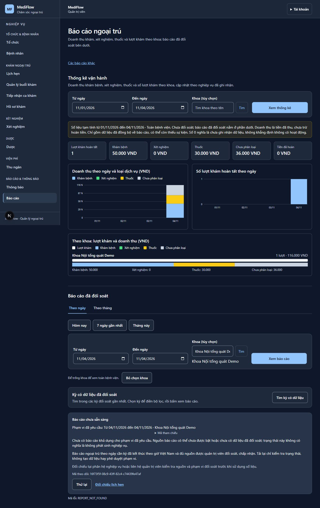
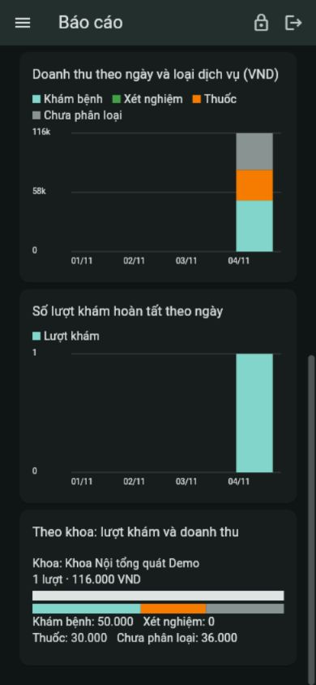

# LAB / Report verification — 2026-11-04

User-assigned scope: retest LAB and Report after correcting the workstation clock,
fix findings, chart examination/drug revenue and completed visits by department on
web and mobile, and open a PR. Runtime baseline `2bd7719f`; PR base `origin/master` (`1e45473e`); branch
`codex/lab-report-charts-ui-verification`. All UI mutations below used synthetic
patients and disposable local PostgreSQL/RabbitMQ; no real patient/payment system.

## Findings and resulting behavior

- The current outpatient accepted-report API requires a **closed, accepted period**
  and complete source evidence. The snapshot has a synthetic accepted 2025 department
  period; the current November period is not accepted. Correcting the clock does not
  create coverage. Current-day accepted reports correctly remain unavailable.
- Add a separate, explicitly provisional statistics API over Report-owned facts.
  Both clients chart gross cash receipts for EXAM/LAB_TEST/PRESCRIPTION, completed
  visits by day and department, and show refunds separately. Deposits are excluded.
  Missing events/zero projections are not evidence of zero activity. This does not
  publish accepted reports or represent earned/net revenue.
- New scheduled examination payments now join the exact accepted outpatient
  publication cohort and use the same publication decision as other outpatient
  payments. The old path held their events, so Report did not receive them.
  Existing HELD deliveries are not automatically released by this change.
- Persist service purpose from locked Billing wire targets outside the historical
  receipt fingerprints. Legacy NULL purpose stays **unclassified**, including on
  replay. Only explicitly synthetic snapshot fixtures are classified during seed.
- Previously built production classes were dated 2026-11-05, later than the corrected
  2026-11-04 workstation clock. Incremental Maven compilation reused old bytecode.
  A clean package regenerated all eight runtime applications; demo launcher rebuilds
  now use clean package while retaining the verified artifact fast path.
- The mobile demo commands now include the existing Report UI feature gate. Mobile
  visit axes use distinct integer ticks and cash labels preserve fractional values.

The PR also carries two existing, unpublished commits from this working branch:
`4d98f36f` rejects Lab order price codes absent from Billing's authoritative catalog,
and `2bd7719f` opens Report on the newest accepted period. The final verification
covers both rather than rewriting their existing history.
The final review also found that padded known codes could pass Clinical's trimmed
allowlist check but fail Billing's strict wire format. Exact matching now rejects
them before persistence; the regression failed before the fix and passes afterward.

## Real UI checks

| Scenario | Observed outcome |
|---|---|
| LAB unpaid request | No start action; payment confirmation required. |
| LAB ready → in progress | Start succeeds; result form date is 04/11/2026. |
| LAB empty result submission | Validation requires an indicator name and value. |
| LAB save WBC 6.5, unit 10^9/L, reference 4–10 | Completes, survives reload, no further editing action. |
| Mobile opens the same LAB request | Same 04/11/2026 date, WBC and conclusion from web. |
| Reception selects existing active patient | Duplicate active registration is prevented. |
| Reception creates another synthetic registration; cashier pays EXAM | Actual UI quote/payment succeeds for 50,000 VND. |
| Cashier pays synthetic prescription | Actual UI payment succeeds for 30,000 VND; no further payment offered. |
| Report opens after the two payments | 50,000 EXAM + 30,000 drug + 36,000 unclassified; one completed visit. |
| Web charts | Stacked daily cash, daily visits, department bars and numeric values present. |
| Mobile 390×844 | Same figures; all charts readable; no repeated fractional visit ticks. |
| Mobile department picker | Search by name, select department, reload returns matching figures. |
| Web reversed date range (keyboard date control) | Validation shown; request is not issued. |
| Current-day accepted report | REPORT_NOT_FOUND with closed-period/source-acceptance explanation. |
| Historical synthetic accepted period | Existing accepted charts still load, labeled simulation. |
| Old snapshot LAB payment without quote | Correctly blocked; missing quote is not interpreted as free service. |

[Web LAB result](lab-ui-completed.jpg) · [Same LAB result on mobile](mobile-lab-result-ui.jpg)
· [EXAM UI receipt](exam-payment-ui.jpg) · [Unavailable accepted period](report-coverage-unavailable-ui.jpg)

## Automated verification

- Billing: **1,223** tests, Gateway: **1,882**, LAB: **273**; zero failures/errors/skips.
- Frontend: **1,360 tests / 155 files**; TypeScript and production build pass.
  Lint has zero errors and two existing Pharmacy hook warnings.
- Mobile: **434 tests** pass; analysis has no errors/warnings and two existing style
  infos (router braces and Pharmacy null-aware collection). Web and Android debug APK builds pass.
- Demo scripts: **52** Python tests pass.
- Packaged LAB acceptance: **1** real runtime scenario passes (165.4 seconds), with
  six applications, PostgreSQL and RabbitMQ. Verifies EXAM/LAB payment, published
  clearance, result attachment, role/owner restrictions and consumer restart/redelivery.
  [Business evidence](paid-lab-evidence.json), [clearance](paid-lab-clearance.json),
  [authority checks](paid-lab-authority.json), [queues](billing-lifecycle-queues.txt).
  Recovery results: [Lab clearance](integrated-recovery/lab-financial.clearance.granted/result.json),
  [Clinical clearance](integrated-recovery/clinical-financial.clearance.granted/result.json),
  [Clinical Lab result](integrated-recovery/clinical-lab.result.created/result.json).
- Clinical: **493** tests, zero failures/errors/skips, including the padded-code regression.
- Report: **1,473** tests, zero failures/errors/skips; final full-suite process exits 0.

The packaged LAB harness now uses current email issuance and mandatory password
change through Gateway. Generated fixture accounts are explicitly registered in
that isolated Organization demo registry before mailbox retrieval. SMTP dispatch
is disabled; this validates credential setup for LAB, not external email delivery.
Full logs remain in the ignored local `scripts/demo_25_10/evidence/` directory;
key portable synthetic evidence above is included with this PR.

## Limits

These are local synthetic UI and PostgreSQL/RabbitMQ tests, not a production data
reconciliation or rollout approval. Real old receipts are not fabricated or
reclassified. Native Android APK compilation is verified; device UI was exercised
through Flutter web, not an Android emulator. Existing unrelated working-tree
changes to `.claude/launch.json` and the generated demo ZIP are excluded from the PR.
