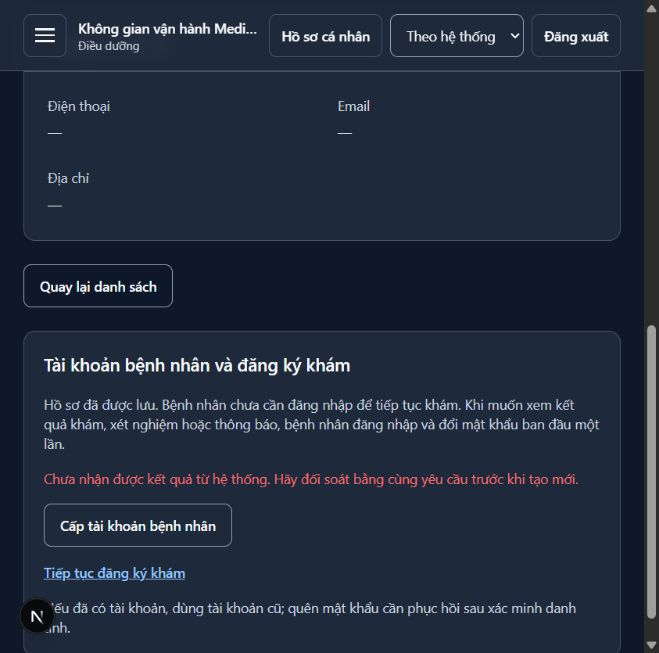
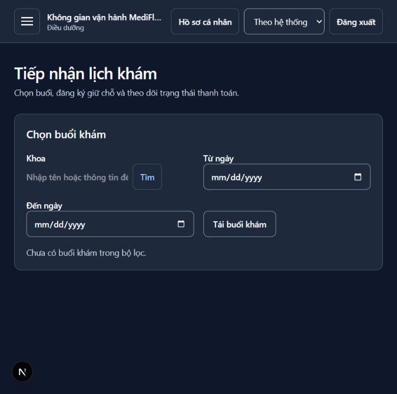

# Bàn giao vòng thử trực tiếp — 27/10/2026

PR [#547](https://github.com/Dangvinh77/MediFlow/pull/547), code commit `d496b49e`.
Phạm vi bổ sung: thông báo lỗi khi chưa biết kết quả command, cách đọc lời hẹn cho
bệnh nhân, kiểm thử trạng thái màn hình và replay Notification trên broker riêng.
Không sửa backend production hoặc thay artifact của checkpoint trước.

## Bằng chứng mới

| Bằng chứng | Kết quả và giới hạn |
|---|---|
| [Gateway + broker](gateway-result-replay.json) | 89 HTTP checks đạt; ba source facts thật, mỗi fact replay thêm ba bản giữ nguyên bytes, AMQP properties và eventId; history vẫn đúng ba notificationId cũ, queue đã drain với consumer hoạt động, DLQ bằng 0 trước/sau; hoàn tất trước patient login đầu |
| [Trình duyệt qua fault proxy](browser-issuance-recovery.json) | POST upstream 201 bị ngắt trước response; sau tải lại, cùng patient/key trả 200 cùng account. Chỉ lưu key hash, không lưu password/token/body. GET departments 502 cuối trace xảy ra sau stack rehearsal hết thời hạn hai giờ; không tính là ca booking đã đạt |
| [Guard arguments](guard-results.json) | Bốn lệnh sai mode/port/output bị từ chối exit 2 trước login hoặc transport |
| [Frontend và source identity](verification.json) | 121 files / 1.108 tests đạt, typecheck, toàn bộ lint và production build đạt; bốn script Python compile đạt, diff check đạt |

Runtime JSON giữ nguyên `sourceHead=43c20412` tại thời điểm chạy trước commit. Các runner
đã được commit thành `d496b49e`; SHA-256 của từng file Windows worktree vẫn khớp lúc chạy,
và Git blob identity được ghi riêng trong verification. Không đổi nhãn lần chạy thành
commit mới hoặc cộng 89 checks vào các checkpoint cũ để suy tỷ lệ hoàn thành. Các JAR
có fingerprints trong JSON và bằng checkpoint onboarding trước đó.

Lần khởi động stack riêng tiếp theo sau 18:00 chỉ kiểm health; không chạy lại full khám
ngoài giờ hoặc sửa đồng hồ để lách guard trước 17:00. Dừng các tiến trình/container do
runner tạo bằng đúng stopFile. Dữ liệu môi trường dự án không bị sử dụng.

## Sửa UX và kiểm thử

Lỗi 408/5xx thiếu envelope khi gửi command hiện giải thích rằng chưa biết kết quả,
yêu cầu đối soát cùng yêu cầu trước khi tạo mới. GET lỗi hướng dẫn tải lại. Giữ nguyên
status/code và thông báo có từ backend; không tự retry command hoặc thay key.
Bốn regression cases mới đã đỏ trước sửa và xanh sau sửa.

Patient exam/Lab component tests kiểm loading, empty, lỗi và retry đúng page, dữ liệu
completed, tên bác sĩ qua reference directory và quyền chỉ đọc. UUID nguồn nằm trong
phần đối chiếu thu gọn; patient được hướng dẫn liên hệ điều dưỡng chọn buổi tái khám.
Đây là component evidence, không đổi thành browser evidence cho mọi trạng thái nguồn.

Hai ảnh dùng dữ liệu giả lập; ảnh tiếp nhận chứng minh điều hướng và patient context,
không chứng minh đã đăng ký/thu tiền thành công qua màn hình này. Không lưu ảnh màn
hình cấp account thành công vì có mật khẩu ban đầu.

## Review và phần bàn giao

Đã tự review theo `.agents/skills/review-pr/SKILL.md`: ownership, Gateway-only calls,
reference permissions, exact event identity, queue drain, secrets, replay/key semantics,
test assertions và source/artifact fingerprints. Không thấy blocker trong diff bổ sung.
Đây là self-review, không có independent review sign-off cho lượt bổ sung này.
Đủ điều kiện gửi PR review và vòng thử trực tiếp; chưa ký GO nghiệm thu toàn demo.

[Runbook ba developer](../../plans/16-three-developer-demo-acceptance-2026-10-27.md)
là danh sách thao tác tiếp theo. Thao tác đổi password trên UI do người thử tự thực hiện;
runner API đã kiểm effects ở checkpoint hiện tại/trước. Quay lại ngày khác, xác minh danh
tính recovery, tổng duyệt Pharmacy/Report/zero/refund và ký ONB/WF/SC vẫn cần bằng chứng
đúng ca. Không xóa handoff hoặc đánh dấu toàn WF-11 đạt từ slice onboarding này.
