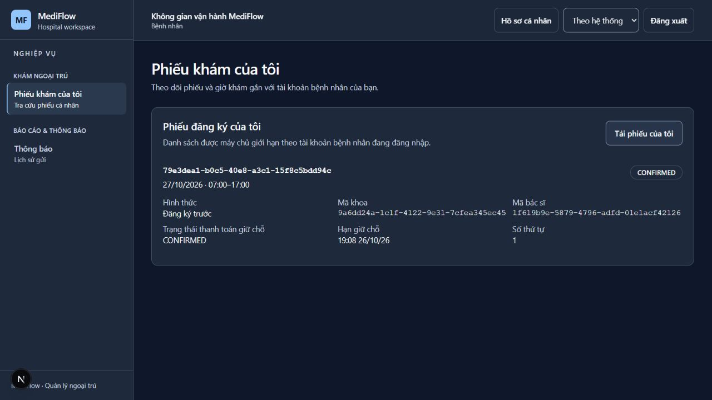
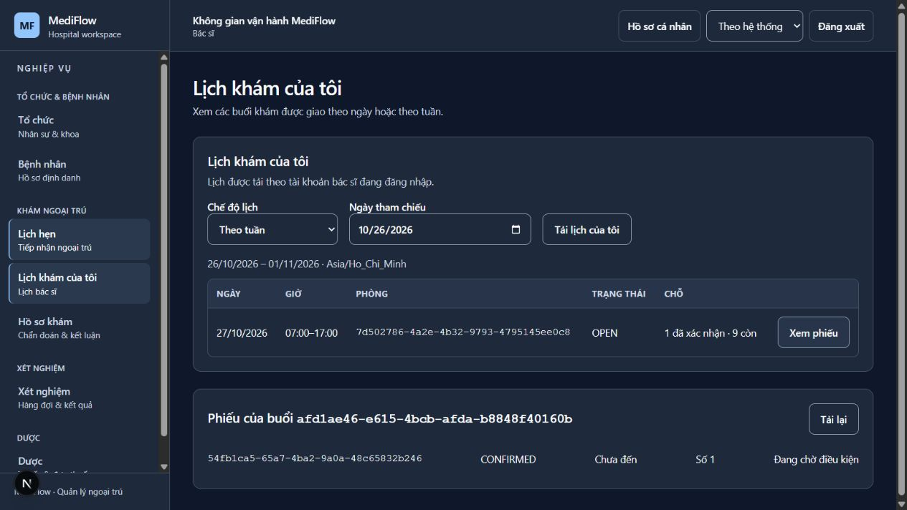

# Bằng chứng triển khai ngoại trú V2 — 26/10/2026

Nhánh `codex/outpatient-workflow-implementation`, contract `OPD-SCHED-2026-10-26`
revision 2. Source đã tích hợp `origin/master` tại `a3566b44` bằng merge `a1015e61`.
Đây là kết quả theo phạm vi bên dưới, **chưa đóng WF-11 và chưa chứng nhận sẵn sàng bảo vệ**.
Các commit bằng chứng sau merge không thay code nghiệp vụ đã kiểm.

## 1. Kiểm thử source

| Bộ kiểm thử | Tests | Failures / errors / skipped |
|---|---:|---|
| Core | 350 | 0 / 0 / 0 |
| Clinical | 428 | 0 / 0 / 0 |
| Billing | 1.171 | 0 / 0 / 0 |
| Lab | 266 | 0 / 0 / 0 |
| Notification | 306 | 0 / 0 / 0 |
| Gateway | 1.587 | 0 / 0 / 0 |
| Frontend sau merge master | 1.061, 114 files | Đạt |

Backend đếm từ Surefire XML của các lần chạy module trong lượt triển khai, bao gồm
PostgreSQL/RabbitMQ Testcontainers ở các suite liên quan. Không dùng kết quả cũ của
Support/Pharmacy/Report/deferred modules để tuyên bố toàn reactor đã qua.
Frontend chạy lại toàn bộ sau khi giải quyết conflict; lint, typecheck và production build đều exit 0.
Build JAR tám ứng dụng sau merge cũng exit 0.

Các lệnh đã chạy (từ root, riêng pnpm từ `frontend/`):

```bash
mvn -q -pl backend/clinical-service -am test
mvn -q -pl backend/billing-service -am test
mvn -q -pl backend/core-service,backend/lab-service,backend/gateway,backend/notification-service -am test
mvn -q -pl backend/core-service,backend/clinical-service,backend/lab-service,backend/pharmacy-service,backend/billing-service,backend/support-service,backend/gateway,backend/eureka-server -am -DskipTests package
pnpm test --maxWorkers=1 --no-file-parallelism --testTimeout=15000 --hookTimeout=30000
pnpm lint
pnpm typecheck
pnpm build
python scripts/contract-checks/check-outpatient-scheduling.py
docker compose -f docker-compose.yml -f compose.demo.local.yml -f compose.outpatient.local.yml config --quiet
```

Schema checker: 87 cases / 50 definitions đúng kỳ vọng; đây không phải 87 business tests.
Timeout 15 giây của Vitest dành cho máy demo chạy đồng thời nhiều JVM; không đổi assertion hoặc bỏ test.

## 2. Chạy JAR, DB/broker và API thật

Runner `--scheduling --keep` tạo PostgreSQL/RabbitMQ riêng, restore đủ tám context,
xác nhận import lần hai bị chặn, áp fixture phòng khám và chạy Flyway khi boot.
Tám ứng dụng health UP: Eureka, Gateway, Core, Clinical, Lab, Pharmacy, Billing, Support.
Không dùng hay xóa volume demo có sẵn của người dùng.

Hai vấn đề tìm được và đã sửa trong runner/runbook:

- Snapshot 25/10 không có phòng `CONSULTATION`: bổ sung fixture demo riêng,
  resolve khoa từ tài khoản `demo.doctor`, không sửa SQL snapshot/Flyway đã phát hành.
- Billing chạy JAR cần địa chỉ Clinical `127.0.0.1:28082`, thay cho hostname Docker
  mặc định của payment-lock adapter. Compose vẫn dùng mạng Docker.

Lượt đạt cuối dùng stack `snapshot-20261026-185052`, Gateway `127.0.0.1:28080`,
chạy `accept_scheduling.py --booking-only` sau giờ khám, đặt trước buổi 27/10.
[Trace API không chứa token](booking-payment.json) ghi role, route, HTTP status và correlation ID.

Đã kiểm thực tế:

1. Đăng nhập bảy tài khoản demo; đọc authority/phòng từ Core qua Gateway.
2. ADMIN tạo buổi 07:00–17:00, capacity 10; NURSE đăng ký `PREBOOKED` mới.
3. Replay cùng key trả cùng registration; bệnh nhân khác bị từ chối đọc phiếu.
4. Chờ event tạo projection Billing; quote gross 100.000đ, support 50.000đ,
   patient payable 50.000đ theo policy demo.
5. CASHIER thu đủ 50.000đ; replay trả cùng transaction, không thu hai lần.
6. Clinical nhận eligibility và chuyển `CONFIRMED`; phiếu đặt trước vẫn
   `checkedInAt=null`, `readyForExam=false` trước check-in.
7. DOCTOR đọc được buổi của mình qua endpoint `mine`.

Các UUID là dữ liệu tổng hợp của stack đã dừng; không dùng làm fixture đầu vào của môi trường khác.
JAR runtime dùng code trước merge; thay đổi backend nhập từ master chỉ thêm default pricing YAML.
Overlay giá demo đã được xác nhận trong runtime và build cuối sau merge đã qua;
không coi build đó là một lần chạy lại toàn bộ API trên binary mới.

## 3. Giao diện đã xem trực tiếp

- PATIENT: tải phiếu cá nhân, thấy ngày 27/10, `Đăng ký trước`, `CONFIRMED`, số thứ tự 1.
- DOCTOR: tải lịch tuần 26/10–01/11, thấy buổi được phân công với 1 chỗ xác nhận/9 còn;
  xem phiếu thấy `Chưa đến / Đang chờ điều kiện`, không có thao tác bắt đầu khám.





Đây là hai lát UI đã thao tác trực tiếp; các role/luồng còn lại có component tests,
không ghi thành đã tổng duyệt trình duyệt toàn hệ thống. UI lịch/phiếu mới còn hiển thị mã UUID
cho khoa/bác sĩ/phòng; cần cải thiện nhãn tên trước buổi bảo vệ nếu dùng làm màn hình chính.

## 4. Điều kiện còn mở

- Full runtime cùng ngày: bắt đầu khám → chẩn đoán → tạo Lab → quote/thu Lab → kết quả
  → hoàn tất → lời hẹn → đăng ký tái khám lần hai. Script full đã có nhưng chưa đạt end-to-end;
  cần chạy trước 17:00 giờ Việt Nam, nên bắt đầu trước 16:00 trên stack mới.
- Chạy UI đủ ADMIN/MANAGER/NURSE/CASHIER/DOCTOR/LAB_TECH/PATIENT và lỗi sai quyền,
  mất kết nối, hết hạn, cạnh tranh suất, recovery/restart theo ma trận 06/10.
- Dataset hỗ trợ 100% riêng cho EXAM/LAB zero; xác nhận Report không tăng cash,
  notification không trùng, refund không vượt tiền thực trả và hồi quy cấp phát thuốc.
- Chưa có command renew quote; GET quote không gia hạn. Không sửa chứng từ cũ hoặc dùng key mới
  để né operation `PREPARING`; xử lý terminal/cancel đúng nguồn trước khi đăng ký/chỉ định mới.
- Chưa chạy Docker image end-to-end cho overlay mới; đã kiểm Compose config và JAR topology.

Các gate mặc định vẫn tắt; overlay V2 là cấu hình opt-in dành cho kiểm thử.
Không đổi trạng thái handoff sang CLOSED chỉ từ unit tests hoặc trace booking-payment này.
Làm tiếp theo [runbook V2](../../../scripts/demo_25_10/MediFlow_Ngoai_Tru_V2_Test_2026-10-26.md).
