# MediFlow — Review 2: Thiết kế kiến trúc, dữ liệu và giao diện
> **Option bố cục cho Word.** A4, lề 25 mm. Chèn ảnh PNG bên dưới. Sơ đồ lớn chia thành các hình liên tiếp; nút lặp lại dùng để nối nội dung giữa các phần. [Bảng chọn sơ đồ](word-compact/README.md) có cả hai khổ giấy và bản tổng quan. Kiến trúc 01 gom nhóm deployment và store; xem bản gốc để đối chiếu từng đường nối.

[Bản tiếng Anh](03-review-2-word-en.md)

| Mục | Nội dung |
|---|---|
| Project | MediFlow: A Microservices-Based Hospital Information System for Outpatient Care Management |
| Review | Review 2 |
| Baseline | 2026-10-19 · source commit `26232b54813d` + bản sửa tài liệu này |
| Scope | MVP ngoại trú; giữ source nội trú/phẫu thuật ở trạng thái hoãn |
| Status | Tài liệu thiết kế đối chiếu source; không phải chứng nhận nghiệm thu runtime |

Tài liệu này kế thừa bố cục báo cáo song ngữ của Review 1 nhưng cập nhật theo source hiện tại. Một số mô tả lịch sử trong Review 1 còn nói 12 module/chưa có Support: hiện root reactor có **13 module**, Compose mặc định có **6 business deployments**, **8 context stores active**. Gateway/Eureka là hạ tầng, common là thư viện; Report/Notification là thư viện trong Support và giữ launcher rollback.

Quy ước trạng thái: **SOURCE** = có code/config; **GATED** = cần đúng profile/contract/activation; **DEFERRED** = giữ source nhưng ngoài MVP. Sơ đồ mô tả hành vi theo mode được ghi, không khẳng định mọi đường đi đã chạy thành công trên môi trường hiện tại. Không chạy lại backend hoặc kiểm tra DB thật trong lần lập tài liệu này.

## Quy chuẩn sơ đồ

Tất cả sơ đồ dùng theme **MediFlow Sky/Teal**: nền trắng, chữ slate `#0f172a`, khối xanh `#e0f2fe`, viền `#0284c7`, phụ trợ teal `#ccfbf1`. Mỗi khối Mermaid chứa cùng cấu hình theme. Mũi tên liền biểu thị request/quan hệ trực tiếp; nét đứt trong kiến trúc biểu thị message/discovery. ERD chỉ dùng FK có trong cùng store; tham chiếu giữa contexts ghi riêng bằng UUID.

Bản Word dùng PNG để giữ chữ, logo và actor ổn định khi chèn. Nguồn Mermaid và SVG của từng hình nằm ở liên kết đi kèm. Theme Sky/Teal và toàn bộ logo gốc được giữ. SVG có nhãn HTML nên cần kiểm tra khả năng hiển thị nếu chèn trực tiếp vào Word.

## 1. Architecture Design

### 1.1. System / Application Architecture

### Kiến trúc hệ thống — một vùng backend, sáu service nghiệp vụ

**Phần 1/4 · A4 landscape**

[Mermaid](word-compact/panels/mermaid/01-vi-part-01.mmd) · [SVG](word-compact/panels/svg/01-vi-part-01.svg)

**Phần 2/4 · A4 landscape**

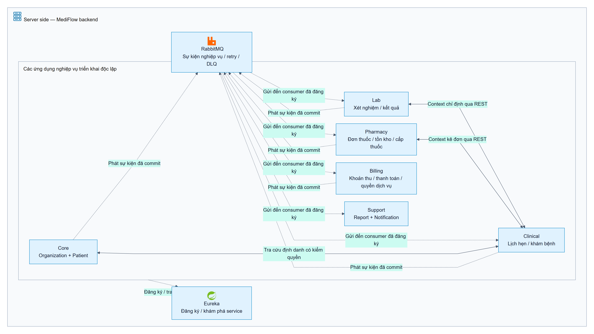

[Mermaid](word-compact/panels/mermaid/01-vi-part-02.mmd) · [SVG](word-compact/panels/svg/01-vi-part-02.svg)

**Phần 3/4 · A4 landscape**

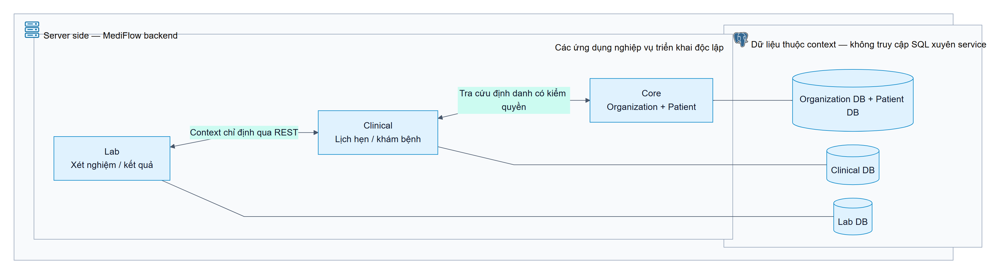

[Mermaid](word-compact/panels/mermaid/01-vi-part-03.mmd) · [SVG](word-compact/panels/svg/01-vi-part-03.svg)

**Phần 4/4 · A4 landscape**

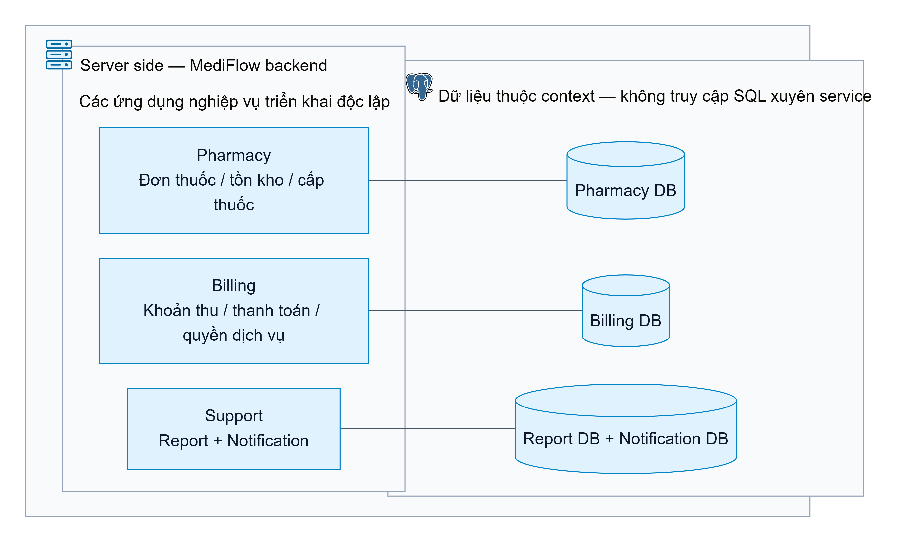

[Mermaid](word-compact/panels/mermaid/01-vi-part-04.mmd) · [SVG](word-compact/panels/svg/01-vi-part-04.svg)

[Original SVG](assets/svg/01-vi.svg) · [Portrait PNG](word-compact/portrait/png/01-vi.png) · [Landscape PNG](word-compact/landscape/png/01-vi.png)

Một vùng Server side chứa sáu ứng dụng nghiệp vụ, không có nghĩa backend chỉ có một tiến trình. Core và Support mỗi ứng dụng ghép hai context nhưng giữ quyền sở hữu dữ liệu riêng. Cạnh broker mô tả khả năng producer/consumer đã cấu hình, không phải phát mọi sự kiện cho mọi service. Host web Next.js và rewrite /api cùng origin là chi tiết triển khai: frontend/next.config.ts vẫn cấu hình rewrite và standalone production. Đây không phải backend nghiệp vụ thứ hai. Docker Compose điều phối hạ tầng local; hình không ghi port hoặc bật Inpatient/Surgery.

### Kiến trúc công nghệ và công cụ

**A4 portrait**

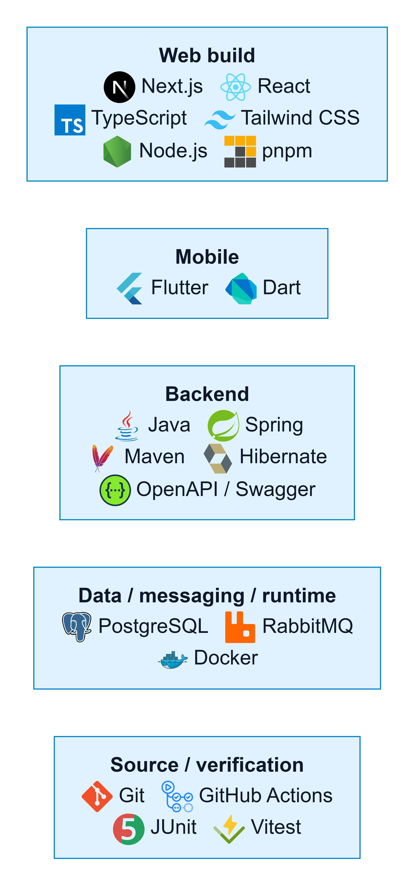

[Mermaid](word-compact/portrait/mermaid/02-vi.mmd) · [SVG](word-compact/portrait/svg/02-vi.svg)

[Original SVG](assets/svg/02-vi.svg) · [Portrait PNG](word-compact/portrait/png/02-vi.png) · [Landscape PNG](word-compact/landscape/png/02-vi.png)
Các thư viện không có logo riêng trong bộ logo đi kèm được ghi bằng tên trong bảng sau; chúng không phải deployment mới. Logo Spring đại diện Boot/Cloud/Security/Data, logo Flutter đại diện hệ sinh thái mobile. Không thêm Redis, Kafka, Kubernetes hoặc payment provider ngoài vào kiến trúc.

| Lớp | Stack xác nhận trong source | Nguồn |
|---|---|---|
| Backend | Java 21; Spring Boot 3.3.5; Spring Cloud 2023.0.3; Maven; Spring Security; Spring Data JPA/Hibernate; Flyway; MapStruct; Lombok; JJWT 0.12.6; springdoc 2.6.0 | [pom.xml](../../../../pom.xml) |
| Web | Next.js 16.2.11; React 19.2.4; TypeScript 5; Tailwind CSS 4; Node.js/pnpm; Vitest 4; ESLint 9; Testing Library | [frontend/package.json](../../../../frontend/package.json) |
| Mobile | Flutter; Dart ^3.13.0; Riverpod ^3.4.3; GoRouter ^18.1.0; Dio ^5.11.1; flutter_secure_storage ^11.2.0 | [mobile/pubspec.yaml](../../../../mobile/pubspec.yaml) |
| Infrastructure | PostgreSQL 16-alpine; RabbitMQ 3-management-alpine; Docker Compose; Eureka; Gateway | [docker-compose.yml](../../../../docker-compose.yml) |
| Verification | JUnit / Spring Boot Test / Testcontainers; Git / GitHub Actions | [backend/support-service/pom.xml](../../../../backend/support-service/pom.xml) |

Phiên bản có `^` là constraint của manifest, không phải kết quả đọc runtime đã cài. Logo và tên công nghệ không chứng minh đã triển khai production.

### Kiến trúc ứng dụng — đường request và phụ thuộc hướng vào trong

**Phần 1/2 · A4 landscape**

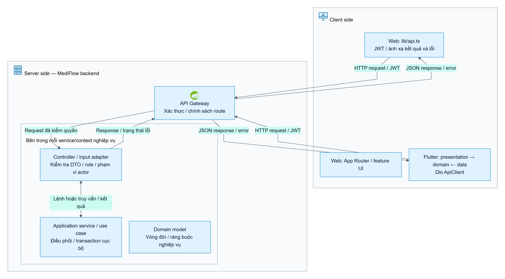

[Mermaid](word-compact/panels/mermaid/03-vi-part-01.mmd) · [SVG](word-compact/panels/svg/03-vi-part-01.svg)

**Phần 2/2 · A4 portrait**

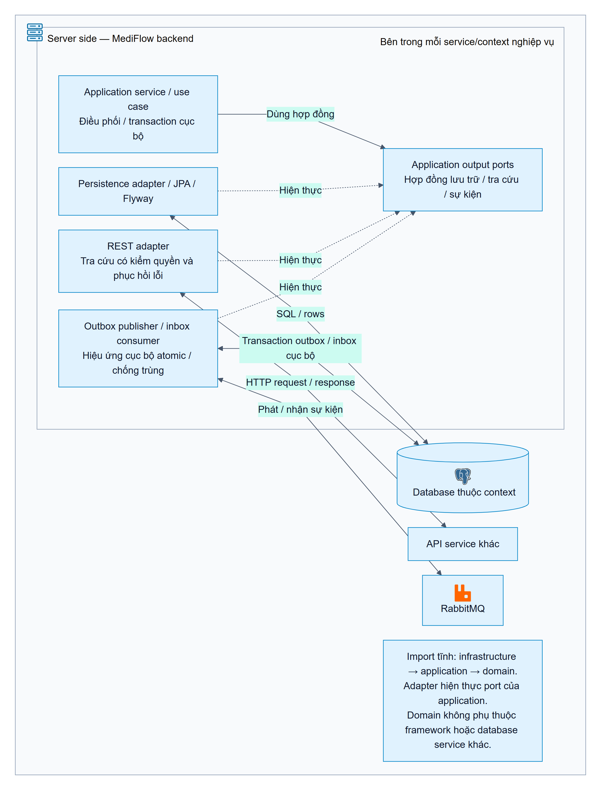

[Mermaid](word-compact/panels/mermaid/03-vi-part-02.mmd) · [SVG](word-compact/panels/svg/03-vi-part-02.svg)

[Original SVG](assets/svg/03-vi.svg) · [Portrait PNG](word-compact/portrait/png/03-vi.png) · [Landscape PNG](word-compact/landscape/png/03-vi.png)

Cạnh liền ghi rõ request/kết quả lúc chạy hoặc đánh giá quy tắc; cạnh chấm implements là hiện thực interface tĩnh, không phải HTTP. Chiều import được ghi rõ ở chú thích cuối. Mẫu này áp dụng trong từng context; đóng gói Core/Support không gộp database các context. Commit cục bộ không phải transaction phân tán. Hình lược chi tiết host web nhưng giữ tuyến Gateway qua /api cùng origin.

### 1.2. Use Cases Diagrams

Mỗi role người dùng có một sơ đồ. Đăng nhập và gia hạn độc lập; tác vụ nghiệp vụ cần phiên hợp lệ. Use case mô tả mục tiêu, không mô tả thứ tự một lượt khám.

<!-- role-usecases:start -->
### Use case chi tiết — một sơ đồ cho mỗi vai trò

Hình 29–36 theo mẫu của giảng viên: mỗi hình có một actor người dùng, mũi tên liền đến tác vụ chính, mũi tên đứt `«include»` cho hành vi con bắt buộc và mũi tên đứt `«extend»` từ nhánh mở rộng có điều kiện về tác vụ gốc. Nhánh mở rộng có thể có luồng con `include` riêng. Mũi tên thể hiện quan hệ, không phải thứ tự thực hiện. Đăng nhập và gia hạn là hai use case độc lập của mỗi role; phiên hợp lệ là tiền điều kiện của các tác vụ nghiệp vụ. Oval xanh dương là tác vụ chính; xanh teal là tác vụ con/mở rộng. Hình mô tả khả năng trong source, không khẳng định mọi UI đã hoàn thiện hoặc mọi feature đã bật.

**Hiệu chỉnh phạm vi:** PATIENT hiện có đăng nhập/refresh và truy cập thông báo của mình. Không gán quyền tự thao tác lịch hẹn/xét nghiệm cho PATIENT. SYSTEM là định danh máy, không tạo sơ đồ role người dùng. Quyền từng role lấy giao của ma trận Gateway và guards downstream.

#### ADMIN — Tác vụ quản trị viên

**A4 portrait**

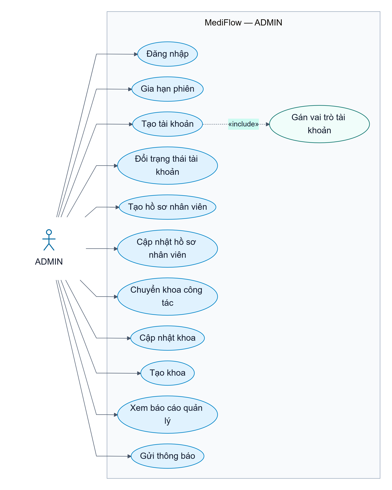

[Mermaid](word-compact/portrait/mermaid/29-vi.mmd) · [SVG](word-compact/portrait/svg/29-vi.svg)

[Original SVG](assets/svg/29-vi.svg) · [Portrait PNG](word-compact/portrait/png/29-vi.png) · [Landscape PNG](word-compact/landscape/png/29-vi.png)

Hình tập trung quản trị tổ chức/tài khoản. ADMIN còn có các quyền cụ thể tại những nghiệp vụ khác theo ma trận nguồn; không bỏ qua business guards. Không thêm xóa tài khoản hay màn hình chỉnh quyền tùy ý. Đăng nhập và gia hạn là hai mục tiêu độc lập, không nối include/extend với nhau. Lệnh nghiệp vụ nhân viên cần phiên xác thực hợp lệ. Tiền điều kiện và kiểm tra trường dữ liệu nằm trong sequence/đặc tả, không tách thành oval thao tác màn hình.

Điều kiện mở rộng: Không có.

Đối chiếu source: [AccountController](../../../../backend/core-service/src/main/java/com/mediflow/organization/web/controller/AccountController.java) · [StaffController](../../../../backend/core-service/src/main/java/com/mediflow/organization/web/controller/StaffController.java) · [DepartmentController](../../../../backend/core-service/src/main/java/com/mediflow/organization/web/controller/DepartmentController.java) · [ReportController](../../../../backend/report-service/src/main/java/com/mediflow/report/web/ReportController.java) · [NotificationController](../../../../backend/notification-service/src/main/java/com/mediflow/notification/web/NotificationController.java) · [RouteAuthorizationFilter](../../../../backend/gateway/src/main/java/com/mediflow/gateway/filter/RouteAuthorizationFilter.java) · [AuthController](../../../../backend/gateway/src/main/java/com/mediflow/gateway/auth/AuthController.java)

#### MANAGER — Tác vụ quản lý

**A4 portrait**

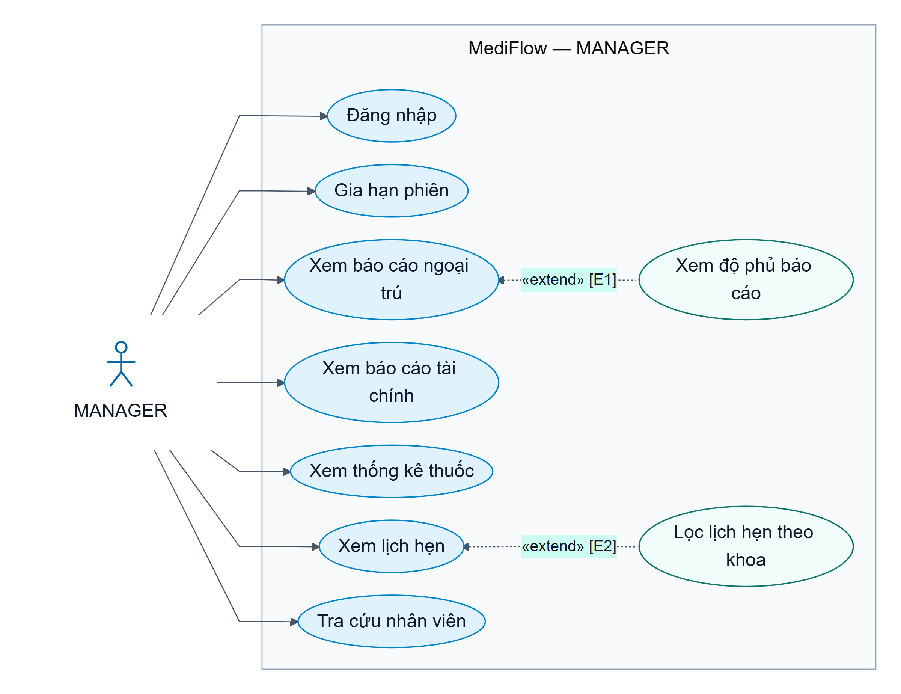

[Mermaid](word-compact/portrait/mermaid/30-vi.mmd) · [SVG](word-compact/portrait/svg/30-vi.svg)

[Original SVG](assets/svg/30-vi.svg) · [Portrait PNG](word-compact/portrait/png/30-vi.png) · [Landscape PNG](word-compact/landscape/png/30-vi.png)

Nghiệp vụ quản lý chỉ đọc: báo cáo ngày/tháng, top thuốc, doanh thu khoa, danh sách lịch hẹn/xét nghiệm, nhân viên và khoa. MANAGER không tạo tài khoản, sửa nhân viên hay thực hiện lệnh khám/thu tiền. Báo cáo snapshot phụ thuộc availability và coverage tại runtime. Đăng nhập và gia hạn là hai mục tiêu độc lập, không nối include/extend với nhau. Lệnh nghiệp vụ nhân viên cần phiên xác thực hợp lệ. Tiền điều kiện và kiểm tra trường dữ liệu nằm trong sequence/đặc tả, không tách thành oval thao tác màn hình.

Điều kiện mở rộng: E1: Xem độ phủ báo cáo — cần xem độ phủ; E2: Lọc lịch hẹn theo khoa — chọn bộ lọc khoa

Đối chiếu source: [OutpatientReportController](../../../../backend/report-service/src/main/java/com/mediflow/report/web/OutpatientReportController.java) · [FinancialSnapshotReportController](../../../../backend/report-service/src/main/java/com/mediflow/report/web/FinancialSnapshotReportController.java) · [ReportController](../../../../backend/report-service/src/main/java/com/mediflow/report/web/ReportController.java) · [RevenueController](../../../../backend/billing-service/src/main/java/com/mediflow/billing/web/RevenueController.java) · [AppointmentController](../../../../backend/clinical-service/src/main/java/com/mediflow/clinical/web/AppointmentController.java) · [StaffController](../../../../backend/core-service/src/main/java/com/mediflow/organization/web/controller/StaffController.java) · [AuthController](../../../../backend/gateway/src/main/java/com/mediflow/gateway/auth/AuthController.java)

#### DOCTOR — Tác vụ bác sĩ

**A4 portrait**

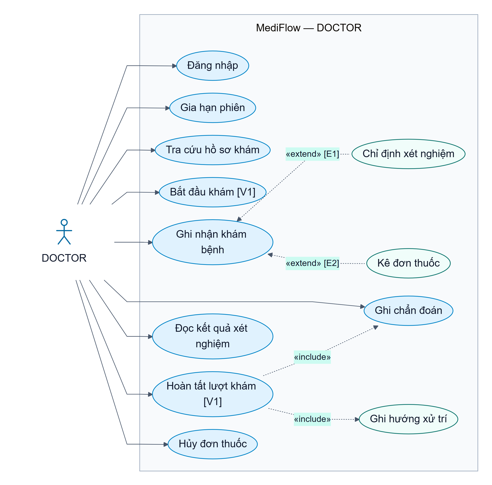

[Mermaid](word-compact/portrait/mermaid/31-vi.mmd) · [SVG](word-compact/portrait/svg/31-vi.svg)

[Original SVG](assets/svg/31-vi.svg) · [Portrait PNG](word-compact/portrait/png/31-vi.png) · [Landscape PNG](word-compact/landscape/png/31-vi.png)

Vẫn kiểm tra clinical authority, bệnh nhân và context. [V1] cần bật care-finance-v2; start-exam cần exact EXAM clearance hoặc audited override đã hỗ trợ. AppointmentController còn cấp quyền xem/sửa lịch/trạng thái; source cũng cho phép xem báo cáo vận hành và hủy xét nghiệm. Bác sĩ không check-in thay điều dưỡng, cấp thuốc thay dược sĩ hay thu tiền thay thu ngân. Đăng nhập và gia hạn là hai mục tiêu độc lập, không nối include/extend với nhau. Lệnh nghiệp vụ nhân viên cần phiên xác thực hợp lệ. Tiền điều kiện và kiểm tra trường dữ liệu nằm trong sequence/đặc tả, không tách thành oval thao tác màn hình.

Điều kiện mở rộng: E1: Chỉ định xét nghiệm — có chỉ định xét nghiệm; E2: Kê đơn thuốc — có chỉ định dùng thuốc

Đối chiếu source: [AppointmentController](../../../../backend/clinical-service/src/main/java/com/mediflow/clinical/web/AppointmentController.java) · [MedicalRecordController](../../../../backend/clinical-service/src/main/java/com/mediflow/clinical/web/MedicalRecordController.java) · [ClinicalCareFinanceController](../../../../backend/clinical-service/src/main/java/com/mediflow/clinical/web/ClinicalCareFinanceController.java) · [ClinicalLabOrderController](../../../../backend/clinical-service/src/main/java/com/mediflow/clinical/web/ClinicalLabOrderController.java) · [LabController](../../../../backend/lab-service/src/main/java/com/mediflow/lab/web/LabController.java) · [PrescriptionController](../../../../backend/pharmacy-service/src/main/java/com/mediflow/pharmacy/web/PrescriptionController.java) · [AuthController](../../../../backend/gateway/src/main/java/com/mediflow/gateway/auth/AuthController.java)

#### NURSE — Tác vụ điều dưỡng

**A4 portrait**

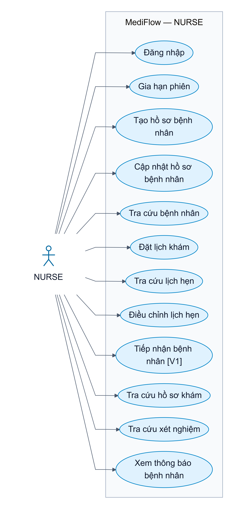

[Mermaid](word-compact/portrait/mermaid/32-vi.mmd) · [SVG](word-compact/portrait/svg/32-vi.svg)

[Original SVG](assets/svg/32-vi.svg) · [Portrait PNG](word-compact/portrait/png/32-vi.png) · [Landscape PNG](word-compact/landscape/png/32-vi.png)

[V1] check-in cần bật care-finance-v2 và không đồng nghĩa bắt đầu khám. NURSE xem danh sách/chi tiết xét nghiệm và danh sách thông báo theo bệnh nhân; không ghi chẩn đoán, kết quả xét nghiệm, đơn thuốc hay thanh toán; không có quyền mở endpoint chi tiết thông báo. Không tạo role RECEPTIONIST. Đăng nhập và gia hạn là hai mục tiêu độc lập, không nối include/extend với nhau. Lệnh nghiệp vụ nhân viên cần phiên xác thực hợp lệ. Tiền điều kiện và kiểm tra trường dữ liệu nằm trong sequence/đặc tả, không tách thành oval thao tác màn hình.

Điều kiện mở rộng: Không có.

Đối chiếu source: [PatientController](../../../../backend/core-service/src/main/java/com/mediflow/patient/web/PatientController.java) · [AppointmentController](../../../../backend/clinical-service/src/main/java/com/mediflow/clinical/web/AppointmentController.java) · [ClinicalCareFinanceController](../../../../backend/clinical-service/src/main/java/com/mediflow/clinical/web/ClinicalCareFinanceController.java) · [MedicalRecordController](../../../../backend/clinical-service/src/main/java/com/mediflow/clinical/web/MedicalRecordController.java) · [LabController](../../../../backend/lab-service/src/main/java/com/mediflow/lab/web/LabController.java) · [NotificationController](../../../../backend/notification-service/src/main/java/com/mediflow/notification/web/NotificationController.java) · [AuthController](../../../../backend/gateway/src/main/java/com/mediflow/gateway/auth/AuthController.java)

#### LAB_TECH — Tác vụ kỹ thuật viên xét nghiệm

**A4 portrait**

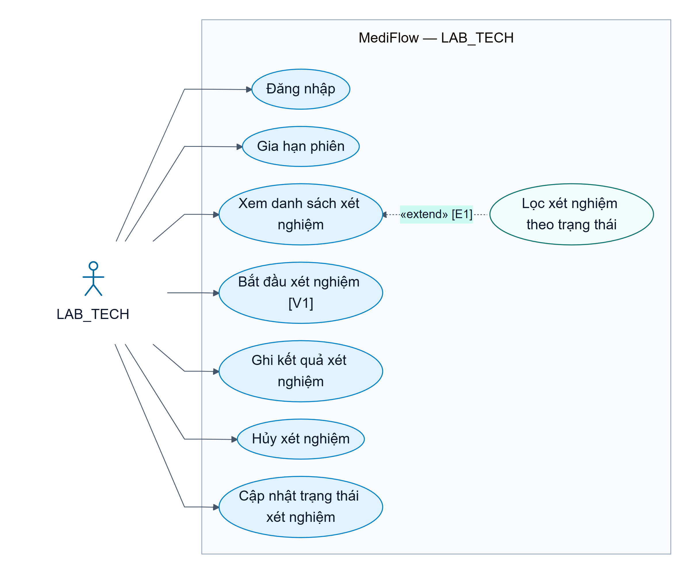

[Mermaid](word-compact/portrait/mermaid/33-vi.mmd) · [SVG](word-compact/portrait/svg/33-vi.svg)

[Original SVG](assets/svg/33-vi.svg) · [Portrait PNG](word-compact/portrait/png/33-vi.png) · [Landscape PNG](word-compact/landscape/png/33-vi.png)

Start/cancel tuân theo lifecycle và feature availability; exact LAB_TEST clearance áp dụng cho protected action V1. LAB_TECH tra cứu xét nghiệm, ghi kết quả/trạng thái; không tạo chỉ định, kê đơn hay thu tiền. Lọc trạng thái là nhánh mở rộng tùy chọn của danh sách. Đăng nhập và gia hạn là hai mục tiêu độc lập, không nối include/extend với nhau. Lệnh nghiệp vụ nhân viên cần phiên xác thực hợp lệ. Tiền điều kiện và kiểm tra trường dữ liệu nằm trong sequence/đặc tả, không tách thành oval thao tác màn hình.

Điều kiện mở rộng: E1: Lọc xét nghiệm theo trạng thái — chọn bộ lọc trạng thái

Đối chiếu source: [LabController](../../../../backend/lab-service/src/main/java/com/mediflow/lab/web/LabController.java) · [AuthController](../../../../backend/gateway/src/main/java/com/mediflow/gateway/auth/AuthController.java)

#### PHARMACIST — Tác vụ dược sĩ

**A4 portrait**

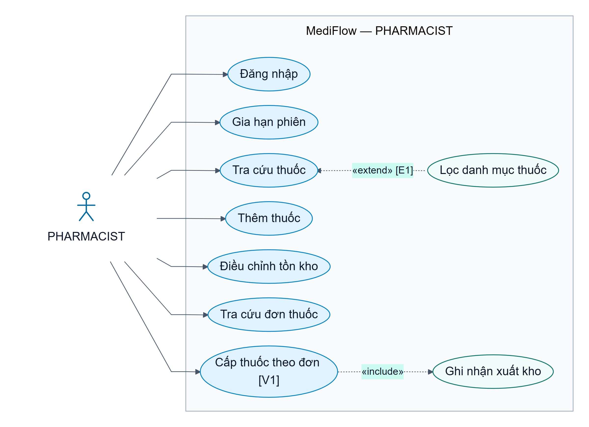

[Mermaid](word-compact/portrait/mermaid/34-vi.mmd) · [SVG](word-compact/portrait/svg/34-vi.svg)

[Original SVG](assets/svg/34-vi.svg) · [Portrait PNG](word-compact/portrait/png/34-vi.png) · [Landscape PNG](word-compact/landscape/png/34-vi.png)

Lệnh cấp thuốc ngoại trú lấy actor đã ký và lifecycle V1; kiểm tra exact PRESCRIPTION clearance, tồn và reservation. Dược sĩ chủ động cấp thuốc, không tự cấp khi nhận sự kiện thanh toán. PHARMACIST không tạo/hủy đơn; hết hạn là xử lý lifecycle của hệ thống, không phải tác vụ người dùng. Đăng nhập và gia hạn là hai mục tiêu độc lập, không nối include/extend với nhau. Lệnh nghiệp vụ nhân viên cần phiên xác thực hợp lệ. Tiền điều kiện và kiểm tra trường dữ liệu nằm trong sequence/đặc tả, không tách thành oval thao tác màn hình.

Điều kiện mở rộng: E1: Lọc danh mục thuốc — chọn bộ lọc thuốc

Đối chiếu source: [DrugController](../../../../backend/pharmacy-service/src/main/java/com/mediflow/pharmacy/web/DrugController.java) · [PrescriptionController](../../../../backend/pharmacy-service/src/main/java/com/mediflow/pharmacy/web/PrescriptionController.java) · [AuthController](../../../../backend/gateway/src/main/java/com/mediflow/gateway/auth/AuthController.java)

#### CASHIER — Tác vụ thu ngân

**A4 landscape**

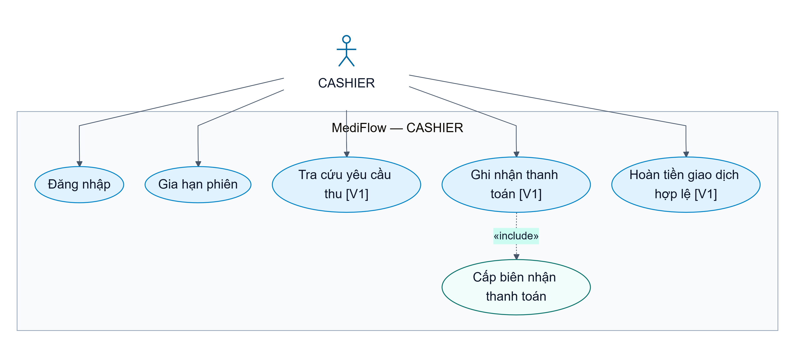

[Mermaid](word-compact/landscape/mermaid/35-vi.mmd) · [SVG](word-compact/landscape/svg/35-vi.svg)

[Original SVG](assets/svg/35-vi.svg) · [Portrait PNG](word-compact/portrait/png/35-vi.png) · [Landscape PNG](word-compact/landscape/png/35-vi.png)

Hình chính dùng yêu cầu thu ledger V1. Hoàn tiền là thao tác độc lập sau đó trên giao dịch đủ điều kiện, không extend hành vi thanh toán. Các lệnh hóa đơn cũ vẫn có trong source ở nhánh compatibility, ngoài luồng V1 chính. Gửi lại lệnh phải giữ intent và không thu tiền hai lần.

Điều kiện mở rộng: Không có.

Đối chiếu source: [InvoiceController](../../../../backend/billing-service/src/main/java/com/mediflow/billing/web/InvoiceController.java) · [PaymentRequestDiscoveryController](../../../../backend/billing-service/src/main/java/com/mediflow/billing/web/PaymentRequestDiscoveryController.java) · [LedgerPaymentController](../../../../backend/billing-service/src/main/java/com/mediflow/billing/web/LedgerPaymentController.java) · [LedgerRefundController](../../../../backend/billing-service/src/main/java/com/mediflow/billing/web/LedgerRefundController.java) · [LedgerRefundService](../../../../backend/billing-service/src/main/java/com/mediflow/billing/application/service/LedgerRefundService.java) · [AuthController](../../../../backend/gateway/src/main/java/com/mediflow/gateway/auth/AuthController.java)

#### PATIENT — Tác vụ bệnh nhân

**A4 landscape**

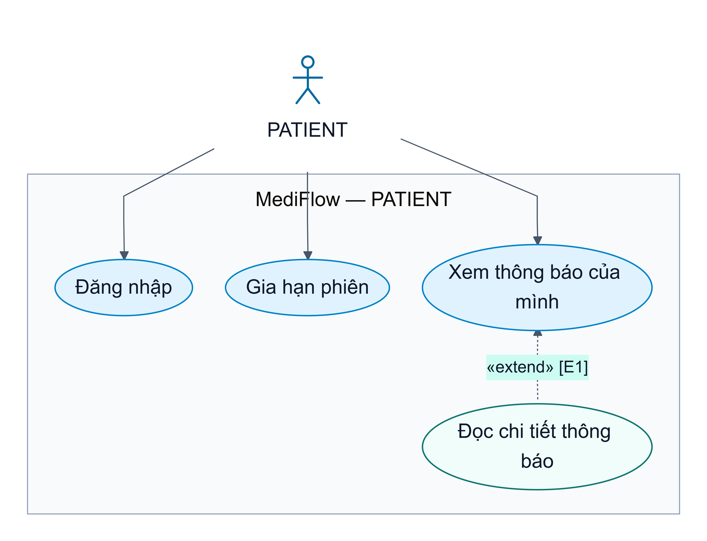

[Mermaid](word-compact/landscape/mermaid/36-vi.mmd) · [SVG](word-compact/landscape/svg/36-vi.svg)

[Original SVG](assets/svg/36-vi.svg) · [Portrait PNG](word-compact/portrait/png/36-vi.png) · [Landscape PNG](word-compact/landscape/png/36-vi.png)

Hình phản ánh đúng phạm vi quyền hiện có. PATIENT chưa trực tiếp tạo/xem lịch hẹn, lấy hồ sơ bệnh nhân, kết quả xét nghiệm, đơn thuốc hay hóa đơn qua ma trận Gateway/controller hiện tại. Chưa có tự đăng ký hoặc sửa hồ sơ. Đây là khoảng trống tương lai, không vẽ thành chức năng đã có. Mở chi tiết thông báo vẫn kiểm tra ownership độc lập. Đăng nhập và gia hạn là hai mục tiêu độc lập, không nối include/extend với nhau. Lệnh nghiệp vụ nhân viên cần phiên xác thực hợp lệ. Tiền điều kiện và kiểm tra trường dữ liệu nằm trong sequence/đặc tả, không tách thành oval thao tác màn hình.

Điều kiện mở rộng: E1: Đọc chi tiết thông báo — chọn thông báo của mình

Đối chiếu source: [AuthController](../../../../backend/gateway/src/main/java/com/mediflow/gateway/auth/AuthController.java) · [NotificationController](../../../../backend/notification-service/src/main/java/com/mediflow/notification/web/NotificationController.java) · [RouteAuthorizationFilter](../../../../backend/gateway/src/main/java/com/mediflow/gateway/filter/RouteAuthorizationFilter.java)

<!-- role-usecases:end -->

### 1.3. Sequences Diagrams

<!-- word-sequence-excerpts:start -->
Các phần Word giữ nguyên điều kiện bao quanh từng thông điệp. Nếu chỉ trích một nhánh alternative, phần đó dùng `opt` với điều kiện của chính nhánh để biểu diễn trích đoạn có điều kiện; xem hình đầy đủ để đọc toàn bộ `alt` và các kết quả khác.
<!-- word-sequence-excerpts:end -->

Luồng chính dùng nhất quán hợp đồng ngoại trú V1. Đọc theo thứ tự: đặt lịch → đến/check-in → thu phí khám → khám → xét nghiệm/thanh toán/kết quả nếu có chỉ định → bác sĩ kết luận → kê đơn khi cần → thanh toán/chủ động cấp thuốc. Hình 06 và 04 là hai tình huống xác thực độc lập. Mỗi actor dùng phiên đúng quyền; lifeline API service viết gọn vẫn đi qua Gateway. Vẫn áp dụng feature/acceptance gate V1. Báo cáo và thông báo cập nhật riêng, không chặn chăm sóc.

### Đăng nhập — kiểm tra dữ liệu, từ chối và thử lại

**Phần 1/2 · A4 portrait**

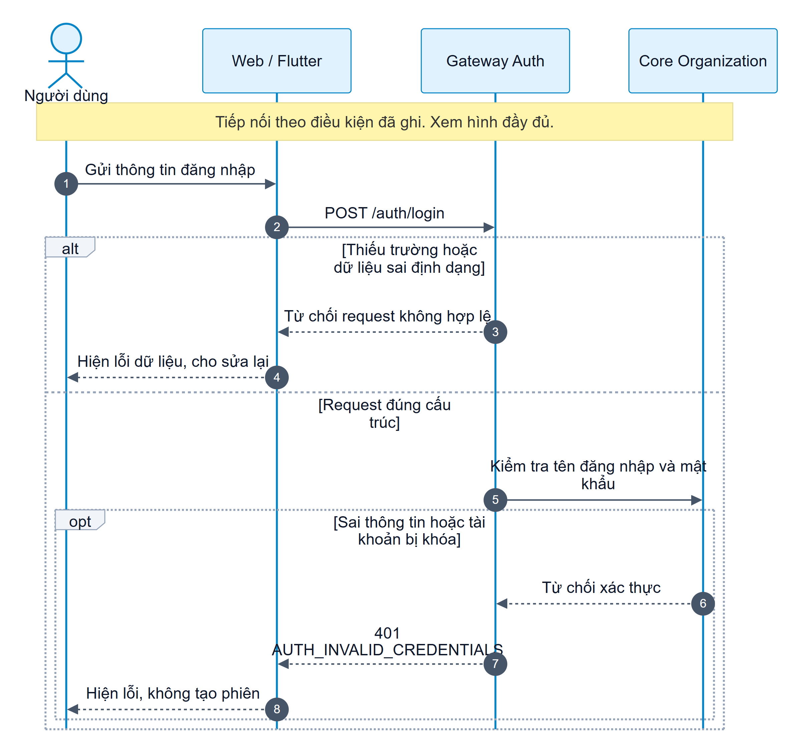

[Mermaid](word-compact/panels/mermaid/06-vi-part-01.mmd) · [SVG](word-compact/panels/svg/06-vi-part-01.svg)

**Phần 2/2 · A4 portrait**

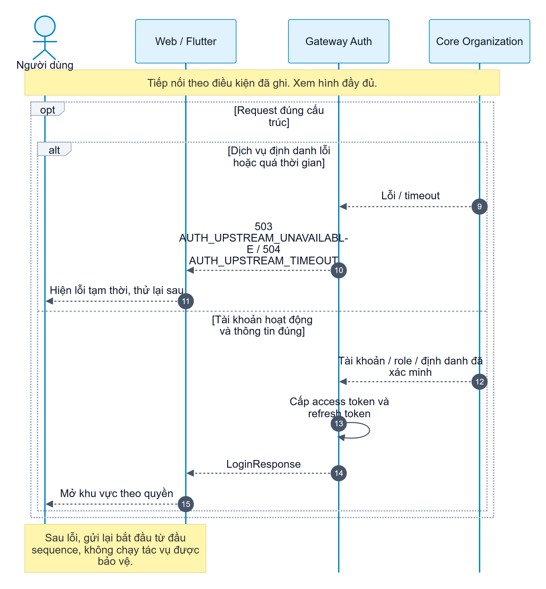

[Mermaid](word-compact/panels/mermaid/06-vi-part-02.mmd) · [SVG](word-compact/panels/svg/06-vi-part-02.svg)

[Original SVG](assets/svg/06-vi.svg) · [Portrait PNG](word-compact/portrait/png/06-vi.png) · [Landscape PNG](word-compact/landscape/png/06-vi.png)

Gateway cấp token sau khi Core xác minh tài khoản; Core không trả token trực tiếp cho client. Gia hạn là hình 04, một use case độc lập. Lỗi cấu trúc request theo xử lý validation; đăng nhập thành công dùng LoginResponse, không giả định mọi endpoint cùng một envelope.

### Gia hạn phiên — use case xác thực độc lập

**A4 portrait**

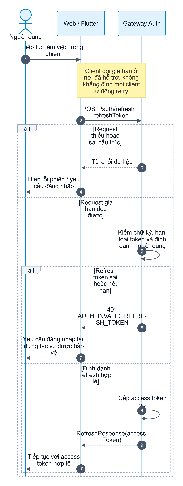

[Mermaid](word-compact/portrait/mermaid/04-vi.mmd) · [SVG](word-compact/portrait/svg/04-vi.svg)

[Original SVG](assets/svg/04-vi.svg) · [Portrait PNG](word-compact/portrait/png/04-vi.png) · [Landscape PNG](word-compact/landscape/png/04-vi.png)

Gateway kiểm claims đã ký tại chỗ khi refresh; implementation hiện tại không gọi lại Core hoặc cấp refresh token mới. Hình mô tả hợp đồng endpoint, không chứng nhận client tự gia hạn.

### Đặt lịch khám trước khi đến tiếp nhận

**Phần 1/2 · A4 landscape**

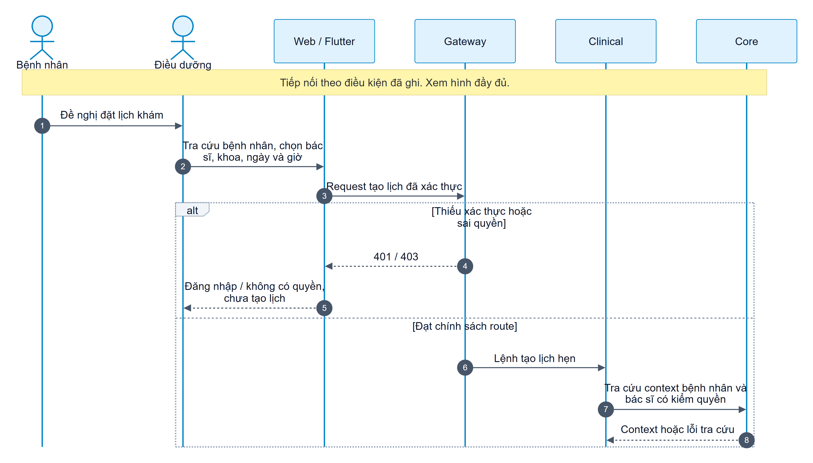

[Mermaid](word-compact/panels/mermaid/05-vi-part-01.mmd) · [SVG](word-compact/panels/svg/05-vi-part-01.svg)

**Phần 2/2 · A4 landscape**

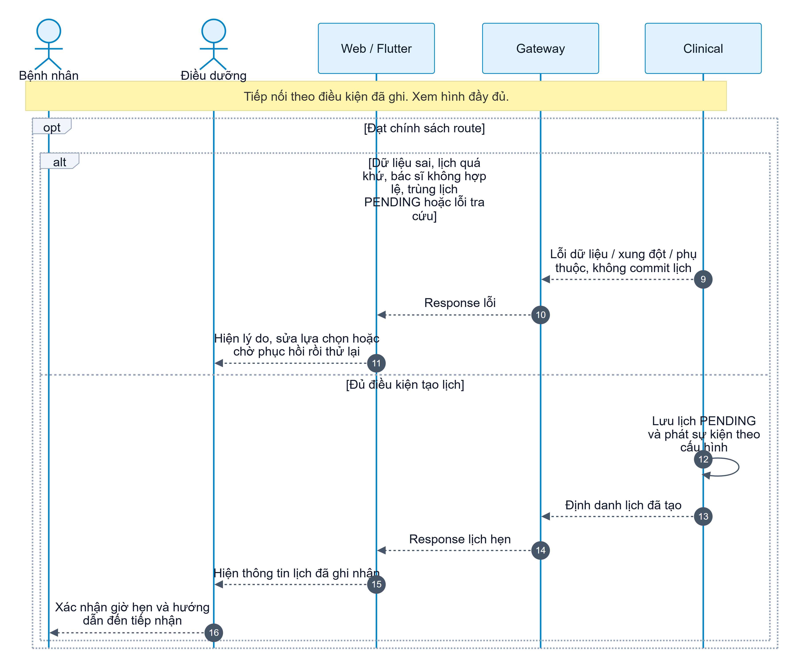

[Mermaid](word-compact/panels/mermaid/05-vi-part-02.mmd) · [SVG](word-compact/panels/svg/05-vi-part-02.svg)

[Original SVG](assets/svg/05-vi.svg) · [Portrait PNG](word-compact/portrait/png/05-vi.png) · [Landscape PNG](word-compact/landscape/png/05-vi.png)

PATIENT nhờ điều dưỡng đặt lịch; không thêm API tự đặt lịch cho bệnh nhân. Nếu chưa có hồ sơ bệnh nhân thì tạo tại Core trước, ngoài sequence này. Chỉ lịch lưu thành công mới là đầu vào check-in ở hình 07. Đặt lịch không chứng minh đã thanh toán hoặc được bắt đầu khám.

### Đến tiếp nhận → thu phí khám → bắt đầu khám (V1)

**Phần 1/3 · A4 landscape**

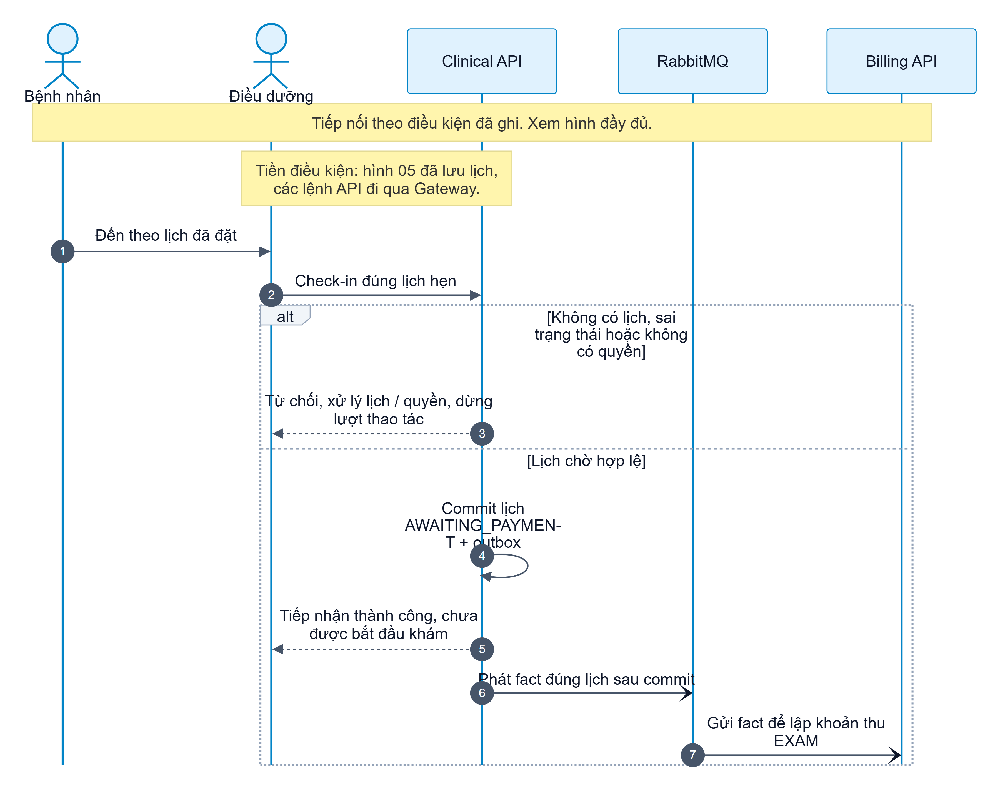

[Mermaid](word-compact/panels/mermaid/07-vi-part-01.mmd) · [SVG](word-compact/panels/svg/07-vi-part-01.svg)

**Phần 2/3 · A4 portrait**

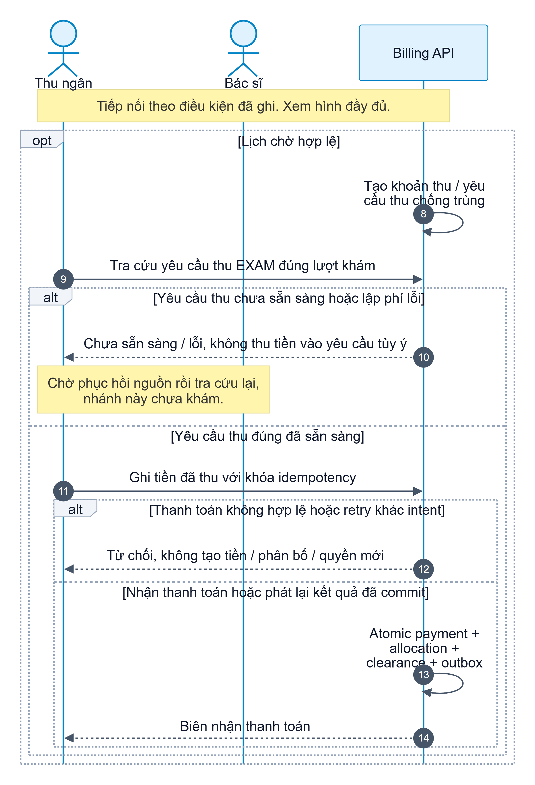

[Mermaid](word-compact/panels/mermaid/07-vi-part-02.mmd) · [SVG](word-compact/panels/svg/07-vi-part-02.svg)

**Phần 3/3 · A4 landscape**

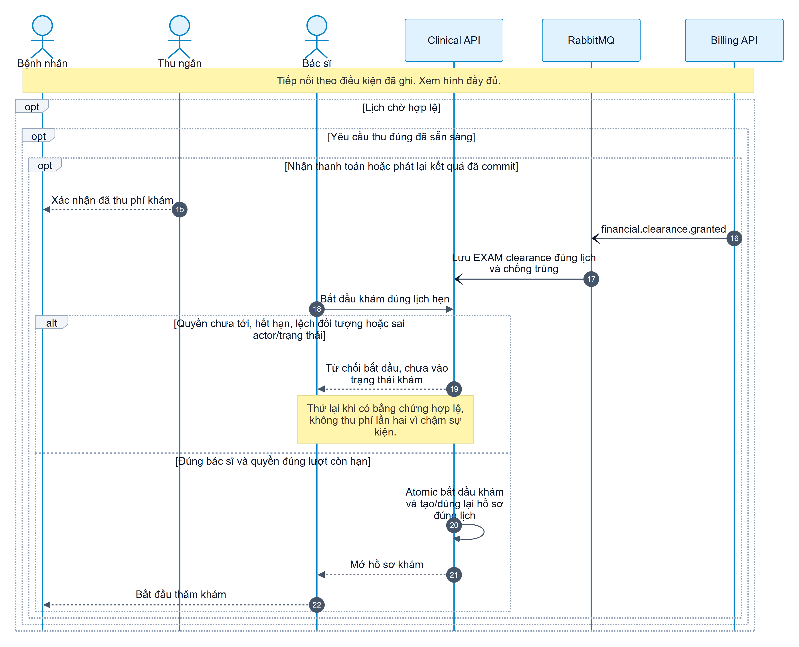

[Mermaid](word-compact/panels/mermaid/07-vi-part-03.mmd) · [SVG](word-compact/panels/svg/07-vi-part-03.svg)

[Original SVG](assets/svg/07-vi.svg) · [Portrait PNG](word-compact/portrait/png/07-vi.png) · [Landscape PNG](word-compact/landscape/png/07-vi.png)

Luồng ngoại trú V1 thông thường. Check-in trước thu phí; có quyền từ phí khám trước khi bắt đầu khám. Audited emergency override là khả năng riêng có kiểm quyền trong source, không phải đường vòng cho lượt khám chưa trả phí bình thường. Mỗi actor dùng phiên riêng; lifeline API chỉ lược đường truyền Gateway. Mũi tên sự kiện là bất đồng bộ; phát lại không tạo khoản thu thứ hai.

### Chỉ định → thanh toán → xét nghiệm → bác sĩ đọc kết quả (V1)

**Phần 1/4 · A4 portrait**

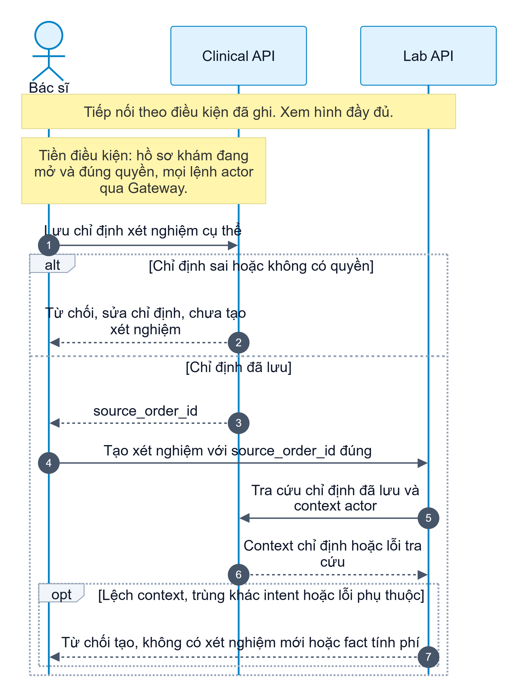

[Mermaid](word-compact/panels/mermaid/08-vi-part-01.mmd) · [SVG](word-compact/panels/svg/08-vi-part-01.svg)

**Phần 2/4 · A4 landscape**

[Mermaid](word-compact/panels/mermaid/08-vi-part-02.mmd) · [SVG](word-compact/panels/svg/08-vi-part-02.svg)

**Phần 3/4 · A4 portrait**

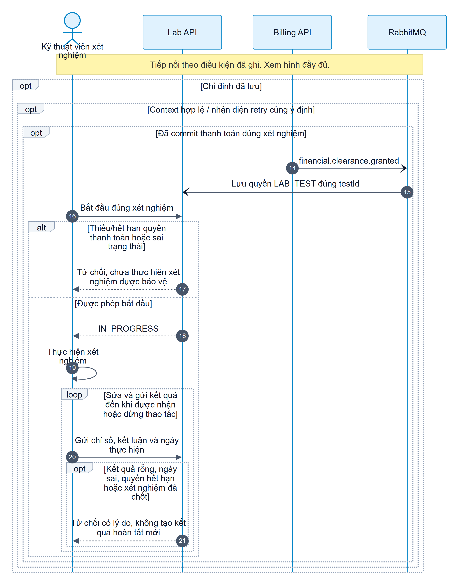

[Mermaid](word-compact/panels/mermaid/08-vi-part-03.mmd) · [SVG](word-compact/panels/svg/08-vi-part-03.svg)

**Phần 4/4 · A4 landscape**

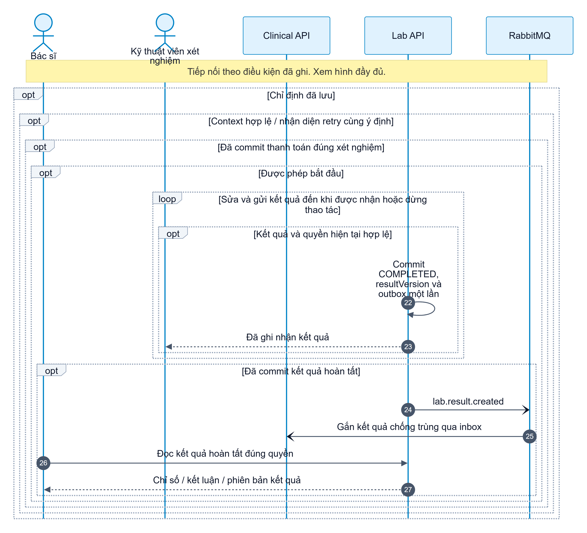

[Mermaid](word-compact/panels/mermaid/08-vi-part-04.mmd) · [SVG](word-compact/panels/svg/08-vi-part-04.svg)

[Original SVG](assets/svg/08-vi.svg) · [Portrait PNG](word-compact/portrait/png/08-vi.png) · [Landscape PNG](word-compact/landscape/png/08-vi.png)

Chú thích tham chiếu thanh toán bao gồm cả nhánh thành công/thất bại, không mặc định đã thu tiền. Khi bắt đầu và khi ghi kết quả đều kiểm quyền hiện tại. Kỹ thuật viên ghi kết quả; bác sĩ diễn giải ở hình 37. Projection Support không chặn luồng này nên được lược. Ghi kết quả lỗi không được phát sự kiện hoàn tất.

### Bác sĩ kết luận và trả kết quả khám cho bệnh nhân

**Phần 1/2 · A4 portrait**

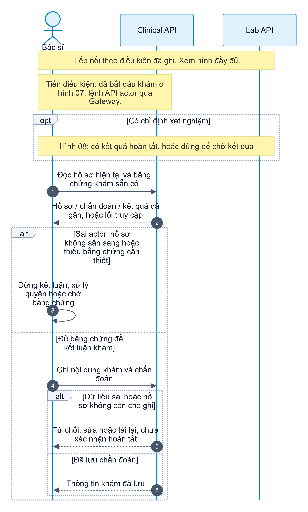

[Mermaid](word-compact/panels/mermaid/37-vi-part-01.mmd) · [SVG](word-compact/panels/svg/37-vi-part-01.svg)

**Phần 2/2 · A4 portrait**

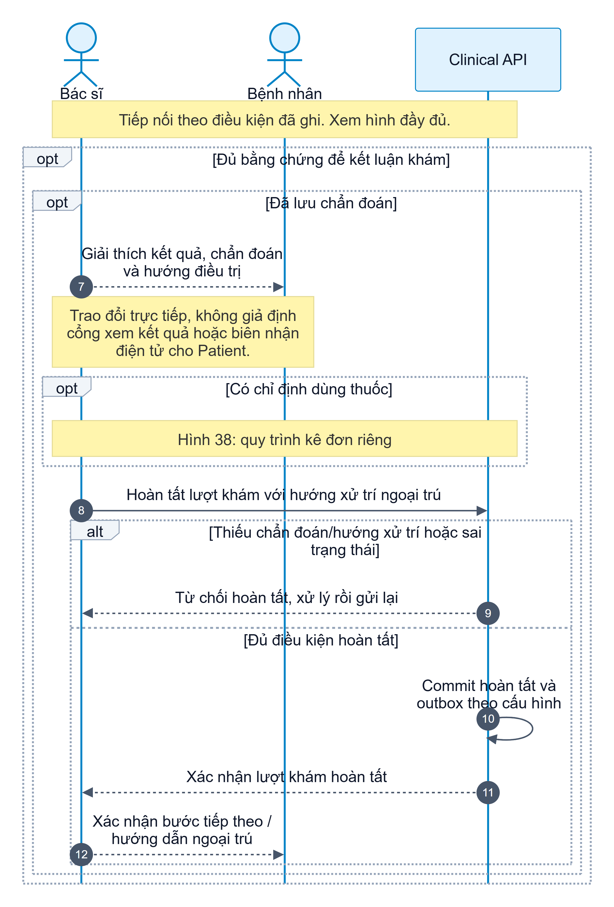

[Mermaid](word-compact/panels/mermaid/37-vi-part-02.mmd) · [SVG](word-compact/panels/svg/37-vi-part-02.svg)

[Original SVG](assets/svg/37-vi.svg) · [Portrait PNG](word-compact/portrait/png/37-vi.png) · [Landscape PNG](word-compact/landscape/png/37-vi.png)

Bác sĩ đọc kết quả Lab qua API có quyền; kết quả gắn bất đồng bộ vào Clinical có thể đến sau. Hình mô tả việc giải thích chuyên môn cho bệnh nhân, không tạo endpoint trả kết quả mới. Cấp thuốc thuộc quy trình Pharmacy/Billing riêng, không phải bằng chứng đã trả kết quả khám. Lệnh hoàn tất Clinical theo lifecycle trong source; không thêm điều kiện giả rằng phải cấp thuốc mới được kết thúc khám.

### Kê đơn — quy trình riêng khi có chỉ định

**A4 portrait**

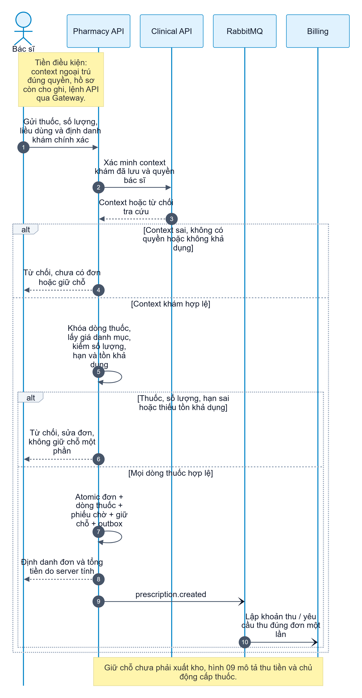

[Mermaid](word-compact/portrait/mermaid/38-vi.mmd) · [SVG](word-compact/portrait/svg/38-vi.svg)

[Original SVG](assets/svg/38-vi.svg) · [Portrait PNG](word-compact/portrait/png/38-vi.png) · [Landscape PNG](word-compact/landscape/png/38-vi.png)

Giá lấy từ snapshot danh mục server, không nhận giá do client tự gửi. Context nguồn được xác minh, không suy ra từ chuỗi chẩn đoán hoặc UUID tùy ý. Retry theo hợp đồng endpoint thật; hình không thêm khóa idempotency kê đơn áp dụng chung khi source chưa có.

### Thanh toán đơn và dược sĩ chủ động cấp thuốc (V1)

**Phần 1/3 · A4 portrait**

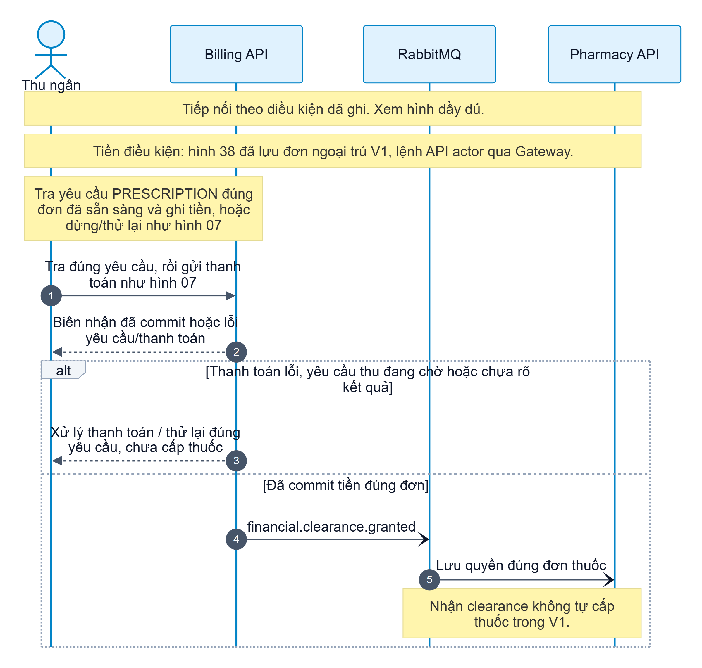

[Mermaid](word-compact/panels/mermaid/09-vi-part-01.mmd) · [SVG](word-compact/panels/svg/09-vi-part-01.svg)

**Phần 2/3 · A4 portrait**

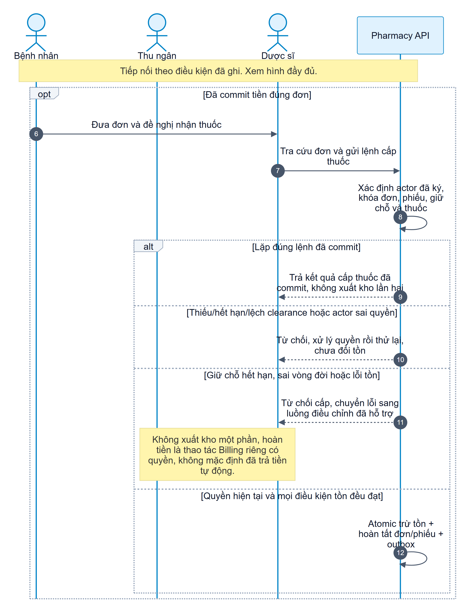

[Mermaid](word-compact/panels/mermaid/09-vi-part-02.mmd) · [SVG](word-compact/panels/svg/09-vi-part-02.svg)

**Phần 3/3 · A4 landscape**

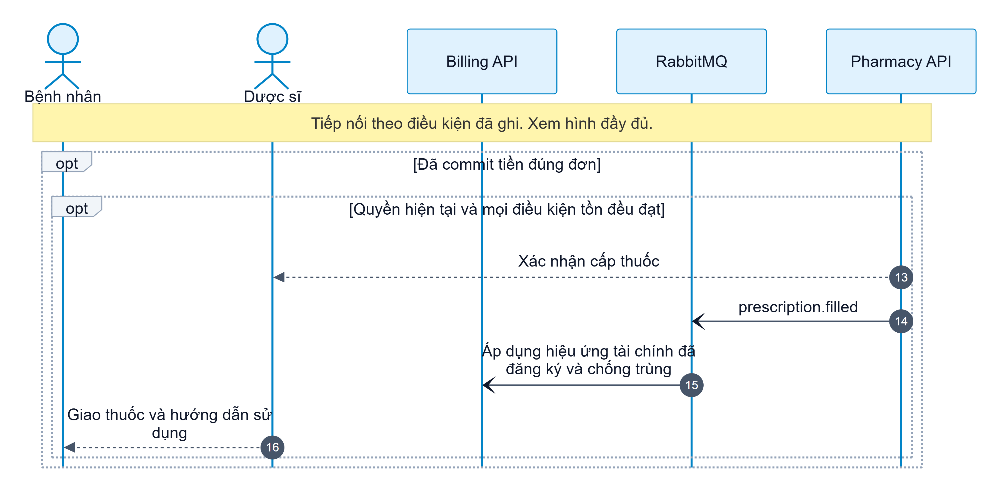

[Mermaid](word-compact/panels/mermaid/09-vi-part-03.mmd) · [SVG](word-compact/panels/svg/09-vi-part-03.svg)

[Original SVG](assets/svg/09-vi.svg) · [Portrait PNG](word-compact/portrait/png/09-vi.png) · [Landscape PNG](word-compact/landscape/png/09-vi.png)

Saga V0 tự động từ payment.completed là cơ chế compatibility cũ, không phải luồng V1 chính. Phải có lệnh dược sĩ, clearance đúng đích còn hạn, lifecycle và tồn đã khóa hợp lệ. Giao thuốc thực tế là hành động người dùng sau xác nhận lưu; source không chứng minh bệnh nhân đã nhận.

### 1.4. Class Diagrams

Các lớp domain nhóm theo service triển khai. Core/Support giữ ranh giới context bên trong; Pharmacy/Billing cùng một hình nhưng là hai service độc lập. Thuộc tính chọn lọc phải khớp source; phụ thuộc tích hợp nét đứt không phải quan hệ database.

### Core service — module Organization và Patient

**A4 landscape**

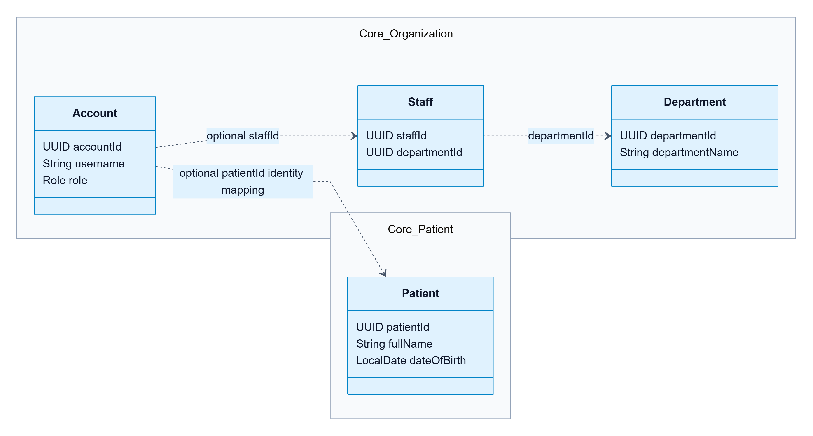

[Mermaid](word-compact/landscape/mermaid/39-vi.mmd) · [SVG](word-compact/landscape/svg/39-vi.svg)

[Original SVG](assets/svg/39-vi.svg) · [Portrait PNG](word-compact/portrait/png/39-vi.png) · [Landscape PNG](word-compact/landscape/png/39-vi.png)

Hai module chạy trong Core nhưng giữ store Organization/Patient riêng. Tham chiếu định danh là tùy chọn theo role tài khoản; hình không tạo khóa ngoại xuyên database. Hình domain tổng quan không trộn các lớp infrastructure.

### Clinical service — các lớp nghiệp vụ

**Phần 1/2 · A4 landscape**

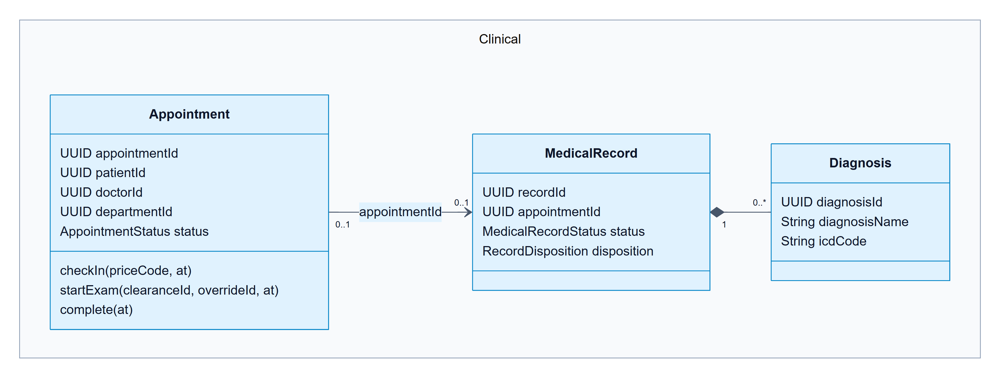

[Mermaid](word-compact/panels/mermaid/10-vi-part-01.mmd) · [SVG](word-compact/panels/svg/10-vi-part-01.svg)

**Phần 2/2 · A4 landscape**

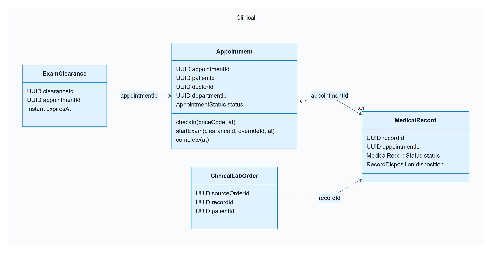

[Mermaid](word-compact/panels/mermaid/10-vi-part-02.mmd) · [SVG](word-compact/panels/svg/10-vi-part-02.svg)

[Original SVG](assets/svg/10-vi.svg) · [Portrait PNG](word-compact/portrait/png/10-vi.png) · [Landscape PNG](word-compact/landscape/png/10-vi.png)

Tất cả lớp trong hình thuộc Clinical. LabTest/LabResult chuyển sang hình 40. Tham chiếu UUID nét đứt không hàm ý điều hướng JPA. Hồ sơ theo lịch hẹn khác với hồ sơ legacy còn giữ không có lịch. Thuộc tính/method chọn lọc từ source; không liệt kê getter sinh tự động.

### Lab service — xét nghiệm, kết quả và quyền dịch vụ

**A4 landscape**

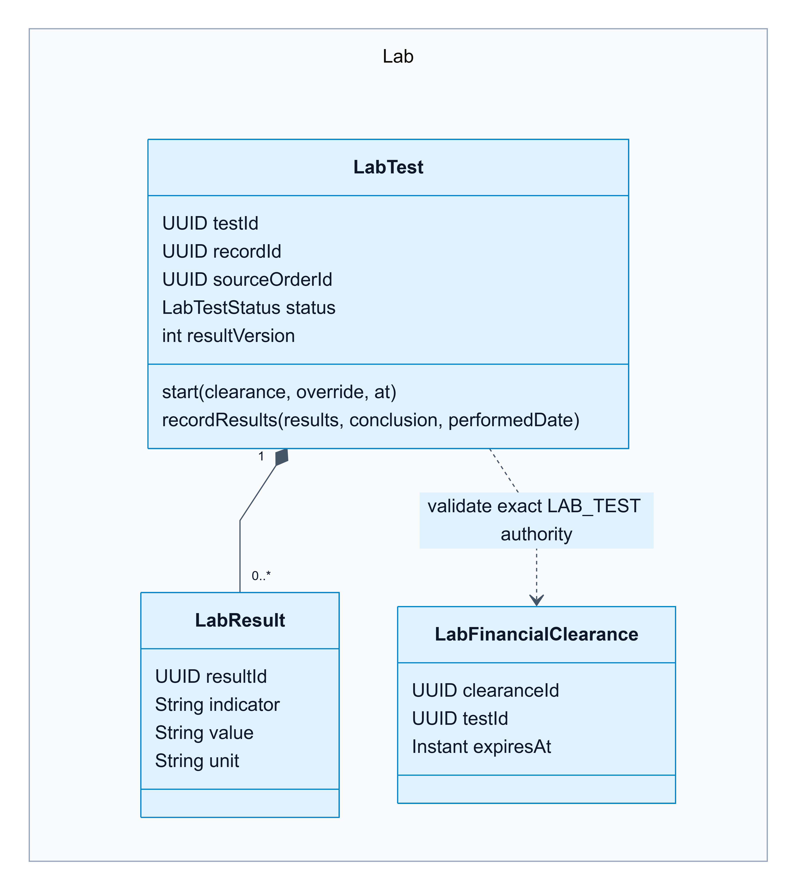

[Mermaid](word-compact/landscape/mermaid/40-vi.mmd) · [SVG](word-compact/landscape/svg/40-vi.svg)

[Original SVG](assets/svg/40-vi.svg) · [Portrait PNG](word-compact/portrait/png/40-vi.png) · [Landscape PNG](word-compact/landscape/png/40-vi.png)

Hồ sơ/chỉ định Clinical chỉ được tham chiếu bằng UUID bên ngoài, không đưa object Clinical vào Lab. Lab lưu bằng chứng clearance nhận được; Billing vẫn có quyền sở hữu hiệu ứng tiền. Trước hoàn tất có thể chưa có kết quả; khi hoàn tất phải có kết quả không rỗng.

### Pharmacy và Billing — hai service riêng, hợp đồng rõ ràng

**Phần 1/3 · A4 landscape**

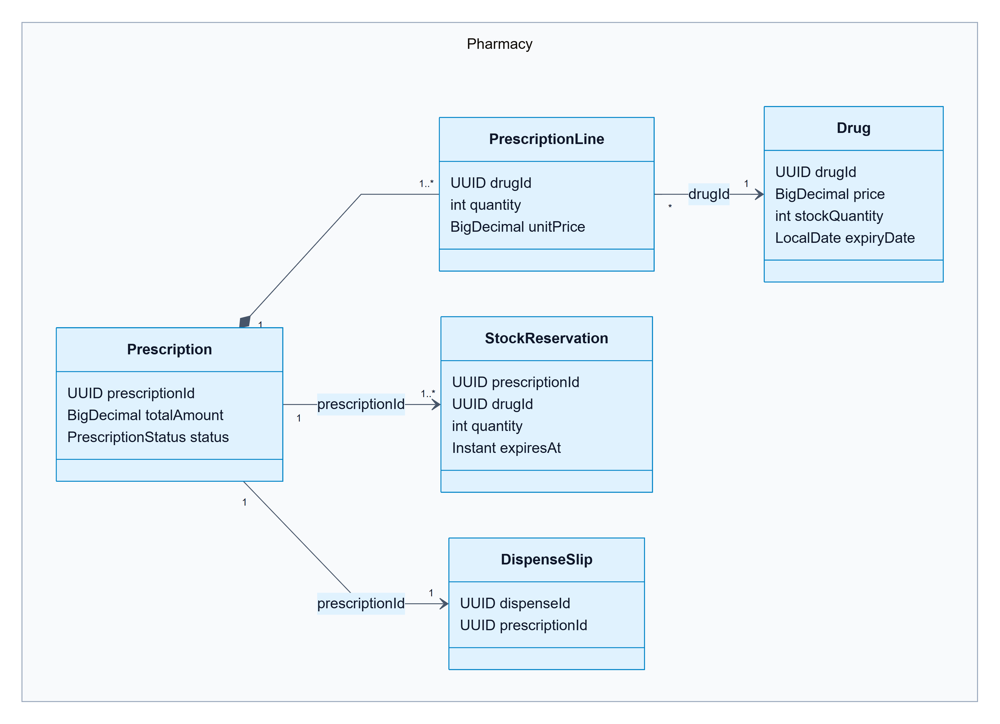

[Mermaid](word-compact/panels/mermaid/11-vi-part-01.mmd) · [SVG](word-compact/panels/svg/11-vi-part-01.svg)

**Phần 2/3 · A4 landscape**

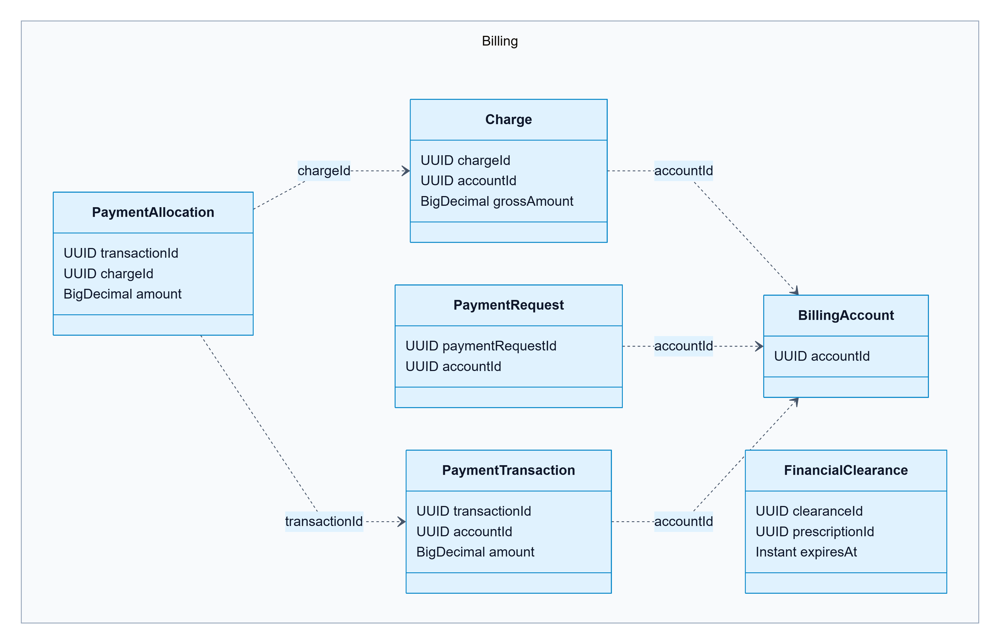

[Mermaid](word-compact/panels/mermaid/11-vi-part-02.mmd) · [SVG](word-compact/panels/svg/11-vi-part-02.svg)

**Phần 3/3 · A4 portrait**

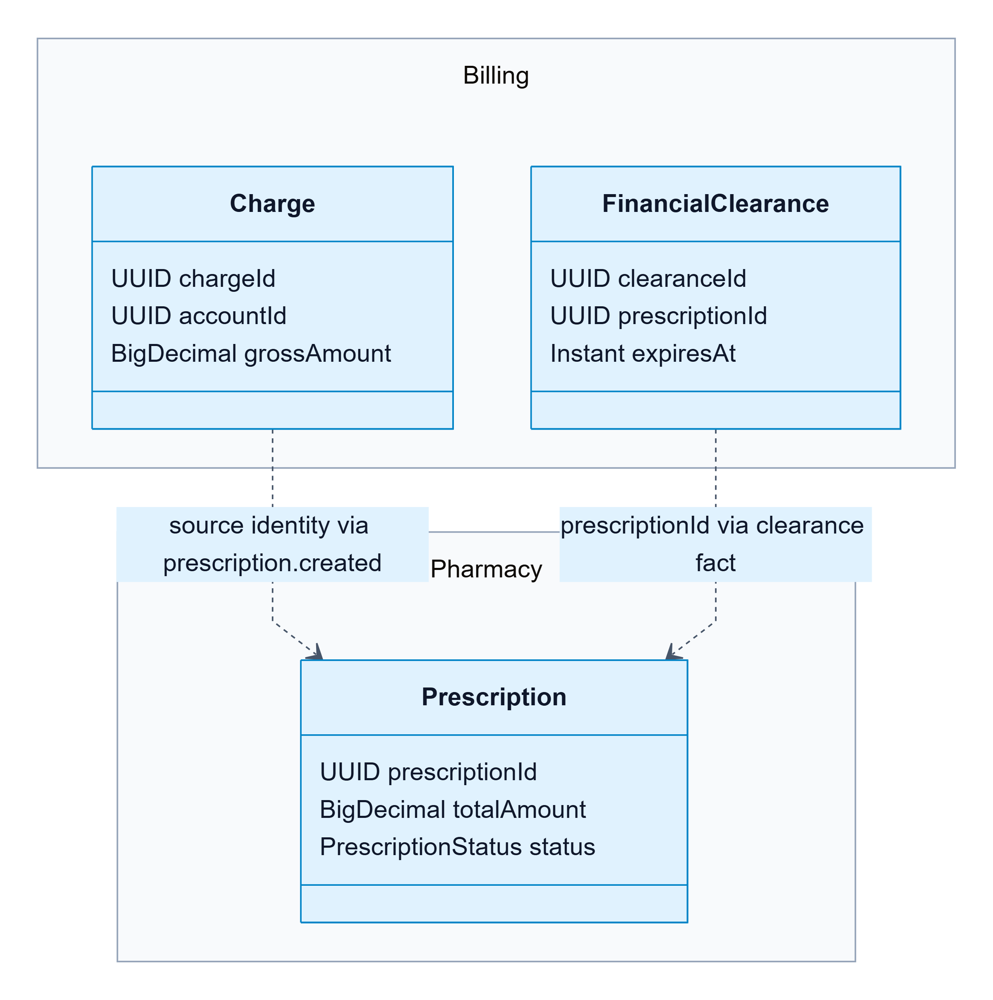

[Mermaid](word-compact/panels/mermaid/11-vi-part-03.mmd) · [SVG](word-compact/panels/svg/11-vi-part-03.svg)

[Original SVG](assets/svg/11-vi.svg) · [Portrait PNG](word-compact/portrait/png/11-vi.png) · [Landscape PNG](word-compact/landscape/png/11-vi.png)

Namespace là ranh giới hai service độc lập, mỗi service có database riêng. Phụ thuộc xuyên vùng chỉ hợp đồng sự kiện/UUID, không phải quan hệ entity hoặc transaction chung. Hình V1 dùng mô hình ledger; Invoice legacy vẫn được mô tả trong từ điển database và source compatibility. StockReservation/DispenseSlip được tạo cùng đơn trong luồng tạo thành công đang mô tả.

### Support service — mô hình báo cáo và thông báo riêng

**A4 portrait**

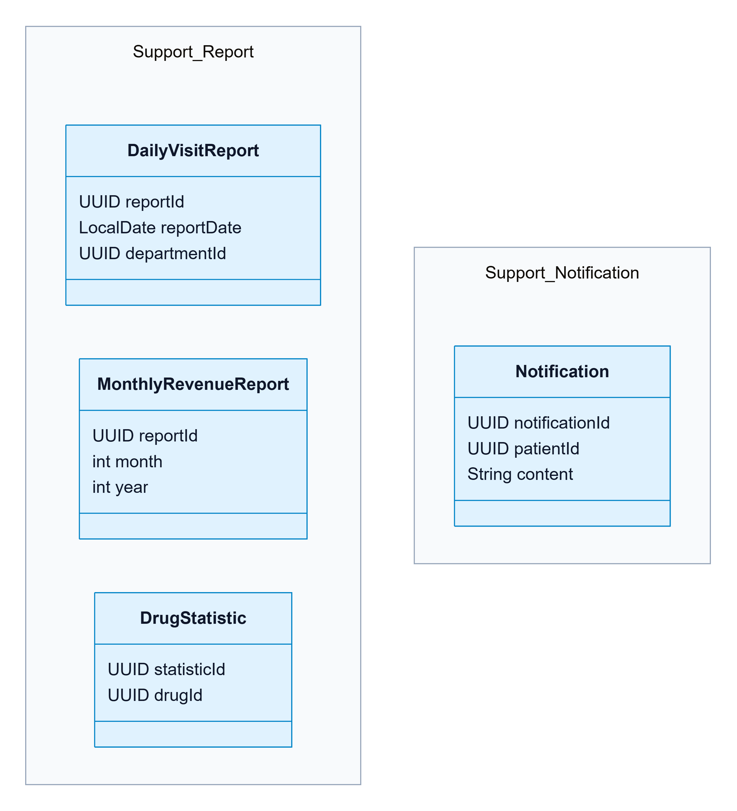

[Mermaid](word-compact/portrait/mermaid/41-vi.mmd) · [SVG](word-compact/portrait/svg/41-vi.svg)

[Original SVG](assets/svg/41-vi.svg) · [Portrait PNG](word-compact/portrait/png/41-vi.png) · [Landscape PNG](word-compact/landscape/png/41-vi.png)

Report và Notification ghép trong Support nhưng có database và transaction manager riêng. Không tạo quan hệ domain giả giữa các projection độc lập. Sự kiện nghiệp vụ cập nhật các mô hình bất đồng bộ; chúng không bắt buộc tham gia đường request khám/trả kết quả/cấp thuốc.

## 2. Data Flow Diagram

Quy tắc đồng bộ: EXAM, LAB_TEST và PRESCRIPTION là ba đích thanh toán riêng. Lưu thanh toán không bảo đảm sự kiện đã được nhận ngay. Giải thích kết quả khám và giao thuốc thực tế là tương tác con người, không tạo endpoint Patient tự phục vụ mới. Các bảng/thuật toán invoice/saga V0 cũ còn là tham chiếu compatibility, ngoài bộ sequence V1 chính.

DFD biểu diễn dữ liệu nghiệp vụ, không dùng nó để suy ra endpoint hoặc transaction xuyên service. P0 ở mức context được phân rã thành P1–P6 ở Level 1; tất cả giao tiếp actor đều đi qua client/Gateway về mặt triển khai.

### DFD Level 0 — ranh giới hệ thống

**A4 landscape**

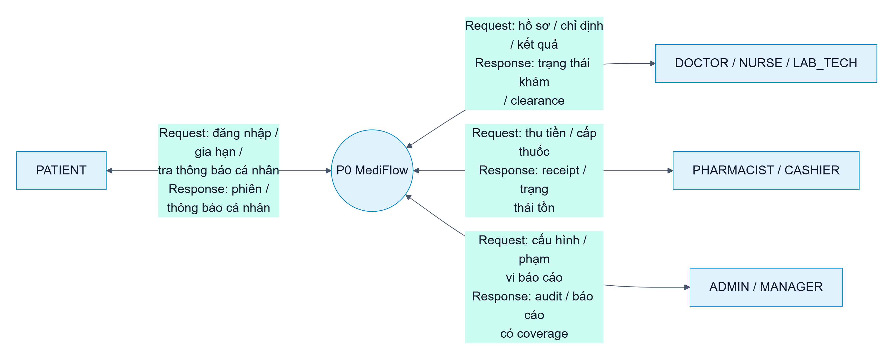

[Mermaid](word-compact/landscape/mermaid/12-vi.mmd) · [SVG](word-compact/landscape/svg/12-vi.svg)

[Original SVG](assets/svg/12-vi.svg) · [Portrait PNG](word-compact/portrait/png/12-vi.png) · [Landscape PNG](word-compact/landscape/png/12-vi.png)

### DFD Level 1 — sáu tiến trình và tám store

**Phần 1/7 · A4 landscape**

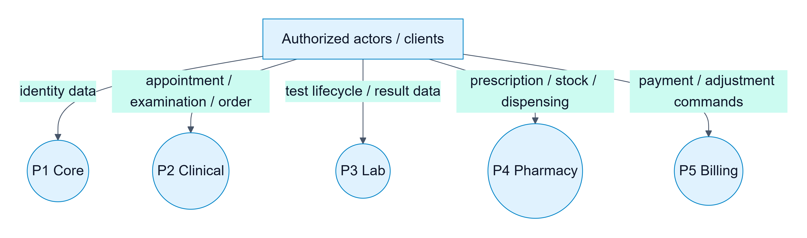

[Mermaid](word-compact/panels/mermaid/13-vi-part-01.mmd) · [SVG](word-compact/panels/svg/13-vi-part-01.svg)

**Phần 2/7 · A4 landscape**

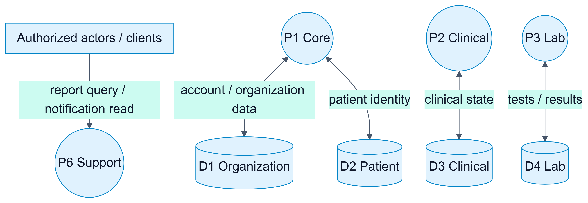

[Mermaid](word-compact/panels/mermaid/13-vi-part-02.mmd) · [SVG](word-compact/panels/svg/13-vi-part-02.svg)

**Phần 3/7 · A4 landscape**

[Mermaid](word-compact/panels/mermaid/13-vi-part-03.mmd) · [SVG](word-compact/panels/svg/13-vi-part-03.svg)

**Phần 4/7 · A4 landscape**

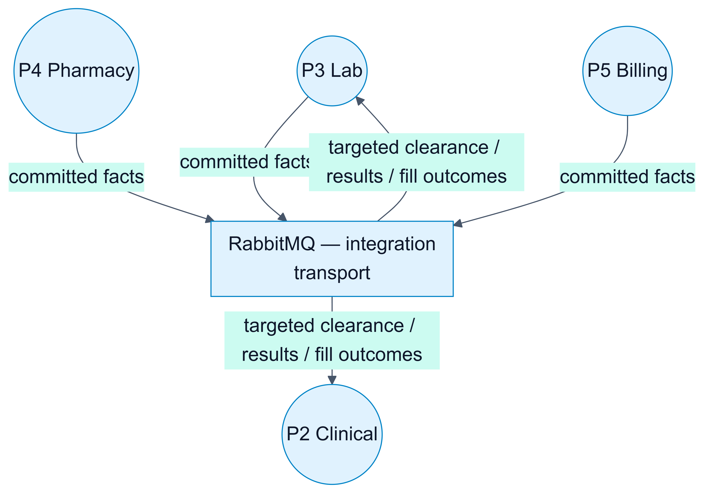

[Mermaid](word-compact/panels/mermaid/13-vi-part-04.mmd) · [SVG](word-compact/panels/svg/13-vi-part-04.svg)

**Phần 5/7 · A4 landscape**

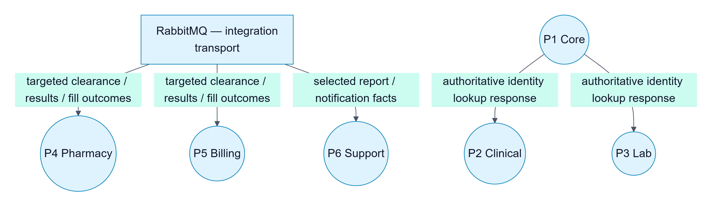

[Mermaid](word-compact/panels/mermaid/13-vi-part-05.mmd) · [SVG](word-compact/panels/svg/13-vi-part-05.svg)

**Phần 6/7 · A4 landscape**

[Mermaid](word-compact/panels/mermaid/13-vi-part-06.mmd) · [SVG](word-compact/panels/svg/13-vi-part-06.svg)

**Phần 7/7 · A4 portrait**

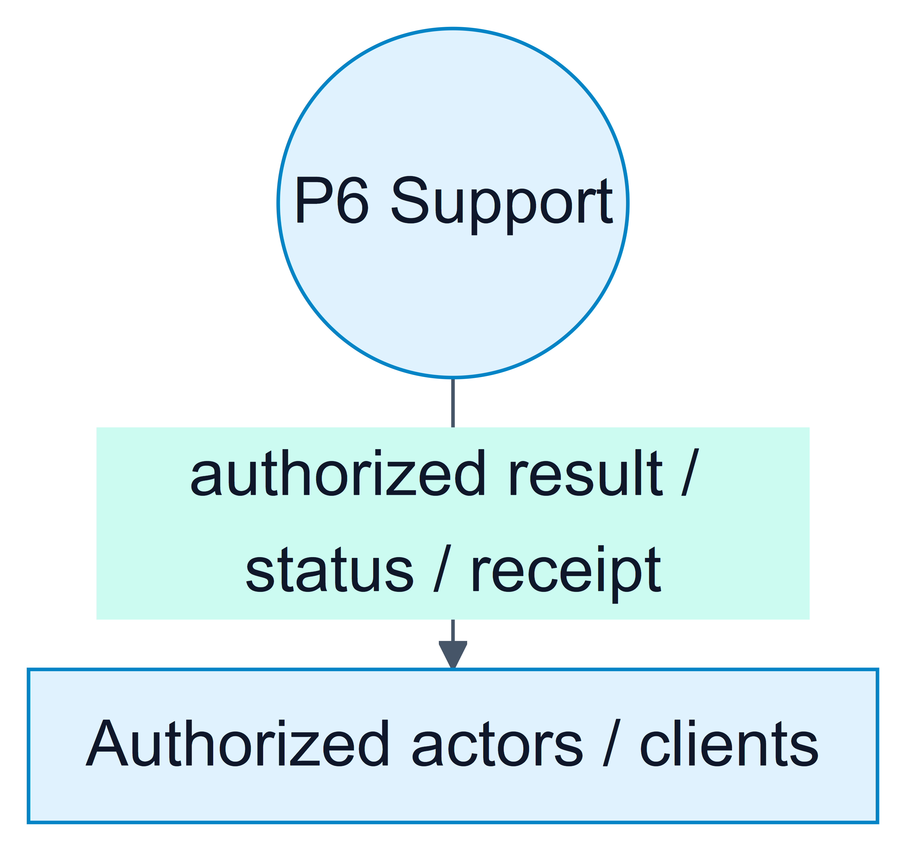

[Mermaid](word-compact/panels/mermaid/13-vi-part-07.mmd) · [SVG](word-compact/panels/svg/13-vi-part-07.svg)

[Original SVG](assets/svg/13-vi.svg) · [Portrait PNG](word-compact/portrait/png/13-vi.png) · [Landscape PNG](word-compact/landscape/png/13-vi.png)

### DFD Level 2 — ghi tiền và cấp quyền dịch vụ V1

**Phần 1/3 · A4 portrait**

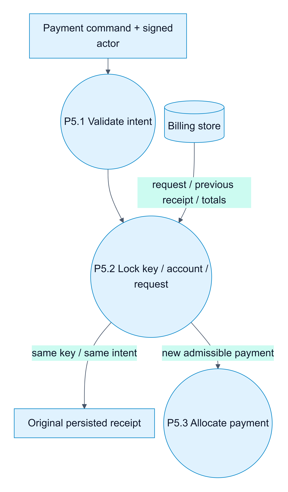

[Mermaid](word-compact/panels/mermaid/14-vi-part-01.mmd) · [SVG](word-compact/panels/svg/14-vi-part-01.svg)

**Phần 2/3 · A4 portrait**

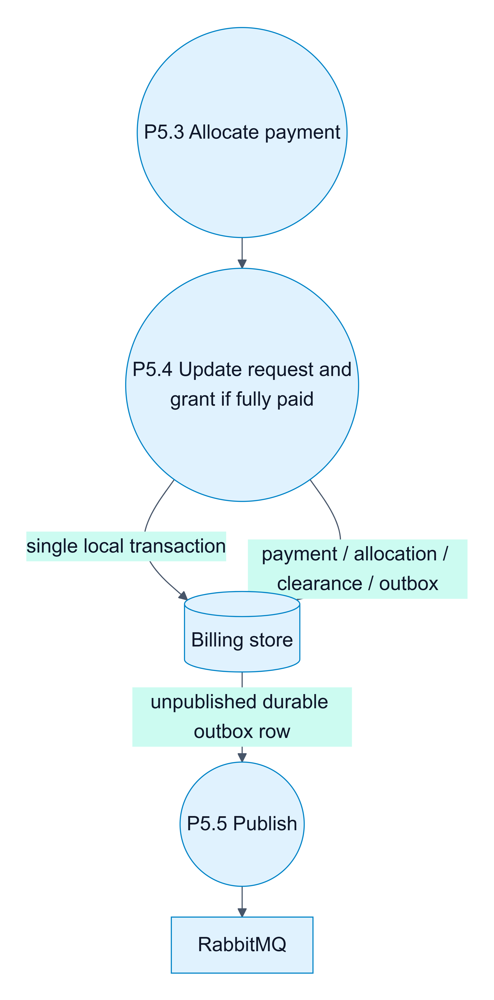

[Mermaid](word-compact/panels/mermaid/14-vi-part-02.mmd) · [SVG](word-compact/panels/svg/14-vi-part-02.svg)

**Phần 3/3 · A4 portrait**

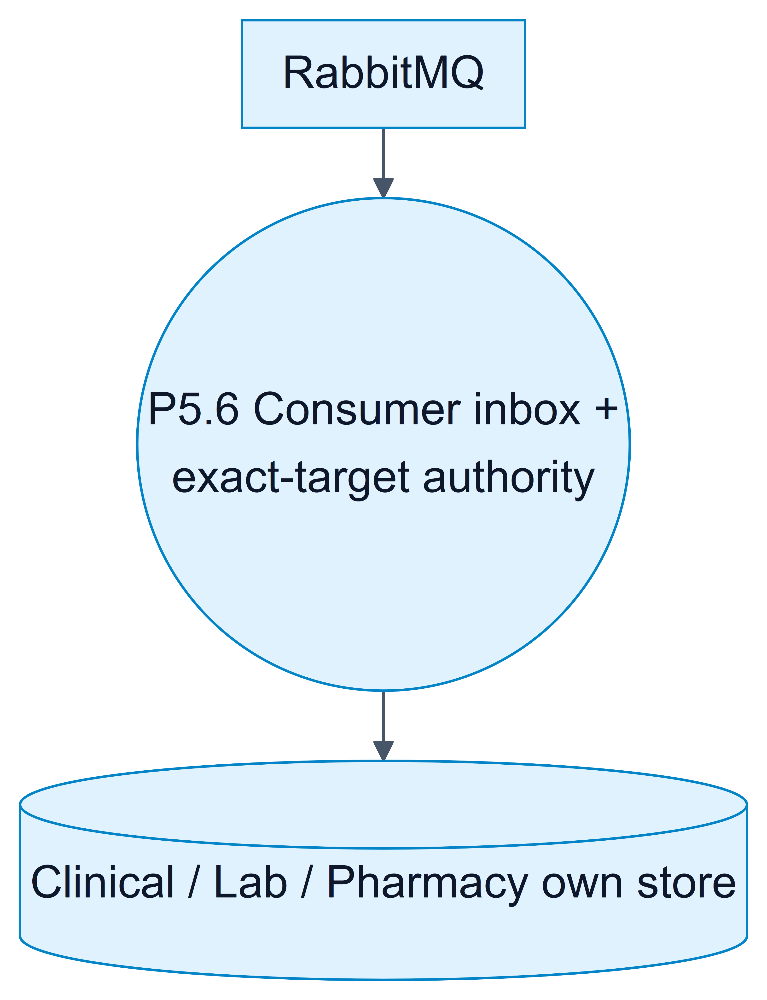

[Mermaid](word-compact/panels/mermaid/14-vi-part-03.mmd) · [SVG](word-compact/panels/svg/14-vi-part-03.svg)

[Original SVG](assets/svg/14-vi.svg) · [Portrait PNG](word-compact/portrait/png/14-vi.png) · [Landscape PNG](word-compact/landscape/png/14-vi.png)

## 3. Entity Relationship Diagram

ERD dưới đây là lát cắt vật lý của mỗi database, trích từ migration. Dấu chân chim biểu thị FK local, không đường nối giả giữa các DB. Trường UUID có tên đối tượng ở context khác là logical reference. Mỗi sơ đồ chọn nhóm bảng cốt lõi; inventory ở mục 4 bao phủ toàn bộ CREATE TABLE của tám context, kể cả nền tảng mở rộng đang gated/deferred.

### ERD — Organization

**A4 portrait**

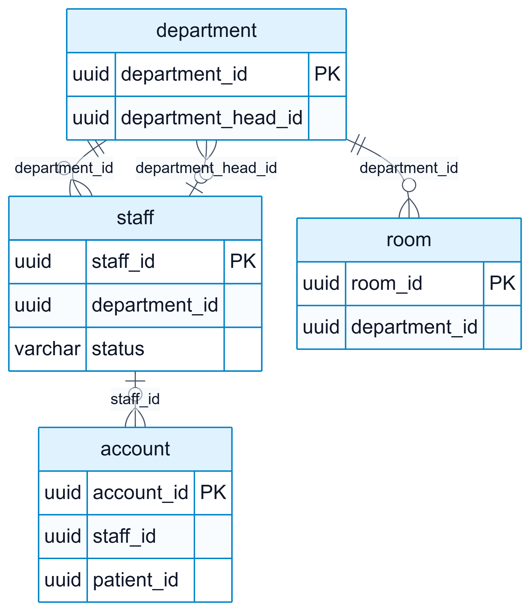

[Mermaid](word-compact/portrait/mermaid/15-vi.mmd) · [SVG](word-compact/portrait/svg/15-vi.svg)

[Original SVG](assets/svg/15-vi.svg) · [Portrait PNG](word-compact/portrait/png/15-vi.png) · [Landscape PNG](word-compact/landscape/png/15-vi.png)

### ERD — Patient

**A4 landscape**

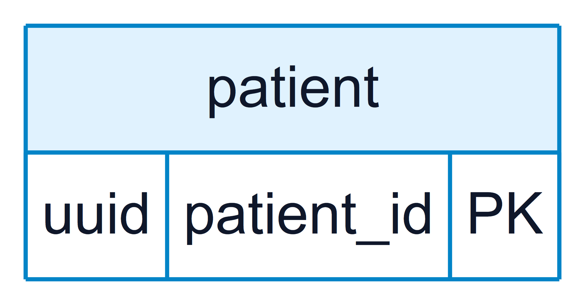

[Mermaid](word-compact/landscape/mermaid/16-vi.mmd) · [SVG](word-compact/landscape/svg/16-vi.svg)

[Original SVG](assets/svg/16-vi.svg) · [Portrait PNG](word-compact/portrait/png/16-vi.png) · [Landscape PNG](word-compact/landscape/png/16-vi.png)

### ERD — Clinical

**A4 portrait**

[Mermaid](word-compact/portrait/mermaid/17-vi.mmd) · [SVG](word-compact/portrait/svg/17-vi.svg)

[Original SVG](assets/svg/17-vi.svg) · [Portrait PNG](word-compact/portrait/png/17-vi.png) · [Landscape PNG](word-compact/landscape/png/17-vi.png)

### ERD — Lab

**A4 portrait**

[Mermaid](word-compact/portrait/mermaid/18-vi.mmd) · [SVG](word-compact/portrait/svg/18-vi.svg)

[Original SVG](assets/svg/18-vi.svg) · [Portrait PNG](word-compact/portrait/png/18-vi.png) · [Landscape PNG](word-compact/landscape/png/18-vi.png)

### ERD — Pharmacy

**A4 landscape**

[Mermaid](word-compact/landscape/mermaid/19-vi.mmd) · [SVG](word-compact/landscape/svg/19-vi.svg)

[Original SVG](assets/svg/19-vi.svg) · [Portrait PNG](word-compact/portrait/png/19-vi.png) · [Landscape PNG](word-compact/landscape/png/19-vi.png)

### ERD — Billing

**Phần 1/4 · A4 portrait**

[Mermaid](word-compact/panels/mermaid/20-vi-part-01.mmd) · [SVG](word-compact/panels/svg/20-vi-part-01.svg)

**Phần 2/4 · A4 landscape**

[Mermaid](word-compact/panels/mermaid/20-vi-part-02.mmd) · [SVG](word-compact/panels/svg/20-vi-part-02.svg)

**Phần 3/4 · A4 landscape**

[Mermaid](word-compact/panels/mermaid/20-vi-part-03.mmd) · [SVG](word-compact/panels/svg/20-vi-part-03.svg)

**Phần 4/4 · A4 portrait**

[Mermaid](word-compact/panels/mermaid/20-vi-part-04.mmd) · [SVG](word-compact/panels/svg/20-vi-part-04.svg)

[Original SVG](assets/svg/20-vi.svg) · [Portrait PNG](word-compact/portrait/png/20-vi.png) · [Landscape PNG](word-compact/landscape/png/20-vi.png)

### ERD — Notification

**A4 portrait**

[Mermaid](word-compact/portrait/mermaid/21-vi.mmd) · [SVG](word-compact/portrait/svg/21-vi.svg)

[Original SVG](assets/svg/21-vi.svg) · [Portrait PNG](word-compact/portrait/png/21-vi.png) · [Landscape PNG](word-compact/landscape/png/21-vi.png)

### ERD — Report

**A4 landscape**

[Mermaid](word-compact/landscape/mermaid/22-vi.mmd) · [SVG](word-compact/landscape/svg/22-vi.svg)

[Original SVG](assets/svg/22-vi.svg) · [Portrait PNG](word-compact/portrait/png/22-vi.png) · [Landscape PNG](word-compact/landscape/png/22-vi.png)
Cardinality bổ sung từ unique index: một appointment có tối đa một medical_record (`uq_medical_record_appointment`); một prescription có tối đa một dispense_slip; một financial_clearance ứng với một payment_request. Report là read model có UUID nguồn, không FK về Billing/Pharmacy. Trường `invoice_id` trong PAYMENT_REQUEST không được suy thành FK tới bảng INVOICE V0.

| Tham chiếu logic | Authority | Cách trao đổi |
|---|---|---|
| `patient_id` | Core / Patient | REST identity lookup; event payload UUID |
| `doctor_id / department_id` | Core / Organization | REST authority lookup; signed actor context |
| `record_id / care_episode_id` | Clinical | Exact outpatient context contract / event |
| `test_id / source_order_id` | Lab / Clinical | Explicit order / result contracts |
| `prescription_id` | Pharmacy | Prescription facts / target lookup |
| `clearance_id / payment_request_id` | Billing | Purpose + exact target + expiry; event/lookup |

## 4. Table Design

### 4.1. Database Tables

Tên bảng không có dấu ngoặc kép trong PostgreSQL được chuẩn hóa chữ thường, dù migration viết HOA. Inventory sau đọc các migration theo số V, ghi migration tạo bảng và các migration ALTER TABLE liên quan. Đây là inventory source, không phải ảnh chụp live DB: bảng chưa migrate hoặc feature tắt vẫn có thể xuất hiện. Không đưa `flyway_schema_history` do Flyway tạo tự động vào tổng số bảng nghiệp vụ.

| Context | Database | Số bảng khai báo | Migration |
|---|---|---:|---|
| Organization | `mediflow_organization` | 7 | 4 |
| Patient | `mediflow_patient` | 1 | 1 |
| Clinical | `mediflow_clinical` | 12 | 7 |
| Lab | `mediflow_lab` | 8 | 3 |
| Pharmacy | `mediflow_pharmacy` | 17 | 20 |
| Billing | `mediflow_billing` | 42 | 23 |
| Notification | `mediflow_notification` | 7 | 4 |
| Report | `mediflow_report` | 58 | 24 |

**Không có nghĩa mọi bảng đều active trong MVP.** Clinical có admission_referral giữ lại; Billing/Pharmacy/Report/Notification có các cấu trúc nâng cao hoặc nội trú/phẫu thuật. Inventory ghi tồn tại vật lý trong source; activate theo profile, không theo tên bảng.

#### Organization — `mediflow_organization`

| Table | PK / định danh | CREATE migration | ALTER migrations |
|---|---|---|---|
| `department` | `department_id` | [V1__init.sql](../../../../backend/core-service/src/main/resources/db/organization-migration/V1__init.sql) | [V1](../../../../backend/core-service/src/main/resources/db/organization-migration/V1__init.sql) |
| `staff` | `staff_id` | [V1__init.sql](../../../../backend/core-service/src/main/resources/db/organization-migration/V1__init.sql) | — |
| `account` | `account_id` | [V1__init.sql](../../../../backend/core-service/src/main/resources/db/organization-migration/V1__init.sql) | [V2](../../../../backend/core-service/src/main/resources/db/organization-migration/V2__account_patient_identity.sql) |
| `room` | `room_id` | [V3__room_lookup.sql](../../../../backend/core-service/src/main/resources/db/organization-migration/V3__room_lookup.sql) | — |
| `operating_room` | `room_id` | [V4__surgery_reference_authority.sql](../../../../backend/core-service/src/main/resources/db/organization-migration/V4__surgery_reference_authority.sql) | — |
| `surgical_capability` | `staff_id, team_role` | [V4__surgery_reference_authority.sql](../../../../backend/core-service/src/main/resources/db/organization-migration/V4__surgery_reference_authority.sql) | — |
| `surgery_authority_outbox` | `event_id` | [V4__surgery_reference_authority.sql](../../../../backend/core-service/src/main/resources/db/organization-migration/V4__surgery_reference_authority.sql) | — |

#### Patient — `mediflow_patient`

| Table | PK / định danh | CREATE migration | ALTER migrations |
|---|---|---|---|
| `patient` | `patient_id` | [V1__init_patient.sql](../../../../backend/core-service/src/main/resources/db/patient-migration/V1__init_patient.sql) | — |

#### Clinical — `mediflow_clinical`

| Table | PK / định danh | CREATE migration | ALTER migrations |
|---|---|---|---|
| `appointment` | `appointment_id` | [V1__init.sql](../../../../backend/clinical-service/src/main/resources/db/migration/V1__init.sql) | [V4](../../../../backend/clinical-service/src/main/resources/db/migration/V4__care_finance_v2.sql) |
| `medical_record` | `record_id` | [V1__init.sql](../../../../backend/clinical-service/src/main/resources/db/migration/V1__init.sql) | [V4](../../../../backend/clinical-service/src/main/resources/db/migration/V4__care_finance_v2.sql) |
| `diagnosis` | `diagnosis_id` | [V1__init.sql](../../../../backend/clinical-service/src/main/resources/db/migration/V1__init.sql) | — |
| `attached_result` | `record_id, type, reference_id` | [V2__attached_result.sql](../../../../backend/clinical-service/src/main/resources/db/migration/V2__attached_result.sql) | — |
| `processed_event` | `event_id` | [V3__processed_event.sql](../../../../backend/clinical-service/src/main/resources/db/migration/V3__processed_event.sql) | — |
| `exam_clearance` | `clearance_id` | [V4__care_finance_v2.sql](../../../../backend/clinical-service/src/main/resources/db/migration/V4__care_finance_v2.sql) | — |
| `clinical_emergency_override` | `override_id` | [V4__care_finance_v2.sql](../../../../backend/clinical-service/src/main/resources/db/migration/V4__care_finance_v2.sql) | — |
| `admission_referral` | `admission_request_id` | [V4__care_finance_v2.sql](../../../../backend/clinical-service/src/main/resources/db/migration/V4__care_finance_v2.sql) | — |
| `clinical_outbox_event` | `event_id` | [V4__care_finance_v2.sql](../../../../backend/clinical-service/src/main/resources/db/migration/V4__care_finance_v2.sql) | [V5](../../../../backend/clinical-service/src/main/resources/db/migration/V5__clinical_outbox_delivery_state.sql) |
| `clinical_lab_order` | `source_order_id` | [V6__clinical_lab_orders.sql](../../../../backend/clinical-service/src/main/resources/db/migration/V6__clinical_lab_orders.sql) | — |
| `consumer_inbox_delivery` | `consumer_name, event_id` | [V7__consumer_inbox.sql](../../../../backend/clinical-service/src/main/resources/db/migration/V7__consumer_inbox.sql) | — |
| `consumer_inbox_operation` | `consumer_name, operation_key` | [V7__consumer_inbox.sql](../../../../backend/clinical-service/src/main/resources/db/migration/V7__consumer_inbox.sql) | — |

#### Lab — `mediflow_lab`

| Table | PK / định danh | CREATE migration | ALTER migrations |
|---|---|---|---|
| `lab_test` | `test_id` | [V1__init.sql](../../../../backend/lab-service/src/main/resources/db/migration/V1__init.sql) | [V2](../../../../backend/lab-service/src/main/resources/db/migration/V2__care_finance_v2.sql) |
| `lab_result` | `result_id` | [V1__init.sql](../../../../backend/lab-service/src/main/resources/db/migration/V1__init.sql) | — |
| `processed_event` | `event_id` | [V1__init.sql](../../../../backend/lab-service/src/main/resources/db/migration/V1__init.sql) | — |
| `lab_financial_clearance` | `clearance_target_id` | [V2__care_finance_v2.sql](../../../../backend/lab-service/src/main/resources/db/migration/V2__care_finance_v2.sql) | — |
| `lab_emergency_override` | `override_id` | [V2__care_finance_v2.sql](../../../../backend/lab-service/src/main/resources/db/migration/V2__care_finance_v2.sql) | — |
| `lab_outbox_event` | `event_id` | [V2__care_finance_v2.sql](../../../../backend/lab-service/src/main/resources/db/migration/V2__care_finance_v2.sql) | — |
| `consumer_inbox_delivery` | `consumer_name, event_id` | [V3__consumer_inbox.sql](../../../../backend/lab-service/src/main/resources/db/migration/V3__consumer_inbox.sql) | — |
| `consumer_inbox_operation` | `consumer_name, operation_key` | [V3__consumer_inbox.sql](../../../../backend/lab-service/src/main/resources/db/migration/V3__consumer_inbox.sql) | — |

#### Pharmacy — `mediflow_pharmacy`

| Table | PK / định danh | CREATE migration | ALTER migrations |
|---|---|---|---|
| `drug` | `drug_id` | [V1__init.sql](../../../../backend/pharmacy-service/src/main/resources/db/migration/V1__init.sql) | — |
| `prescription` | `prescription_id` | [V1__init.sql](../../../../backend/pharmacy-service/src/main/resources/db/migration/V1__init.sql) | [V4](../../../../backend/pharmacy-service/src/main/resources/db/migration/V4__prescription_lifecycle_and_reservation_audit.sql), [V14](../../../../backend/pharmacy-service/src/main/resources/db/migration/V14__prescription_care_context.sql), [V17](../../../../backend/pharmacy-service/src/main/resources/db/migration/V17__held_prescription_care_events.sql) |
| `prescription_line` | `line_id` | [V1__init.sql](../../../../backend/pharmacy-service/src/main/resources/db/migration/V1__init.sql) | [V17](../../../../backend/pharmacy-service/src/main/resources/db/migration/V17__held_prescription_care_events.sql) |
| `dispense_slip` | `dispense_id` | [V1__init.sql](../../../../backend/pharmacy-service/src/main/resources/db/migration/V1__init.sql) | [V4](../../../../backend/pharmacy-service/src/main/resources/db/migration/V4__prescription_lifecycle_and_reservation_audit.sql), [V13](../../../../backend/pharmacy-service/src/main/resources/db/migration/V13__dispense_actor_audit_type.sql), [V17](../../../../backend/pharmacy-service/src/main/resources/db/migration/V17__held_prescription_care_events.sql) |
| `processed_event` | `event_id` | [V1__init.sql](../../../../backend/pharmacy-service/src/main/resources/db/migration/V1__init.sql) | — |
| `stock_reservation` | `reservation_id` | [V2__stock_reservation.sql](../../../../backend/pharmacy-service/src/main/resources/db/migration/V2__stock_reservation.sql) | [V3](../../../../backend/pharmacy-service/src/main/resources/db/migration/V3__unique_prescription_drug_reservation.sql), [V4](../../../../backend/pharmacy-service/src/main/resources/db/migration/V4__prescription_lifecycle_and_reservation_audit.sql) |
| `pharmacy_event_outbox` | `event_id` | [V5__pharmacy_event_outbox.sql](../../../../backend/pharmacy-service/src/main/resources/db/migration/V5__pharmacy_event_outbox.sql) | [V7](../../../../backend/pharmacy-service/src/main/resources/db/migration/V7__pharmacy_event_outbox_lease.sql), [V9](../../../../backend/pharmacy-service/src/main/resources/db/migration/V9__pharmacy_event_outbox_quarantine.sql), [V12](../../../../backend/pharmacy-service/src/main/resources/db/migration/V12__pharmacy_outbox_causal_order.sql), [V17](../../../../backend/pharmacy-service/src/main/resources/db/migration/V17__held_prescription_care_events.sql), [V20](../../../../backend/pharmacy-service/src/main/resources/db/migration/V20__selective_outpatient_delivery_cohort.sql) |
| `payment_receipt` | `receipt_id` | [V6__payment_receipt.sql](../../../../backend/pharmacy-service/src/main/resources/db/migration/V6__payment_receipt.sql) | — |
| `stock_adjustment` | `adjustment_id` | [V8__stock_adjustment_audit.sql](../../../../backend/pharmacy-service/src/main/resources/db/migration/V8__stock_adjustment_audit.sql) | — |
| `pharmacy_scheduler_lease` | `job_name` | [V10__pharmacy_scheduler_cursor_lease.sql](../../../../backend/pharmacy-service/src/main/resources/db/migration/V10__pharmacy_scheduler_cursor_lease.sql) | [V11](../../../../backend/pharmacy-service/src/main/resources/db/migration/V11__pharmacy_scheduler_fencing_token.sql) |
| `admission_medication_context` | `admission_id` | [V15__admission_medication_context.sql](../../../../backend/pharmacy-service/src/main/resources/db/migration/V15__admission_medication_context.sql) | [V19](../../../../backend/pharmacy-service/src/main/resources/db/migration/V19__admission_medical_discharge.sql) |
| `admission_medication_event` | `event_id` | [V15__admission_medication_context.sql](../../../../backend/pharmacy-service/src/main/resources/db/migration/V15__admission_medication_context.sql) | — |
| `prescription_clearance_target` | `prescription_id` | [V16__prescription_clearance.sql](../../../../backend/pharmacy-service/src/main/resources/db/migration/V16__prescription_clearance.sql) | — |
| `prescription_clearance` | `clearance_id` | [V16__prescription_clearance.sql](../../../../backend/pharmacy-service/src/main/resources/db/migration/V16__prescription_clearance.sql) | — |
| `prescription_clearance_event` | `event_id` | [V16__prescription_clearance.sql](../../../../backend/pharmacy-service/src/main/resources/db/migration/V16__prescription_clearance.sql) | — |
| `care_prescription_creation` | `command_id` | [V18__held_care_creation_receipt.sql](../../../../backend/pharmacy-service/src/main/resources/db/migration/V18__held_care_creation_receipt.sql) | — |
| `pharmacy_outpatient_delivery_cohort` | `prescription_id` | [V20__selective_outpatient_delivery_cohort.sql](../../../../backend/pharmacy-service/src/main/resources/db/migration/V20__selective_outpatient_delivery_cohort.sql) | — |

#### Billing — `mediflow_billing`

| Table | PK / định danh | CREATE migration | ALTER migrations |
|---|---|---|---|
| `fee` | `fee_id` | [V1__init.sql](../../../../backend/billing-service/src/main/resources/db/migration/V1__init.sql) | — |
| `invoice` | `invoice_id` | [V1__init.sql](../../../../backend/billing-service/src/main/resources/db/migration/V1__init.sql) | [V3](../../../../backend/billing-service/src/main/resources/db/migration/V3__drop_invoice_dispense_id.sql) |
| `processed_event` | `event_id` | [V1__init.sql](../../../../backend/billing-service/src/main/resources/db/migration/V1__init.sql) | — |
| `lab_test_type` | `lab_id` | [V1__init.sql](../../../../backend/billing-service/src/main/resources/db/migration/V1__init.sql) | — |
| `billing_event_outbox` | `event_id` | [V2__billing_event_outbox.sql](../../../../backend/billing-service/src/main/resources/db/migration/V2__billing_event_outbox.sql) | [V5](../../../../backend/billing-service/src/main/resources/db/migration/V5__ledger_payment_authority.sql), [V6](../../../../backend/billing-service/src/main/resources/db/migration/V6__ledger_event_delivery_fence.sql), [V22](../../../../backend/billing-service/src/main/resources/db/migration/V22__outpatient_publication_cohort.sql) |
| `billing_account` | `account_id` | [V4__care_finance_ledger.sql](../../../../backend/billing-service/src/main/resources/db/migration/V4__care_finance_ledger.sql) | — |
| `charge` | `charge_id` | [V4__care_finance_ledger.sql](../../../../backend/billing-service/src/main/resources/db/migration/V4__care_finance_ledger.sql) | [V7](../../../../backend/billing-service/src/main/resources/db/migration/V7__surgery_charge_reconciliation.sql), [V9](../../../../backend/billing-service/src/main/resources/db/migration/V9__surgery_planned_request_issuance.sql) |
| `payment_request` | `payment_request_id` | [V4__care_finance_ledger.sql](../../../../backend/billing-service/src/main/resources/db/migration/V4__care_finance_ledger.sql) | — |
| `payment_request_charge` | `payment_request_id, charge_id` | [V4__care_finance_ledger.sql](../../../../backend/billing-service/src/main/resources/db/migration/V4__care_finance_ledger.sql) | — |
| `payment_transaction` | `transaction_id` | [V4__care_finance_ledger.sql](../../../../backend/billing-service/src/main/resources/db/migration/V4__care_finance_ledger.sql) | [V5](../../../../backend/billing-service/src/main/resources/db/migration/V5__ledger_payment_authority.sql) |
| `payment_allocation` | `allocation_id` | [V4__care_finance_ledger.sql](../../../../backend/billing-service/src/main/resources/db/migration/V4__care_finance_ledger.sql) | — |
| `financial_clearance` | `clearance_id` | [V4__care_finance_ledger.sql](../../../../backend/billing-service/src/main/resources/db/migration/V4__care_finance_ledger.sql) | — |
| `insurance_adjustment` | `adjustment_id` | [V4__care_finance_ledger.sql](../../../../backend/billing-service/src/main/resources/db/migration/V4__care_finance_ledger.sql) | — |
| `settlement` | `settlement_id` | [V4__care_finance_ledger.sql](../../../../backend/billing-service/src/main/resources/db/migration/V4__care_finance_ledger.sql) | — |
| `payment_request_target` | `payment_request_id` | [V5__ledger_payment_authority.sql](../../../../backend/billing-service/src/main/resources/db/migration/V5__ledger_payment_authority.sql) | — |
| `ledger_refund_evidence` | `refund_transaction_id` | [V8__ledger_refund_evidence.sql](../../../../backend/billing-service/src/main/resources/db/migration/V8__ledger_refund_evidence.sql) | — |
| `surgery_charge_delivery` | `event_id` | [V9__surgery_planned_request_issuance.sql](../../../../backend/billing-service/src/main/resources/db/migration/V9__surgery_planned_request_issuance.sql) | [V9](../../../../backend/billing-service/src/main/resources/db/migration/V9__surgery_planned_request_issuance.sql) |
| `surgery_charge_source` | `surgery_case_id` | [V9__surgery_planned_request_issuance.sql](../../../../backend/billing-service/src/main/resources/db/migration/V9__surgery_planned_request_issuance.sql) | [V11](../../../../backend/billing-service/src/main/resources/db/migration/V11__surgery_requested_at_exact_time.sql) |
| `surgery_charge_item` | `surgery_case_id,item_code` | [V9__surgery_planned_request_issuance.sql](../../../../backend/billing-service/src/main/resources/db/migration/V9__surgery_planned_request_issuance.sql) | — |
| `surgery_cancellation_source` | `surgery_case_id` | [V10__surgery_cancellation_adjustment.sql](../../../../backend/billing-service/src/main/resources/db/migration/V10__surgery_cancellation_adjustment.sql) | — |
| `surgery_cancellation_delivery` | `event_id` | [V10__surgery_cancellation_adjustment.sql](../../../../backend/billing-service/src/main/resources/db/migration/V10__surgery_cancellation_adjustment.sql) | — |
| `surgery_cancellation_refund_due` | `cancellation_id,original_transaction_id,charge_id` | [V10__surgery_cancellation_adjustment.sql](../../../../backend/billing-service/src/main/resources/db/migration/V10__surgery_cancellation_adjustment.sql) | — |
| `lab_test_charge_delivery` | `event_id` | [V12__lab_test_charge_issuance.sql](../../../../backend/billing-service/src/main/resources/db/migration/V12__lab_test_charge_issuance.sql) | [V12](../../../../backend/billing-service/src/main/resources/db/migration/V12__lab_test_charge_issuance.sql) |
| `lab_test_charge_source` | `lab_id` | [V12__lab_test_charge_issuance.sql](../../../../backend/billing-service/src/main/resources/db/migration/V12__lab_test_charge_issuance.sql) | — |
| `admission_deposit_delivery` | `event_id` | [V13__admission_deposit_request_issuance.sql](../../../../backend/billing-service/src/main/resources/db/migration/V13__admission_deposit_request_issuance.sql) | [V13](../../../../backend/billing-service/src/main/resources/db/migration/V13__admission_deposit_request_issuance.sql) |
| `admission_deposit_source` | `admission_id` | [V13__admission_deposit_request_issuance.sql](../../../../backend/billing-service/src/main/resources/db/migration/V13__admission_deposit_request_issuance.sql) | — |
| `admission_reconciliation` | `settlement_id` | [V14__admission_reconciliation_snapshots.sql](../../../../backend/billing-service/src/main/resources/db/migration/V14__admission_reconciliation_snapshots.sql) | — |
| `admission_charge_close` | `admission_id` | [V15__admission_medical_charge_close.sql](../../../../backend/billing-service/src/main/resources/db/migration/V15__admission_medical_charge_close.sql) | — |
| `admission_charge_close_delivery` | `event_id` | [V15__admission_medical_charge_close.sql](../../../../backend/billing-service/src/main/resources/db/migration/V15__admission_medical_charge_close.sql) | — |
| `deposit_allocation_operation` | `allocation_operation_id` | [V16__admission_deposit_allocation.sql](../../../../backend/billing-service/src/main/resources/db/migration/V16__admission_deposit_allocation.sql) | — |
| `surgery_completion_source` | `surgery_case_id` | [V17__surgery_completion_proof.sql](../../../../backend/billing-service/src/main/resources/db/migration/V17__surgery_completion_proof.sql) | — |
| `surgery_completion_delivery` | `event_id` | [V17__surgery_completion_proof.sql](../../../../backend/billing-service/src/main/resources/db/migration/V17__surgery_completion_proof.sql) | — |
| `final_admission_settlement_operation` | `recognition_operation_id` | [V18__final_admission_settlement_operation.sql](../../../../backend/billing-service/src/main/resources/db/migration/V18__final_admission_settlement_operation.sql) | — |
| `prescription_charge_source` | `prescription_id` | [V19__prescription_charge_issuance.sql](../../../../backend/billing-service/src/main/resources/db/migration/V19__prescription_charge_issuance.sql) | [V20](../../../../backend/billing-service/src/main/resources/db/migration/V20__prescription_terminal_adjustment.sql) |
| `prescription_charge_item` | `prescription_id,drug_id` | [V19__prescription_charge_issuance.sql](../../../../backend/billing-service/src/main/resources/db/migration/V19__prescription_charge_issuance.sql) | — |
| `prescription_charge_delivery` | `event_id` | [V19__prescription_charge_issuance.sql](../../../../backend/billing-service/src/main/resources/db/migration/V19__prescription_charge_issuance.sql) | — |
| `prescription_terminal_source` | `prescription_id` | [V20__prescription_terminal_adjustment.sql](../../../../backend/billing-service/src/main/resources/db/migration/V20__prescription_terminal_adjustment.sql) | — |
| `prescription_terminal_delivery` | `event_id` | [V20__prescription_terminal_adjustment.sql](../../../../backend/billing-service/src/main/resources/db/migration/V20__prescription_terminal_adjustment.sql) | — |
| `prescription_terminal_refund_due` | `prescription_id, original_transaction_id, charge_id` | [V20__prescription_terminal_adjustment.sql](../../../../backend/billing-service/src/main/resources/db/migration/V20__prescription_terminal_adjustment.sql) | — |
| `exam_charge_delivery` | `event_id` | [V21__exam_charge_issuance.sql](../../../../backend/billing-service/src/main/resources/db/migration/V21__exam_charge_issuance.sql) | [V21](../../../../backend/billing-service/src/main/resources/db/migration/V21__exam_charge_issuance.sql) |
| `exam_charge_source` | `appointment_id` | [V21__exam_charge_issuance.sql](../../../../backend/billing-service/src/main/resources/db/migration/V21__exam_charge_issuance.sql) | — |
| `billing_outpatient_publication_cohort` | `payment_request_id` | [V22__outpatient_publication_cohort.sql](../../../../backend/billing-service/src/main/resources/db/migration/V22__outpatient_publication_cohort.sql) | — |

#### Notification — `mediflow_notification`

| Table | PK / định danh | CREATE migration | ALTER migrations |
|---|---|---|---|
| `notification` | `notification_id` | [V1__init.sql](../../../../backend/notification-service/src/main/resources/db/migration/V1__init.sql) | [V2](../../../../backend/notification-service/src/main/resources/db/migration/V2__care_receipt_delivery.sql) |
| `processed_event` | `event_id` | [V1__init.sql](../../../../backend/notification-service/src/main/resources/db/migration/V1__init.sql) | [V2](../../../../backend/notification-service/src/main/resources/db/migration/V2__care_receipt_delivery.sql) |
| `notification_event_outbox` | `event_id` | [V2__care_receipt_delivery.sql](../../../../backend/notification-service/src/main/resources/db/migration/V2__care_receipt_delivery.sql) | — |
| `surgery_notice_case` | `surgery_case_id` | [V3__surgery_reminder_evidence.sql](../../../../backend/notification-service/src/main/resources/db/migration/V3__surgery_reminder_evidence.sql) | — |
| `surgery_notice_source` | `event_type,source_id` | [V3__surgery_reminder_evidence.sql](../../../../backend/notification-service/src/main/resources/db/migration/V3__surgery_reminder_evidence.sql) | — |
| `surgery_notice_snapshot` | `snapshot_id` | [V3__surgery_reminder_evidence.sql](../../../../backend/notification-service/src/main/resources/db/migration/V3__surgery_reminder_evidence.sql) | — |
| `care_notification_source` | `event_type,source_id` | [V4__care_notification_source.sql](../../../../backend/notification-service/src/main/resources/db/migration/V4__care_notification_source.sql) | — |

#### Report — `mediflow_report`

| Table | PK / định danh | CREATE migration | ALTER migrations |
|---|---|---|---|
| `daily_visit_report` | `report_id` | [V1__init.sql](../../../../backend/report-service/src/main/resources/db/migration/V1__init.sql) | — |
| `monthly_revenue_report` | `report_id` | [V1__init.sql](../../../../backend/report-service/src/main/resources/db/migration/V1__init.sql) | — |
| `drug_statistic` | `statistic_id` | [V1__init.sql](../../../../backend/report-service/src/main/resources/db/migration/V1__init.sql) | — |
| `processed_event` | `event_id` | [V1__init.sql](../../../../backend/report-service/src/main/resources/db/migration/V1__init.sql) | — |
| `payment_contribution` | `invoice_id` | [V1__init.sql](../../../../backend/report-service/src/main/resources/db/migration/V1__init.sql) | [V2](../../../../backend/report-service/src/main/resources/db/migration/V2__enforce_pending_payment_scope.sql) |
| `financial_contribution` | `contribution_id` | [V6__care_finance_projections.sql](../../../../backend/report-service/src/main/resources/db/migration/V6__care_finance_projections.sql) | — |
| `daily_financial_report` | `report_id` | [V6__care_finance_projections.sql](../../../../backend/report-service/src/main/resources/db/migration/V6__care_finance_projections.sql) | — |
| `operational_contribution` | `contribution_id` | [V6__care_finance_projections.sql](../../../../backend/report-service/src/main/resources/db/migration/V6__care_finance_projections.sql) | [V7](../../../../backend/report-service/src/main/resources/db/migration/V7__operational_journal.sql) |
| `daily_operational_report` | `report_id` | [V6__care_finance_projections.sql](../../../../backend/report-service/src/main/resources/db/migration/V6__care_finance_projections.sql) | [V7](../../../../backend/report-service/src/main/resources/db/migration/V7__operational_journal.sql), [V21](../../../../backend/report-service/src/main/resources/db/migration/V21__medical_discharge_report_projection.sql) |
| `operational_event_journal` | `event_id` | [V7__operational_journal.sql](../../../../backend/report-service/src/main/resources/db/migration/V7__operational_journal.sql) | — |
| `operational_delivery` | `event_id, metric_type` | [V7__operational_journal.sql](../../../../backend/report-service/src/main/resources/db/migration/V7__operational_journal.sql) | — |
| `operational_replay_generation` | `generation_id` | [V8__isolated_operational_replay.sql](../../../../backend/report-service/src/main/resources/db/migration/V8__isolated_operational_replay.sql) | — |
| `operational_replay_input` | `generation_id, event_id` | [V8__isolated_operational_replay.sql](../../../../backend/report-service/src/main/resources/db/migration/V8__isolated_operational_replay.sql) | — |
| `operational_replay_contribution` | `generation_id, source_type, source_id, source_revision, metric_type` | [V8__isolated_operational_replay.sql](../../../../backend/report-service/src/main/resources/db/migration/V8__isolated_operational_replay.sql) | — |
| `operational_replay_scope` | `see DDL` | [V8__isolated_operational_replay.sql](../../../../backend/report-service/src/main/resources/db/migration/V8__isolated_operational_replay.sql) | — |
| `report_admission_target` | `admission_id` | [V9__pending_admission_report_evidence.sql](../../../../backend/report-service/src/main/resources/db/migration/V9__pending_admission_report_evidence.sql) | — |
| `report_admission_delivery` | `event_id` | [V9__pending_admission_report_evidence.sql](../../../../backend/report-service/src/main/resources/db/migration/V9__pending_admission_report_evidence.sql) | — |
| `report_admission_fact` | `admission_id, fact_type` | [V9__pending_admission_report_evidence.sql](../../../../backend/report-service/src/main/resources/db/migration/V9__pending_admission_report_evidence.sql) | — |
| `operational_report_publication` | `report_kind` | [V10__operational_snapshot_publication.sql](../../../../backend/report-service/src/main/resources/db/migration/V10__operational_snapshot_publication.sql) | — |
| `operational_source_snapshot` | `source_type,source_id,source_revision,event_type` | [V11__operational_source_fingerprints.sql](../../../../backend/report-service/src/main/resources/db/migration/V11__operational_source_fingerprints.sql) | — |
| `report_cash_receipt` | `transaction_id` | [V12__offline_gross_cash_receipts.sql](../../../../backend/report-service/src/main/resources/db/migration/V12__offline_gross_cash_receipts.sql) | — |
| `report_cash_delivery` | `event_id` | [V12__offline_gross_cash_receipts.sql](../../../../backend/report-service/src/main/resources/db/migration/V12__offline_gross_cash_receipts.sql) | — |
| `report_gross_cash_daily` | `scope_id` | [V12__offline_gross_cash_receipts.sql](../../../../backend/report-service/src/main/resources/db/migration/V12__offline_gross_cash_receipts.sql) | — |
| `cash_replay_generation` | `generation_id` | [V13__isolated_cash_receipt_replay.sql](../../../../backend/report-service/src/main/resources/db/migration/V13__isolated_cash_receipt_replay.sql) | — |
| `cash_replay_input` | `generation_id,transaction_id` | [V13__isolated_cash_receipt_replay.sql](../../../../backend/report-service/src/main/resources/db/migration/V13__isolated_cash_receipt_replay.sql) | — |
| `cash_replay_receipt` | `generation_id,transaction_id` | [V13__isolated_cash_receipt_replay.sql](../../../../backend/report-service/src/main/resources/db/migration/V13__isolated_cash_receipt_replay.sql) | — |
| `cash_replay_scope` | `see DDL` | [V13__isolated_cash_receipt_replay.sql](../../../../backend/report-service/src/main/resources/db/migration/V13__isolated_cash_receipt_replay.sql) | — |
| `report_cash_refund` | `refund_transaction_id` | [V15__completed_cash_refund_evidence.sql](../../../../backend/report-service/src/main/resources/db/migration/V15__completed_cash_refund_evidence.sql) | — |
| `report_cash_refund_delivery` | `event_id` | [V15__completed_cash_refund_evidence.sql](../../../../backend/report-service/src/main/resources/db/migration/V15__completed_cash_refund_evidence.sql) | — |
| `report_refund_cash_daily` | `scope_id` | [V15__completed_cash_refund_evidence.sql](../../../../backend/report-service/src/main/resources/db/migration/V15__completed_cash_refund_evidence.sql) | — |
| `prescription_fill_receipt` | `prescription_id` | [V16__prescription_fill_source_receipt.sql](../../../../backend/report-service/src/main/resources/db/migration/V16__prescription_fill_source_receipt.sql) | — |
| `refund_replay_generation` | `generation_id` | [V17__isolated_cash_refund_replay.sql](../../../../backend/report-service/src/main/resources/db/migration/V17__isolated_cash_refund_replay.sql) | — |
| `refund_replay_input` | `generation_id,refund_transaction_id` | [V17__isolated_cash_refund_replay.sql](../../../../backend/report-service/src/main/resources/db/migration/V17__isolated_cash_refund_replay.sql) | — |
| `refund_replay_fact` | `generation_id,refund_transaction_id` | [V17__isolated_cash_refund_replay.sql](../../../../backend/report-service/src/main/resources/db/migration/V17__isolated_cash_refund_replay.sql) | — |
| `refund_replay_scope` | `see DDL` | [V17__isolated_cash_refund_replay.sql](../../../../backend/report-service/src/main/resources/db/migration/V17__isolated_cash_refund_replay.sql) | — |
| `report_settlement_snapshot` | `settlement_id` | [V19__settlement_receivable_stock.sql](../../../../backend/report-service/src/main/resources/db/migration/V19__settlement_receivable_stock.sql) | — |
| `report_settlement_delivery` | `event_id` | [V19__settlement_receivable_stock.sql](../../../../backend/report-service/src/main/resources/db/migration/V19__settlement_receivable_stock.sql) | — |
| `report_receivable_current` | `account_id` | [V19__settlement_receivable_stock.sql](../../../../backend/report-service/src/main/resources/db/migration/V19__settlement_receivable_stock.sql) | — |
| `report_receivable_stock` | `see DDL` | [V19__settlement_receivable_stock.sql](../../../../backend/report-service/src/main/resources/db/migration/V19__settlement_receivable_stock.sql) | — |
| `financial_report_generation` | `generation_id` | [V20__financial_snapshot_read_boundary.sql](../../../../backend/report-service/src/main/resources/db/migration/V20__financial_snapshot_read_boundary.sql) | — |
| `financial_report_day` | `see DDL` | [V20__financial_snapshot_read_boundary.sql](../../../../backend/report-service/src/main/resources/db/migration/V20__financial_snapshot_read_boundary.sql) | — |
| `financial_report_publication` | `currency,report_zone` | [V20__financial_snapshot_read_boundary.sql](../../../../backend/report-service/src/main/resources/db/migration/V20__financial_snapshot_read_boundary.sql) | — |
| `report_medical_discharge` | `admission_id` | [V21__medical_discharge_report_projection.sql](../../../../backend/report-service/src/main/resources/db/migration/V21__medical_discharge_report_projection.sql) | — |
| `report_medical_discharge_delivery` | `event_id` | [V21__medical_discharge_report_projection.sql](../../../../backend/report-service/src/main/resources/db/migration/V21__medical_discharge_report_projection.sql) | — |
| `report_final_recognition` | `recognition_operation_id` | [V22__final_settlement_recognition.sql](../../../../backend/report-service/src/main/resources/db/migration/V22__final_settlement_recognition.sql) | — |
| `report_final_recognition_delivery` | `event_id` | [V22__final_settlement_recognition.sql](../../../../backend/report-service/src/main/resources/db/migration/V22__final_settlement_recognition.sql) | — |
| `report_final_recognition_contribution` | `see DDL` | [V22__final_settlement_recognition.sql](../../../../backend/report-service/src/main/resources/db/migration/V22__final_settlement_recognition.sql) | — |
| `report_final_deposit_release` | `recognition_operation_id,original_transaction_id` | [V22__final_settlement_recognition.sql](../../../../backend/report-service/src/main/resources/db/migration/V22__final_settlement_recognition.sql) | — |
| `report_final_recognition_daily` | `see DDL` | [V22__final_settlement_recognition.sql](../../../../backend/report-service/src/main/resources/db/migration/V22__final_settlement_recognition.sql) | — |
| `financial_source_rebuild` | `generation_id` | [V23__finite_financial_source_rebuild.sql](../../../../backend/report-service/src/main/resources/db/migration/V23__finite_financial_source_rebuild.sql) | — |
| `financial_source_rebuild_input` | `generation_id,source_kind,source_id` | [V23__finite_financial_source_rebuild.sql](../../../../backend/report-service/src/main/resources/db/migration/V23__finite_financial_source_rebuild.sql) | — |
| `financial_source_rebuild_day` | `see DDL` | [V23__finite_financial_source_rebuild.sql](../../../../backend/report-service/src/main/resources/db/migration/V23__finite_financial_source_rebuild.sql) | — |
| `financial_archive_restore` | `archive_fingerprint` | [V24__financial_archive_restore_provenance.sql](../../../../backend/report-service/src/main/resources/db/migration/V24__financial_archive_restore_provenance.sql) | — |
| `financial_generation_acceptance` | `generation_id` | [V25__controlled_financial_publication.sql](../../../../backend/report-service/src/main/resources/db/migration/V25__controlled_financial_publication.sql) | — |
| `financial_publication_audit` | `command_id` | [V25__controlled_financial_publication.sql](../../../../backend/report-service/src/main/resources/db/migration/V25__controlled_financial_publication.sql) | — |
| `operational_generation_acceptance` | `generation_id` | [V26__controlled_operational_publication.sql](../../../../backend/report-service/src/main/resources/db/migration/V26__controlled_operational_publication.sql) | — |
| `operational_publication_audit` | `command_id` | [V26__controlled_operational_publication.sql](../../../../backend/report-service/src/main/resources/db/migration/V26__controlled_operational_publication.sql) | — |
| `report_outpatient_coverage` | `coverage_id` | [V27__outpatient_read_coverage.sql](../../../../backend/report-service/src/main/resources/db/migration/V27__outpatient_read_coverage.sql) | — |

### 4.2. Từ điển cột của các bảng cốt lõi

Chọn các bảng của hành trình ngoại trú. Kiểu/ràng buộc cột được trích từ CREATE và ADD COLUMN; cột DROP đã bỏ. Đây không phải trình chạy SQL đầy đủ: ALTER TYPE/DEFAULT/constraint/index và SQL có điều kiện phải đọc thêm trong migration được link; không dùng bảng này để tự tạo DDL production. Các trường đã loại như `invoice.dispense_id` không còn xuất hiện.

#### Organization.account

| Column | Kiểu và ràng buộc khai báo |
|---|---|
| `account_id` | `UUID PRIMARY KEY` |
| `username` | `VARCHAR(50) NOT NULL` |
| `password_hash` | `VARCHAR(255) NOT NULL` |
| `staff_id` | `UUID` |
| `role` | `VARCHAR(20) NOT NULL` |
| `is_active` | `BOOLEAN NOT NULL DEFAULT TRUE` |
| `last_login_at` | `TIMESTAMPTZ` |
| `created_at` | `TIMESTAMPTZ NOT NULL DEFAULT now()` |
| `updated_at` | `TIMESTAMPTZ` |
| `patient_id` | `UUID` |

#### Organization.staff

| Column | Kiểu và ràng buộc khai báo |
|---|---|
| `staff_id` | `UUID PRIMARY KEY` |
| `full_name` | `VARCHAR(100) NOT NULL` |
| `department_id` | `UUID NOT NULL` |
| `job_title` | `VARCHAR(20) NOT NULL` |
| `specialization` | `VARCHAR(100)` |
| `license_number` | `VARCHAR(50)` |
| `phone_number` | `VARCHAR(15)` |
| `email` | `VARCHAR(100)` |
| `status` | `VARCHAR(20) NOT NULL DEFAULT 'ACTIVE'` |
| `created_at` | `TIMESTAMPTZ NOT NULL DEFAULT now()` |
| `updated_at` | `TIMESTAMPTZ` |

#### Organization.department

| Column | Kiểu và ràng buộc khai báo |
|---|---|
| `department_id` | `UUID PRIMARY KEY` |
| `department_name` | `VARCHAR(100) NOT NULL` |
| `abbreviation` | `VARCHAR(20) NOT NULL` |
| `department_type` | `VARCHAR(20) NOT NULL` |
| `department_head_id` | `UUID` |
| `location` | `VARCHAR(255)` |
| `is_active` | `BOOLEAN NOT NULL DEFAULT TRUE` |
| `created_at` | `TIMESTAMPTZ NOT NULL DEFAULT now()` |
| `updated_at` | `TIMESTAMPTZ` |

#### Patient.patient

| Column | Kiểu và ràng buộc khai báo |
|---|---|
| `patient_id` | `UUID PRIMARY KEY` |
| `full_name` | `VARCHAR(100) NOT NULL` |
| `date_of_birth` | `DATE NOT NULL` |
| `gender` | `VARCHAR(1) NOT NULL` |
| `identity_number` | `VARCHAR(20) NOT NULL` |
| `address` | `VARCHAR(255)` |
| `phone_number` | `VARCHAR(15)` |
| `email` | `VARCHAR(100)` |
| `health_insurance_number` | `VARCHAR(20)` |
| `created_at` | `TIMESTAMPTZ NOT NULL DEFAULT now()` |
| `updated_at` | `TIMESTAMPTZ` |

#### Clinical.appointment

| Column | Kiểu và ràng buộc khai báo |
|---|---|
| `appointment_id` | `UUID PRIMARY KEY` |
| `patient_id` | `UUID NOT NULL` |
| `doctor_id` | `UUID NOT NULL` |
| `department_id` | `UUID NOT NULL` |
| `appointment_date` | `DATE NOT NULL` |
| `appointment_time` | `TIME NOT NULL` |
| `status` | `VARCHAR(20) NOT NULL DEFAULT 'PENDING'` |
| `reason` | `TEXT` |
| `created_at` | `TIMESTAMPTZ NOT NULL DEFAULT now()` |
| `updated_at` | `TIMESTAMPTZ` |
| `care_contract_version` | `SMALLINT NOT NULL DEFAULT 0` |
| `exam_clearance_id` | `UUID` |
| `exam_clearance_at` | `TIMESTAMPTZ` |
| `emergency_override_id` | `UUID` |
| `exam_price_code` | `VARCHAR(64)` |
| `checked_in_at` | `TIMESTAMPTZ` |
| `examination_started_at` | `TIMESTAMPTZ` |
| `completed_at` | `TIMESTAMPTZ` |

#### Clinical.medical_record

| Column | Kiểu và ràng buộc khai báo |
|---|---|
| `record_id` | `UUID PRIMARY KEY` |
| `patient_id` | `UUID NOT NULL` |
| `doctor_id` | `UUID NOT NULL` |
| `department_id` | `UUID NOT NULL` |
| `examination_date` | `DATE NOT NULL` |
| `symptoms` | `TEXT` |
| `appointment_id` | `UUID REFERENCES appointment(appointment_id)` |
| `created_at` | `TIMESTAMPTZ NOT NULL DEFAULT now()` |
| `updated_at` | `TIMESTAMPTZ` |
| `status` | `VARCHAR(20) NOT NULL DEFAULT 'OPEN'` |
| `disposition` | `VARCHAR(32)` |
| `disposition_note` | `TEXT` |
| `completed_at` | `TIMESTAMPTZ` |

#### Clinical.diagnosis

| Column | Kiểu và ràng buộc khai báo |
|---|---|
| `diagnosis_id` | `UUID PRIMARY KEY` |
| `record_id` | `UUID NOT NULL REFERENCES medical_record(record_id) ON DELETE CASCADE` |
| `diagnosis_name` | `VARCHAR(255) NOT NULL` |
| `description` | `TEXT` |
| `icd_code` | `VARCHAR(10)` |
| `created_at` | `TIMESTAMPTZ NOT NULL DEFAULT now()` |

#### Clinical.clinical_lab_order

| Column | Kiểu và ràng buộc khai báo |
|---|---|
| `source_order_id` | `UUID PRIMARY KEY` |
| `record_id` | `UUID NOT NULL REFERENCES medical_record(record_id)` |
| `patient_id` | `UUID NOT NULL` |
| `requesting_doctor_id` | `UUID NOT NULL` |
| `requesting_department_id` | `UUID NOT NULL` |
| `care_episode_type` | `VARCHAR(32) NOT NULL CHECK (care_episode_type = 'OUTPATIENT_VISIT')` |
| `care_episode_id` | `UUID NOT NULL REFERENCES appointment(appointment_id)` |
| `lab_type` | `VARCHAR(50) NOT NULL CHECK (length(btrim(lab_type)) > 0)` |
| `requested_date` | `DATE NOT NULL` |
| `price_code` | `VARCHAR(64) NOT NULL CHECK (length(btrim(price_code)) > 0)` |
| `ordered_at` | `TIMESTAMPTZ NOT NULL` |

#### Lab.lab_test

| Column | Kiểu và ràng buộc khai báo |
|---|---|
| `test_id` | `UUID PRIMARY KEY` |
| `record_id` | `UUID NOT NULL` |
| `patient_id` | `UUID NOT NULL` |
| `requesting_department_id` | `UUID NOT NULL` |
| `test_type` | `VARCHAR(50) NOT NULL` |
| `requested_date` | `DATE NOT NULL` |
| `performed_date` | `DATE` |
| `status` | `VARCHAR(20) NOT NULL DEFAULT 'PENDING'` |
| `conclusion` | `TEXT` |
| `is_paid` | `BOOLEAN NOT NULL DEFAULT false` |
| `created_at` | `TIMESTAMPTZ NOT NULL DEFAULT now()` |
| `updated_at` | `TIMESTAMPTZ` |
| `care_contract_version` | `SMALLINT NOT NULL DEFAULT 0` |
| `care_episode_type` | `VARCHAR(32)` |
| `care_episode_id` | `UUID` |
| `source_order_id` | `UUID` |
| `price_code` | `VARCHAR(64)` |
| `clearance_id` | `UUID` |
| `clearance_granted_at` | `TIMESTAMPTZ` |
| `emergency_override_id` | `UUID` |
| `result_version` | `INTEGER NOT NULL DEFAULT 0` |

#### Lab.lab_result

| Column | Kiểu và ràng buộc khai báo |
|---|---|
| `result_id` | `UUID PRIMARY KEY` |
| `test_id` | `UUID NOT NULL REFERENCES lab_test(test_id) ON DELETE CASCADE` |
| `indicator` | `VARCHAR(100) NOT NULL` |
| `value` | `VARCHAR(50) NOT NULL` |
| `unit` | `VARCHAR(20)` |
| `reference_range` | `VARCHAR(50)` |
| `created_at` | `TIMESTAMPTZ NOT NULL DEFAULT now()` |

#### Pharmacy.drug

| Column | Kiểu và ràng buộc khai báo |
|---|---|
| `drug_id` | `UUID PRIMARY KEY` |
| `drug_name` | `VARCHAR(150) NOT NULL` |
| `active_ingredient` | `VARCHAR(150)` |
| `unit` | `VARCHAR(20) NOT NULL` |
| `price` | `DECIMAL(15,2) NOT NULL` |
| `stock_quantity` | `INT NOT NULL DEFAULT 0` |
| `expiry_date` | `DATE NOT NULL` |
| `manufacturer` | `VARCHAR(150)` |
| `low_stock_threshold` | `INT NOT NULL DEFAULT 10` |
| `created_at` | `TIMESTAMPTZ NOT NULL DEFAULT now()` |
| `updated_at` | `TIMESTAMPTZ` |

#### Pharmacy.prescription

| Column | Kiểu và ràng buộc khai báo |
|---|---|
| `prescription_id` | `UUID PRIMARY KEY` |
| `record_id` | `UUID` |
| `patient_id` | `UUID NOT NULL` |
| `doctor_id` | `UUID NOT NULL` |
| `department_id` | `UUID NOT NULL` |
| `prescribed_date` | `DATE NOT NULL` |
| `total_amount` | `DECIMAL(15,2) NOT NULL DEFAULT 0` |
| `created_at` | `TIMESTAMPTZ NOT NULL DEFAULT now()` |
| `updated_at` | `TIMESTAMPTZ` |
| `status` | `VARCHAR(30) NOT NULL DEFAULT 'ACTIVE'` |
| `cancelled_at` | `TIMESTAMPTZ` |
| `cancelled_by` | `UUID` |
| `cancellation_reason` | `VARCHAR(500)` |
| `care_contract_version` | `SMALLINT NOT NULL DEFAULT 0` |
| `care_context` | `VARCHAR(20) NOT NULL DEFAULT 'OUTPATIENT'` |
| `care_episode_type` | `VARCHAR(32)` |
| `care_episode_id` | `UUID` |
| `admission_id` | `UUID` |
| `price_code` | `VARCHAR(64)` |
| `lifecycle_at_iso` | `VARCHAR(35)` |

#### Pharmacy.prescription_line

| Column | Kiểu và ràng buộc khai báo |
|---|---|
| `line_id` | `UUID PRIMARY KEY` |
| `prescription_id` | `UUID NOT NULL REFERENCES PRESCRIPTION(prescription_id) ON DELETE CASCADE` |
| `drug_id` | `UUID NOT NULL REFERENCES DRUG(drug_id)` |
| `quantity` | `INT NOT NULL` |
| `unit_price` | `DECIMAL(15,2) NOT NULL` |
| `dosage` | `VARCHAR(255)` |
| `line_total` | `DECIMAL(15,2) NOT NULL` |
| `drug_name_snapshot` | `VARCHAR(150)` |

#### Pharmacy.stock_reservation

| Column | Kiểu và ràng buộc khai báo |
|---|---|
| `reservation_id` | `UUID PRIMARY KEY` |
| `drug_id` | `UUID NOT NULL REFERENCES DRUG(drug_id)` |
| `prescription_id` | `UUID NOT NULL REFERENCES PRESCRIPTION(prescription_id)` |
| `quantity` | `INT NOT NULL` |
| `status` | `VARCHAR(20) NOT NULL DEFAULT 'RESERVED'` |
| `expires_at` | `TIMESTAMPTZ NOT NULL` |
| `created_at` | `TIMESTAMPTZ NOT NULL DEFAULT now()` |
| `updated_at` | `TIMESTAMPTZ` |
| `release_reason` | `VARCHAR(50)` |
| `released_at` | `TIMESTAMPTZ` |
| `released_by` | `UUID` |

#### Pharmacy.dispense_slip

| Column | Kiểu và ràng buộc khai báo |
|---|---|
| `dispense_id` | `UUID PRIMARY KEY` |
| `prescription_id` | `UUID NOT NULL UNIQUE REFERENCES PRESCRIPTION(prescription_id)` |
| `status` | `VARCHAR(20) NOT NULL DEFAULT 'PENDING'` |
| `dispensed_at` | `TIMESTAMPTZ` |
| `dispensed_by` | `UUID` |
| `failure_reason` | `VARCHAR(500)` |
| `created_at` | `TIMESTAMPTZ NOT NULL DEFAULT now()` |
| `updated_at` | `TIMESTAMPTZ` |
| `dispensed_actor_type` | `VARCHAR(30)` |
| `lifecycle_at_iso` | `VARCHAR(35)` |

#### Billing.invoice

| Column | Kiểu và ràng buộc khai báo |
|---|---|
| `invoice_id` | `UUID PRIMARY KEY` |
| `patient_id` | `UUID NOT NULL` |
| `created_date` | `DATE NOT NULL` |
| `total_amount` | `DECIMAL(15,2) NOT NULL` |
| `is_paid` | `BOOLEAN NOT NULL DEFAULT false` |
| `payment_method` | `VARCHAR(20)` |
| `prescription_id` | `UUID` |
| `saga_status` | `VARCHAR(20) NOT NULL DEFAULT 'NONE'` |
| `paid_at` | `TIMESTAMPTZ` |
| `created_at` | `TIMESTAMPTZ NOT NULL DEFAULT now()` |
| `updated_at` | `TIMESTAMPTZ` |

#### Billing.billing_account

| Column | Kiểu và ràng buộc khai báo |
|---|---|
| `account_id` | `UUID PRIMARY KEY` |
| `patient_id` | `UUID NOT NULL` |
| `department_id` | `UUID NOT NULL` |
| `care_episode_type` | `VARCHAR(32) NOT NULL` |
| `care_episode_id` | `UUID NOT NULL` |
| `status` | `VARCHAR(32) NOT NULL DEFAULT 'OPEN'` |
| `currency` | `CHAR(3) NOT NULL DEFAULT 'VND'` |
| `version` | `BIGINT NOT NULL DEFAULT 0` |
| `opened_at` | `TIMESTAMPTZ NOT NULL` |
| `charge_closed_at` | `TIMESTAMPTZ` |
| `closed_at` | `TIMESTAMPTZ` |
| `created_at` | `TIMESTAMPTZ NOT NULL DEFAULT now()` |
| `updated_at` | `TIMESTAMPTZ NOT NULL DEFAULT now()` |

#### Billing.charge

| Column | Kiểu và ràng buộc khai báo |
|---|---|
| `charge_id` | `UUID PRIMARY KEY` |
| `account_id` | `UUID NOT NULL REFERENCES BILLING_ACCOUNT(account_id)` |
| `patient_id` | `UUID NOT NULL` |
| `department_id` | `UUID NOT NULL` |
| `source_type` | `VARCHAR(32) NOT NULL` |
| `source_id` | `UUID NOT NULL` |
| `price_code` | `VARCHAR(64) NOT NULL` |
| `description` | `VARCHAR(255) NOT NULL` |
| `quantity` | `NUMERIC(19,4) NOT NULL DEFAULT 1 CHECK (quantity > 0)` |
| `unit_amount` | `DECIMAL(19,2) NOT NULL CHECK (unit_amount >= 0)` |
| `gross_amount` | `DECIMAL(19,2) NOT NULL CHECK (gross_amount >= 0)` |
| `status` | `VARCHAR(20) NOT NULL DEFAULT 'POSTED'` |
| `void_reason` | `VARCHAR(500)` |
| `incurred_at` | `TIMESTAMPTZ NOT NULL` |
| `created_at` | `TIMESTAMPTZ NOT NULL DEFAULT now()` |
| `reconciled_result_id` | `UUID` |

#### Billing.payment_request

| Column | Kiểu và ràng buộc khai báo |
|---|---|
| `payment_request_id` | `UUID PRIMARY KEY` |
| `invoice_id` | `UUID NOT NULL UNIQUE` |
| `account_id` | `UUID NOT NULL REFERENCES BILLING_ACCOUNT(account_id)` |
| `purpose` | `VARCHAR(32) NOT NULL` |
| `status` | `VARCHAR(24) NOT NULL DEFAULT 'PENDING'` |
| `requested_amount` | `DECIMAL(19,2) NOT NULL CHECK (requested_amount >= 0)` |
| `currency` | `CHAR(3) NOT NULL DEFAULT 'VND'` |
| `expires_at` | `TIMESTAMPTZ` |
| `created_by` | `UUID` |
| `created_at` | `TIMESTAMPTZ NOT NULL DEFAULT now()` |
| `completed_at` | `TIMESTAMPTZ` |

#### Billing.payment_transaction

| Column | Kiểu và ràng buộc khai báo |
|---|---|
| `transaction_id` | `UUID PRIMARY KEY` |
| `account_id` | `UUID NOT NULL REFERENCES BILLING_ACCOUNT(account_id)` |
| `payment_request_id` | `UUID REFERENCES PAYMENT_REQUEST(payment_request_id)` |
| `transaction_type` | `VARCHAR(20) NOT NULL` |
| `classification` | `VARCHAR(24) NOT NULL` |
| `status` | `VARCHAR(20) NOT NULL` |
| `amount` | `DECIMAL(19,2) NOT NULL CHECK (amount > 0)` |
| `currency` | `CHAR(3) NOT NULL DEFAULT 'VND'` |
| `payment_method` | `VARCHAR(20) NOT NULL` |
| `provider_reference` | `VARCHAR(120)` |
| `idempotency_key` | `VARCHAR(120) NOT NULL UNIQUE` |
| `original_transaction_id` | `UUID REFERENCES PAYMENT_TRANSACTION(transaction_id)` |
| `completed_at` | `TIMESTAMPTZ` |
| `created_at` | `TIMESTAMPTZ NOT NULL DEFAULT now()` |
| `actor_account_id` | `UUID` |

#### Billing.payment_allocation

| Column | Kiểu và ràng buộc khai báo |
|---|---|
| `allocation_id` | `UUID PRIMARY KEY` |
| `transaction_id` | `UUID NOT NULL REFERENCES PAYMENT_TRANSACTION(transaction_id)` |
| `charge_id` | `UUID NOT NULL REFERENCES CHARGE(charge_id)` |
| `amount` | `DECIMAL(19,2) NOT NULL CHECK (amount > 0)` |
| `created_at` | `TIMESTAMPTZ NOT NULL DEFAULT now()` |

#### Billing.financial_clearance

| Column | Kiểu và ràng buộc khai báo |
|---|---|
| `clearance_id` | `UUID PRIMARY KEY` |
| `account_id` | `UUID NOT NULL REFERENCES BILLING_ACCOUNT(account_id)` |
| `payment_request_id` | `UUID NOT NULL REFERENCES PAYMENT_REQUEST(payment_request_id)` |
| `invoice_id` | `UUID NOT NULL` |
| `patient_id` | `UUID NOT NULL` |
| `purpose` | `VARCHAR(32) NOT NULL` |
| `care_episode_type` | `VARCHAR(32) NOT NULL` |
| `care_episode_id` | `UUID NOT NULL` |
| `appointment_id` | `UUID` |
| `record_id` | `UUID` |
| `lab_test_ids` | `UUID[] NOT NULL DEFAULT '{}'` |
| `prescription_id` | `UUID` |
| `admission_id` | `UUID` |
| `surgery_case_id` | `UUID` |
| `amount` | `DECIMAL(19,2) NOT NULL CHECK (amount >= 0)` |
| `currency` | `CHAR(3) NOT NULL DEFAULT 'VND'` |
| `payment_method` | `VARCHAR(20) NOT NULL` |
| `emergency_override` | `BOOLEAN NOT NULL DEFAULT FALSE` |
| `expires_at` | `TIMESTAMPTZ` |
| `granted_at` | `TIMESTAMPTZ NOT NULL` |
| `revoked_at` | `TIMESTAMPTZ` |

#### Notification.notification

| Column | Kiểu và ràng buộc khai báo |
|---|---|
| `notification_id` | `UUID PRIMARY KEY` |
| `patient_id` | `UUID NOT NULL` |
| `title` | `VARCHAR(255) NOT NULL` |
| `content` | `TEXT NOT NULL` |
| `channel` | `VARCHAR(10) NOT NULL` |
| `recipient_address` | `VARCHAR(150)` |
| `status` | `VARCHAR(10) NOT NULL DEFAULT 'PENDING'` |
| `failure_reason` | `VARCHAR(255)` |
| `retry_count` | `INT NOT NULL DEFAULT 0` |
| `created_at` | `TIMESTAMPTZ NOT NULL DEFAULT now()` |
| `sent_at` | `TIMESTAMPTZ` |
| `template_key` | `VARCHAR(64)` |
| `source_event_id` | `UUID` |
| `source_event_type` | `VARCHAR(100)` |
| `source_id` | `UUID` |
| `correlation_id` | `VARCHAR(120)` |
| `sensitivity` | `VARCHAR(32) NOT NULL DEFAULT 'STANDARD'` |

#### Report.daily_visit_report

| Column | Kiểu và ràng buộc khai báo |
|---|---|
| `report_id` | `UUID PRIMARY KEY` |
| `report_date` | `DATE NOT NULL` |
| `department_id` | `UUID` |
| `visit_count` | `INT NOT NULL DEFAULT 0` |
| `lab_count` | `INT NOT NULL DEFAULT 0` |
| `prescription_count` | `INT NOT NULL DEFAULT 0` |
| `revenue` | `DECIMAL(15,2) NOT NULL DEFAULT 0` |
| `created_at` | `TIMESTAMPTZ NOT NULL DEFAULT now()` |
| `updated_at` | `TIMESTAMPTZ` |

#### Report.monthly_revenue_report

| Column | Kiểu và ràng buộc khai báo |
|---|---|
| `report_id` | `UUID PRIMARY KEY` |
| `month` | `INT NOT NULL` |
| `year` | `INT NOT NULL` |
| `department_id` | `UUID` |
| `total_revenue` | `DECIMAL(15,2) NOT NULL DEFAULT 0` |
| `invoice_count` | `INT NOT NULL DEFAULT 0` |
| `created_at` | `TIMESTAMPTZ NOT NULL DEFAULT now()` |
| `updated_at` | `TIMESTAMPTZ` |

#### Report.drug_statistic

| Column | Kiểu và ràng buộc khai báo |
|---|---|
| `statistic_id` | `UUID PRIMARY KEY` |
| `drug_id` | `UUID NOT NULL` |
| `drug_name` | `VARCHAR(150) NOT NULL` |
| `report_date` | `DATE NOT NULL` |
| `department_id` | `UUID` |
| `dispensed_quantity` | `INT NOT NULL DEFAULT 0` |
| `updated_at` | `TIMESTAMPTZ` |

### 4.3. Ràng buộc và chiến lược lưu trữ

- UUID là khóa nghiệp vụ; tham chiếu xuyên context không có JPA relation/FK. Account.patient_id ở Organization vẫn tham chiếu logic Patient dù cùng Core JVM.
- Tiền dùng BigDecimal và NUMERIC/DECIMAL theo DDL; V0 thường `(15,2)`, ledger `(19,2)`. Không đổi precision về một kiểu chung trong tài liệu.
- Appointment unique PENDING theo patient/date; medical_record unique appointment; prescription_line quantity > 0; stock/price không âm; unique prescription/drug reservation.
- Billing unique charge `(source_type, source_id, price_code)` và `payment_transaction.idempotency_key`; foreign keys/allocations chỉ trong Billing store.
- Timestamp nghiệp vụ dùng TIMESTAMPTZ/Instant, ngày dùng DATE/LocalDate. Lab result.value là VARCHAR, giữ kết quả dạng text và reference_range.
- Outbox cùng transaction với state; inbox/receipt cùng transaction với effect. Retry không đổi eventId/bytes; poison message bounded retry → DLQ; HELD không tự release.
- Flyway migration đã phát hành là append-only. Các index và CHECK nhiều cột nằm trong DDL link ở inventory, không chỉ trong bảng cột phía trên.

### 4.4. Database Diagram

### Triển khai database: một server phát triển, tám authority

**A4 landscape**

[Mermaid](word-compact/landscape/mermaid/23-vi.mmd) · [SVG](word-compact/landscape/svg/23-vi.svg)

[Original SVG](assets/svg/23-vi.svg) · [Portrait PNG](word-compact/portrait/png/23-vi.png) · [Landscape PNG](word-compact/landscape/png/23-vi.png)

## 5. SiteMap

Sitemap lấy từ `frontend/src/app/**/page.tsx` và `mobile/lib/app/router.dart`. Route tồn tại không chứng minh workflow đã nghiệm thu; route động giữ nguyên `[id]` theo App Router. Các route Inpatient được giữ nhưng ngoài MVP; không suy ra Surgery route nếu source không có.

### Sitemap web theo nhóm route

**A4 landscape**

[Mermaid](word-compact/landscape/mermaid/24-vi.mmd) · [SVG](word-compact/landscape/svg/24-vi.svg)

[Original SVG](assets/svg/24-vi.svg) · [Portrait PNG](word-compact/portrait/png/24-vi.png) · [Landscape PNG](word-compact/landscape/png/24-vi.png)

| Web route | File source | Phạm vi |
|---|---|---|
| `/appointments/[appointmentId]/edit` | [page.tsx](../../../../frontend/src/app/%28dashboard%29/appointments/%5BappointmentId%5D/edit/page.tsx) | SOURCE / theo gate và policy |
| `/appointments/[appointmentId]` | [page.tsx](../../../../frontend/src/app/%28dashboard%29/appointments/%5BappointmentId%5D/page.tsx) | SOURCE / theo gate và policy |
| `/appointments/new` | [page.tsx](../../../../frontend/src/app/%28dashboard%29/appointments/new/page.tsx) | SOURCE / theo gate và policy |
| `/appointments` | [page.tsx](../../../../frontend/src/app/%28dashboard%29/appointments/page.tsx) | SOURCE / theo gate và policy |
| `/billing/[invoiceId]` | [page.tsx](../../../../frontend/src/app/%28dashboard%29/billing/%5BinvoiceId%5D/page.tsx) | SOURCE / theo gate và policy |
| `/billing/admin/outbox` | [page.tsx](../../../../frontend/src/app/%28dashboard%29/billing/admin/outbox/page.tsx) | SOURCE / theo gate và policy |
| `/billing/new` | [page.tsx](../../../../frontend/src/app/%28dashboard%29/billing/new/page.tsx) | SOURCE / theo gate và policy |
| `/billing` | [page.tsx](../../../../frontend/src/app/%28dashboard%29/billing/page.tsx) | SOURCE / theo gate và policy |
| `/billing/payment-requests/[requestId]` | [page.tsx](../../../../frontend/src/app/%28dashboard%29/billing/payment-requests/%5BrequestId%5D/page.tsx) | SOURCE / theo gate và policy |
| `/billing/payment-requests` | [page.tsx](../../../../frontend/src/app/%28dashboard%29/billing/payment-requests/page.tsx) | SOURCE / theo gate và policy |
| `/billing/revenue` | [page.tsx](../../../../frontend/src/app/%28dashboard%29/billing/revenue/page.tsx) | SOURCE / theo gate và policy |
| `/inpatient/[admissionId]` | [page.tsx](../../../../frontend/src/app/%28dashboard%29/inpatient/%5BadmissionId%5D/page.tsx) | DEFERRED |
| `/inpatient/beds` | [page.tsx](../../../../frontend/src/app/%28dashboard%29/inpatient/beds/page.tsx) | DEFERRED |
| `/inpatient/new` | [page.tsx](../../../../frontend/src/app/%28dashboard%29/inpatient/new/page.tsx) | DEFERRED |
| `/inpatient` | [page.tsx](../../../../frontend/src/app/%28dashboard%29/inpatient/page.tsx) | DEFERRED |
| `/lab/[testId]` | [page.tsx](../../../../frontend/src/app/%28dashboard%29/lab/%5BtestId%5D/page.tsx) | SOURCE / theo gate và policy |
| `/lab/new` | [page.tsx](../../../../frontend/src/app/%28dashboard%29/lab/new/page.tsx) | SOURCE / theo gate và policy |
| `/lab` | [page.tsx](../../../../frontend/src/app/%28dashboard%29/lab/page.tsx) | SOURCE / theo gate và policy |
| `/notifications/[notificationId]` | [page.tsx](../../../../frontend/src/app/%28dashboard%29/notifications/%5BnotificationId%5D/page.tsx) | SOURCE / theo gate và policy |
| `/notifications` | [page.tsx](../../../../frontend/src/app/%28dashboard%29/notifications/page.tsx) | SOURCE / theo gate và policy |
| `/notifications/send` | [page.tsx](../../../../frontend/src/app/%28dashboard%29/notifications/send/page.tsx) | SOURCE / theo gate và policy |
| `/organization/accounts` | [page.tsx](../../../../frontend/src/app/%28dashboard%29/organization/accounts/page.tsx) | SOURCE / theo gate và policy |
| `/organization/departments/[departmentId]/edit` | [page.tsx](../../../../frontend/src/app/%28dashboard%29/organization/departments/%5BdepartmentId%5D/edit/page.tsx) | SOURCE / theo gate và policy |
| `/organization/departments/[departmentId]` | [page.tsx](../../../../frontend/src/app/%28dashboard%29/organization/departments/%5BdepartmentId%5D/page.tsx) | SOURCE / theo gate và policy |
| `/organization/departments/new` | [page.tsx](../../../../frontend/src/app/%28dashboard%29/organization/departments/new/page.tsx) | SOURCE / theo gate và policy |
| `/organization` | [page.tsx](../../../../frontend/src/app/%28dashboard%29/organization/page.tsx) | SOURCE / theo gate và policy |
| `/organization/staff/[staffId]/edit` | [page.tsx](../../../../frontend/src/app/%28dashboard%29/organization/staff/%5BstaffId%5D/edit/page.tsx) | SOURCE / theo gate và policy |
| `/organization/staff/[staffId]` | [page.tsx](../../../../frontend/src/app/%28dashboard%29/organization/staff/%5BstaffId%5D/page.tsx) | SOURCE / theo gate và policy |
| `/organization/staff/new` | [page.tsx](../../../../frontend/src/app/%28dashboard%29/organization/staff/new/page.tsx) | SOURCE / theo gate và policy |
| `/patients/[patientId]/edit` | [page.tsx](../../../../frontend/src/app/%28dashboard%29/patients/%5BpatientId%5D/edit/page.tsx) | SOURCE / theo gate và policy |
| `/patients/[patientId]` | [page.tsx](../../../../frontend/src/app/%28dashboard%29/patients/%5BpatientId%5D/page.tsx) | SOURCE / theo gate và policy |
| `/patients/new` | [page.tsx](../../../../frontend/src/app/%28dashboard%29/patients/new/page.tsx) | SOURCE / theo gate và policy |
| `/patients` | [page.tsx](../../../../frontend/src/app/%28dashboard%29/patients/page.tsx) | SOURCE / theo gate và policy |
| `/pharmacy/admin/outbox` | [page.tsx](../../../../frontend/src/app/%28dashboard%29/pharmacy/admin/outbox/page.tsx) | SOURCE / theo gate và policy |
| `/pharmacy/drugs/[drugId]` | [page.tsx](../../../../frontend/src/app/%28dashboard%29/pharmacy/drugs/%5BdrugId%5D/page.tsx) | SOURCE / theo gate và policy |
| `/pharmacy/drugs/new` | [page.tsx](../../../../frontend/src/app/%28dashboard%29/pharmacy/drugs/new/page.tsx) | SOURCE / theo gate và policy |
| `/pharmacy/drugs` | [page.tsx](../../../../frontend/src/app/%28dashboard%29/pharmacy/drugs/page.tsx) | SOURCE / theo gate và policy |
| `/pharmacy` | [page.tsx](../../../../frontend/src/app/%28dashboard%29/pharmacy/page.tsx) | SOURCE / theo gate và policy |
| `/pharmacy/prescriptions/[prescriptionId]` | [page.tsx](../../../../frontend/src/app/%28dashboard%29/pharmacy/prescriptions/%5BprescriptionId%5D/page.tsx) | SOURCE / theo gate và policy |
| `/pharmacy/prescriptions/new` | [page.tsx](../../../../frontend/src/app/%28dashboard%29/pharmacy/prescriptions/new/page.tsx) | SOURCE / theo gate và policy |
| `/pharmacy/prescriptions` | [page.tsx](../../../../frontend/src/app/%28dashboard%29/pharmacy/prescriptions/page.tsx) | SOURCE / theo gate và policy |
| `/records/[recordId]/edit` | [page.tsx](../../../../frontend/src/app/%28dashboard%29/records/%5BrecordId%5D/edit/page.tsx) | SOURCE / theo gate và policy |
| `/records/[recordId]` | [page.tsx](../../../../frontend/src/app/%28dashboard%29/records/%5BrecordId%5D/page.tsx) | SOURCE / theo gate và policy |
| `/records/new` | [page.tsx](../../../../frontend/src/app/%28dashboard%29/records/new/page.tsx) | SOURCE / theo gate và policy |
| `/records` | [page.tsx](../../../../frontend/src/app/%28dashboard%29/records/page.tsx) | SOURCE / theo gate và policy |
| `/reports/outpatient` | [page.tsx](../../../../frontend/src/app/%28dashboard%29/reports/outpatient/page.tsx) | SOURCE / theo gate và policy |
| `/reports` | [page.tsx](../../../../frontend/src/app/%28dashboard%29/reports/page.tsx) | SOURCE / theo gate và policy |
| `/loading-test` | [page.tsx](../../../../frontend/src/app/loading-test/page.tsx) | UTILITY |
| `/login` | [page.tsx](../../../../frontend/src/app/login/page.tsx) | SOURCE / theo gate và policy |
| `/` | [page.tsx](../../../../frontend/src/app/page.tsx) | SOURCE / theo gate và policy |

### Sitemap mobile và mức triển khai

**A4 portrait**

[Mermaid](word-compact/portrait/mermaid/25-vi.mmd) · [SVG](word-compact/portrait/svg/25-vi.svg)

[Original SVG](assets/svg/25-vi.svg) · [Portrait PNG](word-compact/portrait/png/25-vi.png) · [Landscape PNG](word-compact/landscape/png/25-vi.png)
Loading/error/empty/retry phải rõ; 401 yêu cầu đăng nhập lại, không tự gửi lại mutation chưa biết kết quả. UI role gating chỉ hỗ trợ UX. Flutter có real login và read-only Appointment/Lab, các workspace còn lại không được mô tả như native app đã hoàn tất.

## 6. Algorithm

### 6.1. Tạo đơn và giữ chỗ tồn kho

Nguồn chính: `CarePrescriptionCreationService.createInternal`. Giá từ catalogue server; không dùng giá client, không tự giả clinical identity.

### Thuật toán tạo đơn V1 có kiểm context

**Phần 1/3 · A4 portrait**

[Mermaid](word-compact/panels/mermaid/26-vi-part-01.mmd) · [SVG](word-compact/panels/svg/26-vi-part-01.svg)

**Phần 2/3 · A4 portrait**

[Mermaid](word-compact/panels/mermaid/26-vi-part-02.mmd) · [SVG](word-compact/panels/svg/26-vi-part-02.svg)

**Phần 3/3 · A4 landscape**

[Mermaid](word-compact/panels/mermaid/26-vi-part-03.mmd) · [SVG](word-compact/panels/svg/26-vi-part-03.svg)

[Original SVG](assets/svg/26-vi.svg) · [Portrait PNG](word-compact/portrait/png/26-vi.png) · [Landscape PNG](word-compact/landscape/png/26-vi.png)
Công thức: `available = drug.stock_quantity − Σ quantity(RESERVED)`; `line_total = quantity × server_unit_price`; `total_amount = Σ line_total`. Reserve chưa làm giảm stock vật lý. Sắp xếp n dòng thuốc có độ phức tạp CPU O(n log n); số hàng reservation đọc và thời gian chờ DB không bị chặn chỉ bởi n.

### 6.2. Ghi nhận thanh toán idempotent

Nguồn: `LedgerPaymentService.complete`. Lock idempotency key rồi account/request; replay kiểm requestId, actor, amount, currency, method và provider reference. Partial payment chưa cấp clearance; chỉ đủ tiền và purpose khác SETTLEMENT mới grant đúng target.

### Thuật toán payment và clearance

**Phần 1/3 · A4 portrait**

[Mermaid](word-compact/panels/mermaid/27-vi-part-01.mmd) · [SVG](word-compact/panels/svg/27-vi-part-01.svg)

**Phần 2/3 · A4 portrait**

[Mermaid](word-compact/panels/mermaid/27-vi-part-02.mmd) · [SVG](word-compact/panels/svg/27-vi-part-02.svg)

**Phần 3/3 · A4 landscape**

[Mermaid](word-compact/panels/mermaid/27-vi-part-03.mmd) · [SVG](word-compact/panels/svg/27-vi-part-03.svg)

[Original SVG](assets/svg/27-vi.svg) · [Portrait PNG](word-compact/portrait/png/27-vi.png) · [Landscape PNG](word-compact/landscape/png/27-vi.png)

### 6.3. Phát sự kiện, chống trùng và phục hồi

### Thuật toán outbox / inbox

**A4 portrait**

[Mermaid](word-compact/portrait/mermaid/28-vi.mmd) · [SVG](word-compact/portrait/svg/28-vi.svg)

[Original SVG](assets/svg/28-vi.svg) · [Portrait PNG](word-compact/portrait/png/28-vi.png) · [Landscape PNG](word-compact/landscape/png/28-vi.png)
Publisher confirm không tạo exactly-once. Crash sau commit trước ACK phải trả lại committed outcome, không trừ kho/thu tiền lần hai. Crash trước commit rollback toàn bộ local effect. HELD/quarantine chỉ release theo policy/gate, không theo retry timer.

### 6.4. Tổng hợp báo cáo có coverage

Nhận fact có source hợp lệ → kiểm receipt/fingerprint → cập nhật projection trong local transaction → query scope/date/department → kiểm coverage → trả số đo hoặc unavailable. `cash received − completed cash refunds = net cash` chỉ tính trên dữ kiện và khoảng đã có coverage; không suy payment thành earned revenue. Replay/rebuild Report không phát lại notification nghiệp vụ.

## 7. Đối chiếu source và giới hạn review

| Nội dung | Nguồn kiểm chứng |
|---|---|
| Topology / scope | [docs/plans/01-system-design.md](../../../plans/01-system-design.md) |
| Business invariants | [docs/plans/02-business-flows.md](../../../plans/02-business-flows.md) |
| Contract modes / wire / RBAC | [docs/plans/03-contracts.md](../../../plans/03-contracts.md) |
| Atomicity / reliability | [docs/plans/04-data-reliability.md](../../../plans/04-data-reliability.md) |
| Acceptance gates | [docs/plans/06-acceptance-runbook.md](../../../plans/06-acceptance-runbook.md) |
| Compose deployment | [docker-compose.yml](../../../../docker-compose.yml) |
| Core host | [backend/core-service/README.md](../../../../backend/core-service/README.md) |
| Support host | [backend/support-service/README.md](../../../../backend/support-service/README.md) |
| Clinical aggregate | [backend/clinical-service/src/main/java/com/mediflow/clinical/domain/model/Appointment.java](../../../../backend/clinical-service/src/main/java/com/mediflow/clinical/domain/model/Appointment.java) |
| Medical record | [backend/clinical-service/src/main/java/com/mediflow/clinical/domain/model/MedicalRecord.java](../../../../backend/clinical-service/src/main/java/com/mediflow/clinical/domain/model/MedicalRecord.java) |
| Lab aggregate | [backend/lab-service/src/main/java/com/mediflow/lab/domain/model/LabTest.java](../../../../backend/lab-service/src/main/java/com/mediflow/lab/domain/model/LabTest.java) |
| Stock reservation algorithm | [backend/pharmacy-service/src/main/java/com/mediflow/pharmacy/application/service/CarePrescriptionCreationService.java](../../../../backend/pharmacy-service/src/main/java/com/mediflow/pharmacy/application/service/CarePrescriptionCreationService.java) |
| Payment algorithm | [backend/billing-service/src/main/java/com/mediflow/billing/application/service/LedgerPaymentService.java](../../../../backend/billing-service/src/main/java/com/mediflow/billing/application/service/LedgerPaymentService.java) |
| Frontend route state | [frontend/docs/frontend-workboard.md](../../../../frontend/docs/frontend-workboard.md) |
| Web API boundary | [frontend/src/lib/api.ts](../../../../frontend/src/lib/api.ts) |
| Mobile scope | [mobile/README.md](../../../../mobile/README.md) |
| Mobile routes | [mobile/lib/app/router.dart](../../../../mobile/lib/app/router.dart) |
| Review 1 baseline | [docs/monitor_proj_progress/01-giai-doan-1-khoi-dong-dac-ta/review-1/01-review-1-standard-en.md](../../01-giai-doan-1-khoi-dong-dac-ta/review-1/01-review-1-standard-en.md) |

Review này đọc source/config/migrations và đối chiếu graph index; SQL có khoảng parse_partial được đọc trực tiếp từ file. Không dùng số lượng node/edge của graph làm bằng chứng tích hợp runtime. Acceptance log có ngày/profile riêng; default flag không được bật chỉ để tạo báo cáo. Bản sửa này chỉ cập nhật tài liệu và assets; không đổi hành vi production hoặc cờ kích hoạt.

Tài sản: [nguồn Mermaid](assets/mermaid/), [SVG](assets/svg/), [logo](assets/logos/), [cấu hình theme](assets/mermaid-config.json). Logo là nhận diện của các dự án tương ứng, nguồn [Devicon](https://github.com/devicons/devicon/tree/v2.17.0); actor hình người là SVG nội bộ của bộ tài liệu.

<!-- supervisor-evidence:start -->
### Nguồn đối chiếu bổ sung

Bản sửa theo góp ý: hình 04/05 thay tổng quan cũ bằng sequence gia hạn/đặt lịch riêng. Tổng quan use case được thay bằng tám hình theo role 29–36. Hình 37–41 bổ sung trả kết quả, kê đơn và class nhóm theo service. Các phần cho Word là trích đoạn theo thứ tự của hình đầy đủ: giữ điều kiện và tiếp tục đánh số thông điệp giữa các phần sequence.

| Nội dung | Source |
|---|---|
| Đăng nhập / gia hạn | [AuthController.java](../../../../backend/gateway/src/main/java/com/mediflow/gateway/auth/AuthController.java) |
| Check-in / quyền từ phí khám / bắt đầu khám | [ClinicalCareFinanceApplicationService.java](../../../../backend/clinical-service/src/main/java/com/mediflow/clinical/application/service/ClinicalCareFinanceApplicationService.java) |
| Chỉ định xét nghiệm đã lưu | [ClinicalLabOrder.java](../../../../backend/clinical-service/src/main/java/com/mediflow/clinical/domain/model/ClinicalLabOrder.java) |
| Kiểm quyền và lệnh ghi kết quả Lab | [LabController.java](../../../../backend/lab-service/src/main/java/com/mediflow/lab/web/LabController.java) |
| Transaction chủ động cấp thuốc V1 | [CareDispenseTransactionService.java](../../../../backend/pharmacy-service/src/main/java/com/mediflow/pharmacy/application/service/CareDispenseTransactionService.java) |
| Host web / rewrite đến Gateway | [next.config.ts](../../../../frontend/next.config.ts) |
<!-- supervisor-evidence:end -->
