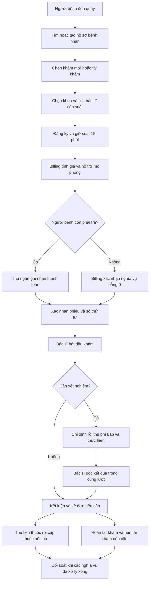

# Luồng nghiệp vụ ngoại trú — quy tắc hiện hành 25/10/2026

## 1. Phạm vi và cách đọc

MediFlow mô phỏng phòng khám đa khoa ngoại trú nhỏ có tiếp nhận, bác sĩ, Lab, quầy thuốc,
thu ngân và quản lý. Các quyết định dưới đây được chốt theo yêu cầu người dùng ngày 25/10.
Nội trú, phẫu thuật, quyết toán BHXH, liên thông bảo hiểm và cổng thanh toán thật ngoài phạm vi.

**Đây là nghiệp vụ đích đã chốt, không là xác nhận binary hiện tại đã triển khai.**
Baseline kỹ thuật V0/V1 và các guard đã có nằm ở phần cuối; hợp đồng hiện hành ở [03](03-contracts.md).
Gap triển khai nằm ở [07](07-outpatient-workflow-implementation.md), tiêu chí kiểm ở [06](06-acceptance-runbook.md).
Nếu màn hình hiện tại thiếu lịch ca, liên kết tái khám hoặc hỗ trợ BHYT, phải ghi là gap;
không dùng mô tả thiết kế làm bằng chứng chức năng đã chạy.

## 2. Thuật ngữ và trách nhiệm

| Khái niệm | Ý nghĩa |
|---|---|
| Hồ sơ bệnh nhân | Định danh lâu dài; bệnh nhân quay lại vẫn cùng patientId |
| Lịch hẹn | Dự kiến đến khám; không chứng minh đã có mặt hoặc đã thanh toán |
| Lượt khám ngoại trú | Một lần tiếp nhận và xử trí; chứa các khoản phí và chỉ định đúng lượt |
| Hồ sơ khám | Nội dung chuyên môn của lượt: triệu chứng, diagnosis, chỉ định, kết luận |
| Phiếu đăng ký | Thông tin khoa, bác sĩ, khung giờ dự kiến, phí và trạng thái chờ thanh toán |
| Phiếu khám đã xác nhận | Đã tiếp nhận và đủ điều kiện tài chính; có số thứ tự/hướng dẫn vào khám |
| Lịch khám ngoại trú | Khoảng thời gian bác sĩ nhận khám tại khoa/phòng; không đồng nhất ca trực cấp cứu/nội trú |
| Tái khám | Lượt khám mới để đánh giá lại vấn đề đã khám, liên kết lần khám trước |
| Quay lại đọc kết quả | Tiếp tục lượt đang mở sau Lab; không phải một lần tái khám mới |

Y tá trong MVP kiêm tiếp nhận; không tự chẩn đoán hoặc tự chỉ định xét nghiệm/thuốc.
Y tá ghi nhu cầu, hướng dẫn chuyên khoa theo quy trình phòng khám; trường hợp chưa rõ cần
bác sĩ/người có chuyên môn hỗ trợ. Thu ngân xác nhận thu/hoàn; bác sĩ quyết định chuyên môn;
LAB_TECH tiếp nhận mẫu/thực hiện/trả kết quả; PHARMACIST cấp thuốc. ADMIN vận hành,
MANAGER theo dõi và quản lý lịch theo quyền cụ thể đã được cấp. Không coi role là quyền
thực hiện mọi hành động chuyên môn; endpoint và authority phải được nghiệm thu riêng.

## 3. Lịch khám và phân công bác sĩ

Chi tiết wire TARGET cho lịch/giữ suất nằm ở [03 phụ lục A](03-contracts.md#opd-scheduling-v2).
ADMIN cấp danh sách khoa quản lý cho account MANAGER tại Core; khoa công tác hoặc chức danh
trưởng khoa không tự cấp quyền. Phiếu PREBOOKED đã thu có thể CONFIRMED nhưng vẫn cần ghi nhận
đã đến trước bắt đầu khám. Slice đầu thu đủ số tiền dương; hỗ trợ BHYT/tái khám/zero payable
vẫn theo các bước riêng bên dưới, chưa được chứng nhận bởi schema của slice lịch khám.

Clinical là authority của `ConsultationSchedule` và việc giữ suất ngoại trú; Organization
là authority staff/khoa/phòng và tình trạng đủ điều kiện của bác sĩ. Đây là ranh giới đích,
chưa phải tên entity/API đã có. Không tạo hai lịch cùng authoritative ở Core và Clinical.
Lịch nhân sự tổng quát của Core nếu có chỉ là nguồn tham chiếu, không là bộ đếm suất khám.

Mỗi lịch xác định bác sĩ, khoa, phòng, ngày, giờ bắt đầu/kết thúc, khoảng nghỉ, sức chứa và
trạng thái mở/ngừng nhận. Giờ nghiệp vụ dùng `Asia/Ho_Chi_Minh`; facts dùng UTC Instant.
Khung phục vụ mặc định MVP là 07:00–17:00; chỉ nhận suất có thời gian kết thúc không vượt
cuối ca, không chồng ca/phòng/bác sĩ. Không coi giới hạn 07:00–17:00 hiện có là kiểm tra ca trực.

### 3.1. Quản lý lịch theo buổi và lịch cá nhân

MVP quản lý **buổi nhận khám và sức chứa**, không chia cứng mỗi người bệnh 15 phút.
Ví dụ bác sĩ A nhận khám 07:00–11:00 tại phòng 101, tối đa 12 lượt; đây là dữ liệu minh họa,
không là định mức chuyên môn. TTL giữ suất 15 phút bên dưới là thời hạn hoàn tất đăng ký/thu,
không phải thời lượng khám. Một suất là một chỗ trong buổi; giờ trên phiếu là khung dự kiến.

| Use case | Role đích | Thao tác và kết quả |
|---|---|---|
| SCH-01 Quản lý buổi khám | ADMIN/MANAGER được phân quyền | Chọn ngày, bác sĩ, khoa, phòng, giờ, khoảng nghỉ và sức chứa; kiểm eligibility/chồng lịch rồi mở nhận |
| SCH-02 Điều chỉnh/ngừng nhận | ADMIN/MANAGER được phân quyền | Xem phiếu bị ảnh hưởng, ghi lý do; ngừng nhận mới không tự hủy phiếu cũ |
| SCH-03 Tra cứu suất để tiếp nhận | NURSE | Lọc ngày/khoa, xem buổi còn suất và giữ một chỗ; backend kiểm lại trước ghi |
| SCH-04 Xem lịch cá nhân theo ngày | DOCTOR | Mặc định hôm nay, xem các buổi của mình, khoa/phòng, giờ và danh sách người bệnh theo trạng thái |
| SCH-05 Xem lịch cá nhân theo tuần | DOCTOR | Tuần từ thứ Hai đến Chủ nhật theo giờ Việt Nam; xem buổi khám và mức sử dụng, chọn buổi mở chi tiết ngày |
| SCH-06 Xem phiếu của bản thân | PATIENT | Xem bác sĩ, khoa/phòng, khung giờ và số thứ tự trên phiếu của mình khi API đã hỗ trợ |

Role trong bảng là thiết kế cần triển khai @PreAuthorize và authority tương ứng, không tự mở
quyền endpoint hiện tại. MANAGER chỉ quản lý khoa/phạm vi đã được giao trong dữ liệu quyền;
chưa có nguồn phạm vi thì từ chối command quản lý, không coi MANAGER mặc định quản lý mọi khoa.
ADMIN quản lý toàn phòng khám theo quyền vận hành. NURSE không tự sửa lịch hoặc sức chứa.

Màn hình ngày tách **buổi nhận khám** với **danh sách lượt đã đăng ký**. Bác sĩ xem khám mới/
tái khám, có mặt/chưa đến, chờ thu, sẵn sàng khám, đang khám, chờ Lab và hoàn tất theo dữ liệu
nguồn. Chờ thu có thể xuất hiện ở danh sách đăng ký nhưng không vào hàng chờ được phép khám.
Chỉ mở/bắt đầu lượt được phân công hoặc bàn giao hợp lệ; không coi role DOCTOR đủ quyền khám
mọi bệnh nhân. Không thêm một lượt mới khi người bệnh trở lại đọc kết quả trong cùng hồ sơ.

Màn hình tuần ưu tiên thông tin lịch và tổng số, không tải hồ sơ bệnh án của tất cả người bệnh.
Hiển thị tách số suất còn giữ tạm, đã xác nhận và còn trống; tổng lượt hoàn tất riêng, không cộng
lại vào số đã xác nhận để đếm sức chứa hai lần. Suất đã phục vụ vẫn chiếm định mức của buổi;
hủy trước phục vụ giải phóng theo policy, thanh toán chưa rõ kết quả vẫn giữ như quy tắc mục 3.2.
Ngày không có lịch hiển thị “Không có buổi khám”; lỗi tải lịch hiển thị lỗi, không giả lịch trống.

Bác sĩ **xem lịch**, chưa tự tạo/sửa/xóa ca hoặc duyệt nghỉ qua hệ thống trong MVP. Khi bận,
báo người quản lý theo kênh vận hành hiện có; người quản lý xử lý lịch và các phiếu liên quan.
Chấm công, tính lương, trực cấp cứu/nội trú, tự động tối ưu phân ca và lặp lịch dài hạn ngoài phạm vi.

### 3.2. Giữ suất và xử lý thay đổi

Quy tắc đăng ký:

1. Chọn ngày và khoa, chỉ liệt kê bác sĩ hoạt động, đúng khoa, có lịch nhận khám còn suất.
2. Y tá chọn một suất; backend kiểm lại và giữ suất nguyên tử. Không chỉ kiểm danh sách trên UI.
3. Mặc định giữ suất **15 phút**, là chính sách demo do dự án chọn; hiển thị thời điểm hết hạn.
4. Sau khi đủ nghĩa vụ tài chính, xác nhận cùng suất, không chọn bác sĩ lại sau khi đã thu tiền.
5. Hết hạn chưa thu thì giải phóng suất. Bắt đầu thu phải có quyền giữ suất ổn định cho payment
   operation đó; tác vụ hết hạn không được giải phóng suất đang xử lý giao dịch chưa rõ kết quả.
6. Không biết kết quả thu vì timeout thì tra cứu cùng operationId, không thu lại hoặc báo thất bại
   chắc chắn. Late payment sau khi suất thật sự đã mất phải vào đối soát: chưa cho vào hàng chờ,
   đề nghị lịch thay thế có xác nhận của bệnh nhân hoặc hoàn tiền đúng quy tắc.

Lịch khám ghi **khung giờ dự kiến**, số thứ tự xác định thứ tự trong buổi; không hứa chính xác
phút bắt đầu. Bệnh nhân trễ đến cần y tá sắp lại theo suất còn trống và chính sách hàng chờ,
không chiếm suất của người đã được xác nhận. Không cộng ưu tiên tái khám tùy ý; chỉ hỗ trợ
đúng lịch hẹn và phân loại chuyên môn được ghi nhận.

Bác sĩ nghỉ/đổi ca: ngừng nhận mới, liệt kê các phiếu bị ảnh hưởng, y tá đề xuất bác sĩ cùng
khoa đủ điều kiện hoặc đổi giờ. Ghi người đổi, lý do, lịch cũ/mới và sự đồng ý của người bệnh.
Không sửa ngầm phiếu đã trả tiền, không tự thu EXAM lần hai; chênh lệch giá phải qua Billing.

## 4. Khám mới tại quầy và lịch đặt trước

Bản xuất để xem/in: [SVG](diagrams/outpatient-patient-flow.svg),
[Mermaid source](diagrams/outpatient-patient-flow.mmd). Định nghĩa luồng trong khối trên
là nguồn sửa chính; cập nhật bản xuất cùng lúc khi thay sơ đồ.

Các bước tại quầy:

1. Y tá tìm hồ sơ theo thông tin định danh, xác minh đúng người; không tạo patient mới mỗi lần đến.
2. Ghi lý do khám, chọn loại lượt, khoa và bác sĩ có lịch phù hợp. Hiển thị phí trước khi xác nhận.
3. **Một lần xác nhận đăng ký tại quầy bao gồm xác nhận đã có mặt** và mở yêu cầu thu phí khám.
   Không yêu cầu thêm một người bấm “duyệt tiếp nhận” nếu không có trách nhiệm kiểm tra riêng.
4. Thu ngân xem đúng phiếu, đối chiếu các dòng tiền, thu đúng phần người bệnh phải trả.
5. Sau thanh toán/zero-pay eligibility, hệ thống xác nhận phiếu và hướng dẫn phòng, bác sĩ,
   khung giờ, số thứ tự. Trước đó người bệnh vẫn được xem thông tin dự kiến và số tiền.
6. Bác sĩ được phân công gọi người bệnh, kiểm tra đúng lượt và bắt đầu khám. Thanh toán không
   tự động ghi “đã khám”; phải có người thực hiện và thời điểm thực tế.

Với **đặt lịch trước**, slice PREBOOKED trong 03 yêu cầu hoàn tất thu trong 15 phút từ lúc
đăng ký; sau xác nhận, suất được giữ cho buổi đã chọn, không tiếp tục hết hạn sau 15 phút.
Khi đến vẫn ghi nhận có mặt, kiểm lại lịch và xử lý nghĩa vụ phát sinh nếu có; không thu phí
khám lần hai. Đặt trước nhưng chờ tới ngày khám mới thu cần chính sách giữ suất riêng,
chưa nằm trong slice này. MVP mới chưa cung cấp self-booking nếu chưa có API/ownership
đã nghiệm thu; không mô tả PATIENT tự đặt là chức năng hiện tại.

Người có dấu hiệu cấp cứu phải được hướng dẫn xử trí theo quy trình chuyên môn phù hợp;
luồng thông thường không được dùng để tuyên bố cấp cứu phải chờ đóng tiền. Chỉ giữ audited
emergency override đã có, không mở thêm cấp cứu/nội trú để hoàn thành phạm vi này.

## 5. Tái khám và quay lại đọc kết quả

| Trường hợp | Lượt/hồ sơ | Phí khám | Thông tin chuyên môn |
|---|---|---|---|
| Vấn đề mới ở người bệnh đã có hồ sơ | Lượt mới, cùng patientId | Theo catalogue khám mới | Lịch sử chỉ để tham khảo |
| Bác sĩ hẹn đánh giá lại | Lượt mới loại FOLLOW_UP, liên kết lượt/hồ sơ trước | Theo catalogue tái khám, không mặc định miễn | Lời hẹn, mục tiêu đánh giá, điều trị trước |
| Quay lại có kết quả trong lượt chưa kết thúc | Cùng lượt và hồ sơ đang mở | Không thêm EXAM charge | Bác sĩ tiếp tục đánh giá/kết luận |
| Tự quay lại sau lần trước đã hoàn tất, không có lời hẹn | Y tá ghi nhu cầu; bác sĩ xác định tiếp nối hay vấn đề mới | Theo loại dịch vụ đã xác định, không suy miễn phí | Giữ liên kết lần trước nếu thực sự tiếp nối |

Kết thúc khám, bác sĩ có thể lập `FollowUpRecommendation`: ngày hoặc khoảng ngày đề nghị,
khoa, bác sĩ ưu tiên, lý do, hướng dẫn chuẩn bị và nguồn hồ sơ. Đây là **lời hẹn chuyên môn**,
chưa giữ một suất bác sĩ nếu chưa chọn lịch đang mở. Không mặc định lời hẹn tương đương đã thanh toán.

Khi đăng ký tái khám, xác minh lượt nguồn thuộc đúng patient; hiển thị lời hẹn, chẩn đoán và
điều trị trước dưới dạng lịch sử. Ưu tiên bác sĩ cũ khi còn lịch; nếu nghỉ thì chọn người thay
cùng khoa, thông báo và lưu lý do. Quá khoảng hẹn cần đánh giá lại, không tự từ chối khám hoặc
tự chuyển sang miễn phí. Không giới hạn mọi người bệnh một lần khám suốt ngày nếu cần tiếp nối
chuyên môn; thay guard `PENDING/day` phải có thiết kế chống lượt trùng và regression cụ thể.

Không copy chẩn đoán cũ thành kết luận mới, không tự cấp lại đơn hoặc lặp xét nghiệm theo lời
hẹn. Mỗi chỉ định mới do bác sĩ xác nhận và có sourceId riêng. Lượt nguồn đã hoàn tất là bất biến;
không mở lại để tránh phí, không gắn kết quả của người khác hoặc lượt mới vào lượt cũ.

## 6. BHYT mô phỏng và cách tính tiền

> **Giả định học phần theo yêu cầu người dùng:** mọi người bệnh có BHYT đã đóng đầy đủ,
> còn hạn và được coi đủ điều kiện. MediFlow chỉ mô phỏng hỗ trợ giá một số dịch vụ.
> Các tỷ lệ dưới đây do dự án tự quy định; không là mức hưởng BHYT theo pháp luật,
> không phân tuyến, không giám định, không kiểm thẻ và không quyết toán với BHXH.

UI/phiếu phải ghi **“Hỗ trợ BHYT mô phỏng”**; không gọi đây là khoản BHXH đã chuyển tiền.
Trong phạm vi này Billing xử lý như khoản giảm nghĩa vụ người bệnh; không mở công nợ bên
bảo hiểm, không tạo payment giả. Người không có account PATIENT vẫn dùng cùng chính sách khi
có hồ sơ; login role không quyết định mức hỗ trợ.

### Danh mục và chính sách demo phiên bản `DEMO-BHYT-2026-10-25`

| Nhóm/dịch vụ minh họa | Giá gốc ví dụ | Hỗ trợ | Người bệnh trả | Ghi chú |
|---|---:|---:|---:|---|
| Khám mới thông thường | 100.000 VND | 50% = 50.000 | 50.000 | Không bao gồm khám theo yêu cầu |
| Tái khám theo hẹn | 80.000 VND | 50% = 40.000 | 40.000 | Lượt mới, có liên kết nguồn |
| Công thức máu | 120.000 VND | 70% = 84.000 | 36.000 | Chỉ item được gắn policy |
| Đường huyết | 40.000 VND | 50% = 20.000 | 20.000 | Chỉ item được gắn policy |
| Dịch vụ Lab khác/khám theo yêu cầu | Theo catalogue | 0% | 100% giá gốc | Mặc định không hỗ trợ |
| Thuốc | Theo catalogue Pharmacy | 0% | 100% giá gốc | Chưa mô phỏng danh mục thuốc BHYT |

Tên và giá trên là **dữ liệu thiết kế minh họa**, chưa là priceCode/drugId thật, không tự
gửi các tên đó vào API hiện tại. Khi triển khai phải ánh xạ item catalogue thực bằng ID và
khóa fixture. Được cấu hình thêm dịch vụ với tỷ lệ 0–100%, nhưng không áp một tỷ lệ chung cho
mọi khoản phí hoặc tự cho mọi xét nghiệm cùng mức hưởng.

Với từng dòng: `grossAmount = unitPrice × quantity`;
`supportAmount = round(grossAmount × supportRate, 0, HALF_UP)`;
`patientPayable = grossAmount - supportAmount`. Currency VND, BigDecimal, quantity hợp lệ,
0 <= supportAmount <= grossAmount. Cộng tiền sau làm tròn từng dòng. Phần trăm lưu dạng decimal
trong policy do server quản lý; frontend chỉ hiển thị kết quả. Không cộng chồng khuyến mại trong MVP.

Billing lưu snapshot catalogue/policyVersion/giá gốc/tỷ lệ/tiền hỗ trợ/phần người bệnh cho từng
charge và quote. Đổi policy chỉ ảnh hưởng quote mới; quote đã phát hành còn hiệu lực giữ snapshot.
Quote hết hạn phải xác nhận giá mới trước khi thu; không sửa invoice/receipt đã thanh toán.

Ví dụ một lượt có khám mới và công thức máu: giá gốc 220.000, hỗ trợ 134.000, người bệnh
trả 86.000. Có thể thu khám 50.000 trước, sau khi bác sĩ chỉ định mới thu Lab 36.000.
Không thu trước một xét nghiệm chưa được chỉ định, không trả EXAM rồi tự mở quyền tất cả Lab.

Nếu hỗ trợ 100%, patientPayable bằng 0: Billing ghi quyết định eligibility/settled obligation
có source và policy snapshot rồi mới cấp clearance. Không tạo cash payment bằng 0 để giả có thu.
Nếu mới trả một phần, chưa cấp quyền thực hiện dịch vụ đó. Clearance dựa trên nghĩa vụ người
bệnh đã đủ, không so số tiền mặt với grossAmount chưa trừ hỗ trợ.

Hoàn phí chỉ trả lại phần người bệnh thực đã trả được duyệt, trừ phần đã hoàn trước đó.
Phần hỗ trợ bị hủy là điều chỉnh chính sách/sổ đối soát, không là cash refund cho người bệnh.
Giữ giá/tỷ lệ gốc khi tính hoàn, không áp policy mới hồi tố. Ví dụ khám mới đã thu 50.000:
hủy hợp lệ trước thực hiện và duyệt hoàn toàn bộ thì hoàn 50.000, không phải 100.000.

## 7. Lab, thuốc và kết thúc lượt

Bác sĩ tạo chỉ định explicit gắn đúng lượt/hồ sơ/patient. Lab tiếp nhận chỉ định; Billing tạo
phí từ yêu cầu, không đợi kết quả mới thu. Có thể gộp các xét nghiệm đã chỉ định trong một yêu
cầu thanh toán cùng lượt; mỗi test vẫn có source/clearance riêng, không gộp theo mọi phí của patient.

Người bệnh thanh toán phần phải trả; Lab mới nhận thực hiện theo quyền hiện hành. Theo dõi
riêng chỉ định, điều kiện tài chính, tiếp nhận/lấy mẫu, thực hiện, kết quả. Với xét nghiệm không
dùng mẫu vẫn ghi bước tiếp nhận phù hợp; không tạo thời điểm lấy mẫu giả. Nhập kết quả phải có
actor, thời điểm, nội dung hợp lệ; sửa kết quả terminal ngoài phạm vi MVP, không overwrite ngầm.

Kết quả quay về hồ sơ qua event. Bác sĩ đọc kết quả và tiếp tục **cùng lượt đang mở**;
không đăng ký/thu EXAM lần hai. Nếu cần xét nghiệm bổ sung thì có chỉ định và charge mới.
Chưa có kết quả hoặc kết quả chưa đủ thì hiển thị chờ; không coi HTTP tạo chỉ định thành công
là đã có kết quả. Trường hợp trả kết quả muộn sang hôm sau có thể tiếp tục lượt vẫn mở,
không tự biến sang tái khám chỉ vì đổi ngày.

Không hoàn tất chuyên môn khi còn chỉ định bắt buộc chưa có kết quả, trừ khi bác sĩ hủy/hoãn
có lý do được ghi nhận và hướng xử trí. Đây là guard đích; hiện trạng completion phải audit
trước khi tuyên bố đã chặn mọi pending Lab. Không sửa trạng thái Lab từ Clinical để vượt guard.

Sau kết luận, kê đơn nếu cần. Pharmacy giữ giá server snapshot, reservations và kiểm kho;
thu ngân thu phần thuốc phải trả rồi PHARMACIST xác nhận cấp phát. Đã trả tiền không tự chứng
minh đã lĩnh thuốc. Không có đơn thì không ép đi qua bước Pharmacy.

Phân biệt **hoàn tất khám chuyên môn** và **đóng nghĩa vụ của lượt**: bác sĩ có thể hoàn tất
hồ sơ sau khi kê đơn, Pharmacy tiếp tục cấp thuốc và đính kèm fact vào hồ sơ mà không mở lại.
Lượt chỉ đối soát xong khi các dịch vụ/thuốc đã hoàn thành hoặc hủy hợp lệ, khoản phải thu/hoàn
còn lại đã được xử lý. Không tạo state CLOSED trên API hiện tại nếu chưa có contract.

## 8. Nhận biết trạng thái trên frontend

| Chiều trạng thái | Nội dung cần hiển thị | Không được suy ra |
|---|---|---|
| Đăng ký/lịch | Giữ suất, chờ thanh toán, đã xác nhận, hết hạn, hủy | Đặt lịch = đã có mặt |
| Khám | Chờ khám, đang khám, chờ Lab, đã kết luận | Đã thu tiền = đã khám |
| Tài chính | Chưa thu, thu một phần, đủ nghĩa vụ, chờ đối soát, chờ hoàn, đã hoàn | Hỗ trợ = tiền đã thu |
| Lab | Đã chỉ định, chờ thu, chờ thực hiện, đang làm, có kết quả, hủy | Đã chỉ định = kết quả |
| Thuốc | Chờ thu, đủ điều kiện cấp, đã cấp, hủy | Thanh toán = đã trừ kho/cấp thuốc |

Đây là nhãn nghiệp vụ đích, không phải danh sách enum live. V1 hiện có
`PENDING → AWAITING_PAYMENT → READY_FOR_EXAM → IN_EXAM → COMPLETED` qua các command riêng;
`checkIn()` đang mở yêu cầu phí khám. Màn hình tại quầy đích cần orchestration đăng ký/tiếp nhận,
không đổi `PENDING` thành “đã xác nhận thanh toán” hoặc gọi status PATCH để bỏ guard.

Màn hình tiếp nhận cần tìm patient, chọn khám mới/tái khám, nguồn lần trước, lịch còn suất,
bảng tiền và một nút đăng ký tại quầy. Màn hình thu ngân hiển thị mã lượt, dịch vụ, giá gốc,
hỗ trợ mô phỏng, phần phải trả/đã trả/còn lại; không nhập lại giá hoặc chọn tất cả nợ của patient.
Màn hình bác sĩ có danh sách chờ của mình, hồ sơ trước khi tái khám, pending Lab và kết quả.
Màn hình bệnh nhân chỉ hiển thị phiếu/lịch/kết quả/thông báo của mình theo API đã cấp quyền;
không mặc định mọi endpoint staff đều có phiên bản PATIENT.

## 9. Report và Notification theo nghiệp vụ mới

Report tách lượt đăng ký, lượt đã bắt đầu/hoàn tất, khám mới, tái khám, hủy/no-show nếu có fact.
Đọc kết quả trong lượt cũ không tăng lượt mới/tái khám. Đếm theo source operation, không đếm
số lần event được gửi hoặc số bản ghi projection. Phải có fact phân loại trước khi công bố KPI
tái khám; thiếu fact là unavailable, không tự đoán từ cùng patientId hoặc ngày gần nhau.

Tách `grossAmount`, hỗ trợ mô phỏng, nghĩa vụ người bệnh, patient cash received, actual cash
refund và net cash. Khoản hỗ trợ không phải cash, công nợ BHXH hoặc earned revenue. Mỗi payment
chỉ đóng góp một lần; cùng lượt thu khám và Lab là hai khoản thu nhưng vẫn một lượt khám.

Notification: đăng ký chờ thu chỉ thông báo “đăng ký đang chờ thanh toán”; sau khi đủ nghĩa vụ
và suất đã được xác nhận mới gửi “phiếu khám đã xác nhận”. Thay đổi bác sĩ/giờ phải thông báo
sau quyết định có audit. Lời hẹn tái khám không được ghi “đã đặt lịch” nếu chưa giữ suất.
Có kết quả Lab thì thông báo có kết quả, không diễn giải diagnosis thay bác sĩ. Hoàn tiền chỉ
ghi “đã hoàn” khi có completed refund, không từ cancellation fact. Nội dung tối thiểu, đúng
mapping patient/account; event replay/Report rebuild không gửi lại thông báo.

## 10. Nguồn tham khảo và giới hạn áp dụng

Quy trình thực tế thay đổi theo cơ sở và loại hình chi trả. [Bệnh viện Bạch Mai hướng dẫn
đăng ký Kiosk](https://bachmai.gov.vn/bai-viet/huong-dan-dang-ky-kham-benh-tu-dong-qua-kiosk-tai-benh-vien-bach-mai?id=b7e6010c-f19a-4757-b768-488e02e90576)
phân biệt đăng ký theo chuyên khoa/phòng với đặt trước để chọn đích danh bác sĩ; không yêu
cầu mọi nơi phân công giống MediFlow. [Bệnh viện Đa khoa Bạc Liêu công bố quy trình khám](https://bvdkbaclieu.gov.vn/gioi-thieu/quy-trinh-kham-chua-benh)
theo hướng dẫn 1313/QĐ-BYT và phân biệt nhóm BHYT/không BHYT/theo yêu cầu.
Đây là nguồn tham khảo tổ chức luồng, không xác nhận mức BHYT hoặc tuân thủ pháp luật của demo.
Giữ suất 15 phút, catalogue giá và tỷ lệ hỗ trợ trong mục 6 là quyết định của dự án.

## 11. Baseline kỹ thuật và các bất biến phải giữ

Các mục bên dưới mô tả nền tảng hợp đồng/độ tin cậy cần bảo toàn khi triển khai nghiệp vụ mới.
Giá và clearance hiện hành chưa tự hỗ trợ phép tính mục 6; cần hoàn thiện WF-05/06 trước rollout.

### Luồng baseline V1 cần giữ

Định danh → check-in → thanh toán khám → khám → Lab nếu cần → kê đơn nếu cần →
thanh toán thuốc → cấp thuốc → hoàn tất ngoại trú → báo cáo và thông báo cập nhật bất đồng bộ.

Đích dùng quyền theo purpose/target cho EXAM, LAB_TEST và PRESCRIPTION. Giữ V0 làm compatibility
và rollback theo [contract modes](03-contracts.md); V0 không được coi là đã đạt mọi gate đích.
Không đưa quyết toán nội trú vào luồng này để hoàn thành backend ngoại trú.

### Core

Patient UUID bất biến, identity number không trùng, ngày sinh/contact/bảo hiểm hợp lệ theo DTO.
Account username duy nhất, password BCrypt; account bị khóa không login. SYSTEM chỉ là service
token, không là human account. Staff thuộc khoa hoạt động; bác sĩ có eligibility đúng khoa.
Account/patient mapping có nguồn chính thức; không lấy patientId từ một UUID bất kỳ trong JWT.

Core không tạo medical record, charge, stock, permission khám/thuốc. Room authority đang có
được giữ dữ liệu nhưng không tạo task Surgery resource booking.

### Clinical

Baseline hiện tại: appointment không quá khứ, giữ khung giờ và ràng buộc PENDING/day.
Đây không là policy đầy đủ cho lịch ca/tái khám đích; thay guard theo WF-02/04 sau source lock. Tạo record từ
appointment cập nhật ARRIVED trong cùng local transaction. Check-in không cho phép bắt đầu khám.

Ở profile V1, check-in/request tạo fact có exact visit ID; Billing issuer tạo EXAM charge.
Chỉ bắt đầu khi exact EXAM clearance hợp lệ hoặc audited emergency override mà code đã hỗ trợ.
Không tự thêm override mới. Bắt đầu exam tạo/reuse một record; completion có diagnosis và
disposition. MVP chỉ disposition ngoại trú; admission/transfer workflows không nghiệm thu đợt này.

Lab/prescription references giữ UUID thật. Clinical nhận result/fill fact idempotently; không
copy entity của Lab/Pharmacy, không suy luận chỉ định từ chuỗi diagnosis.

### Lab

Bác sĩ tạo explicit test request với record/patient/department/source và episode đích có nguồn.
V1 charge lúc lab.request.created, không chờ kết quả. LAB_TEST clearance phải khớp từng testId.
Không bắt đầu/ghi kết quả nếu thiếu quyền; expiry kiểm tại thời điểm hành động.

Kết quả không rỗng, performed date không trước request date; hoàn thành một lần, terminal không
sửa trong MVP. Giữ resultVersion riêng envelope version. Fact kết quả cập nhật Clinical/Report/
Notification. Không tự tạo test từ medicalrecord.created hoặc đoán testId từ invoice.

### Pharmacy

Creation xác minh identity và exact outpatient clinical context. Giá lấy từ server catalogue,
snapshot theo từng dòng, không nhận giá client. Lock drug rows có thứ tự; kiểm quantity/expiry/
available stock; tạo prescription, pending dispense slip và reservations cùng transaction.
Reserve không trừ stock thật.

Billing nhận prescription.created đúng mode, tạo một charge/request/invoice. Ngoại trú V1
cần exact non-expired PRESCRIPTION clearance và authenticated dispense actor; receipt không
tự động cấp thuốc. V0 payment.completed saga là compatibility với SYSTEM actor có kiểu rõ ràng,
không giả staff UUID. M6-10 phải hoàn thiện driving API/authority thực cho V1, không mock provider.

Dispense khóa prescription/slip/reservations/drug rows; kiểm lại quyền và thời gian sau lock.
Tất cả dòng hợp lệ mới trừ stock. Stock/reservation/slip/prescription/outbox commit cùng nhau.
Command/event gửi lặp không xuất kho hai lần. Terminal failure không được thành success muộn.
Cancel/expiry release reservations và phát fact để Billing xử lý financial adjustment đúng mode.

### Billing

Chỉ Billing owns tiền. V1 account theo exact OUTPATIENT_VISIT identity; invoice/request chọn
charge cùng account, không gom mọi phí chưa trả của patient. Source charge có business key
chống trùng; giá của dịch vụ theo catalog/policy đã có, Rx theo server snapshot contract.

Payment có idempotency, persisted state và allocation guards. Transaction/outbox atomic.
Clearance khớp purpose và target, không là patient-wide paid flag. Duplicate callback/event
không tạo thêm payment/charge/grant. Refund/reversal V1 là record mới liên kết payment gốc,
không sửa lịch sử để balance về zero. Không tự tích hợp bank/card provider ngoài.

Chính sách hoàn phí được chốt ngày 2026-10-21: đã thanh toán hoặc đã nhận phiếu thu không
tự làm mất quyền đề nghị hoàn. Xét từng dịch vụ và mức độ thực hiện, lý do hủy, phần chi phí
được duyệt; không mặc định hoàn toàn bộ chỉ vì chưa nhận kết quả. Cashier ghi khoản thực hoàn
toàn bộ hoặc một phần, người thực hiện và lý do, liên kết giao dịch thu gốc. Nghĩa vụ hoàn do
hủy dịch vụ là giới hạn để đối soát, không phải bằng chứng tiền đã trả cho người bệnh.

Trước khi bắt đầu EXAM/LAB_TEST, Clinical/Lab phải nhận xác nhận thực hiện từ Billing theo
đúng clearance và source. Billing quyết định bước bắt đầu và hoàn phí dưới cùng khóa account:
hoàn trước thì chỉ định cũ không được bắt đầu. Mọi khoản hoàn EXAM/LAB_TEST thông thường phải có
bằng chứng hủy đúng dịch vụ đã được áp dụng bền vững, kể cả chưa có receipt bắt đầu ở Billing.
Quy tắc này bao phủ thực hiện cấp cứu có override và lần bắt đầu từ trước nâng cấp, khi Billing
không có đủ thông tin để kết luận dịch vụ chưa thực hiện. Hủy không sửa phiếu thu gốc,
không tự thực hiện giao dịch trả tiền. Chỉ định đã hủy không được mở lại bằng event thanh toán
hoặc clearance đến trễ. Sau khi đã hoàn tất dịch vụ, khiếu nại/thu sai cần luồng điều chỉnh riêng;
không dùng hủy xét nghiệm/khám để xóa lịch sử thực hiện đã hoàn tất.

Xác nhận bắt đầu ở Billing có thể commit trước khi giao dịch local của Clinical/Lab thất bại.
Retry phải dùng cùng operationId/source và đọc lại quyết định; không tạo lần bắt đầu mới.
Nếu local không thể tiếp tục, cần xác nhận hủy có audit để giải phóng nghĩa vụ hoàn. Không
coi timeout là bằng chứng dịch vụ chưa bắt đầu hoặc tự hoàn tiền trong khoảng chưa rõ kết quả.

MVP không cần admission accounts/deposits/insurance settlement/post-final corrections. Dữ liệu
và kernel có sẵn vẫn giữ. Không đổi quy tắc earned final-settlement-only đã chốt: số thu tiền
ngoại trú của MVP được gọi cash received/net cash, không tự công bố earned revenue.

### Thanh toán và cấp thuốc khi có lỗi

- Pharmacy tắt trước khi nhận payment event: queue giữ fact, retry khi service trở lại.
- DB rollback: không persist stock effect/outbox/inbox claim một phần.
- Commit dispense rồi receipt finalize/ACK lỗi: replay đọc committed outcome, không trừ lần hai.
- Expired reservation hoặc stock failure: Pharmacy lưu terminal outcome và failure fact đúng
  transaction boundary; Billing thực hiện compensation một lần bằng policy đúng mode.
- Payment đến sau cancel/expiry: không mở lại prescription, compensation không lặp.
- Refund chưa thành công: trạng thái vẫn pending/failed; notification không được ghi “đã hoàn”.

Compatibility V0 có ledger reversal riêng; không mô tả đó là tiền đã hoàn qua ngân hàng.
Chỉ test/record đã chứng minh completed refund mới được báo refunded ở V1.

### Support

Report nhận facts, chống trùng theo event và operation; tổng hợp lượt khám, Lab, đơn/items xuất
và cash/refund có source rõ ràng. Không suy từ thanh toán sang earned, không đọc producer DB.
Khoảng chưa có source coverage hiển thị unavailable; zero chỉ khi chứng minh khoảng có coverage
và không có operations. Legacy response fields giữ compatibility, không đổi ý nghĩa âm thầm.

Notification tạo in-app intent cho sự kiện ngoại trú đã chọn, người nhận có authoritative
patient/account mapping. Persist history/claim atomic; người dùng chỉ đọc của mình. Không cần
email/SMS hay Surgery reminder để đạt MVP. Report rebuild không phát thêm notification.

### Trạng thái và audit

Giữ state machines của mode được dùng; không free-form status PATCH để bỏ guards. Actor lấy
từ signed credential, không từ request fields untrusted. UTC Instant cho facts, zone cấu hình
cho report date; UUID/money precision không đổi. Có history và correlation, không log PII/token.
