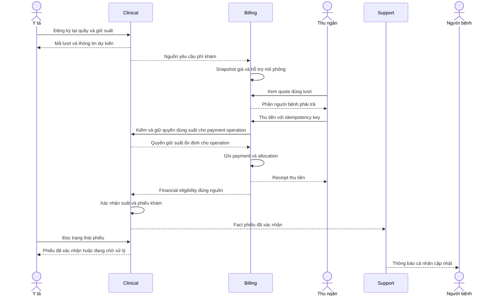

# Hợp đồng tích hợp tối thiểu

## Một nguồn wire truth

Evidence source audit 26/10 nằm ở [WF-01 source lock](09-outpatient-source-lock-2026-10-26.md)
và manifest SHA-256 đi kèm. Đây là baseline quan sát, không phát hành schema mới;
G-01–11 phải có wire và nghiệm thu producer/consumer trước khi đóng WF-01; slice lịch/giữ suất
đã có TARGET wire tại phụ lục A, chưa là producer implementation.

**Cập nhật nghiệp vụ 25/10/2026:** [02](02-business-flows.md) là nguồn quy tắc khám mới,
tái khám, lịch khám và BHYT mô phỏng. Bảng dưới là gap thiết kế cần khóa contract, không
phải schema/endpoint đã phát hành. Các route/event V1 ở phần sau giữ nguyên cho baseline.

## Hợp đồng cần bổ sung cho luồng 25/10 — chưa triển khai

Ngày 26/10 đã cụ thể hóa phần lịch khám, quyền theo khoa và reservation/payment ở
[phụ lục A](#opd-scheduling-v2).
Đây là TARGET wire để triển khai; chưa có producer/consumer implementation acceptance.
Các phần revisit, chính sách hỗ trợ/zero payable và Report vẫn theo gap WF-01, không suy đã đóng.

| Trao đổi | Authority và thông tin cần có | Tính nhất quán bắt buộc |
|---|---|---|
| Staff/khoa/phòng đủ điều kiện | Core cung cấp identity và eligibility; Clinical gọi REST bằng service credential | Missing khác unavailable; backend kiểm lại khi tạo/đổi lịch |
| Lịch khám và giữ suất | Clinical owns schedule/slot/reservation, revision, capacity, expiry, actor | Giữ suất local atomic; không hai người lấy cùng suất cuối; không đọc DB Core |
| Lịch cá nhân ngày/tuần | Clinical lấy doctor/staff identity từ signed actor, lọc khoảng ngày theo timezone nghiệp vụ | DOCTOR không đổi doctorId trên URL/body để đọc lịch cá nhân người khác; PATIENT không đọc danh sách bệnh nhân |
| Quản lý lịch theo khoa | Clinical kiểm ADMIN hoặc MANAGER và phạm vi khoa authoritative | Không có phạm vi MANAGER thì deny; phòng/bác sĩ chồng giờ bị chặn tại backend |
| Đăng ký tại quầy | Clinical nhận patient, loại lượt, lịch, nguồn tái khám nếu có | Một intent/idempotency key; nguồn tái khám đúng patient; đã có mặt cùng intent |
| Quote sau hỗ trợ | Billing owns item mapping, policy version, gross/support/patient payable, currency, expiry | Giá server snapshot; replay cùng intent trả cùng quote; input khác báo conflict |
| Thu tiền và giữ suất | Clinical/Billing trao reservation identity/revision và payment operation | Có quyền giữ ổn định trước nhận thu; expiry/cancel không cắt ngang payment chưa rõ kết quả |
| Xác nhận phiếu | Billing phát financial eligibility đúng EXAM source; Clinical quyết định schedule confirmation | Patient liability đủ và suất còn hợp lệ; không dùng payment.completed như quyền phổ quát |
| Nghĩa vụ bằng 0 | Billing lưu policy/source-bound eligibility riêng | Không giả payment bằng 0, không mở mọi dịch vụ của patient |
| Tái khám | Clinical owns lời hẹn, previous visit/record reference, target date/window, reason | Không đổi episode của lượt cũ; không coi lời hẹn là reservation đã xác nhận |
| Lab lifecycle | Clinical order và Lab test giữ exact visit/record/source | Đủ tài chính rồi thực hiện; result/cancel có version và actor; Clinical không hoàn tất khi pending bắt buộc |
| Report/Notification | Snapshot nguồn đủ loại lượt và breakdown tiền, confirmation/change facts | Report không đoán loại lượt; Notification không gọi appointment.created là phiếu đã thanh toán |

Tên như `ConsultationSchedule`, `FollowUpRecommendation`, `policyVersion`, `supportAmount`
ở thiết kế là thuật ngữ đề xuất, chưa được phép gửi vào live DTO. Khóa wire trong WF-01
trước implementation: path/method/role, request/response/errors, nullable fields, producer
subject/event version, source identity và golden fixture. Breaking meaning dùng version mới;
không thêm optional field rồi đổi nghĩa tổng tiền cũ. Không tự tăng V1/V2 theo ngày tài liệu.

Luồng request/response đích: UI → same-origin Gateway → Clinical tạo registration và reservation;
Billing nhận nguồn tạo quote/charge qua hợp đồng đã khóa; UI hiển thị chờ chuẩn bị thu nếu event
chưa tới. Thu ngân gửi payment idempotently tới Billing; response cho biết kết quả thu, không
khẳng định Clinical đã xử lý event. UI đọc lại phiếu tới khi confirmed hoặc trạng thái cần đối soát,
có retry read hữu hạn; không tự gửi lại payment. Sau đủ tài chính, Clinical xác nhận cùng reservation
và phát fact để Notification cập nhật. Không tạo distributed transaction giữa hai service.

Bản xuất để xem/in: [SVG](diagrams/outpatient-confirmation-sequence.svg),
[Mermaid source](diagrams/outpatient-confirmation-sequence.mmd).

Mũi tên bất đồng bộ trong sơ đồ là thiết kế ngữ nghĩa; event name/wire cụ thể chỉ tồn tại sau
source lock. Với zero payable thay bước thu tiền bằng quyết định eligibility có audit của Billing.
Sơ đồ mô tả happy path. Nếu Clinical từ chối giữ suất hoặc unavailable, Billing dừng trước khi
ghi nhận thu; không tiếp tục các bước receipt/grant/confirmation phía sau.
Late payment sau lost reservation phải có trạng thái đối soát, không tự cấp số thứ tự vượt suất.
Report/Notification có thể cập nhật chậm; không chặn thu tiền vì Support unavailable.

Hoàn phí cần snapshot nguyên bản và linkage actual patient payment/allocation/refund. Không gửi
supportAmount vào cash payment/refund fact như tiền đã nhận. Phần hỗ trợ mô phỏng bị hủy cần
adjustment riêng; duplicate event không tạo thêm patient liability hoặc grant. Thuốc mặc định
hỗ trợ 0%, Pharmacy vẫn là nguồn giá catalogue/stock, Billing là nguồn chính sách tài chính.

Tài liệu này quyết định phạm vi và quy tắc tích hợp. Exact field names/types/nullability/roles/
errors lấy từ live controllers, DTOs, serializers và producer fixtures ở source, sau đó khóa
manifest M6-02. Không dùng thiết kế mới để khẳng định endpoint/event chưa code đã tồn tại.
Không đổi wire tiếng Việt/Anh vì đổi deployment name; breaking change có version riêng.

## Modes

| Mode | Sử dụng |
|---|---|
| COMPATIBILITY V0 | Giữ các API/saga/event đang có để regression và rollback; không mở rộng ý nghĩa paid |
| MVP OUTPATIENT V1 | Profile đích cho exact EXAM/LAB_TEST/PRESCRIPTION clearance và source-bound operations |
| DEFERRED | Admission/Surgery/full V2, không producer/listener/job/route activation trong MVP |

Mỗi command/aggregate/delivery chọn một mode rõ ràng. Không thử V1 rồi fallback V0 khi thiếu
permission/provider. Không chạy hai issuer cùng charge source. MVP V1 chỉ công bố đạt khi
driving API, real authority, producer/consumer cùng bytes và PG/Rabbit/Gateway tests đạt.
Nếu chưa đủ, ghi task mở; không đổi demo thành V0 mà vẫn gọi toàn bộ MVP V1 hoàn thành.

## Gateway và routes

| Prefix giữ nguyên | Target deployment | Source owner |
|---|---|---|
| /api/v1/auth/** | Gateway; upstream account verification ở Core | Hoàng Anh |
| /api/v1/org/**, /api/v1/patients/** | Core | Hoàng Anh |
| /api/v1/appointments/**, /api/v1/records/** | Clinical | Vinh |
| /api/v1/lab/** | Lab | Vinh |
| /api/v1/pharmacy/** | Pharmacy | Huy |
| /api/v1/billing/** | Billing | Vinh |
| /api/v1/reports/**, /api/v1/notifications/** | Support | Huy/Report, Vinh/Notification |
| /api/v1/inpatient/**, /api/v1/surgery/** | Không route trong profile MVP | Deferred |

Prefix không thay exact endpoint/role matrix. Gateway phải deny method/path ngoài manifest,
không OR roles của hai module co-host. Account verify và exists/lookup là service-only,
không public human API. Giữ ApiResponse/PageResult và correlation như source.

## Core/Gateway access-control changes — 2026-10-25

- Patient `DELETE /api/v1/patients/{id}` remains ADMIN-only and returns 204, but now
  archives instead of physically deleting. Repeating it is idempotent. `PatientDTO.daLuuTru`
  exposes the state. Active search excludes archived records; authorized get-by-id and
  service existence/minimal lookup retain the UUID and identity. The unique identity number
  remains reserved. Updating an archived record returns 422 `PATIENT_ARCHIVED`.
  Archival does not cancel visits, disable accounts or establish clearance in other contexts.
- ADMIN/NURSE correction of `soCmnd` or `ngaySinh` on the existing Patient PUT requires
  `lyDoThayDoiDinhDanh` (nonblank, at most 500 characters). Missing reason returns 422
  `PATIENT_IDENTITY_REASON_REQUIRED`; unchanged identity does not require a reason.
  A locked Patient row, its correction audit and event outbox commit in one Patient transaction.
  Audit stores signed actor account/role, reason, before/after identity and birth date, time and
  correlation ID. Audit values are private persistence data; no public audit endpoint is added.
- `PUT /api/v1/org/staff/{id}/contact` accepts only `phoneNumber`, `email`, `address`
  (nullable, omitted values clear the corresponding contact value; full replacement of these
  three fields). ADMIN/MANAGER/DOCTOR/NURSE/PHARMACIST/CASHIER/LAB_TECH must match the signed
  `staffId`, including ADMIN. PATIENT/SYSTEM and absent/foreign staff identity are denied.
  Full administrator staff editing remains ADMIN-only. Identity, job, department, licence,
  qualifications and account permissions cannot be changed through self-contact updates.
- Login/refresh access tokens now carry `credentialVersion`. Gateway validates each protected
  human request against the existing signed Organization account identity lookup: active state,
  credential version, role and staff/department/patient claims must all match. Stale sessions
  return 401 `AUTH_SESSION_REVOKED`; unavailable authority fails closed with 503/504
  `AUTH_UPSTREAM_UNAVAILABLE`. No cache means the next request observes a committed change;
  in-flight requests are not cancelled. Legacy tokens without a version mean version zero.
  Public authentication/health and signed SYSTEM routes keep their existing guards.
  This adds one Organization lookup per authorized human request and makes availability depend
  on that authority. Business ports must remain internal: direct calls bypass Gateway revocation.
- Additive, flat event facts are `patient.archived` and `staff.contact.updated`, each containing
  only `eventId`, `occurredAt`, `correlationId`, and `patientId`/`staffId`. They use the owning
  context's transactional outbox. No downstream action or consumer is activated; unbound facts
  follow the existing bounded retry/quarantine policy and remain retained for investigation.

Patient migration `V4__patient_archive_and_identity_audit.sql` adds the archive flag and audit
store. Client rollout must include the reason field before users correct identity; mobile clients
that omit it receive the explicit validation error. Mobile code and token storage are unchanged.

## REST dependencies

Organization hiện yêu cầu `departmentHeadId` trong request
`PUT /api/v1/org/departments/{id}`: UUID để bổ nhiệm, `null` để bỏ trưởng khoa;
thiếu field là request không hợp lệ, không có nghĩa giữ nguyên. Trưởng khoa phải là bác sĩ
đang hoạt động trong cùng khoa; không chuyển khoa của trưởng khoa trước khi bỏ/đổi bổ nhiệm.
Đổi chức danh trưởng khoa từ `DOCTOR` sang `NURSE` hoặc chức danh không phải bác sĩ cũng
phải bỏ/đổi bổ nhiệm trước; yêu cầu đổi khi còn giữ chức bị từ chối với lỗi hiện hành
`422 DEPARTMENT_HEAD_INVALID`. Sau miễn nhiệm/thay thế, cho phép đổi chức danh theo validation
nhân viên hiện có. Bổ nhiệm/miễn nhiệm không tự thay `jobTitle`; bảng quy định và giới hạn
mô hình nằm trong [Core docs](../../backend/core-service/docs.md).
Giữ nguyên hợp đồng này khi đóng gói Core; kiểm tra consumer theo DTO/test nguồn master.

Clinical/Pharmacy gọi Core để xác minh patient/staff/department bằng signed service credential.
Pharmacy gọi Clinical prescription-context lookup với exact recordId, patient, prescriber,
department và visit identity. Gateway OrganizationAuthClient phải đổi upstream discovery về Core.
Report không Feign tới producer; Notification MVP không tự thêm contact lookup vì chỉ in-app.

Confirmed absence khác timeout/5xx/malformed; unavailable không là exists=false hoặc default
permission. Có timeout/circuit breaker/bounded retry, không retry write tạo effect mới.
Discovery name khác logical JWT subject; giữ allowlist/module caller identities compatibility.

Pharmacy dùng service subject `pharmacy-service`, role SYSTEM, TTL tối đa 60 giây cho đúng
`GET /api/v1/billing/financial-clearances/{id}/lookup`; đây không là quyền gọi Billing human APIs.
Current PRESCRIPTION eligibility phải đối soát exact request/charge/allocation/payment cùng
patient/account/episode. `grantedAt` phải giữ instant từ original grant envelope khi còn bằng
chứng đó: làm tròn TIMESTAMPTZ không được biến cùng một source thành authorization khác.
Không sửa original bytes hoặc nới so khớp để bỏ qua revoked/expired/refunded/mismatched grants.

## Event manifest

### B01–B06 bổ sung ngày 2026-10-21

Clinical/Lab dùng signed SYSTEM subject tương ứng để gọi
`POST /api/v1/billing/financial-clearances/{id}/execution-starts` với
`operationId`, `sourceType`, `sourceId`, `patientId`, `careEpisodeType`, `careEpisodeId`.
Operation ID ổn định bằng source ID; Billing khóa account cùng đường hoàn tiền, kiểm lại quyền
hiện tại trước cả replay và trả receipt gốc. Thời điểm bắt đầu cũ không làm replay hết hạn;
không đổi operation ID sau timeout. Lookup hiện tại có thêm `sourceType`/`sourceId` để Lab
đối chiếu đúng test khi ghi kết quả. Giữ nguyên grant event V1.

ADMIN/CASHIER có thể đọc `GET /api/v1/billing/lab-adjustments/{testId}/refunds-due` và
`GET /api/v1/billing/exam-adjustments/{appointmentId}/refunds-due` để đối soát nghĩa vụ còn lại.
Cancellation fact không phải giao dịch trả tiền. Hợp đồng, snapshot lịch sử và quy trình replay
nguồn nằm trong [Billing README](../../backend/billing-service/README.md).

Gateway refresh phải đọc current identity từ
`GET /api/v1/org/accounts/{accountId}/identity`; endpoint chỉ cho SYSTEM subject `gateway`.
Snapshot gồm `exists`, `active`, `accountId`, `role`, `staffId`, `departmentId`, `patientId`.
Token thiếu expiration, tài khoản khóa hoặc lookup unavailable không cấp access token mới.

`POST /api/v1/org/staff` hỗ trợ `Idempotency-Key` theo actor và exact request fields.
First create trả 201, exact replay trả 200 cùng staff ID/Location và header
`Idempotency-Replayed: true`; khác request với cùng key trả 409
`STAFF_IDEMPOTENCY_KEY_REUSED`. Organization outbox và receipt cùng store/transaction;
relay giữ event ID/bytes và consumer phải chống lặp. Chi tiết vận hành tại
[Core README](../../backend/core-service/README.md).

Đây là routing/semantics manifest, không schema mới. Khóa schema bằng fixtures tại M6-02.

| Fact | Logical producer | Consumer/action trong MVP |
|---|---|---|
| patient.created | patient-service | Notification compatibility khi mapping hợp lệ |
| appointment.created | clinical-service | In-app notice |
| appointment.status.changed | clinical-service | EXAM issuer theo mode; không double-charge với record |
| medicalrecord.created | clinical-service | Billing compatibility/EXAM source dedupe, Report compatibility |
| medicalrecord.completed | clinical-service | Report outpatient count, Notification nếu fixture đã có |
| lab.request.created | lab-service | V1 Billing planned charge |
| lab.request.cancelled | lab-service | Exact-source cancellation, void unpaid charge / record remaining refund obligation |
| appointment.exam.cancelled | clinical-service | Exact EXAM cancellation and audit, Billing adjustment evidence |
| lab.result.created | lab-service | Clinical result, Report Lab count, optional in-app notice |
| prescription.created | pharmacy-service | Billing Rx charge/request |
| prescription.filled | pharmacy-service | Billing saga completion, Clinical attachment, Report items/count, in-app |
| prescription.dispense.failed | pharmacy-service | Billing adjustment/compensation, không auto refund cả hai mode |
| invoice.created | billing-service | Private payment-request notice đúng mode |
| payment.completed | billing-service | V0 Rx saga hoặc V1 cash evidence; V1 không care authorization |
| financial.clearance.granted | billing-service | Exact EXAM/LAB_TEST/PRESCRIPTION authorization |
| payment.failed | billing-service | V0 compensation/report reversal/notice theo source |
| payment.refunded | billing-service | V1 completed cash refund projection/notice khi activated |
| stock.low | pharmacy-service | Ops/in-app nếu thuộc manifest, không MVP prerequisite |
| notification.sent | notification-service | Delivery fact, không unlock care |

ADMISSION_DEPOSIT/SURGERY clearance và admission/surgery/settlement/topup facts không bật ở
MVP. Không xóa shared queues hoặc historical messages: consumer phải phân loại deferred facts
trước effect, giữ quarantine/HELD theo policy hiện có, không ACK-drop financial evidence.

## Identity và idempotency

Patient/staff/account/department IDs có authoritative origin. Episode identity chọn khi mở
outpatient account, không thay khi record xuất hiện. Không lookup “latest record” hoặc dùng
patientId để chọn mọi khoản tiền/đơn thuốc.

V1 envelope: eventId, eventType, integer version, occurredAt, correlationId, producer, payload.
Routing key không tự thêm .v1; schema version không là result/operation revision.
Logical producer vẫn patient-service/clinical-service/pharmacy-service/... dù app co-host.
Giữ event IDs và raw bytes của outbox cũ. Optional additive field có compatibility test;
rename/type/meaning change phải version và consumer fixtures đồng bộ.

Claim eventId và effect cùng transaction. Business-operation key chống same operation/new eventId.
Same key/different bytes là conflict; source ID/purpose/episode mismatch không được silently accept.
Không bảo đảm broker exactly-once; phải chứng minh effects không lặp bằng state/locks/receipts.

Notification `payment.completed` V1 giữ SHA-256 exact inbound bytes ở `receipt_raw_hash`;
`payload_hash` normalized cũ được giữ để tương thích old reader. Hai hash và history/outbox
commit cùng transaction. Historical V1 raw-NULL fail closed; chỉ offline import từ archive
original producer có provenance mới được bổ sung raw identity, không học từ replay đầu tiên.
Coverage/archive và rollback phải theo
[Notification upgrade runbook](../../backend/notification-service/docs/receipt-byte-identity.md).
Rollback binary cũ giữ data compatibility nhưng không cung cấp raw-byte enforcement mới.

### Clinical nhận outpatient prescription.filled V1

Producer bytes khóa tại
`backend/pharmacy-service/src/test/resources/contracts/care-finance-v1/prescription.filled.outpatient.v1.json`.
Clinical chỉ nhận envelope V1 này trong mode `outpatient-mvp`: logical producer
`pharmacy-service`, careContext `OUTPATIENT`, sourceType `PRESCRIPTION`, sourceId bằng
prescriptionId, admissionId null, occurredAt bằng filledAt. Required target fields là
recordId/patientId/departmentId, `OUTPATIENT_VISIT`/careEpisodeId và dispenseId.
Không suy recordId từ prescriptionId hoặc dispenseId. Clinical khóa record rồi đối chiếu
patient/khoa/episode; episode là appointmentId của record, hoặc recordId với walk-in.

Delivery key là eventId; operation key là `clinical:prescription:v1:<dispenseId>`.
Inbox claim và attached result commit cùng transaction, giữ exact raw bytes và fingerprint
toàn bộ business snapshot, kể cả items/price chưa dùng trong Clinical projection. Price decimals
V1 phải giữ chính xác; không đổi fingerprint đã persist của V0/Lab/clearance cũ.
Same eventId phải cùng raw bytes; new eventId/cùng dispense chỉ no-op khi business snapshot
khớp. Prescription đã gắn bởi dispense khác hoặc effect lịch sử thiếu fingerprint là conflict;
không tự đánh dấu delivery mới thành công.

Sự kiện đến muộn có thể append reference vào record đã hoàn tất ngoại trú mà không mở lại
record, thay diagnosis/disposition hoặc phát lại completion. Known replay vẫn no-op sau
completion; new fill vào disposition ADMISSION/TRANSFER bị reject trong MVP.
Flat V0 tiếp tục quarantine trong MVP và giữ behavior compatibility ngoài MVP;
không đổi default mode/gates. Đây là consumer contract acceptance, chưa là real paid Rx E2E.

## RBAC

Role constants giữ ADMIN, DOCTOR, NURSE, PHARMACIST, CASHIER, LAB_TECH, MANAGER, PATIENT, SYSTEM.
Role không tự thay clinical authority. Mọi endpoint có @PreAuthorize theo live manifest.
Human APIs chỉ signed access tokens; refresh/service không dùng thay human. PATIENT ownership
kiểm trong use case; internal-only lookups cần authenticated service subject/scope. Secrets external.

## Contract evidence và gap register

Không giữ handoff cũ như task bắt buộc. Một gap MVP mới phải ghi ngay trong M6 task:
producer, consumer, thiếu field/permission/behavior, owner, acceptance fixture và test.
Task không tự cấp quyền sửa service owner khác. Deferred gap không chặn MVP trừ khi code còn
vô tình phụ thuộc nó. Chuyển module/hợp đồng phải update cả hai phía hoặc giữ gate OFF.

Surgery/Inpatient contract implementation và fixtures trong source vẫn tồn tại, nhưng không
là scope mới của tài liệu này. Không sửa payload của chúng theo manifest ngoại trú.

### Producer Inpatient được nhập từ master ngày 2026-10-14 — DEFERRED

- `GET /api/v1/inpatient/admissions/{id}/placement-lookup` trả snapshot coherent với
  `exists`, `admissionId`, `patientId`, `admissionStatus`, `medicationWindowOpen`,
  `placementRevision`, `placement`, `observedAt`. `placement` có thể null; department
  của placement là khoa của giường, không tự suy ra từ khoa chủ quản admission.
  Lookup không phải lease hay quyền cấp thuốc cuối cùng; lookup admission cũ vẫn giữ nguyên.
- `admission.placement.changed` V1 dùng `(admissionId, placementRevision)`:
  ASSIGNED có current, TRANSFERRED có previous/current nguyên tử, RELEASED có previous.
  Same-bed no-op không sinh fact; gap giữ pending/unavailable, duplicate cùng bytes
  idempotent, cùng key khác bytes là conflict.
- `bed.capacity.changed` V1 dùng `(bedId, capacityRevision)` và effective snapshot.
  Eligible khi active và không OUT_OF_SERVICE; AVAILABLE/OCCUPIED không tạo capacity revision.
  Migration V3 chỉ tạo baseline tại `updated_at` hiện hữu, không bịa lịch sử trước baseline.
- Fixtures nguồn: `backend/inpatient-service/src/test/resources/contracts/admission-placement-v1/`
  và `backend/inpatient-service/src/test/resources/contracts/bed-capacity-v1/`.
  Consumer phải nghiệm thu cùng bytes trước khi mở gates. Report vẫn sở hữu interval bucketing,
  coverage, replay/publication; producer đã có không chứng minh consumer đã hoàn thành.

Không bật admission medication hoặc occupancy V2 trong MVP chỉ vì merge producer này.

## Phụ lục A — TARGET wire lịch khám và giữ suất 26/10/2026

Contract ID `OPD-SCHED-2026-10-26`, revision 2. Trạng thái: **IMPLEMENTATION IN PROGRESS / NOT RELEASE ACCEPTED**.
Revision 2 bổ sung read-only payment context và danh sách phiếu của chính bệnh nhân, cùng
`reservationRevision` trong Billing discovery. Revision 1 chưa phát hành; bổ sung này sửa khoảng
trống tích hợp được phát hiện khi triển khai, không đổi wire V1 hoặc baseline source lock.
Các path/DTO/event ở phụ lục này là yêu cầu triển khai mới, không dùng để test demo binary hiện tại.
Không thay các route/serializer V1 đã phát hành. Schema máy đọc và ví dụ target ở
[JSON Schema](contracts/outpatient-scheduling-v2.schema.json) và
[examples](contracts/outpatient-scheduling-v2.examples.json). Chúng là design fixtures, không phải golden
fixtures của producer và không được chép vào source tests rồi tuyên bố producer đã nghiệm thu.

### A.1. Lựa chọn và ranh giới

Đã xét ba hướng: chỉ ghép create/check-in hiện có ở frontend (ít thay đổi nhưng không bảo vệ capacity),
gộp thu tiền và giữ suất trong một database (mâu thuẫn authority/context hiện hành), hoặc local transactions
với reservation và payment operation bền vững. Chọn hướng cuối, giữ Clinical/Billing độc lập.

Clinical owns session/reservation/registration/queue position; Core owns account/staff/department/room
và quyền quản lý khoa; Billing owns payment request/operation/cash/eligibility. Không cross-context SQL.
Một registration mới có `registrationId = appointmentId = careEpisodeId = EXAM sourceId`; đây là quyết định
wire cho flow mới, không đổi các walk-in/record-based sources V1 lịch sử. `reservationId`, `sessionId`,
`paymentRequestId`, `paymentOperationId`, `clearanceId` luôn là các identity riêng.

HTTP mới dùng `/api/v2/...`; frontend tiếp tục shared `api` và same-origin `/api/v2/...`.
Gateway cần route/rule **mới** tới Clinical/Core/Billing; wildcard V1 hiện tại không tự cho phép V2.
Các service không được mở cổng trực tiếp cho UI để vượt Gateway. Các endpoint internal dưới đây
được gọi bằng discovery/service credential, không public human route.

### A.2. Quy ước chung, idempotency và lỗi

- Response giữ `ApiResponse<T>`: success/data/error/timestamp/correlationId; lỗi có data=null,
  error={code,message,details}, thành công error=null. Timestamp/facts UTC RFC3339.
- UUID canonical; LocalDate `YYYY-MM-DD`; LocalTime `HH:mm`; timezone cố định `Asia/Ho_Chi_Minh`.
  Mọi khoảng ca/nghỉ là `[startTime,endTime)`. Tại 17:00 không nhận buổi mới; endTime tối đa 17:00.
- Command human bắt buộc `X-Correlation-Id` nonblank tối đa 120 và `Idempotency-Key` nonblank tối đa
  120 ký tự ASCII printable không space. Payment V2 cũng dùng **header**; V1 vẫn giữ key trong body.
  Header correlation cho read optional, thiếu thì server tạo và echo. Internal request bắt buộc correlation.
- Idempotency scope=(verified actor account hoặc service subject, method, canonical path, key).
  Normalize DTO theo typed values, giữ null khác string rỗng; chưa qua validation không tạo receipt.
  Exact replay trả original data, HTTP status và Location, `Idempotency-Replayed: true`; không tính lại
  expiry, queue number, operationId hay giá. Same key khác typed input trả 409 `IDEMPOTENCY_CONFLICT`.
  Actor bị khóa/mất quyền vẫn bị deny trước khi đọc receipt; không phát lại dữ liệu trái quyền.
- Receipt retention tối thiểu 30 ngày cho schedule command; registration/payment/lease receipts giữ
  cùng vòng đời hồ sơ/ledger, không tự purge để key cũ có thể tạo effect lần hai. Hết hạn dữ liệu
  idempotency thì giữ tombstone hoặc deny reuse, không coi key lịch sử là command mới.
- Mutation optimistic dùng `expectedRevision` trong body, không đồng thời dùng If-Match. Revision
  bắt đầu 1. JSON có field thừa hoặc thiếu field bắt buộc trả 400 `INVALID_REQUEST` cho request V2.
- Tiền trong **DTO V2 mới** là decimal string dạng `100000.00`, không dấu phân tách hàng nghìn;
  currency=`VND`. V1/events hiện có giữ BigDecimal numeric wire. Không dùng JS float để quyết định thu.
- Read list có page mặc định 0, size 20, tối đa 100; PageResult content/totalElements/totalPages/number/size.
  Bộ lọc không được cấp quyền bị 403, không trả danh sách rỗng để che lỗi quyền. ID không tồn tại
  hoặc ngoài resource scope trả cùng 404 `RESOURCE_NOT_FOUND`; own-calendar không cho chọn doctorId.

| HTTP | Code target | Điều kiện |
|---|---|---|
| 400 | INVALID_REQUEST, INVALID_IDEMPOTENCY_KEY | Sai schema/header/date/range; query không được hỗ trợ |
| 401 | AUTH_UNAUTHORIZED | Thiếu/sai/hết hạn credential |
| 403 | SCHEDULING_SCOPE_DENIED | Role không được phép hoặc query khoa ngoài assigned scope |
| 404 | RESOURCE_NOT_FOUND | Không có resource nhìn thấy trong scope |
| 404 | PAYMENT_REQUEST_NOT_READY, PAYMENT_OPERATION_NOT_FOUND | Read request chưa sẵn sàng hoặc internal operation không tồn tại; không chứng minh chưa thu để nhả khóa |
| 409 | REVISION_CONFLICT, IDEMPOTENCY_CONFLICT | Stale revision hoặc key reuse khác input |
| 409 | SESSION_OVERLAP, SESSION_CAPACITY_EXHAUSTED | Ca/phòng chồng hoặc hết suất |
| 409 | SESSION_HAS_REGISTRATIONS, RESERVATION_NOT_PAYABLE | Thay cấu hình ảnh hưởng phiếu hoặc hold đã hết/hủy |
| 409 | PAYMENT_OPERATION_IN_PROGRESS, PAYMENT_OPERATION_CLOSED | Đã có operation khác hoặc đã đóng không thu |
| 409 | BILLING_PAYMENT_FLOW_REQUIRED, CLINICAL_REGISTRATION_FLOW_REQUIRED | Cố dùng write V1 cho source V2 |
| 422 | SCHEDULE_INELIGIBLE, FOLLOW_UP_NOT_ENABLED, PAYMENT_AMOUNT_MISMATCH | Không đủ eligibility, follow-up chưa mở, amount không khớp phần còn phải trả |
| 503 | SCHEDULING_AUTHORITY_UNAVAILABLE, PAYMENT_AUTHORITY_UNAVAILABLE | Timeout/5xx/malformed provider; không biến thành missing hoặc thanh toán thất bại chắc chắn |

### A.3. Authority và phòng — Core, owner Hoàng Anh

MVP dùng danh sách khoa quản lý được ADMIN cấp **theo accountId** trong Core, revision và audit riêng.
Không lấy departmentHeadId hoặc staff.departmentId làm quyền MANAGER. ADMIN toàn phòng khám;
MANAGER account active + staff active + assignment của khoa active; không assignment thì deny.
ADMIN grant không tự đổi role: chỉ account role MANAGER mới dùng danh sách quyền này.

| Method/path TARGET | Caller/role | Request → data |
|---|---|---|
| `GET /api/v2/org/accounts/{id}/schedule-management-scope` | ADMIN | ScopeSnapshot; không cho MANAGER đọc quyền account khác |
| `PUT /api/v2/org/accounts/{id}/schedule-management-scope` | ADMIN | ScopeCommand → ScopeSnapshot; idempotent, replace toàn bộ list |
| `GET /api/v2/org/scheduling-authority?actorAccountId=&departmentId=` | Service subject clinical-service, role SYSTEM, type service | SchedulingAuthority; snapshot current account/staff/khoa/assignment |
| `GET /api/v2/org/current-doctor-authority?actorAccountId=` | clinical-service/SYSTEM/service | CurrentDoctorAuthority; xác minh lịch cá nhân kể cả ngày/tuần chưa có ca |
| `GET /api/v2/org/consultation-eligibility?doctorId=&departmentId=&roomId=` | clinical-service/SYSTEM/service | ConsultationEligibility; kiểm các identity cùng snapshot Core |
| `GET /api/v2/org/consultation-rooms?departmentId=&page=&size=` | ADMIN/MANAGER | PageResult<RoomSummary>; Core kiểm scope, chỉ active CONSULTATION rooms |

`ScopeCommand={expectedRevision,departmentIds,reason}`; lần đầu expectedRevision=0, revision mới=1;
departmentIds là array UUID duy nhất, [] là thu hồi toàn bộ; reason 1–500, tối đa 100 khoa.
Core từ chối unknown/inactive khoa, cấp list nonempty cho account không active MANAGER hoặc staff không hợp lệ
bằng 422 SCHEDULE_INELIGIBLE. List [] được phép thu hồi cả khi account đã inactive/đổi role.
Read account chưa có assignment trả revision=0, departmentIds=[]; account không tồn tại
trả 404. ScopeSnapshot={accountId,revision,departmentIds,updatedAt,updatedByAccountId}; hai audit fields
null chỉ ở snapshot revision=0. Update/revoke và outbox/audit/receipt cùng transaction Core.

`SchedulingAuthority={actorAccountId,accountExists,accountActive,currentRole,staffId,staffActive,
departmentId,departmentActive,canManageSchedules,scopeRevision,observedAt}`. currentRole/staffId null
khi không có account/association; scopeRevision=0 nếu chưa có assignment. Subject Clinical không được
chuyển accountId người khác từ human body vào authority call: account lấy từ verified access principal.
Clinical so currentRole với signed role; mismatch deny, không tự nâng role. Account ADMIN active có thể
canManageSchedules=true mà staffId null; MANAGER bắt buộc staffId và staffActive=true.

`CurrentDoctorAuthority={actorAccountId,accountExists,accountActive,currentRole,staffId,staffActive,
departmentId,departmentActive,observedAt}`. Core lấy departmentId từ association staff hiện tại,
không nhận departmentId từ caller. Missing account/staff/khoa trả flags false và nullable identity,
không tự tạo ID. Clinical dùng accountId từ verified principal, so currentRole=DOCTOR với signed role,
staffId khớp verified staffId và account/staff/khoa đều active trước khi trả own-calendar.
Ngày/tuần chưa có ca vẫn kiểm quyền này rồi mới trả lịch rỗng; không lấy khoa từ ca bất kỳ để đoán quyền.
Credential và correlation áp dụng cùng quy tắc internal A.3; không mở đường dẫn này ở Gateway.

`ConsultationEligibility={doctorId,doctorExists,doctorActive,eligibleDoctor,doctorDepartmentId,
departmentId,departmentExists,departmentActive,roomId,roomExists,roomActive,roomDepartmentId,
roomType,eligible,observedAt}`. eligible chỉ true nếu doctor đủ điều kiện, cùng khoa active,
room active cùng khoa và roomType=`CONSULTATION`. Kết quả missing vẫn 200 với flags false/null tương ứng;
503 là unavailable. Department/room UUID requested vẫn echo, không tạo UUID thay thế.

RoomSummary={roomId,departmentId,roomName,roomType}; không expose staff contacts/medical records.
Core hiện lưu roomType dưới dạng string, chưa có enum CONSULTATION được khóa từ source.
Giá trị CONSULTATION ở đây là hợp đồng TARGET: owner Core phải chuẩn hóa/kiểm kê dữ liệu phòng
và nghiệm thu mapping trước khi mở gate; không tự coi mọi roomType cũ là phòng khám hợp lệ.
Credential internal TTL tối đa 60 giây, sub allowlist chính xác clinical-service, role SYSTEM, type service;
không human/refresh token hoặc chỉ tin X-Role. Clinical không cache positive authority cho mutation.
Quyền có hiệu lực tại snapshot kiểm tra từng command; không hứa transaction nguyên tử xuyên Core/Clinical.
Thu hồi quyền chặn các command sau khi Core trả revision mới; không tự hủy phiếu đã thu từ trước.

### A.4. Buổi nhận khám và lịch bác sĩ — Clinical, owner Vinh

| Method/path TARGET | Role và scope | Input → data |
|---|---|---|
| `POST /api/v2/consultation-sessions` | ADMIN/MANAGER có scope khoa | SessionCreate → SessionDTO; 201 + Location |
| `PUT /api/v2/consultation-sessions/{id}` | ADMIN/MANAGER scoped | SessionUpdate → SessionDTO; 200 |
| `PUT /api/v2/consultation-sessions/{id}/status` | ADMIN/MANAGER scoped | SessionStatusCommand → SessionDTO; 200 |
| `GET /api/v2/consultation-sessions` | ADMIN/MANAGER/NURSE | departmentId bắt buộc, fromDate/toDate, page/size; PageResult<SessionDTO> |
| `GET /api/v2/consultation-sessions/mine` | DOCTOR | weekStart thứ Hai hoặc date, đúng một trong hai; DoctorCalendar |
| `GET /api/v2/consultation-sessions/{id}/registrations` | ADMIN/MANAGER scoped/NURSE/assigned DOCTOR | page/size; PageResult<RegistrationSummary> |

SessionCreate={doctorId,departmentId,roomId,sessionDate,startTime,endTime,breaks,capacity}.
breaks là array không null, có thể [], tối đa 20 phần tử; mỗi phần tử={startTime,endTime}. Capacity integer 1–200
là giới hạn kỹ thuật demo, không định mức chuyên môn. Thời gian 07:00≤start<end≤17:00, breaks nằm
trọn trong ca, không chồng, không phủ kín ca. Các khoảng ca của cùng doctor **hoặc** room không chồng,
kể cả trạng thái STOPPED; chỉ CANCELLED bỏ ràng buộc. Hai ca liền nhau được phép.

SessionUpdate gồm toàn bộ SessionCreate + expectedRevision/reason; không chuyển departmentId.
Muốn đổi khoa thì hủy ca rỗng và tạo mới. Có HELD/PAYMENT_LOCKED/CONFIRMED/CONSUMED thì chỉ được đổi
capacity≥occupied và capacity≥1; đổi doctor/room/date/times/breaks bị SESSION_HAS_REGISTRATIONS.
Ca có người đã phục vụ vẫn không sửa các trường này. Replay exact command vẫn trả receipt ban đầu.

SessionStatusCommand={expectedRevision,status,reason}; status chỉ OPEN/STOPPED/CANCELLED.
OPEN↔STOPPED được phép, mở lại kiểm Core eligibility. STOPPED không nhận giữ chỗ mới nhưng các hold
đã có còn hạn vẫn được thanh toán/xác nhận. CANCELLED terminal, chỉ cho khi occupied=0;
không tự hủy phiếu hoặc tự hoàn tiền. Không DELETE ca; audit before/after/actor/reason.

SessionDTO={sessionId,revision,doctorId,departmentId,roomId,sessionDate,startTime,endTime,breaks,capacity,
status,heldCount,paymentLockedCount,confirmedCount,consumedCount,availableCount,observedAt}.
revision là **configuration revision**, không tăng theo từng lượt giữ suất. Counter là snapshot server;
available=capacity-held-paymentLocked-confirmed-consumed, không âm. Cancellation trước phục vụ chỉ
trả capacity sau khi lease/outcome đã được xử lý; completed vẫn chiếm consumed, không cộng lần hai.

List giới hạn khoảng ngày tối đa 31 ngày; fromDate≤toDate. ADMIN/NURSE đọc khoa được chỉ định,
MANAGER chỉ assignment; NURSE không có quyền tạo/sửa ca. Directory chỉ cho chọn, mutation recheck server.
DoctorCalendar={doctorId,fromDate,toDate,timezone,sessions}; sessions là list SessionDTO tối đa 7 ngày,
weekStart là thứ Hai theo Asia/Ho_Chi_Minh, date là 1 ngày. Không nhận doctorId query kể cả trùng mình.
Actor staffId từ signed credential; thiếu identity hoặc inactive thì deny. Không có buổi → sessions=[],
provider lỗi → 503. Week response không chứa danh sách người bệnh/diagnoses.

RegistrationSummary={registrationId,patientId,visitType,status,checkedInAt,queueNumber,readyForExam}.
DOCTOR chỉ đọc registrations của session được phân công; không nhận doctorId body. MANAGER chỉ xem
tóm tắt vận hành, không tự mở quyền xem hồ sơ khám. Họ tên cần directory tối thiểu đã kiểm quyền,
không lấy từ bảng khác của Core hoặc mở broad patient endpoint cho mọi role.

### A.5. Đăng ký và giữ một suất — Clinical

| Method/path TARGET | Role | Input → data |
|---|---|---|
| `POST /api/v2/outpatient-registrations` | ADMIN/NURSE | RegistrationCreate → RegistrationDTO; 201 + Location |
| `GET /api/v2/outpatient-registrations/mine` | PATIENT | page/size → PageResult<RegistrationDTO>; chỉ signed patientId, không nhận patientId filter |
| `GET /api/v2/outpatient-registrations/{id}` | ADMIN/NURSE/assigned DOCTOR hoặc owner PATIENT | RegistrationDTO; PATIENT dùng signed patientId |
| `PUT /api/v2/outpatient-registrations/{id}/arrival` | ADMIN/NURSE | RevisionCommand → RegistrationDTO; 200 |
| `PUT /api/v2/outpatient-registrations/{id}/cancellation` | ADMIN/NURSE hoặc assigned DOCTOR | CancellationCommand → RegistrationDTO; 200 |

RegistrationCreate={patientId,sessionId,expectedSessionRevision,receptionMode,visitType,
previousRegistrationId,reason}. receptionMode=AT_COUNTER/PREBOOKED; visitType ở slice này chỉ NEW_VISIT,
previousRegistrationId phải null. FOLLOW_UP trả FOLLOW_UP_NOT_ENABLED cho tới khi WF-04 có contract riêng;
không gắn nhãn tái khám bằng cách nhét text vào reason. reason nullable tối đa 1000.

Một transaction Clinical: khóa session, kiểm OPEN/config revision/Core doctor-room eligibility/patient,
unique intent, chống trùng lượt active cùng patient/session, giữ một suất và tạo registration/outbox/receipt.
Database guard chống last-seat race; hai registration khác key không thể cùng lấy suất cuối.
AT_COUNTER đặt checkedInAt=server now; PREBOOKED=null, arrival command ghi lần đầu bằng server time.
Không thêm command 'xác nhận tiếp nhận' trước thu cho người đã AT_COUNTER.
PREBOOKED ở slice này cũng hoàn tất thu trong TTL 15 phút từ lúc đăng ký; khi CONFIRMED,
reservation không bị TTL HELD giải phóng, được giữ cho ngày/buổi đã chọn. Khi đến chỉ ghi
arrival và xử lý khoản phát sinh nếu có. Đặt trước để tới ngày khám mới thu là policy khác,
chưa được mở bằng receptionMode này.

Reservation hết hạn tại server now+15 phút khi HELD; past session date hoặc buổi đã kết thúc không nhận mới.
Chỉ giới hạn reservation bởi buổi/TTL, không chia 15 phút thành thời lượng khám. Tại t==expiresAt hold
không còn payable, trừ khi payment lease đã chuyển PAYMENT_LOCKED trước thời điểm đó. Bắt đầu thu cũng
phải trước endTime của buổi; late arrival đã thanh toán được xử lý vận hành, không tự đổi bác sĩ/ca.

RegistrationDTO={registrationId,revision,patientId,doctorId,departmentId,roomId,sessionId,sessionDate,
startTime,endTime,receptionMode,visitType,previousRegistrationId,status,reservationId,reservationRevision,
reservationStatus,reservationExpiresAt,checkedInAt,queueNumber,readyForExam,createdAt,updatedAt}.
Ngày/giờ/bác sĩ là snapshot của buổi, chưa được gọi là lịch đã xác nhận khi status=AWAITING_PAYMENT.
queueNumber null trước CONFIRMED; số tăng duy nhất trong session khi xác nhận, không tái dùng số đã hủy.
readyForExam chỉ true khi CONFIRMED + checkedInAt!=null + eligibility mà Clinical biết còn hợp lệ;
đây là hint cho UI, không gọi execution-starts có side effect để tính một GET. Start command phải kiểm
current authority/schedule/execution guards lại, không tin boolean frontend.

Điểm tích hợp bắt đầu khám giữ `PUT /api/v1/appointments/{id}/start-exam` và wire
`StartExamRequest` đang khóa ở source audit, normal body `{"emergencyOverride":null}`.
Với registrationContractVersion=2, implementation phải dispatch sang guard mới: assigned doctor,
CONFIRMED, checkedInAt khác null, reservation CONFIRMED và exact financial execution authority.
Transaction Clinical chuyển IN_EXAM/CONSUMED, tạo record đúng episode và registration fact cùng commit;
retry không tạo record hoặc consumedCount lần hai. Slice lịch khám không mở emergencyOverride để
bỏ qua các điều kiện trên. Endpoint complete/Lab giữ wire hiện có, cần bổ sung lifecycle integration
theo WF-07; không tuyên bố schema lịch khám đã nghiệm thu vòng khám/Lab.

Trạng thái registration: AWAITING_PAYMENT → CONFIRMED → IN_EXAM → COMPLETED, hoặc
AWAITING_PAYMENT → EXPIRED/CANCELLED; lỗi paid/confirmation mismatch → RECONCILIATION_REQUIRED.
Không cần trạng thái registration PAYMENT_PENDING: reservationStatus thể hiện PAYMENT_LOCKED.
Hủy trước khám dùng expectedRevision/reason (1–500); PAYMENT_LOCKED bị 409 PAYMENT_OPERATION_IN_PROGRESS.
Hủy CONFIRMED trước IN_EXAM phát cancellation và nghĩa vụ hoàn, không trả tiền tự động. Hủy/đổi sau
IN_EXAM không thuộc command này; theo clinical cancellation/adjustment policy riêng, không giải phóng suất đã phục vụ.

Reservation chuyển CONFIRMED→CONSUMED khi bắt đầu khám, không đợi complete. Hoàn tất hồ sơ chỉ đổi
registration IN_EXAM→COMPLETED; không giảm consumedCount. Clinical resolution/recovery không bị buộc
gọi Core chỉ để áp receipt tài chính đã có; Core unavailable chặn allocation mới/quản lý ca và bắt đầu
khám khi thiếu authority, không cản ghi nhận outcome cash để đối soát. Bác sĩ bị ngừng hoạt động sau
giữ suất cần xử lý vận hành có audit, không tự chuyển bác sĩ hoặc xóa payment.

### A.6. Thu tiền có khóa suất — Billing và Clinical

Slice này thu **toàn bộ số còn phải trả, dương**, bằng CASH/BANK_TRANSFER; không mở partial payment mới,
zero-payable hoặc INSURANCE cash. BHYT policy/zero-liability thuộc WF-05/06, cần contract bổ sung.
Billing vẫn phải giữ primitive ledger/cash facts và refund guards đã có.

| Method/path TARGET | Caller | Request → data |
|---|---|---|
| `GET /api/v2/billing/payment-requests/by-registration?registrationId=` | ADMIN/CASHIER | RegistrationPaymentRequestDTO; 404 PAYMENT_REQUEST_NOT_READY nếu source chưa xử lý, UI read retry hữu hạn |
| `POST /api/v2/billing/payment-requests/{id}/payments` | ADMIN/CASHIER | ScheduledPaymentCommand → ScheduledPaymentResult; 200 completed hoặc 202 PREPARING |
| `GET /api/v2/billing/payment-operations/{id}` | ADMIN/CASHIER hoặc clinical-service/SYSTEM | ScheduledPaymentResult; human scope theo payment request; internal bắt buộc query registrationId/reservationId khớp binding |
| `POST /api/v2/clinical/reservations/{id}/payment-locks` | billing-service/SYSTEM/service | PaymentLockCommand → PaymentLease; 200 |
| `GET /api/v2/clinical/reservations/{id}/payment-context` | billing-service/SYSTEM/service | ReservationPaymentContext; read-only, không tạo lease/receipt |
| `POST /api/v2/billing/payment-operations/{id}/close-if-unpaid` | clinical-service/SYSTEM/service | ClosePaymentCommand → ScheduledPaymentResult; 200 COMPLETED/CLOSED_NOT_PAID |
| `PUT /api/v2/clinical/reservations/{id}/payment-resolution` | billing-service/SYSTEM/service | PaymentResolution → RegistrationDTO; 200 |

Source registration binding trong Billing do fact Clinical ở A.7 tạo, không từ human body tự khai.
RegistrationPaymentRequestDTO={paymentRequestId,invoiceId,accountId,registrationId,reservationId,
patientId,departmentId,sourceType,sourceId,careEpisodeType,careEpisodeId,requestedAmount,paidAmount,
remainingAmount,currency,status,expiresAt,reservationRevision,observedAt}. sourceType=EXAM; episodeType=OUTPATIENT_VISIT;
sourceId=careEpisodeId=registrationId. requested/paid/remaining decimal strings; snapshot không phải lease.

`ReservationPaymentContext={reservationId,registrationId,patientId,reservationRevision,reservationStatus,expiresAt}`.
Billing đọc current snapshot bằng credential `billing-service`/SYSTEM/service (TTL tối đa 60 giây),
đối chiếu reservation/registration/patient với source binding rồi trả `reservationRevision` trong discovery.
Không đọc database Clinical hoặc cache positive revision để quyết định mutation. Timeout/unavailable
trả 503; không đoán revision=1. Thu ngân dùng revision vừa đọc để gửi command; stale revision vẫn
bị Clinical từ chối khi acquire. GET không lấy suất hoặc gia hạn TTL. `mine` dùng signed patientId,
page/size theo A.2; không cho role khác lợi dụng route `/{id}` để đọc danh sách của bệnh nhân.

ScheduledPaymentCommand={reservationId,expectedReservationRevision,amount,currency,paymentMethod,
providerReference}; idempotency header bắt buộc. Billing so reservationId với source binding, amount
với remaining under lock, currency/method hợp lệ; không nhận giá/bác sĩ/patient/lease token do thu ngân chọn.
ProviderReference null cho CASH; BANK_TRANSFER là thu ngân đối chiếu bằng chứng mô phỏng, reference
1–120 bắt buộc, không tích hợp ngân hàng thật. Không gọi một transaction chưa biết outcome là thất bại.

PaymentOperation={paymentOperationId,paymentRequestId,registrationId,reservationId,status,transactionId,
amount,currency,createdAt,updatedAt}; status PREPARING/COMPLETED/CLOSED_NOT_PAID.
transactionId chỉ nonnull ở COMPLETED. ScheduledPaymentResult={operation,payment,clearanceId}; payment là
LedgerPaymentV2DTO khi completed, money V2 dạng string; payment/clearanceId=null khi PREPARING/CLOSED_NOT_PAID.
COMPLETED có clearanceId nonnull để Clinical đối soát kết quả khi event eligibility bị trễ.
Exact replay còn PREPARING trả 202 **cùng operationId**, khi COMPLETED trả 200 cùng receipt; đây là
ngoại lệ read-current của command receipt chung A.2, không tạo payment mới. CLOSED trả 409 PAYMENT_OPERATION_CLOSED.

Trình tự bắt buộc:

1. Billing lưu PREPARING + stable operationId/command fingerprint/actor dưới unique key; mỗi request
   chỉ một operation chưa terminal. Không giữ DB transaction/row lock trong lúc gọi mạng.
2. Billing gọi Clinical payment-locks với operationId và exact binding; Clinical khóa reservation,
   kiểm HELD chưa expiry/session chưa kết thúc, revision và patient/source; đổi PAYMENT_LOCKED,
   tạo fenceToken tăng đơn điệu, ghi operation receipt cùng transaction. Không kiểm 'còn suất' lần hai
   để chiếm suất khác: chính reservation này đã chiếm một suất.
3. Billing có lease mới mở local transaction, khóa operation/request/account, kiểm chưa CLOSED,
   source và amount vẫn khớp rồi ghi payment/allocation/request/clearance/outbox/COMPLETED cùng commit.
   Lease ID/fence binding được persist với operation. Một concurrent close tranh cùng operation row.
   Lease acquire hợp lệ trước TTL cho phép operation này commit sau TTL; không áp nguyên guard expiry
   V1 vào đường mới rồi thu thất bại giữa chừng. Không nới expiry cho V1 hay operation chưa có lease.
4. Response thu tiền chỉ chứng minh Billing commit. Clinical nhận resolution/fact (A.7), kiểm exact
   operation/fence/binding/financial eligibility, chuyển reservation CONFIRMED và registration CONFIRMED,
   cấp queueNumber cùng outbox/receipt trong transaction. Trước đó UI hiển thị 'Đã thu, chờ xác nhận lịch'.
5. Nếu Clinical từ chối acquire lease, Billing đóng operation CLOSED_NOT_PAID; không ghi payment.
   Nếu HTTP acquire timeout, giữ PREPARING và retry cùng operation; không tự chuyển CLOSED chỉ từ timeout.

PaymentLockCommand={paymentOperationId,paymentRequestId,registrationId,patientId,sourceType,sourceId,
careEpisodeId,expectedReservationRevision}. Expected revision chỉ kiểm ở acquire lần đầu;
exact replay cùng operation/binding trả original fence dù revision đã tăng. Changed binding trả 409.
PaymentLease={paymentOperationId,reservationId,reservationRevision,fenceToken,lockedAt,reconcileAfter}.
reconcileAfter=lockedAt+2 phút là lúc worker bắt đầu đối soát, **không là hạn tự giải phóng**.
Internal commands dùng paymentOperationId/fence làm business idempotency key; không yêu cầu tạo
Idempotency-Key header khác qua từng retry. Exact binding được giữ trong receipt; changed binding conflict.

ClosePaymentCommand={registrationId,reservationId,fenceToken,reason}; reason=RESERVATION_RECONCILIATION.
Billing khóa operation: COMPLETED trả original completed receipt/clearance; PREPARING chuyển CLOSED_NOT_PAID;
vắng operation trả 404 PAYMENT_OPERATION_NOT_FOUND, Clinical giữ khóa và báo lỗi đối soát,
không trả 'missing nên cứ release'. PREPARING đã phải persist trước acquire; mất row là lỗi cần phục hồi,
không được tự bịa amount/receipt để tạo một response CLOSED.
Sau khi CLOSED, mọi late payment attempt cùng ID đều bị từ chối. Khác binding là 409; timeout/5xx giữ khóa.

PaymentResolution={paymentOperationId,paymentRequestId,registrationId,reservationId,fenceToken,outcome,
transactionId,clearanceId,completedAt}; outcome=COMPLETED/CLOSED_NOT_PAID. Hoàn tất cần ba fields cuối
nonnull; CLOSED cần chúng null. Clinical chỉ nhận Billing service credential, không nhận human xác nhận.
Nếu COMPLETED: CONFIRMED (không claim lần hai); nếu CLOSED: trở lại HELD khi TTL và buổi còn hạn,
ngược lại EXPIRED và giải phóng. COMPLETED đến sau cuối buổi chuyển RECONCILIATION_REQUIRED,
không tự cấp số khám cho buổi đã kết thúc; giữ cash receipt để xử lý đổi lịch/hoàn có audit.
Mỗi operation chỉ một terminal resolution; CLOSED không được thành
COMPLETED trong local policy. Mismatch giữ RECONCILIATION_REQUIRED + evidence, không chiếm thêm suất.

Worker Clinical quét PAYMENT_LOCKED đến reconcileAfter bằng durable cursor/lease; gọi close-if-unpaid,
áp kết quả bằng cùng routine resolution. Worker chết/restart tiếp tục cursor; lỗi provider bounded retry
và thông báo vận hành, không drop hoặc giữ im lặng vô hạn. Poll mặc định 30 giây, backoff tối đa 60 giây;
sau 5 phút chưa đối soát được tạo cảnh báo. Không có timeout đơn phương giải phóng trong outage.

Billing worker tiếp tục PREPARING bằng cùng operation/lease, hoặc thấy CLOSED thì dừng. Worker Clinical
có thể đóng PREPARING trước khi tiền được commit; Billing phải kiểm terminal row trong transaction cuối.
Sau close/release, Clinical giữ tombstone operation/fence để late acquire request không hồi sinh hold.
Đây là chốt chống 'hết giờ → cấp lại suất → payment cũ tới muộn'. Không cần distributed transaction.

### A.7. Fact mới, replay và thứ tự sự kiện

Các fact mới đều envelope eventId/eventType/version/occurredAt/correlationId/producer/payload,
integer `version=1` vì là **event type mới**; không liên quan HTTP `/v2`. Routing key bằng eventType.
Original bytes/eventId persist trong outbox; không serialize lại khi retry. Các event cũ không đổi schema.

| Event type mới | Producer → consumer | Payload |
|---|---|---|
| `outpatient.registration.changed` | clinical-service → Billing/Notification/Report | RegistrationFact |
| `outpatient.financial.eligibility.granted` | billing-service → Clinical | EligibilityFact |

RegistrationFact={registrationId,registrationRevision,patientId,doctorId,departmentId,sessionId,
roomId,sessionDate,startTime,endTime,visitType,reservationId,reservationStatus,status,checkedInAt,
queueNumber,reservationExpiresAt,priceCode,sourceType,sourceId,careEpisodeType,careEpisodeId,cancellation,changedAt}.
cancellation=null trừ status CANCELLED; khi CANCELLED bắt buộc
{actorAccountId,actorStaffId,reason,cancelledAt}, actorStaffId nullable cho ADMIN không có staff association.
EXPIRED do clock/worker không giả actor human. Billing dùng reservationExpiresAt làm expiry snapshot,
nhưng operation đã acquire lease hợp lệ được xử lý theo A.6.
priceCode do Clinical server policy quyết định, không nhận từ request tiếp nhận. Slice này NEW_VISIT
và OUTPATIENT_EXAM theo catalogue mapping đã cấu hình; unknown price giữ source chờ xử lý, không giả giá 0.
AWAITING_PAYMENT mở đúng một EXAM source/request; CONFIRMED không tạo phí lần hai; CANCELLED/EXPIRED
đóng nguồn chưa thu hoặc ghi nghĩa vụ adjustment, không tự refund tiền đã nhận.

EligibilityFact={paymentOperationId,paymentRequestId,registrationId,reservationId,fenceToken,patientId,
sourceType,sourceId,careEpisodeType,careEpisodeId,transactionId,clearanceId,amount,currency,completedAt,basis}.
basis=PATIENT_PAYMENT duy nhất ở slice này, amount là liability đã thu đủ (decimal string); không hỗ trợ
basis zero-liability cho tới contract WF-06. Clinical xác minh current Billing authority khi cần bắt đầu khám;
event không là quyền vĩnh viễn sau refund/revoke.

Consumer key=eventId + raw hash; business keys: registrationId/registrationRevision và
paymentOperationId/fenceToken/outcome. Exact replay no-op; cùng key khác bytes/snapshot conflict/quarantine.
Revision registration thấp hơn có thể bỏ projection stale nhưng vẫn lưu receipt; nếu terminal cancellation
đến trước create, Billing giữ terminal tombstone và không mở charge khi create cũ tới muộn. Revision gap
giữ pending/reconcile từ producer, không đoán event chưa thấy. Chỉ CONFIRMED fact mới là notice xác nhận;
AWAITING_PAYMENT có thể báo tiếp nhận/chờ thu. Report chưa có visit/support consumer mới thì giữ gate OFF.

Billing payment.completed V1 vẫn là cash evidence đúng ý nghĩa cũ. Với source mới không đồng thời phát
financial.clearance.granted V1 để legacy Clinical consumer bỏ qua reservation; chỉ fact eligibility mới
dẫn xác nhận. Clearance lookup/execution-starts vẫn đối soát exact source đã lưu, không bỏ guards cũ.

### A.8. Tương thích, kích hoạt và nghiệm thu

Target gates mới, mặc định OFF: `mediflow.clinical.scheduling.enabled`,
`mediflow.billing.scheduled-payments.enabled`, `mediflow.gateway.scheduling-v2.enabled`.
Frontend target gate `MEDIFLOW_SCHEDULING_UI_ENABLED=false`; Core scope/eligibility/directory có acceptance
trước bật Clinical mutations. Đây là tên cấu hình **cần tạo**, chưa có tác dụng trong config hiện tại.
Không tái dùng nhãn acceptance reference local demo cũ cho feature mới.

Clinical gắn registrationContractVersion=2 vào nguồn mới; write V1 tiếp nhận/check-in/hủy/sửa lịch
đối với nguồn đó bị CLINICAL_REGISTRATION_FLOW_REQUIRED. `start-exam` được giữ làm điểm tích hợp
theo A.5, phải chọn guard theo contract version; không cho đường legacy bypass reservation/arrival.
Billing không cho thanh toán V1 vào request bound reservation mới:
BILLING_PAYMENT_FLOW_REQUIRED. V1 rows/receipts/JSON lịch sử giữ nguyên; read compatibility cần test,
không migrate dữ liệu cũ thành schedule giả. Binary rollback không được nhận write nguồn version 2;
tắt ingress V2, giữ worker đối soát bằng binary biết V2 cho tới khi payment operation hết pending.

Nghiệm thu tối thiểu: schema/examples target hợp lệ; Core scope own/other/revoked/unavailable;
doctor/room overlap và last-seat race trên PG; idempotency concurrent/conflict; payment crash trước/sau
lease/commit/outbox; close-vs-commit và late acquire; replay/out-of-order Rabbit; Gateway human/internal
deny; NURSE đăng ký một lần, CASHIER thu/retry đúng operation, DOCTOR own day/week, PATIENT xem đúng phiếu.
Hash của target examples không thay producer bytes acceptance. Đọc [ma trận nghiệm thu slice](10-scheduling-contract-acceptance.md)
và [source audit WF-01](09-outpatient-source-lock-2026-10-26.md) để biết gate nào còn mở.

### A.9. Kiểm tra đóng chỉ định xét nghiệm — WF-07

`GET /api/v2/lab/source-orders/{sourceOrderId}/lifecycle` chỉ nhận credential service
subject=`clinical-service`, role=`SYSTEM`, type=`service`, lifetime tối đa 60 giây,
không mang staffId/patientId/departmentId của human. Route không mở tại Gateway;
không dùng token human SYSTEM để thay service. Header `X-Correlation-Id` bắt buộc,
nonblank, tối đa 120 ký tự; không nhận query filter, body hoặc side effect.

Response data `LabOrderLifecycleDTO={sourceOrderId,exists,testId,recordId,patientId,departmentId,
careEpisodeType,careEpisodeId,status,observedAt}`. Lab tìm bằng exact sourceOrderId duy nhất,
departmentId là requestingDepartmentId của chỉ định. observedAt là server UTC.
Missing trả HTTP 200, exists=false, sourceOrderId echo, các binding/status còn lại null.
Found trả exact binding và status hiện tại trong `PENDING|AWAITING_PAYMENT|READY|IN_PROGRESS|COMPLETED|CANCELLED`.
Unavailable trả lỗi, không chuyển thành missing, không suy rằng thiếu chỉ định là đã hoàn tất.

Clinical kiểm tra mọi sourceOrderId đã lưu của hồ sơ trước khi complete: source, record,
patient, department, careEpisodeType=`OUTPATIENT_VISIT` và careEpisodeId phải khớp toàn bộ.
Chỉ `COMPLETED` hoặc `CANCELLED` mới đóng; CANCELLED vẫn giữ audit/lý do tại Lab và Clinical
không tự hủy để đi tiếp. Missing, binding mismatch, pending hoặc upstream timeout đều chặn hoàn tất.
Kết quả lookup không ghi clearance, thu tiền hoặc tạo chỉ định mới. Completed/cancelled là
trạng thái terminal của chỉ định hiện tại; một lần chỉ định mới có sourceOrderId riêng.
Đây là kiểm tra authority của Lab, không truy cập database chéo và không suy trạng thái từ payment.

### A.10. Quote hỗ trợ mô phỏng và nghĩa vụ bằng không — WF-05/06

Phần mở rộng này đang triển khai, chưa được phép mở gate từ schema hoặc tài liệu.
Gate `mediflow.billing.outpatient-quotes.enabled=false` và
`mediflow.billing.zero-payable-eligibility.enabled=false`; gate zero yêu cầu quotes đã bật.
Không dùng admission insurance hoặc hồi tố các request/receipt không có quote.

Billing phát hành `OutpatientQuote` bất biến, gắn đúng paymentRequestId, patient/episode và từng
source item. Snapshot lưu catalogueVersion, policyVersion, quantity, unitPrice, grossAmount,
supportRate, supportAmount, patientPayable; tính theo 02 §6 và cộng sau làm tròn từng dòng.
Catalogue không tồn tại phải báo lỗi; item có giá hợp lệ nhưng không có mapping hỗ trợ nhận 0%.
Mapping do server cấu hình bằng exact sourceType + priceCode, không đoán theo tên dịch vụ,
role hoặc patient. Giá/rate trong ví dụ 02 chưa tự kích hoạt mapping của database cũ.
CHARGE giữ gross; requested_amount/request-charge và khoản thực thu dùng patientPayable.
Quote đã cấp giữ nguyên khi config đổi; không sửa quote/receipt đã thu.

`GET /api/v2/billing/payment-requests/{id}/quote` cho ADMIN/CASHIER, không side effect.
Data `OutpatientQuoteDTO={quoteId,paymentRequestId,patientId,careEpisodeType,careEpisodeId,
currency,lines,grossAmount,supportAmount,patientPayable,issuedAt,expiresAt}`.
Line fields `{sourceId,sourceType,priceCode,catalogueVersion,policyVersion,description,quantity,
unitPrice,grossAmount,supportRate,supportAmount,patientPayable}`; mọi decimal dùng JSON string.
Missing quote trả 404 BILLING_QUOTE_NOT_FOUND. Query không được hỗ trợ phải bị từ chối.
Quote EXAM hết hạn không muộn hơn hold; Lab dùng TTL 15 phút. Trước PREPARING phải kiểm quote
current và chưa hết hạn. Sau acquire lease hợp lệ, commit giữ snapshot đã khóa, không tự bỏ
khóa do thời gian trôi qua. Thiết kế dài hạn cần command cấp lại quote hết hạn; slice hiện tại chưa có command renew.
GET không tạo quote mới. EXAM hết hold phải xử lý hết hạn rồi đăng ký mới; LAB cần hủy/tạo
chỉ định mới hợp lệ khi chưa thực hiện và chưa có operation chưa rõ kết quả;
không tự thay số tiền dưới nút thanh toán đang mở hoặc sửa receipt đã phát hành.

ScheduledPaymentRequest thêm `quoteId`; nullable chỉ cho positive-payment chưa dùng quotes.
Request có quote bắt buộc gửi đúng current quoteId; lưu vào command fingerprint và operation.
PaymentLockCommand, PaymentLease, PaymentResolution, PaymentOperation thêm `{basis,quoteId}`.
`PaymentOperationDTO` còn thêm `completedAt` (nullable trước COMPLETED). Giá trị này là thời điểm
commit bất biến, không lấy từ `updatedAt` vì worker có thể cập nhật thời điểm xử lý sau đó.
Recovery dùng `operation.completedAt`; nếu có payment thì phải bằng `payment.completedAt`.
Trong mô tả dưới đây, basis là
`PATIENT_PAYMENT|ZERO_LIABILITY`; quoteId bắt buộc cho ZERO_LIABILITY. Clinical lưu hai giá trị
trong lease receipt và kiểm exact binding khi resolve/replay/recovery. EligibilityFact thêm quoteId;
basis PATIENT_PAYMENT yêu cầu amount>0 và transactionId nonnull; ZERO_LIABILITY yêu cầu amount=0,
transactionId=null, quoteId và clearanceId thật. COMPLETED resolution cần clearanceId/completedAt,
transactionId chỉ nonnull khi basis PATIENT_PAYMENT. CLOSED_NOT_PAID giữ ba fields kết quả null,
vẫn echo basis/quoteId. Không suy eligibility từ amount=0 hoặc transactionId thiếu đơn lẻ.

`POST /api/v2/billing/payment-requests/{id}/zero-payable-eligibility` cho ADMIN/CASHIER,
body `{reservationId,expectedReservationRevision,quoteId}`, standard Idempotency-Key/correlation.
Chỉ EXAM mới dùng chuỗi PREPARING → Clinical lease → local commit → resolution của A.6.
Billing kiểm quote exact/current/chưa hết hạn, payable=0, request pending, chưa thu và đúng source.
Commit ghi clearance amount0/method ZERO_LIABILITY, operation COMPLETED và eligibility outbox;
không ghi PAYMENT_TRANSACTION, allocation cash hay payment.completed. Clinical chỉ xác nhận
theo credential Billing, exact lease/basis/quote và current clearance khi bắt đầu khám.

`POST /api/v2/billing/payment-requests/{id}/lab-payments` cho ADMIN/CASHIER,
body `LabQuotedPaymentCommand={quoteId,amount,currency,paymentMethod}`; decimal string,
currency VND, method CASH hoặc BANK_TRANSFER. Chỉ LAB_TEST/OUTPATIENT_VISIT, toàn bộ
patientPayable dương đúng current quote còn hạn; kiểm nguồn/account/quote và ghi tiền trong
cùng local transaction. Response là LedgerPaymentDTO trong ApiResponse, cùng receipt của
thu V1. Key/correlation theo command chuẩn; replay cùng actor/request/quote/body trả receipt cũ,
đổi một binding báo conflict. Không dùng reservation/Clinical lease cho LAB.
Khi quotes bật, request LAB đã gắn quote không được đi đường thu V1 để bỏ qua quoteId.

`POST /api/v2/billing/payment-requests/{id}/lab-zero-payable-eligibility` cho ADMIN/CASHIER,
body `{quoteId}`, standard Idempotency-Key/correlation. Lab không có reservation nên không gọi
Clinical lease. Billing lấy exact LAB_TEST/source/record/patient/episode/target IDs từ ledger đã lưu,
kiểm quote current/payable0, chưa thu và chưa có operation xung đột. Một local transaction ghi
receipt/idempotent eligibility operation, request PAID dưới basis ZERO_LIABILITY, clearance amount0
method ZERO_LIABILITY và financial.clearance.granted với exact Lab targets. Publication tuân theo
cohort fence hiện tại. Không có payment transaction và không dùng phương thức INSURANCE để giả cash.
Replay không tạo thêm clearance/outbox; key reuse khác input phải conflict. Tiền hoàn tối đa phần
patient đã thực trả trừ hoàn trước, không hoàn phần hỗ trợ; giữ snapshot gốc để tính.

### A.11. Lời hẹn và đăng ký tái khám — WF-04

`POST /api/v2/records/{recordId}/follow-up-recommendations` chỉ DOCTOR, standard key/correlation,
body `{recommendedFrom,recommendedThrough,reason,preparationInstructions}`. Date ISO, from<=through;
reason nonblank tối đa 1000, preparationInstructions nullable tối đa 2000. Core current-doctor-authority
phải xác minh account/staff/khoa active và signed DOCTOR. Bác sĩ phải là người khám của record nguồn.
Record, appointment V2 và outpatient registration đều COMPLETED, exact patient/doctor/department/episode;
không biến lời hẹn thành quyền mở lại record hoặc giữ suất. Không tự nâng V1 thành nguồn V2 giả.

`FollowUpRecommendationDTO={recommendationId,sourceRecordId,sourceRegistrationId,patientId,
departmentId,preferredDoctorId,recommendedFrom,recommendedThrough,reason,preparationInstructions,createdAt}`.
201 + Location; một recommendation bất biến cho mỗi source record, khác key tạo lại trả
409 FOLLOW_UP_RECOMMENDATION_EXISTS. Exact replay trả original 201, key reuse khác input conflict.
Recommendation/audit/idempotency/outbox cùng transaction. Event `followup.recommendation.created` v1
chỉ gồm IDs/date facts, không đưa diagnosis/symptoms/reason/preparationInstructions vào Rabbit.
`GET /api/v2/records/{recordId}/follow-up-recommendation` cho ADMIN/NURSE/DOCTOR/PATIENT;
DOCTOR chỉ nguồn do mình khám, PATIENT chỉ signed patientId khớp nguồn, missing/out-of-scope cùng 404.

RegistrationCreateRequest thêm `followUpRecommendationId`, `replacementReason` và
`patientAgreedToDoctorReplacement` nullable. Consent là Boolean, chỉ true khi người bệnh đã đồng ý.
FOLLOW_UP cần previousRegistrationId của lượt V2 đã COMPLETED, cùng patient/khoa; chọn buổi đang mở
và giữ suất như khám mới. Recommendation nếu có phải khớp source; nếu không có, reason bắt buộc
để ghi nhu cầu tự quay lại. Chọn bác sĩ khác preferredDoctor/source doctor cần replacementReason
nonblank tối đa 1000 và patientAgreedToDoctorReplacement=true, lưu audit sự đồng ý.
Không tự từ chối ngoài khoảng hẹn hoặc cho miễn phí.
NEW_VISIT từ chối mọi previous/recommendation/replacement reference. RegistrationDTO giữ các liên kết;
RegistrationFact giữ shape A.7 nhưng visitType nhận FOLLOW_UP, priceCode là mã catalogue tái khám do
server chọn. Không sao chép diagnosis/Rx/Lab cũ vào lượt mới. Quay lại đọc kết quả trong lượt đang mở
tiếp tục record đó và không tạo registration/EXAM charge khác.

`GET /api/v2/outpatient-registrations/follow-up-sources?patientId=&page=&size=` cho ADMIN/NURSE,
trả PageResult<FollowUpSourceSummary>, không cho human chọn doctorId để vượt scope.
Summary `{registrationId,recordId,patientId,departmentId,doctorId,completedAt,recommendation}`;
`RegistrationDTO` bổ sung `recordId` và `followUpRecommendation` nullable để PATIENT lấy lời hẹn
ngay trong `/outpatient-registrations/mine`. Chỉ nhúng khi record COMPLETED và exact patient,
registration, doctor, department binding; chưa hoàn tất hoặc chưa có lời hẹn thì trả null.
Không mở endpoint tra cứu hồ sơ khác cho bệnh nhân để thay cho kiểm quyền sở hữu.
Lý do tự quay lại vẫn là `appointment.reason`; `follow_up_reason` trong registration chỉ giữ bản
sao bất biến của command cho audit, không là nguồn clinical text có thể sửa độc lập.
recommendation nullable FollowUpRecommendationDTO. Chỉ liệt kê nguồn V2 đã hoàn tất với exact
binding record/appointment/registration; dữ liệu trả là picker tại quầy, không mở trường nhập UUID
thay cho việc xác minh nguồn. Missing recommendation đơn lẻ trả 404 RESOURCE_NOT_FOUND.
Lý do tự quay lại lưu tại appointment.reason và audit, không tạo cột lý do thứ hai trùng nội dung.
V10 của Clinical gộp recommendation và linkage/consent columns để không trùng version Flyway.

### A.12. Phát eligibility theo cohort mới

`mediflow.billing.scheduled-eligibility-publication.enabled=false` mặc định; bật cần
`acceptance-reference` không rỗng (tối đa 200 ký tự). Gate này riêng với legacy publication.
Chỉ event mới ghi lúc thanh toán mới được capture quyền phát. V30 lưu operation reference
bất biến, kiểm deferred ở commit: đúng operation COMPLETED, registration/reservation/patient,
source/episode/fence/basis/quote, transaction/clearance/amount/currency/completedAt.
Không promote row HELD lịch sử khi bật gate. Dispatcher dùng publisher confirm và retry cũ;
Clinical inbox tiếp nhận cả PATIENT_PAYMENT và ZERO_LIABILITY và đối chiếu lease trước resolve.
ACK HTTP và event có thể đến khác thứ tự; cả hai phải cho cùng kết quả idempotent.
