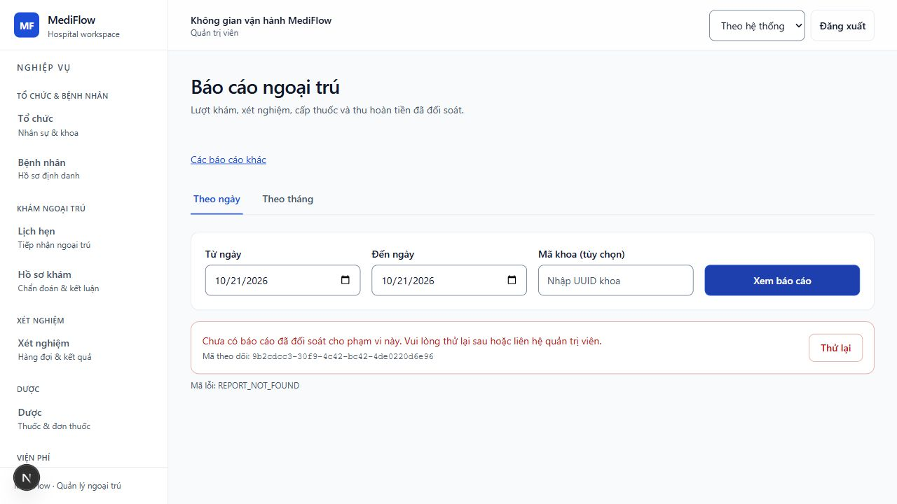
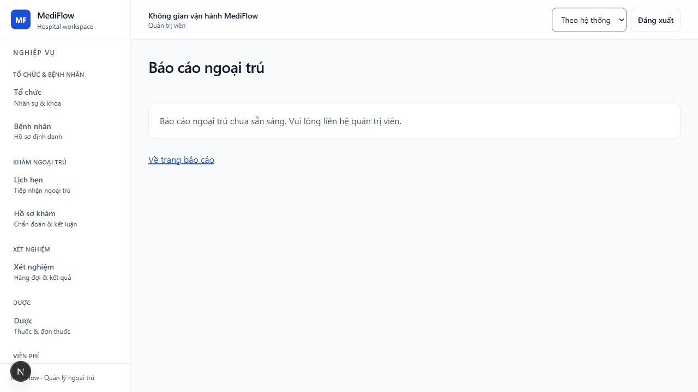
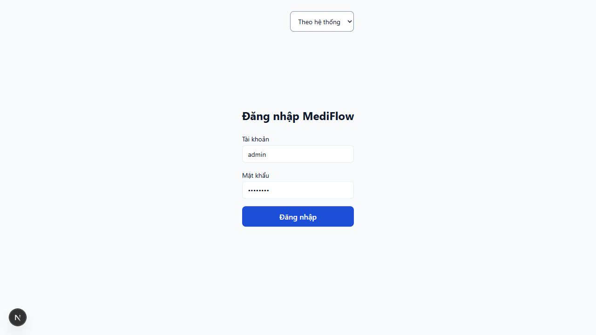

# Huy — chạy tiếp nghiệm thu thật, 2026-10-21

Candidate: nhánh Huy, base `42aab198` + Gateway coverage allowlist working diff.
Artifacts build từ snapshot source ở `.git/huy-fe-final-20261021`; không tạo nhánh,
commit hoặc push. Dữ liệu, tài khoản và giao dịch đều là test dùng một lần.

## Runtime và kết quả

Docker 29.6.2; PostgreSQL 16, RabbitMQ 3.13; sáu business apps và Gateway/Eureka.
Trong runtime riêng, bật `MEDIFLOW_NOTIFICATION_REFUND_CONSUMER_ENABLED=true` và
`MEDIFLOW_REPORT_OUTPATIENT_COVERAGE_ACCEPTANCE_ENABLED=true`. Frontend dùng Pharmacy
outpatient mode và Report UI ON, sau đó restart OFF. Không thay default cấu hình source.
Hold runtime dùng access-token TTL một phút để kiểm phiên hết hạn bằng issuer thật.

- Normal `mvn -q -pl backend/support-service -Psix-service-acceptance verify`: exit 0,
  Surefire **18/18**, Failsafe **1/1**, không skip. Log local `.git/huy-fe-followup-normal.log`.
  Kiểm actual payment, Pharmacy unavailable/restart và durable clearance, dispense một lần,
  Support → standalone rollback → Support giữ dữ liệu, refund race/exact retry/over-refund
  và cancelled/refunded terminal denial. Đây là packaged API acceptance, không phải browser E2E.
- Hold cùng artifacts, với `-Dtest=__NoUnitTests__ -Dsurefire.failIfNoSpecifiedTests=false`
  và `MEDIFLOW_FE_ACCEPTANCE_HOLD=true`: Failsafe **1/1**, exit 0 sau STOP. Log local
  `.git/huy-fe-followup-hold.log`. Unit suites không chạy lại trong lượt hold.
- Public API qua Gateway: tạo Rx từ public authority có trong manifest, thu tiền, hủy,
  tạo refund 30.000 VND **201**, exact-key retry **201 cùng refundTransactionId**.
  Chờ thông báo hoàn tiền có giới hạn 45 giây nhưng không nhận được: không tính đạt delivery.
- Approval gate ON: ADMIN coverage preview qua Gateway → Support **200**; đọc daily
  chưa có accepted coverage **404 REPORT_NOT_FOUND**. Preview rỗng không đủ bằng chứng
  completeness; không POST acceptance, không tự chế reviewed exports.
- Negative security: chọn notification ID thật từ public history, owner issuer token đọc
  detail **200**, sau đó dùng signed TEST credentials theo mẫu kiểm thử backend:
  thiếu patientId **401 tại Gateway** dù subject bằng target patient và có header giả;
  sai patientId **403 tại Notification**; expired/no-exp **401**. Token ký kiểm thử không
  được gọi là credential do Core issuer phát hành. Không lưu token/signing key.
- Một lần chạy helper ban đầu dùng `/notifications/undefined` do chưa có refund notice,
  nhận 401 và assertion fail; đó là phép thử không hợp lệ, không tính coverage. Evidence
  giữ attempt này; các checks sau dùng ID thật và positive owner control rồi mới tính đạt.

Safe API bodies: [actual-gateway-checks.json](actual-gateway-checks.json).
Normal harness: [refund](normal-gateway-refund.json),
[paid prescription](normal-paid-prescription.json),
[normal summary](normal-failsafe-summary.xml), [hold summary](hold-failsafe-summary.xml).

## Browser thực tế

ADMIN đăng nhập bằng public Core issuer tại frontend localhost:3183, same-origin API qua
Gateway runtime. Token hết hạn rồi bấm Xem báo cáo dẫn về login. Đăng nhập mới, Report ON
hiện form; submit thực tế cho ngày **2026-10-21** hiển thị REPORT_NOT_FOUND và focus lỗi,
không hiển thị dashboard số 0. Không gọi đây là báo cáo có accepted coverage.

Restart Next với UI OFF, đăng nhập lại và mở trực tiếp `/reports/outpatient`: chỉ hiện
“Báo cáo ngoại trú chưa sẵn sàng”, không có form/controls gửi query. OFF branch không mount
report component; đối chiếu source cùng bằng chứng browser. Backend gates giữ ON trong
runtime disposable này, dừng toàn bộ runtime sau test; source default flags không đổi.

## Dependency đã xác định cụ thể

Billing `LedgerRefundService.java:83` ghi `payment.refunded` bằng `appendHeld`.
`LedgerEventOutboxAdapter.java:20` chỉ cho publication của invoice.created,
payment.completed, financial.clearance.granted; `appendHeld` luôn publication_enabled=false.
Normal six-service acceptance hiện còn assert refund rows HELD. Vì vậy bật Notification
consumer không đủ để có refund intake thật. Không phát sự kiện giả hoặc sửa DB để nghiệm thu.
Vinh cần chốt contract/gate publication Billing và regression trước nghiệm thu refund notice.

Đóng **HF6-09.4**, tiến độ **10/14 task, 50/56 tiêu chí**. Các phần còn lại: accepted coverage
năm nguồn + báo cáo ngày/tháng thành công, integrated workflow/matrix, refund publication/intake,
final release và lỗi fixture Lab ngoài scope. Full FE gần nhất 594/595, typecheck/lint/build
PASS theo checkpoint trước; lượt này không sửa source FE, không chạy lại để gọi là kết quả mới.
Release HOLD. Browser đã đăng xuất; frontend và hold runtime đã dừng. Một handoff chung
`docs/handoffs/HANDOFF-HUY-MVP.md`, không tạo thêm handoff.
