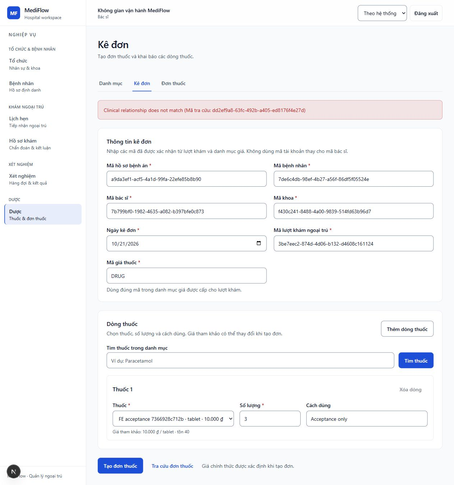

# Huy — hoàn tất matrix nguồn kê đơn, 2026-10-21

Candidate không đổi: Huy base `42aab198` + Gateway coverage working diff, frontend production
source nguyên trạng. Không tạo branch/commit/push. Cùng snapshot artifacts với hai checkpoint
[final](../2026-10-21-final/README.md) và [follow-up](../2026-10-21-followup/README.md).

## Kiểm thử mới thực chạy

Chạy lại opt-in six-service hold trên PostgreSQL/RabbitMQ disposable, Gateway
`http://127.0.0.1:63181`, frontend `http://localhost:3183`, Pharmacy outpatient mode,
Report UI OFF. Approval/refund-consumer ON chỉ trong runtime test, không đổi default source.
Access-token TTL một phút. Huy không sửa Lab/Billing/Notification production trong lượt này.

- Foreign patient do public Core POST tạo, IDs hồ sơ/episode/doctor/department từ public
  Clinical workflow; thuốc từ Pharmacy API và priceCode từ Billing policy trong harness.
  [Public authority responses](public-source-context.json), [public setup](public-source-setup.json).
- Negative body chủ động ghép **patient thật khác** với source record. Tất cả authority IDs
  có nguồn public; không sinh ID giả để vượt việc tra cứu.
- Actual DOCTOR API POST V1 nhận **422 PHARMACY_CARE_CONTEXT_INVALID**. Exact command/key/body
  retry vẫn **422**. Public stock read trước/sau **40 → 40**.
  [Bodies/status/key và provenance](source-invalid-api.json). Stock read chứng minh số tồn
  on-hand không đổi, không được dùng riêng để suy ra số receipt/reservation nội bộ.
- Actual DOCTOR browser điền chính body sai nguồn, chọn thuốc trong catalog và submit:
  hiện “Clinical relationship does not match” cùng correlation ID, focus vào error group,
  vẫn ở form kê đơn với giá trị được giữ lại. Bấm tạo lại vẫn bị từ chối; không chuyển detail,
  không fallback V0. Đây là browser thật, không phải mocked response.
- Hold Failsafe **1/1 PASS, exit 0**, [summary](hold-summary.xml). Log local
  `.git/huy-fe-matrix-runtime.log`; helper local `.git/huy-fe-matrix-check.cjs`.
  Frontend log `.git/huy-fe-matrix-ui.log`. Browser logout, frontend và hold đều đã dừng.

## HF6-11.3 — traceability của matrix trên cùng candidate

Các case chạy qua nhiều runtime disposable cùng source candidate; không gọi là một phiên
all-browser E2E. Không cần chạy lại case đã đạt nếu source chưa thay đổi.

| Tiêu chí | Bằng chứng thực tế |
|---|---|
| Chưa thanh toán | Final checkpoint: PHARMACIST browser submit, backend từ chối clearance, không tự đánh dấu paid |
| Source không hợp lệ | Lượt này: browser lỗi giữ form; API 422 + exact-key retry 422, stock 40 → 40 |
| Role denial | Final checkpoint: DOCTOR không có dispense, signed role-denial API; Report DOCTOR 403 |
| Session hết hạn | Follow-up: Core-issued access token hết hạn rồi Report submit đưa browser về login |
| API unavailable/recovery | Final: Support pause/error/keyboard retry/resume, content/focus đúng; follow-up normal harness Pharmacy down/payment/restart/durable clearance |
| Retry không tạo trùng | Final: payment exact retry cùng tx, dispense lặp stock 40 → 37 → 37; follow-up normal Rx exact-key retry/race/refund; lượt này invalid-source exact retry không thành success |
| Không fallback V0/legacy report | Lượt này V1 source failure giữ form; follow-up Report ON thiếu accepted coverage hiện REPORT_NOT_FOUND, không thay bằng legacy metrics/zero |

Đóng **HF6-11.3** theo matrix trên. Giữ HF6-11.2 mở vì Report sau đối soát chưa chạy thành công.
Tiến độ **10/14 task, 51/56 tiêu chí (91,1%)**. HF6-09 2/4, HF6-11 3/4,
HF6-12 3/4, HF6-14 3/4; năm tiêu chí còn: 09.2, 09.3, 11.2, 12.4, 14.3.

Không đóng bốn task lớn: còn reviewed five-source coverage + daily/monthly success,
Billing payment.refunded publication trước Notification refund intake, và final release/
full regression (Lab fixture ngoài scope). Full FE 594/595, typecheck/lint/build là kết quả
checkpoint trước, không phải vừa chạy lại. Chỉ cập nhật một handoff chung, release HOLD.
