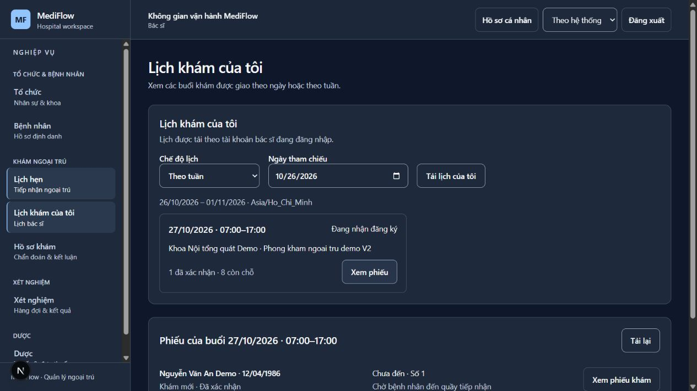
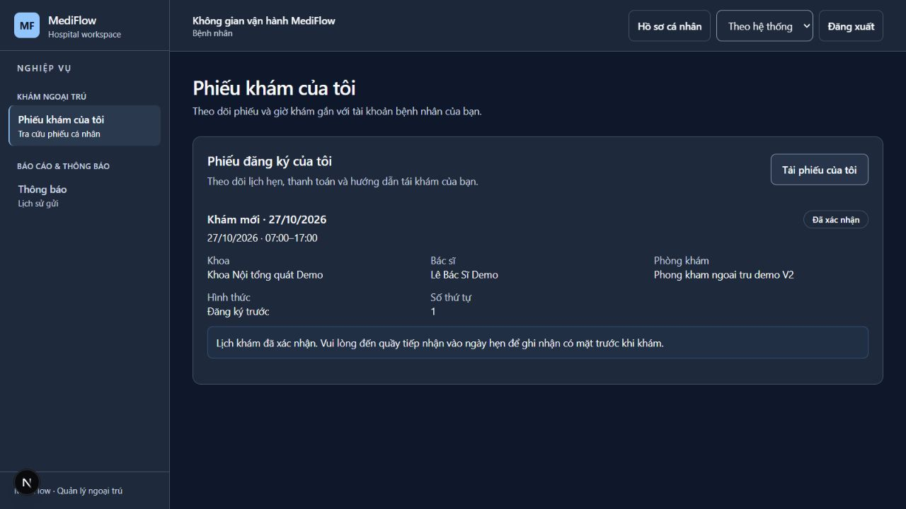
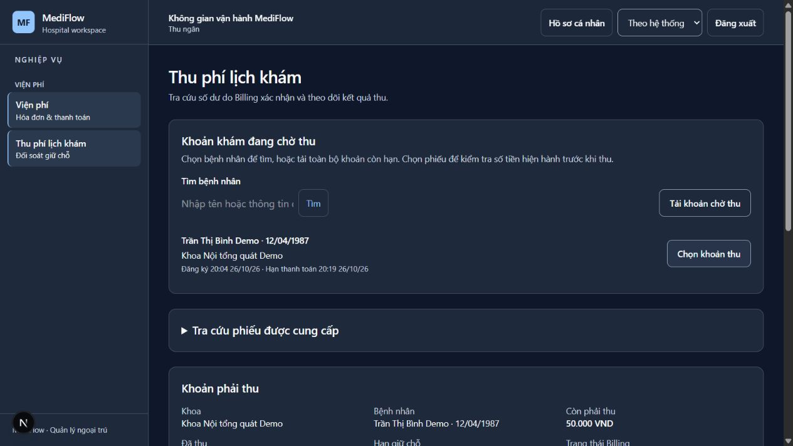

# Kiểm chứng khả dụng ngoại trú — 26/10/2026

Candidate: `codex/outpatient-frontend-usability`, base `be8c48f8`; thay đổi trong cùng PR.
Dữ liệu tổng hợp demo, không dùng dữ liệu người bệnh thật. Không lưu token trong evidence.

## Thay đổi được kiểm chứng

- DOCTOR: lịch tuần 26/10–01/11, buổi 27/10 07:00–17:00 có tên khoa/phòng;
  phiếu ghi Nguyễn Văn An Demo/Trần Thị Bình Demo kèm ngày sinh, trạng thái thanh toán/đến riêng.
- PATIENT: tên bác sĩ Lê Bác Sĩ Demo, khoa/phòng và số thứ tự 1; phiếu xác nhận yêu cầu
  đến quầy ngày hẹn, không hiển thị hạn giữ chỗ cũ.
- CASHIER: tải hàng đợi, chọn Trần Thị Bình Demo theo tên/ngày sinh, tải lại quote;
  100.000 VND, hỗ trợ mô phỏng 50%, người bệnh trả 50.000 VND. Chọn phiếu thu gọn mã kỹ thuật.
  Thu tiền mặt demo thành công; request/quote cũ không tiếp tục hiển thị như khoản nợ.
  Cập nhật số dư và tải lại hàng đợi: phiếu đã trả đủ rời danh sách. Không có giao dịch tiền thật.
- API Gateway: [28 kiểm tra](gateway-checks.json), gồm exact minimal fields/no-store,
  CASHIER/LAB_TECH được directory nhưng bị chặn full profile, PATIENT bị chặn directory/queue,
  paid registration không xuất hiện trong queue, một phiếu PREBOOKED chưa trả có trong queue.
- [Booking/payment](booking-payment.json): đăng ký replay cùng phiếu, quote hỗ trợ mô phỏng,
  payment replay cùng transaction, CONFIRMED, chưa đến và chưa readyForExam.
  DOCTOR start trước khi đủ điều kiện bị từ chối 422.

## Kiểm thử tự động

- Frontend: 116 file / 1.073 test qua trong đợt hồi quy toàn bộ; sau chỉnh hiển thị thu ngân,
  chạy lại 13 test ScheduledPaymentWorkspace/ScheduledPaymentQueue đều qua.
- Core: 362 test; Gateway: 1.584 test; Billing: 1.175 test; XML không failure/error/skip.
  Có cảnh báo Surefire shutdown của các Spring context dùng container sau test;
  không coi cảnh báo này là bằng chứng một nghiệp vụ đã được kiểm thử.
- Package JAR Core/Gateway/Billing thành công sau khi dừng JAR cũ đang khóa file trên Windows.
- TypeScript, ESLint và production build được chạy lại sau thay đổi cuối (xem kết quả trong PR).
- Có review độc lập về role matrix, directory tối thiểu, queue và các khóa thu tiền.

## Phạm vi và cách tái kiểm tra

Runtime: tám JAR/ứng dụng ở 28761,28080,28089,28082,28084–28087; PostgreSQL/RabbitMQ
trong hai container rehearsal riêng. Web 3000 gọi Gateway 28080 cùng origin qua Next proxy.
Cách chạy và các bước theo role trong
[runbook V2](../../../../scripts/demo_25_10/MediFlow_Ngoai_Tru_V2_Test_2026-10-26.md).
API mới và các quyền theo [A.13](../../../../docs/plans/03-contracts.md).

Tổng duyệt này thực hiện ngoài giờ khám: booking ngày mai, không chứng minh đã đi hết
khám/Lab/tái khám trong một ca. Phải chạy lại full examination trước 17:00 theo ca thật;
không đổi clock/loosen rule để tạo bằng chứng giả. Mobile/Inpatient/Surgery không thuộc đợt này.
Handoff reference directory còn consumer web/mobile cần đối chiếu; không đóng toàn bộ H-01.

## Ảnh trình duyệt

