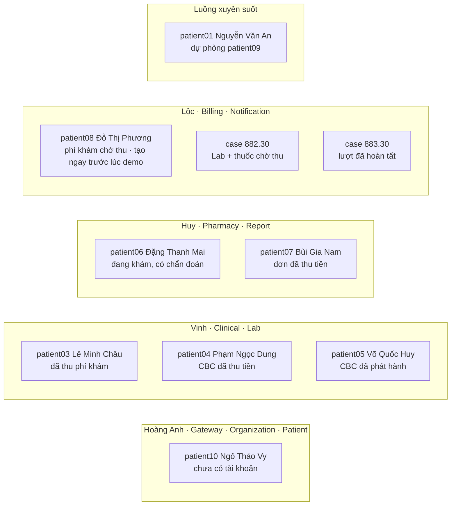
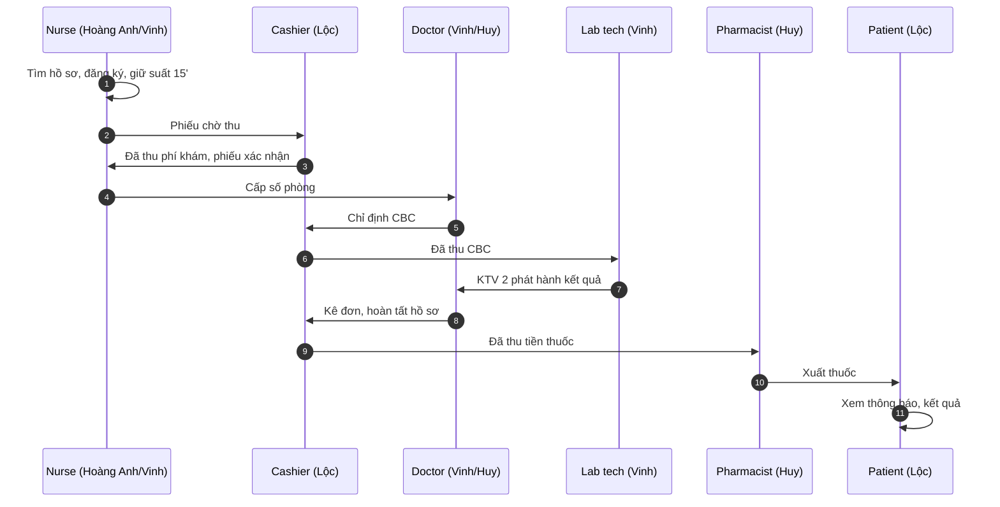

# Demo theo thứ tự người trình bày: Hoàng Anh → Vinh → Huy → Lộc → luồng xuyên suốt

Cập nhật **13/11/2026**. File này trả lời câu hỏi: *mỗi người dùng tài khoản nào, mở bệnh nhân nào,
để demo phần của mình mà không phải chờ hay mở màn hình của người khác.*

- **Phần I** — mỗi người demo độc lập trên bệnh nhân đã được seed sẵn đúng trạng thái.
- **Phần II** — một bệnh nhân đi trọn luồng từ tiếp nhận đến nhận thuốc, khi giám khảo yêu cầu demo thật.

Thao tác chi tiết từng nút (tên ô, giá trị nhập) nằm ở [DEMO_UI_TUNG_BUOC.md](DEMO_UI_TUNG_BUOC.md);
file này chỉ ra **điểm bắt đầu** và **mục cần làm** trong hướng dẫn đó.

---

## 0. Chuẩn bị một lần trước buổi demo

1. `scripts/run/start-backend.bat` (nên dùng `-Fast` để giữ dữ liệu) → backend **tự seed toàn bộ**
   bệnh nhân demo cho cả 4 người, chờ lần lượt các dòng
   **FOLLOW-UP SOURCE READY**, **DRUG STOCK READY**, **CASHIER DEMO READY**, **STAGED DEMO READY**,
   **CALENDAR READY**, **HEAD CANDIDATES READY**, **READY**.
   Mỗi thuốc seed có **hàng nghìn đơn vị** (viên 5.000, gói/lọ 1.500), đủ kê đơn 3 tháng trở lên.
   Seed lượt khám chỉ tạo được **trong giờ khám 07:00–16:45 (giờ Việt Nam)**. Nếu bật backend ngoài giờ,
   **không cần khởi động lại**: khi phòng khám mở, nhấp đúp **`scripts/run/seed-demo.bat`** để seed bổ sung.
2. `scripts/run/start-frontend.bat` → mở **http://127.0.0.1:3000/login**.
3. Mở file **`DEMO-STAGED.local.md`** trong thư mục evidence mà backend in ra (dòng `STAGED DEMO READY: …`).
   File liệt kê đúng tên, CCCD và mã phiếu/hồ sơ/xét nghiệm/đơn của ngày hôm đó.

| Dòng trên cửa sổ backend | Ý nghĩa |
|---|---|
| `STAGED DEMO READY` | Đủ 5 bệnh nhân seed theo điểm bàn giao (bảng mục I.0) |
| `STAGED DEMO PARTIAL: …` | Có ca chưa chuẩn bị được; `DEMO-STAGED.local.md` ghi **LỖI** và lý do ở đúng dòng đó. Các ca khác vẫn dùng được |
| `PARTIAL: Run again 07:00-16:45…` | Khởi động ngoài giờ khám: chỉ có lịch, **chưa có** bệnh nhân seed. Trong giờ khám chạy `scripts/run/seed-demo.bat` (backend vẫn chạy) |

> **Không khởi động lại backend giữa các phần.** Chế độ thường sẽ phục hồi lại dữ liệu và mất
> những gì vừa thao tác. Với `-Fast`, chạy lại cùng ngày sẽ đọc lại đúng các ca đã seed, không tạo trùng.

**Mật khẩu mọi tài khoản demo:** `MediFlowDemo@2026`. Đăng nhập bằng **email**.

### 0.1. Tài khoản nhân viên

| Vai | Email | Người dùng chính |
|---|---|---|
| ADMIN | `demo.staff01@example.test` | Hoàng Anh, Huy (Report) |
| NURSE (tiếp nhận, quầy khoa) | `demo.staff04@example.test` | Hoàng Anh, Vinh |
| DOCTOR — Lê Bác Sĩ Demo, Khoa Nội tổng quát Demo | `demo.staff03@example.test` | Vinh, Huy |
| LAB_TECH nhập kết quả | `demo.staff15@example.test` | Vinh |
| LAB_TECH thứ hai, phát hành | `demo.staff16@example.test` | Vinh |
| PHARMACIST | `demo.staff17@example.test` | Huy |
| CASHIER | `demo.staff19@example.test` | Lộc |

### 0.2. Bệnh nhân và việc của từng người



| Bệnh nhân | CCCD | Ngày sinh | Trạng thái lúc khởi động | Dành cho |
|---|---|---|---|---|
| Lê Minh Châu Demo (patient03) | `999881000003` | 12/04/1988 | Đã thu phí khám, phiếu **đã xác nhận**, chưa có số phòng | Vinh — I.2a |
| Phạm Ngọc Dung Demo (patient04) | `999881000004` | 12/04/1989 | Đang khám, CBC **đã thu tiền**, Lab ở trạng thái sẵn sàng | Vinh — I.2b |
| Võ Quốc Huy Demo (patient05) | `999881000005` | 12/04/1990 | Đang khám, CBC **đã phát hành** | Vinh — I.2c |
| Đặng Thanh Mai Demo (patient06) | `999881000006` | 12/04/1991 | Đang khám, đã có chẩn đoán, chưa có đơn | Huy — I.3a |
| Bùi Gia Nam Demo (patient07) | `999881000007` | — | Đơn thuốc **đã thu tiền**, chưa xuất | Huy — I.3b |
| Đỗ Thị Phương Demo (patient08) | `999881000008` | — | Không seed sẵn; Lộc tạo khoản phí khám ngay trước lúc demo | Lộc — I.4a |
| Demo LIVE_PHARMACY_BILLING_DEMO | `999882000030` | — | Lab 36.000 + thuốc 20.000 **chờ thu** | Lộc — I.4b |
| Demo HIST_2025_COMPLETED_AND_REFUNDS | `999883000030` | — | Lượt đã thu đủ, có kết quả Lab, đã nhận thuốc, đã hoàn tất | Lộc — I.4c, I.4d |
| Ngô Thảo Vy Demo (patient10) | `999881000010` | — | Có hồ sơ, **chưa có tài khoản** | Hoàng Anh — I.1c |
| Nguyễn Văn An Demo (patient01) | `999881000001` | 12/04/1986 | Không động tới | Phần II |
| Hồ Minh Quân Demo (patient09) | `999881000009` | — | Không động tới | Dự phòng phần II |

Mỗi bệnh nhân chỉ có **một lượt khám trong ngày**. Không dùng bệnh nhân của người khác để demo phần
của mình, nếu không người sau sẽ không còn đúng trạng thái.

---

## Phần I — Demo theo từng người

### I.1. HOÀNG ANH — Gateway, Organization, Patient (8–10 phút)

Không phụ thuộc ai. Slide: Functional Requirements → Use case → Kiến trúc → Gateway.

**a. Gateway** (tài khoản `demo.staff01@example.test`)

1. Mở **http://127.0.0.1:28761** (Eureka): chỉ các service đã đăng ký —
   GATEWAY, CORE-SERVICE, CLINICAL-SERVICE, LAB-SERVICE, PHARMACY-SERVICE, BILLING-SERVICE, SUPPORT-SERVICE.
2. Mở thẳng **http://127.0.0.1:28080/api/v1/patients** trên thanh địa chỉ (trình duyệt không gửi token) →
   **401** `AUTH_UNAUTHORIZED`, envelope `ApiResponse` có `correlationId`: Gateway chặn trước khi tới Core.
3. Đăng nhập ADMIN, bật **DevTools → Network**, mở **Bệnh nhân**:
   - request đi `/api/v1/patients` cùng origin, không gọi cổng 8089;
   - response header **`X-Correlation-Id`** — cùng mã xuất hiện trong log Core.
4. Đăng xuất, đăng nhập **CASHIER** `demo.staff19@example.test` trên **http://127.0.0.1:3000**,
   mở DevTools → **Console**, dán:

   ```js
   fetch('/api/v1/patients', {headers: {Authorization: 'Bearer ' + localStorage.getItem('mediflow.accessToken')}})
     .then(r => r.json()).then(console.log)
   ```

   → **403** `AUTH_FORBIDDEN`: token hợp lệ nhưng CASHIER không nằm trong ma trận role của route này
   (chỉ ADMIN/DOCTOR/NURSE). Gateway mặc định chặn; service phía sau vẫn kiểm `@PreAuthorize` lần nữa.
5. (Tùy chọn) Trang **Quên mật khẩu** gửi quá 5 lần trong 15 phút từ cùng máy → **429**:
   giới hạn tần suất cho endpoint công khai.

**b. Organization** (ADMIN `demo.staff01`): **Tổ chức → Khoa Nội tổng quát Demo**, nhân viên
**Lê Bác Sĩ Demo**, tài khoản. Tùy chọn: bổ nhiệm/miễn nhiệm trưởng khoa —
[DEMO_UI_TUNG_BUOC.md mục 2.2](DEMO_UI_TUNG_BUOC.md#22-tùy-chọn-bổ-nhiệmmiễn-nhiệm-trên-ui).

- **Phòng làm việc của khoa**: trong chi tiết khoa chỉ còn nút **Thêm phòng làm việc**; phòng tạo ở đây
  tự thuộc khoa đang xem nên không còn ô lọc/tìm phòng. Ô Khoa ẩn, vị trí điền sẵn theo khoa.
- **Bổ nhiệm trưởng khoa** — mỗi khoa lâm sàng có sẵn bác sĩ ở ba trạng thái tài khoản (cột **Tài khoản**):

  | Bác sĩ | Tài khoản | Bổ nhiệm |
  |---|---|---|
  | BS Ứng viên **TK01** / **TK02** … | **Đang hoạt động** | Chọn được → nhập lý do → **Bổ nhiệm → Xác nhận bổ nhiệm** |
  | BS Ứng viên **KHOA** … | **Đã khóa** | Nút chọn bị khóa |
  | BS Demo … **01–03** (lịch luân phiên) | **Chưa cấp tài khoản** | Nút chọn bị khóa |

  Nêu: chỉ bác sĩ có tài khoản DOCTOR đang hoạt động mới được bổ nhiệm; backend vẫn chặn
  (`HEAD_INELIGIBLE`) nếu gọi API trực tiếp. Danh sách email nằm trong `DEMO-HEAD-CANDIDATES.local.md`
  (dạng `demo.head.<khoa>.tk01@example.test`). Các tài khoản này được Core **seed sẵn với mật khẩu mặc định**
  của bộ demo nên không có email cấp mật khẩu nào được gửi.

**c. Patient và tài khoản** (NURSE `demo.staff04`)

1. **Bệnh nhân → tìm `999881000001`**: hồ sơ cũ, đã có tài khoản; khối tài khoản hiện nút
   **Cấp lại mật khẩu tạm qua email** (đã cấp lần đầu). **Không bấm**, vì phần II dùng mật khẩu này.
2. **Tìm `999881000010` → Ngô Thảo Vy Demo**: chưa có tài khoản → **Cấp tài khoản bệnh nhân**.
   Hệ thống tạo tài khoản bằng email hồ sơ và gửi mật khẩu tạm qua thư.
3. Ngay sau đó, nút đổi thành **Cấp lại mật khẩu tạm qua email** và hiện dòng **Thư mật khẩu tạm**:
   *Đang gửi…* rồi tự chuyển sang **Gửi thành công** (xanh) hoặc **Gửi thất bại** (đỏ, kèm nút
   **Gửi lại thư**), không cần bấm kiểm tra. Nêu: lần đầu là *cấp tài khoản*, các lần sau là *cấp lại*;
   mật khẩu không bao giờ hiện trên UI, chỉ đi qua email. Mở `/demo-mailbox` để cho xem thư vừa tới.
4. (Tùy chọn) **Thêm bệnh nhân** mới theo [mục 3A](DEMO_UI_TUNG_BUOC.md#a-bệnh-nhân-mới-tạo-hồ-sơ-và-cấp-tài-khoản)
   → event `patient.created`.

> patient10 chỉ "chưa có tài khoản" ở lần chạy đầu. Nếu đã cấp ở buổi trước với `-Fast`, nút hiện
> ngay **Cấp lại…**; khi đó demo cấp lần đầu bằng một bệnh nhân vừa tạo ở bước 4.

### I.2. VINH — Clinical, Lab (10–12 phút)

Ba bệnh nhân, ba điểm vào. Không cần chờ Lộc thu tiền.

**a. Đã thu phí khám → vào khám** — Lê Minh Châu Demo `999881000003`

1. (Tùy chọn, minh họa đăng ký) Mở **/appointments/reception**, chọn buổi
   **Lê Bác Sĩ Demo / 07:00–17:00**, bấm **Tải phiếu trong buổi**: phiếu của Lê Minh Châu đã ở
   trạng thái **đã xác nhận**, tức là thu ngân đã thu phí khám. Đây là chỗ thay cho bước chờ Lộc.
2. NURSE `demo.staff04` → **Quầy điều dưỡng khoa** → **Tải hàng đợi** → Lê Minh Châu ở bảng
   **Chờ cấp số phòng** → **Cấp số phòng** — [mục 5b](DEMO_UI_TUNG_BUOC.md#5b-vinh--nurse--clinical-quầy-điều-dưỡng-khoa-cấp-số-phòng).
   Hàng đợi mỗi phòng là bảng cột **Số thứ tự · Bệnh nhân · Sinh hiệu · Thao tác**.
3. (Tùy chọn) **Ghi sinh hiệu** mở bảng nhập ngay dưới dòng bệnh nhân: cột **Chỉ số · Giá trị · Đơn vị ·
   Thang đo hợp lệ**. Để minh họa bắt lỗi, nhập Mạch `300` → ô viền đỏ, báo *Ngoài thang đo 20 – 250 lần/phút*;
   nhập HA tâm thu 120, tâm trương 130 → *Huyết áp tâm trương phải nhỏ hơn tâm thu*; nhiệt độ `36,5` →
   *dùng dấu chấm*. Sửa lại: Mạch 80, HA 120/80, Nhiệt độ 36.8, Nhịp thở 18, SpO2 98, Cân nặng 60 → **Lưu sinh hiệu**.
   Nêu: thang đo là giới hạn đo được của thiết bị để bắt lỗi gõ; hệ thống không phán đoán bình thường/bất thường.
4. DOCTOR `demo.staff03` → **Lịch khám của tôi** → **Xem phiếu** → Lê Minh Châu →
   **Bắt đầu khám → Mở hồ sơ khám** → tab **Khám & chẩn đoán** → **Thêm chẩn đoán** → tab **Xét nghiệm** →
   **Lập chỉ định xét nghiệm** CBC →
   **Lập chỉ định → Tạo yêu cầu từ chỉ định** — [mục 6](DEMO_UI_TUNG_BUOC.md#6-vinh--doctor--clinical-khám-và-lập-yêu-cầu-lab).
   Khoản Lab của ca này để chờ thu; Vinh **không** đợi, chuyển sang ca b.

**b. CBC đã thu tiền → nhập và duyệt kết quả** — Phạm Ngọc Dung Demo `999881000004`

1. LAB_TECH `demo.staff15` → **/lab** → **Công thức máu · Phạm Ngọc Dung Demo**
   (hoặc mã `testId` trong `DEMO-STAGED.local.md`) → đã có xác nhận thu → **Bắt đầu xét nghiệm**.
2. **Thu nhận bệnh phẩm** `WHOLE_BLOOD_EDTA` → **Tiếp nhận** → nhập WBC 7.0, RBC 4.8, HGB 140,
   HCT 0.42, PLT 250 → **Lưu nháp → Gửi duyệt**.
3. Bấm **Phát hành** bằng chính `demo.staff15` → bị từ chối (một người không tự duyệt).
4. Đăng xuất → `demo.staff16` → cùng URL → **Phát hành** → `lab.result.created` —
   [mục 8](DEMO_UI_TUNG_BUOC.md#8-vinh--lab_tech--lab-bệnh-phẩm-nhập-kết-quả-và-duyệt-hai-người).

**c. Đã có kết quả → kê đơn và hoàn tất hồ sơ** — Võ Quốc Huy Demo `999881000005`

1. DOCTOR `demo.staff03` → **Lịch khám của tôi** → Võ Quốc Huy → **Mở hồ sơ khám**
   (hoặc `/records/<recordId>` trong `DEMO-STAGED.local.md`). Màn hình chia tab — xem
   [mục I.2d](#i2d-chi-tiết-hồ-sơ-khám--đi-qua-từng-tab).
2. Tab **Xét nghiệm** → CBC đã phát hành của đúng lượt.
3. Tab **Đơn thuốc** → **Kê đơn cho lượt khám** → **Thuốc minh họa A**, liều 1 viên × 2 lần/ngày,
   thời gian **3 tháng** (chip) → số lượng tự tính 180 → **Tạo đơn thuốc**. Tồn kho seed đủ cho đơn dài ngày.
4. Tab **Kết thúc khám** → mở **Hoàn tất lần khám**: **Theo dõi ngoại trú**, tích xác nhận →
   **Hoàn tất hồ sơ khám** → `medicalrecord.completed`. Tab đổi tên thành **Tái khám** để đề xuất ngày tái khám.
   Nêu: bác sĩ hoàn tất ngay sau khi kê đơn; Pharmacy vẫn thu tiền và cấp thuốc sau đó,
   không cần chờ bệnh nhân thanh toán. Chỉ Lab chưa xong mới chặn hoàn tất.

### I.2d. Chi tiết hồ sơ khám — đi qua từng tab

Bố cục theo các hệ thống EMR thật: **phần nhận diện luôn ở trên**, nội dung chia **tab theo thứ tự lượt khám**.
Thanh tab dính dưới thanh trên cùng khi cuộn; tab đang mở lưu trên địa chỉ (`?tab=…`) nên tải lại trang,
gửi link hay bấm Back vẫn đúng tab. Đổi tab **không mất bản nháp** đang nhập (chẩn đoán, đơn thuốc).
Bàn phím: ← → để chuyển tab, Home/End về tab đầu/cuối.

**Luôn hiển thị phía trên tab**

| Khối | Nội dung | Nêu khi demo |
|---|---|---|
| **Sổ dị ứng** | Dị ứng đang hiệu lực của bệnh nhân; form **Ghi nhận dị ứng mới** thu gọn | Dị ứng là thông tin an toàn, xem được ở mọi tab |
| **Thẻ bệnh nhân** | Họ tên · ngày sinh, ngày khám, khoa, bác sĩ, trạng thái **Đang khám / Đã hoàn tất / Kết thúc không kết luận** | Không bao giờ nhầm bệnh nhân khi chuyển tab |
| Thông báo | Đang cập nhật, chỉ đọc (không phải bác sĩ phụ trách), dữ liệu đổi khi đang nhập | Quyền ghi do backend quyết định |

**Các tab** (tab chỉ hiện khi có ý nghĩa với lượt và vai đang đăng nhập)

| Tab | Hiện khi | Có gì | Thao tác demo |
|---|---|---|---|
| **Khám & chẩn đoán** (số chẩn đoán) | Luôn có | Triệu chứng, hướng xử trí, nội dung lâm sàng, danh sách chẩn đoán ICD, đính chính có hiệu lực | **Thêm chẩn đoán**, **Tác vụ khác → Sửa triệu chứng** (chỉ khi đang khám) |
| **Xét nghiệm** | Lượt có lịch hẹn | Chỉ định và trạng thái xét nghiệm của đúng lượt | **Lập chỉ định xét nghiệm**, **Xem phiếu xét nghiệm**, rút chỉ định chưa thực hiện |
| **Đơn thuốc** | ADMIN/DOCTOR | Đơn của hồ sơ; bác sĩ phụ trách kê khi đang khám | **Kê đơn cho lượt khám** (liều, ngày/tuần/tháng) |
| **Liệu trình & hội chẩn** | Luôn có | Đợt điều trị, bàn giao hồ sơ, ghi chú hội chẩn, yêu cầu sửa hồ sơ đã hoàn tất | Theo quyền trả về từ backend |
| **Tài liệu** | Luôn có | Phiếu xét nghiệm, đơn thuốc gắn với hồ sơ | Mở tài liệu gốc |
| **Kết thúc khám** / **Tái khám** | Có quyền hoàn tất, hoặc hồ sơ đã hoàn tất | **Hoàn tất lần khám**, **Kết thúc lượt không kết luận**; sau hoàn tất: đề xuất tái khám | Hoàn tất / đề xuất ngày tái khám |
| **Thông tin hồ sơ** | Luôn có | Mã hồ sơ, bệnh nhân, bác sĩ mở hồ sơ, khoa, lịch hẹn, các mốc thời gian | Dùng khi đối chiếu log/correlation |

**Kịch bản 2 phút** (DOCTOR `demo.staff03`, hồ sơ đang mở của Võ Quốc Huy):

1. Mở hồ sơ → chỉ vào **Sổ dị ứng** và **thẻ bệnh nhân** (luôn ở trên).
2. **Khám & chẩn đoán** → **Thêm chẩn đoán** J06.9, gõ dở phần mô tả.
3. Bấm tab **Xét nghiệm** → CBC đã phát hành → quay lại tab đầu: phần mô tả vẫn còn → **Lưu**.
4. **Đơn thuốc** → kê đơn 3 tháng. Bấm F5: vẫn ở tab Đơn thuốc (địa chỉ có `?tab=prescription`).
5. **Kết thúc khám** → Hoàn tất. Tab chuyển thành **Tái khám**; **Thông tin hồ sơ** có thời điểm hoàn tất.

### I.3. HUY — Pharmacy, Report (6–8 phút)

**a. Kê đơn** — Đặng Thanh Mai Demo `999881000006` (vai DOCTOR `demo.staff03`)

1. **/pharmacy/prescriptions/new** → bệnh nhân `999881000006` → hồ sơ đang mở hôm nay.
2. Tìm **DEMO-HIST-2025** → chọn **Thuốc minh họa A** (không chọn thuốc *hết tồn*/*cảnh báo tồn thấp*)
   → số lượng 2 → **Tạo đơn thuốc** → `prescription.created`, Billing tạo khoản PRESCRIPTION.
   Đơn này để chờ thu; Huy không đợi, chuyển sang ca b — [mục 10](DEMO_UI_TUNG_BUOC.md#10-huy--doctor--pharmacy-tạo-đơn-thuốc).

**b. Đơn đã thu tiền → xuất thuốc** — Bùi Gia Nam Demo `999881000007` (PHARMACIST `demo.staff17`)

1. **/pharmacy/prescriptions** → đơn của Bùi Gia Nam (mã `prescriptionId` trong `DEMO-STAGED.local.md`).
2. **Tải lại trạng thái**: đơn đã thu đủ → **Xuất thuốc → Xác nhận xuất thuốc** → `prescription.filled`;
   tồn Thuốc minh họa A giảm 2 — [mục 12](DEMO_UI_TUNG_BUOC.md#12-huy--pharmacist--pharmacy-cấp-phát-thuốc).

**c. Report** (ADMIN `demo.staff01`): **/reports/outpatient** → **Theo ngày** →
**Tìm kỳ có dữ liệu → Dùng kỳ này → Xem báo cáo**. Kỳ đối soát đã được seed lúc khởi động —
[mục 15](DEMO_UI_TUNG_BUOC.md#15-huy--admin-hoặc-trưởng-khoa--report-cuối-luồng).

### I.4. LỘC — Billing, Notification (8–10 phút)

**a. Thu phí khám.** Phiếu chưa thu **giữ suất 2 giờ**, nên khoản này nên tạo **trong vòng 2 giờ trước lúc Lộc lên**:

```powershell
.\scripts\run\seed-demo.bat -ExamChargeNow
```

Kỳ vọng: `EXAM CHARGE READY: Đỗ Thị Phương Demo (CCCD 999881000008) …`. Sau đó CASHIER `demo.staff19` →
**Thu phí lịch khám** → chọn Đỗ Thị Phương → **Tiền mặt → Thu phí lịch khám** (50.000 VND) →
`payment.completed` → `outpatient.financial.eligibility.granted` — [mục 5](DEMO_UI_TUNG_BUOC.md#5-lộc--cashier--billing-thu-phí-khám).
Chạy lại lệnh trong cùng ngày không tạo phiếu thứ hai.

**b. Thu Lab và thuốc** — Demo LIVE_PHARMACY_BILLING_DEMO `999882000030`

1. **Thu phí xét nghiệm & thuốc** → **Tìm bệnh nhân chờ thu** `999882000030`.
2. **Xét nghiệm** → **Chọn khoản** → 36.000 VND → **Tiền mặt → Xác nhận thu theo báo giá** → `financial.clearance.granted`.
3. **Đơn thuốc** → **Chọn khoản** → 20.000 VND → **Xác nhận thanh toán**.

**c. Lịch sử thu**: tìm `999883000030` → một lượt đã thu đủ cả ba khoản (khám, Lab, thuốc).

**d. Notification** — đăng xuất, đăng nhập bệnh nhân `demo.case.883.30@example.test`:
**/notifications** (kết quả Lab, hồ sơ hoàn tất), **/records/mine**, **/lab/mine**.
Nêu chuỗi `lab.result.created` / `medicalrecord.completed` → `notification.q` → lưu IN_APP.

---

## Phần II — Một bệnh nhân xuyên suốt (khi giám khảo yêu cầu demo thật)

**Bệnh nhân:** Nguyễn Văn An Demo, CCCD `999881000001`, tài khoản `demo.patient01@example.test`.
Dùng người này vì đã có tài khoản và mật khẩu biết trước, nên cuối luồng đăng nhập được bằng vai bệnh nhân.
Nếu patient01 đã có lượt hôm nay, dùng **Hồ Minh Quân Demo `999881000009`** (bỏ bước đăng nhập bệnh nhân,
hoặc cấp tài khoản cho người này như I.1c).

| # | Người | Đăng nhập | Việc | Hướng dẫn chi tiết |
|---|---|---|---|---|
| 1 | Hoàng Anh | `demo.staff04` | Tìm `999881000001` → **Tiếp tục đăng ký khám** | [3B](DEMO_UI_TUNG_BUOC.md#b-bệnh-nhân-cũ-đến-khám-đợt-mới) |
| 2 | Vinh | `demo.staff04` | Chọn buổi Lê Bác Sĩ Demo, **Khám đợt mới**, **Đăng ký và giữ chỗ** | [4](DEMO_UI_TUNG_BUOC.md#4-vinh--nurse--clinical-chọn-buổi-và-đăng-ký-khám) |
| 3 | Lộc | `demo.staff19` | Thu phí khám 50.000 (trong 2 giờ) | [5](DEMO_UI_TUNG_BUOC.md#5-lộc--cashier--billing-thu-phí-khám) |
| 4 | Vinh | `demo.staff04` | Cấp số phòng, ghi sinh hiệu | [5b](DEMO_UI_TUNG_BUOC.md#5b-vinh--nurse--clinical-quầy-điều-dưỡng-khoa-cấp-số-phòng) |
| 5 | Vinh | `demo.staff03` | Bắt đầu khám, chẩn đoán Z00, chỉ định CBC | [6](DEMO_UI_TUNG_BUOC.md#6-vinh--doctor--clinical-khám-và-lập-yêu-cầu-lab) |
| 6 | Lộc | `demo.staff19` | Thu CBC 36.000 | [7](DEMO_UI_TUNG_BUOC.md#7-lộc--cashier--billing-thu-phí-cbc) |
| 7 | Vinh | `demo.staff15` → `demo.staff16` | Bệnh phẩm, nhập, gửi duyệt → phát hành | [8](DEMO_UI_TUNG_BUOC.md#8-vinh--lab_tech--lab-bệnh-phẩm-nhập-kết-quả-và-duyệt-hai-người) |
| 8 | Vinh | `demo.staff03` | Đọc CBC trong hồ sơ | [9](DEMO_UI_TUNG_BUOC.md#9-vinh--doctor--clinical-đọc-lại-kết-quả-trong-cùng-lượt) |
| 9 | Huy | `demo.staff03` | Kê đơn Thuốc minh họa A × 2 | [10](DEMO_UI_TUNG_BUOC.md#10-huy--doctor--pharmacy-tạo-đơn-thuốc) |
| 10 | Vinh | `demo.staff03` | Hoàn tất hồ sơ (không cần chờ thu tiền thuốc) | [13](DEMO_UI_TUNG_BUOC.md#13-vinh--doctor--clinical-hoàn-tất-hồ-sơ-hướng-dẫn-ra-về) |
| 11 | Lộc | `demo.staff19` | Thu tiền thuốc 20.000 | [11](DEMO_UI_TUNG_BUOC.md#11-lộc--cashier--billing-thu-tiền-thuốc) |
| 12 | Huy | `demo.staff17` | Xuất thuốc | [12](DEMO_UI_TUNG_BUOC.md#12-huy--pharmacist--pharmacy-cấp-phát-thuốc) |
| 13 | Lộc | `demo.patient01` | Thông báo, kết quả khám, kết quả Lab | [14](DEMO_UI_TUNG_BUOC.md#14-lộc--patient--notification-và-kết-quả-cá-nhân) |
| 14 | Huy | `demo.staff01` | Report ngoại trú | [15](DEMO_UI_TUNG_BUOC.md#15-huy--admin-hoặc-trưởng-khoa--report-cuối-luồng) |

Tổng thu của lượt: 50.000 + 36.000 + 20.000 = **106.000 VND**, ba biên nhận riêng.
Bước 10 có thể đặt sau bước 12 nếu muốn khớp thứ tự slide; hệ thống cho phép cả hai.



---

## Xử lý nhanh khi kẹt

| Hiện tượng | Cách xử lý |
|---|---|
| Không có dòng `STAGED DEMO READY` | Backend khởi động ngoài 07:00–16:45, hoặc một ca lỗi: đọc `DEMO-STAGED.local.md`. Trong giờ khám, chạy `scripts/run/seed-demo.bat` (backend vẫn chạy) để seed lại phần còn thiếu |
| Ca của mình đã bị người khác thao tác | Chuyển sang phần II với patient09, hoặc demo trên ca kế tiếp cùng người (ví dụ Vinh dùng ca c thay ca b) |
| `--exam-charge-now` báo lỗi phiếu đã có | Phiếu hôm nay đã tạo; nếu đã quá 2 giờ thì hết hạn giữ suất, demo thu phí bằng phần II bước 2–3 |
| Lab ca b không hiện xác nhận thu | **Tải lại trạng thái**; xác nhận thu đến qua event, thường vài giây |
| Không chạy `lab_v2_walkthrough.py` trong ngày demo | Script đó tự chọn bệnh nhân "Demo" và có thể lấy trùng bệnh nhân seed ở trên |

Seed do `seed_demo.py` (gọi `prepare_ui_demo` → `prepare_cashier_demo` → `prepare_staged_demo`) thực hiện qua Gateway bằng đúng các lệnh UI gửi, không ghi SQL nghiệp vụ.
Nhật ký ở `evidence/…/staged-journal.local.json`; chạy lại cùng ngày dùng lại cùng khóa chống trùng.
