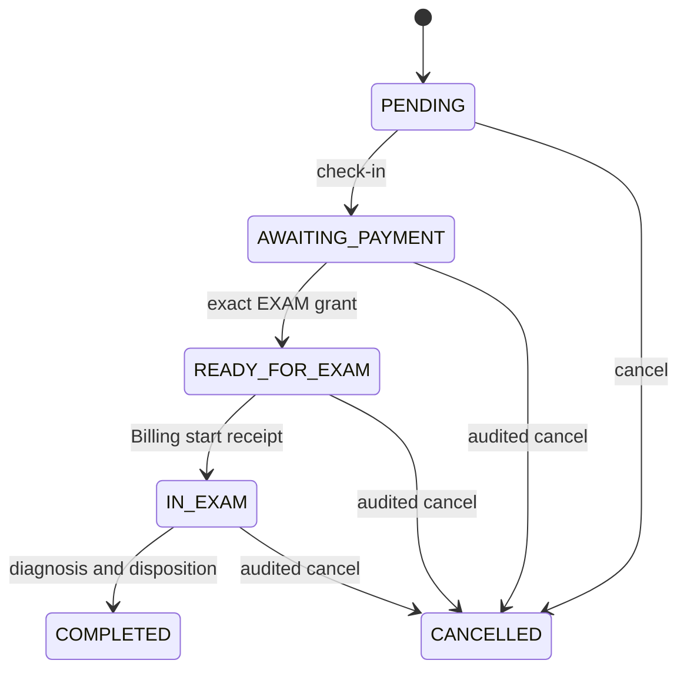
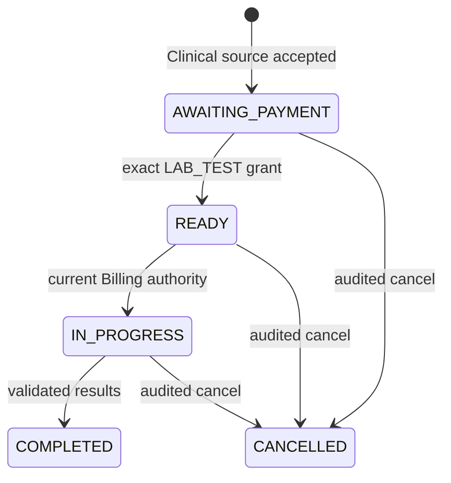
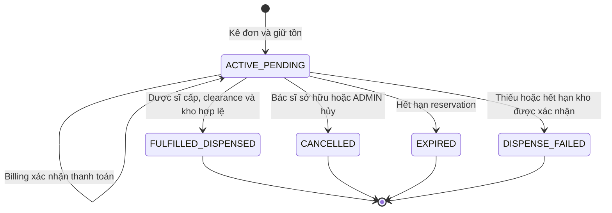
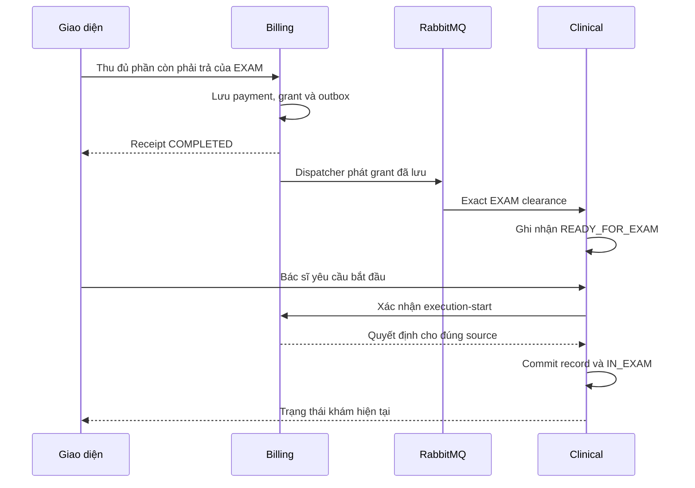

# MediFlow — Cẩm nang demo và bảo vệ đồ án dành cho 4 thành viên

**Phạm Đăng Vinh · Huy (LQHuy0210) · Trần Hoàng Anh · Thân Thế Lộc**<br>
**Ngày biên soạn:** 24/10/2026, múi giờ Việt Nam.<br>
**Dự án:** *MediFlow: A Microservices-Based Hospital Information System for Outpatient Care Management.*<br>
**Mã nguồn đối chiếu:** `Dangvinh77/MediFlow`, nhánh `master`, commit `64a1f04340efe07d324a1335d44c2b90baac68fd`, committer ghi nhận lúc 01:10:13 ngày 24/10/2026 theo giờ Việt Nam.<br>
**Mục đích:** một tài liệu để cả nhóm chuẩn bị máy, tập dượt, phân vai, thao tác, giải thích code và trả lời phản biện.

> **Cách đọc quan trọng:** tài liệu này bám mã nguồn ở commit trên. “Có implementation” nghĩa là đã tìm thấy controller/use case/UI tương ứng; “có evidence” nghĩa là repo lưu kết quả kiểm tra có ngày và phạm vi cụ thể. Không đồng nhất hai điều đó với việc máy của nhóm vừa chạy thành công. Lượt biên soạn ban đầu chỉ đọc source/config/contracts/harness/evidence. Lượt cập nhật Lab ngày 24/10 sử dụng Maven và Docker; kết quả chạy mới được ghi riêng trong LAB-NORMAL-VERIFICATION.md, không thay cho smoke UI hoặc emulator trên máy trình bày. Nhóm dùng checklist ở cuối để xác nhận runtime của chính buổi demo.


> **Cập nhật Lab cho demo 25/10:** phải build và chạy Lab từ nhánh `codex/fix-lab-clearance-identity` (base `64a1f04340efe07d324a1335d44c2b90baac68fd`). Link GitHub trong tài liệu vẫn khóa theo baseline để đối chiếu; bản vá local được mô tả ở mục 9.3.1. Chạy [Run-LabNormalAcceptance.ps1](Run-LabNormalAcceptance.ps1) và đọc [LAB-NORMAL-VERIFICATION.md](LAB-NORMAL-VERIFICATION.md) để biết kết quả thực tế. SQL đi kèm là snapshot lịch sử; các ca `EMERGENCY_DEMO` giữ nguyên audit, không đại diện normal paid flow sau sửa. Demo normal cần ca mới, thanh toán thật, không override và không SQL chỉnh state/ID.

## Mục lục

**Cập nhật rehearsal 25/10:** dùng [README](README.md) để chạy các runner hiện tại và
[FOLLOWUP-VERIFICATION](FOLLOWUP-VERIFICATION.md) để đọc kết quả mới. Billing đã sửa
legacy listener đọc sai envelope V1, tránh phát sinh thêm phí EXAM/LAB. Web và Flutter
Web đã đăng nhập và đọc hàng đợi Lab trên snapshot restore đủ tám database; đây là
browser smoke, không phải bằng chứng normal flow từ các ca lịch sử `EMERGENCY_DEMO`.
Report snapshot có coverage năm 2025 theo khoa
`9a6dd24a-1c1f-4122-9e31-7cfea345ec45`: lọc ngày `2025-06-15` để trình bày kỳ đã đóng.
Kỳ hiện tại không có coverage trả `REPORT_NOT_FOUND` đúng guard; không duyệt giả để demo.
Native Android/iOS/Windows vẫn cần đáp ứng toolchain riêng trước khi tuyên bố đã chạy.

1. [Phạm vi trình bày và cách chia phần cho 4 dev.](#chuong-01)
2. [Bản đồ hệ thống, dữ liệu, port và vai trò.](#chuong-02)
3. [Chuẩn bị máy, phiên bản source và dữ liệu.](#chuong-03)
4. [Khởi động bằng Docker Compose, web và cấu hình ngoại trú.](#chuong-04)
5. [Chạy backend bằng JAR/IDE khi cần trình bày code.](#chuong-05)
6. [Khởi động Flutter Web và mobile native.](#chuong-06)
7. [Kịch bản tổng thể và sổ mã định danh.](#chuong-07)
8. [Hoàng Anh: Core, Organization, Patient, tài khoản và Gateway.](#chuong-08)
9. [Vinh: lịch hẹn, khám, hồ sơ và xét nghiệm.](#chuong-09)
10. [Huy: thuốc, đơn thuốc, cấp phát và Report.](#chuong-10)
11. [Lộc: Billing, hoàn tiền và Notification.](#chuong-11)
12. [Kịch bản mobile gắn với cùng dữ liệu.](#chuong-12)
13. [Giải thích cơ chế code xuyên hệ thống.](#chuong-13)
14. [Bộ câu hỏi phản biện và câu trả lời.](#chuong-14)
15. [Các giới hạn đã xác định, cách ứng xử khi demo.](#chuong-15)
16. [Xử lý sự cố theo triệu chứng.](#chuong-16)
17. [Checklist tập dượt, trình diễn và kết thúc.](#chuong-17)
18. [Phụ lục API, bằng chứng và chỉ mục mã nguồn.](#chuong-18)

---

<a id="chuong-01"></a>

# 1. Phạm vi trình bày và phân công

## 1.1. Nói đúng đề tài ngay từ đầu

Lời mở đầu có thể dùng:

> “MediFlow là hệ thống thông tin bệnh viện theo kiến trúc microservices, tập trung vào quy trình khám chữa bệnh ngoại trú. Nhóm mô phỏng sự phối hợp giữa tiếp nhận, bác sĩ, xét nghiệm, nhà thuốc, thu ngân và quản lý. Hệ thống có web Next.js và ứng dụng Flutter dùng chung API Gateway. Phần triển khai hiện tại gồm sáu ứng dụng nghiệp vụ; dữ liệu của các ngữ cảnh vẫn được quản lý riêng.”

Phạm vi đang hoạt động gồm Organization, Patient, Clinical, Lab, Pharmacy, Billing, Report và Notification. Inpatient/Surgery cùng các màn hình, bảng dữ liệu đã có được giữ lại cho hướng phát triển sau; không đưa nội trú, giường bệnh hoặc phẫu thuật vào danh sách tính năng hoàn tất của buổi demo này. [S01] [S02]

**Không gọi hệ thống là “chỉ có đặt lịch”.** Luồng chính đã có các lớp phối hợp nghiệp vụ: xác thực người thực hiện, dữ liệu bệnh nhân, tiếp nhận, thu tiền theo nguồn phí cụ thể, điều kiện bắt đầu dịch vụ, kê đơn, giữ tồn kho, cấp thuốc, hoàn tiền và thông báo.

**Cũng không gọi đây là HIS đầy đủ cho mọi hoạt động của bệnh viện.** Định vị chính xác là HIS với MVP ngoại trú; phạm vi có chủ đích giúp giải thích tại sao hoãn nội trú/phẫu thuật.

## 1.2. Phân biệt người trình bày với quyền sở hữu code hiện tại

| Thành viên | Phần dẫn demo | Phần code nên giải thích | Lưu ý về đóng góp |
|---|---|---|---|
| **Hoàng Anh** | Khoa/phòng, nhân viên, bệnh nhân, tài khoản, phân quyền, đăng nhập | Core, hai ranh giới Organization/Patient, Gateway, JWT và mapping danh tính | Backend hiện thuộc Hoàng Anh; phần nền tảng frontend dùng chung có đóng góp phối hợp |
| **Vinh** | Lịch hẹn, check-in, bắt đầu khám, chẩn đoán, hồ sơ, chỉ định xét nghiệm, kết quả; phối hợp mobile | Clinical, Lab, state machine, exact clearance, tích hợp sự kiện; nền tảng web/mobile theo source thực tế | Từ 18/10, Vinh tiếp nhận backend Billing/Notification và kiểm chứng backend |
| **Huy** | Danh mục thuốc, tồn kho, kê đơn, cấp thuốc; báo cáo | Pharmacy, reservation/dispense, Report projection, Support host | Surgery đang deferred; không lấy source còn lưu làm bằng chứng hoàn tất Surgery |
| **Lộc** | Thu phí khám/xét nghiệm/thuốc, tra cứu nguồn phí, hoàn tiền, thông báo | Frontend Billing/Notification, nguồn nền tảng backend đã đóng góp, chống thao tác trùng và xử lý kết quả chưa rõ | Frontend Billing/Notification vẫn thuộc Lộc; các đợt Vinh/Huy hoàn thiện là phạm vi được giao cụ thể, không tự xóa đóng góp của Lộc |

Nguồn phân công chính: `AGENTS.md`, `docs/ai/15-frontend-ownership.md` và các trang dịch vụ frontend cập nhật ngày 22/10. Không dùng số commit để tuyên bố ai “sở hữu toàn bộ” một tính năng phối hợp. [S01] [S03] [S12] [S13]

**Câu giới thiệu phù hợp cho Lộc:**

> “Em trình bày Billing và Notification trên frontend, cùng phần nền tảng nghiệp vụ em đã tham gia. Backend của hai ngữ cảnh này hiện do Vinh tiếp nhận hoàn thiện; khi giải thích các thay đổi tích hợp gần đây, nhóm ghi nhận phần phối hợp đó.”

**Không cần chia mỗi người một máy chủ.** Chia theo ngữ cảnh và vai trò sử dụng, nhưng cùng chạy trên một môi trường và cùng chuyển giao mã bệnh nhân/lượt khám.

## 1.3. Ba cấp độ của buổi trình diễn

| Cấp độ | Nội dung | Điều kiện |
|---|---|---|
| **Luồng chính** | Bệnh nhân → lịch hẹn → check-in → thu phí khám → khám → kê đơn → thu tiền thuốc → cấp thuốc → hoàn tất lượt khám | Chạy preflight thành công với dữ liệu mới và đầy đủ cấu hình ở phần 4 |
| **Nhánh mở rộng** | Xét nghiệm; hủy đơn trước cấp thuốc rồi hoàn tiền; thông báo đúng bệnh nhân | Kiểm tra riêng từng nhánh và sử dụng nguồn phí/định danh đúng |
| **Trình bày kỹ thuật có điều kiện** | Report có accepted coverage; replay một event đã biết; recovery; mobile native | Chỉ trình bày kết quả thành công khi chính môi trường đang dùng đã có bằng chứng tương ứng |

Một flow bị chặn đúng nghiệp vụ cũng có giá trị trình bày, ví dụ chưa trả tiền không được bắt đầu khám. Tuy nhiên, không thay toàn bộ demo thành công bằng các màn hình báo lỗi. Nhóm cần ít nhất một lượt khám mới đi trọn luồng chính trước ngày báo cáo.

---

<a id="chuong-02"></a>

# 2. Bản đồ hệ thống để cả nhóm cùng hiểu

## 2.1. Sáu ứng dụng nghiệp vụ, tám ngữ cảnh dữ liệu

| Thành phần | Port mặc định trên máy host | Ngữ cảnh/chức năng | Database sở hữu |
|---|---:|---|---|
| Eureka | 8761 | Đăng ký và tìm địa chỉ service | Không là database nghiệp vụ |
| Gateway | 8080 | Cửa vào API, xác thực, policy theo route | Không sở hữu hồ sơ bệnh án |
| Core | 8089 | Organization + Patient | `mediflow_organization`, `mediflow_patient` |
| Clinical | 8082 | Appointment, examination, medical record, chỉ định | `mediflow_clinical` |
| Lab | 8084 | Yêu cầu xét nghiệm, trạng thái thực hiện, kết quả | `mediflow_lab` |
| Pharmacy | 8085 | Thuốc, tồn kho, đơn thuốc, giữ hàng, phiếu xuất | `mediflow_pharmacy` |
| Billing | 8086 | Phí, payment request, giao dịch, quyền tài chính, hoàn tiền | `mediflow_billing` |
| Support | 8087 | Report + Notification, cùng host nhưng tách persistence/transaction | `mediflow_report`, `mediflow_notification` |
| Web Next.js | 3000 | Giao diện trình duyệt | Gọi Gateway qua cùng origin `/api/*` |
| Flutter Web proxy | 4300 trong hướng dẫn này | Chạy cùng code Flutter trên Chrome | Proxy `/api/*` tới Gateway |
| PostgreSQL | 5432 | Một tiến trình chứa nhiều context database | Tám active + hai deferred trên fresh init |
| RabbitMQ | 5672 | AMQP | Broker cho sự kiện |
| RabbitMQ Management | 15672 | Quan sát exchange/queue | Giao diện vận hành |

`report-service:8088` và `notification-service:8087` standalone là phương án tương thích/rollback, không chạy đồng thời với Support trên cùng store trong kịch bản mặc định. Inpatient `8090` và Surgery `8091` nằm trong profile deferred. [S04] [S05]

**Điểm cần trả lời khi thầy cô hỏi:** sáu deployment không có nghĩa là sáu bounded context hoặc sáu database. Core và Support giảm số tiến trình triển khai nhưng không biến hai context bên trong thành một database nghiệp vụ chung.

## 2.2. Ai giữ thông tin nào?

| Câu hỏi | Nơi có thẩm quyền |
|---|---|
| Người bệnh tên gì, ngày sinh gì, mã bệnh nhân nào? | Patient trong Core |
| Nhân viên còn hoạt động không, là bác sĩ khoa nào? | Organization trong Core |
| Bệnh nhân khám lần nào, chẩn đoán, hồ sơ khám ra sao? | Clinical |
| Xét nghiệm nào đã chạy, kết quả gì? | Lab |
| Thuốc còn bao nhiêu, đơn nào đã cấp? | Pharmacy |
| Đã thu tiền chưa, thu cho dịch vụ nào, đã hoàn bao nhiêu? | Billing |
| Tổng hợp các facts từ nhiều ngữ cảnh để xem thống kê? | Report |
| Thông báo nào thuộc người bệnh nào? | Notification |

**Hồ sơ bệnh án/hồ sơ khám ngoại trú thuộc Clinical.** Patient quản lý thông tin hành chính của bệnh nhân; Lab và Pharmacy giữ dữ liệu chuyên môn riêng, liên kết qua UUID và facts. Không trả lời rằng Patient nắm toàn bộ bệnh án chỉ vì có bảng bệnh nhân.

## 2.3. Chuỗi giao tiếp thực tế

1. Component web gọi façade của feature.
2. Façade đi qua `frontend/src/lib/api.ts`.
3. HTTP dùng `/api/v1/...` trên origin của Next.js.
4. Next rewrite chuyển tới Gateway.
5. Gateway xác thực và chọn service qua discovery.
6. Service kiểm tra JWT/quyền và quy tắc nghiệp vụ.
7. Service ghi database của mình; những thay đổi cần tích hợp có outbox/fact.
8. RabbitMQ chuyển fact tới consumer.
9. Consumer ghi dữ liệu của chính mình và chống áp dụng trùng.
10. UI tải lại hoặc đọc lại để nhìn trạng thái mới; không giả định mọi màn hình cập nhật đồng thời.

Flutter đi qua `ApiClient`/Dio và Gateway; không dùng các port service để thay thế API công khai. Các lệnh `/actuator/health` trực tiếp tới service trong runbook là kiểm tra vận hành, không phải luồng gọi nghiệp vụ của client. [S06] [S07]

## 2.4. Các loại định danh không được tráo đổi

| Tên | Ý nghĩa | Dùng ở đâu |
|---|---|---|
| `accountId` | Tài khoản đăng nhập | JWT subject, audit người thao tác |
| `staffId` | Nhân viên chuyên môn | Bác sĩ phụ trách, kỹ thuật viên, người cấp thuốc |
| `patientId` | Bệnh nhân | Nguồn dữ liệu Patient, scope tài nguyên |
| `departmentId` | Khoa/phòng | Eligibility, phân loại phí, thống kê |
| `appointmentId` | Một lịch/lượt hẹn | EXAM source |
| `recordId` | Hồ sơ khám | Chẩn đoán, chỉ định, context của Rx/Lab |
| `careEpisodeId` | Đợt chăm sóc cụ thể | Cùng episode khi kiểm clearance/thu phí |
| `sourceOrderId` | Chỉ định Lab do Clinical phát hành | Xác minh nguồn chỉ định ở Lab |
| `testId` trong Lab API; `labId` trong event payload | Cùng UUID của yêu cầu xét nghiệm do Lab tạo | LAB_TEST source; nằm trong `labTestIds` của quyền tài chính; lấy `testId` từ response UI/API |
| `prescriptionId` | Đơn thuốc | PRESCRIPTION source, cấp thuốc, hủy, đối soát hoàn |
| `paymentRequestId` | Yêu cầu thu một khoản đã chọn | POST ghi nhận thanh toán |
| `transactionId` | Giao dịch thu tiền | Căn cứ hoàn tiền |
| `clearanceId` | Quyền tài chính cụ thể | Kiểm tra đúng mục đích, đối tượng, thời hạn |
| `eventId` | Lần chuyển giao fact | Dedupe/replay, khác business-operation identity |

**Ngoại lệ có định nghĩa rõ:** với EXAM hiện tại, contract/UI dùng `appointmentId` cho `sourceId` và `careEpisodeId` khi tra cứu. Đây là quy tắc được code triển khai; không mở rộng thành suy luận rằng mọi episode đều bằng testId/recordId. Lấy `careEpisodeId` trong phản hồi Billing để chuyển tiếp sang Rx/Lab. [S14] [S15]

---

<a id="chuong-03"></a>

# 3. Chuẩn bị trước khi bật hệ thống

## 3.1. Chọn một máy chủ demo

Cấu hình thuận tiện nhất:

- Một máy chạy PostgreSQL, RabbitMQ, Eureka, Gateway và sáu ứng dụng nghiệp vụ.
- Web ở `http://localhost:3000`.
- Flutter Web ở `http://localhost:4300`.
- Các dev trình bày luân phiên trên cùng màn hình hoặc truy cập cùng Gateway trên LAN.
- Mỗi vai trò sử dụng **browser profile riêng** hoặc đăng xuất/đăng nhập có chủ đích.

Không mở bốn tab cùng profile rồi giả định bốn tab giữ bốn tài khoản khác nhau. Session của ứng dụng có thể được chia sẻ/đồng bộ trong cùng browser profile. Nếu chuyển tài khoản, các component có logic xóa dữ liệu/draft theo session; đây là hành vi cần có.

**Gợi ý vận hành, không phải thông số đo benchmark:** máy 16 GB RAM có thể cần khởi động/build lần lượt; 24–32 GB thường thuận tiện hơn khi chạy Docker, IDE, nhiều JVM và Android emulator. Nếu thiếu RAM, dùng Flutter Web trước, đóng IDE không cần thiết, hoặc để Docker build hoàn tất trước khi bật emulator. Dùng lượng tài nguyên đã đo trong buổi tập dượt để quyết định.

## 3.2. Công cụ

| Công cụ | Khi dùng | Xác minh |
|---|---|---|
| Git | Lấy và khóa revision | `git --version` |
| Docker Desktop/Engine + Compose v2 | Phương án Docker và DB/broker | `docker version`, `docker compose version` |
| JDK 21 | Khi build/chạy Java trên host | `java -version` |
| Maven 3.9+ | Khi build JAR/tests trên host | `mvn -version` |
| Node 22 + pnpm | Khi chạy web trên host; Dockerfile dùng Node 22 | `node --version`, `pnpm --version` |
| Flutter SDK/Dart phù hợp với mobile | Flutter Web/native | `flutter --version`, `flutter doctor -v` |
| Android SDK/emulator hoặc thiết bị | Demo Android | `flutter devices`, `adb devices` |
| Chrome | Web và Flutter Web | Mở được hai origin riêng |

Nếu chọn backend/web hoàn toàn bằng Docker, Maven và Node trên host không cần cho việc chạy các container; vẫn cần Flutter trên host nếu build mobile. Repo không cung cấp bằng chứng có sẵn Maven wrapper trong mọi hướng dẫn: dùng `mvn` thực sự có trong máy, không thay thành `./mvnw` khi file wrapper không tồn tại.

Next.js/React phiên bản được khóa trong `frontend/package.json` và lockfile; dùng lockfile của revision này. Không nâng package ngay trước buổi báo cáo. [S36] [S37] [S38]

## 3.3. Lấy đúng source

Máy mới, chạy từng dòng:

```powershell
git clone https://github.com/Dangvinh77/MediFlow.git MediFlow-Demo
Set-Location .\MediFlow-Demo
git switch --track origin/codex/fix-lab-clearance-identity
git status --short
git rev-parse HEAD
```

Nếu nhóm chủ động demo bản mới hơn, giữ bản mới đó nhưng phải đọc phần thay đổi và tập dượt lại; các đường dẫn và điều kiện trong tài liệu này được khóa theo revision nêu đầu tài liệu.

Với clone đang có công việc chưa commit, tránh reset/checkout đè lên công việc. Có thể tạo một worktree riêng sau khi kiểm tra trạng thái:

```powershell
git status --short
git fetch origin
git worktree add --detach ..\MediFlow-Demo origin/codex/fix-lab-clearance-identity
Set-Location ..\MediFlow-Demo
```

## 3.4. Kiểm tra port và runtime cũ

```powershell
$demoPorts = 3000,4300,5432,5672,8080,8082,8084,8085,8086,8087,8089,8761,15672
Get-NetTCPConnection -State Listen -ErrorAction SilentlyContinue |
  Where-Object { $_.LocalPort -in $demoPorts } |
  Select-Object LocalAddress,LocalPort,OwningProcess
docker ps --format "table {{.Names}}\t{{.Ports}}\t{{.Status}}"
```

Kiểm tra tiến trình nào đang dùng port trước khi thay đổi. Dừng đúng stack demo cũ khi cần; không dùng lệnh tắt toàn bộ `java.exe` hoặc xóa mọi container trên máy.

**Lưu ý Compose:** file repo đặt `container_name` và tên network cố định. Chỉ thêm `-p project-moi` không đủ để tạo hai stack hoàn toàn độc lập. Nếu cần hai stack, phải đổi port/name/network tương ứng; việc đó nằm ngoài lệnh khởi động chuẩn bên dưới.

## 3.5. Không phụ thuộc vào runtime Review 3 trên máy người khác

Repo có `docs/documentation_docx/Review3/runtime_review3.py`, nhưng script đọc `demo-runtime/launch.json` và các artifact riêng của máy, dùng port/custom container riêng. Đây không phải bootstrap tự đủ cho một clone mới. Không copy các port như `58910` hoặc `15432` vào hướng dẫn chung nếu máy chưa có manifest/runtime đó. [S16]

Cẩm nang này dùng Compose và cấu hình công khai của source để nhóm có thể dựng lại.

---

<a id="chuong-04"></a>

# 4. Khởi động bằng Docker Compose và web

## 4.1. Vì sao không chỉ chạy một câu lệnh?

`docker compose up -d` có thể khởi động topology, nhưng chưa bảo đảm các command ngoại trú sẵn sàng:

- Clinical dùng `MEDIFLOW_CARE_FINANCE_V2_ENABLED`.
- Lab/Pharmacy/Support dùng `MEDIFLOW_CARE_FINANCE_V2`.
- Web có cờ UI riêng.
- Billing cần bật discovery/publication phù hợp và có bảng giá V1.
- Compose bật consumer Rx của Billing nhưng giá trị mặc định của `MEDIFLOW_BILLING_PRESCRIPTION_PRICE_CODES` rỗng; code policy sẽ từ chối khởi động khi thiếu allowlist.
- Các giá `billing.pricing.default-exam-fee/default-lab-fee` của nhánh cũ không thay cho `billing.care-finance.prices` trong V1.
- Publication bật sau khi tạo dữ liệu không tự biến các outbox row lịch sử HELD thành row được phép gửi.

Đó là lý do hướng dẫn có một override local rõ ràng. [S04] [S17] [S18] [S19]

## 4.2. Tạo cấu hình cho lần tập dượt local

Tại root repo, tạo file `compose.demo.local.yml` và copy **toàn bộ** nội dung dưới đây.

Đây là **cấu hình đề xuất cho môi trường tập dượt riêng** dựa trên các property đã có; không phải một file vốn đã được commit trong repo. Mã `LOCAL-DEMO-REHEARSAL-2026-10-24` là nhãn liên kết log/evidence của lần tập dượt. Điền nhãn không chứng minh acceptance thành công và không cấp quyền mở release trên môi trường dùng thật.

```yaml
services:
  core-service:
    environment:
      MEDIFLOW_DEMO_SEED_ENABLED: "true"

  clinical-service:
    environment:
      MEDIFLOW_CARE_FINANCE_V2_ENABLED: "true"
      MEDIFLOW_CLINICAL_PRESCRIPTION_CONTEXT_LOOKUP_ENABLED: "true"

  lab-service:
    environment:
      MEDIFLOW_CARE_FINANCE_V2: "true"
      MEDIFLOW_LAB_CLINICAL_CONTEXT_ENABLED: "true"

  pharmacy-service:
    environment:
      MEDIFLOW_CARE_FINANCE_V2: "true"
      MEDIFLOW_PHARMACY_IDENTITY_ENABLED: "true"
      MEDIFLOW_PHARMACY_CLINICAL_CONTEXT_ENABLED: "true"
      MEDIFLOW_PHARMACY_CLEARANCE_CONSUMER_ENABLED: "true"
      MEDIFLOW_PHARMACY_CLEARANCE_AUTHORITY_ENABLED: "true"
      MEDIFLOW_PHARMACY_OUTPATIENT_API_ENABLED: "true"
      MEDIFLOW_PHARMACY_OUTPATIENT_EVENTS_ENABLED: "true"
      MEDIFLOW_PHARMACY_OUTPATIENT_EVENTS_ACCEPTANCE_REFERENCE: "LOCAL-DEMO-REHEARSAL-2026-10-24"

  billing-service:
    environment:
      MEDIFLOW_BILLING_PAYMENT_REQUEST_DISCOVERY_ENABLED: "true"
      MEDIFLOW_BILLING_PRESCRIPTION_PRICE_CODES: "RX-DEMO"
      MEDIFLOW_BILLING_OUTPATIENT_PUBLICATION_ENABLED: "true"
      MEDIFLOW_BILLING_OUTPATIENT_PUBLICATION_PURPOSES: "EXAM,LAB_TEST,PRESCRIPTION"
      MEDIFLOW_BILLING_OUTPATIENT_PUBLICATION_ACCEPTANCE_REFERENCE: "LOCAL-DEMO-REHEARSAL-2026-10-24"
      SPRING_APPLICATION_JSON: >-
        {
          "billing": {
            "care-finance": {
              "prices": {
                "OUTPATIENT_EXAM": {
                  "description": "Phi kham ngoai tru demo",
                  "unitAmount": 150000.00
                },
                "LAB": {
                  "description": "Phi xet nghiem demo",
                  "unitAmount": 80000.00
                }
              }
            }
          },
          "mediflow": {
            "billing": {
              "outpatient-refund-publication": {
                "enabled": true,
                "acceptance-reference": "LOCAL-DEMO-REHEARSAL-2026-10-24"
              }
            }
          }
        }

  support-service:
    environment:
      MEDIFLOW_CARE_FINANCE_V2: "true"
      MEDIFLOW_REPORT_OUTPATIENT_CONSUMER_ENABLED: "true"
      MEDIFLOW_REPORT_OUTPATIENT_READ_ENABLED: "true"
      MEDIFLOW_NOTIFICATION_CARE_V1_ENABLED: "true"
      MEDIFLOW_NOTIFICATION_OUTPATIENT_PRESCRIPTION_CONSUMER_ENABLED: "true"
      MEDIFLOW_NOTIFICATION_REFUND_CONSUMER_ENABLED: "true"

  frontend:
    environment:
      MEDIFLOW_OUTPATIENT_UI_ENABLED: "true"
      MEDIFLOW_PHARMACY_PRESCRIPTION_MODE: "outpatient"
      MEDIFLOW_REPORT_OUTPATIENT_UI_ENABLED: "true"
```

**Giải thích các lựa chọn:**

- Bảng giá ví dụ: khám `150000`; một request xét nghiệm dùng mã `LAB` là `80000`. Đây là số liệu minh họa của buổi demo, không phải giá khám ngoài đời hoặc số tiền được hard-code trong UI.
- Khi tạo chỉ định Lab, phải điền `priceCode=LAB` để khớp bảng giá.
- Khi tạo đơn thuốc, điền `priceCode=RX-DEMO`; Billing cho phép mã đó, còn tổng tiền thuốc lấy từ snapshot giá server của Pharmacy.
- Các cờ ledger/refunds/EXAM/LAB/Rx consumer đã được base Compose đặt `true` và được kế thừa.
- JSON giữ nguyên key `OUTPATIENT_EXAM`/`LAB` cho map bảng giá, tránh nhầm quy tắc chuyển tên environment variable của map key.
- Bật Report read/UI giúp kiểm tra đúng trạng thái. Nếu chưa có accepted coverage, vẫn trả unavailable; cấu hình này không tự tạo coverage.
- Chỉ kích hoạt các purpose ngoại trú. Không bật admission/surgery để “làm cho mọi thứ xanh”.

## 4.3. Kiểm tra cú pháp cấu hình

```powershell
docker compose -f docker-compose.yml -f compose.demo.local.yml config --quiet
docker compose -f docker-compose.yml -f compose.demo.local.yml config --services
```

Lệnh thứ nhất phải thành công. Lệnh thứ hai phải liệt kê đúng tên service để tránh gõ tên tượng trưng như `backend`. Trong repo này không có service tên `backend`.

Nếu dùng Linux/macOS, các lệnh `docker compose ...` giữ nguyên; đổi riêng lệnh quản lý thư mục/biến môi trường theo shell.

## 4.4. Khởi động theo tầng

**Terminal 1 — DB và broker:**

```powershell
docker compose -f docker-compose.yml -f compose.demo.local.yml up -d postgres rabbitmq
docker compose -f docker-compose.yml -f compose.demo.local.yml ps
docker compose exec postgres pg_isready -U postgres
docker compose exec rabbitmq rabbitmq-diagnostics -q ping
```

PostgreSQL/RabbitMQ cần healthy. Fresh volume chạy `scripts/init-databases.sql`; volume cũ không tự chạy lại init SQL chỉ vì restart container. [S04]

**Terminal 1 — Eureka:**

```powershell
docker compose -f docker-compose.yml -f compose.demo.local.yml up -d --build eureka-server
```

Mở `http://localhost:8761`. Đợi service lên rồi tiếp tục.

**Terminal 1 — Gateway và sáu ứng dụng:**

```powershell
docker compose -f docker-compose.yml -f compose.demo.local.yml up -d --build gateway core-service clinical-service lab-service pharmacy-service billing-service support-service
docker compose -f docker-compose.yml -f compose.demo.local.yml ps
```

Lần build đầu có thể lâu vì tải Maven dependencies và image. Chạy trước ngày báo cáo. `-d` giúp container chạy nền; nó không có nghĩa mọi nghiệp vụ đã sẵn sàng ngay sau khi lệnh kết thúc.

**Đọc log theo đúng service:**

```powershell
docker compose -f docker-compose.yml -f compose.demo.local.yml logs --tail=100 core-service
docker compose -f docker-compose.yml -f compose.demo.local.yml logs --tail=100 billing-service
docker compose -f docker-compose.yml -f compose.demo.local.yml logs --tail=100 clinical-service lab-service pharmacy-service support-service
```

Muốn theo dõi liên tục, thêm `-f`; Ctrl+C chỉ thoát việc theo dõi log, không tắt container đang chạy nền.

## 4.5. Xác minh backend

Trên PowerShell:

```powershell
$demoHealthPorts = 8761,8080,8089,8082,8084,8085,8086,8087
foreach ($demoPort in $demoHealthPorts) {
  try {
    $demoHealth = Invoke-RestMethod -Uri "http://localhost:$demoPort/actuator/health"
    "{0}: {1}" -f $demoPort, $demoHealth.status
  } catch {
    "{0}: CHUA SAN SANG - {1}" -f $demoPort, $_.Exception.Message
  }
}
```

Sau đó:

1. Mở Eureka.
2. Kiểm tra Core, Clinical, Lab, Pharmacy, Billing, Support, Gateway đăng ký đúng.
3. Không tìm `organization-service`/`patient-service` như hai ứng dụng riêng trong topology mới.
4. Không yêu cầu `REPORT-SERVICE` và `NOTIFICATION-SERVICE` xuất hiện riêng khi đang chạy Support.
5. Health tốt mới thử login.
6. Login tốt mới thử business flow. Health không chứng minh role, bảng giá, event binding hoặc clearance đã đúng.

## 4.6. Chạy web — chọn đúng một trong hai cách

### Cách A: Web trong Docker

```powershell
docker compose -f docker-compose.yml -f compose.demo.local.yml up -d --build frontend
```

Mở `http://localhost:3000/login`.

Base Compose truyền `GATEWAY_URL=http://gateway:8080` ở **build argument** và runtime. Next rewrites được tạo lúc build; đổi gateway origin của Docker frontend cần build lại khi origin đã được bake vào bundle cấu hình. Các page ngoại trú có `force-dynamic` và đọc cờ UI ở server, nhưng đổi environment container vẫn cần recreate/restart đúng cấu hình. [S04] [S06] [S37]

### Cách B: Web trên host để tiện trình bày code

Không để Docker frontend chiếm port 3000:

```powershell
docker compose -f docker-compose.yml -f compose.demo.local.yml stop frontend
Set-Location .\frontend
pnpm install --frozen-lockfile
```

Tạo/cập nhật `frontend/.env.local`:

```dotenv
GATEWAY_URL=http://localhost:8080
MEDIFLOW_OUTPATIENT_UI_ENABLED=true
MEDIFLOW_PHARMACY_PRESCRIPTION_MODE=outpatient
MEDIFLOW_REPORT_OUTPATIENT_UI_ENABLED=true
```

Chạy:

```powershell
pnpm dev
```

Để tập dượt bản production trước giờ báo cáo, dùng output `standalone` mà `next.config.ts` của repo đã cấu hình. Trong thư mục `frontend`, build rồi chép hai thư mục asset vào cây standalone giống Dockerfile:

```powershell
pnpm build
if ($LASTEXITCODE -ne 0) { throw "Next.js production build failed" }
New-Item -ItemType Directory -Force .\.next\standalone\public | Out-Null
Copy-Item -Path .\public\* -Destination .\.next\standalone\public -Recurse -Force
New-Item -ItemType Directory -Force .\.next\standalone\.next\static | Out-Null
Copy-Item -Path .\.next\static\* -Destination .\.next\standalone\.next\static -Recurse -Force
$env:PORT = "3000"
$env:MEDIFLOW_OUTPATIENT_UI_ENABLED = "true"
$env:MEDIFLOW_PHARMACY_PRESCRIPTION_MODE = "outpatient"
$env:MEDIFLOW_REPORT_OUTPATIENT_UI_ENABLED = "true"
node .\.next\standalone\server.js
```

`pnpm start` của repo gọi `next start`, còn Next.js khuyến nghị entry point `node .next/standalone/server.js` khi output là standalone. Đoạn trên đặt rõ cờ UI cho tiến trình server; `GATEWAY_URL` của rewrite vẫn lấy từ cấu hình khi build. Không chạy `pnpm dev` và standalone server cùng trên port 3000. Chuẩn bị dependency/build/assets trước buổi bảo vệ; lúc trình bày nạp lại các biến runtime trên rồi chạy `node .\.next\standalone\server.js`. [Nguồn: Dockerfile dự án](https://github.com/Dangvinh77/MediFlow/blob/64a1f04340efe07d324a1335d44c2b90baac68fd/frontend/Dockerfile) và [Next.js standalone output](https://nextjs.org/docs/app/api-reference/config/next-config-js/output).

**Phép thử nhanh:** mở web, đăng nhập, dùng DevTools Network xác nhận URL phía browser là `http://localhost:3000/api/v1/...`; request backend đi tiếp qua Gateway. Không thấy browser gọi trực tiếp `:8082` hoặc `:8085` để thực hiện nghiệp vụ.

## 4.7. Đổi cấu hình rồi chạy lại

```powershell
docker compose -f docker-compose.yml -f compose.demo.local.yml up -d --force-recreate billing-service clinical-service lab-service pharmacy-service support-service frontend
```

Chỉ recreate các service đã đổi môi trường là đủ; câu lệnh trên dùng khi cả nhóm cờ liên quan cùng thay đổi. Thay code thì cần `--build`. Thay feature flag không chữa dữ liệu cũ có sai source/clearance hoặc outbox HELD lịch sử.

**Sau khi bật đúng mode, tạo lượt khám/đơn mới.** Không giả định dữ liệu được tạo trong chế độ V0 hoặc khi publication OFF tự trở thành dữ liệu V1 hợp lệ.

## 4.8. Tắt và mở lại mà giữ dữ liệu

```powershell
docker compose -f docker-compose.yml -f compose.demo.local.yml stop
docker compose -f docker-compose.yml -f compose.demo.local.yml up -d
```

Hoặc `down` khi muốn gỡ container/network của stack mà giữ named volumes. Không dùng `down -v` như bước kết thúc bình thường: `-v` xóa dữ liệu volume. Muốn làm lại demo, ưu tiên bệnh nhân/lượt khám/đơn mới; giữ lại chứng từ của lượt trước để đối chiếu.

<a id="chuong-05"></a>

# 5. Chạy backend bằng JAR hoặc IDE để tiện trình bày code

Đây là phương án thay thế cho các container Java ở phần 4, hữu ích khi muốn đặt breakpoint hoặc xem từng terminal. Không chạy đồng thời JAR và container của cùng service trên cùng port/database.

## 5.1. Giữ DB/broker, dừng đúng ứng dụng Java trong Docker

Tại root repo:

```powershell
docker compose -f docker-compose.yml -f compose.demo.local.yml stop frontend gateway core-service clinical-service lab-service pharmacy-service billing-service support-service eureka-server
docker compose up -d postgres rabbitmq
mvn -q -DskipTests install
```

Lệnh build tạo artifact; `-DskipTests` không phải kết quả kiểm thử. Không dùng câu “build xanh nên toàn bộ luồng đã pass”.

Sau khi build, kiểm tra:

```powershell
Get-ChildItem .\backend\*\target\*-0.0.1-SNAPSHOT.jar |
  Select-Object FullName
```

## 5.2. Biến môi trường dùng cho các terminal local

Tạo `demo-env.local.ps1` tại root repo. Đây là convenience script local do hướng dẫn đề xuất, không phải script đã có trong source. Chỉ chứa credential demo đã có công khai trong cấu hình dự án.

```powershell
$env:MEDIFLOW_JWT_SECRET = "dev-secret-key-change-in-production-32bytes-min!!"
$env:MEDIFLOW_DB_USER = "postgres"
$env:MEDIFLOW_DB_PASSWORD = "postgres"
$env:MEDIFLOW_RABBIT_HOST = "localhost"
$env:MEDIFLOW_RABBIT_PORT = "5672"
$env:MEDIFLOW_RABBIT_USER = "guest"
$env:MEDIFLOW_RABBIT_PASSWORD = "guest"
$env:EUREKA_DEFAULT_ZONE = "http://localhost:8761/eureka/"
$env:EUREKA_CLIENT_SERVICEURL_DEFAULTZONE = "http://localhost:8761/eureka/"
$env:SPRING_PROFILES_ACTIVE = "outpatient-mvp"

$env:MEDIFLOW_ORGANIZATION_DB_URL = "jdbc:postgresql://localhost:5432/mediflow_organization"
$env:MEDIFLOW_PATIENT_DB_URL = "jdbc:postgresql://localhost:5432/mediflow_patient"
$env:MEDIFLOW_REPORT_DB_URL = "jdbc:postgresql://localhost:5432/mediflow_report"
$env:MEDIFLOW_REPORT_DB_USER = "postgres"
$env:MEDIFLOW_REPORT_DB_PASSWORD = "postgres"
$env:MEDIFLOW_NOTIFICATION_DB_URL = "jdbc:postgresql://localhost:5432/mediflow_notification"
$env:MEDIFLOW_NOTIFICATION_DB_USER = "postgres"
$env:MEDIFLOW_NOTIFICATION_DB_PASSWORD = "postgres"
$env:MEDIFLOW_REPORT_DESTINATION = "support-service"
$env:MEDIFLOW_NOTIFICATION_DESTINATION = "support-service"

$env:MEDIFLOW_DEMO_SEED_ENABLED = "true"
$env:MEDIFLOW_CARE_FINANCE_V2_ENABLED = "true"
$env:MEDIFLOW_CARE_FINANCE_V2 = "true"
$env:MEDIFLOW_CLINICAL_PRESCRIPTION_CONTEXT_LOOKUP_ENABLED = "true"
$env:MEDIFLOW_LAB_CLINICAL_CONTEXT_ENABLED = "true"

$env:MEDIFLOW_PHARMACY_IDENTITY_ENABLED = "true"
$env:MEDIFLOW_PHARMACY_CLINICAL_CONTEXT_ENABLED = "true"
$env:MEDIFLOW_PHARMACY_CLEARANCE_CONSUMER_ENABLED = "true"
$env:MEDIFLOW_PHARMACY_CLEARANCE_AUTHORITY_ENABLED = "true"
$env:MEDIFLOW_PHARMACY_OUTPATIENT_API_ENABLED = "true"
$env:MEDIFLOW_PHARMACY_OUTPATIENT_EVENTS_ENABLED = "true"
$env:MEDIFLOW_PHARMACY_OUTPATIENT_EVENTS_ACCEPTANCE_REFERENCE = "LOCAL-DEMO-REHEARSAL-2026-10-24"

$env:MEDIFLOW_BILLING_LEDGER_ENABLED = "true"
$env:MEDIFLOW_BILLING_REFUNDS_ENABLED = "true"
$env:MEDIFLOW_BILLING_CLEARANCE_LOOKUP_ENABLED = "true"
$env:MEDIFLOW_BILLING_EXAM_CHARGE_CONSUMER_ENABLED = "true"
$env:MEDIFLOW_BILLING_LAB_TEST_CHARGE_CONSUMER_ENABLED = "true"
$env:MEDIFLOW_BILLING_PRESCRIPTION_CHARGE_CONSUMER_ENABLED = "true"
$env:MEDIFLOW_BILLING_PAYMENT_REQUEST_DISCOVERY_ENABLED = "true"
$env:MEDIFLOW_BILLING_PRESCRIPTION_PRICE_CODES = "RX-DEMO"
$env:MEDIFLOW_BILLING_OUTPATIENT_PUBLICATION_ENABLED = "true"
$env:MEDIFLOW_BILLING_OUTPATIENT_PUBLICATION_PURPOSES = "EXAM,LAB_TEST,PRESCRIPTION"
$env:MEDIFLOW_BILLING_OUTPATIENT_PUBLICATION_ACCEPTANCE_REFERENCE = "LOCAL-DEMO-REHEARSAL-2026-10-24"

$env:MEDIFLOW_REPORT_OUTPATIENT_CONSUMER_ENABLED = "true"
$env:MEDIFLOW_REPORT_OUTPATIENT_READ_ENABLED = "true"
$env:MEDIFLOW_NOTIFICATION_CARE_V1_ENABLED = "true"
$env:MEDIFLOW_NOTIFICATION_OUTPATIENT_PRESCRIPTION_CONSUMER_ENABLED = "true"
$env:MEDIFLOW_NOTIFICATION_REFUND_CONSUMER_ENABLED = "true"
```

Không thêm `SPRING_DATASOURCE_URL` chung trỏ một database cho tất cả terminal. Các service đơn có URL đúng database riêng trong cấu hình; Core/Support dùng biến datasource riêng. Đặc biệt Support cần đủ ba biến URL/user/password cho cả Report và Notification.

Tạo `billing.demo.local.yml` tại root, dùng cùng bảng giá với phần 4:

```yaml
billing:
  care-finance:
    prices:
      OUTPATIENT_EXAM:
        description: Phi kham ngoai tru demo
        unitAmount: 150000.00
      LAB:
        description: Phi xet nghiem demo
        unitAmount: 80000.00

mediflow:
  billing:
    outpatient-refund-publication:
      enabled: true
      acceptance-reference: LOCAL-DEMO-REHEARSAL-2026-10-24
```

## 5.3. Mỗi terminal chạy một ứng dụng

Trong **mỗi terminal**, đứng tại root repo rồi nạp biến:

```powershell
. .\demo-env.local.ps1
```

Dấu chấm đầu tiên là dot-sourcing của PowerShell; các biến chỉ có hiệu lực trong shell hiện tại và tiến trình được khởi động từ shell đó. Không giả định terminal mới tự có environment của terminal trước.

Sau đó, mỗi terminal chạy **một** dòng tương ứng:

| Terminal | Lệnh |
|---|---|
| T1 — Eureka | `java -jar backend/eureka-server/target/eureka-server-0.0.1-SNAPSHOT.jar` |
| T2 — Gateway | `java -jar backend/gateway/target/gateway-0.0.1-SNAPSHOT.jar` |
| T3 — Core | `java -jar backend/core-service/target/core-service-0.0.1-SNAPSHOT.jar --spring.profiles.active=local` |
| T4 — Billing | `java -jar backend/billing-service/target/billing-service-0.0.1-SNAPSHOT.jar --spring.config.additional-location=file:./billing.demo.local.yml` |
| T5 — Clinical | `java -jar backend/clinical-service/target/clinical-service-0.0.1-SNAPSHOT.jar` |
| T6 — Lab | `java -jar backend/lab-service/target/lab-service-0.0.1-SNAPSHOT.jar` |
| T7 — Pharmacy | `java -jar backend/pharmacy-service/target/pharmacy-service-0.0.1-SNAPSHOT.jar` |
| T8 — Support | `java -jar backend/support-service/target/support-service-0.0.1-SNAPSHOT.jar` |

Core dùng `local` có chủ đích để kích hoạt seeder; nếu áp `outpatient-mvp` lên Core, seeder local bị loại theo điều kiện của code. Support tự include `report-module,notification-module,outpatient-mvp` từ cấu hình host.

Thứ tự cần giữ: DB/broker → Eureka → Gateway và các service đăng ký → kiểm health/discovery → web/mobile. Có thể mở nhiều service song song sau Eureka, nhưng chỉ bắt đầu demo khi tất cả dependency của flow sẵn sàng.

Trên IntelliJ, tạo Run Configuration theo từng main class, JDK 21, working directory root; chuyển environment và program arguments ở bảng vào configuration. Không dùng một cấu hình chung mà quên đường dẫn bảng giá của Billing.

## 5.4. Làm việc với log/breakpoint

- Đặt breakpoint ở controller/use case muốn giải thích; không dừng một service quá lâu giữa lúc frontend đang chờ command.
- Browser có timeout; request timeout không chứng minh transaction chưa commit.
- Nếu cần minh họa code chậm, mở source và giải thích sau khi flow đã hoàn tất, tránh giữ database lock chỉ để nói chuyện.
- Khi đổi mode/cờ, restart đúng ứng dụng; tạo source mới để kiểm cohort mới.
- Thoát một JAR bằng Ctrl+C trong terminal của nó; giữ DB/broker nếu còn cần dữ liệu.
- Nếu dùng JAR local, cờ trong `compose.demo.local.yml` không tự truyền vào JVM. Ngược lại, file PowerShell không tự thay environment trong container.

<a id="chuong-06"></a>

# 6. Khởi động Flutter Web và mobile native

## 6.1. Chọn cách trình diễn và nói đúng mức đã kiểm chứng

Flutter dùng cùng Gateway và cùng dữ liệu nghiệp vụ với web. Ứng dụng không có tài khoản đăng nhập giả hay danh sách mẫu dự phòng trong production. Dữ liệu demo nằm ở backend, được truy cập qua API thật.

| Phương án | Khi nên chọn | Cách giới thiệu trước thầy cô |
|---|---|---|
| Flutter Web tại `localhost:4300` | Máy thuyết trình đã chạy backend; muốn chuẩn bị nhanh và ổn định | “Đây là Flutter client chạy trên nền tảng Web, hiển thị ở kích thước điện thoại.” |
| Android emulator | Đã có Android SDK/AVD, đủ RAM và đã tổng duyệt | “Đây là ứng dụng Flutter chạy native trên Android emulator.” |
| Android thật qua USB | Có điện thoại đã bật USB debugging, muốn giảm phụ thuộc Wi-Fi | “Ứng dụng chạy trên thiết bị Android thật, Gateway đặt trên máy demo.” |
| Android thật qua LAN/HTTPS | Thiết bị và laptop truy cập được cùng Gateway | Nói rõ đây là kết nối tới Gateway của môi trường demo |
| iOS hoặc Windows native | Máy có toolchain tương ứng và build đã được kiểm tra | Chỉ nói đã chạy nền tảng đó khi có kết quả thực tế trên máy/thiết bị |

Ảnh Review3 đã commit là **Flutter Web qua Gateway thật với dữ liệu demo ở backend**. Chúng không chứng minh Android/iOS native đã nghiệm thu. Pharmacy mobile hiện ghi code task 01–11 đã hoàn thiện, còn task nghiệm thu thật chưa đóng; không dùng unit/widget test để khẳng định cả quy trình cấp thuốc, clearance và trừ kho đã đạt trên thiết bị. [Nguồn: mobile README](https://github.com/Dangvinh77/MediFlow/blob/64a1f04340efe07d324a1335d44c2b90baac68fd/mobile/README.md).

## 6.2. Kiểm tra công cụ

Trong terminal trên máy demo, chạy:

```powershell
flutter --version
dart --version
flutter doctor -v
flutter devices
```

`mobile/pubspec.yaml` yêu cầu Dart **`^3.13.0`**. Dùng Flutter SDK đi kèm Dart đáp ứng ràng buộc này. Cài plugin Flutter trong IDE không thay thế việc cài Flutter SDK và đưa thư mục `bin` vào PATH.

| Kết quả kiểm tra | Việc cần làm |
|---|---|
| Không nhận lệnh `flutter` | Sửa PATH theo nơi đã cài SDK; mở lại terminal |
| Dart không thỏa `^3.13.0` | Dùng Flutter SDK tương thích với revision dự án |
| Android SDK/licenses thiếu | Cài SDK/Platform Tools/Emulator, chạy `flutter doctor --android-licenses` và kiểm lại |
| Không thấy thiết bị | Mở emulator hoặc kết nối điện thoại, kiểm tra quyền USB debugging và `flutter devices` |
| Chỉ demo Flutter Web | Không cần ép mọi mục iOS/Windows native của doctor phải xanh |

Nguồn: [pubspec của snapshot](https://github.com/Dangvinh77/MediFlow/blob/64a1f04340efe07d324a1335d44c2b90baac68fd/mobile/pubspec.yaml#L1-L25), [hướng dẫn Android của Flutter](https://docs.flutter.dev/platform-integration/android/setup).

## 6.3. Phân biệt ba loại URL trước khi chạy

| Tham số | Ví dụ đúng | Lý do |
|---|---|---|
| `GATEWAY_URL` của ứng dụng Flutter | `http://localhost:4300/api` hoặc `http://10.0.2.2:8080/api` | AppConfig yêu cầu hậu tố `/api` |
| `-Gateway` của `run_web.ps1` | `http://127.0.0.1:8080` | Đây là origin upstream của proxy, không kèm `/api` |
| Đối số Gateway của `dev_server.dart` | `http://127.0.0.1:8080` | Proxy giữ nguyên path `/api/...` của request |

AppConfig từ chối URL có credentials, query, fragment, đường dẫn không phải `/api` hoặc `/api/`; từ chối các port service `8081–8091` và Eureka `8761`. Với HTTP trên địa chỉ LAN ngoài danh sách local, cần `ALLOW_INSECURE_HTTP=true` cho phát triển; cờ này không bỏ qua chính sách mạng của Android/iOS.

Nguồn: [AppConfig](https://github.com/Dangvinh77/MediFlow/blob/64a1f04340efe07d324a1335d44c2b90baac68fd/mobile/lib/core/config/app_config.dart), [proxy dev_server](https://github.com/Dangvinh77/MediFlow/blob/64a1f04340efe07d324a1335d44c2b90baac68fd/mobile/tool/dev_server.dart#L3-L35).

## 6.4. Cách nhanh: Flutter Web proxy mặc định

**Điều kiện:** backend đã khởi động ở phần 4 hoặc 5, Gateway truy cập được tại `http://127.0.0.1:8080`, tài khoản Core đã có.

Từ root repository:

```powershell
Set-Location .\mobile
./tool/run_web.ps1
```

Mở **`http://localhost:4300`**. Script tự làm ba việc: lấy dependencies, build web rồi chạy static host kèm proxy `/api/*` đến Gateway thật. Giữ terminal này mở. Ctrl+C dừng proxy; thay code phải chạy lại để build lại.

Nếu PowerShell của máy không cho chạy file `.ps1`, dùng các lệnh Flutter/Dart trực tiếp ở mục 6.5; không cần thay chính sách máy để hoàn tất việc khởi động ứng dụng.

Đổi port nếu 4300 đang bận:

```powershell
./tool/run_web.ps1 -Port 4301 -Gateway http://127.0.0.1:8080
```

Mở `http://localhost:4301` tương ứng. Không đổi URL browser thành `127.0.0.1:4301` khi bản build đang gọi `localhost:4301/api`, vì đây là hai origin khác nhau.

**Giới hạn của launcher hiện hành:** script chỉ truyền `GATEWAY_URL`. Nó **không** truyền `MEDIFLOW_OUTPATIENT_UI_ENABLED=true` và **không** truyền `PHARMACY_MODE=outpatient`. Vì vậy launcher mặc định phù hợp để kiểm tra đăng nhập và các màn đọc; muốn trình bày các command Clinical ngoại trú và command Pharmacy theo V1, dùng cách build rõ cờ ở mục 6.5.

Proxy bind vào loopback `127.0.0.1`; điện thoại khác trên LAN không tự mở được `http://IP_LAPTOP:4300`. Nếu muốn chạy native trên điện thoại, dùng Gateway URL theo mục USB/LAN phía dưới.

Nguồn: [run_web.ps1](https://github.com/Dangvinh77/MediFlow/blob/64a1f04340efe07d324a1335d44c2b90baac68fd/mobile/tool/run_web.ps1), [dev_server.dart](https://github.com/Dangvinh77/MediFlow/blob/64a1f04340efe07d324a1335d44c2b90baac68fd/mobile/tool/dev_server.dart#L3-L35).

## 6.5. Flutter Web có giao diện lệnh ngoại trú

Đây là cách nên dùng khi toàn bộ backend đã được cấu hình theo phần 4 và nhóm sẽ tổng duyệt workflow V1. Các cờ client chỉ điều khiển hành vi UI/repository; chúng **không tự bật backend gates** và không tự biến một khoản chưa thanh toán thành đủ điều kiện thực hiện.

Trong thư mục `mobile`:

```powershell
flutter pub get
if ($LASTEXITCODE -ne 0) { throw "flutter pub get failed" }
flutter build web --dart-define=GATEWAY_URL=http://localhost:4300/api --dart-define=MEDIFLOW_OUTPATIENT_UI_ENABLED=true --dart-define=PHARMACY_MODE=outpatient
if ($LASTEXITCODE -ne 0) { throw "Flutter web build failed" }
dart run tool/dev_server.dart 4300 http://127.0.0.1:8080
```

Mở `http://localhost:4300`. Chỉ tiếp tục nếu build thành công. Nếu build lỗi, không chạy bản `build/web` cũ rồi tưởng đó là bản vừa bật cờ.

| Cờ | Giá trị cho lần demo này | Điều phải hiểu |
|---|---|---|
| `GATEWAY_URL` | `http://localhost:4300/api` | Browser gọi cùng origin với static host; proxy chuyển tiếp sang Gateway |
| `MEDIFLOW_OUTPATIENT_UI_ENABLED` | `true` | Bật UI của luồng Clinical ngoại trú tương ứng backend |
| `PHARMACY_MODE` | `outpatient` | Chọn adapter/command cho backend Pharmacy V1 đã xác nhận |

Nếu backend Pharmacy đã được xác nhận là V0, dùng `PHARMACY_MODE=legacy`. Khi chưa xác nhận mode, giữ mặc định `unavailable`: danh mục vẫn đọc được nhưng các command cần mode bị khóa. Không chọn outpatient chỉ để làm nút hiện lên.

Sau bản build có các cờ trên, **không chạy tiếp `run_web.ps1`** trừ khi chủ động quay về cấu hình mặc định: script sẽ build đè bản web mà không có hai cờ nghiệp vụ. Mỗi lần thay cờ, build lại rồi khởi động host lại.

Nếu muốn đổi port thành 4301, thay **cả** URL trong `--dart-define` và đối số đầu của `dev_server.dart` thành 4301.

Nguồn: [AppConfig](https://github.com/Dangvinh77/MediFlow/blob/64a1f04340efe07d324a1335d44c2b90baac68fd/mobile/lib/core/config/app_config.dart), [composition root và PharmacyMode](https://github.com/Dangvinh77/MediFlow/blob/64a1f04340efe07d324a1335d44c2b90baac68fd/mobile/lib/app/dependencies.dart), [UI flag Clinical](https://github.com/Dangvinh77/MediFlow/blob/64a1f04340efe07d324a1335d44c2b90baac68fd/mobile/lib/features/appointment/presentation/appointment_page.dart#L18-L23).

## 6.6. Android emulator

1. Mở Android Studio → Device Manager và chạy AVD đã cài.
2. Đợi emulator vào màn hình chính.
3. Kiểm tra Flutter nhận thiết bị; ghi chính xác device ID.
4. Chạy app ở chế độ debug với địa chỉ host dành riêng cho emulator.

Trong thư mục `mobile`:

```powershell
flutter doctor --android-licenses
flutter doctor -v
flutter devices
```

Đặt device ID thực tế mà lệnh vừa hiển thị; chuỗi dưới đây chỉ là ví dụ phổ biến:

```powershell
$demoAndroidDevice = "emulator-5554"
flutter pub get
flutter run --debug -d $demoAndroidDevice --dart-define=GATEWAY_URL=http://10.0.2.2:8080/api --dart-define=MEDIFLOW_OUTPATIENT_UI_ENABLED=true --dart-define=PHARMACY_MODE=outpatient
```

`10.0.2.2` là địa chỉ máy host nhìn từ Android Emulator. `localhost` trong emulator là chính emulator; dùng `localhost:8080` sẽ sai nếu chưa cấu hình reverse forwarding.

Android debug manifest của repo cho phép HTTP local; không lấy cấu hình debug này làm chứng nhận an toàn hoặc khả năng mạng của bản release. Nếu máy thiếu RAM, đóng IDE không cần thiết, đợi Docker build xong rồi mới mở emulator; Flutter Web là lựa chọn khác trong tài liệu, không cần sửa source để giảm tính năng.

Nguồn: [mobile README, device configuration](https://github.com/Dangvinh77/MediFlow/blob/64a1f04340efe07d324a1335d44c2b90baac68fd/mobile/README.md), [Android debug manifest](https://github.com/Dangvinh77/MediFlow/blob/64a1f04340efe07d324a1335d44c2b90baac68fd/mobile/android/app/src/debug/AndroidManifest.xml), [Flutter Android setup](https://docs.flutter.dev/platform-integration/android/setup).

## 6.7. Android thật qua USB

Trên điện thoại bật Developer options và USB debugging, kết nối cáp truyền dữ liệu, chấp nhận máy tính được debug khi điện thoại hỏi. Trên Windows, cài driver thiết bị nếu cần để ADB nhận máy.

Trong thư mục `mobile`:

```powershell
adb devices
flutter devices
```

Dùng device ID thật, không dùng chuỗi ví dụ nguyên xi:

```powershell
$demoAndroidDevice = Read-Host "Nhap device ID Android tu flutter devices"
adb -s $demoAndroidDevice reverse tcp:8080 tcp:8080
flutter pub get
flutter run --debug -d $demoAndroidDevice --dart-define=GATEWAY_URL=http://127.0.0.1:8080/api --dart-define=MEDIFLOW_OUTPATIENT_UI_ENABLED=true --dart-define=PHARMACY_MODE=outpatient
```

`adb reverse` chuyển cổng 8080 trên thiết bị về cổng Gateway 8080 trên laptop. Nhờ đó app dùng địa chỉ loopback trên thiết bị mà vẫn đến backend laptop. Giữ cáp kết nối; sau rút cáp hoặc đổi thiết bị, kiểm tra lại ADB/reverse trước demo.

Lệnh trên là hướng dẫn thiết lập; chỉ đánh dấu Android native đạt khi đăng nhập và các bước nghiệp vụ thực sự thành công trên thiết bị đã chọn. Nguồn cơ chế reverse: [Android Developers](https://developer.android.com/develop/ui/views/layout/webapps/access-local-server).

## 6.8. Android thật qua LAN hoặc Gateway HTTPS

Điện thoại và laptop phải có đường mạng tới Gateway; Wi-Fi khách của trường có thể cô lập thiết bị với nhau. Kiểm tra địa chỉ IPv4 LAN của laptop, Gateway đang lắng nghe trên interface phù hợp, Docker đã publish 8080, firewall cho phép kết nối Gateway từ mạng demo.

Trong thư mục `mobile`:

```powershell
$demoAndroidDevice = Read-Host "Nhap device ID Android"
$demoGatewayLanIp = Read-Host "Nhap IPv4 LAN cua laptop chay Gateway"
flutter run --debug -d $demoAndroidDevice "--dart-define=GATEWAY_URL=http://${demoGatewayLanIp}:8080/api" --dart-define=ALLOW_INSECURE_HTTP=true --dart-define=MEDIFLOW_OUTPATIENT_UI_ENABLED=true --dart-define=PHARMACY_MODE=outpatient
```

Không dùng `0.0.0.0` làm URL trên điện thoại; đó là địa chỉ bind, không phải đích truy cập. Không dùng `localhost` của laptop trên thiết bị khác nếu không có reverse forwarding.

Nếu có Gateway HTTPS truy cập được với chứng chỉ hợp lệ:

```powershell
$demoDevice = Read-Host "Nhap device ID"
$demoGatewayHttps = Read-Host "Nhap URL HTTPS Gateway co hau to /api"
flutter run -d $demoDevice "--dart-define=GATEWAY_URL=$demoGatewayHttps" --dart-define=MEDIFLOW_OUTPATIENT_UI_ENABLED=true --dart-define=PHARMACY_MODE=outpatient
```

`ALLOW_INSECURE_HTTP` chỉ điều chỉnh validation URL của Dart cho phát triển; iOS ATS và chính sách mạng nền tảng vẫn có hiệu lực. Không sửa code để bỏ qua lỗi chứng chỉ trong ngày trình diễn. Nguồn: [AppConfig](https://github.com/Dangvinh77/MediFlow/blob/64a1f04340efe07d324a1335d44c2b90baac68fd/mobile/lib/core/config/app_config.dart#L7-L44), [mobile README](https://github.com/Dangvinh77/MediFlow/blob/64a1f04340efe07d324a1335d44c2b90baac68fd/mobile/README.md).

## 6.9. iOS và Windows native

**iOS:** cần macOS/Xcode và thiết bị/simulator được Flutter nhận. Dùng Gateway HTTPS hợp lệ; `--dart-define=ALLOW_INSECURE_HTTP=true` không tắt ATS. Thực hiện lệnh `flutter run -d <device-id>` với các cờ theo mode đã tổng duyệt. Nếu chưa có máy Mac/toolchain thì đánh dấu iOS chưa kiểm tra, không coi thư mục `ios/` là bằng chứng chạy được.

**Windows native:** cần Visual Studio với workload Desktop development with C++, MSVC và CMake. Sau `flutter doctor -v` và `flutter devices` đạt trên máy, trong thư mục mobile có thể thử:

```powershell
flutter run -d windows --dart-define=GATEWAY_URL=http://localhost:8080/api --dart-define=MEDIFLOW_OUTPATIENT_UI_ENABLED=true --dart-define=PHARMACY_MODE=outpatient
```

Đây là một client desktop từ Flutter, không trình bày nó như Android mobile. Native build còn phụ thuộc platform plugins/toolchain; mọi kết luận phải dựa trên bản build chạy thực tế. [Nguồn mobile README](https://github.com/Dangvinh77/MediFlow/blob/64a1f04340efe07d324a1335d44c2b90baac68fd/mobile/README.md).

## 6.10. Kiểm tra ngay sau khi ứng dụng mở

1. Đăng nhập bằng tài khoản demo đúng role đã xác nhận ở Core.
2. Kiểm tên workspace/menu phù hợp với role.
3. Mở một màn đọc đã có dữ liệu thật trong backend, ví dụ NURSE/ADMIN tìm bệnh nhân ở phần 8.
4. Đối chiếu cùng bệnh nhân/UUID giữa web và Flutter; không chọn tên trùng mà khác hồ sơ.
5. Với Web, kiểm Network: request đi tới `localhost:4300/api/v1/...`, proxy mới gọi Gateway.
6. Với native, kiểm đúng Gateway URL đã build; nếu lỗi kết nối, sửa network rồi query lại trước khi lặp command.
7. Nếu phiên hết hạn/401, đăng nhập lại; client chưa tự refresh access token hay tự phát lại yêu cầu thanh toán/cấp thuốc.

SecureStorage của app được đặt key theo Gateway URL. Trên Web, HTTPS hoặc localhost là môi trường cần có cho secure storage; đổi host/port là đổi origin. Giữ nguyên origin trong cả buổi demo để tránh nhầm phiên đăng nhập. [Nguồn auth repository](https://github.com/Dangvinh77/MediFlow/blob/64a1f04340efe07d324a1335d44c2b90baac68fd/mobile/lib/features/auth/data/gateway_auth_repository.dart#L10-L63), [session controller](https://github.com/Dangvinh77/MediFlow/blob/64a1f04340efe07d324a1335d44c2b90baac68fd/mobile/lib/features/auth/presentation/session_controller.dart#L15-L64).

## 6.11. Những giới hạn mobile đã đối chiếu trong snapshot

| Giới hạn | Bằng chứng trong code/tài liệu | Hệ quả đối với bài demo |
|---|---|---|
| Tạo nhân viên từ mobile thiếu CCCD bắt buộc | `OrganizationDto.createStaffBody` không gửi `identityNumber`; Core `CreateStaffRequest` bắt buộc đúng 12 chữ số | Tạo nhân viên bằng web; không hứa nhánh mobile này đã hoàn tất end-to-end |
| Danh bạ nhân viên mobile có mismatch với privacy response | Mobile parser bắt buộc timestamps; Core directory response trả timestamps null cho non-admin | Chọn ADMIN cho demo Organization mobile; đây là phát hiện tĩnh, chưa phải kết quả chạy lại runtime trong lượt soạn |
| PATIENT không có mobile module danh sách `/patients` | `modules.dart` chỉ cấp module cho ADMIN/DOCTOR/NURSE | Không hứa mobile đã có đầy đủ cổng tự phục vụ tương đương web profile |
| Lab đã có trạng thái READY nhưng start bị từ chối ở runtime Review3 | Đã xác định trên baseline: guard local so nhầm testId với clearanceTargetId, từ chối trước HTTP Billing; bản sửa ở nhánh codex/fix-lab-clearance-identity | Tổng duyệt request mới → đúng payment → publication → start; giữ lỗi backend, không tự đổi UI thành thành công |
| Báo cáo ngày chưa có accepted coverage của một số cửa sổ | Handoff ghi `REPORT_NOT_FOUND` | Query đúng cửa sổ đã nghiệm thu; báo cáo tháng empty/zero không thay bằng chứng coverage |
| Pharmacy mobile nghiệm thu thật còn mở | README tách 11 task code khỏi task12 acceptance | Chỉ demo cấp thuốc thành công sau khi môi trường và thiết bị hiện tại qua các gate |

Nguồn: [DTO mobile Organization](https://github.com/Dangvinh77/MediFlow/blob/64a1f04340efe07d324a1335d44c2b90baac68fd/mobile/lib/features/organization/data/organization_dto.dart#L28-L104), [Core CreateStaffRequest](https://github.com/Dangvinh77/MediFlow/blob/64a1f04340efe07d324a1335d44c2b90baac68fd/backend/core-service/src/main/java/com/mediflow/organization/web/dto/request/CreateStaffRequest.java#L12-L32), [Core redacted StaffResponse](https://github.com/Dangvinh77/MediFlow/blob/64a1f04340efe07d324a1335d44c2b90baac68fd/backend/core-service/src/main/java/com/mediflow/organization/web/dto/response/StaffResponse.java#L44-L58), [module roles](https://github.com/Dangvinh77/MediFlow/blob/64a1f04340efe07d324a1335d44c2b90baac68fd/mobile/lib/app/modules.dart#L24-L111), [Review3 runtime handoff](https://github.com/Dangvinh77/MediFlow/blob/64a1f04340efe07d324a1335d44c2b90baac68fd/docs/handoffs/HANDOFF-REVIEW3-RUNTIME-2026-10-22.md).

## 6.12. Tóm tắt cơ chế mobile để chuyển sang phần trình diễn

“Flutter chia theo feature và giữ hướng phụ thuộc presentation → domain ← data. Widget không tự gọi port service; adapter dùng ApiClient chung để đến Gateway. Riverpod lắp các dependency và theo dõi phiên, GoRouter kiểm tra điều hướng theo role. ApiClient gắn bearer token, đọc envelope lỗi và correlation ID, gửi Idempotency-Key khi use case cung cấp. Session thay đổi làm các workspace xóa dữ liệu riêng của phiên cũ; response đến muộn không được phục hồi thông tin của tài khoản trước. Phân quyền cuối cùng vẫn do backend quyết định.”

Các file mở để chứng minh: [modules.dart](https://github.com/Dangvinh77/MediFlow/blob/64a1f04340efe07d324a1335d44c2b90baac68fd/mobile/lib/app/modules.dart), [router.dart](https://github.com/Dangvinh77/MediFlow/blob/64a1f04340efe07d324a1335d44c2b90baac68fd/mobile/lib/app/router.dart), [dependencies.dart](https://github.com/Dangvinh77/MediFlow/blob/64a1f04340efe07d324a1335d44c2b90baac68fd/mobile/lib/app/dependencies.dart), [ApiClient](https://github.com/Dangvinh77/MediFlow/blob/64a1f04340efe07d324a1335d44c2b90baac68fd/mobile/lib/core/network/api_client.dart).

<a id="chuong-07"></a>

# 7. Chuẩn bị kịch bản, tài khoản và sổ định danh

## 7.1. Bộ tài khoản demo có sẵn

Khi Core chạy với profile mặc định hoặc `local`, `mediflow.demo-seed.enabled` được cấu hình bật, seeder tạo **10 khoa/phòng, 20 nhân viên, 10 bệnh nhân và 10 tài khoản**. Không cần Gateway đang chạy để seed. Dữ liệu nằm trong `backend/core-service/src/main/resources/demo-seed.json`, được tạo bằng các use case bình thường nên vẫn đi qua validation, hash mật khẩu và cơ chế event/outbox.

Mật khẩu ban đầu của cả 10 tài khoản **chỉ trong bộ dữ liệu demo tổng hợp** là `MediFlowDemo@2026`. Đây không phải mật khẩu của người thật. Nếu lần chạy trước đã thay mật khẩu hoặc khóa tài khoản thì restart không đặt lại về mặc định.

| Tài khoản demo | Role | Liên kết | Dùng trong bài demo |
|---|---|---|---|
| `demo.admin` | `ADMIN` | Nhân viên `staff-01`, Nguyễn Quản Trị Demo | Tạo khoa/nhân viên/tài khoản; tra cứu mọi phần quản trị được cho phép |
| `demo.manager` | `MANAGER` | Nhân viên `staff-02`, Trần Quản Lý Demo | Danh bạ, báo cáo, doanh thu theo quyền |
| `demo.doctor` | `DOCTOR` | Nhân viên `staff-03`, Lê Bác Sĩ Demo; Khoa Nội tổng quát Demo | Bác sĩ chính của luồng khám |
| `demo.doctor2` | `DOCTOR` | Nhân viên `staff-05`, Nguyễn Minh Phúc Demo; Khoa Nhi Demo | Chứng minh khoa/bác sĩ khác; không tráo với người được phân công |
| `demo.nurse` | `NURSE` | Nhân viên `staff-04`, Phạm Điều Dưỡng Demo | Đăng ký bệnh nhân, lịch hẹn, tiếp nhận |
| `demo.lab` | `LAB_TECH` | Nhân viên `staff-15` | Thực hiện xét nghiệm theo quyền |
| `demo.pharmacist` | `PHARMACIST` | Nhân viên `staff-17` | Kho thuốc và cấp thuốc |
| `demo.cashier` | `CASHIER` | Nhân viên `staff-19` | Thanh toán, hoàn tiền theo API cho phép |
| `demo.patient` | `PATIENT` | `patient-01`, Nguyễn Văn An Demo, CCCD demo `999881000001` | Hồ sơ cá nhân/thông báo của đúng người |
| `demo.patient2` | `PATIENT` | `patient-02`, Trần Thị Bình Demo, CCCD demo `999881000002` | Kiểm tra không đọc chéo dữ liệu bệnh nhân |

`staff-03`, `patient-01` là **khóa trong file seed**, không phải UUID gửi API. Seeder gọi use case rồi lấy UUID thật. Nhóm phải lấy `staffId`, `departmentId`, `maBenhNhan` từ giao diện hoặc response của đúng môi trường; không hard-code UUID từ ảnh cũ. Một Core đã có dữ liệu khác sẽ không nhất thiết có tổng số đúng 10/20/10/10 vì đây là kích thước dataset, không phải giới hạn database.

Seeder có receipt riêng cho từng context và khóa advisory trong PostgreSQL. Sau khi có receipt, các thay đổi hợp lệ của người dùng được giữ; dòng đã xóa không tự tái tạo. Profile nghiệm thu như `outpatient-mvp`/`mvp-outpatient`, `acceptancefixture`, `test`, `prod` hoặc `production` không kích hoạt seeder này. Có thể tắt bằng `MEDIFLOW_DEMO_SEED_ENABLED=false`. Không dùng `docker compose down -v` để “làm mới” trước buổi bảo vệ: sẽ xóa dữ liệu đã tổng duyệt. Dừng bằng `docker compose stop` hoặc `docker compose down` vẫn giữ volume.

Nguồn: [Core README, phần Automatic persistent local demo data][core-seed-readme], [file seed][seed-json], [điều kiện và thứ tự seed][seed-config].

## 7.2. Chọn dữ liệu cho buổi báo cáo

Có hai lựa chọn hợp lệ; cả nhóm thống nhất trước buổi demo:

| Lựa chọn | Dùng khi | Cách triển khai |
|---|---|---|
| **Tạo bệnh nhân mới và tài khoản PATIENT mới** | Muốn chứng minh trọn luồng Core → chăm sóc → thông báo | Hoàng Anh tạo bệnh nhân, ADMIN tạo tài khoản liên kết đúng bệnh nhân; Vinh/Huy/Lộc dùng đúng UUID này xuyên flow |
| **Dùng bệnh nhân seed đã có tài khoản** | Thời gian trình bày ngắn | Dùng bệnh nhân gắn với `demo.patient`; việc tạo mới bệnh nhân được trình bày như nhánh riêng, không tráo ID vào giữa flow chính |

Gợi ý dữ liệu minh họa của lượt chính:

| Trường | Giá trị chuẩn bị |
|---|---|
| Nhãn buổi | `BV2410-A`; đổi suffix khi tổng duyệt lại |
| Bệnh nhân mới | `Nguyễn Demo Bảo Vệ BV2410-A` |
| CCCD/CMND | Một giá trị tổng hợp đúng format và chưa tồn tại; kiểm tra trước khi tạo |
| Ngày sinh | Ví dụ `2000-01-15` |
| Bác sĩ | `demo.doctor`, đúng staff UUID và khoa seed của tài khoản này |
| Khoa | Khoa Nội tổng quát Demo tương ứng với `demo.doctor` |
| Ngày/giờ hẹn | Hôm nay hoặc tương lai, giờ 07:00–17:00; tránh một lịch PENDING khác của cùng patient trong ngày và dành đủ thời gian trình bày |
| Triệu chứng/kết luận | Văn bản có nhãn “dữ liệu mô phỏng đồ án”; không dùng dữ liệu người bệnh thật |
| Mã giá khám | `OUTPATIENT_EXAM` do server cấu hình |
| Chỉ định Lab tùy chọn | Loại `CBC` để minh họa; mã giá `LAB` |
| Thuốc | Một mặt hàng giả có nhãn demo, chưa hết hạn, đủ tồn kho |
| Mã giá đơn | `RX-DEMO` |
| Thanh toán | `CASH` để minh họa ghi nhận tiền mặt; hoặc `TRANSFER` nếu mô tả đúng là ghi nhận đã đối soát |

**Đừng tạo khoa mới rồi vẫn chọn bác sĩ seed ở khoa cũ.** Nếu demo cả tạo khoa và nhân viên, dùng hai nhánh: nhánh quản trị Hoàng Anh với nhân sự mới; nhánh khám chính dùng bác sĩ đã tổng duyệt. Nếu muốn nhân viên mới làm bác sĩ của lượt chính, phải tạo tài khoản đúng mapping và đăng nhập tài khoản đó.

## 7.3. Sổ mã định danh dùng xuyên suốt

Điền bảng này trong lúc tập dượt. Có thể copy vào ghi chú của người điều phối. Không tự điền UUID mẫu lấy từ ảnh hoặc fixture của một máy khác.

| Biến của buổi demo | Giá trị thực tế | Nguồn lấy | Bàn giao cho |
|---|---|---|---|
| `RUN_LABEL` |  | Nhãn nhóm đặt | Cả nhóm |
| `PATIENT_ID` |  | Patient response `maBenhNhan` hoặc detail | Vinh, Huy, Lộc |
| `PATIENT_LOGIN` |  | Username liên kết đúng patient | Người demo privacy/mobile |
| `DEPARTMENT_ID` |  | Organization | Vinh, Huy |
| `DOCTOR_STAFF_ID` |  | Staff/phiên `demo.doctor` | Vinh, Huy |
| `LAB_TECH_STAFF_ID` |  | Staff/phiên `demo.lab` | Vinh |
| `PHARMACIST_STAFF_ID` |  | Staff/phiên `demo.pharmacist` | Huy |
| `APPOINTMENT_ID` |  | Lịch hẹn mới | Vinh, Lộc |
| `EXAM_REQUEST_ID` |  | Billing exact source lookup | Lộc |
| `EPISODE_ID` |  | `careEpisodeId` từ Billing EXAM response | Vinh, Huy, Lộc |
| `EXAM_TRANSACTION_ID` |  | Giao dịch thu phí khám | Lộc |
| `RECORD_ID` |  | Sau start, `GET /api/v1/records/patient/{PATIENT_ID}` rồi chọn record có appointmentId đúng; hoặc bấm **Mở hồ sơ khám**. Start chỉ trả AppointmentDTO | Vinh, Huy |
| `CLINICAL_LAB_ORDER_ID` |  | `sourceOrderId` do Clinical tạo | Vinh |
| `LAB_TEST_ID` |  | `testId` từ Lab API; event gọi cùng ID là `labId` | Vinh, Lộc |
| `LAB_REQUEST_ID` |  | Billing LAB_TEST lookup | Lộc |
| `PRESCRIPTION_A_ID` |  | Rx chính dùng để dispense | Huy, Lộc |
| `RX_A_REQUEST_ID` |  | Billing PRESCRIPTION lookup | Lộc |
| `RX_A_TRANSACTION_ID` |  | Thu tiền Rx A | Lộc |
| `DISPENSE_SLIP_ID` |  | Kết quả cấp thuốc | Huy |
| `PRESCRIPTION_B_ID` |  | Rx phụ dùng hủy/hoàn tiền | Huy, Lộc |
| `RX_B_TRANSACTION_ID` |  | Thu tiền Rx B | Lộc |
| `REFUND_TRANSACTION_ID` |  | Giao dịch hoàn tiền Rx B | Lộc |
| `NOTIFICATION_ID` |  | History/detail Notification | Lộc |
| `CORRELATION_ID` khi có lỗi |  | Response header/body/UI | Người mở log |

Không dùng `PATIENT_ID` làm `accountId`; không dùng `RECORD_ID` làm `EPISODE_ID`; không lấy `CLINICAL_LAB_ORDER_ID` nộp vào Billing thay `LAB_TEST_ID`.

## 7.4. Kịch bản 25–30 phút

Đây là thời lượng đề xuất để tập, không phải số đo hiệu năng.

| Chặng | Người dẫn | Thao tác | Tiêu chí kết thúc chặng |
|---|---|---|---|
| 1 — 2 phút | Hoàng Anh | Giới thiệu phạm vi; bảng sáu deployment | Thầy cô hiểu ngoại trú và ranh giới dữ liệu |
| 2 — 4 phút | Hoàng Anh | Login, tìm/tạo bệnh nhân, cho thấy doctor thuộc khoa | Có `PATIENT_ID`, `DOCTOR_STAFF_ID`, `DEPARTMENT_ID` đúng |
| 3 — 3 phút | Vinh | Tạo lịch hẹn; check-in; chỉ ra chưa được khám khi chưa thanh toán | `AWAITING_PAYMENT` |
| 4 — 3 phút | Lộc | Tra cứu EXAM; thu đủ tiền bằng CASH | Receipt COMPLETED; giữ `EPISODE_ID` |
| 5 — 3 phút | Vinh | Đúng doctor start-exam; mở record; thêm chẩn đoán | Record OPEN, appointment IN_EXAM |
| 6 — 3 phút | Huy | Kê đơn đúng context; xem số lượng/giá server | Prescription tạo thành công, tồn được giữ |
| 7 — 2 phút | Lộc | Tra cứu PRESCRIPTION, thu tiền | Receipt COMPLETED cho đúng Rx |
| 8 — 3 phút | Huy → Vinh | Pharmacist cấp thuốc; doctor hoàn tất lượt khám | Phiếu xuất thành công; record/lượt khám terminal |
| 9 — 2 phút | Lộc | Notification history, own-patient read | Thông báo đúng người; không lộ dữ liệu chéo |
| 10 — 3 phút | Vinh/Huy | Mở Flutter xem cùng đối tượng, tải lại dữ liệu | Chứng minh cùng backend/UUID |
| 11 — còn lại | Cả nhóm | Mỗi dev mở 1–2 file code, trả lời câu hỏi | Giải thích được một guard và một transaction của phần mình |

Bản ngắn không ép xét nghiệm vào ca nếu preflight của nhánh Lab chưa đạt. Report thành công chỉ thêm khi đã có ngày/kỳ được coverage xác nhận; nếu chưa có, giải thích trạng thái unavailable trong phần kiến trúc, không kéo dài buổi demo chính.

## 7.5. Bản đầy đủ 45–60 phút

Bố trí các nhánh dưới đây **trước khi hoàn tất hồ sơ**. Chèn Lab sau chặng 5, trước kê đơn/đóng ca; thực hiện Rx B và hoàn tiền khi record còn OPEN hoặc dùng một ca B độc lập. Nếu đã chạy xong bản ngắn và record COMPLETED, phải tạo một lượt mới cho bản đầy đủ.

Các phần bổ sung:

1. Hoàng Anh tạo khoa/nhân viên/tài khoản mới và đăng nhập thật.
2. Vinh thực hiện nhánh Lab mới: tạo source order, tạo request, thu đúng phí, start, ghi kết quả.
3. Huy tạo Rx B, Lộc thu tiền, Huy hủy trước cấp phát.
4. Lộc đọc nghĩa vụ hoàn tiền, ghi nhận hoàn toàn bộ/một phần đã đối soát.
5. Huy mở Report trên một kỳ đã chuẩn bị accepted coverage.
6. Chuyển sang Flutter để thực hiện một command trên lượt thử riêng hoặc đọc cùng dữ liệu vừa tạo.
7. Chọn một negative case về quyền, một case về gate tài chính và một case retry/idempotency.
8. Mở code sâu hơn theo tour của từng thành viên.

Không dùng cùng prescription vừa dispense thành công để minh họa hủy-before-dispense. Dùng Rx B độc lập để giữ hai flow rõ ràng.

## 7.6. Câu chuyển giao giữa các thành viên

**Hoàng Anh → Vinh:**

> “Hồ sơ bệnh nhân và nhân sự đã được xác định. Đây là mã bệnh nhân, bác sĩ và khoa đã được server cấp. Phần Clinical sẽ dùng các định danh này để bắt đầu một lượt khám cụ thể.”

**Vinh → Lộc ở phí khám:**

> “Tiếp nhận đã chuyển lượt khám sang chờ thanh toán. Clinical không tự ghi nhận tiền; Lộc sẽ tìm đúng yêu cầu thu của lượt khám này tại Billing.”

**Lộc → Vinh:**

> “Billing đã ghi nhận đủ tiền và tạo quyền EXAM cho lượt này. Chúng ta đợi Clinical nhận sự kiện, tải lại thấy READY_FOR_EXAM rồi bác sĩ yêu cầu bắt đầu khám. Thanh toán thành công không tự biến trạng thái thành đã khám.”

**Vinh → Huy:**

> “Đây là hồ sơ đang mở, bác sĩ phụ trách và episode trả về từ nguồn đã xác nhận. Pharmacy dùng context này để kiểm tra người kê đơn và tạo đơn.”

**Huy → Lộc ở phí thuốc:**

> “Đơn đã giữ tồn kho và lưu snapshot giá. Đây là prescriptionId; thu ngân thu đúng khoản của đơn này, không tự cộng mọi phí còn nợ của bệnh nhân.”

**Lộc → Huy ở cấp thuốc:**

> “Giao dịch thuốc hoàn tất; dược sĩ sẽ xác nhận cấp phát. Backend Pharmacy còn kiểm tra quyền Billing hiện tại và tồn kho trước khi trừ kho.”

**Huy → Vinh khi kết thúc:**

> “Phiếu xuất đã hoàn tất và các lượng tồn liên quan đã cập nhật. Bác sĩ có thể hoàn tất lượt khám theo checklist đã kiểm tra.”

**Lộc khi mở thông báo:**

> “Đây là dữ liệu Notification đã tiếp nhận từ luồng hoặc thao tác gửi trong ứng dụng. Phần tiếp theo kiểm tra người bệnh chỉ đọc được tài nguyên thuộc mình.”

## 7.7. Chỉ mở những màn hình đã tổng duyệt

Trước giờ báo cáo, chuẩn bị tab:

- `/organization`, `/patients`.
- `/appointments` và detail lịch hẹn mới.
- `/billing/payment-requests`.
- `/records/{RECORD_ID}`.
- `/lab` nếu demo Lab.
- `/pharmacy/drugs`, detail Rx.
- `/billing` phần hoàn tiền nếu demo nhánh Rx B.
- `/notifications`.
- `/reports/outpatient` với kỳ đã chuẩn bị, nếu đủ coverage.
- Flutter client.
- Eureka và RabbitMQ Management chỉ dùng khi giải thích vận hành.
- IDE có bookmark file; không tìm mò cả repository trước thầy cô.

Giữ một người theo dõi sổ ID; người đang trình bày không cần vừa nói vừa chép nhiều UUID từ Network.

<a id="chuong-08"></a>

# 8. Hoàng Anh — Core, Organization, Patient, tài khoản và Gateway

## 8.1 Mục tiêu và phân vai

**Kết quả cần chứng minh:** một người bệnh được tạo và tìm lại bằng định danh thống nhất; bác sĩ có hồ sơ nhân sự thuộc khoa; tài khoản được liên kết đúng người; các request đi qua Gateway và bị kiểm tra quyền tại backend. Đây là phần mở đầu để bàn giao `patientId`, `doctorStaffId`, `departmentId` cho Vinh.

Chuẩn bị một phiên web ADMIN và một phiên NURSE/DOCTOR khác nhau. Với cùng browser profile, các tab và cửa sổ thường dùng chung session; dùng hai browser profile khác nhau hoặc một profile thường và một phiên ẩn danh độc lập. Nếu dùng chung profile, đăng xuất/đăng nhập có chủ đích và chờ các màn hình cập nhật phiên. Chọn một bệnh nhân demo mới của buổi, ví dụ `Nguyễn Demo Bảo Vệ BV2410-A`, CCCD tổng hợp chưa tồn tại; số CCCD ví dụ cần kiểm tra trùng trước khi dùng.

## 8.2 Nhánh A — tạo và quản lý khoa/phòng

| Bước | Thao tác web | Dữ liệu/kết quả mong đợi | Điều giải thích |
|---|---|---|---|
| 1 | Đăng nhập `demo.admin`; mở `/organization` | Nhìn thấy khoa/phòng và nhân sự theo UI hiện hành | Core đồng triển khai hai context; Organization quản lý nhân sự/khoa, Patient giữ định danh bệnh nhân |
| 2 | Mở `/organization/departments/new` | Form `Tên khoa`, `Viết tắt`, `Loại khoa`, `Địa điểm`, phần liên hệ | Mã viết tắt bắt buộc chữ hoa, tối đa 20 ký tự; ví dụ `DEMO-BV24` |
| 3 | Tạo khoa `Khoa Nội Demo Bảo Vệ`, loại `CLINICAL` | Server trả khoa có UUID, `active=true` | Không gắn bác sĩ/trưởng khoa bằng chuỗi tên tùy ý |
| 4 | Mở chi tiết rồi sửa `/organization/departments/{id}/edit` | Xem mô tả, địa điểm, trạng thái | Mã viết tắt giữ nguyên trong form sửa |
| 5 | Sau khi đã có bác sĩ trong khoa, chọn `Trưởng khoa` | Save thành công khi bác sĩ hoạt động, thuộc đúng khoa | Đây là bổ nhiệm quản lý; không đổi chức danh DOCTOR hoặc role tài khoản |
| 6, tùy thời gian | Thử ngừng khoa đang có nhân viên hoạt động | Backend từ chối, UI giữ lỗi nghiệp vụ | Chặn trạng thái không nhất quán “nhân viên hoạt động ở khoa ngừng hoạt động” |

Không dùng `demo.doctor` thuộc khoa Nội tổng quát seed làm trưởng khoa mới khác chỉ vì có quyền ADMIN: người được bổ nhiệm phải thuộc khoa đó. Khoa/phòng hành chính là ngoại lệ được viết rõ trong code: `DepartmentType.ADMINISTRATIVE` không bắt trưởng phòng có chức danh DOCTOR; điều kiện đang hoạt động và cùng đơn vị vẫn áp dụng. Với khoa không phải hành chính, trưởng khoa phải là bác sĩ.

Nguồn: [DepartmentForm][web-department-form], [Department domain][department-domain], [UpdateStaffService][staff-update-service].

## 8.3 Nhánh B — tạo nhân sự và điều chuyển

1. Mở `/organization/staff/new` bằng ADMIN.
2. Điền **Họ tên**, **CCCD 12 chữ số**, **Đơn vị công tác**, **Chức danh**. Với DOCTOR phải có **Số giấy phép**. Ví dụ minh họa: tên `Bác Sĩ Demo Bảo Vệ`, CCCD tổng hợp mới, khoa vừa tạo, chức danh `DOCTOR`, giấy phép demo `DEMO-GP-24`. Dùng dữ liệu giả có nhãn rõ.
3. Điền thêm chuyên môn, số điện thoại 10–15 chữ số, email, ngày sinh, ngày vào làm và trình độ nếu muốn thể hiện hồ sơ phong phú. Không trình diễn quá lâu các trường này nếu mục tiêu chính là luồng khám.
4. Bấm **Tạo nhân sự**; lấy `staffId`. Tải lại hoặc tìm trong danh bạ để chứng minh dữ liệu đã lưu ở backend.
5. Mở `/organization/staff/{staffId}`; phần điều chuyển dùng command riêng `/api/v1/org/staff/{staffId}/department` với `newDepartmentId`.
6. Nếu người đó đang là trưởng khoa, phải miễn nhiệm/thay trưởng khoa trước khi điều chuyển. Đừng chọn nhân sự đang tham gia ca demo chính để thử thay đổi giữa buổi.

**Cơ chế code cần nói:** web gửi `Idempotency-Key` cho ý định tạo nhân viên. Core khóa receipt theo actor/key và request; cùng request retry trả đối tượng ban đầu, key bị tái dùng với nội dung khác bị từ chối. Tạo mới thành công lần đầu có HTTP 201; replay hợp lệ có HTTP 200 và `Idempotency-Replayed: true`. Đây là cơ chế xử lý trường hợp server đã lưu nhưng browser mất response, khác với việc chỉ khóa nút trong vài giây.

**Chức danh không đồng nghĩa role:** `Staff.jobTitle` là hồ sơ chuyên môn; `Department.departmentHeadId` là bổ nhiệm; `Account.role` là quyền truy cập. `UpdateStaffService` không tự đổi role tài khoản. Web tạo tài khoản mới có bảng ánh xạ UX từ chức danh sang role, nhưng không được trình bày rằng hệ thống đã tự đồng bộ mọi tài khoản hiện có sau đổi chức danh. Việc code cho ADMIN đổi DOCTOR sang NURSE sau gỡ bổ nhiệm là quy tắc dữ liệu hiện có; không mô tả như quy trình pháp lý/nhân sự đầy đủ vì chưa có entity quyết định bổ nhiệm và phê duyệt năng lực.

Nguồn: [StaffForm][web-staff-form], [staff controller][staff-controller], [CreateStaffRequest][core-create-staff], [Organization API web][web-org-api], [quy định và concurrency Core][core-rules], [bảng ánh xạ role web][web-role-map].

## 8.4 Nhánh C — tạo và liên kết tài khoản

1. ADMIN vào `/organization/accounts` và tìm `demo.doctor` để thấy danh sách có role/trạng thái, không có mật khẩu/hash.
2. Vào `/organization/accounts/new`.
3. Điền tên đăng nhập riêng cho buổi, từ 3–50 ký tự chữ/số/dấu chấm/gạch dưới/gạch ngang; mật khẩu đủ độ dài.
4. Chọn **Loại hồ sơ liên kết** = `Nhân viên`, chọn đúng nhân viên vừa tạo. **Vai trò tự động** hiện theo chức danh: DOCTOR→DOCTOR, NURSE→NURSE, TECHNICIAN→LAB_TECH, PHARMACIST→PHARMACIST, CASHIER→CASHIER, MANAGER→MANAGER, ADMINISTRATIVE→ADMIN. Kiểm lại role trước bấm tạo.
5. Bấm **Tạo tài khoản**, mở chi tiết `/organization/accounts/{accountId}`. Dùng browser profile khác hoặc phiên ẩn danh độc lập đăng nhập tài khoản mới; nếu dùng cùng profile, đăng xuất/đăng nhập có chủ đích để chứng minh luồng end-to-end tạo hồ sơ → tài khoản → xác thực.
6. Với bệnh nhân, chọn loại liên kết `Bệnh nhân`; dùng patientId của bệnh nhân đã tạo, role PATIENT, không đồng thời gắn staffId.
7. Nếu người này đã có tài khoản active, API trả `ACCOUNT_OWNER_ACTIVE`. Web hiện hộp thoại thay tài khoản; mặc định nên **Hủy** trong demo chính. Nếu cần demo thay tài khoản, dùng người demo phụ và giải thích việc xác nhận sẽ inactive tài khoản cũ.

**Giải thích kỹ thuật:** `CreateAccountService` hash mật khẩu, kiểm trùng username, cấm tạo tài khoản SYSTEM qua API quản trị người dùng. `AccountOwnerPolicy` khóa owner trong transaction, chỉ cho một tài khoản active trên staff/patient; xác nhận thay thế inactive các tài khoản cũ và tăng credential version. Receipt tạo tài khoản có fingerprint bao gồm cờ thay tài khoản; replay yêu cầu đã hoàn tất không được inactive nhầm tài khoản tạo ở thời điểm sau.

Có thể demo **Khóa/mở tài khoản** ở chi tiết; chỉ chọn tài khoản phụ. Sau khóa, đăng nhập mới bị từ chối. Đừng tuyên bố access token đang lưu trên client hết hiệu lực ngay: access token đã cấp vẫn theo TTL; refresh kiểm trạng thái hiện tại. Có đổi mật khẩu cá nhân ở `/organization/security` và reset password ADMIN ở account detail; không có nhà cung cấp email/SMS recovery trong nguồn hiện tại.

Nguồn: [AccountAdmin web][web-account-admin], [CreateAccountService][account-create-service], [AccountOwnerPolicy][account-owner-policy], [Account controllers][account-controller], [Core README][core-readme].

## 8.5 Nhánh D — tạo bệnh nhân, sửa và phát hiện trùng

| Bước | Thao tác | Mong đợi |
|---|---|---|
| 1 | Đăng nhập NURSE; mở `/patients`, chọn tạo mới `/patients/new` | Nurse có quyền tạo/sửa; doctor chỉ có quyền đọc |
| 2 | Nhập `Họ tên`, `Ngày sinh`, `Giới tính`, `Số CMND/CCCD`; thêm điện thoại/email/địa chỉ tùy cần | Giới tính Patient wire là `M`/`F`; không dùng enum `MALE`/`FEMALE` của hồ sơ nhân sự |
| 3 | Bấm `Tạo bệnh nhân` | HTTP 201, `maBenhNhan` là UUID mới, chuyển chi tiết |
| 4 | Tìm lại theo tên/CCCD trên danh sách | Thấy đúng bệnh nhân vừa tạo; lấy UUID bàn giao cho Clinical |
| 5 | Sửa điện thoại/địa chỉ ở `/patients/{id}/edit`, lưu rồi tải lại | ID bệnh nhân giữ nguyên; dữ liệu mới được lưu |
| 6, demo lỗi chủ động | Thử tạo người khác với CCCD đã dùng | HTTP 409 `PATIENT_CMND_DUPLICATE`; không sinh bản ghi thứ hai |
| 7, tùy thời gian | Sửa CCCD sang giá trị đã thuộc bệnh nhân khác | Bị từ chối; UUID và liên kết lịch sử không được thay |

BHYT trong form có mẫu `2 số-8 số-1 số`, ví dụ tổng hợp `12-12345678-1`, không dùng chuỗi tùy tiện. Ngày sinh không ở tương lai. Không xóa bệnh nhân của luồng chính để thử nút xóa: API DELETE hiện có và ADMIN-only nhưng không có nghĩa toàn bộ quan hệ liên context đã được “cascade” xử lý. Với buổi demo, tạo/sửa/tìm/trùng định danh đủ chứng minh CRUD và bất biến, không cần thao tác xóa dữ liệu đang có lịch sử chăm sóc.

**Code:** `PatientController.create` → `PatientWriteApplicationService.create` → domain `Patient.create` → `PatientRepositoryPort` → adapter PostgreSQL. Cùng transaction Patient ghi bản ghi và event outbox. API 201 khẳng định hồ sơ và ý định phát sự kiện đã commit, không khẳng định Notification đã xử lý xong. Email/điện thoại đầu vào là dữ liệu tổng hợp; không chứa thông tin thật của bệnh nhân.

Nguồn: [PatientController][patient-controller], [PatientWriteApplicationService][patient-write], [PatientForm][web-patient-form], [Patient API web][web-patient-api].

## 8.6 Nhánh E — chứng minh dữ liệu cá nhân và quyền

Đăng nhập `PATIENT_LOGIN` của ca chính ở web, vào `/organization/profile` để hiển thị profile được liên kết. Chỉ dùng `demo.patient` khi ca chính chọn bệnh nhân seed tương ứng. PATIENT được đọc `GET /api/v1/patients/{id}` khi id khớp claim patientId đã xác thực; PATIENT không có quyền tìm toàn bộ danh sách bệnh nhân. Route web `/patients/{id}` hiện chặn PATIENT bằng RoleGate kể cả với hồ sơ của mình, nên đổi URL web chỉ chứng minh lớp UI. Để chứng minh backend ownership, dùng API client đã chuẩn bị với cùng token PATIENT: GET hồ sơ của mình mong đợi 200; GET hồ sơ bệnh nhân khác mong đợi 403. Không chiếu token khi trình bày. Trên mobile hiện menu `/patients` chỉ mở cho ADMIN/DOCTOR/NURSE; không hứa mobile có PATIENT workspace hồ sơ tương đương web.

Với staff, ADMIN đọc đầy đủ hồ sơ; danh bạ trả cho MANAGER/DOCTOR/NURSE được redacted thông tin riêng. Chủ hồ sơ có thể đọc detail của mình; PHARMACIST/CASHIER/LAB_TECH chỉ được đọc chi tiết staff đúng signed staffId, không nhờ đó có quyền duyệt toàn bộ danh bạ. Endpoint `/api/v1/org/staff/{id}/department` chỉ trả `{departmentId, departmentName}` của chính nhân viên và `Cache-Control: no-store`; kể cả ADMIN không dùng endpoint “own unit” này để tra người khác.

**Lời nói gợi ý:** “Ẩn nút trên giao diện chỉ giúp người dùng biết họ có thể thao tác gì. Bảo vệ thật nằm ở Gateway và `@PreAuthorize` của controller. Vì vậy đổi URL hoặc tự gửi request vẫn phải đi qua kiểm tra role và ownership của tài nguyên.”

Nguồn: [PatientController][patient-controller], [StaffController][staff-controller], [StaffResponse.directory][core-staff-response], [OwnStaffDepartmentController][own-department], [profile identity client][web-profile-identity], [mobile module role matrix][mobile-modules].

## 8.7. Tour code và cơ chế xác thực để trình bày

| Chủ đề | File / symbol mở tại buổi bảo vệ | Giải thích trong 20–40 giây |
|---|---|---|
| Core gộp triển khai, tách dữ liệu | `CorePersistenceConfiguration` | Hai datasource, entity manager, transaction manager và Flyway locations; một JVM không có nghĩa một database nghiệp vụ chung |
| Tạo bệnh nhân | `PatientController.create`, `PatientWriteApplicationService.create` | Controller nhận request và chặn role; use case giữ nghiệp vụ; repository port tách lưu trữ; ghi event cùng transaction |
| Hồ sơ bệnh án ở đâu | Patient DTO và đường route Clinical | Patient giữ định danh; nội dung khám, chẩn đoán, kết luận thuộc Clinical MedicalRecord; Lab/Pharmacy giữ dữ liệu chuyên biệt và tham chiếu |
| Trùng định danh | `PatientWriteApplicationService.create/update` | Kiểm tra nghiệp vụ và unique constraint DB; bệnh nhân được sửa thông tin nhưng giữ UUID |
| Trưởng khoa | `Department.changeHead`, `UpdateStaffService` | Chức vụ quản lý khác chức danh; kiểm cùng khoa/active; non-administrative yêu cầu doctor; khóa bảo vệ race |
| Retry tạo nhân viên/tài khoản | Controllers và receipt repositories | Key cùng ý định trả kết quả cũ; key khác nội dung bị 409; không tạo trùng khi response thất lạc |
| Xác thực thật | Gateway `AuthController.login` → `OrganizationAuthClient.verify` → `VerifyCredentialsService` | Gateway không có users giả trong client; Core kiểm tài khoản, active, BCrypt password; Gateway mới cấp JWT |
| Refresh | `AuthController.refresh` | Kiểm token refresh, hạn, credentialVersion và snapshot hiện tại từ Organization; không dùng role cũ vô điều kiện |
| Chống giả header | `JwtAuthenticationFilter.continueWithIdentity` | Xóa header identity từ client rồi sinh lại từ signed claims; giữ correlation ID để truy vết |
| Security service token | `AccountController.verify/lookupIdentity` | Chỉ service token có subject gateway được gọi các contract xác thực nội bộ |

**Luồng đăng nhập chi tiết để nói:** browser/mobile gửi `POST /api/v1/auth/login` với username/password đến Gateway. `OrganizationAuthClient` dùng WebClient load-balanced gọi Core bằng service identity ngắn hạn. Core tìm và khóa account, từ chối SYSTEM/không active/mật khẩu sai, dùng `PasswordHasher.matches`, đọc department của staff, ghi lastLogin rồi trả snapshot accountId/role/staffId/departmentId/patientId/credentialVersion. Gateway ký access token và refresh token. Request sau mang `Authorization: Bearer`; Gateway kiểm signature/type/expiry/role, xóa header giả mạo, thực thi ma trận method/path/role; service phía sau tự kiểm lại. `accountId` là subject, còn hành vi lâm sàng dùng staffId và truy vấn authority tương ứng.

Cấu hình Gateway hiện có access token 30 phút, refresh 1.440 phút, service token 1 phút. Sau đổi mật khẩu, refresh token cũ bị chặn bởi credentialVersion; access token đã cấp không bị revoke ngay. Mobile lưu cả refresh token nhưng hiện **không tự gọi refresh**; 401 dẫn về đăng nhập, không tự phát lại command nghiệp vụ. Không gộp khả năng của backend với khả năng client đã triển khai.

Nguồn: [Core persistence][core-persistence], [Gateway auth][gateway-auth], [Gateway JWT filter][gateway-jwt], [Gateway config][gateway-config], [VerifyCredentialsService][verify-credentials], [mobile auth repository][mobile-auth-repo], [mobile session controller][mobile-session].

<a id="chuong-09"></a>

# 9. Vinh — Clinical và Lab

**Mục tiêu trình bày:** chứng minh một lượt khám có tiếp nhận, kiểm quyền thanh toán, bác sĩ phụ trách, hồ sơ, chẩn đoán và hoàn tất; sau đó mở rộng sang chỉ định xét nghiệm với nguồn rõ ràng, thu phí đúng test và ghi kết quả. Các phần thu tiền/cấp thuốc chuyển cho Lộc/Huy theo cùng ID của ca demo.

**Chuẩn bị:** cấu hình ở phần 4 đã áp dụng; có bệnh nhân, khoa, bác sĩ và các account NURSE/DOCTOR/LAB_TECH thật. Ca A là lượt khám mới dùng cho luồng chính; ca B dành cho Lab và thử lỗi. Giữ các ID từ sổ demo ở phần 7; mở sẵn các browser profile theo vai trò.

**Định danh Lab:** response REST dùng `testId`, path dùng `/lab/{testId}`; event kết quả có trường `labId` mang cùng UUID của test. `sourceOrderId` là ID khác do Clinical tạo, không thay thế cho test ID. Trong các bước dưới, `LAB_TEST_ID` luôn là `testId` lấy từ response tạo Lab.

## 9.1. Vai trò thực hiện và ràng buộc bác sĩ

Vinh là người thuyết trình phần Clinical/Lab nhưng có thể phải đổi account NURSE → DOCTOR → LAB_TECH, vì đây là ba vai trò nghiệp vụ khác nhau. Để tiết kiệm thời gian, dùng các browser profile hoặc trình duyệt riêng cho từng vai trò; chỉ mở thêm tab trong cùng origin thường vẫn dùng chung phiên. Người trình bày không được lấy tài khoản admin làm bằng chứng phân quyền đầy đủ.

| Hành động | Vai trò được controller cho phép | Guard sâu hơn |
|---|---|---|
| Danh sách lịch hẹn | ADMIN, MANAGER, DOCTOR, NURSE | MANAGER xem list không đồng nghĩa được GET chi tiết mọi endpoint |
| Chi tiết lịch hẹn | ADMIN, DOCTOR, NURSE | UUID có thật |
| Tạo lịch hẹn | ADMIN, NURSE | Bệnh nhân có thật, bác sĩ đúng khoa, không trùng PENDING trong ngày |
| Tiếp nhận | ADMIN, NURSE | Chỉ PENDING, careContractVersion 0 |
| Bắt đầu khám | ADMIN, DOCTOR | Assigned doctor + đúng khoa + exact EXAM grant hiện hành hoặc audited override |
| Đọc chi tiết hồ sơ hoặc tra hồ sơ theo patient | ADMIN, DOCTOR, NURSE | `GET /api/v1/records/{id}` và `GET /api/v1/records/patient/{patientId}`; MANAGER không được tự suy quyền từ lịch hẹn list |
| Sửa triệu chứng, thêm chẩn đoán | ADMIN, DOCTOR | Trong MVP: hồ sơ OPEN, lịch V1 IN_EXAM, cùng bệnh nhân/bác sĩ/khoa, đúng doctor |
| Lập Clinical Lab order | ADMIN, DOCTOR | Hồ sơ đang khám, chính bác sĩ phụ trách |
| Tạo Lab request từ source | ADMIN, DOCTOR | Lab gọi Clinical xác minh source; requester phải là doctor trong source |
| Đọc hàng đợi Lab | ADMIN, MANAGER, DOCTOR, NURSE, LAB_TECH | Quyền này không tự cấp quyền PatientDTO rộng |
| Đọc chi tiết Lab | ADMIN, DOCTOR, NURSE, LAB_TECH | MANAGER có quyền list nhưng không có quyền endpoint detail này |
| Tra Lab theo patient | ADMIN, DOCTOR | `GET /api/v1/lab/patient/{patientId}` hẹp hơn quyền đọc hàng đợi/chi tiết Lab |
| Start hoặc nhập kết quả Lab | ADMIN, LAB_TECH | Exact grant chưa hết hạn + Billing hiện vẫn cho phép |
| Hủy Lab | ADMIN, DOCTOR, LAB_TECH | Test chưa terminal; actor UUID xác thực + lý do |
| Hoàn tất hồ sơ | ADMIN, DOCTOR | Đúng doctor, lịch IN_EXAM, ít nhất một chẩn đoán, hướng xử trí hợp lệ |

Nguồn: [AppointmentController](https://github.com/Dangvinh77/MediFlow/blob/64a1f04340efe07d324a1335d44c2b90baac68fd/backend/clinical-service/src/main/java/com/mediflow/clinical/web/AppointmentController.java), [ClinicalCareFinanceController](https://github.com/Dangvinh77/MediFlow/blob/64a1f04340efe07d324a1335d44c2b90baac68fd/backend/clinical-service/src/main/java/com/mediflow/clinical/web/ClinicalCareFinanceController.java), [MedicalRecordController](https://github.com/Dangvinh77/MediFlow/blob/64a1f04340efe07d324a1335d44c2b90baac68fd/backend/clinical-service/src/main/java/com/mediflow/clinical/web/MedicalRecordController.java#L38-L82), [ClinicalLabOrderController](https://github.com/Dangvinh77/MediFlow/blob/64a1f04340efe07d324a1335d44c2b90baac68fd/backend/clinical-service/src/main/java/com/mediflow/clinical/web/ClinicalLabOrderController.java#L21-L34), [LabController](https://github.com/Dangvinh77/MediFlow/blob/64a1f04340efe07d324a1335d44c2b90baac68fd/backend/lab-service/src/main/java/com/mediflow/lab/web/LabController.java).

## 9.2. Kịch bản web chính: tiếp nhận → trả phí khám → khám → kê đơn → hoàn tất

### 9.2.1. CL-01 — Tạo lịch hẹn mới

**Người nói:** Vinh; **account:** NURSE hoặc ADMIN; **URL:** `/appointments/new`.

1. Chọn bệnh nhân demo vừa được Hoàng Anh tạo/tra cứu ở Core.
2. Chọn khoa đang hoạt động.
3. Chọn bác sĩ thực sự thuộc khoa đó; phải biết tài khoản đăng nhập tương ứng.
4. Chọn ngày hôm nay hoặc tương lai, giờ nằm trong 07:00–17:00. Ngày hôm nay giúp tất cả màn hình báo cáo/lọc dùng cùng một ngày.
5. Nhập lý do trung tính, ví dụ `Demo ngoại trú 24-10 — ca A`; không dùng bệnh án thật.
6. Submit một lần. Mở chi tiết lịch vừa tạo; ghi `appointmentId`.
7. Kiểm tra `PENDING`; API có `careContractVersion=0` ở thời điểm tạo mới. Đây là trạng thái chờ bước promote/check-in, không có nghĩa đang chạy nhầm V0.

**Điều kiện PASS:** Có đúng lịch mới, đúng bệnh nhân/bác sĩ/khoa/ngày/giờ. Không lấy lịch cũ `ARRIVED` hoặc `COMPLETED` thay cho ca mới.

**Lời trình bày:** “Clinical kiểm tra bệnh nhân và bác sĩ qua hợp đồng Core. Các service truyền mã tham chiếu UUID; Clinical không đọc bảng Patient hay Staff trực tiếp. Lịch mới ở trạng thái chờ; việc bệnh nhân có lịch chưa cấp quyền bắt đầu khám.”

**Mở code:** `AppointmentApplicationService.create()` kiểm `requirePatient`, `requireDoctorDepartment`, `existsPendingSameDay`; `Appointment.create()` kiểm ngày và giờ rồi tạo PENDING. Không nói hệ thống đã có bộ lập lịch phức tạp hoặc chống mọi trùng slot bác sĩ: guard đang đọc ở đây là PENDING của cùng patient trong cùng ngày và khung giờ.

Nguồn: [AppointmentApplicationService.create](https://github.com/Dangvinh77/MediFlow/blob/64a1f04340efe07d324a1335d44c2b90baac68fd/backend/clinical-service/src/main/java/com/mediflow/clinical/application/service/AppointmentApplicationService.java#L80-L90), [Appointment.validateSchedule](https://github.com/Dangvinh77/MediFlow/blob/64a1f04340efe07d324a1335d44c2b90baac68fd/backend/clinical-service/src/main/java/com/mediflow/clinical/domain/model/Appointment.java#L281-L294).

### 9.2.2. CL-02 — Tiếp nhận và chứng minh gate thanh toán

**Account:** NURSE/ADMIN; **URL:** `/appointments/{APPOINTMENT_ID}`.

1. Chọn **Tiếp nhận bệnh nhân**.
2. Đọc xác nhận và xác nhận một lần.
3. Quan sát trạng thái **AWAITING_PAYMENT**; chưa có nút bắt đầu dành cho NURSE và chưa đủ điều kiện khám.
4. Ghi `examPriceCode`/ID để bàn giao cho Lộc tìm khoản phí EXAM theo đúng source.
5. Chuyển sang account bác sĩ và bấm **Cập nhật trạng thái** để chứng minh vẫn chưa được khám khi chưa thanh toán.

**Bàn giao lời nói:** “Em đã tiếp nhận bệnh nhân nhưng chưa bắt đầu khám. Em chuyển cho phần viện phí thu đúng phí khám của lịch này. Thanh toán thành công sẽ phát sự kiện, Clinical mới nhận quyền EXAM dành riêng cho lượt này.”

**Cơ chế:** `checkIn()` khóa appointment, `Appointment.checkIn()` chuyển `careContractVersion` từ 0 sang 1 và state sang AWAITING_PAYMENT, lưu price code/timestamp; lưu aggregate và ghi `appointment.status.changed` vào outbox trong cùng local transaction. Billing nhận fact và tạo charge/request. Không gọi check-in hai lần: state machine từ chối lần không còn PENDING.

Nguồn: [checkIn application](https://github.com/Dangvinh77/MediFlow/blob/64a1f04340efe07d324a1335d44c2b90baac68fd/backend/clinical-service/src/main/java/com/mediflow/clinical/application/service/ClinicalCareFinanceApplicationService.java#L114-L123), [checkIn domain](https://github.com/Dangvinh77/MediFlow/blob/64a1f04340efe07d324a1335d44c2b90baac68fd/backend/clinical-service/src/main/java/com/mediflow/clinical/domain/model/Appointment.java#L144-L179).

### 9.2.3. CL-03 — Nhận quyền khám sau khi Lộc thu tiền

1. Lộc tra EXAM source đúng `APPOINTMENT_ID`, đối chiếu bệnh nhân và khoản phí do server trả; thu đủ phần còn phải trả bằng command Billing thật. Một receipt COMPLETED của lần thu một phần chưa đủ tạo grant.
2. Lưu `careEpisodeId` do PaymentRequestDiscoveryDTO trả về cho ca này; đây cũng là đầu vào cho Rx sau đó.
3. Quay về account bác sĩ được phân công; **Cập nhật trạng thái**.
4. Đợi bounded polling/refresh cho đến `READY_FOR_EXAM` và `examClearanceId != null`.
5. Nếu Billing đã có receipt nhưng Clinical chưa READY, xem queue/outbox/correlation theo runbook; không tiếp tục bằng cách sửa state.

**Điều kiện PASS:** Cùng một appointment đã đổi từ AWAITING_PAYMENT sang READY_FOR_EXAM, sau một thanh toán thật. Chụp hoặc ghi payment request ID, payment ID, grant ID trong checklist kỹ thuật.

### 9.2.4. CL-04 — Bắt đầu khám, mở hồ sơ do server tạo

**Account:** đúng DOCTOR được gán.

1. Chọn **Bắt đầu khám** → xác nhận.
2. Quan sát `IN_EXAM` và thông báo hồ sơ đã được hệ thống tạo.
3. Chọn **Mở hồ sơ khám**.
4. Kiểm tra hồ sơ `OPEN`, đúng `appointmentId`, patient/doctor/department.
5. Lưu `recordId`; không dùng `/records/new` để tạo thêm record cho cùng visit.

**Cơ chế sâu để giải thích:** Backend không chỉ kiểm tra vai trò DOCTOR. `ClinicalStaffAuthority` buộc `actor.staffId == appointment.doctorId` và xác minh doctor eligibility/khoa từ Core. `startExam()` kiểm grant khớp target và còn hạn, gọi Billing `POST /api/v1/billing/financial-clearances/{clearanceId}/execution-starts` với operationId ổn định bằng appointment ID. Sau đó record OPEN, appointment IN_EXAM và hai facts được commit local. Nếu Billing đã nhận start nhưng phản hồi/local commit có vấn đề, retry dùng cùng identity; không phát minh execution ID khác để “chạy lại”.

**Chỉ rõ nơi UI lấy record:** command start-exam trả `AppointmentDTO`, không trả `recordId`. `ExaminationRecordLink` gọi `GET /api/v1/records/patient/{patientId}`, lọc chính xác `record.appointmentId === appointmentId`; chỉ mở khi đúng một kết quả. UI không lấy “hồ sơ mới nhất của patient” bằng phỏng đoán.

Nguồn: [startExam](https://github.com/Dangvinh77/MediFlow/blob/64a1f04340efe07d324a1335d44c2b90baac68fd/backend/clinical-service/src/main/java/com/mediflow/clinical/application/service/ClinicalCareFinanceApplicationService.java#L158-L230), [ExaminationRecordLink](https://github.com/Dangvinh77/MediFlow/blob/64a1f04340efe07d324a1335d44c2b90baac68fd/frontend/src/features/medical-record/components/ExaminationRecordLink.tsx#L11-L34).

### 9.2.5. CL-05 — Triệu chứng và chẩn đoán

**URL:** `/records/{RECORD_ID}`.

1. Chọn **Sửa triệu chứng**; nhập dữ liệu minh họa, ví dụ `Thông tin ca mô phỏng phục vụ demo`.
2. Lưu, quay về chi tiết, xác nhận dữ liệu đã tải từ API.
3. Ở phần chẩn đoán, nhập tên chẩn đoán minh họa, mô tả và ICD nếu bộ dữ liệu demo có quy định. Không tự gán một mã ICD ngẫu nhiên như dữ liệu y khoa thật.
4. Thêm ít nhất một chẩn đoán; kiểm tra danh sách cập nhật.
5. Nếu demo thêm Lab, thực hiện nhánh LAB-01–LAB-06 khi record còn OPEN.
6. Nếu đi luồng chính không Lab, bàn giao Huy kê đơn với `recordId`, `patientId`, `doctorId`, `departmentId`, `careEpisodeId` đã lấy từ EXAM lookup.

**Lời nói:** “Hồ sơ bệnh án của lần khám do Clinical sở hữu. Patient ở Core là dữ liệu định danh. Lab sở hữu kết quả xét nghiệm; Pharmacy sở hữu đơn và phát thuốc. Các kết quả liên kết bằng ID và sự kiện, không gộp mọi bảng vào một service.”

### 9.2.6. CL-06 — Kết thúc ca

Sau khi Huy/Lộc đã hoàn tất đơn thuốc, thanh toán và cấp thuốc của ca demo:

1. Quay lại `/records/{RECORD_ID}` bằng đúng DOCTOR.
2. Đối chiếu các thao tác thật đã xong; trên kịch bản có Lab thì xem kết quả ở trang Lab trước.
3. Trong **Hoàn tất khám**, chọn **Kê đơn thuốc** nếu ca có Rx, **Theo dõi ngoại trú** nếu ca không có thuốc, hoặc **Khác** với ghi chú rõ ràng.
4. Nhập ghi chú hướng xử trí.
5. Tick **Tôi đã kiểm tra chẩn đoán, chỉ định và xác nhận hoàn tất lần khám.**
6. Chọn **Hoàn tất hồ sơ khám**.
7. Kiểm tra record COMPLETED, disposition/completedAt; mở lại appointment kiểm COMPLETED.
8. Chứng minh các control sửa triệu chứng/thêm chẩn đoán/hoàn tất không còn khả dụng cho hồ sơ terminal.

**Giới hạn cần nói chính xác:** `complete()` kiểm state IN_EXAM, assigned doctor, diagnosis, disposition và cập nhật record+appointment. Nó **không truy vấn Lab hoặc Pharmacy để chặn khi còn chỉ định pending**. “Đợi Lab/Rx hoàn tất trước khi đóng” là checklist vận hành của kịch bản này, không được giới thiệu là invariant tự động đã có trong code. Nếu nhánh Lab lỗi, không tuyên bố toàn bộ ca đã hoàn tất xét nghiệm; có thể demo completion trên một ca không Lab độc lập đã rehearsal.

**Bất biến đã có:** Sau COMPLETED, domain từ chối sửa record. MVP không nhận disposition ADMISSION/TRANSFER khi admission referral gate tắt. Có enum/class cho nội trú không đồng nghĩa demo nội trú đã hoàn thiện.

Nguồn: [complete application](https://github.com/Dangvinh77/MediFlow/blob/64a1f04340efe07d324a1335d44c2b90baac68fd/backend/clinical-service/src/main/java/com/mediflow/clinical/application/service/ClinicalCareFinanceApplicationService.java#L264-L299), [MedicalRecord domain](https://github.com/Dangvinh77/MediFlow/blob/64a1f04340efe07d324a1335d44c2b90baac68fd/backend/clinical-service/src/main/java/com/mediflow/clinical/domain/model/MedicalRecord.java#L89-L133), [CompleteRecordForm](https://github.com/Dangvinh77/MediFlow/blob/64a1f04340efe07d324a1335d44c2b90baac68fd/frontend/src/features/medical-record/components/CompleteRecordForm.tsx).

## 9.3. Nhánh Lab: source order → request → trả phí → start → kết quả

### 9.3.1. LAB-00 — Rehearsal bắt buộc với request mới

Rà soát ngày 24/10 trên baseline `64a1f043` xác nhận lỗi trong normal flow: `onFinancialClearance()` sinh khóa projection `clearanceTargetId` riêng, nhưng adapter lại yêu cầu khóa đó bằng `testId`. Vì vậy fresh payment PAID và Lab READY vẫn bị `LAB_CLEARANCE_REQUIRED` trước khi gọi Billing. Không kết luận Billing đã revoke từ thông báo lỗi này. Bản sửa trong nhánh `codex/fix-lab-clearance-identity` kiểm request testId bằng grant.testId(), chỉ yêu cầu projection ID khác null; không ép hai ID giống hoặc khác nhau. Cả start và results vẫn kiểm authority hiện hành từ Billing. Evidence lịch sử 20/10 không thay cho rehearsal revision đã sửa.

Rehearsal PostgreSQL/RabbitMQ ngày 24/10 còn phát hiện mất độ chính xác nanosecond của grant khi đọc lại `TIMESTAMPTZ`: start đã 200 nhưng results bị từ chối dù Billing lookup hợp lệ. Bản vá Lab lấy lại thời gian gốc từ inbox bất biến, giữ nguyên strict equality/expiry/freshness. Phải build cả hai sửa đổi trong nhánh; không bỏ `requireCurrent()` hoặc thêm cờ paid để né lỗi. Xem kết quả cuối, IDs và giới hạn kiểm chứng ở `LAB-NORMAL-VERIFICATION.md`.

Do đó dùng test mới của ca rehearsal, lấy payment/grant mới qua Billing hiện hành. Nếu chưa diễn tập được start/results thật trên máy trình bày, đưa nhánh Lab vào “demo chức năng có điều kiện”; không gọi READY hoặc ảnh Review3 là bằng chứng hoàn tất xét nghiệm.

Nguồn: [evidence frontend 20/10](https://github.com/Dangvinh77/MediFlow/blob/64a1f04340efe07d324a1335d44c2b90baac68fd/frontend/docs/frontend-workboard.md#L416-L444), [runtime handoff 22/10](https://github.com/Dangvinh77/MediFlow/blob/64a1f04340efe07d324a1335d44c2b90baac68fd/docs/handoffs/HANDOFF-REVIEW3-RUNTIME-2026-10-22.md#L29-L41).

### 9.3.2. LAB-01 — Lập chỉ định ở Clinical

**Account:** DOCTOR phụ trách; **điều kiện:** record OPEN, appointment IN_EXAM; **URL:** `/records/{RECORD_ID}/lab-order`, vào từ nút **Chỉ định xét nghiệm**.

1. Nhập **Loại xét nghiệm** `CBC` cho ca mô phỏng. Đây là tên loại xét nghiệm; tách biệt với mã giá ở bước sau.
2. Nhập **Mã giá** `LAB` để khớp `billing.care-finance.prices.LAB` trong cấu hình demo ở phần 4, mức minh họa 80.000 VND cho một request. Không nhập `CBC` thay cho priceCode: `labType` và `priceCode` là hai field khác nhau.
3. Ngày yêu cầu là hôm nay, không ở tương lai.
4. Chọn **Lập chỉ định**.
5. Giữ nguyên trang để làm bước 2. Server trả `sourceOrderId`, record/patient/doctor/department, `careEpisodeType`, `careEpisodeId`, `labType`, `requestedDate`, `priceCode`, `orderedAt`.

**Cơ chế:** `ClinicalLabOrderApplicationService.create()` khóa record và appointment; đối chiếu đúng patient/doctor/department, OPEN/IN_EXAM/V1; xác minh bác sĩ; lưu source order bất biến. Đây là nguồn chỉ định thật, không phải một UUID front-end tự sinh.

### 9.3.3. LAB-02 — Tạo Lab request từ đúng source order

1. Trên cùng trang, phần **2. Gửi yêu cầu xét nghiệm** xuất hiện.
2. Chọn **Tạo yêu cầu từ chỉ định** một lần.
3. Component sao chép nguyên các ID/episode/price từ Clinical response vào `POST /api/v1/lab`.
4. Thành công → **Mở xét nghiệm**; ghi `testId`.
5. Kiểm tra `careContractVersion=1`, `AWAITING_PAYMENT`, đúng source/episode.

**Không làm:** Không rời trang giữa hai bước rồi lập lại source chỉ vì quên ID. Nếu timeout/409, xem queue với source đã có để đối soát; UI có “unknown outcome” lock, không gửi lại vô hạn.

**Cơ chế:** Lab không tin JSON request đơn thuần. `createOutpatientV1()` lấy authenticated doctor, gọi authority Clinical để đọc source đã persist, so sánh toàn bộ record/patient/department/source/episode/type/date/price và actor. `LabRequestCreationApplicationService.createCareFinance()` trong transaction lưu test + outbox `lab.request.created` version 1. `sourceOrderId` có chống trùng; Billing có exact test source để thu tiền từ lúc tạo request, không đợi có kết quả mới thu.

Nguồn: [ClinicalLabOrderApplicationService](https://github.com/Dangvinh77/MediFlow/blob/64a1f04340efe07d324a1335d44c2b90baac68fd/backend/clinical-service/src/main/java/com/mediflow/clinical/application/service/ClinicalLabOrderApplicationService.java#L62-L118), [LabOrderWorkspace](https://github.com/Dangvinh77/MediFlow/blob/64a1f04340efe07d324a1335d44c2b90baac68fd/frontend/src/app/%28dashboard%29/records/%5BrecordId%5D/lab-order/LabOrderWorkspace.tsx), [Lab source validation](https://github.com/Dangvinh77/MediFlow/blob/64a1f04340efe07d324a1335d44c2b90baac68fd/backend/lab-service/src/main/java/com/mediflow/lab/application/service/LabApplicationService.java#L174-L213), [transaction creation](https://github.com/Dangvinh77/MediFlow/blob/64a1f04340efe07d324a1335d44c2b90baac68fd/backend/lab-service/src/main/java/com/mediflow/lab/application/service/LabRequestCreationApplicationService.java#L54-L72).

### 9.3.4. LAB-03 — Trả phí đúng xét nghiệm

1. Chuyển Lộc/cashier sang Billing; lookup `purpose=LAB_TEST`, `sourceId=LAB_TEST_ID`, `patientId=PATIENT_ID`, `careEpisodeId=source.careEpisodeId` vừa tạo. Không thêm query key `sourceType` vào endpoint này vì controller từ chối unknown keys.
2. Đối chiếu patient, account, episode, số tiền/currency từ server; lấy đúng request vừa sinh, không gộp mọi phí của bệnh nhân một cách mù quáng.
3. Ghi payment thật qua API/UI Billing, thu đủ để request chuyển PAID; thu một phần chưa mở gate Lab.
4. Quay Lab, refresh đến `READY` và `clearanceId` có giá trị.
5. Nếu chưa thấy request: kiểm outbox Lab → broker → Billing; nếu đã paid nhưng chưa READY: kiểm Billing outbox/financial-clearance queue → Lab. Không chỉnh boolean `paid` để bỏ gate.

**Lời nói:** “Trạng thái xét nghiệm và thanh toán độc lập. V1 dùng clearance cho đúng test ID, bệnh nhân, lượt khám và purpose LAB_TEST; cờ paid kiểu cũ không đủ cho phép chạy xét nghiệm.”

### 9.3.5. LAB-04 — Bắt đầu bằng account LAB_TECH

1. Đăng nhập kỹ thuật viên xét nghiệm; mở `/lab/{LAB_TEST_ID}`.
2. Quan sát **Bắt đầu xét nghiệm** chỉ hiện khi V1 READY và clearanceId có thật.
3. Bấm một lần; chờ `IN_PROGRESS`.
4. Nếu bị `LAB_CLEARANCE_REQUIRED`, giữ nguyên lỗi và correlation ID, reload. READY là projection local; Billing kiểm quyền hiện hành ngay lúc command. Không dùng SQL sửa trạng thái hoặc emergency override tự tạo để lách.

**Cơ chế:** Lab khóa test row; domain kiểm target/expiry; adapter gọi Billing execution-start bằng stable operationId=testId. Billing quyết định bắt đầu và hoàn tiền dưới khóa account; quyền có thể bị thu hồi sau refund dù local READY chưa đổi. REST dùng service token ngắn hạn, correlation ID, kiểm schema/response target chặt.

### 9.3.6. LAB-05 — Nhập kết quả và hoàn tất

1. Trong IN_PROGRESS, chọn **Nhập kết quả**.
2. Thêm ít nhất một chỉ số, có tên và giá trị; có thể dùng `Chỉ số mô phỏng`, `7.2`, đơn vị `demo`, khoảng tham chiếu `Dữ liệu minh họa` để tránh coi số liệu là kết luận điều trị thật.
3. Chọn ngày thực hiện không trước ngày yêu cầu.
4. Nhập kết luận minh họa.
5. Chọn **Lưu kết quả**; kiểm `COMPLETED`, `performedDate`, kết quả, `resultVersion`.
6. Refresh để chứng minh kết quả đã persist.
7. Chỉ ra không còn nút sửa/hủy kết quả terminal. `resultVersion` tồn tại nhưng MVP không hỗ trợ chuỗi amendment/correction.

**Cơ chế:** `addResults()` gọi `requireCurrent()` trên Billing cho normal clearance ngay khi ghi kết quả, kiểm vẫn `eligible=true`, đúng sourceType/sourceId/patient/account/invoice/episode/grant timing. Domain chặn kết quả rỗng, sai ngày, chưa IN_PROGRESS, thiếu/hết hạn grant, terminal. Lưu aggregate và `lab.result.created` cùng local transaction.

### 9.3.7. LAB-06 — Chứng minh liên thông đúng phạm vi UI hiện có

1. Mở lại Lab result để hội đồng thấy nội dung.
2. Dùng DevTools Network xem response HTTP có `recordId`, `testId`, `careEpisodeId`, `resultVersion`; sau đó mở code `LabResultV2Payload` để chỉ event `lab.result.created` dùng trường `labId` cho UUID test và `ClinicalIntegrationService` nhận fact, attach reference idempotently. Browser Network không tự hiển thị message RabbitMQ.
3. Quay record để tiếp tục chẩn đoán/kê đơn/hoàn tất theo kịch bản.

**Không nói “kết quả đã hiện trên tab hồ sơ tổng hợp” nếu tab đó không có.** `MedicalRecordDTO` hiện không trả collection attached Lab/Rx và `MedicalRecordDetail` không render nó; backend đã attach reference, nhưng màn hình chi tiết hồ sơ mới hiển thị triệu chứng/chẩn đoán/hướng xử trí. Có thể chứng minh bằng test/code hoặc kiểm tra store Clinical do người vận hành có quyền thực hiện; không mở hoặc join DB của context khác để client làm việc.

Nguồn: [Lab start/results](https://github.com/Dangvinh77/MediFlow/blob/64a1f04340efe07d324a1335d44c2b90baac68fd/backend/lab-service/src/main/java/com/mediflow/lab/application/service/LabApplicationService.java#L241-L337), [Billing authority adapter](https://github.com/Dangvinh77/MediFlow/blob/64a1f04340efe07d324a1335d44c2b90baac68fd/backend/lab-service/src/main/java/com/mediflow/lab/infrastructure/client/LabBillingExecutionAuthorityAdapter.java#L55-L135), [Lab terminal rules](https://github.com/Dangvinh77/MediFlow/blob/64a1f04340efe07d324a1335d44c2b90baac68fd/backend/lab-service/src/main/java/com/mediflow/lab/domain/model/LabTest.java#L256-L315), [ClinicalIntegrationService](https://github.com/Dangvinh77/MediFlow/blob/64a1f04340efe07d324a1335d44c2b90baac68fd/backend/clinical-service/src/main/java/com/mediflow/clinical/application/service/ClinicalIntegrationService.java), [MedicalRecordDetail](https://github.com/Dangvinh77/MediFlow/blob/64a1f04340efe07d324a1335d44c2b90baac68fd/frontend/src/features/medical-record/components/MedicalRecordDetail.tsx).

## 9.4. Các nhánh kiểm soát lỗi đáng demo

Dùng **ca B riêng**, không phá ca chính đã chuẩn bị. Chọn 2–3 case có giá trị thay vì bấm mọi lỗi trước hội đồng.

| Case | Thao tác | Kết quả đúng | Ý nghĩa |
|---|---|---|---|
| Chưa thanh toán khám | Check-in xong, mở bằng DOCTOR trước cashier payment | AWAITING_PAYMENT, không có start bình thường | Tiếp nhận không đồng nghĩa quyền khám |
| Bác sĩ không được gán | Đăng nhập DOCTOR B, gọi start/update trên ca A | Từ chối assigned-doctor | Vai trò + quan hệ dữ liệu, không chỉ role |
| Chưa thanh toán Lab | Mở request AWAITING_PAYMENT | Không start V1 bình thường | Clearance theo từng test |
| Grant không hợp lệ | Dùng ca riêng đã có bằng chứng revoked/expired hoặc sai test | Server từ chối đúng business code | READY local không là current authority; seed lỗi ID cũ không chứng minh Billing revoke |
| Kết quả rỗng | Trong IN_PROGRESS để thiếu tên hoặc value | Client validation; API/domain cũng kiểm | Tránh dữ liệu kết quả rỗng |
| Ngày thực hiện trước requestedDate | Nhập ngày cũ | Từ chối | Bất biến ngày |
| Sửa kết quả COMPLETED | Quan sát UI không cho; API được chuẩn bị riêng nếu cần | Domain từ chối `LabResultFinalizedException` | Terminal immutable |
| Hủy Lab trước hoàn tất | Account phù hợp, lý do + actor thật | CANCELLED + cancellation audit + fact | Hủy chuyên môn làm nguồn cho Billing adjustment |
| Hủy record/appointment đã COMPLETED | Không cố free-form status patch | Không được quay về trạng thái đang khám | Giữ lịch sử |
| Timeout tạo chỉ định | Dùng evidence/test thay vì gây ngắt mạng tùy tiện | UI uncertain, đối soát trước retry | Không tạo order trùng vì chưa biết outcome |

### 9.4.1. Hủy Lab có audit

Web chi tiết Lab có **Hủy xét nghiệm**, trường **Mã nhân viên hủy** và **Lý do hủy**. Chọn đúng staff của account hiện tại. Backend so supplied actor với signed staff; một UUID hợp lệ về cú pháp chưa đủ. Mobile tự lấy người thao tác từ session. `LabTest.cancel()` giữ nguyên timestamp khi cùng actor/reason retry; khác nội dung sau terminal bị từ chối. Sự kiện cancellation chỉ nói dịch vụ đã hủy, không nói tiền đã trả lại. Lộc cần ghi actual refund qua Billing để chứng minh hoàn tiền.

### 9.4.2. Hủy EXAM V1: API đã có, web chưa thành luồng đầy đủ

Backend `PUT /api/v1/appointments/{id}/status` chấp nhận `{ "status": "CANCELLED", "reason": "..." }`; application định tuyến V1 sang audited cancellation, lấy actor từ signed principal, trạng thái được phép AWAITING_PAYMENT/READY_FOR_EXAM/IN_EXAM. Appointment COMPLETED không hủy bằng luồng này.

Tuy nhiên web `OutpatientExamActions` chỉ render nút **Hủy lịch hẹn** lúc PENDING; TS `ChangeAppointmentStatusRequest` chỉ có status, chưa có reason. Vì vậy không viết kịch bản “bấm hủy phí khám đã trả trên web” như tính năng UI hoàn chỉnh. Nếu cần minh họa backend, dùng API client đã rehearsal với account và body đúng, gắn nhãn demo API; luồng hoàn tiền của cashier là một phần riêng.

Nguồn: [LabActions](https://github.com/Dangvinh77/MediFlow/blob/64a1f04340efe07d324a1335d44c2b90baac68fd/frontend/src/features/lab/components/LabActions.tsx), [Lab cancel domain](https://github.com/Dangvinh77/MediFlow/blob/64a1f04340efe07d324a1335d44c2b90baac68fd/backend/lab-service/src/main/java/com/mediflow/lab/domain/model/LabTest.java#L206-L229), [EXAM cancel](https://github.com/Dangvinh77/MediFlow/blob/64a1f04340efe07d324a1335d44c2b90baac68fd/backend/clinical-service/src/main/java/com/mediflow/clinical/application/service/ClinicalCareFinanceApplicationService.java#L126-L155), [web action guard](https://github.com/Dangvinh77/MediFlow/blob/64a1f04340efe07d324a1335d44c2b90baac68fd/frontend/src/features/appointment/components/OutpatientExamActions.tsx#L31-L65).

## 9.5. Điểm nối sang phần mobile

Phần 12 trình bày mobile đầy đủ; trong lượt của Vinh chỉ cần minh họa rằng Flutter đọc đúng lịch/record mà web vừa thay đổi. Menu **Lịch hẹn** → **Mở lịch hẹn** → **Làm mới**; khi có quyền, các nút là **Tiếp nhận** và **Bắt đầu khám**. Sau start, qua menu **Hồ sơ khám**, tra bệnh nhân và mở đúng record có appointment tương ứng. Mobile chưa có nút nối trực tiếp từ appointment detail sang record giống web ở snapshot này.

Trong record có **Sửa triệu chứng**, **Thêm chẩn đoán**, **Hoàn tất hồ sơ**; Lab source gồm **1. Lập chỉ định** rồi **2. Gửi yêu cầu xét nghiệm**. Account LAB_TECH ở chi tiết Lab dùng **Tải lại trạng thái**, **Bắt đầu thực hiện**, **Lưu kết quả**. Chuyển qua web refresh để thấy thay đổi từ cùng backend.

Flutter đi qua `GatewayAppointmentRepository`, `GatewayMedicalRecordRepository`, `GatewayLabWorkflow` và `ApiClient`; không gọi cổng service trực tiếp. Busy/uncertain/session guard tránh gửi lệnh trùng hoặc hiển thị phản hồi của phiên cũ. Detail Clinical/Lab dùng Navigator/MaterialPageRoute, không áp URL chi tiết Next.js vào Flutter. Nếu trình chiếu Flutter Web, giới thiệu đúng client Flutter chạy trên web; không gọi bộ ảnh web là bằng chứng Android/iOS native.

Nguồn: [mobile router](https://github.com/Dangvinh77/MediFlow/blob/64a1f04340efe07d324a1335d44c2b90baac68fd/mobile/lib/app/router.dart), [appointment page](https://github.com/Dangvinh77/MediFlow/blob/64a1f04340efe07d324a1335d44c2b90baac68fd/mobile/lib/features/appointment/presentation/appointment_page.dart), [medical record adapter](https://github.com/Dangvinh77/MediFlow/blob/64a1f04340efe07d324a1335d44c2b90baac68fd/mobile/lib/features/medical_record/data/gateway_medical_record_repository.dart), [Lab adapter](https://github.com/Dangvinh77/MediFlow/blob/64a1f04340efe07d324a1335d44c2b90baac68fd/mobile/lib/features/lab/data/gateway_lab_workflow.dart).

## 9.6. API để kiểm tra và giải thích

Tất cả URL bên dưới đi qua Gateway `http://localhost:8080`; web proxy `/api/*` giữ cùng origin. Không gọi port service từ UI. Body là JSON; token người dùng từ đăng nhập Core; không ký SYSTEM token để demo human flow.

| Bước | Method + path sau host | Role tại controller | Body/ghi chú |
|---|---|---|---|
| Tạo lịch | `POST /api/v1/appointments` | ADMIN, NURSE | patientId, doctorId, departmentId, appointmentDate, appointmentTime, reason |
| Tiếp nhận | `PUT /api/v1/appointments/{id}/check-in` | ADMIN, NURSE | Không cần body |
| Xem lịch | `GET /api/v1/appointments/{id}` | ADMIN, DOCTOR, NURSE | Đọc status, examClearanceId, careContractVersion |
| Bắt đầu khám | `PUT /api/v1/appointments/{id}/start-exam` | ADMIN, DOCTOR | `{ "emergencyOverride": null }`; response là AppointmentDTO |
| Tìm hồ sơ của patient | `GET /api/v1/records/patient/{patientId}` | ADMIN, DOCTOR, NURSE | Chọn đúng appointmentId, không chọn tùy bản ghi đầu |
| Sửa triệu chứng | `PUT /api/v1/records/{recordId}` | ADMIN, DOCTOR | `{ "symptoms": "Dữ liệu minh họa" }` |
| Thêm chẩn đoán | `POST /api/v1/records/{recordId}/diagnoses` | ADMIN, DOCTOR | diagnosisName, description, icdCode |
| Lập source Lab | `POST /api/v1/records/{recordId}/lab-orders` | ADMIN, DOCTOR | labType, requestedDate, priceCode |
| Tạo test | `POST /api/v1/lab` | ADMIN, DOCTOR | Copy các source response fields đúng DTO bên dưới; không có requestingDoctorId trong body Lab |
| Đọc test | `GET /api/v1/lab/{testId}` | ADMIN, DOCTOR, NURSE, LAB_TECH | State, clearanceId, resultVersion, results |
| Start test | `PUT /api/v1/lab/{testId}/start` | ADMIN, LAB_TECH | `{ "emergencyOverride": null }` |
| Ghi kết quả | `PUT /api/v1/lab/{testId}/results` | ADMIN, LAB_TECH | results[], conclusion, performedDate |
| Hủy Lab | `PUT /api/v1/lab/{testId}/cancel` | ADMIN, DOCTOR, LAB_TECH | cancelledBy khớp staff đang login, reason |
| Hoàn tất record | `PUT /api/v1/records/{recordId}/complete` | ADMIN, DOCTOR | disposition, dispositionNote |

Role trong bảng chỉ là cổng vào controller; các guard assigned doctor, source order, trạng thái và clearance ở mục 9.1 vẫn bắt buộc. Ba command tiếp nhận, bắt đầu khám và hoàn tất hồ sơ đều dùng **PUT**. Nguồn method/role là các controller dẫn tại mục 9.1.

Ví dụ body tạo Lab lấy **các giá trị trả về thật** của Clinical source:

```json
{
  "recordId": "<source.recordId>",
  "patientId": "<source.patientId>",
  "requestingDepartmentId": "<source.requestingDepartmentId>",
  "labType": "<source.labType>",
  "requestedDate": "<source.requestedDate>",
  "sourceOrderId": "<source.sourceOrderId>",
  "careEpisodeType": "OUTPATIENT_VISIT",
  "careEpisodeId": "<source.careEpisodeId>",
  "priceCode": "<source.priceCode>"
}
```

Ví dụ body nhập kết quả dùng dữ liệu mô phỏng, thay ngày bằng ngày demo:

```json
{
  "results": [
    {
      "indicator": "Chi so mo phong",
      "value": "7.2",
      "unit": "demo",
      "referenceRange": "Du lieu minh hoa"
    }
  ],
  "conclusion": "Ket qua gia lap phuc vu demo phan mem",
  "performedDate": "<YYYY-MM-DD>"
}
```

Đây là mẫu cấu trúc với placeholder, không phải request copy-paste chạy ngay khi chưa thay giá trị.

## 9.7. State machine để trình bày



Sơ đồ trên là nhánh normal V1 của appointment; không vẽ emergency override/legacy ARRIVED như đường tắt demo.



Ở Lab V1, `paid` là trường compatibility; state/clearance/current Billing lookup mới tạo gate. Không đưa generic PUT status vào hướng dẫn normal V1: domain từ chối vì cần specialized start/cancel/results commands.

## 9.8. Tour code 8–10 phút cho Vinh

| Thời lượng | File/symbol mở | Điều cần giải thích |
|---|---|---|
| 1 phút | `AppointmentController`, `ClinicalCareFinanceController` | HTTP adapter, DTO validation, @PreAuthorize, ApiResponse/correlation |
| 1 phút | `Appointment` | State machine; business invariants không dựa vào UI |
| 1,5 phút | `ClinicalCareFinanceApplicationService.startExam` | Khóa dữ liệu, assigned doctor, clearance, synchronous authority, create record, outbox |
| 1 phút | `ClinicalStaffAuthority.requireAssignedDoctor` | RBAC + record ownership; Core giữ doctor authority |
| 1 phút | `ClinicalLabOrderApplicationService.create` | Source order đã persist; dữ liệu xuyên service có nguồn rõ |
| 1 phút | `LabApplicationService.createOutpatientV1` | REST validate source và actor; không trust client UUID |
| 1 phút | `LabRequestCreationApplicationService.createCareFinance` | Test và outbox trong transaction; chống duplicate source |
| 1 phút | `LabBillingExecutionAuthorityAdapter` | Cached grant chưa đủ; REST chống race với refund; fail closed |
| 1 phút | `LabTest.recordResults` + `MedicalRecord.complete` | Result/record terminal immutable, timestamp/diagnosis guards |
| 30 giây | FE `useCommand`, Flutter Gateway adapter | Busy/uncertain/session guard, client không tự thay business state |

### 9.8.1. Lời trình bày gợi ý

> “Phần em phụ trách lấy lượt khám làm trục chính. Clinical giữ lịch và hồ sơ, Lab giữ xét nghiệm. Core xác nhận định danh và chuyên môn; Billing xác nhận quyền thực hiện theo từng dịch vụ. Khi tiếp nhận, em không đổi thẳng sang đang khám. Hệ thống tạo sự kiện để Billing cấp khoản phí, sau khi thu tiền mới có clearance EXAM. Đến lúc bắt đầu, Clinical kiểm cả bác sĩ được phân công lẫn quyền hiện hành ở Billing. Các thay đổi dữ liệu và outbox được ghi trong transaction local; sự kiện cập nhật các context còn lại bất đồng bộ.
>
> Với xét nghiệm, bác sĩ tạo source order trong Clinical trước. Lab đọc lại nguồn đã lưu và đối chiếu toàn bộ ID/episode/price/actor. Nhờ đó người dùng không thể nhập một test cho sai bệnh nhân hay mượn quyền của xét nghiệm khác. Kết quả hoàn tất là bất biến trong MVP. Web và Flutter cùng gọi Gateway, cùng chịu guard backend, nên đổi client không bỏ qua quy tắc nghiệp vụ.”

## 9.9. Câu hỏi phản biện riêng Clinical/Lab

**Hồ sơ bệnh án nằm ở đâu?** Ở Clinical: record, triệu chứng, chẩn đoán, hướng xử trí và reference kết quả. Core Patient giữ định danh, không giữ toàn bộ nội dung khám. Lab/Pharmacy vẫn giữ dữ liệu chuyên môn riêng của mình.

**Tại sao không truyền trực tiếp entity giữa service?** Hợp đồng dùng DTO và UUID. Entity/JPA chỉ thuộc persistence boundary của context. Thay đổi schema nội bộ không bắt client/service khác phụ thuộc vào object graph của service đó.

**ADMIN có khám được mọi ca không?** Controller cho role ADMIN, nhưng application còn kiểm assigned doctor/staff ID và Core eligibility. Theo code hiện tại admin chung không phải cách bỏ qua ràng buộc bác sĩ phụ trách.

**Tại sao vừa dùng Rabbit vừa dùng REST?** Facts sau thay đổi như check-in/result cần giao bất đồng bộ và phục hồi; quyết định đang thực hiện như “Billing còn cho phép start này không” cần dữ liệu authority hiện hành nên gọi REST. Không dùng event cached để khẳng định quyền tài chính còn hiệu lực.

**Nếu trả phí rồi nhưng Lab vẫn chờ?** Payment commit, publication và consumer update là các bước khác nhau. Đối soát exact payment/request/test, outbox, queue, correlation. UI refresh để đọc lại; không sửa paid/state bằng tay.

**Nếu message gửi hai lần?** Các consumer dùng inbox/processed-event claim và business operation identity. Effect và claim cùng transaction; replay không được attach hai lần hoặc tạo lại test. Tuy nhiên không nói toàn hệ thống có exactly-once delivery: broker có thể redeliver, code chịu trách nhiệm effect idempotence.

**Tại sao test READY mà start lại lỗi?** Trước bản vá 24/10, guard local so nhầm projection ID với test ID có thể từ chối trước khi gọi Billing. Sau khi chạy đúng binary đã sửa, READY vẫn chỉ là projection local: Billing có thể từ chối khi đã hoàn tiền/thu hồi/mismatch/expiry. Cần phân biệt lỗi local, business denial và dependency unavailable bằng correlation/log; không suy READY là quyền hiện hành.

**Có sửa kết quả đã hoàn tất không?** MVP chặn. `resultVersion` là identity của fact/result hiện tại, không đồng nghĩa đã triển khai amendment workflow. Chức năng correction cần thiết kế/contract riêng ở giai đoạn sau.

**Kết quả Lab có hiển thị tự động trong hồ sơ không?** Backend tiếp nhận và attach reference. DTO/UI record hiện chưa expose collection kết quả; demo nội dung tại màn Lab. Không mô tả tab tổng hợp chưa có.

**Hoàn tất record có chặn khi Lab đang pending không?** Code hiện tại không gọi Lab/Pharmacy khi complete. Có guard diagnosis, disposition, IN_EXAM và assigned doctor. Quy trình demo kiểm đủ trước khi đóng, nhưng dependency completion gate liên context là hạn chế hiện có.

**Có phải tạo appointment xong là version1 ngay?** Không. Code tạo PENDING với version0; check-in chuyên biệt promote thành version1 và mở EXAM gate. Không dùng generic status ARRIVED trong normal outpatient profile.

**Tại sao sinh viên bấm nhưng account là nhiều vai trò?** Người trình bày là dev; role là quyền nghiệp vụ của người sử dụng. Đổi role trong demo cho thấy chính một hệ thống thực hiện handoff điều dưỡng–bác sĩ–thu ngân–kỹ thuật viên–dược sĩ.

## 9.10. Checklist hoàn thành phần của Vinh

- [ ] Có ca A fresh phục vụ luồng EXAM → Rx → dispense → complete, với ID đã ghi từ response thật.
- [ ] NURSE tạo/tiếp nhận được; không trùng PENDING ngày của patient demo.
- [ ] DOCTOR account khớp assignedDoctorId và đúng khoa.
- [ ] EXAM payment request hiện đúng source và có authoritative careEpisodeId để đưa sang Pharmacy.
- [ ] Thanh toán EXAM thật → READY_FOR_EXAM → start IN_EXAM → đúng một record.
- [ ] Triệu chứng, diagnosis, hoàn tất record được lưu; reload appointment thấy COMPLETED.
- [ ] Có ca B fresh cho Lab hoặc negative demo, tránh reuse CBC seeded stale grant.
- [ ] Clinical source → Lab request → Billing payment → grant → start → results đã rehearsal trên máy trình bày.
- [ ] Nếu Lab chưa PASS, đánh dấu “chưa nghiệm thu trên môi trường demo”; giữ luồng chính không Lab riêng.
- [ ] Không hứa hiển thị attachment Lab/Rx trong record UI đang thiếu contract.
- [ ] Không hứa sửa kết quả terminal, nội trú, Surgery, hoặc generic status bypass.
- [ ] Mobile đã build đúng flags; nếu chạy Flutter Web thì giới thiệu đúng là web client ở viewport mobile.
- [ ] Nếu giới thiệu native, có emulator/thiết bị và một lần login/data access thật đã kiểm trước.
- [ ] Có lời bàn giao giữa Vinh → Lộc → Vinh → Huy → Lộc → Huy → Vinh gắn với ID cùng ca.

<a id="chuong-10"></a>

# 10. Huy — danh mục thuốc, kê đơn, cấp phát và báo cáo

**Mục tiêu phần trình bày:** thực hiện một đơn thuốc từ lúc bác sĩ kê đến lúc dược sĩ cấp; chứng minh tồn kho và tiền thu có trách nhiệm riêng; sau đó trình bày cách Report tổng hợp dữ liệu đã đối soát. Dành khoảng 12–18 phút nếu thực hiện cả nhánh hủy/hoàn tiền và báo cáo, hoặc 7–10 phút cho danh mục, kê đơn và cấp thuốc. Các thao tác thu tiền/hoàn tiền chuyển cho Lộc đúng thời điểm, giữ cùng dữ liệu của lượt khám Vinh vừa trình bày.

**Màn hình cần mở sẵn:** Pharmacy catalog; form tạo đơn; trang chi tiết đơn; Billing của CASHIER; Report của MANAGER. Dùng browser profile riêng cho DOCTOR và PHARMACIST, hoặc đăng xuất/đăng nhập có chủ đích. Các giá trị tiền và thuốc trong phần này là dữ liệu giả lập của buổi demo.

## 10.1. Chuẩn bị đúng phạm vi và điều kiện

Huy trình bày Pharmacy: danh mục thuốc, tồn kho, giữ tồn cho đơn, cấp thuốc có kiểm tra clearance, hủy và phát sự kiện. Huy trình bày Report: read model nhận các sự kiện đã xảy ra, đối soát phạm vi dữ liệu rồi đọc báo cáo. Report được nhúng cùng Notification trong `support-service`, nhưng vẫn có database, transaction manager, migration và scheduler riêng; việc Huy đóng gói Support không có nghĩa Huy là tác giả toàn bộ Notification. Surgery vẫn hoãn, không xếp vào demo đã hoàn chỉnh.

**Bốn điều kiện ảnh hưởng trực tiếp đến việc demo được:**

1. Phải dùng đúng môi trường `outpatient-mvp` và bật chính xác các cờ của scenario ngoại trú đã chuẩn bị. `docker compose up` mặc định không tự mở hết nghiệp vụ V1. UI web mặc định chọn chế độ outpatient, nhưng UI chọn chế độ không tự bật backend.
2. Đơn V1 cần `recordId`, `patientId`, `doctorId` nhân sự, `departmentId`, `careEpisodeId` đúng quan hệ, `careEpisodeType=OUTPATIENT_VISIT` và `priceCode` thuộc policy Billing. Không dùng accountId làm doctorId. Không sao chép UUID của lần demo khác.
3. Cấp thuốc V1 là thao tác chủ động của PHARMACIST/ADMIN sau thanh toán; sự kiện clearance không tự trừ kho. `paymentConfirmed` trong GET detail chỉ là thông tin quan sát, không phải quyền cấp thuốc.
4. Báo cáo ngoại trú thành công cần **coverage đã được duyệt**, không chỉ cần có một vài event. Nếu demo bằng dữ liệu vừa tạo hôm nay, cần trình bày luồng live và báo cáo kỳ đã đóng được chuẩn bị trước như hai phần có phạm vi rõ ràng.

Nguồn: [Pharmacy API gates](https://github.com/Dangvinh77/MediFlow/blob/64a1f04340efe07d324a1335d44c2b90baac68fd/backend/pharmacy-service/src/main/java/com/mediflow/pharmacy/infrastructure/config/PharmacyOutpatientApiConfiguration.java#L19-L38), [system scope](https://github.com/Dangvinh77/MediFlow/blob/64a1f04340efe07d324a1335d44c2b90baac68fd/docs/plans/01-system-design.md), [Report coverage runbook](https://github.com/Dangvinh77/MediFlow/blob/64a1f04340efe07d324a1335d44c2b90baac68fd/backend/report-service/operations/outpatient-coverage-acceptance.md).

### Cờ Pharmacy phải rà trước buổi demo

| Thiết lập | Giá trị của scenario ngoại trú đã được kiểm tra | Ý nghĩa |
|---|---|---|
| Spring profile | `outpatient-mvp` | MVP ngoại trú; alias cũ là `mvp-outpatient` |
| `MEDIFLOW_CARE_FINANCE_V2` | `true` | Cờ chung; chưa đủ để mở API |
| `MEDIFLOW_PHARMACY_IDENTITY_ENABLED` | `true` | Đọc identity/eligibility từ Core |
| `MEDIFLOW_PHARMACY_CLINICAL_CONTEXT_ENABLED` | `true` | Đối chiếu đúng record/patient/doctor/department/episode |
| `MEDIFLOW_PHARMACY_CLEARANCE_CONSUMER_ENABLED` | `true` | Nhận proof clearance của Billing |
| `MEDIFLOW_PHARMACY_CLEARANCE_AUTHORITY_ENABLED` | `true` | Kiểm tra clearance hiện hành tại Billing trước stock effect |
| `MEDIFLOW_PHARMACY_OUTPATIENT_API_ENABLED` | `true` | Đăng ký public creator/lifecycle V1 |
| `MEDIFLOW_PHARMACY_OUTPATIENT_EVENTS_ENABLED` | `true` | Đăng ký cohort phát sự kiện cho **đơn mới** |
| `MEDIFLOW_PHARMACY_OUTPATIENT_EVENTS_ACCEPTANCE_REFERENCE` | Tham chiếu buổi rehearsal/acceptance thực tế, không trống | Ghi bằng chứng chấp thuận cohort; không thay được việc kiểm thử consumer |
| Web `MEDIFLOW_PHARMACY_PRESCRIPTION_MODE` | `outpatient` | Chọn hợp đồng form web; mặc định đã là outpatient |
| Flutter `--dart-define=PHARMACY_MODE=outpatient` | Có khai báo rõ | Mobile mặc định `unavailable`; thiếu mode thì đóng command |

Các giá trị bật trên tương ứng cấu hình ở phần 4, dành cho môi trường demo tách biệt đã luyện chạy, không phải chỉ dẫn bật rollout trên dữ liệu cũ. Những outbox row V1 lịch sử `delivery_enabled=false` vẫn giữ nguyên; replay không được đổi chúng thành delivery-enabled. Nếu tạo đơn khi cohort chưa bật rồi mới bật cờ, đơn cũ không tự biến thành một đơn publish được: hãy giữ nguyên bằng chứng cũ và tạo một đơn demo mới đúng môi trường.

Nguồn: [OutpatientEventActivation](https://github.com/Dangvinh77/MediFlow/blob/64a1f04340efe07d324a1335d44c2b90baac68fd/backend/pharmacy-service/src/main/java/com/mediflow/pharmacy/infrastructure/messaging/OutpatientEventActivation.java#L6-L25), [pharmacy config](https://github.com/Dangvinh77/MediFlow/blob/64a1f04340efe07d324a1335d44c2b90baac68fd/backend/pharmacy-service/src/main/resources/application.yml#L69-L120), [web mode](https://github.com/Dangvinh77/MediFlow/blob/64a1f04340efe07d324a1335d44c2b90baac68fd/frontend/src/features/pharmacy/prescriptionMode.ts), [mobile config](https://github.com/Dangvinh77/MediFlow/blob/64a1f04340efe07d324a1335d44c2b90baac68fd/mobile/lib/core/config/app_config.dart).

### Bảng route và vai trò

| Web | Việc trình diễn | Vai trò |
|---|---|---|
| `/pharmacy`, `/pharmacy/drugs` | Tìm danh mục, đổi trang, mở thuốc | ADMIN, DOCTOR, PHARMACIST |
| `/pharmacy/drugs/new` | Tạo thuốc | ADMIN, PHARMACIST |
| `/pharmacy/drugs/{drugId}` | Chi tiết và form điều chỉnh tồn | Đọc: ba vai trò trên; sửa tồn: ADMIN/PHARMACIST |
| `/pharmacy/prescriptions` | **Tra cứu bằng UUID**, không phải danh sách tất cả đơn | ADMIN, DOCTOR, PHARMACIST |
| `/pharmacy/prescriptions/new` | Kê đơn ngoại trú | ADMIN, DOCTOR |
| `/pharmacy/prescriptions/{prescriptionId}` | Xem đơn và các hành động hợp lệ | Đọc: ba vai trò trên |
| Cùng trang chi tiết → Hủy | Hủy ACTIVE/PENDING | ADMIN hoặc đúng DOCTOR kê đơn |
| Cùng trang chi tiết → Xuất thuốc | Cấp ACTIVE/PENDING, clearance hợp lệ | ADMIN, PHARMACIST |
| `/pharmacy/admin/outbox` | Replay một event đã biết ID | ADMIN |
| `/reports` | Các báo cáo compatibility ngày/tháng/top thuốc | ADMIN, MANAGER |
| `/reports/outpatient` | Báo cáo ngoại trú có coverage | ADMIN, MANAGER; thêm UI/backend gates |

API Pharmacy chỉ có GET `/prescriptions/{id}`, không có collection GET `/prescriptions`. Không hướng dẫn click vào “danh sách đơn đang chờ” nếu màn hình đó không tồn tại. Cần lưu lại prescriptionId ngay sau khi tạo.

Nguồn: [DrugController](https://github.com/Dangvinh77/MediFlow/blob/64a1f04340efe07d324a1335d44c2b90baac68fd/backend/pharmacy-service/src/main/java/com/mediflow/pharmacy/web/DrugController.java#L52-L125), [PrescriptionController](https://github.com/Dangvinh77/MediFlow/blob/64a1f04340efe07d324a1335d44c2b90baac68fd/backend/pharmacy-service/src/main/java/com/mediflow/pharmacy/web/PrescriptionController.java#L66-L163), [web capabilities](https://github.com/Dangvinh77/MediFlow/blob/64a1f04340efe07d324a1335d44c2b90baac68fd/frontend/src/features/pharmacy/permissions.ts#L30-L105).

## 10.2. Demo danh mục và tồn kho — 3 đến 4 phút

**Mục tiêu:** cho thấy dữ liệu danh mục có validation, tồn kho là dữ liệu do Pharmacy quản lý, điều chỉnh kho có audit. Dùng thuốc hoàn toàn giả lập tên `DEMO-Thuốc-A-<mã-buổi-demo>`; thông tin này phục vụ kiểm thử phần mềm, không là đơn điều trị.

| Bước | Màn hình/thao tác | Giá trị mẫu | Kết quả và câu giải thích |
|---|---|---|---|
| 10.2.1 | Đăng nhập PHARMACIST, mở `/pharmacy/drugs` | Tìm tiền tố `DEMO-` | Có danh mục và phân trang; số liệu lấy từ server |
| 10.2.2 | Mở `/pharmacy/drugs/new` | Tên giả lập; đơn vị `viên`; giá `10000`; tồn `40`; hạn dùng một năm sau ngày demo; ngưỡng `10` | Bấm tạo, chuyển sang thuốc ID do backend cấp; lưu ID |
| 10.2.3 | Đọc chi tiết thuốc | Đối chiếu giá/tồn/hạn/name | “Pharmacy sở hữu catalog và tồn kho; client chỉ gửi ý định.” |
| 10.2.4 | Điều chỉnh tồn, dùng một thuốc phụ nếu cần giữ số đẹp 40→37 cho luồng chính | `+7`, lý do `Bổ sung kho demo` | Đây là delta; 5+7 thành12 nếu thuốc phụ bắt đầu5. Nhập7 không có nghĩa đặt tồn thành7 |
| 10.2.5 | Thử số âm mà bỏ lý do | Ví dụ `-1` | Form/backend từ chối lý do thiếu; tồn cũ còn nguyên |
| 10.2.6 | Sửa lý do rồi hoàn thành thao tác hợp lệ | `Kiểm kê dữ liệu demo` | Backend lưu before/delta/after/actor/correlation/time và event `stock.adjusted` cùng transaction |

Field thực tế: `Tên thuốc`, `Đơn vị`, `Hoạt chất`, `Nhà sản xuất`, `Giá thuốc (VND)`, `Tồn kho ban đầu`, `Hạn sử dụng`, `Ngưỡng tồn thấp`. Ngưỡng bỏ trống dùng mặc định10. Ngày hết hạn không trước ngày hiện tại; giá không âm, tối đa hai số thập phân. Thao tác nhập kho không phải chứng minh quy trình mua hàng/supplier/batch lot nếu source chưa có những quy trình đó.

**Mở code:** `DrugController` chuyển request vào `ManageDrugUseCase`; `DrugApplicationService.adjustStock` khóa row thuốc, tính `adjustedStock = stockQuantity + quantity`, tổng lượng RESERVED, từ chối `adjustedStock < reservedStock` bằng `STOCK_BELOW_RESERVED`, sau đó lưu thuốc/audit/event. `Drug.create` chứa rule domain; repository adapter mới làm việc với JPA/PostgreSQL.

Nguồn: [DrugApplicationService](https://github.com/Dangvinh77/MediFlow/blob/64a1f04340efe07d324a1335d44c2b90baac68fd/backend/pharmacy-service/src/main/java/com/mediflow/pharmacy/application/service/DrugApplicationService.java#L68-L159), [CreateDrugForm](https://github.com/Dangvinh77/MediFlow/blob/64a1f04340efe07d324a1335d44c2b90baac68fd/frontend/src/features/pharmacy/components/drug/CreateDrugForm.tsx#L167-L267), [AdjustStockForm](https://github.com/Dangvinh77/MediFlow/blob/64a1f04340efe07d324a1335d44c2b90baac68fd/frontend/src/features/pharmacy/components/drug/AdjustStockForm.tsx#L220-L311).

## 10.3. Luồng chính: kê đơn → thanh toán → cấp thuốc — 6 đến 9 phút

### 10.3.1. Nhận bàn giao đúng nguồn

Vinh đã tạo một hồ sơ khám của bệnh nhân demo; ghi nguyên `recordId`, `patientId`, bác sĩ nhân sự `doctorId`, `departmentId` và appointment/episode đúng lượt. Lộc có thể bàn giao public response của EXAM payment request; response chứa `careEpisodeId`, `careEpisodeType`, `appointmentId`, `recordId`. **EXAM có hợp đồng riêng:** form Billing gửi `sourceId=appointmentId` và `careEpisodeId=appointmentId`; đây là binding được code định nghĩa, không phải quy tắc tự suy cho mọi loại nghiệp vụ. Sau lookup thành công, dùng `careEpisodeId` backend trả về, đối chiếu patient/appointment; lấy recordId từ Clinical nếu EXAM response chưa có nó. `by-source` yêu cầu đủ purpose/sourceId/patientId/careEpisodeId, không bỏ tham số episode.

Một nguồn bổ sung hợp lệ là `ClinicalLabOrderDTO.careEpisodeId` khi lượt khám **thực sự có chỉ định Lab**. Không tạo chỉ định Lab thừa chỉ để lấy ID. `priceCode` được người phụ trách Billing xác nhận theo allowed-price-codes. **Cấu hình demo của cẩm nang sử dụng `RX-DEMO`: Billing phải cho phép chính mã `RX-DEMO`, rồi nhập đúng `RX-DEMO` tại “Mã giá thuốc” trên web hoặc “Mã giá Billing” trên mobile.** `DRUG` xuất hiện ở evidence lịch sử chỉ hợp lệ với policy riêng của lần chạy đó. Endpoint Clinical prescription-context là SYSTEM/service-only; không gọi nó trực tiếp bằng phiên DOCTOR trong browser/mobile và không lấy ID bằng đọc chéo database.

Nguồn: [PaymentRequestLookupForm EXAM binding](https://github.com/Dangvinh77/MediFlow/blob/64a1f04340efe07d324a1335d44c2b90baac68fd/frontend/src/features/billing/components/PaymentRequestLookupForm.tsx#L60-L77), [PaymentRequestDiscoveryDTO](https://github.com/Dangvinh77/MediFlow/blob/64a1f04340efe07d324a1335d44c2b90baac68fd/backend/billing-service/src/main/java/com/mediflow/billing/application/dto/response/PaymentRequestDiscoveryDTO.java#L8-L22), [strict query controller](https://github.com/Dangvinh77/MediFlow/blob/64a1f04340efe07d324a1335d44c2b90baac68fd/backend/billing-service/src/main/java/com/mediflow/billing/web/PaymentRequestDiscoveryController.java#L43-L78).

### 10.3.2. Thao tác liên tục

| Bước | Người/role | Thao tác chính xác | Kết quả kỳ vọng |
|---|---|---|---|
| 1 | Huy / DOCTOR đúng bác sĩ của hồ sơ | Mở `/pharmacy/prescriptions/new` | Form “Kê đơn”; mode outpatient |
| 2 | DOCTOR | Chọn bệnh nhân; chọn khoa rồi bác sĩ; nhập lại recordId và episode sau khi đổi patient | Chọn patient mới làm sạch record/episode; đổi khoa làm sạch doctor nên phải nhập theo đúng thứ tự |
| 3 | DOCTOR | Nhập “Mã hồ sơ bệnh án”, “Mã lượt khám ngoại trú”, “Mã giá thuốc”, ngày kê hiện tại | UUID có nguồn thật; không dùng ngày tương lai |
| 4 | DOCTOR | Tìm thuốc DEMO-A, số lượng3, dosage là nội dung minh họa | Request chỉ gửi drugId/quantity/dosage, không gửi unitPrice/totalAmount |
| 5 | DOCTOR | Bấm “Tạo đơn thuốc” một lần | HTTP201; UI chuyển `/pharmacy/prescriptions/{RxId}`; ACTIVE/PENDING; tổng30.000 nếu server price10.000 |
| 6 | Huy | Lưu RxId vào bảng theo dõi buổi demo, bàn giao Lộc | Không mất ID khi chuyển tài khoản |
| 7 | PHARMACIST | Mở detail, thử “Xuất thuốc” trước khi trả tiền trong scenario đã luyện | Backend từ chối vì clearance chưa có; stock40 giữ nguyên; không đánh dấu DISPENSE_FAILED chỉ vì chưa trả tiền |
| 8 | Lộc / CASHIER | Tra khoản `PRESCRIPTION` theo RxId/patient/episode tại Billing, thanh toán số tiền server yêu cầu | Có payment transaction; đợi luồng publication/clearance; lưu transactionId |
| 9 | Huy / PHARMACIST | Tải lại detail đơn | Còn ACTIVE/PENDING trước thao tác cấp; tiền đã thu không đồng nghĩa thuốc đã giao |
| 10 | PHARMACIST | “Xuất thuốc”, đọc confirmation, xác nhận | PUT bodyless; server kiểm Billing clearance hiện hành, tồn/hạn/reservation |
| 11 | Huy | Đọc kết quả và tải lại | Rx FULFILLED, slip DISPENSED, server actor/time; stock40→37; backend gửi `prescription.filled` |
| 12 | Vinh/Lộc/Huy | Đối chiếu record attachment, thông báo, Report evidence theo module | Eventual consistency: chờ/refresh có giới hạn; không thêm thuốc vào hồ sơ bằng cách sửa DB |

**Điểm đáng nói khi giữ kho:** sau bước5, on-hand vẫn40 nhưng3 đơn vị đã RESERVED, nên available theo server còn37. GET DrugDTO không có field reserved/available riêng, vì vậy không khẳng định màn catalog trực tiếp hiển thị37 trước dispense. Có thể chứng minh guard bằng một thao tác giảm tồn từ40 xuống2: server từ chối vì3 đang giữ. Sau dispense mới giảm on-hand thành37. Không chạy bước kiểm tra này nếu chưa rehearse, vì tăng/giảm kho là command thật trên dữ liệu demo.

**Lời trình bày mẫu:**

> “Trong phần này em phụ trách Pharmacy. Bác sĩ tạo đơn bằng các mã có nguồn từ hồ sơ và lượt khám; service kiểm tra lại quan hệ với Clinical và danh tính từ Core. Giá gửi xuống browser chỉ để hiển thị; khi tạo đơn, backend chụp giá và tên thuốc từ danh mục, đồng thời giữ tồn. Thu ngân làm việc ở Billing. Khi đã thu tiền, Pharmacy nhận bằng chứng clearance nhưng vẫn cần dược sĩ xác nhận giao thuốc. Transaction cấp thuốc khóa đơn, phiếu xuất và tồn kho, kiểm tra quyền thu phí hiện hành rồi mới trừ kho và ghi sự kiện. Vì vậy trả tiền và giao thuốc có hai trạng thái riêng.”

### 10.3.3. HTTP tối thiểu để giải thích Network tab

```http
POST /api/v1/pharmacy/prescriptions
Authorization: Bearer <access token của DOCTOR đúng hồ sơ>
Idempotency-Key: <UUID của cùng một ý định tạo đơn>
Content-Type: application/json
```

```json
{
  "recordId": "<recordId của Clinical>",
  "patientId": "<patientId đúng hồ sơ>",
  "doctorId": "<staffId của bác sĩ kê đơn>",
  "departmentId": "<departmentId đúng hồ sơ>",
  "prescribedDate": "<ngày hiện tại YYYY-MM-DD>",
  "careContractVersion": 1,
  "careContext": "OUTPATIENT",
  "careEpisodeType": "OUTPATIENT_VISIT",
  "careEpisodeId": "<episode đã đối chiếu public workflow>",
  "admissionId": null,
  "priceCode": "RX-DEMO",
  "lines": [
    {"drugId":"<drugId do Pharmacy trả>","quantity":3,"dosage":"Minh họa kiểm thử"}
  ]
}
```

```http
PUT /api/v1/pharmacy/prescriptions/<RxId>/dispense
Authorization: Bearer <access token của PHARMACIST>
```

PUT dispense **không có body**: không gửi `{paid:true}`, actorId hay số tiền. Backend lấy actor từ JWT và kiểm tra proof. Không chụp/ghi token vào slide/tài liệu; chỉ cho thấy method/path/status/response nghiệp vụ đã che thông tin phiên.

Nguồn: [CreatePrescriptionForm](https://github.com/Dangvinh77/MediFlow/blob/64a1f04340efe07d324a1335d44c2b90baac68fd/frontend/src/features/pharmacy/components/prescription/CreatePrescriptionForm.tsx#L237-L299), [form fields and wire mapping](https://github.com/Dangvinh77/MediFlow/blob/64a1f04340efe07d324a1335d44c2b90baac68fd/frontend/src/features/pharmacy/components/prescription/outpatientPrescriptionForm.ts#L30-L65), [Pharmacy API adapter](https://github.com/Dangvinh77/MediFlow/blob/64a1f04340efe07d324a1335d44c2b90baac68fd/frontend/src/features/pharmacy/api.ts), [V1 button semantics](https://github.com/Dangvinh77/MediFlow/blob/64a1f04340efe07d324a1335d44c2b90baac68fd/frontend/src/features/pharmacy/components/prescription/PrescriptionDetail.tsx#L292-L299).

### 10.3.4. State machine nên giải thích



Các tên ghép trong sơ đồ dùng diễn giải cặp `prescription.status`/`dispense.status`; chúng không phải enum thật. Enum Rx là ACTIVE/FULFILLED/CANCELLED/EXPIRED/DISPENSE_FAILED; enum phiếu xuất là PENDING/DISPENSED/FAILED/CANCELLED/EXPIRED. Timeout Billing, sai role hoặc chưa có clearance không tự chuyển thành thất bại kho.

## 10.4. Hủy đơn chưa giao và hoàn tiền — 4 đến 6 phút, Huy bàn giao Lộc

Chuẩn bị **một đơn thứ hai**, tuyệt đối không dùng đơn đã FULFILLED ở luồng 10.3. Có thể cùng bệnh nhân/record nếu contract hiện hành cho phép, nhưng từng Rx có ID/giữ tồn/payment request riêng.

1. DOCTOR đúng người kê tạo đơn Rx-B, quantity3; lưu RxId-B. Đơn ACTIVE/PENDING, giữ tồn3.
2. CASHIER thanh toán request của Rx-B; trả lại màn Pharmacy kiểm tra chưa có thao tác dispense.
3. DOCTOR đúng bác sĩ mở detail Rx-B → Hủy → nhập lý do `Bệnh nhân đổi kế hoạch điều trị trong dữ liệu demo` → xác nhận.
4. Server trả CANCELLED, `releasedReservations` bằng số dòng giữ tồn đã release trong lần đầu. On-hand không tăng do thuốc chưa từng bị trừ; **available tăng** vì reservation được release. Retry cùng actor/reason không release lần hai và có thể trả releasedReservations0.
5. Lộc chuyển `/billing` → khu vực tra cứu hoàn tiền do prescription-adjustment; nhập đúng RxId-B; chờ fact cancellation đi qua outbox/consumer. Thực hiện public refund theo originalTransactionId, không sửa invoice thành unpaid.
6. Đối chiếu transaction hoàn, số dư nghĩa vụ còn lại, patient notification và Report refund evidence nếu consumer/pub gates của scenario bật. Đơn không tự mở lại ACTIVE sau hoàn tiền.

**Không có API sửa các dòng của đơn đã tạo trong `PrescriptionController` hiện tại.** Không dựng kịch bản “sửa số lượng thuốc trực tiếp rồi tự động hoàn chênh lệch” nếu không có màn/command thật. Luồng minh họa chắc chắn từ controller đang đọc là tạo → thanh toán → hủy chưa cấp → Billing xác định nghĩa vụ hoàn. Hủy đơn đã cấp không là đường đi hợp lệ của flow này.

**Cơ chế:** `CarePrescriptionTerminalService.cancelCare` khóa Rx/slip/reservations, kiểm ownership dưới lock, kiểm ACTIVE/PENDING, release toàn bộ reservation, lưu trạng thái/lý do/actor/business time và capture terminal event trong cùng transaction. Pharmacy phát fact; Billing sở hữu quyết định financial effect/refund, không để Pharmacy sửa ledger. [Terminal service](https://github.com/Dangvinh77/MediFlow/blob/64a1f04340efe07d324a1335d44c2b90baac68fd/backend/pharmacy-service/src/main/java/com/mediflow/pharmacy/application/service/CarePrescriptionTerminalService.java#L57-L112).

## 10.5. Ba phép kiểm tra âm hữu ích trước thầy cô

Chọn hai phép đã rehearse để không kéo dài thời gian. Mỗi phép cần hiển thị dữ liệu trước/sau, không chỉ toast lỗi.

| Phép thử | Cách làm | Kết quả phải chứng minh |
|---|---|---|
| Sai vai trò | DOCTOR cố gọi dispense, hoặc PHARMACIST cố cancel | HTTP403; không có thay đổi stock/Rx. Nút UI ẩn chỉ là UX, controller/Gateway vẫn chặn request |
| Chưa thanh toán | PHARMACIST cấp Rx ACTIVE/PENDING chưa có clearance | Lỗi business clearance; tồn giữ nguyên; không chuyển thành DISPENSE_FAILED |
| Giảm tồn qua mức giữ | Sau kê3 trên tồn40, thử delta-38 với lý do | STOCK_BELOW_RESERVED; server không ghi tồn2 |
| Replay tạo cùng ý định | Dùng cùng Idempotency-Key/body từ kịch bản API đã chuẩn bị | Trả RxId cũ, không giữ thêm3; đổi body với key cũ là conflict |
| Sai nguồn hồ sơ | Nhập record/patient/doctor/department/episode không cùng quan hệ | Reject context trước mutation; không xuất hiện một đơn hợp lệ giả |
| Gọi lại dispense đã thành công | API lặp lại sau success của một đơn demo | Trả proof kết quả cũ, stock vẫn37, không tạo filled event mới |

Lỗi 401 xử lý bằng đăng nhập lại; lỗi403 kiểm vai trò và signed staff; 404 kiểm ID/môi trường; 422 đọc business code; 503 kiểm dependency và correlation. Timeout/5xx của mutation là kết quả chưa chắc chắn, không cho rằng server chắc chắn chưa commit. UI web giữ intent/key cho explicit retry tạo V1; mobile có receipt/unknown-outcome guards tương ứng.

Nguồn: [creation receipt/fingerprint](https://github.com/Dangvinh77/MediFlow/blob/64a1f04340efe07d324a1335d44c2b90baac68fd/backend/pharmacy-service/src/main/java/com/mediflow/pharmacy/application/service/CarePrescriptionCreationService.java#L77-L125), [terminal proof on duplicate dispense](https://github.com/Dangvinh77/MediFlow/blob/64a1f04340efe07d324a1335d44c2b90baac68fd/backend/pharmacy-service/src/main/java/com/mediflow/pharmacy/application/service/CareDispenseTransactionService.java#L155-L169), [stock failure separation](https://github.com/Dangvinh77/MediFlow/blob/64a1f04340efe07d324a1335d44c2b90baac68fd/backend/pharmacy-service/src/main/java/com/mediflow/pharmacy/application/service/OutpatientPrescriptionLifecycleApplicationService.java#L21-L59).

## 10.6. Demo độ tin cậy/outbox — tùy chọn 3 phút

Chỉ làm trên môi trường demo đã rehearsed. Dùng ADMIN `/pharmacy/admin/outbox`; nhập **eventId thật đã ghi trong manifest/giám sát của buổi chạy**, không dùng prescriptionId hoặc UUID ngẫu nhiên. UI không có endpoint liệt kê toàn bộ outbox. Confirm replay; thành công nghĩa là event được đưa lại vào hàng chờ, **không đồng nghĩa mọi consumer đã ACK**. Đối chiếu sau một khoảng chờ có giới hạn: stock không trừ thêm, Clinical attachment không nhân đôi, Report/Notification effect không tăng vì cùng fact.

Giải thích theo code:

1. Mutation và immutable payload outbox được ghi cùng local transaction; mất broker không được biến thành mất fact đã commit.
2. `PharmacyOutboxClaimService` claim bằng row lock/lease; repository dùng `FOR UPDATE SKIP LOCKED`, kiểm delivery_enabled và chặn critical predecessor chưa publish. Trật tự được giữ theo aggregate, không hứa một global event order cho toàn hệ thống.
3. Dispatcher gửi đúng payload/eventId, chờ publisher confirm và kiểm unroutable return, rồi mới markPublished bằng lease owner guard.
4. Crash sau broker nhận nhưng trước markPublished có thể gửi lại; consumer cần dedupe. Gọi đây là delivery có thể lặp với business effect được bảo vệ, không tuyên bố RabbitMQ tự cung cấp exactly-once toàn hệ thống.
5. Retry exponential có giới hạn; row có thể quarantine. Replay giữ nguyên ID/payload và không bật delivery_enabled của lịch sử HELD.

Nguồn: [outbox claim SQL và replay](https://github.com/Dangvinh77/MediFlow/blob/64a1f04340efe07d324a1335d44c2b90baac68fd/backend/pharmacy-service/src/main/java/com/mediflow/pharmacy/infrastructure/persistence/repository/PharmacyEventOutboxJpaRepository.java#L34-L125), [dispatcher](https://github.com/Dangvinh77/MediFlow/blob/64a1f04340efe07d324a1335d44c2b90baac68fd/backend/pharmacy-service/src/main/java/com/mediflow/pharmacy/infrastructure/messaging/PharmacyOutboxDispatcher.java#L82-L160), [UI outcome wording](https://github.com/Dangvinh77/MediFlow/blob/64a1f04340efe07d324a1335d44c2b90baac68fd/frontend/src/features/pharmacy/components/outbox/OutboxReplayForm.tsx#L217-L239).

## 10.7. Report: phân biệt đúng hai nhóm màn hình

| Nhóm | Endpoint | Ý nghĩa khi demo |
|---|---|---|
| Compatibility | GET `/api/v1/reports/daily?date=...`, `/monthly?month=...&year=...`, `/top-medicines?fromDate=...&toDate=...&limit=...` | Màn và hợp đồng cũ vẫn tồn tại. Zero/empty ở đây không chứng minh dữ liệu V1 đầy đủ |
| Outpatient đã đối soát | GET `/api/v1/reports/outpatient/daily?fromDate=...&toDate=...`, `/outpatient/monthly?year=...` | Số liệu từ facts ngoại trú + coverage; thiếu coverage trả404 REPORT_NOT_FOUND |
| Operator approval | GET `/api/v1/reports/outpatient/coverage/preview`; POST `/coverage/acceptances` | ADMIN-only; không phải tác vụ người dùng thường xuyên hay form approve tự động |

ADMIN/MANAGER đọc report; DOCTOR không được đọc hai nhóm report public trên. MANAGER không được duyệt coverage. Outpatient monthly API nhận **năm**, trả12 kỳ tháng của năm đã được phủ; không phải API một tháng bất kỳ.

### 10.7.1. Chuẩn bị báo cáo đúng trước buổi demo

- Backend Support có profile Report phù hợp, `MEDIFLOW_CARE_FINANCE_V2=true`, `MEDIFLOW_REPORT_OUTPATIENT_CONSUMER_ENABLED=true`, `MEDIFLOW_REPORT_OUTPATIENT_READ_ENABLED=true`. Web cần `MEDIFLOW_REPORT_OUTPATIENT_UI_ENABLED=true` để hiện filter.
- Coverage acceptance là cờ riêng mặc địnhfalse: `MEDIFLOW_REPORT_OUTPATIENT_COVERAGE_ACCEPTANCE_ENABLED`. Chỉ bật cho phiên operator review có evidence thực tế.
- Chọn kỳ **đã kết thúc** theo Report zone. Config Report mặc định `Asia/Bangkok`; offset hiện tại cùng UTC+7 nhưng coverage so sánh cả chuỗi zoneId, nên đừng lấy reference có `Asia/Ho_Chi_Minh` để duyệt một reader cấu hình `Asia/Bangkok`.
- Phải có đủ năm nhóm nguồn `CLINICAL`, `LAB`, `PHARMACY`, `BILLING_CASH`, `BILLING_REFUND`, kể cả nguồn rỗng cần evidence rỗng có chủ sở hữu xác nhận. Preview local hash không chứng minh source completeness.
- Khi đọc năm, coverage phải bao phủ trọn Jan1–Dec31; coverage một ngày không đủ. Không chỉnh đồng hồ máy, không chèn coverage vào SQL để làm cho màn hình có số.
- Chuẩn bị tốt nhất: dữ liệu synthetic ở kỳ demo trước đã đóng, các evidence tương ứng, approval đã luyện chạy. Luồng hôm nay dùng để thể hiện các hành động; report quá khứ dùng để thể hiện các thống kê đã đối soát.

**Khi sử dụng bằng chứng có sẵn trong repo:** repo có evidence 21/10/2026 hoàn tất isolated FE acceptance 14/14 task, 56/56 tiêu chí; ADMIN/MANAGER daily/monthly browser qua Gateway→Support, số tiền160.000/refund30.000/net130.000, 1 Rx và3 units. Scenario đó dùng **test-only Report Clock** để đóng năm2026 ở2027-01-02; helper không có trong production JAR, system/JWT/source clocks không đổi. Nó chứng minh scenario hữu hạn được kiểm tra, không chứng nhận coverage lịch sử của môi trường đang demo. Cùng evidence ghi CLINICAL/LAB bằng0 vì scenario đó chưa có completed visit/Lab order; không dùng nó làm bằng chứng positive paid Lab. [Evidence đầy đủ](https://github.com/Dangvinh77/MediFlow/blob/64a1f04340efe07d324a1335d44c2b90baac68fd/frontend/docs/evidence/huy-six-service/2026-10-21-close/README.md).

### 10.7.2. Thao tác trình bày Report — 3 đến 5 phút

1. ADMIN/MANAGER mở `/reports/outpatient`; chọn “Theo ngày”; nhập Từ ngày/Đến ngày của coverage đã chuẩn bị, để khoa trống nếu coverage là toàn cơ sở, hoặc nhập đúng scope khoa đã được duyệt.
2. Bấm “Xem báo cáo”. Chỉ đọc dữ liệu khi có trạng thái “Đã đối soát”; chỉ ra `Dữ liệu nguồn cập nhật`, `Đối soát lúc`, `Mã đối soát`, tiền tệ, zone.
3. Giải thích7 chỉ số: lượt khám hoàn tất; xét nghiệm; đơn đã xuất; số lượng thuốc đã xuất; tiền đã thu; tiền đã hoàn; thu ròng=thu−hoàn. Một đơn3 viên tăng1 đơn và3 đơn vị; không tăng3 đơn. Đơn mới tạo chưa cấp không được coi đã xuất.
4. Nếu có coverage cả năm đã đóng, chuyển “Theo tháng”, chọn năm; kiểm12 kỳ. Nếu chỉ có coverage ngày thì bỏ bước này và nói rõ điều kiện.
5. Đổi sang kỳ/khoa chưa được phủ để demo lỗi REPORT_NOT_FOUND; giao diện báo chưa có báo cáo đã đối soát, không vẽ hàng0. Đổi lại kỳ đúng để recovery.
6. Đổi DOCTOR hoặc một phiên riêng đã chuẩn bị, chứng minh bị chặn; quay lại MANAGER để kết thúc.

**Lời trình bày mẫu:**

> “Report là read model riêng. Nó không đọc trực tiếp bảng Pharmacy, Clinical hay Billing; nó nhận facts qua RabbitMQ rồi lưu contributions cục bộ. Giá trị thu ròng là tiền đã thu trừ hoàn tiền thực tế, không đồng nghĩa lợi nhuận. Trước khi cung cấp báo cáo ngoại trú, hệ thống kiểm tra coverage có đủ năm nguồn cho đúng kỳ và khoa. Vì vậy khi dữ liệu chưa đủ, hệ thống trả chưa có báo cáo đối soát thay vì biến sự thiếu dữ liệu thành số0.”

Nguồn: [Report intake bindings](https://github.com/Dangvinh77/MediFlow/blob/64a1f04340efe07d324a1335d44c2b90baac68fd/backend/report-service/src/main/java/com/mediflow/report/infrastructure/config/ReportOutpatientConsumerConfiguration.java#L20-L56), [fact routing](https://github.com/Dangvinh77/MediFlow/blob/64a1f04340efe07d324a1335d44c2b90baac68fd/backend/report-service/src/main/java/com/mediflow/report/application/service/OutpatientReportFactReceiver.java#L31-L57), [read service](https://github.com/Dangvinh77/MediFlow/blob/64a1f04340efe07d324a1335d44c2b90baac68fd/backend/report-service/src/main/java/com/mediflow/report/application/service/OutpatientReportReadService.java#L17-L59), [UI result](https://github.com/Dangvinh77/MediFlow/blob/64a1f04340efe07d324a1335d44c2b90baac68fd/frontend/src/features/report/components/OutpatientReportResult.tsx#L14-L49).

### 10.7.3. Vì sao dữ liệu vừa xuất hiện rồi lại unavailable?

Read service mở snapshot `REPEATABLE_READ` trên `reportTransactionManager`, tải coverage cùng evidence, so fingerprint hiện tại với fingerprint đã duyệt và kiểm pending/invalid. Event đến muộn hoặc refund còn pending có thể làm witness thay đổi; reader fail closed. ADMIN phải review lại và tạo approval mới với requestId mới. Replay một request approval cũ trả receipt cũ, không tự cập nhật coverage. Đây là bảo vệ ý nghĩa dữ liệu, không phải cứ HTTP200 là báo cáo luôn đúng.

**Giới hạn tích hợp với sửa kết quả Lab:** `LabOperationalContributionMapper` hiện chỉ chấp nhận `resultVersion=1`; version correction/replacement cao hơn chưa hỗ trợ trong kernel Report. Lab terminal cũng đang bất biến trong MVP của snapshot này, nên không có kịch bản amendment hoàn chỉnh để trình diễn. Không khẳng định Report đã hỗ trợ cập nhật kết quả sửa trong tương lai. [Lab mapper và revision guard](https://github.com/Dangvinh77/MediFlow/blob/64a1f04340efe07d324a1335d44c2b90baac68fd/backend/report-service/src/main/java/com/mediflow/report/application/mapper/LabOperationalContributionMapper.java#L27-L60).

## 10.8. Demo Flutter Pharmacy và Report — 4 đến 6 phút

Phần chạy thiết bị/emulator do phần 6 hướng dẫn. Khi chạy Flutter Web phải gọi đúng “bản Flutter chạy trên trình duyệt”; một viewport hẹp không phải bằng chứng Android/iOS native đã đạt. Source mobile đã nối repository/session/routes; evidence Pharmacy integration ghi11/12 implementation, acceptance native/actual workflow còn giới hạn. Review3 có thể bổ sung ảnh/UI evidence nhưng không thay việc test thanh toán/cấp thuốc trên chính thiết bị.

### Checklist mobile

1. Build/run với `PHARMACY_MODE=outpatient`; shared `AppConfig` mặc định unavailable. Đăng nhập thật qua Gateway; app dependency bind `GatewayPharmacyRepository` và `GatewayReportRepository` qua shared `ApiClient`.
2. PHARMACIST mở Pharmacy `/pharmacy`: tìm thuốc đã tạo trên web, pull refresh/chuyển trang, mở `/pharmacy/drugs/{id}`. Giá/tồn/hạn phải trùng web vì dùng cùng API/storage.
3. Dùng thuốc phụ để demo thêm thuốc `/pharmacy/drugs/new`, điều chỉnh kho `/pharmacy/drugs/{id}/stock`. Có confirmation; receipt/server DTO quyết định kết quả, không cộng trừ tồn ở client.
4. Mở `/pharmacy/prescriptions`; nhập UUID một đơn đã cấp từ web để xem trạng thái cuối. Đây là cách demo đồng bộ đa client gọn nhất, không cần phát sinh duplicate patient/record.
5. Nếu muốn thao tác tạo/cấp trên mobile, chuẩn bị **một Rx khác**. DOCTOR `/pharmacy/prescriptions/new`: nhập `Mã bệnh nhân`, `Mã khoa`, `Mã bác sĩ nhân sự`, `Mã hồ sơ`, `Mã lượt khám OUTPATIENT_VISIT`, `Mã giá Billing`, `Nguồn đã đối chiếu`, `Ngày kê đơn (YYYY-MM-DD)`, chọn thuốc/số lượng; confirmation “Xác nhận kê đơn V1”. SourceReference chỉ giữ trong memory để người thao tác đối chiếu; backend vẫn tự kiểm authority.
6. CASHIER trả tiền ở web/mobile Billing; PHARMACIST mobile mở Rx detail và cấp với confirmation. Bodyless PUT, không tự retry, không tự gán paid hoặc giảm stock. Dùng web refresh kiểm trạng thái chung.
7. MANAGER mobile `/reports`: dropdown “Loại báo cáo” có Báo cáo ngày, Báo cáo tháng, Thuốc sử dụng nhiều, Ngoại trú theo ngày, Ngoại trú theo tháng. Chọn đúng loại/kỳ/scope. Outpatient monthly lấy year từ ngày đã chọn; coverage của backend vẫn áp dụng.
8. Logout/đổi role: giao diện cũ và callbacks cũ phải được bỏ; không dùng cache của người trước làm dữ liệu phiên mới.

Nếu PHARMACIST không đọc được tên bệnh nhân/bác sĩ qua Core lookup, module vẫn có fallback ID theo quyền public hiện hành; không kết luận đơn sai chỉ vì nhãn tên chưa được cấp quyền. Không mở rộng role để chữa một lỗi trình diễn ngay trên sân khấu.

**Cơ chế mobile để giải thích:** presentation (Material3/Riverpod) gọi domain interfaces; data adapter thực hiện HTTP qua ApiClient; app composition root bind dependencies. Domain không phụ thuộc Flutter/Dio; không gọi service8085/8088 trực tiếp. Request tạo V1 có frozen intent/idempotency key; retry tường minh giữ nguyên body/key. Đổi session/mode/route loại bỏ kết quả cũ. Đọc JSON kiểm required/type/state; không tự điền thiếu dữ liệu bằng số0 hoặc suy contract version từ DTO đọc.

Nguồn: [mobile routes](https://github.com/Dangvinh77/MediFlow/blob/64a1f04340efe07d324a1335d44c2b90baac68fd/mobile/lib/app/router.dart#L85-L148), [DI](https://github.com/Dangvinh77/MediFlow/blob/64a1f04340efe07d324a1335d44c2b90baac68fd/mobile/lib/app/dependencies.dart), [mobile Pharmacy manifest](https://github.com/Dangvinh77/MediFlow/blob/64a1f04340efe07d324a1335d44c2b90baac68fd/mobile/lib/features/pharmacy/README.md), [mobile Report UI](https://github.com/Dangvinh77/MediFlow/blob/64a1f04340efe07d324a1335d44c2b90baac68fd/mobile/lib/features/report/presentation/report_page.dart#L118-L201), [Report Gateway adapter](https://github.com/Dangvinh77/MediFlow/blob/64a1f04340efe07d324a1335d44c2b90baac68fd/mobile/lib/features/report/data/gateway_report_repository.dart#L47-L130).

## 10.9. Giải thích code trong 5 phút

Đặt sẵn bookmark các file này trong IDE. Mỗi file trình bày một rule và liên kết nó với điều vừa thấy trên UI; tránh đọc cả class.

| Thứ tự | File/symbol | Đoạn nên chỉ | Ý cần nói |
|---|---|---|---|
| 1 | `web/PrescriptionController.create` |66–95 | HTTP validation, role DOCTOR/ADMIN, tách V0/V1, UUID Idempotency-Key, không có business price ở controller |
| 2 | `ContextCheckedPrescriptionCreationService.createWithContext` |24–38 | `Propagation.NEVER` cho identity/context preflight; REST ngoài mutation transaction, exact/fresh proof |
| 3 | `CarePrescriptionCreationService.createInternal` |77–125 | Receipt chống lặp; lock thuốc theo UUID; available=onhand−reserved; snapshot server price/name; Rx/reservations/slip/event/receipt cùng transaction |
| 4 | `CareDispenseTransactionService.execute` |86–152 | Lock aggregate/stock; Billing authority; recheck time sau waits; kiểm toàn bộ dòng trước mọi stock effect; atomically mark fulfilled/slip/event |
| 5 | `PrescriptionClearanceAuthorizationService.requireValidAfterLocks` |49–72 | Grant local phải khớp và còn hạn, current Billing lookup phải cho phép; đây là point-in-time check, không phải distributed lock trên Billing |
| 6 | `PharmacyOutboxDispatcher` + repository |82–160 và43–75 | Durable outbox, broker confirm, retry, lease, causal predecessor, dedupe cần thiết |
| 7 | `ReportOutpatientConsumerConfiguration` + `OutpatientReportFactReceiver` |34–35 và31–57 | Năm event keys; chọn đúng outpatient facts, không đọc DB nguồn; gửi unsupported/deferred sang đường reject/DLQ |
| 8 | `OutpatientReportReadService.query` |28–46 | Coverage/scope/time/fingerprint/pending guard trước khi trả số; netCash ở dòng59 |

**Cẩn thận khi nói REST trong transaction:** create preflight đọc Core/Clinical ngoài transaction; dispense hiện tại gọi Billing clearance lookup **sau khi đã giữ locks** để kiểm sát thời điểm effect. Không phát biểu “mọi REST call của dự án đều ngoài transaction”, vì `PrescriptionClearanceAuthorizationService` có `MANDATORY` và gọi currentAuthority ngay trong boundary. Tradeoff: giữ lock lâu hơn theo độ trễ Billing; bounded timeout và deny khi unavailable giảm rủi ro. Không khẳng định lookup này khóa được một revocation xảy ra sau đó ở Billing.

Nguồn các đoạn code: [preflight](https://github.com/Dangvinh77/MediFlow/blob/64a1f04340efe07d324a1335d44c2b90baac68fd/backend/pharmacy-service/src/main/java/com/mediflow/pharmacy/application/service/ContextCheckedPrescriptionCreationService.java#L24-L38), [creation](https://github.com/Dangvinh77/MediFlow/blob/64a1f04340efe07d324a1335d44c2b90baac68fd/backend/pharmacy-service/src/main/java/com/mediflow/pharmacy/application/service/CarePrescriptionCreationService.java#L77-L125), [dispense](https://github.com/Dangvinh77/MediFlow/blob/64a1f04340efe07d324a1335d44c2b90baac68fd/backend/pharmacy-service/src/main/java/com/mediflow/pharmacy/application/service/CareDispenseTransactionService.java#L86-L169), [clearance](https://github.com/Dangvinh77/MediFlow/blob/64a1f04340efe07d324a1335d44c2b90baac68fd/backend/pharmacy-service/src/main/java/com/mediflow/pharmacy/application/service/PrescriptionClearanceAuthorizationService.java#L44-L72).

## 10.10. Câu hỏi bảo vệ và trả lời ngắn có căn cứ

**Vì sao tách Pharmacy khỏi Billing?** Pharmacy là nguồn đúng của stock, reservation và việc giao thuốc; Billing là nguồn đúng của giao dịch tiền và clearance. Hai service có thể gặp lỗi độc lập; outbox và idempotency giúp thu tiền xong nhưng Pharmacy tạm dừng vẫn phục hồi được. Không dùng một transaction database giả để bao trùm hai context.

**Một đơn có ba thuốc, thuốc thứ ba thiếu thì có giao hai thuốc đầu không?** Transaction V1 kiểm đủ mọi stock/reservation trước khi mutation; nếu rule thất bại thì rollback cả đơn. Partial fulfillment không được tuyên bố có trong flow này. Stock failure chỉ ghi sau rollback rồi xác minh lại bằng transaction mới.

**Bấm tạo hai lần có hai đơn không?** Public V1 yêu cầu UUID Idempotency-Key. Backend lưu actor+fingerprint intent và RxId; cùng key/body trả kết quả cũ, khác nội dung bị conflict. Hai intent mới dùng hai key mới có thể là hai đơn hợp lệ; idempotency không đoán ý định người dùng.

**Có sửa giá ở DevTools được không?** Payload create không nhận unitPrice/totalAmount. Backend đọc catalog đã khóa, snapshot giá/tên và tính total; client chỉ hiển thị response.

**Tiền đã trả thì vì sao chưa có thuốc?** Payment là fact của Billing, dispense là thao tác dược sĩ. V1 clearance không tự dispense. Điều này giữ trách nhiệm giao thuốc và audit actor rõ ràng.

**Có thể gửi `paid=true` để cấp không?** Không có field đó trong bodyless dispense API; server dùng grant local khớp Rx và current Billing lookup rồi kiểm thời hạn sau locks.

**RabbitMQ gửi event hai lần thì sao?** Event delivery có thể lặp. Từng consumer có claim/operation proof để giữ một business effect; stock còn được bảo vệ bằng trạng thái terminal và immutable filled proof. Chỉ demo/test mới xác nhận tổ hợp cụ thể đã chạy, không nói mọi sự cố phân tán đều giải quyết.

**Bật cờ có phát lại sự kiện cũ không?** Không. Pharmacy persist cohort cho aggregate mới, lịch sử HELD giữ delivery-disabled; replay chỉ reset retry state. Cần phân biệt lưu event và được phép phát event.

**Hủy thuốc có hoàn tiền luôn không?** Pharmacy hủy/release stock và phát fact. Billing xác định nghĩa vụ hoàn và cashier thực hiện theo contract; Notice và Report nhận fact completed refund sau đó. Không sửa trạng thái thanh toán cũ để giả lập refund.

**Sau dispense có hủy và tự nhập lại kho không?** Flow hiện tại chỉ cho cancel ACTIVE/PENDING; FULFILLED/DISPENSED là terminal. Quy trình trả thuốc sau giao nếu cần là scope mới, chưa trình bày là đã hỗ trợ.

**Báo cáo có gọi tất cả service khi người dùng bấm Xem không?** Không. Read model cục bộ được cập nhật từ events; reader dùng local transaction snapshot. Tốc độ đọc và khả năng chịu lỗi tốt hơn cho truy vấn tổng hợp, đổi lại độ trễ đồng bộ và nhu cầu kiểm coverage.

**Không có event thì report có trả0 không?** Report ngoại trú cần coverage duyệt đúng kỳ/khoa/năm nguồn. Bên trong phạm vi đã được chứng minh đầy đủ mới có thể zero-fill. Chưa có coverage trả unavailable/404; zero của API compatibility không thay được evidence V1.

**Vì sao báo cáo tháng lại cần một năm?** Hợp đồng `/outpatient/monthly?year=` trả12 kỳ, service query Jan1–Dec31. Vì vậy phải có coverage nguyên năm; legacy `/monthly?month=&year=` là API khác.

**Thu ròng có phải doanh thu/lợi nhuận không?** Outpatient DTO định nghĩa `netCash=cashReceived-refunds`. Đây là dòng tiền thu ròng, không bao gồm đủ phân tích chi phí để gọi là lợi nhuận; không đồng nhất deposit với earned revenue.

**Core/Support gộp deployment có mất boundary không?** Cùng JVM là cùng failure domain, nhưng module giữ datasource/EMF/Flyway/transaction manager riêng. Cần nêu rõ6 deployment nghiệp vụ và8 active contexts; số process không đồng nghĩa số context/database.

**Mobile đã hoàn chỉnh toàn bộ chưa?** Mô tả đúng phần đang chạy, role, mode và thiết bị. Shared repository/router của Pharmacy đã nối source; việc widget/build pass hoặc ảnh Flutter Web không chứng nhận Android/iOS native và full signed pay/dispense E2E. Dùng các flow đã rehearsal thành công, phần chưa nghiệm thu ghi rõ.

## 10.11. Tín hiệu lỗi → xử lý ngay khi demo

| Hiện tượng | Nguyên nhân cần kiểm đầu tiên | Cách xử lý phù hợp |
|---|---|---|
| Form V1 có nhưng POST unavailable | Thiếu một trong6 gate hoặc profile sai | Đối chiếu config rehearsal; không fallback sang V0 |
| POST báo V1_REQUIRED | Frontend legacy nhưng backend MVP | Sửa mode trong cấu hình trước buổi demo, restart frontend; không đổi payload lén |
| Tạo Rx403 | doctorId là accountId hoặc không đúng signed staff | Dùng staffId đúng bác sĩ của Clinical record |
| Tạo Rx422 context | Sai patient/khoa/bác sĩ/episode hoặc deferred disposition | Đối chiếu public source response từng field |
| Tạo đơn thành công nhưng Billing không có request | Rx event HELD/cohort sai, issuer/consumer policy thiếu | Kiểm acceptance flags và outbox; tạo đơn mới đúng cohort khi setup đã sửa, không release lịch sử |
| Trả tiền xong nhưng dispense chưa được | Clearance consumer chậm, mismatch/expired hoặc Billing lookup lỗi | Refresh, kiểm correlation/gates/durable queue; không sửa `paymentConfirmed` |
| pharmacy detail còn false legacy payment flag | Quan sát có thể stale và không là authority | V1 command vẫn kiểm current clearance; dùng actual outcome, không suy boolean là toàn bộ tài chính |
| Report UI chỉ hiện chưa sẵn sàng | UI gatefalse | Dùng phần compatibility hoặc config đã rehearsal; UI gate không tự cấp coverage |
| Outpatient report404 | Gate endpoint chưa đăng ký hoặc coverage thiếu/sai/kỳ chưa đóng | Đọc error code, kiểm scope và đúng nguồn evidence; không zero-fill |
| Monthly404 nhưng daily200 | Daily coverage chưa bao phủ nguyên năm | Trình bày daily; chỉ demo annual monthly khi đã chuẩn bị đủ |
| Mobile thiếu nút kê/cấp | PHARMACY_MODE unavailable hoặc role/session | Đối chiếu dart-define, rebuild/restart, login đúng role |
| Mất tên nhưng còn UUID khi PHARMACIST | Role lookup Core hạn chế | Dùng ID/source từ phiên đã được phép; không mở quyền trái policy |

## 10.12. Bằng chứng để trả lời câu hỏi về mức độ kiểm chứng

- [Six-service cutover/runbook](https://github.com/Dangvinh77/MediFlow/blob/64a1f04340efe07d324a1335d44c2b90baac68fd/docs/plans/huy-mvp-cutover-runbook.md): lịch sử runtime six-app, EXAM/Rx, restart/rollback; giới hạn Lab và coverage ghi cùng kết quả.
- [Pharmacy signed browser acceptance 19/10](https://github.com/Dangvinh77/MediFlow/blob/64a1f04340efe07d324a1335d44c2b90baac68fd/frontend/docs/evidence/huy-six-service/2026-10-19/README.md): tạo quantity3, payment30.000, on-hand40→37, replay không nhân effect. Là mixed browser/API acceptance, không phải mọi setup/payment đều bằng browser.
- [Final isolated FE acceptance 21/10](https://github.com/Dangvinh77/MediFlow/blob/64a1f04340efe07d324a1335d44c2b90baac68fd/frontend/docs/evidence/huy-six-service/2026-10-21-close/README.md): refund+Notice+Report; Report calendar helper test-only, rollout HOLD.
- [Mobile Pharmacy integration 22/10](https://github.com/Dangvinh77/MediFlow/blob/64a1f04340efe07d324a1335d44c2b90baac68fd/mobile/docs/evidence/huy-pharmacy/2026-10-22-integration/README.md): implementation wiring, unit/widget/build; không tự nâng thành native acceptance.

Không cộng các số test từ ngày khác nhau thành một tổng “đã test hôm nay”; không dẫn một pass lịch sử để khẳng định commit hiện tại đã rerun full. Buổi trình bày có thể nói “repo lưu bằng chứng ở các mốc này; nhóm đã rehearsal kịch bản hôm nay trên snapshot X” khi và chỉ khi có rehearsal mới thật.

**Câu chuyển sang phần của Lộc:**

> “Pharmacy đã ghi nhận việc giữ thuốc, cấp thuốc hoặc hủy trước cấp bằng dữ liệu của chính mình. Phần tiếp theo Lộc sẽ giải thích cách Billing ghi sổ thu, theo dõi nghĩa vụ hoàn và Notification gửi đúng thông tin cho bệnh nhân. Nhóm tiếp tục dùng các mã đơn và giao dịch vừa tạo để chứng minh các bước liên kết với nhau.”

<a id="chuong-11"></a>

# 11. Lộc — Billing, hoàn tiền và Notification

## 11.1. Mục tiêu và cách giới thiệu phần của mình

**Phần cần chứng minh:**

1. Chọn đúng khoản phải thu từ source nghiệp vụ.
2. Thu tiền và lưu giao dịch có danh tính người thao tác.
3. Một khoản thu đủ tiền mới cấp quyền tài chính tương ứng.
4. Không thu trùng khi người dùng bấm lại hoặc mạng không trả lời rõ.
5. Hủy dịch vụ/đơn và hoàn tiền là hai bước khác nhau.
6. Người bệnh chỉ đọc thông báo thuộc mình.

Lời giới thiệu:

> “Phần em trình bày là Billing và Notification trên frontend, cùng cơ chế phối hợp backend của nhóm. Billing xác định số tiền và trạng thái; giao diện không tự kết luận bệnh nhân đã đủ điều kiện khám hoặc nhận thuốc. Sau giao dịch, các ngữ cảnh khác vẫn kiểm quyền tài chính theo đúng nguồn dịch vụ.”

Phân công hiện hành được giải thích ở mục 1.2. Tour dưới đây giúp Lộc hiểu trọn flow để trình bày, đồng thời ghi nhận backend đã được Vinh tiếp nhận và có những phần phối hợp của Huy. [S01] [S03] [S12] [S13]

## 11.2. Những màn hình cần mở

| Route web | Chức năng | Vai trò dùng trong demo |
|---|---|---|
| `/billing/payment-requests` | Tra cứu nguồn phí V1 và thu tiền | ADMIN/CASHIER |
| `/billing/payment-requests/{requestId}` | Lối vào theo request ID; cần source snapshot trước payment | ADMIN/CASHIER |
| `/billing` | Tra cứu hóa đơn; phần “Hoàn tiền đơn thuốc” | ADMIN/CASHIER |
| `/billing/new` | Tạo hóa đơn nhánh compatibility | ADMIN/CASHIER, chỉ dùng khi demo riêng V0 |
| `/billing/{invoiceId}` | Hóa đơn/detail/pay nhánh tương ứng | ADMIN/CASHIER |
| `/billing/revenue` | Tổng hợp phí trên hóa đơn đã thanh toán theo khoa | ADMIN/MANAGER |
| `/billing/admin/outbox` | Thao tác replay có kiểm soát | ADMIN |
| `/notifications` | History theo bệnh nhân | ADMIN/NURSE/PATIENT đúng scope |
| `/notifications/{notificationId}` | Detail an toàn | ADMIN hoặc PATIENT sở hữu |
| `/notifications/send` | Gửi thủ công | ADMIN |

Vai trò trình bày là Lộc; vai trò phần mềm phải đổi theo bước. Tài khoản CASHIER không tự có quyền xem report quản trị hoặc gửi notification thủ công. [S12] [S13] [S20]

## 11.3. BILL-01 — Thu phí khám đúng lượt

**Đầu vào từ Vinh:** `PATIENT_ID` và `APPOINTMENT_ID` đã check-in; appointment hiện `AWAITING_PAYMENT`.

| Bước | Thao tác cụ thể | Kết quả cần quan sát | Giải thích khi trình bày |
|---|---|---|---|
| 1 | Đăng nhập `demo.cashier` | Role CASHIER | Người thu tiền được xác thực |
| 2 | Vào `/billing/payment-requests` | Form có “Loại khoản phí”, mã nguồn, bệnh nhân | Đây là selected-source payment |
| 3 | Chọn **Khám** | Source label “Mã lịch khám” | EXAM khác LAB_TEST/PRESCRIPTION |
| 4 | Dán `APPOINTMENT_ID`, chọn/dán `PATIENT_ID` | Không cần tự nhập episode cho EXAM | UI thực hiện mapping EXAM đã định nghĩa |
| 5 | Bấm **Tra cứu khoản phí** | Server trả tổng khoản phí, đã thanh toán, còn phải thu, currency, status, accountStatus, expiresAt | GET chỉ tra cứu, không tự tạo charge |
| 6 | Kiểm người bệnh và khoản phí | Với config mẫu mới: tổng khám 150.000 theo currency phản hồi | Số tiền đến từ Billing |
| 7 | Chép `paymentRequestId` và `careEpisodeId` | Có dữ liệu bàn giao chính xác | Episode được dùng lại cho Rx/Lab |
| 8 | Để số tiền bằng remainingAmount, chọn **Tiền mặt** | Currency chỉ đọc | Không nhập loại tiền tự do |
| 9 | Bấm **Xác nhận thanh toán** một lần | Giao dịch `COMPLETED`, có transactionId | Đây là receipt giao dịch |
| 10 | Lưu mã giao dịch, tra cứu lại nếu cần | Request `PAID`, remainingAmount 0 | Receipt thành công khác quyền lâm sàng đã được consumer áp dụng |
| 11 | Bàn giao Vinh, tải lại lịch hẹn | Sau grant phù hợp: `READY_FOR_EXAM` | Bác sĩ vẫn phải start-exam |

Nếu bước 5 trả 404, kiểm tra đúng source/patient, check-in, event publication/consumer và bảng giá. Không tự tạo paymentRequestId và không chuyển sang hóa đơn cũ để “bỏ qua” gate.

Đối với EXAM, query thực tế có bốn tham số:

```http
GET /api/v1/billing/payment-requests/by-source?purpose=EXAM&sourceId=<APPOINTMENT_ID>&patientId=<PATIENT_ID>&careEpisodeId=<APPOINTMENT_ID>
Authorization: Bearer <CASHIER_ACCESS_TOKEN>
```

`<...>` là chỗ thay bằng giá trị thực, không phải UUID ví dụ dùng được ngay. Controller từ chối thiếu, lặp hoặc thêm query key ngoài bốn khóa; không thêm `sourceType`. [S14] [S15] [S21]

## 11.4. BILL-02 — Chứng minh trả một phần chưa cấp quyền toàn bộ

Chỉ chọn nhánh này trong rehearsal hoặc khi có đủ thời gian. Tạo một lượt khám thử riêng.

Ví dụ server báo 150.000:

1. Thu 50.000.
2. Giao dịch 50.000 có thể `COMPLETED`.
3. Tra cứu lại source: request phải `PARTIALLY_PAID`, remainingAmount 100.000.
4. Bác sĩ chưa được bắt đầu khám từ việc đã có một receipt.
5. Sau response đầu tiên đã xác định thành công, thực hiện tra cứu mới để lấy snapshot số dư mới.
6. Thu tiếp 100.000 với **ý định giao dịch mới**, do UI sinh key mới.
7. Khi tổng bằng requestedAmount, request mới `PAID` và đủ điều kiện tạo exact clearance.
8. Start-exam vẫn phải qua checks phía Clinical/Billing.

**Không cộng/trừ tiền bằng JavaScript rồi coi kết quả là thẩm quyền.** UI hiển thị số dư server và kiểm input để giảm lỗi; backend khóa và tính lại bằng `BigDecimal` trước khi chấp nhận.

**Câu nói tốt:**

> “Giao dịch hoàn tất có nghĩa lần thu này đã được ghi nhận. Cả yêu cầu thu có thể vẫn còn thiếu tiền. Clearance chỉ được tạo khi đúng yêu cầu đã đủ số tiền và đối tượng của quyền hợp lệ.”

Nguồn cơ chế: `LedgerPaymentService.complete`. [S22]

## 11.5. BILL-03 — Thu tiền xét nghiệm

Nhận từ Vinh:

- `PATIENT_ID`.
- `LAB_TEST_ID` = `testId` trả từ Lab API.
- `EPISODE_ID` đúng đợt khám.
- Không nhận `sourceOrderId` của Clinical như một thay thế cho testId.

Thao tác:

1. Trên lookup chọn **Xét nghiệm**.
2. Điền mã xét nghiệm `LAB_TEST_ID`.
3. Điền bệnh nhân.
4. Điền **Mã đợt điều trị**.
5. Tra cứu.
6. Kiểm `purpose=LAB_TEST`, `labTestIds` chứa testId cần thực hiện, đúng currency/requestedAmount.
7. Với chỉ định mã `LAB` và config demo: dự kiến 80.000 cho request minh họa; nếu server trả khác, dùng phản hồi thực và kiểm lại config, không sửa UI cho khớp kịch bản.
8. Thu đủ theo snapshot.
9. Lưu transaction/request IDs.
10. Bàn giao Vinh để tải lại, start và ghi kết quả bằng LAB_TECH.

**Khi UI Lab hiện READY nhưng start bị chặn:** xác nhận JAR Lab đã chứa bản sửa ID ngày 24/10; bản baseline có thể từ chối ngay tại guard local trước Billing. Với bản sửa, kiểm correlation và response Billing hiện hành để phân biệt revoke/expiry/context sai với dependency unavailable. Chạy request mới bằng workflow đầy đủ; không sửa quyền/trạng thái bằng SQL. [S14] [S15] [S23]

## 11.6. BILL-04 — Thu tiền đơn thuốc và bàn giao cấp phát

Nhận từ Huy `PRESCRIPTION_A_ID` cùng `PATIENT_ID` và `EPISODE_ID`.

1. Chọn **Đơn thuốc**.
2. Nhập prescription source, bệnh nhân và episode.
3. Tra cứu: expected `purpose=PRESCRIPTION`.
4. Kiểm total từ snapshot của Pharmacy đã được Billing tiếp nhận.
5. Chọn CASH/TRANSFER và ghi nhận đủ tiền.
6. Lưu receipt.
7. Huy dùng PHARMACIST mở đúng prescription và xác nhận cấp phát.
8. Xem lại trạng thái đơn/phiếu xuất.

Không bấm “pay” ở một hóa đơn khác cùng bệnh nhân rồi kết luận Rx này đã được phép dispense. Quyền có mục đích và target cụ thể.

**TRANSFER trong bản demo:** chỉ mô tả là ghi nhận một khoản chuyển khoản đã được thu ngân đối soát. Source hiện tại không tự chứng minh tích hợp cổng thanh toán/ngân hàng hoặc webhook tiền thật. CASH cũng là thao tác ghi nhận nghiệp vụ với dữ liệu mô phỏng, không phải ứng dụng tự giữ tiền.

## 11.7. Cơ chế thanh toán để mở code

Mở theo thứ tự:

| Vị trí | Điều nên chỉ ra |
|---|---|
| `PaymentRequestLookupForm.tsx` | Mapping EXAM, lấy snapshot source, khóa lookup khi payment đang pending/uncertain |
| `billing/api.ts` | GET by-source và POST payments; client gọi Gateway |
| `PaymentRequestDiscoveryController` | Bốn query key chính xác, ADMIN/CASHIER, signed identity |
| `PaymentRequestDiscoveryAdapter` | Đọc mapping trong **Billing store**, kiểm đúng patient/purpose/episode |
| `LedgerPaymentController` | Actor account từ principal, correlation, request validation |
| `LedgerPaymentService.complete` | Lock, replay, remaining amount, allocate, receipt, grant |
| `LedgerEventOutboxAdapter` | Ghi original event bytes và publication eligibility cùng persistence |

Lời giải thích 90 giây:

> “Frontend phải tra source để biết yêu cầu thu thật và số tiền còn lại. Khi người dùng xác nhận, nó tạo một idempotency key cho ý định đó. Backend khóa key và request/account, kiểm lại trạng thái, hạn thanh toán, currency và số tiền. Nếu key đã hoàn tất với cùng nội dung và cùng actor thì trả receipt cũ. Nếu cùng key nhưng nội dung khác thì báo conflict. Sau đó backend lưu giao dịch, allocation và event outbox. Khi trả đủ đúng request, nó tạo clearance cho đúng appointment, test hoặc prescription. Các service khác vẫn kiểm quyền này ở thời điểm thực hiện.”

Một transaction payment `COMPLETED`, một payment request `PAID` và một appointment `COMPLETED` là ba loại trạng thái khác nhau. Trình bày chính xác loại đối tượng đang được nói tới. [S21] [S22] [S24]

## 11.8. Retry và trạng thái chưa xác định

| Tình huống | Hành vi đúng |
|---|---|
| Người dùng double-click payment | UI khóa đồng bộ; backend vẫn có idempotency |
| Server hoàn tất nhưng browser timeout | Giữ cùng request payload/key; dùng **Thử lại cùng giao dịch** |
| Cùng key, đổi số tiền/currency/actor | Backend báo `BILLING_IDEMPOTENCY_CONFLICT` |
| Đã biết giao dịch COMPLETED và muốn thu phần còn lại | Tra cứu lại snapshot; ý định mới có key mới |
| Đang pending/uncertain | Không tra lại để vô tình tháo component và tạo một ý định khác |
| Session thay đổi | Xóa draft/receipt riêng tư của phiên cũ theo boundary |
| Snapshot nói được trả nhưng backend nói hết hạn/đã paid | Chấp nhận backend; tải lại dữ liệu |
| 401 | Xử lý phiên đăng nhập; không tự đổi actor rồi lặp giao dịch cũ |

**Lưu ý kỹ thuật:** key payment V1 nằm trong JSON body `idempotencyKey`. Các API khác như tạo tài khoản hoặc kê đơn có thể dùng header `Idempotency-Key`; không nói mọi endpoint dùng cùng một vị trí key. `api.ts` hỗ trợ header nhưng contract từng endpoint quyết định cách dùng.

**Không phải endpoint nào cũng có cùng cơ chế retry.** Payment form giữ payload/key để retry; form refund/manual notification hiện có luồng khóa khi uncertain và yêu cầu đối soát. Không quảng cáo một nút retry chung cho mọi command. [S25] [S26] [S27]

## 11.9. BILL-05 — Hủy đơn đã thanh toán nhưng chưa cấp rồi hoàn tiền

Đây là nhánh phối hợp Huy–Lộc, dùng `PRESCRIPTION_B_ID`, không dùng Rx A đã cấp.

### Chuẩn bị

- Có một Rx B hợp lệ trên record đang mở.
- Rx B đã được thu tiền bằng payment V1.
- Chưa thực hiện dispense.
- Billing account của payment gốc chưa CLOSED hoặc SETTLED; nếu bị BILLING_REFUND_REQUIRES_ACCOUNT_REOPEN thì xử lý theo workflow hỗ trợ, không sửa trạng thái bằng SQL.
- Huy hủy Rx B theo luồng public của Pharmacy.
- Chờ fact terminal được Billing áp dụng.
- Giữ mã giao dịch gốc, không chỉ giữ invoiceId.

### Thao tác của Lộc

| Bước | Thao tác | Kết quả mong đợi |
|---|---|---|
| 1 | CASHIER vào `/billing` | Thấy phần **Hoàn tiền đơn thuốc** |
| 2 | Nhập Rx B | Đúng mã prescription đã hủy |
| 3 | Bấm **Tra cứu nghĩa vụ hoàn tiền** | Billing trả trạng thái adjustment và danh sách refundsDue |
| 4 | Đọc originalTransactionId, amount, currency | Có nguồn giao dịch gốc rõ ràng |
| 5 | Minh họa việc thu ngân hoàn/đối soát trong tình huống mô phỏng | Không nói nút sẽ tự chuyển tiền qua ngân hàng |
| 6 | Nhập **Số tiền đã hoàn**, **Lý do**, **Hình thức hoàn** | Không vượt nghĩa vụ được trả về |
| 7 | Tick **Tôi đã hoàn tiền và đối soát giao dịch gốc** | Xác nhận có ý nghĩa nghiệp vụ |
| 8 | Bấm **Ghi nhận hoàn tiền** | HTTP 201; receipt status COMPLETED |
| 9 | Giữ refundTransactionId | Có giao dịch mới liên kết originalTransactionId |
| 10 | Đọc lại adjustment; mở history Notification nếu consumer/publication đúng | Phản ánh kết quả mới, không dựa vào số tự trừ trên client |
| 11 | Khi kết quả đã xác định, dùng **Tra cứu đơn khác** nếu tiếp tục | Không thao tác mơ hồ trên đơn cũ |

Ở phiên bản này, GET `refunds-due` trả số tiền còn phải hoàn theo từng giao dịch gốc. Backend lấy nghĩa vụ gốc đã lưu, giới hạn bằng allocation của PAYMENT gốc sau khi trừ các allocation REFUND/REVERSAL đã COMPLETED, và chỉ trả dòng có số tiền dương. Đây là snapshot tại thời điểm đọc, không giữ chỗ cho thao tác tiếp theo; POST refund vẫn kiểm lại dưới khóa. Sau thành công, UI lấy lại dữ liệu server, không tự trừ bằng JavaScript. Khi không có thao tác đồng thời, hoàn đủ rồi GET thành công phải cho danh sách rỗng; hoàn một phần còn nghĩa vụ tương ứng. Xem [PrescriptionTerminalRepositoryAdapter](https://github.com/Dangvinh77/MediFlow/blob/64a1f04340efe07d324a1335d44c2b90baac68fd/backend/billing-service/src/main/java/com/mediflow/billing/infrastructure/persistence/adapter/PrescriptionTerminalRepositoryAdapter.java#L124-L147).

### Những điều phải nói rõ

- Có hóa đơn/phiếu thu không đồng nghĩa tuyệt đối không được hoàn.
- Hủy đơn là fact nghiệp vụ; nghĩa vụ hoàn là kết quả đối soát; refund transaction là bằng chứng đã ghi nhận hoàn.
- Không đổi giao dịch PAYMENT cũ thành “chưa từng xảy ra”.
- Refund là record mới, liên kết PAYMENT gốc, lưu người thao tác/lý do.
- Rx B đã từng PAID. Khi Billing áp dụng fact hủy, request chuyển CANCELLED, charge bị VOIDED và clearance bị thu hồi. Refund thêm giao dịch mới liên kết payment gốc; không làm request trở lại trạng thái được phép thu.
- Một đơn đã cấp thuốc không được dùng lại luồng “hủy trước dispense” để xóa lịch sử cấp phát.
- Đây là cơ chế trong MediFlow, không phải lời khẳng định chính sách hoàn tiền áp dụng cho mọi cơ sở y tế.

### Code cần mở

`LedgerRefundService.refund`:

1. Validate request và actor/correlation.
2. Lock idempotency key, account và payment gốc.
3. Nếu replay cùng intent, so khớp original/actor/amount/method/reason rồi trả kết quả cũ.
4. Bắt buộc PAYMENT gốc đã COMPLETED.
5. Kiểm account/currency và tổng tiền hoàn không vượt tiền đã thu.
6. Với payment EXAM hoặc LAB_TEST, yêu cầu cancellation evidence đã được áp dụng và giới hạn refund due. Trong nhánh thuốc đang demo, thu ngân lấy giao dịch từ prescription adjustment sau hủy; không suy rộng rằng generic refund endpoint cưỡng chế cancellation evidence cho mọi payment PRESCRIPTION. Phạm vi này nằm trong [LedgerRefundRepositoryAdapter](https://github.com/Dangvinh77/MediFlow/blob/64a1f04340efe07d324a1335d44c2b90baac68fd/backend/billing-service/src/main/java/com/mediflow/billing/infrastructure/persistence/adapter/LedgerRefundRepositoryAdapter.java#L131-L176).
7. Append refund transaction và audit reason.
8. Reverse allocations phù hợp; thu hồi quyền không còn đủ điều kiện.
9. Ghi `payment.refunded` vào outbox theo cohort/gate.
10. Giữ original payment và lịch sử.

API chính:

```http
GET /api/v1/billing/prescription-adjustments/<RX_ID>/refunds-due
POST /api/v1/billing/transactions/<ORIGINAL_TRANSACTION_ID>/refunds
```

Body mẫu để đọc contract, không copy UUID giả vào runtime:

```json
{
  "idempotencyKey": "<KEY_CUA_DUNG_Y_DINH_HOAN>",
  "amount": 30000.00,
  "reason": "Du lieu mo phong: huy don truoc cap thuoc, da doi soat",
  "paymentMethod": "CASH"
}
```

Số 30.000 chỉ phù hợp khi payment/obligation thực tế tương ứng; dùng số của server trên ca đang demo. [S26] [S28]

## 11.10. Phí khám/xét nghiệm đã thanh toán và hoàn tiền

Backend còn có:

- `GET /api/v1/billing/exam-adjustments/{appointmentId}/refunds-due`.
- `GET /api/v1/billing/lab-adjustments/{testId}/refunds-due`.

Nhưng frontend hoàn tiền hiện có luồng rõ ràng cho **prescription adjustment**. Không hứa có đầy đủ màn hình web tương đương cho mọi loại phí chỉ vì API backend tồn tại.

Code EXAM/LAB phối hợp bước bắt đầu dịch vụ và refund dưới khóa Billing. Nếu hoàn tiền làm quyền không còn hợp lệ trước khi bắt đầu thì service không được sử dụng clearance cũ. Ngược lại, khi Billing đã chấp thuận bắt đầu mà local Clinical/Lab timeout/rollback, phải retry/reconcile cùng operation, không suy luận “chưa nhìn thấy kết quả thì dịch vụ chưa bắt đầu”.

Demo phần này nên dùng API client đã chuẩn bị và ca riêng, hoặc mở code để giải thích nếu không có đủ UI. Không sửa status trực tiếp trong database để tạo một cuộc tranh chấp giả. [S29] [S30]

## 11.11. Hóa đơn compatibility và màn doanh thu

Source vẫn có hóa đơn V0 và saga compatibility. Khi nhóm demo V1, ưu tiên `/billing/payment-requests`. Không chuyển qua V0 để giải quyết một lỗi clearance của V1.

Đối với `/billing/revenue`:

1. Đăng nhập ADMIN hoặc MANAGER.
2. Chọn khoảng ngày đúng và khoa nếu muốn lọc.
3. Trình bày đúng response `departmentId / totalRevenue / invoiceCount`.
4. Mở query trong `InvoiceJpaRepository` nếu cần giải thích tổng hợp.

**Giới hạn quan trọng:** endpoint này truy vấn fees gắn với invoices đã thanh toán. Không tự tuyên bố nó là phép cộng toàn bộ cash/refund ledger V1 hoặc thay thế các chỉ số net cash của Report. Một khoản payment V1 mới chưa xuất hiện trong màn doanh thu compatibility không phải bằng chứng tiền chưa được ghi nhận; phải đối chiếu đúng request/transaction API.

V0 DTO hiện không có currency field; không tự thêm VND chỉ vì giao diện tiếng Việt. V1 lấy currency từ response. Đây cũng là ví dụ tốt về việc frontend phải tôn trọng hợp đồng. [S12] [S31]

## 11.12. BILL-06 — Outbox replay có kiểm soát

Không phải phần bắt buộc của luồng người bệnh. Chỉ trình bày nếu có một event thuộc môi trường tập dượt, biết rõ nguồn và trạng thái.

1. ADMIN vào `/billing/admin/outbox`.
2. Dùng eventId đã xác minh từ evidence/log vận hành.
3. Đọc tác động và xác nhận rõ.
4. POST replay.
5. Đọc `replayed: true/false`.
6. Nếu true, giải thích đó là requeue/replay được tiếp nhận, không phải khẳng định mọi consumer đã hoàn tất.
7. Kiểm downstream effects trước/sau; giữ original IDs.

Backend chỉ cho replay theo các điều kiện row chưa publish, đã quarantine và được phép publication. HELD không trở thành PUBLISHED chỉ vì bấm replay. Không nhập UUID ngẫu nhiên hoặc sửa payload trước khi replay.

Câu giải thích:

> “Outbox giúp lưu ý định phát sự kiện cùng thay đổi nghiệp vụ. Replay là công cụ khôi phục giao hàng theo cùng danh tính, không phải tạo một nghiệp vụ thu tiền mới.” [S17] [S24]

## 11.13. NOTI-01 — Thông báo từ luồng nghiệp vụ

Sau thanh toán/cấp thuốc hoặc một event thuộc intake đã bật:

1. ADMIN hoặc NURSE mở `/notifications`.
2. Nhập đúng `PATIENT_ID`.
3. Xem danh sách, thời điểm, channel, status.
4. Bấm refresh/tra cứu lại khi chờ sự kiện.
5. ADMIN mở detail của một notification đã có.
6. Đối chiếu nội dung với flow: yêu cầu thanh toán khác receipt; hủy đơn khác hoàn tiền đã hoàn tất.

Không cần chứng minh mọi loại event có cùng template. Chọn một event đã xuất hiện trong rehearsal, ví dụ lifecycle prescription hoặc receipt phù hợp gates hiện hành.

**Không gọi IN_APP là push notification đến hệ điều hành.** Luồng trình bày ở đây là lịch sử/thông báo trong ứng dụng. UI đọc qua API; việc gửi notification không tự chứng minh có FCM/APNs, WebSocket hay SMS/email provider. [S13] [S32]

## 11.14. NOTI-02 — Gửi thủ công và đọc đúng người

| Bước | Vai trò | Thao tác | Kết quả |
|---|---|---|---|
| 1 | ADMIN | Vào `/notifications/send` | Có form gửi |
| 2 | ADMIN | Chọn bệnh nhân chính; tiêu đề `Thông báo demo BV2410-A` | Patient ID đúng mapping |
| 3 | ADMIN | Nội dung `Thông báo mô phỏng trong buổi trình bày đồ án` | Không chứa dữ liệu nhạy cảm thật |
| 4 | ADMIN | Chọn **Trong ứng dụng** | recipientAddress không cần |
| 5 | ADMIN | Bấm **Gửi thông báo** | Tạo notification, chuyển detail |
| 6 | ADMIN | Ghi notificationId; mở history | Tìm được bản ghi vừa gửi |
| 7 | PATIENT của lượt chính | Đăng nhập đúng tài khoản liên kết; tra history của mình | Đọc được |
| 8 | PATIENT khác | Thử truy cập cùng detail qua URL/API đã chuẩn bị | Bị 403; không nhận nội dung riêng tư |
| 9 | NURSE | Mở history | Được list theo quyền |
| 10 | NURSE | Thử detail | Không được mở detail; UI/backend giữ đúng role matrix |

Dùng tài khoản PATIENT mới đã được Hoàng Anh liên kết với bệnh nhân chính; nếu main flow dùng seed patient, dùng `demo.patient`. Không đăng nhập `demo.patient` để xem một bệnh nhân mới rồi cho rằng đó là lỗi quyền.

## 11.15. Code Notification cần giải thích

**Luồng gửi thủ công:** `NotificationController.send` → `NotificationApplicationService.send` → domain `Notification.create` → lưu PENDING → chọn `NotificationSenderPort` theo channel → cập nhật SENT/FAILED → lưu history và sent-event intent.

**Luồng V1 từ event:** decoder/wire handler kiểm envelope và snapshot đúng producer, version, source/patient/episode; service lưu claim và history theo transaction. Consumer cần chống trùng cả delivery và logical operation ở những flow V1 đã triển khai. Retry không được biến một lifecycle fact thành nhiều thông báo cho cùng người.

**Luồng đọc:** controller giới hạn role, rồi use case kiểm `callerPatientId` lấy từ signed identity. Với PATIENT, không khớp owner thì từ chối. JWT `sub` là accountId nên không thể dùng như patientId.

**Thông tin trả về:** title/content/channel/status/timestamps và trường an toàn trong DTO. Không hiển thị recipient address hoặc payload của nhà cung cấp chỉ để “giải thích kỹ thuật”.

**Điều chưa có:** resend command, mark-as-read/read-state contract. Nút **Tải lại** là GET; không làm gửi lại và không làm bệnh nhân “đã đọc”. [S13] [S20] [S32] [S33]

## 11.16. Manual send khi mạng lỗi

Endpoint gửi thủ công không có hợp đồng idempotency như ledger payment. Frontend khóa sau timeout/network/5xx hoặc kết quả không rõ và hướng người dùng kiểm history. Không tạo một key tưởng tượng và tự POST lại.

Ví dụ lời trình bày:

> “Mạng timeout có thể xảy ra sau khi server đã tạo thông báo. Nếu gửi lại ngay, người bệnh có thể nhận hai bản. Giao diện giữ trạng thái chưa xác định và chuyển sang đối soát bằng history. Khi backend chưa có resend contract, nhóm không dựng một nút retry giả.”

Đây là phần Lộc có thể giải thích sâu về frontend correctness: ref lock để chặn click đồng thời, session boundary, generation guard để bỏ response cũ, và phân biệt lỗi validation với command outcome chưa rõ. [S27]

## 11.17. Checklist phần Lộc

- [ ] Biết phân biệt invoiceId, paymentRequestId, transactionId và sourceId.
- [ ] Có tài khoản CASHIER đúng, không dùng ADMIN xuyên mọi bước chỉ để tránh 403.
- [ ] Phí khám 150.000/phí Lab 80.000 chỉ là config mẫu; đối chiếu server.
- [ ] Đã tra EXAM theo appointment contract.
- [ ] Đã thử một payment đầy đủ, lưu receipt và kiểm downstream grant.
- [ ] Đã hiểu trả một phần không đủ clearance.
- [ ] Nhận Rx A và Rx B riêng từ Huy.
- [ ] Rx B hủy trước dispense, Billing đã có adjustment.
- [ ] Nêu rõ nút refund ghi nhận khoản hoàn đã đối soát, không tự chuyển tiền ngân hàng.
- [ ] Notification own-patient/cross-patient đã thử với mapping thật.
- [ ] Không demo email/SMS delivery thật khi chưa có provider evidence.
- [ ] Không hứa chức năng resend/read-state chưa có API.
- [ ] Thuộc ba file để mở nhanh: payment lookup/form, ledger use case, Notification controller/use case.

<a id="chuong-12"></a>

# 12. Kịch bản mobile gắn với cùng dữ liệu

## 12.1. Mục đích trình diễn

Đừng chỉ mở màn login hoặc thu nhỏ trình duyệt web Next.js rồi gọi là mobile. Phần này sử dụng **ứng dụng Flutter** ở mục 6, cùng Gateway và cùng database nghiệp vụ.

Ba điều cần chứng minh:

1. Đăng nhập qua Gateway thật.
2. Đọc cùng đối tượng đã tạo trên web.
3. Thực hiện một command đã tổng duyệt trên mobile, sau đó tải lại web để thấy thay đổi cùng UUID.

Nếu chạy bằng Chrome, gọi đúng là Flutter Web. Nếu chạy Android, nêu thiết bị/emulator đang dùng. Không thay đổi định nghĩa này theo kích thước cửa sổ.

## 12.2. Bản mobile 5 phút ít rủi ro nhất

| Bước | Vai trò | Thao tác | Điểm cần nói |
|---|---|---|---|
| 1 | ADMIN | Đăng nhập Flutter, mở Organization | Cùng hệ thống account, không có users giả trong client |
| 2 | ADMIN | Xem khoa/nhân viên đã có ở web | UUID/nội dung thống nhất; chọn ADMIN tránh mismatch directory non-admin đã nêu |
| 3 | NURSE hoặc DOCTOR | Đổi phiên có chủ đích; tìm bệnh nhân chính | Cùng `PATIENT_ID` |
| 4 | DOCTOR phụ trách | Mở lịch/hồ sơ của ca vừa demo | Cùng appointment/record, không là bản sao độc lập |
| 5 | PHARMACIST | Tra cứu Rx A | Cùng trạng thái FULFILLED/phiếu xuất đã hoàn tất |
| 6 | PATIENT đúng mapping | Mở Notification history của mình | Ownership giữ nguyên dù đổi nền tảng |
| 7 | Người dẫn | Tải lại một màn tương ứng trên web | Sự thống nhất đến từ backend chung |

Không hứa menu mobile có mọi deep link như Next.js. Nhiều detail của Clinical/Lab được mở từ card bằng Navigator; làm theo nút điều hướng thực trong app. Các bước UI cụ thể của Vinh/Huy đã nằm trong mục 9 và 10.

## 12.3. Bản mobile có command

Chọn một trong các phương án sau sau khi tổng duyệt, không làm tất cả trong một ca đã đóng:

| Phương án | Chuẩn bị | Thực hiện trên mobile | Xác nhận lại trên web |
|---|---|---|---|
| Tiếp nhận | Appointment mới PENDING | NURSE check-in | AWAITING_PAYMENT |
| Khám | EXAM đã trả đủ; Clinical READY_FOR_EXAM; đúng doctor | Start-exam, thêm chẩn đoán hoặc hoàn tất khi đủ điều kiện | Hồ sơ/lượt khám tương ứng cập nhật |
| Xét nghiệm | Fresh Lab request, exact payment, grant hợp lệ | LAB_TECH start và nhập kết quả | Lab test COMPLETED |
| Nhà thuốc | Rx chưa cấp, đã trả đúng tiền, còn reservation/stock | PHARMACIST dispense | Tồn kho và slip thay đổi đúng một lần |
| Billing | Source payment request còn payable | CASHIER lookup/thu theo UI hiện hành | Cùng transaction/request |
| Thông báo | ADMIN, bệnh nhân đã xác nhận | Manual IN_APP nếu chọn flow đã kiểm | Cùng notificationId/history |

**Cách phối hợp tốt:** tạo dữ liệu bằng web, thao tác một bước giữa flow bằng mobile, sau đó quay lại web. Không tạo hai đơn “giống nhau” rồi dùng tên thuốc giống nhau làm bằng chứng dữ liệu đồng bộ.

## 12.4. Điều không đưa vào lời hứa của mobile ở snapshot này

- Tạo nhân viên hoàn chỉnh: DTO mobile thiếu `identityNumber` bắt buộc của Core.
- Danh bạ staff cho mọi role: parser non-admin có nguy cơ lỗi với timestamps đã được redacted.
- Cổng hồ sơ Patient tương đương hoàn toàn web: module role matrix chưa như vậy.
- Tự refresh token: client mobile hiện chưa làm; 401 yêu cầu login lại.
- Native Android/iOS đã pass chỉ nhờ có ảnh Flutter Web.
- Kết quả Lab seed hoặc báo cáo coverage unavailable là flow thành công.
- Gửi email/SMS/push OS thật chỉ vì có enum channel.

Đây là danh sách giới hạn có nguồn cụ thể, không phải suy đoán chung. Các nguồn được dẫn ở mục 6.11.

## 12.5. Đoạn trình bày mobile 60–90 giây

> “Web và Flutter là hai client của cùng Gateway. Ở đây em mở lại đúng mã hồ sơ và đơn thuốc vừa thao tác trên web; dữ liệu nằm ở backend chứ không sinh riêng trong app. Flutter chia presentation, domain và data; repository adapter gọi ApiClient chung. Role trong giao diện giúp điều hướng, còn Gateway và service kiểm tra quyền thật. Các command vẫn chịu cùng điều kiện thanh toán, bác sĩ phụ trách và tồn kho. Bản đang trình bày là [Flutter Web/Android trên thiết bị này], và nhóm phân biệt rõ kết quả đã kiểm trên nền tảng đó với các nền tảng chưa nghiệm thu.”

---

<a id="chuong-13"></a>

# 13. Giải thích cơ chế code xuyên hệ thống

## 13.1. Clean Architecture trong backend

Dùng một use case cụ thể trước khi nói thuật ngữ.

Ví dụ tạo bệnh nhân:

1. Controller nhận HTTP, bind DTO và kiểm role.
2. Application service điều phối validation/nghiệp vụ/lưu dữ liệu.
3. Domain biểu diễn quy tắc và trạng thái.
4. Port mô tả việc ứng dụng cần từ bên ngoài.
5. Adapter triển khai port bằng JPA/JDBC, HTTP hoặc RabbitMQ.
6. DTO response đi ra API; không trả entity JPA trực tiếp.

Hướng phụ thuộc theo quy định repo: infrastructure/web/messaging → application → domain. Domain không phụ thuộc Spring/JPA/RabbitMQ. Application vẫn có thể dùng các annotation được blueprint cho phép; không nên tuyên bố “mọi tầng ngoài domain hoàn toàn không biết framework” nếu source đang có `@Service/@Transactional`. [S08]

**Ví dụ để bảo vệ:** thay cách lưu trữ không cần sửa quy tắc “không cấp thuốc vượt tồn”. Quy tắc nằm trong domain/use case; repository adapter chịu trách nhiệm mapping và lock phù hợp.

**Trade-off:** có nhiều interface/file hơn CRUD đơn giản. Đổi lại, dễ chỉ ra ranh giới, kiểm thử invariant và kiểm soát dependency. Không lấy số tầng làm mục tiêu tự thân.

## 13.2. Feature-based web và Clean Architecture mobile khác nhau

| Client | Cấu trúc đang dùng | Điểm trình bày |
|---|---|---|
| Web | `src/features/<context>`, thin app routes, shared lib/components | Không ép mỗi feature TS phải có domain/application/infrastructure giống Java |
| Mobile | presentation → domain ← data theo feature | Widget không tự gọi service port; repository/use case tách khỏi UI |
| Shared HTTP | Web `api.ts`; Flutter `ApiClient` | Auth, envelope, error/correlation, timeout và hỗ trợ idempotency theo từng contract |
| Session | Boundary/generation guard phù hợp client | Response cũ không được ghi đè dữ liệu của phiên mới |

Đây là hai tổ chức source phục vụ hai stack khác nhau. Nguyên tắc chung là contract rõ, client chỉ dùng Gateway và không tự nhận quyền nghiệp vụ thay backend. [S03] [S07] [S08]

## 13.3. Core/Support gộp process, không gộp quyền dữ liệu

Core:

- Organization sở hữu staff/department/account.
- Patient sở hữu patient.
- Có datasource, entity manager, transaction manager và Flyway boundary tương ứng.

Support:

- Report sở hữu read model/evidence/coverage.
- Notification sở hữu history/processed-event/outbox riêng.
- Host import cấu hình module một cách explicit.
- Không dùng một persistence context chung để tùy ý join mọi bảng.

Câu trả lời khi bị hỏi “gộp như vậy còn microservices không?”:

> “Nhóm đã giảm số deployment cho phạm vi đồ án, giữ sáu ứng dụng nghiệp vụ. Hai host có module bên trong với ranh giới dữ liệu rõ. Vì vậy nhóm mô tả chính xác topology đang chạy và những chỗ co-host, không gọi tám context là tám process độc lập. Điều cần chứng minh là trách nhiệm, contract, quyền sở hữu dữ liệu và cách phối hợp giữa các ứng dụng.”

Gộp Support cũng tạo failure domain chung cho Report/Notification; nếu host chết, cả hai phần bị ảnh hưởng. Đó là đánh đổi triển khai cần thừa nhận. Không nói gộp luôn tăng khả năng chịu lỗi. [S01] [S05] [S09]

## 13.4. Transaction local và workflow phân tán

`@Transactional` của Clinical không bao gồm database Billing hoặc broker theo kiểu một transaction toàn hệ thống. Từng context commit trạng thái của mình.

Ở những luồng critical đã triển khai:

- Producer ghi thay đổi nghiệp vụ cùng outbox.
- Dispatcher gửi fact đã lưu.
- Consumer kiểm event/operation identity và ghi effect cùng receipt/dedupe.
- Các bước cần quyết định ngay dùng REST authority.
- Khi một bước liên context đã commit còn bước sau chưa xong, retry/reconciliation giữ nguyên định danh để không tạo nghiệp vụ thứ hai.

Ví dụ cụ thể: Billing có thể đã nhận execution-start trước khi Clinical local transaction hoàn thành. Không coi timeout là phép rollback toàn hệ thống. Dùng cùng operation để phục hồi quyết định.

**Phát biểu đúng:** “Hệ thống có local atomicity và các cơ chế để xử lý workflow phân tán.”<br>
**Phát biểu quá mức cần tránh:** “Một annotation rollback được mọi service.” [S10] [S22] [S29]

## 13.5. Outbox, broker và consumer đóng vai trò khác nhau

| Thành phần | Bảo đảm trong phạm vi của nó | Không tự bảo đảm |
|---|---|---|
| Local database transaction | Aggregate, receipt/outbox liên quan cùng commit hoặc rollback | Consumer khác đã xử lý |
| Outbox dispatcher | Có thể lấy lại ý định phát khi lỗi/restart, giữ payload/identity | Broker giao một lần tuyệt đối |
| RabbitMQ confirm/ACK | Xác nhận ở bước broker/consumer tương ứng | Toàn workflow đã thành công |
| Consumer dedupe | Không áp dụng lại cùng effect theo identity/policy đã code | Mọi payload mới với ID khác đều hợp lệ |
| Quarantine/DLQ | Giữ fact thất bại để điều tra/khôi phục | Tự có quyền sửa hoặc phát lại mọi message |
| Replay API | Khôi phục giao hàng cho row đủ điều kiện | Tạo một payment/dispense mới |

**Vì sao cần operation identity ngoài eventId?** Cùng một nghiệp vụ có thể bị gửi lại với delivery ID khác. Nếu chỉ chặn trùng eventId, có thể tạo hai effect cho một operation. Source V1 của các ngữ cảnh quan trọng đối chiếu snapshot/business key; cùng key với nội dung khác phải conflict.

Không tuyên bố end-to-end “exactly once”. Cách nói phù hợp hơn là truyền thông có thể lặp, trong khi những effect đã có dedupe/idempotency được bảo vệ khỏi áp dụng trùng theo contract. Mức bảo đảm phải gắn với test và từng flow. [S08] [S10] [S24]

## 13.6. Vì sao clearance khác một cờ “đã trả tiền”?

Clearance gắn ít nhất với danh tính tài khoản tài chính/bệnh nhân/episode, purpose, target, số tiền/currency và thời hạn theo contract.

| Có tiền cho | Không tự cho phép |
|---|---|
| EXAM lượt A | Khám lượt B |
| LAB_TEST test X | Chạy test Y cùng bệnh nhân |
| PRESCRIPTION Rx A | Cấp Rx B |
| Một installment đã COMPLETED | Thực hiện dịch vụ khi request vẫn thiếu tiền |
| Snapshot “đã từng được duyệt” | Bỏ qua revocation/expiry/live authority hiện tại |

Sơ đồ dưới mô tả lần thu **đủ số tiền còn phải trả** của EXAM; nó lược bỏ chi tiết HTTP façade để nhấn mạnh thời điểm. Lần thu một phần chỉ tạo receipt và cập nhật PARTIALLY_PAID, chưa có grant:



Sơ đồ này không nói dispatcher chạy trong cùng request HTTP payment. Receipt và việc consumer áp dụng grant có thể xuất hiện ở hai thời điểm khác nhau. [S22] [S29]

## 13.7. Giá server, BigDecimal và snapshot giá

Pharmacy không nhận một tổng tiền tự khai từ browser rồi xem đó là giá chính thức. Khi tạo đơn, nó đọc catalogue server và lưu snapshot dòng thuốc.

Billing EXAM/LAB đọc price catalog theo priceCode; Rx nhận snapshot theo producer contract/allowlist. Mã giá là khóa chính sách, không phải bằng chứng client được tự đặt giá.

Money trong Java dùng `BigDecimal`; frontend có thể parse/format số để hỗ trợ UX nhưng không là sổ tiền có thẩm quyền. Khi thanh toán concurrent, backend khóa và so sánh lại tổng completedAmount, requestedAmount và remaining.

Ví dụ giá thuốc thay đổi ngày mai: đơn đã được tạo với snapshot hôm nay không được âm thầm đổi tổng khi replay cùng operation. [S18] [S19] [S22]

## 13.8. Tồn kho: reserve khác deduct

Khi tạo Rx, các reservation giúp giữ phần tồn cho đơn theo policy. Chưa dispense thì chưa trừ tồn vật lý theo effect cấp phát. Khi dispense:

1. Xác minh actor và context.
2. Khóa prescription/slip/reservation/drug theo thứ tự đã triển khai.
3. Kiểm clearance hiện tại, expiry và lượng có thể cấp.
4. Cập nhật đồng bộ stock, reservation, slip, prescription.
5. Ghi fact/outbox.
6. Commit; retry đọc outcome cũ thay vì trừ tiếp.

Không nói mọi REST đều nằm ngoài transaction. Cơ chế tạo đơn có preflight trước transaction; luồng dispense hiện có Billing clearance lookup sau khi khóa trong transaction MANDATORY. Đây là lựa chọn code cần biết khi giải thích latency/lock contention. Phần file/method cụ thể ở mục 10.

## 13.9. Report là projection có điều kiện đầy đủ dữ liệu

Report không đi join database các producer để tính mỗi lần người quản lý mở trang. Nó nhận facts và tạo contributions/read models của riêng mình.

**Zero** nghĩa là đã có bằng chứng dữ liệu đầy đủ trong phạm vi nhưng không có operation phù hợp. **Unavailable** nghĩa là chưa đủ điều kiện khẳng định số liệu. Hai trạng thái này không được đổi cho nhau chỉ để chart có số.

Một sự kiện đến trễ có thể làm fingerprint thay đổi sau approval; Report đọc lại evidence và fail closed nếu witness không còn khớp. Báo cáo thu ròng khác doanh thu ghi nhận/lợi nhuận; dùng đúng nhãn cash received/refund/net cash của MVP. [S11] [S34]

## 13.10. Authentication, authorization và chuyên môn

| Khái niệm | Ví dụ | Nơi kiểm |
|---|---|---|
| Authentication | Token có signature/type/expiry hợp lệ không? | Gateway và downstream |
| Role authorization | CASHIER được gọi payment không? | Route policy, `@PreAuthorize` |
| Resource ownership | PATIENT có phải chủ notification này không? | Use case/read authorization |
| Clinical authority | Staff có phải bác sĩ được giao và đúng khoa không? | Clinical + Core authority |
| Command eligibility | Đơn còn ACTIVE, đủ clearance/stock không? | Domain/application |

Không dùng role ADMIN như câu trả lời cho mọi guard. Admin có thể được đi vào endpoint nhưng vẫn bị từ chối nếu không phải bác sĩ được phân công hoặc thiếu context bắt buộc.

Đổi chức danh, bổ nhiệm trưởng khoa và role tài khoản là ba thao tác/khái niệm khác nhau. Bảo mật còn phụ thuộc token lifecycle; không nói khóa account lập tức thu hồi mọi access token đã phát nếu source chỉ kiểm hiện trạng khi login/refresh. [S08] [S09]

## 13.11. Lỗi nào nên retry?

| Loại lỗi | Ví dụ | Cách xử lý |
|---|---|---|
| Validation xác định | Thiếu CCCD, quantity không hợp lệ | Sửa input theo contract |
| Permission xác định | 403 sai role/owner | Đổi sang tài khoản hợp lệ cho bước; không lặp mù |
| Business conflict | Source không còn đúng state, stale authority | Đọc lại, đối chiếu trạng thái; không ép status |
| Temporary read error | Support tạm không truy cập được khi GET | Retry đọc an toàn khi service đã trở lại |
| Command outcome chưa rõ | Payment timeout sau request gửi đi | Theo cơ chế riêng của endpoint, giữ intent/key nếu có |
| Poison/conflicting event | Snapshot/key không khớp contract | Giữ evidence/DLQ, điều tra; không auto-release |

HTTP 500 không có nghĩa “chắc chắn chưa lưu”; HTTP 200 cũng không có nghĩa mọi consumer xong. Giải thích được hai điều này là một điểm mạnh của bài bảo vệ.

<a id="chuong-14"></a>

# 14. Bộ câu hỏi phản biện dành cho cả nhóm

Các mục 8–11 đã có tour code theo từng phần. Dưới đây là các câu xuyên hệ thống. Khi trả lời, nêu một quy tắc rồi mở một ví dụ cụ thể; không đọc thuộc tên công nghệ mà không liên hệ với thao tác vừa demo.

## 14.1. “Tại sao chọn microservices cho đồ án này?”

> “Nhóm dùng các ngữ cảnh có trách nhiệm rõ: Clinical quản lý khám, Pharmacy quản lý thuốc/tồn, Billing quản lý tiền. Việc chia này giúp nhóm học cách phối hợp qua contract và xử lý lỗi phân tán. Đổi lại, cấu hình, dữ liệu nhất quán và vận hành phức tạp hơn. Vì nguồn lực đồ án có hạn, nhóm thu gọn triển khai còn sáu ứng dụng và tập trung ngoại trú.”

Đừng trả lời rằng microservices luôn tốt hơn monolith. Một phòng khám nhỏ có thể không cần mức phức tạp vận hành này. Mục tiêu học tập và phạm vi hiện tại là lý do cụ thể, còn lựa chọn triển khai thật phải dựa quy mô/đội vận hành. Nguồn kiến trúc source: [S01] [S09].

## 14.2. “Không có Redis/MongoDB thì có được gọi là microservices không?”

> “Redis hoặc MongoDB là lựa chọn công nghệ theo nhu cầu lưu trữ/cache, không phải điều kiện định danh kiến trúc. Trong source hiện tại, nhóm dùng các ứng dụng nghiệp vụ riêng, contract HTTP/event, database do từng context quản lý, Gateway và broker. Nếu cần cache hoặc một mô hình dữ liệu khác, nhóm đánh giá thêm công nghệ đó theo yêu cầu đo được.”

Đây là kết luận từ tiêu chí kiến trúc và thiết kế cụ thể, không phải phủ nhận ích lợi của Redis. Tài liệu Azure Architecture Center mô tả kiến trúc theo các service tự chủ/bounded context và nêu rằng architectural style không bắt buộc một công nghệ cụ thể. Tham khảo [Architecture styles](https://learn.microsoft.com/en-us/azure/architecture/guide/architecture-styles/) và [Microservices architecture style](https://learn.microsoft.com/en-us/azure/architecture/guide/architecture-styles/microservices).

## 14.3. “Một PostgreSQL chứa nhiều database có phải database-per-service không?”

> “Trong bản demo, một PostgreSQL instance phục vụ nhiều database theo context. Quyền sở hữu dữ liệu nằm ở từng context, không có business query join chéo database để làm tắt workflow. Cách này tiết kiệm hạ tầng demo, nhưng instance vẫn là failure/resource boundary chung. Tách máy DB là quyết định triển khai tiếp theo, không phải điều kiện để phân biệt quyền sở hữu model.”

Core/Support là ngoại lệ co-host đã thiết kế rõ; phải nói cả phần tách và phần dùng chung, không giấu trade-off. [S04] [S05] [S09]

## 14.4. “Sáu service mà có tám context, con số nào đúng?”

> “Sáu là số business deployment; tám là số ngữ cảnh nghiệp vụ active. Core chứa Organization/Patient; Support chứa Report/Notification. Gateway/Eureka là hạ tầng, common là library. Maven có các module build khác với số ứng dụng nghiệp vụ.”

Dùng bảng 2.1 thay vì đếm thư mục rồi trả lời thiếu nhất quán. [S01] [S04]

## 14.5. “Bệnh án nằm ở service nào?”

> “Clinical giữ hồ sơ khám, triệu chứng, chẩn đoán và kết luận. Patient trong Core giữ dữ liệu hành chính của người bệnh. Kết quả xét nghiệm và dữ liệu cấp thuốc thuộc Lab/Pharmacy, liên kết bằng định danh và facts.”

Nếu thầy yêu cầu xem “bệnh án tổng hợp”, phải nói rõ UI hiện chưa render toàn bộ collection attachment Lab/Rx trên record detail; trình diễn từng màn nguồn với cùng record/episode. [S02] [S09]

## 14.6. “Vì sao trả tiền rồi vẫn phải bấm bắt đầu khám/cấp thuốc?”

> “Thanh toán xác nhận tiền và tạo điều kiện tài chính. Bắt đầu khám hoặc cấp thuốc là hành vi chuyên môn có người thực hiện, thời điểm và kiểm tra khác. Hai hành vi khác nhau nên không để payment tự thay thế xác nhận bác sĩ/dược sĩ.”

Mở `LedgerPaymentService` và `startExam/dispense` để chỉ hai state machine. [S22]

## 14.7. “Nếu RabbitMQ bị chậm hoặc service tắt thì sao?”

> “Các luồng dùng outbox giữ ý định phát cùng dữ liệu. Queue/outbox có thể xử lý tiếp khi dependency trở lại, với dedupe/retry theo contract. Trong lúc chưa có grant, client vẫn chờ hoặc nhận từ chối; không giả lập quyền. Việc hệ thống phục hồi cụ thể cần được kiểm bằng restart/replay test, không chỉ nhìn thấy broker có durable queue.”

Không hứa “không bao giờ mất dữ liệu” khi chưa nêu phạm vi broker durability, persistence và recovery đã kiểm. [S05] [S10]

## 14.8. “Có exactly-once không?”

> “Nhóm không tuyên bố toàn hệ thống exactly-once. Delivery có thể lặp; code dùng idempotency, business key và transaction để bảo vệ effect trong những flow đã triển khai. Khi replay, giữ danh tính và đối chiếu snapshot.”

Lấy ví dụ payment giữ cùng key/receipt hoặc dispense chỉ trừ kho một lần. Không dùng “có ACK” để suy ra end-to-end exactly-once. [S08] [S22]

## 14.9. “Hai thu ngân cùng thu một khoản có thu gấp đôi không?”

> “UI giảm thao tác trùng nhưng backend là nơi quyết định. Backend khóa account/request, đọc completed amount và không cho tổng vượt requested amount; idempotency bảo vệ cùng intent. Hai intent khác nhau cũng phải qua kiểm số dư sau khóa.”

Chỉ nói bài test concurrent đã pass nếu có log/evidence đúng revision hoặc đợt test cụ thể; không tự thêm số test. [S22]

## 14.10. “Tại sao không gom mọi khoản nợ của bệnh nhân rồi trả một lần?”

> “Flow V1 cần xác định đúng nguồn và episode để biết trả tiền cho lượt khám, test hay đơn nào. Payment request chọn khoản theo nguồn, còn clearance chỉ mở đúng target. Gom tùy ý theo patient sẽ dễ cho phép nhầm dịch vụ hoặc khó đối soát hoàn tiền.”

Đây là lựa chọn của contract MVP hiện tại; không khẳng định mọi hệ thống viện phí ngoài đời phải có UI giống vậy. [S14] [S15]

## 14.11. “Đã in phiếu thu có hoàn được không?”

> “Trong mô hình nhóm đang triển khai, việc đã thu không xóa khả năng ghi nhận hoàn. Phải xét trạng thái dịch vụ, bằng chứng hủy theo policy và khoản đã thực hoàn. Refund là giao dịch mới liên kết payment gốc, giữ lịch sử và audit.”

Đề bài demo nên nói “ghi nhận hoàn tiền” và “đã đối soát”; không tự suy một quy định pháp lý hoặc chính sách áp dụng cho mọi bệnh viện. [S28] [S30]

## 14.12. “Admin có thể làm mọi thao tác thay bác sĩ không?”

> “Không. Role chỉ là một lớp. Clinical còn kiểm bác sĩ được phân công, staff/department và thẩm quyền từ Core. Admin được gọi route không đồng nghĩa qua mọi business guard.”

Hãy dùng account bác sĩ thật trong demo thay vì cố giải thích 403/409 bằng lỗi giao diện. Phần actor authority nằm trong tour Vinh.

## 14.13. “Đổi role ở localStorage có lách quyền được không?”

> “Client có thể bị người dùng sửa, nên UI không là nơi cấp quyền. Gateway/downstream kiểm JWT ký hợp lệ, loại token, role và resource. Thay một chuỗi hiển thị trên trình duyệt không tạo được signed credential hợp lệ.”

Để demo, dùng request hợp lệ của một role thấp và quan sát denial; không cần đưa token/secret lên màn chiếu. [S08]

## 14.14. “Khóa tài khoản có chặn ngay token đang dùng không?”

> “Source hiện kiểm current account/credential version khi login/refresh. Access token đã phát có TTL; không có bằng chứng mọi request đều làm một revocation lookup tức thì. Vì vậy nhóm không khẳng định khóa account thu hồi ngay tất cả access token đã phát.”

Nêu giới hạn này chính xác tốt hơn trả lời chung rằng JWT “an toàn tuyệt đối”. Core/Gateway tour ở mục 8.7.

## 14.15. “Tại sao báo cáo trống lại trả lỗi thay vì số 0?”

> “Không có event nhìn thấy chưa chứng minh không có nghiệp vụ. Outpatient Report chỉ trả số sau khi đúng kỳ/scope có accepted coverage. Thiếu coverage trả unavailable; số 0 chỉ có ý nghĩa khi đã có bằng chứng đầy đủ và nguồn không có hoạt động.”

Cũng cần thừa nhận coverage approval yêu cầu operator/source-owner review; không nói source hiện tự chứng minh completeness của mọi producer. [S34]

## 14.16. “Các ảnh mobile chứng minh được gì?”

> “Chúng chứng minh giao diện và thao tác đã ghi nhận trên nền tảng/môi trường được mô tả trong evidence. Ảnh Flutter Web không chứng minh APK/iOS đã chạy. Hôm nay nhóm chỉ kết luận cho thiết bị và flow vừa trình diễn hoặc có bằng chứng tổng duyệt.”

Sử dụng mục 6.11 để trả lời phần chưa có thay vì nói tất cả mobile đã 100%.

## 14.17. “Các test pass có nghĩa là sản phẩm hoàn thiện chưa?”

> “Test chứng minh những scenario và môi trường đã kiểm, không tự chứng minh mọi cấu hình deploy. Nhóm phân biệt unit/web test, database/broker integration, packaged runtime, browser workflow và native mobile. Mỗi evidence có revision, flag và scope riêng.”

Nếu chưa chạy lại suite ở revision đang demo, nêu ngày/commit của evidence lịch sử. Không cộng số testcase các lần chạy trùng thành độ bao phủ. [S05] [S11]

## 14.18. “Giới hạn quan trọng nhất hiện tại là gì và nhóm ưu tiên gì?”

> “Nhóm ưu tiên đóng luồng ngoại trú trên dữ liệu mới và cấu hình thống nhất. Các điểm cần tiếp tục xác nhận là Lab clearance của dữ liệu seed, Report coverage theo kỳ, một số lệch contract mobile Organization và nghiệm thu native. Clinical completion hiện cũng chưa có barrier liên service chặn mọi Lab/Rx còn pending. Nhóm ghi rõ các điểm đó, cùng owner và tiêu chí xác nhận, thay vì dùng tổng số màn hình làm tỷ lệ hoàn thiện.”

Thứ tự ưu tiên này là đề xuất chuẩn bị demo dựa trên source đã xem; không phải một yêu cầu code mới tự giao cho dev nào.

---

<a id="chuong-15"></a>

# 15. Giới hạn đã xác định và cách đưa vào buổi demo

## 15.1. Ma trận kết luận

| Vấn đề | Loại bằng chứng hiện có | Ảnh hưởng | Cách demo đúng |
|---|---|---|---|
| Integration gates mặc định OFF | Cấu hình/source | Server lên nhưng command/consumer có thể chưa active | Dùng override local, kiểm resolved config và tạo dữ liệu mới |
| Billing Rx allowlist mặc định rỗng khi consumer được Compose bật | Source config/bean validation | Có thể fail startup | Khai báo `RX-DEMO` và dùng cùng mã trên Rx |
| Bảng giá EXAM/LAB V1 mặc định rỗng | Source properties | Consumer không issue được request đúng | Cấu hình đúng map price codes |
| Lab CBC seed READY nhưng start bị từ chối | Runtime handoff 22/10 còn OPEN | Không thể hứa dùng seed sẽ hoàn tất Lab | Rehearse fresh order/payment/grant/start/results |
| Report thiếu accepted coverage | Runtime handoff + source | 404 unavailable, không phải 0 | Kỳ đã đóng, evidence/approval đúng hoặc trình bày giới hạn |
| Mobile tạo staff thiếu identityNumber | Đối chiếu DTO tĩnh | Không hoàn tất create staff với Core validation hiện tại | Dùng web cho create staff |
| Mobile staff directory non-admin nhận timestamps null | Đối chiếu DTO tĩnh | Có nguy cơ FormatException | Dùng ADMIN cho Organization mobile, nói rõ chưa runtime-retest |
| Clinical complete chưa kiểm pending Lab/Rx liên context | Source use case | Có thể đóng trước khi mọi nhánh hoàn tất nếu người dùng không theo quy trình | Checklist đợi xong; không giới thiệu là automatic barrier |
| Record UI chưa render attachment collection Lab/Rx | Source UI/DTO | Không có “tab tổng hợp” như có thể kỳ vọng | Xem màn Lab/Pharmacy cùng source/record |
| Web hủy EXAM V1 chưa có đủ UI/reason | Source component/type + API | Backend có command nhưng UI không bao trọn | Chọn API demo riêng hoặc chỉ giải thích code |
| Không có sửa dòng Rx sau tạo | Source public controller | Không có flow edit quantity như một giỏ hàng đã lưu | Dùng cancel-before-dispense và tạo đơn mới hợp lệ khi cần |
| Lab result terminal bất biến | Source domain | Không có amendment end-to-end của snapshot này | Không hứa chỉnh sửa kết quả hoàn tất |
| IN_APP khác email/SMS/push provider | Source + evidence scope | Không chứng minh external delivery | Chọn IN_APP và đọc history thật |
| Không có resend/read-state API | Handoff frontend/contract | Không làm nút gửi lại/đã đọc giả | GET refresh đúng nghĩa |
| Native mobile chưa được xác nhận từ ảnh Web | Evidence scope | Không được nói mọi nền tảng đã pass | Đăng nhập và chạy flow trên thiết bị thực sự dùng |
| Generic refund cancellation guard có phạm vi EXAM/LAB | Source adapter | Không suy mọi Rx refund API tự cưỡng chế cùng guard | Trình bày Rx theo adjustment-after-cancel đã chuẩn bị |
| Revenue compatibility khác net cash V1 | Source query/DTO | Có thể không phản ánh ledger mới như người xem kỳ vọng | Dùng đúng nguồn/nhãn, không cộng trộn |

Nguồn: phần 4/6/9/10/11, [handoff Review3][S23], [runbook nghiệp vụ][S30], [frontend Billing][S12], [frontend Notification][S13]. Các phát hiện tĩnh được ghi là tĩnh; không nâng thành lỗi đã reproduce trong phiên biên soạn.

## 15.2. Cách trả lời khi flow mở rộng chưa đủ điều kiện

Mẫu cho Lab:

> “Dữ liệu đang xem có snapshot READY, nhưng command kiểm lại quyền hiện tại từ Billing và từ chối. Nhóm giữ nguyên guard này. Luồng kết quả thành công phải dùng request mới với đúng payment và clearance đã tổng duyệt; nếu môi trường này chưa đạt thì nhóm chưa kết luận nhánh Lab đã hoàn tất ở đây.”

Mẫu cho Report:

> “Hệ thống chưa có accepted coverage cho kỳ này nên chưa trả số liệu đối soát. Màn hình đang phản ánh thiếu điều kiện dữ liệu. Nhóm có thể trình bày kỳ đã chuẩn bị hoặc evidence của một scenario hữu hạn, và nói rõ đó là môi trường nào.”

Mẫu cho mobile:

> “Command này có UI nhưng còn lệch contract với Core ở revision hiện tại. Trong demo chính nhóm dùng web cho bước đó; phần Flutter hôm nay chứng minh những màn và command đã được kiểm riêng.”

Không đổ mọi lỗi cho môi trường. Cũng không tự nhận source hỏng chỉ vì một ID seed không còn hợp lệ; phân loại theo triệu chứng và bằng chứng.

---

<a id="chuong-16"></a>

# 16. Xử lý sự cố theo triệu chứng

## 16.1. Hạ tầng và khởi động

| Triệu chứng | Kiểm tra đầu tiên | Cách xử lý có căn cứ |
|---|---|---|
| Docker daemon không kết nối | `docker version`; Docker Desktop/Engine đã mở chưa | Khởi động engine, chờ sẵn sàng rồi chạy lại |
| Port bị chiếm | `Get-NetTCPConnection`/`docker ps` | Xác định đúng tiến trình; dừng đúng stack cũ |
| Container name conflict dù đổi `-p` | Base Compose có tên container cố định | Không coi project name là cách cô lập đủ |
| PostgreSQL healthy nhưng thiếu database | Init script chỉ chạy trên volume fresh | Kiểm inventory DB; làm theo migration/bootstrap đúng, không xóa volume cho nhanh |
| Flyway checksum/migration error | Log service và revision schema | Dừng, đối chiếu migration/version; không sửa checksum hoặc drop table tùy ý |
| Billing chết với “Explicit Billing prescription price-code policy is required” | Rx allowlist rỗng | Đặt `MEDIFLOW_BILLING_PRESCRIPTION_PRICE_CODES`, recreate Billing |
| Payment request không xuất hiện, log unknown price | Map bảng giá V1 | Thêm đúng priceCode trong local config, kiểm consumer/recovery; tạo source mới nếu đang tập dượt |
| Health tốt nhưng Gateway 503 route | Eureka registration và destination | Chờ/kiểm registration, service ID và URL |
| Core seed không tạo user | Profile active, flag, receipt | Core default/local; không reset dữ liệu đã có receipt |
| Support không boot | Hai bộ datasource env + log Flyway/bean | Đủ URL/user/password riêng; không chạy legacy host cùng store |
| Web Docker gọi sai Gateway | Build arg `GATEWAY_URL` | Build lại frontend với origin đúng |
| `docker compose logs -f backend` báo không có service | Tên trong config | Dùng `billing-service`/`clinical-service`... |

## 16.2. Nghiệp vụ và phân quyền

| Triệu chứng | Nguyên nhân cần kiểm | Hành động tiếp |
|---|---|---|
| Login demo sai | Password đã đổi, account inactive, Core chưa seed hoặc Gateway/Core secret khác | Kiểm mapping/config/log; dùng credential đã xác nhận |
| 401 sau một thời gian | Token hết hạn hoặc khác môi trường | Đăng nhập lại; mobile không tự refresh |
| 403 dù thấy menu | Route và backend role/ownership | Dùng đúng account, đúng patient resource |
| ADMIN không start exam | Không phải assigned doctor | Đăng nhập doctor của appointment |
| Bác sĩ sai khoa bị chặn | Staff/department eligibility | Đối chiếu doctor ID, department ID với Core |
| Không tạo được lịch | Ngày quá khứ, giờ ngoài 07:00–17:00, hoặc đã có lịch PENDING cùng patient trong ngày | Chọn dữ liệu mới hợp lệ; không suy rằng source đã chống mọi trùng slot bác sĩ |
| Không thấy nút check-in/start | UI gate hoặc backend mode | Kiểm cả cờ UI và service; restart/build theo loại flag |
| Check-in thành công nhưng chưa thấy fee | Event/outbox/consumer hoặc price | GET lại sau khi kiểm pipeline; không check-in lặp mù |
| Discovery 400 | Thiếu/thừa/lặp query key | Dùng đúng bốn key, đúng enum |
| Discovery 404 | Sai patient/source/episode hoặc issuer chưa tạo | Đối chiếu sổ ID; EXAM episode mapping đúng; Lab dùng testId |
| Partial receipt COMPLETED nhưng vẫn chưa khám được | Request vẫn PARTIALLY_PAID | Đọc remaining, thu đủ bằng intent mới khi đã xác nhận lần trước |
| Payment báo currency mismatch | Client gửi sai currency | Dùng currency từ snapshot Billing |
| Timeout payment | Kết quả chưa xác định | Giữ key/payload và nút retry cùng giao dịch |
| Record không thấy ngay sau start | Start trả AppointmentDTO; đọc record riêng | Bấm **Mở hồ sơ khám** hoặc `GET /api/v1/records/patient/{patientId}`, lọc đúng appointmentId |
| Không tạo Lab order sau complete | Record đã terminal | Dùng ca mới; không mở lại bằng SQL |
| Lab READY nhưng start 409 | Current exact clearance/target/expiry không hợp lệ | Kiểm Billing; dùng fresh request flow như mục 9 |
| Pharmacy create unavailable | Thiếu gate/mode/context | Đối chiếu phần 4/10, không fallback V0 tùy tiện |
| Rx charge bị từ chối | priceCode chưa trong allowlist hoặc snapshot sai | Đảm bảo `RX-DEMO` nhất quán |
| Thu tiền Rx xong chưa tự cấp | V1 cần pharmacist command | Mở đúng Rx và dispense bằng account phù hợp |
| Stock không đổi khi tạo Rx | Reservation chưa là deduction | Kiểm reservation/availability; stock đổi khi dispense |
| Cancel Rx đã fulfilled bị từ chối | Terminal guard | Dùng Rx B chưa cấp cho demo refund |
| Refund due chưa xuất hiện | Terminal event chưa được Billing áp dụng | Kiểm điều kiện hủy/gate/queue/adjustment |
| Refund due còn lại sau hoàn một phần | Nghĩa vụ còn sau allocations | Tra cứu lại; đọc response mới, không tự trừ bằng client |
| Refund account closed/settled | Guard account | Chọn ca rehearsal phù hợp; xử lý theo workflow có hỗ trợ |
| Notification chưa xuất hiện | Event/intake/publication hoặc đang khác patient | Đối chiếu ID/gates; GET history lại |
| PATIENT không thấy notification | Mapping patientId trong token hoặc owner sai | Đúng PATIENT_LOGIN của ca, không dùng accountId |
| NURSE đọc Notification history nhưng detail bị chặn | Role matrix riêng của Notification | Giải thích quyền history-only của Notification; không áp dụng kết luận này cho chi tiết Clinical/Lab |
| Report 404 | Kỳ chưa đóng hoặc thiếu/mismatch coverage | Dùng kỳ/scope đã được review; không zero-fill |
| Replay trả false | Row không đủ điều kiện hoặc đã xử lý | Đọc nghĩa kết quả; không bấm đến khi true |

## 16.3. Flutter/mobile

| Triệu chứng | Kiểm tra | Hướng xử lý |
|---|---|---|
| Dart SDK constraint không thỏa | `flutter --version`/`dart --version` | SDK phù hợp `^3.13.0`, không sửa constraint cho qua |
| Không tìm thấy device | `flutter devices`/`adb devices` | Mở AVD, chấp nhận debugging, driver/cáp đúng |
| Emulator không gọi được localhost host | GATEWAY_URL | `10.0.2.2:8080/api` hoặc ADB reverse |
| Android USB lỗi sau đổi cáp/thiết bị | ADB reverse mapping | Chạy lại reverse cho đúng device ID |
| Điện thoại LAN không kết nối | Wi-Fi isolation, firewall, Gateway bind | Kiểm route mạng; không dùng 0.0.0.0 làm URL |
| AppConfig báo URL không hợp lệ | Thiếu `/api` hoặc port service | Dùng đúng Gateway/proxy URL |
| Web CORS | Browser origin khác build origin/upstream | Dùng same-origin proxy đúng phần 6 |
| Bản build có nhưng không có command | Script mặc định build thiếu cờ | Build rõ `MEDIFLOW_OUTPATIENT_UI_ENABLED` và `PHARMACY_MODE` |
| Chạy lại launcher xong mất command | Launcher build đè không có flag | Dùng quy trình 6.5 nhất quán |
| Mobile create staff bị validation | Thiếu identityNumber trong body | Không ép backend; dùng web cho bước create |
| Non-admin staff directory lỗi parse | Timestamps null do privacy DTO | Dùng ADMIN; ghi đúng contract gap |
| Thấy dữ liệu của phiên trước trong lúc đổi role | Version/build/session behavior | Đăng xuất, kiểm đúng origin; không sử dụng dữ liệu cũ làm nguồn command |
| 401 trên mobile | Token hết hạn | Login lại; không auto-resend payment/dispense |

## 16.4. Khi có lỗi giữa buổi, làm theo năm bước

1. Dừng command; đừng bấm lặp để “thử vận may”.
2. Ghi màn hình, object ID, thời điểm và correlation ID.
3. Phân loại read error, permission, business rejection hay uncertain command.
4. Dùng GET/status phù hợp để biết state hiện tại; payment có contract retry thì giữ key/payload.
5. Chuyển sang ca/nhánh đã tổng duyệt nếu không xử lý được trong khoảng thời gian đã thống nhất; nêu rõ ca đó khác ca đang lỗi.

Không nói “hệ thống đã tự rollback hết” nếu chưa có bằng chứng.

---

<a id="chuong-17"></a>

# 17. Checklist tổng duyệt và trình diễn

## 17.1. Trước buổi báo cáo một ngày

### Môi trường

- [ ] Nhóm ghi cùng revision/source trên máy demo.
- [ ] Docker images/Maven/npm/Flutter dependencies đã tải xong.
- [ ] Cấu hình demo được lưu riêng, nhóm biết đang dùng Docker hay JAR.
- [ ] Tất cả health endpoint cần thiết lên.
- [ ] Eureka đăng ký đủ service; Gateway route Support đúng.
- [ ] Web build/start hoặc dev đã chạy đúng.
- [ ] Flutter build/device đã chạy đúng Gateway.
- [ ] Nếu dùng native, đã thử login và ít nhất một command trên chính thiết bị đó.
- [ ] Không còn một runtime legacy hoặc Review3 chiếm port ngoài dự kiến.
- [ ] Có bản ghi DB/seed/config cần giữ; không dùng xóa volume như reset thường xuyên.

### Luồng nghiệp vụ

- [ ] Đăng nhập ADMIN/NURSE/DOCTOR/LAB_TECH/PHARMACIST/CASHIER/MANAGER/PATIENT đúng.
- [ ] Tạo/tìm lại patient; account mapping có nguồn thật.
- [ ] Appointment PENDING → AWAITING_PAYMENT.
- [ ] EXAM lookup/payment → request PAID.
- [ ] Clinical READY_FOR_EXAM → start IN_EXAM.
- [ ] Tìm đúng record bằng appointmentId; có diagnosis.
- [ ] Nếu có Lab: source order mới → test mới → fee → live clearance → start/results.
- [ ] Rx A đúng context, giá/tồn server; thu tiền; dispense đúng một lần.
- [ ] Rx B hủy trước dispense; adjustment; refund record mới và refresh nghĩa vụ.
- [ ] Hoàn tất record chỉ sau các nhánh dự kiến đã xong.
- [ ] Notification owner đọc được; patient khác không đọc.
- [ ] Nếu demo Report thành công: kỳ/scope đã đóng, coverage và source evidence đã sẵn sàng.
- [ ] Web và Flutter nhìn cùng IDs và trạng thái.
- [ ] Các negative case được tạo trên dữ liệu phụ.

### Trình bày

- [ ] Mỗi dev thuộc 2–3 file chính và một invariant cụ thể.
- [ ] Mỗi dev biết điều gì **chưa** được code/acceptance chứng minh.
- [ ] Người điều phối giữ sổ ID và lịch chuyển role.
- [ ] Có bản 25 phút và bản đầy đủ.
- [ ] Tất cả token/password của tài khoản thật được che khỏi màn chiếu; dùng dữ liệu demo.
- [ ] Đã tập câu chuyển giao giữa các dev.

## 17.2. Kiểm tra code/tests khi chuẩn bị

Chạy một lần phù hợp trước ngày trình bày; lưu output, revision, thời gian, flag. Docker cần hoạt động cho các suite Testcontainers.

Web, trong `frontend`:

```powershell
pnpm install --frozen-lockfile
pnpm typecheck
pnpm lint
pnpm test
pnpm build
```

Flutter, trong `mobile`:

```powershell
flutter pub get
flutter analyze
flutter test
flutter build web --dart-define=GATEWAY_URL=http://localhost:4300/api --dart-define=MEDIFLOW_OUTPATIENT_UI_ENABLED=true --dart-define=PHARMACY_MODE=outpatient
```

Backend mặc định, tại root:

```powershell
mvn -q test
```

Nếu cần rehearsal đóng gói sáu ứng dụng theo harness của repo, đọc `backend/support-service/README.md` trước:

```powershell
mvn -q -pl backend/support-service -am -Psix-service-acceptance -Dtest=__NoUnitTests__ -Dsurefire.failIfNoSpecifiedTests=false verify
```

Harness này là một scenario riêng với dữ liệu/môi trường test; không tự cấp acceptance cho volume đang chuẩn bị demo. Các profile Support/Report acceptance khác chạy theo hướng dẫn của module và phạm vi cần kiểm, không bật mọi profile cùng lúc chỉ để có số testcase lớn.

Nếu test fail, ghi tên case và sự ảnh hưởng; không bỏ assertion/gate để có bảng xanh. Nếu môi trường không chạy được Docker/native, ghi “chưa chạy trong môi trường này”, không đổi thành “passed”.

## 17.3. Trước giờ báo cáo 30 phút

- [ ] Khởi động từ đúng thư mục, đúng cấu hình.
- [ ] Kiểm health, login, thời gian máy và ngày giờ dữ liệu.
- [ ] Kiểm thuốc chưa hết hạn/reservation không cũ.
- [ ] Chọn slot lịch hẹn chưa bị bản rehearsal trước dùng.
- [ ] Cập nhật `RUN_LABEL` và các ID thực.
- [ ] Browser profile đúng role; không để tài khoản đã hết hạn.
- [ ] Flutter đúng binary/build và device.
- [ ] Tắt thông báo ứng dụng cá nhân trên máy chiếu.
- [ ] Mở các file code cần nói, không mở file chứa credential thật.
- [ ] Kiểm kỳ Report đã chuẩn bị; nếu chưa đủ coverage, dùng phương án trình bày giới hạn.
- [ ] Không update package, Docker image tag hoặc source ngay trước giờ lên trình bày.

## 17.4. Trong buổi demo

- [ ] Nói mục tiêu trước mỗi flow.
- [ ] Nêu role thực hiện, không chỉ tên dev.
- [ ] Bấm một lần; chờ kết quả hoặc xử lý uncertainty.
- [ ] Chỉ ra trước/sau của một state hoặc một giá trị thật.
- [ ] Ghi ID bàn giao.
- [ ] Giải thích một rule/transaction sau hành động thành công.
- [ ] Chọn negative case đã luyện, không phá ca chính.
- [ ] Gọi đúng Flutter Web/native và evidence hiện có.
- [ ] Không sửa database để chữa lỗi tại chỗ.
- [ ] Dành thời gian cho câu hỏi, không mở rộng sang deferred modules.

## 17.5. Kết thúc

1. Lưu sổ ID, các correlation cần điều tra và thời điểm buổi demo.
2. Ghi flow nào PASS, flow nào BLOCKED, nền tảng nào đã thực hiện.
3. Dừng frontend/mobile bằng terminal tương ứng nếu chạy host.
4. Dừng JAR từng terminal, hoặc `docker compose ... stop`.
5. Giữ volumes và các chứng từ đã tạo.
6. Nếu cần sửa lỗi sau buổi, giao task theo owner hiện hành, kèm nguồn/steps và bằng chứng; không ghi chung “backend lỗi”.

Mẫu ghi nhận:

| Flow | Run label/source ID | Role/device | Kết quả quan sát | Evidence/correlation | Việc tiếp theo |
|---|---|---|---|---|---|
| EXAM |  |  | PASS/BLOCKED/NOT_RUN |  |  |
| LAB_TEST |  |  | PASS/BLOCKED/NOT_RUN |  |  |
| PRESCRIPTION |  |  | PASS/BLOCKED/NOT_RUN |  |  |
| Refund |  |  | PASS/BLOCKED/NOT_RUN |  |  |
| Notification privacy |  |  | PASS/BLOCKED/NOT_RUN |  |  |
| Report |  |  | PASS/BLOCKED/NOT_RUN |  |  |
| Flutter |  |  | PASS/BLOCKED/NOT_RUN |  |  |

<a id="chuong-18"></a>

# 18. Phụ lục API, bằng chứng và chỉ mục mã nguồn

## 18.1. PowerShell: đăng nhập và tra cứu để đối chiếu

Các lệnh dưới đây phục vụ chuẩn bị/tìm ID khi UI không hiện đủ. Dùng Gateway và tài khoản đúng vai trò. Mẫu đăng nhập sử dụng mật khẩu được nhập khi chạy; với tài khoản seed, dùng mật khẩu demo ở mục 7.1. Không đưa token lên màn chiếu.

```powershell
$demoGateway = "http://localhost:8080"

function Get-DemoHeaders {
    param(
        [Parameter(Mandatory=$true)][string]$Username,
        [string]$GatewayOrigin = "http://localhost:8080"
    )
    $demoCredential = Get-Credential -UserName $Username -Message "Dang nhap tai khoan demo"
    $demoLoginBody = @{
        username = $demoCredential.UserName
        password = $demoCredential.GetNetworkCredential().Password
    } | ConvertTo-Json

    $demoLogin = Invoke-RestMethod `
        -Method Post `
        -Uri "$GatewayOrigin/api/v1/auth/login" `
        -ContentType "application/json" `
        -Body $demoLoginBody

    if ([string]::IsNullOrWhiteSpace($demoLogin.accessToken)) {
        throw "Phan hoi dang nhap khong co accessToken; dung va kiem tra."
    }
    return @{ Authorization = "Bearer " + $demoLogin.accessToken }
}

$demoCashierHeaders = Get-DemoHeaders -Username "demo.cashier" -GatewayOrigin $demoGateway
$demoPatientId = [guid](Read-Host "PATIENT_ID")
$demoAppointmentId = [guid](Read-Host "APPOINTMENT_ID da check-in")

$demoExamUri = "$demoGateway/api/v1/billing/payment-requests/by-source" +
    "?purpose=EXAM&sourceId=$demoAppointmentId" +
    "&patientId=$demoPatientId&careEpisodeId=$demoAppointmentId"

$demoExamResponse = Invoke-RestMethod `
    -Method Get `
    -Uri $demoExamUri `
    -Headers $demoCashierHeaders

$demoExamResponse.data | Select-Object `
    paymentRequestId, patientId, sourceId, careEpisodeId, purpose, `
    requestedAmount, paidAmount, remainingAmount, currency, status, accountStatus, expiresAt
```

Đăng nhập trả `accessToken/refreshToken/role` trực tiếp; các business API này dùng envelope `data`. Không áp dụng máy móc một cách unwrap cho mọi endpoint. Nếu nhận lỗi, giữ HTTP status/error code/correlationId để đối chiếu; không sửa UUID tùy ý cho đến khi response “hết đỏ”. Nguồn: [Gateway AuthController][gateway-auth], [PaymentRequestDiscoveryController][S15].

Sau khi bác sĩ đã start-exam thành công, tìm record đúng appointment:

```powershell
$demoDoctorHeaders = Get-DemoHeaders -Username "demo.doctor" -GatewayOrigin $demoGateway
$demoRecordsResponse = Invoke-RestMethod `
    -Method Get `
    -Uri "$demoGateway/api/v1/records/patient/$demoPatientId" `
    -Headers $demoDoctorHeaders

$demoMatchingRecords = @(
    $demoRecordsResponse.data |
        Where-Object { $_.appointmentId -eq $demoAppointmentId.ToString() }
)

if ($demoMatchingRecords.Count -ne 1) {
    throw "Chua tim duoc dung mot record cua appointment. Kiem tra start-exam va ID."
}

$demoMatchingRecords |
    Select-Object recordId, appointmentId, patientId, doctorId, status
```

Nếu dùng bác sĩ khác, đổi username cho đúng bác sĩ assigned. `recordId` đến từ record response, không đến từ response start-exam. Không chọn phần tử đầu tiên của danh sách rồi mặc định đó là lượt vừa khám.

**Kiểm tra ownership:** dùng một phiên PATIENT có liên kết đã xác nhận; gọi GET chính patient của token rồi GET một patient khác. Mã phản hồi backend là bằng chứng kiểm quyền. Việc frontend chặn route trước khi gọi API chỉ chứng minh guard giao diện. Không dùng API nội bộ dành cho SYSTEM như `/verify` hoặc clearance lookup để thay thế kiểm thử bằng tài khoản người dùng.

## 18.2. Bảng API công khai để tìm nhanh

Bảng này là chỉ mục, không thay schema DTO và role guards. Vai trò bên phải là tài khoản khuyến nghị trong kịch bản; một số route còn cho phép ADMIN hoặc role khác nhưng vẫn có business checks.

| Nghiệp vụ | Method và path qua Gateway | Người thao tác trong kịch bản | Điểm cần nhớ |
|---|---|---|---|
| Đăng nhập | `POST /api/v1/auth/login` | Tài khoản tương ứng | Response auth không bọc data như business response |
| Danh mục khoa | `GET /api/v1/org/departments` | ADMIN | ID khoa từ response |
| Tạo nhân viên | `POST /api/v1/org/staff` | ADMIN | Web gửi identityNumber; mobile create còn lệch contract |
| Tạo tài khoản | `POST /api/v1/org/accounts` | ADMIN | Liên kết đúng owner, role hợp lệ, idempotency theo contract |
| Tạo bệnh nhân | `POST /api/v1/patients` | ADMIN/NURSE theo phần 8 | Dữ liệu mô phỏng, tránh trùng định danh |
| Tạo lịch | `POST /api/v1/appointments` | NURSE/ADMIN theo phần 9 | patient, doctor, department và ngày/giờ hợp lệ |
| Tiếp nhận | `PUT /api/v1/appointments/{appointmentId}/check-in` | NURSE | Không phải POST; V1 chuyển chờ thu phí |
| Bắt đầu khám | `PUT /api/v1/appointments/{appointmentId}/start-exam` | Bác sĩ assigned | Trả appointment; không trả trực tiếp recordId |
| Tìm record | `GET /api/v1/records/patient/{patientId}` | Bác sĩ | Match appointmentId |
| Hoàn tất khám | `PUT /api/v1/records/{recordId}/complete` | Bác sĩ assigned | Diagnosis/disposition hợp lệ; dùng checklist các nhánh |
| Chỉ định Lab | `POST /api/v1/records/{recordId}/lab-orders` | Bác sĩ assigned | Source order của Clinical |
| Tạo yêu cầu Lab | `POST /api/v1/lab` | DOCTOR | Copy context từ chỉ định; server trả testId |
| Bắt đầu Lab | `PUT /api/v1/lab/{testId}/start` | LAB_TECH | Kiểm live clearance |
| Ghi kết quả Lab | `PUT /api/v1/lab/{testId}/results` | LAB_TECH | Kết quả mô phỏng, terminal không sửa tùy ý |
| Danh mục thuốc | `GET /api/v1/pharmacy/drugs` | PHARMACIST/DOCTOR theo màn | Chọn dữ liệu server |
| Kê đơn | `POST /api/v1/pharmacy/prescriptions` | Bác sĩ assigned | Outpatient mode là config; không tự thêm /outpatient vào path |
| Đọc đơn | `GET /api/v1/pharmacy/prescriptions/{prescriptionId}` | Đúng role của phần 10 | Không có collection listing API cho mọi nhu cầu UI |
| Hủy đơn | `PUT /api/v1/pharmacy/prescriptions/{prescriptionId}/cancel` | Bác sĩ theo policy phần 10 | Chưa dispense; reason/operation identity |
| Cấp thuốc | `PUT /api/v1/pharmacy/prescriptions/{prescriptionId}/dispense` | PHARMACIST | Tồn kho và clearance còn hợp lệ |
| Tìm khoản phí | `GET /api/v1/billing/payment-requests/by-source` | CASHIER | Đúng bốn query keys ở mục 11.3 |
| Ghi nhận thu | `POST /api/v1/billing/payment-requests/{paymentRequestId}/payments` | CASHIER | idempotencyKey trong JSON body |
| Tra nghĩa vụ hoàn Rx | `GET /api/v1/billing/prescription-adjustments/{prescriptionId}/refunds-due` | CASHIER | Sau terminal adjustment; đọc số còn phải hoàn |
| Ghi nhận hoàn | `POST /api/v1/billing/transactions/{transactionId}/refunds` | CASHIER | transactionId gốc, không phải requestId |
| History thông báo | `GET /api/v1/notifications/patient/{patientId}` | PATIENT của mình hoặc ADMIN/NURSE | Scope patient từ signed identity |
| Gửi thủ công | `POST /api/v1/notifications/send` | ADMIN | Không có resend/idempotency contract để retry mù |
| Report ngày ngoại trú | `GET /api/v1/reports/outpatient/daily?fromDate=YYYY-MM-DD&toDate=YYYY-MM-DD` | ADMIN/MANAGER | Kỳ đóng, coverage đúng scope; thêm departmentId nếu theo khoa |
| Report các tháng trong năm | `GET /api/v1/reports/outpatient/monthly?year=YYYY` | ADMIN/MANAGER | Coverage cho năm đã đóng; thêm departmentId nếu theo khoa |

Body và header chi tiết: xem 9.6, request Pharmacy ở 10.3.3–10.4, Billing ở 11.3–11.10 và controller tương ứng. Khi tài liệu phụ cũ khác controller, đối chiếu cả DTO/use case/tests trước khi chọn cách gọi.

## 18.3. Operator Report — duyệt coverage từ bằng chứng thật rồi mở báo cáo

**Mục đích:** chuẩn bị một kỳ báo cáo ngoại trú đã đóng để Huy trình bày ở mục 10.7. Người thực hiện là ADMIN có quyền vận hành môi trường demo. Duyệt coverage là xác nhận đã đối soát nguồn; queue yên, preview rỗng hoặc HTTP 200 không tự chứng minh dữ liệu đầy đủ. Các lệnh dưới đây dùng **Bash trên Linux/WSL**, có `curl`, `jq`, `sha256sum`; chạy từ thư mục gốc repo. [Runbook operator tại commit dùng cho tài liệu](https://github.com/Dangvinh77/MediFlow/blob/64a1f04340efe07d324a1335d44c2b90baac68fd/backend/report-service/operations/outpatient-coverage-acceptance.md).

**A. Bật đúng cổng thao tác trong phiên operator đã chuẩn bị**

Profile phải là `outpatient-mvp` hoặc `mvp-outpatient`; `MEDIFLOW_CARE_FINANCE_V2=true` và `MEDIFLOW_REPORT_OUTPATIENT_READ_ENABLED=true` đã có trong cấu hình demo. Intake cần `MEDIFLOW_REPORT_OUTPATIENT_CONSUMER_ENABLED=true` để nhận facts mới. Riêng `MEDIFLOW_REPORT_OUTPATIENT_COVERAGE_ACCEPTANCE_ENABLED` mặc định **false**, điều khiển cả preview và acceptance. Tạo thêm file `compose.report-coverage.local.yml`:

```yaml
services:
  support-service:
    environment:
      MEDIFLOW_REPORT_OUTPATIENT_COVERAGE_ACCEPTANCE_ENABLED: "true"
```

```bash
docker compose -f docker-compose.yml -f compose.demo.local.yml -f compose.report-coverage.local.yml up -d --no-deps support-service
```

Xác minh Support thực sự nạp profile và property `mediflow.report.outpatient-coverage-acceptance.enabled=true`; có biến môi trường chưa đủ chứng minh property đã được resolve trong packaged host. Gateway chỉ mở **GET preview / POST acceptances cho ADMIN**; MANAGER chỉ đọc report đã đủ điều kiện. Không dùng SYSTEM token hoặc đi vòng Gateway để bỏ qua role. [Controller và điều kiện đăng ký](https://github.com/Dangvinh77/MediFlow/blob/64a1f04340efe07d324a1335d44c2b90baac68fd/backend/report-service/src/main/java/com/mediflow/report/web/OutpatientCoverageAcceptanceController.java#L23-L50).

**B. Chốt kỳ, scope và hồ sơ đối soát trước khi POST**

- Khoảng ngày bao gồm cả hai đầu, dài **1–366 ngày**, năm 2000–2100. Toàn bộ ngày cuối phải kết thúc theo zone Report; không dùng ngày hôm nay còn đang diễn ra.
- `zoneId` phải đúng chuỗi cấu hình, mặc định `Asia/Bangkok`; currency hiện là `VND`. Không thay zone bằng chuỗi khác chỉ vì cùng offset UTC+7.
- Toàn cơ sở: bỏ `departmentId` ở GET và dùng `null` ở POST. Theo khoa: dùng cùng một UUID khoa ở preview, cả năm nguồn, acceptance và report GET.
- `sourceObservedAt` phải từ thời điểm bắt đầu ngày kế tiếp ngày cuối trở đi; `reconciledAt >= sourceObservedAt`; cả hai không vượt thời gian server khi duyệt. Dùng timestamp có thật trong hồ sơ, không dựng thời gian tương lai để đóng kỳ.

| Khóa nguồn bắt buộc | Bằng chứng cần chủ nguồn bàn giao và đối soát |
|---|---|
| `CLINICAL` | Các fact hoàn tất lượt khám thuộc kỳ/scope, danh tính operation và revision |
| `LAB` | Các fact kết quả xét nghiệm thuộc contract intake được hỗ trợ, test identity/revision |
| `PHARMACY` | Các fact cấp thuốc, prescription identity và số lượng thuốc |
| `BILLING_CASH` | Các payment đã hoàn tất, transaction identity, amount/currency/thời điểm |
| `BILLING_REFUND` | Các refund đã hoàn tất và liên kết payment gốc, amount/currency/thời điểm |

Mỗi nguồn phải có export/cursor được lưu bất biến và xác nhận completeness, **kể cả nguồn rỗng**. Không tự chế producer export API; lấy hồ sơ qua workflow do chủ nguồn cung cấp. Report không đọc DB của Clinical/Lab/Pharmacy/Billing. Kiểm dedupe, revisions, thời gian và tiền trước khi xác nhận nguồn khớp contributions local. Một lần cấp thuốc có thể tạo nhiều evidence rows cho chỉ số đơn và units; `rowCount` không phải số lượt khám hay số payment.

**C. Preview đúng scope và giữ nguyên kết quả thực**

```bash
REPORT_GATEWAY='http://localhost:8080'
read -r -p 'Từ ngày đã đối soát (YYYY-MM-DD): ' REPORT_FROM
read -r -p 'Đến ngày đã đối soát (YYYY-MM-DD): ' REPORT_TO
read -r -p 'UUID khoa; để trống nếu toàn cơ sở: ' REPORT_DEPARTMENT
read -r -s -p 'ADMIN accessToken còn hạn: ' REPORT_ADMIN_TOKEN
printf '\n'
REPORT_SCOPE_ARGS=()
if [[ -n "$REPORT_DEPARTMENT" ]]; then REPORT_SCOPE_ARGS=(--data-urlencode "departmentId=$REPORT_DEPARTMENT"); fi
curl --silent --show-error --fail-with-body --get \
  "$REPORT_GATEWAY/api/v1/reports/outpatient/coverage/preview" \
  -H "Authorization: Bearer $REPORT_ADMIN_TOKEN" \
  --data-urlencode "fromDate=$REPORT_FROM" --data-urlencode "toDate=$REPORT_TO" \
  "${REPORT_SCOPE_ARGS[@]}" --output report-preview.json
jq '.data | {fingerprint, pendingOrInvalid, sources}' report-preview.json
jq -e '.data.pendingOrInvalid == false' report-preview.json
```

Nếu `pendingOrInvalid=true`, dừng approval, giao chủ nguồn/intake xử lý rồi preview lại. `fingerprint` toàn kỳ và từng `sources.<SOURCE>.fingerprint/rowCount` phải lấy từ response thật **sau khi đã đối chiếu** với hồ sơ nguồn; không dùng hash 64 số 0 hay chép preview thành tuyên bố completeness chưa kiểm tra.

Tính SHA-256 trên đúng bytes của từng export đã giữ, ví dụ: `sha256sum /duong-dan-thuc/clinical-export.json`. Lặp lại với cả năm nguồn. `exportSha256` là hash file nguồn, **khác** `localFingerprint` do preview Report trả; reference phải trỏ đến evidence thực, không chứa PII/token. Mọi hash phải gồm 64 ký tự hex thường, reference không trống và tối đa 255 ký tự.

**D. Tạo `report-acceptance.json` với đủ năm proof**

Mẫu sau hợp lệ về cú pháp JSON nhưng **chưa phải payload gửi được**: thay toàn bộ chuỗi `<...>` bằng dữ liệu đã review; thay cả năm `rowCount: 0` bằng số thực từ witness đã đối soát. Chỉ giữ 0 khi đã xác nhận nguồn rỗng hoặc thực sự có 0 projected evidence rows. Sinh `requestId` UUID mới bằng `python3 -c 'import uuid; print(uuid.uuid4())'`; đây là key của ý định approval, không phải ID bệnh án.

```json
{
  "requestId": "<UUID_MOI_CUA_Y_DINH_APPROVAL>",
  "fromDate": "<YYYY-MM-DD_DA_REVIEW>",
  "toDate": "<YYYY-MM-DD_DA_REVIEW>",
  "departmentId": null,
  "zoneId": "<ZONE_ID_THUC_TE_CUA_REPORT>",
  "currency": "VND",
  "sources": {
    "CLINICAL": {"reference":"<REF_EXPORT_CLINICAL>","exportSha256":"<SHA256_FILE_CLINICAL>","rowCount":0,"localFingerprint":"<PREVIEW_CLINICAL_FINGERPRINT>"},
    "LAB": {"reference":"<REF_EXPORT_LAB>","exportSha256":"<SHA256_FILE_LAB>","rowCount":0,"localFingerprint":"<PREVIEW_LAB_FINGERPRINT>"},
    "PHARMACY": {"reference":"<REF_EXPORT_PHARMACY>","exportSha256":"<SHA256_FILE_PHARMACY>","rowCount":0,"localFingerprint":"<PREVIEW_PHARMACY_FINGERPRINT>"},
    "BILLING_CASH": {"reference":"<REF_EXPORT_BILLING_CASH>","exportSha256":"<SHA256_FILE_BILLING_CASH>","rowCount":0,"localFingerprint":"<PREVIEW_BILLING_CASH_FINGERPRINT>"},
    "BILLING_REFUND": {"reference":"<REF_EXPORT_BILLING_REFUND>","exportSha256":"<SHA256_FILE_BILLING_REFUND>","rowCount":0,"localFingerprint":"<PREVIEW_BILLING_REFUND_FINGERPRINT>"}
  },
  "sourceObservedAt": "<INSTANT_QUAN_SAT_THUC_TE_ISO8601>",
  "reconciledAt": "<INSTANT_DOI_SOAT_THUC_TE_ISO8601>",
  "acceptanceReference": "<REF_HO_SO_REVIEW_DA_DUYET>",
  "expectedFingerprint": "<PREVIEW_FINGERPRINT_TOAN_KY>"
}
```

Nếu theo khoa, thay `null` bằng chuỗi UUID khoa đã dùng. Không thêm/bớt source, không thêm actor/acceptedAt tự nhập. `rowCount` là số nguyên không âm, bắt buộc có. ADMIN actor đến từ JWT `sub` UUID đã ký; `acceptedAt` do server đặt. Hash export là attestations lưu trong audit: backend kiểm format và local witness, không tải file ngoài để tự xác thực chữ ký hay completeness của producer. [Validation và xử lý approval](https://github.com/Dangvinh77/MediFlow/blob/64a1f04340efe07d324a1335d44c2b90baac68fd/backend/report-service/src/main/java/com/mediflow/report/application/service/OutpatientCoverageAcceptanceService.java#L36-L87).

**E. Gửi approval, lưu receipt và đọc report**

```bash
jq empty report-acceptance.json
curl --silent --show-error --fail-with-body \
  "$REPORT_GATEWAY/api/v1/reports/outpatient/coverage/acceptances" \
  -H "Authorization: Bearer $REPORT_ADMIN_TOKEN" -H 'Content-Type: application/json' \
  --data-binary @report-acceptance.json --output report-acceptance-response.json
jq '.data | {coverageId, from, to, departmentId, zoneId, currency, acceptedAt, acceptedBy, evidenceFingerprint}' report-acceptance-response.json
curl --silent --show-error --fail-with-body --get \
  "$REPORT_GATEWAY/api/v1/reports/outpatient/daily" \
  -H "Authorization: Bearer $REPORT_ADMIN_TOKEN" \
  --data-urlencode "fromDate=$REPORT_FROM" --data-urlencode "toDate=$REPORT_TO" \
  "${REPORT_SCOPE_ARGS[@]}" --output report-daily.json
jq '.data' report-daily.json
```

POST thành công trả **200** và receipt bất biến. Lưu request JSON, requestId, coverageId, evidence references, response/correlation trong hồ sơ rehearsal; không lưu bearer token. Chỉ chuyển màn web sang “Đã đối soát” khi report GET thực tế thành công. ADMIN hoặc MANAGER đọc được; MANAGER không preview/approve.

Để đọc monthly, gọi `GET /api/v1/reports/outpatient/monthly?year=<NAM_DA_DONG>` và thêm `departmentId` nếu scope khoa. Endpoint trả 12 tháng nên cần coverage **trọn 01/01–31/12** của năm đã đóng; approval một ngày không đủ. Dữ liệu live vừa tạo hôm nay được trình bày bằng workflow nghiệp vụ; không đổi đồng hồ hệ thống, không dùng helper test-only của evidence 21/10 để tuyên bố production đã đóng kỳ. [Reader kiểm coverage và năm đầy đủ](https://github.com/Dangvinh77/MediFlow/blob/64a1f04340efe07d324a1335d44c2b90baac68fd/backend/report-service/src/main/java/com/mediflow/report/application/service/OutpatientReportReadService.java#L21-L46).

**F. Retry, facts đến muộn và cách giải thích cơ chế**

| Tình huống | Xử lý đúng |
|---|---|
| POST timeout/chưa rõ kết quả | Gửi lại đúng file body, cùng requestId và cùng ADMIN actor; có thể dùng token mới của cùng account |
| Reuse requestId nhưng đổi body hoặc actor | 409 `REPORT_COVERAGE_CONFLICT`; không sửa payload rồi gọi đó là retry cùng intent |
| Retry đúng body nhưng dữ liệu local đã đổi | Có thể vẫn nhận 200 **receipt cũ**; không refresh coverage, không chứng minh report hiện tại còn đọc được |
| Facts đến muộn/pending refund/local drift | Report đọc lại witness toàn khoảng được duyệt, kể cả khi chỉ hỏi subrange; lệch thì unavailable; đối soát lại và dùng requestId/reference mới |
| 400 `REPORT_VALIDATION_ERROR` | Kiểm kỳ, zone, currency, timestamp, đủ 5 nguồn, kiểu count và định dạng hash |
| 409 khi approval mới | Kiểm preview mới, pending/invalid, per-source counts/hashes và overall fingerprint; không ép zero-fill |
| 404 `REPORT_NOT_FOUND` khi đọc | Kiểm coverage đúng kỳ/khoa/zone/currency, witness hiện tại và điều kiện đóng kỳ; nếu endpoint không đăng ký còn cần kiểm gate/profile |

Trong một transaction `reportTransactionManager`, approval khóa bảng coverage để tuần tự hóa, khóa ba bảng evidence **local Report** `operational_contribution`, `report_cash_receipt`, `report_cash_refund`, đọc lại witness, rồi lưu coverage + audit cùng nhau. Lock timeout 2 giây, statement timeout 10 giây; lỗi làm rollback toàn bộ. Review/file retrieval diễn ra trước transaction; thao tác này không gọi producer, phát lại event, gửi notification hay đổi tiền. Không có API update/delete/revoke/auto-approve coverage. [Persistence, khóa và audit](https://github.com/Dangvinh77/MediFlow/blob/64a1f04340efe07d324a1335d44c2b90baac68fd/backend/report-service/src/main/java/com/mediflow/report/infrastructure/persistence/adapter/OutpatientCoverageAcceptancePersistenceAdapter.java#L24-L57).

Kết thúc phiên operator, nếu acceptance chỉ được bật tạm bằng file thứ ba ở trên, bỏ file đó khỏi lệnh Compose để trở lại gate mặc định OFF; read/consumer vẫn theo cấu hình demo và coverage đã lưu vẫn chịu kiểm witness:

```bash
docker compose -f docker-compose.yml -f compose.demo.local.yml up -d --no-deps support-service
unset REPORT_ADMIN_TOKEN
```

## 18.4. Đọc bằng chứng kiểm thử đúng phạm vi

| Nguồn | Có thể dùng để nói gì | Không tự suy ra điều gì |
|---|---|---|
| Source controller/domain/UI ở commit đã khóa | Có implementation, contract và guard tương ứng | Máy đang demo vừa chạy thành công |
| [Handoff runtime Review3 ngày 22/10][S23] | Những scenario, giới hạn và lỗi OPEN trong runtime đó | Mọi máy clone mới có cùng dữ liệu/port/manifest hoặc Lab seed đã được sửa |
| [Support six-service acceptance test][S35] | Cách harness test chuỗi liên service trên dataset của test | Mọi UI/native/production đều pass hoặc volume khác có Report coverage |
| Report/Pharmacy evidence trong mục 10 | Scenario hữu hạn, ngày, flags, dữ liệu và chỉ số đã kiểm | “Báo cáo năm nay đã đầy đủ” trên dữ liệu mới |
| `pnpm test`, `flutter test`, Maven test nhóm chạy lại | Những case xuất hiện trong output của lần đó | Toàn bộ workflow browser/emulator đã hoàn tất |
| Video/ảnh Flutter Web | UI và thao tác trên Flutter Web được ghi lại | Android/iOS native đã được nghiệm thu |

Mẫu log tổng duyệt để nhóm điền thật:

```text
Revision:
Ngày giờ và múi giờ:
Máy / hệ điều hành:
Cách chạy: Docker / JAR / IDE
Các file cấu hình local:
Frontend: web build/dev / Flutter Web / Android device
Patient / appointment / episode:
Các nhánh đã hoàn tất:
Các nhánh chưa hoàn tất và error code:
Số tiền thu / hoàn, currency:
Các receipt / event ID cần lưu:
Report period / department / coverage acceptance:
Người thực hiện và người đối chiếu:
Đường dẫn ảnh hoặc video của lần chạy:
```

Nên chụp ít nhưng có giá trị: một ảnh cho điểm giao giữa hai module, một receipt rõ ID/số tiền và một ảnh trạng thái cuối. Che token và dữ liệu riêng tư. Ghi rõ “dữ liệu demo” với hồ sơ mô phỏng.

Không lấy số lượng màn hình làm tỷ lệ hoàn thành. Tiêu chí tốt hơn: đầu vào hợp lệ → người dùng đúng vai trò → command được lưu → trạng thái tiếp theo đúng → service nhận fact đúng → đọc lại được kết quả → nhánh lỗi không làm sai dữ liệu.

## 18.5. Chỉ mục code nên mở khi trình bày

Chuẩn bị bookmark trong IDE trước buổi bảo vệ. Mỗi lần mở code, chỉ ra quy tắc liên quan đến thao tác vừa demo.

| Người mở | File/symbol | Dùng để trả lời |
|---|---|---|
| Hoàng Anh | [CorePersistenceConfiguration][core-persistence] | Hai persistence/transaction boundaries trong Core host |
| Hoàng Anh | [CreateAccountService][account-create-service] và [AccountOwnerPolicy][account-owner-policy] | Account gắn đúng staff hoặc patient, hash mật khẩu và replay |
| Hoàng Anh | [VerifyCredentialsService][verify-credentials] và [Gateway AuthController][gateway-auth] | Core kiểm identity, Gateway phát token |
| Hoàng Anh | [JwtAuthenticationFilter][gateway-jwt] | Token/route guard và service boundary |
| Hoàng Anh | [PatientWriteApplicationService][patient-write] | Validation/định danh và thao tác ghi bệnh nhân |
| Hoàng Anh | [StaffResponse][core-staff-response] | Directory projection và contract với mobile |
| Vinh | `ClinicalCareFinanceApplicationService.startExam`; `ClinicalStaffAuthority.requireAssignedDoctor`, tour 9.8 | Chuyển trạng thái, quyền bác sĩ và tạo record |
| Vinh | `ClinicalLabOrderApplicationService.create`; `LabApplicationService.createOutpatientV1`, tour 9.8 | Chỉ định và kiểm nguồn trước khi tạo Lab |
| Vinh | `LabBillingExecutionAuthorityAdapter`; `LabTest.recordResults`, tour 9.8 | Exact authority và kết quả terminal |
| Vinh | [StartOutpatientExecutionService của Billing][S29] | Transaction local và stable operation identity |
| Huy | `ContextCheckedPrescriptionCreationService`; `CarePrescriptionCreationService`, tour 10.9 | Core/Clinical preflight, reserve và giá snapshot |
| Huy | `CareDispenseTransactionService`; `PrescriptionClearanceAuthorizationService`, tour 10.9 | Locks, current Billing lookup và trừ tồn đúng một effect |
| Huy | `OutpatientReportReadService.query`, tour 10.9 | Coverage trước khi trả số, missing khác zero |
| Huy | [Report operator runbook][S34] | Preview/proof/approval, transaction và idempotency |
| Lộc | [PaymentRequestLookupForm.tsx][S14] | Chọn đúng nguồn, giữ snapshot khi command uncertain |
| Lộc | [LedgerPaymentForm.tsx][S25] | Giữ key/payload và retry cùng ý định |
| Lộc/Vinh | [LedgerPaymentController][S21] và [LedgerPaymentService][S22] | Principal, locks, tiền, replay và clearance |
| Lộc/Vinh | [LedgerEventOutboxAdapter][S24] | Fact cùng transaction và publication eligibility |
| Lộc | [RefundDueLookup.tsx][S26] và [LedgerRefundService][S28] | Số còn phải hoàn, reverse allocation, giữ lịch sử |
| Lộc | [SendNotificationForm.tsx][S27] và [NotificationApplicationService][S33] | Double click, uncertain, IN_APP và history |
| Người demo mobile | [AppConfig][mobile-config], [Dependencies][mobile-dependencies], [ApiClient][mobile-api] | Base URL, compile-time flags, injection và HTTP |
| Người demo mobile | [GatewayAuthRepository][mobile-auth-repo], [SessionController][mobile-session] | Session theo Gateway, secure storage và expire/logout |

## 18.6. Nguồn đối chiếu chính

Tất cả link GitHub khóa theo commit ở đầu file, để nhóm đối chiếu đúng phiên bản khi `master` tiếp tục đổi. Cấu hình local đề xuất đã được ghi rõ là mẫu; acceptance/approval/source export cần dựa trên evidence thật.

| Nhóm nguồn | Tài liệu/mã nguồn |
|---|---|
| Phạm vi và phân công | [AGENTS][S01], [docs/README][S02], [frontend ownership][S03] |
| Kiến trúc và contract | [AI blueprint][S08], [system design][S09], [business flows][S30], [data reliability][S10] |
| Khởi động | [Compose][S04], [backend Dockerfile][S38], [frontend Dockerfile][S37], [Next config][S06], [frontend package][S36], [Support README][S05] |
| Mobile | [Mobile README][S07], nguồn bổ sung dưới đây và chương 6 |
| Seed và runtime | [Core demo seed][S39], [Review3 runtime script][S16], [runtime handoff][S23] |
| Billing | [README][S17], [frontend contract][S12], [pricing][S18], [Rx policy][S19], controller/use case ở mục 11 |
| Notification | [README][S32], [frontend contract][S13], [controller][S20], [application service][S33] |
| Report và acceptance | [Operator coverage runbook][S34], [acceptance runbook][S11], [six-service harness][S35] |

**Điểm dừng chuẩn bị:** khi đã tổng duyệt dữ liệu mới qua chuỗi chính, mỗi dev đọc được code phần mình và nhóm nói rõ các nhánh chưa đủ bằng chứng, hãy giữ nguyên revision/cấu hình để trình bày. Tránh nâng package, đổi schema, đổi mode hoặc tạo lại database vào sáng báo cáo.


[core-readme]: https://github.com/Dangvinh77/MediFlow/blob/64a1f04340efe07d324a1335d44c2b90baac68fd/backend/core-service/README.md
[core-seed-readme]: https://github.com/Dangvinh77/MediFlow/blob/64a1f04340efe07d324a1335d44c2b90baac68fd/backend/core-service/README.md#automatic-persistent-local-demo-data
[seed-json]: https://github.com/Dangvinh77/MediFlow/blob/64a1f04340efe07d324a1335d44c2b90baac68fd/backend/core-service/src/main/resources/demo-seed.json
[seed-config]: https://github.com/Dangvinh77/MediFlow/blob/64a1f04340efe07d324a1335d44c2b90baac68fd/backend/core-service/src/main/java/com/mediflow/core/config/LocalDemoSeedConfiguration.java#L23-L57
[web-ownership]: https://github.com/Dangvinh77/MediFlow/blob/64a1f04340efe07d324a1335d44c2b90baac68fd/docs/ai/15-frontend-ownership.md
[web-department-form]: https://github.com/Dangvinh77/MediFlow/blob/64a1f04340efe07d324a1335d44c2b90baac68fd/frontend/src/features/organization/components/DepartmentForm.tsx#L96-L116
[department-domain]: https://github.com/Dangvinh77/MediFlow/blob/64a1f04340efe07d324a1335d44c2b90baac68fd/backend/core-service/src/main/java/com/mediflow/organization/domain/model/Department.java#L135-L180
[staff-update-service]: https://github.com/Dangvinh77/MediFlow/blob/64a1f04340efe07d324a1335d44c2b90baac68fd/backend/core-service/src/main/java/com/mediflow/organization/application/service/UpdateStaffService.java#L40-L62
[web-staff-form]: https://github.com/Dangvinh77/MediFlow/blob/64a1f04340efe07d324a1335d44c2b90baac68fd/frontend/src/features/organization/components/StaffForm.tsx#L197-L223
[core-create-staff]: https://github.com/Dangvinh77/MediFlow/blob/64a1f04340efe07d324a1335d44c2b90baac68fd/backend/core-service/src/main/java/com/mediflow/organization/web/dto/request/CreateStaffRequest.java#L12-L32
[staff-controller]: https://github.com/Dangvinh77/MediFlow/blob/64a1f04340efe07d324a1335d44c2b90baac68fd/backend/core-service/src/main/java/com/mediflow/organization/web/controller/StaffController.java
[web-org-api]: https://github.com/Dangvinh77/MediFlow/blob/64a1f04340efe07d324a1335d44c2b90baac68fd/frontend/src/features/organization/api.ts
[core-rules]: https://github.com/Dangvinh77/MediFlow/blob/64a1f04340efe07d324a1335d44c2b90baac68fd/backend/core-service/docs.md
[web-role-map]: https://github.com/Dangvinh77/MediFlow/blob/64a1f04340efe07d324a1335d44c2b90baac68fd/frontend/src/features/organization/account-roles.ts
[web-account-admin]: https://github.com/Dangvinh77/MediFlow/blob/64a1f04340efe07d324a1335d44c2b90baac68fd/frontend/src/features/organization/components/AccountAdmin.tsx#L97-L120
[account-create-service]: https://github.com/Dangvinh77/MediFlow/blob/64a1f04340efe07d324a1335d44c2b90baac68fd/backend/core-service/src/main/java/com/mediflow/organization/application/service/CreateAccountService.java#L43-L139
[account-owner-policy]: https://github.com/Dangvinh77/MediFlow/blob/64a1f04340efe07d324a1335d44c2b90baac68fd/backend/core-service/src/main/java/com/mediflow/organization/application/service/AccountOwnerPolicy.java#L11-L26
[account-controller]: https://github.com/Dangvinh77/MediFlow/blob/64a1f04340efe07d324a1335d44c2b90baac68fd/backend/core-service/src/main/java/com/mediflow/organization/web/controller/AccountController.java#L57-L137
[patient-controller]: https://github.com/Dangvinh77/MediFlow/blob/64a1f04340efe07d324a1335d44c2b90baac68fd/backend/core-service/src/main/java/com/mediflow/patient/web/PatientController.java#L53-L104
[patient-write]: https://github.com/Dangvinh77/MediFlow/blob/64a1f04340efe07d324a1335d44c2b90baac68fd/backend/core-service/src/main/java/com/mediflow/patient/application/service/PatientWriteApplicationService.java#L43-L83
[web-patient-form]: https://github.com/Dangvinh77/MediFlow/blob/64a1f04340efe07d324a1335d44c2b90baac68fd/frontend/src/features/patient/components/PatientForm.tsx#L36-L54
[web-patient-api]: https://github.com/Dangvinh77/MediFlow/blob/64a1f04340efe07d324a1335d44c2b90baac68fd/frontend/src/features/patient/api.ts
[core-staff-response]: https://github.com/Dangvinh77/MediFlow/blob/64a1f04340efe07d324a1335d44c2b90baac68fd/backend/core-service/src/main/java/com/mediflow/organization/web/dto/response/StaffResponse.java#L44-L58
[own-department]: https://github.com/Dangvinh77/MediFlow/blob/64a1f04340efe07d324a1335d44c2b90baac68fd/backend/core-service/src/main/java/com/mediflow/organization/web/controller/OwnStaffDepartmentController.java
[web-profile-identity]: https://github.com/Dangvinh77/MediFlow/blob/64a1f04340efe07d324a1335d44c2b90baac68fd/frontend/src/features/organization/profile-identity.ts
[core-persistence]: https://github.com/Dangvinh77/MediFlow/blob/64a1f04340efe07d324a1335d44c2b90baac68fd/backend/core-service/src/main/java/com/mediflow/core/config/CorePersistenceConfiguration.java#L23-L114
[gateway-auth]: https://github.com/Dangvinh77/MediFlow/blob/64a1f04340efe07d324a1335d44c2b90baac68fd/backend/gateway/src/main/java/com/mediflow/gateway/auth/AuthController.java#L43-L152
[gateway-jwt]: https://github.com/Dangvinh77/MediFlow/blob/64a1f04340efe07d324a1335d44c2b90baac68fd/backend/gateway/src/main/java/com/mediflow/gateway/filter/JwtAuthenticationFilter.java#L54-L180
[gateway-config]: https://github.com/Dangvinh77/MediFlow/blob/64a1f04340efe07d324a1335d44c2b90baac68fd/backend/gateway/src/main/resources/application.yml#L11-L74
[verify-credentials]: https://github.com/Dangvinh77/MediFlow/blob/64a1f04340efe07d324a1335d44c2b90baac68fd/backend/core-service/src/main/java/com/mediflow/organization/application/service/VerifyCredentialsService.java#L33-L61
[mobile-readme]: https://github.com/Dangvinh77/MediFlow/blob/64a1f04340efe07d324a1335d44c2b90baac68fd/mobile/README.md
[mobile-pubspec]: https://github.com/Dangvinh77/MediFlow/blob/64a1f04340efe07d324a1335d44c2b90baac68fd/mobile/pubspec.yaml#L1-L25
[mobile-launcher]: https://github.com/Dangvinh77/MediFlow/blob/64a1f04340efe07d324a1335d44c2b90baac68fd/mobile/tool/run_web.ps1
[mobile-dev-server]: https://github.com/Dangvinh77/MediFlow/blob/64a1f04340efe07d324a1335d44c2b90baac68fd/mobile/tool/dev_server.dart#L3-L35
[mobile-config]: https://github.com/Dangvinh77/MediFlow/blob/64a1f04340efe07d324a1335d44c2b90baac68fd/mobile/lib/core/config/app_config.dart
[mobile-dependencies]: https://github.com/Dangvinh77/MediFlow/blob/64a1f04340efe07d324a1335d44c2b90baac68fd/mobile/lib/app/dependencies.dart
[mobile-appointment-flag]: https://github.com/Dangvinh77/MediFlow/blob/64a1f04340efe07d324a1335d44c2b90baac68fd/mobile/lib/features/appointment/presentation/appointment_page.dart#L18-L23
[mobile-modules]: https://github.com/Dangvinh77/MediFlow/blob/64a1f04340efe07d324a1335d44c2b90baac68fd/mobile/lib/app/modules.dart#L24-L111
[mobile-router]: https://github.com/Dangvinh77/MediFlow/blob/64a1f04340efe07d324a1335d44c2b90baac68fd/mobile/lib/app/router.dart#L27-L165
[mobile-api]: https://github.com/Dangvinh77/MediFlow/blob/64a1f04340efe07d324a1335d44c2b90baac68fd/mobile/lib/core/network/api_client.dart#L6-L127
[mobile-auth-repo]: https://github.com/Dangvinh77/MediFlow/blob/64a1f04340efe07d324a1335d44c2b90baac68fd/mobile/lib/features/auth/data/gateway_auth_repository.dart#L10-L63
[mobile-session]: https://github.com/Dangvinh77/MediFlow/blob/64a1f04340efe07d324a1335d44c2b90baac68fd/mobile/lib/features/auth/presentation/session_controller.dart#L15-L64
[mobile-org-dto]: https://github.com/Dangvinh77/MediFlow/blob/64a1f04340efe07d324a1335d44c2b90baac68fd/mobile/lib/features/organization/data/organization_dto.dart#L28-L49
[runtime-handoff]: https://github.com/Dangvinh77/MediFlow/blob/64a1f04340efe07d324a1335d44c2b90baac68fd/docs/handoffs/HANDOFF-REVIEW3-RUNTIME-2026-10-22.md

[S01]: https://github.com/Dangvinh77/MediFlow/blob/64a1f04340efe07d324a1335d44c2b90baac68fd/AGENTS.md
[S02]: https://github.com/Dangvinh77/MediFlow/blob/64a1f04340efe07d324a1335d44c2b90baac68fd/docs/README.md
[S03]: https://github.com/Dangvinh77/MediFlow/blob/64a1f04340efe07d324a1335d44c2b90baac68fd/docs/ai/15-frontend-ownership.md
[S04]: https://github.com/Dangvinh77/MediFlow/blob/64a1f04340efe07d324a1335d44c2b90baac68fd/docker-compose.yml
[S05]: https://github.com/Dangvinh77/MediFlow/blob/64a1f04340efe07d324a1335d44c2b90baac68fd/backend/support-service/README.md
[S06]: https://github.com/Dangvinh77/MediFlow/blob/64a1f04340efe07d324a1335d44c2b90baac68fd/frontend/next.config.ts
[S07]: https://github.com/Dangvinh77/MediFlow/blob/64a1f04340efe07d324a1335d44c2b90baac68fd/mobile/README.md
[S08]: https://github.com/Dangvinh77/MediFlow/blob/64a1f04340efe07d324a1335d44c2b90baac68fd/docs/ai/README.md
[S09]: https://github.com/Dangvinh77/MediFlow/blob/64a1f04340efe07d324a1335d44c2b90baac68fd/docs/plans/01-system-design.md
[S10]: https://github.com/Dangvinh77/MediFlow/blob/64a1f04340efe07d324a1335d44c2b90baac68fd/docs/plans/04-data-reliability.md
[S11]: https://github.com/Dangvinh77/MediFlow/blob/64a1f04340efe07d324a1335d44c2b90baac68fd/docs/plans/06-acceptance-runbook.md
[S12]: https://github.com/Dangvinh77/MediFlow/blob/64a1f04340efe07d324a1335d44c2b90baac68fd/frontend/docs/services/billing.md
[S13]: https://github.com/Dangvinh77/MediFlow/blob/64a1f04340efe07d324a1335d44c2b90baac68fd/frontend/docs/services/notification.md
[S14]: https://github.com/Dangvinh77/MediFlow/blob/64a1f04340efe07d324a1335d44c2b90baac68fd/frontend/src/features/billing/components/PaymentRequestLookupForm.tsx
[S15]: https://github.com/Dangvinh77/MediFlow/blob/64a1f04340efe07d324a1335d44c2b90baac68fd/backend/billing-service/src/main/java/com/mediflow/billing/web/PaymentRequestDiscoveryController.java
[S16]: https://github.com/Dangvinh77/MediFlow/blob/64a1f04340efe07d324a1335d44c2b90baac68fd/docs/documentation_docx/Review3/runtime_review3.py
[S17]: https://github.com/Dangvinh77/MediFlow/blob/64a1f04340efe07d324a1335d44c2b90baac68fd/backend/billing-service/README.md
[S18]: https://github.com/Dangvinh77/MediFlow/blob/64a1f04340efe07d324a1335d44c2b90baac68fd/backend/billing-service/src/main/java/com/mediflow/billing/infrastructure/pricing/CareFinancePriceProperties.java
[S19]: https://github.com/Dangvinh77/MediFlow/blob/64a1f04340efe07d324a1335d44c2b90baac68fd/backend/billing-service/src/main/java/com/mediflow/billing/infrastructure/config/PrescriptionChargeConfiguration.java
[S20]: https://github.com/Dangvinh77/MediFlow/blob/64a1f04340efe07d324a1335d44c2b90baac68fd/backend/notification-service/src/main/java/com/mediflow/notification/web/NotificationController.java
[S21]: https://github.com/Dangvinh77/MediFlow/blob/64a1f04340efe07d324a1335d44c2b90baac68fd/backend/billing-service/src/main/java/com/mediflow/billing/web/LedgerPaymentController.java
[S22]: https://github.com/Dangvinh77/MediFlow/blob/64a1f04340efe07d324a1335d44c2b90baac68fd/backend/billing-service/src/main/java/com/mediflow/billing/application/service/LedgerPaymentService.java
[S23]: https://github.com/Dangvinh77/MediFlow/blob/64a1f04340efe07d324a1335d44c2b90baac68fd/docs/handoffs/HANDOFF-REVIEW3-RUNTIME-2026-10-22.md
[S24]: https://github.com/Dangvinh77/MediFlow/blob/64a1f04340efe07d324a1335d44c2b90baac68fd/backend/billing-service/src/main/java/com/mediflow/billing/infrastructure/messaging/LedgerEventOutboxAdapter.java
[S25]: https://github.com/Dangvinh77/MediFlow/blob/64a1f04340efe07d324a1335d44c2b90baac68fd/frontend/src/features/billing/components/LedgerPaymentForm.tsx
[S26]: https://github.com/Dangvinh77/MediFlow/blob/64a1f04340efe07d324a1335d44c2b90baac68fd/frontend/src/features/billing/components/RefundDueLookup.tsx
[S27]: https://github.com/Dangvinh77/MediFlow/blob/64a1f04340efe07d324a1335d44c2b90baac68fd/frontend/src/features/notification/components/SendNotificationForm.tsx
[S28]: https://github.com/Dangvinh77/MediFlow/blob/64a1f04340efe07d324a1335d44c2b90baac68fd/backend/billing-service/src/main/java/com/mediflow/billing/application/service/LedgerRefundService.java
[S29]: https://github.com/Dangvinh77/MediFlow/blob/64a1f04340efe07d324a1335d44c2b90baac68fd/backend/billing-service/src/main/java/com/mediflow/billing/application/service/StartOutpatientExecutionService.java
[S30]: https://github.com/Dangvinh77/MediFlow/blob/64a1f04340efe07d324a1335d44c2b90baac68fd/docs/plans/02-business-flows.md
[S31]: https://github.com/Dangvinh77/MediFlow/blob/64a1f04340efe07d324a1335d44c2b90baac68fd/backend/billing-service/src/main/java/com/mediflow/billing/infrastructure/persistence/repository/InvoiceJpaRepository.java
[S32]: https://github.com/Dangvinh77/MediFlow/blob/64a1f04340efe07d324a1335d44c2b90baac68fd/backend/notification-service/README.md
[S33]: https://github.com/Dangvinh77/MediFlow/blob/64a1f04340efe07d324a1335d44c2b90baac68fd/backend/notification-service/src/main/java/com/mediflow/notification/application/service/NotificationApplicationService.java
[S34]: https://github.com/Dangvinh77/MediFlow/blob/64a1f04340efe07d324a1335d44c2b90baac68fd/backend/report-service/operations/outpatient-coverage-acceptance.md
[S35]: https://github.com/Dangvinh77/MediFlow/blob/64a1f04340efe07d324a1335d44c2b90baac68fd/backend/support-service/src/test/java/com/mediflow/support/SixServiceOutpatientAcceptanceIT.java
[S36]: https://github.com/Dangvinh77/MediFlow/blob/64a1f04340efe07d324a1335d44c2b90baac68fd/frontend/package.json
[S37]: https://github.com/Dangvinh77/MediFlow/blob/64a1f04340efe07d324a1335d44c2b90baac68fd/frontend/Dockerfile
[S38]: https://github.com/Dangvinh77/MediFlow/blob/64a1f04340efe07d324a1335d44c2b90baac68fd/backend/Dockerfile
[S39]: https://github.com/Dangvinh77/MediFlow/blob/64a1f04340efe07d324a1335d44c2b90baac68fd/backend/core-service/src/main/resources/demo-seed.json
