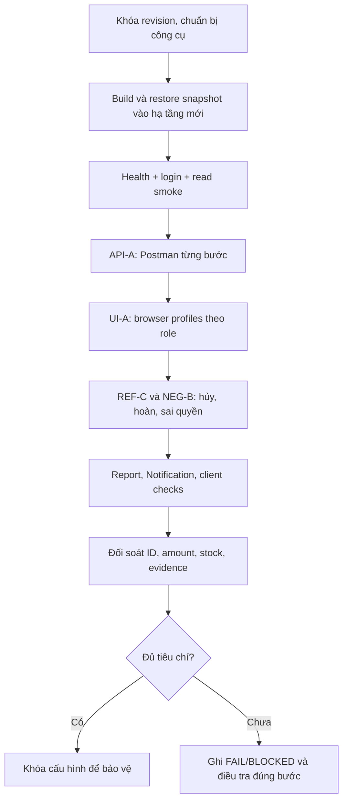
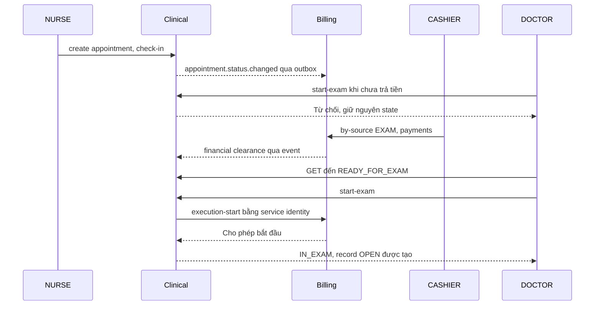
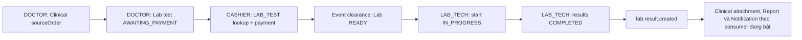
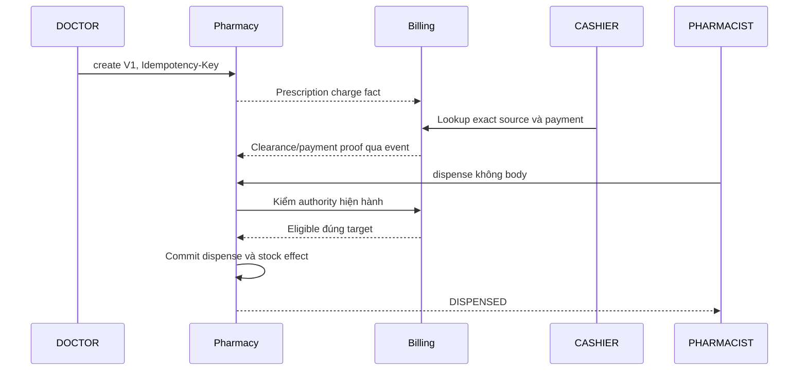
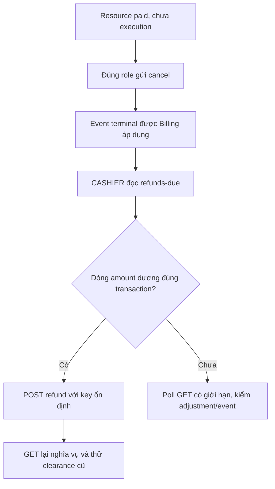
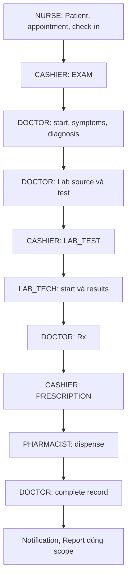

# MediFlow — Thực hành kiểm thử Postman và UI từng bước

> **Phạm vi baseline — cập nhật 25/10/2026:** các lệnh/API và kịch bản bên dưới mô tả mã nguồn
> được khóa trong hướng dẫn, không là nghiệm thu luồng nghiệp vụ mới. Quy tắc hiện hành về
> lịch khám theo ca, giữ suất, đăng ký tại quầy, tái khám và BHYT mô phỏng nằm tại
> [02-business-flows](../../docs/plans/02-business-flows.md); phần chưa triển khai và thứ tự sửa ở
> [WF-01–11](../../docs/plans/07-outpatient-workflow-implementation.md), test đích ở
> [ma trận WF](../../docs/plans/06-acceptance-runbook.md).
> Tiếp tục dùng phần khởi động/restore phù hợp binary hiện tại; không nhập thêm field hỗ trợ BHYT
> vào API cũ, không thay snapshot tiền hoặc kết luận đã có kiểm lịch ca từ màn hình chọn bác sĩ.

Ngày đối chiếu: **25/10/2026**, revision **`eac2cd7b`**, môi trường Windows/PowerShell. Phần diễn giải dùng tiếng Việt; tên field, hàm, role và trạng thái giữ đúng tiếng Anh trong source.

Đây là **quy trình để thực hiện test**, không phải biên bản đã chạy PASS. Chỉ ghi PASS sau khi chạy trên máy của bạn và lưu bằng chứng. Phạm vi full flow là **MVP ngoại trú**: Organization, Patient, Clinical, Lab, Pharmacy, Billing, Report, Notification. Inpatient/Surgery không nằm trong nghiệm thu này.

Tài liệu này ưu tiên thao tác thực tế. Danh mục đầy đủ 152 HTTP operations, DTO, input/output ports và guard nằm trong [tài liệu contract cùng revision](MediFlow_Request_Event_UseCase_Role_Test_Guide_2026-10-25.md). Các API internal, maintenance và deferred được phân loại riêng ở cuối, không trộn vào ca human bình thường.

## Mục lục

1. [Cách tổ chức lượt test](#s01)
2. [Chuẩn bị máy và khóa revision](#s02)
3. [Khởi động backend](#s03)
4. [Khởi động web và Flutter Web](#s04)
5. [Thiết lập Postman](#s05)
6. [Đăng nhập từng role và lấy dữ liệu nền](#s06)
7. [API: Patient → Appointment → thu phí → khám](#s07)
8. [API: chỉ định → Lab → thu phí → kết quả](#s08)
9. [API: kê đơn → thu tiền → cấp thuốc](#s09)
10. [API: hoàn tất hồ sơ](#s10)
11. [API: hủy và hoàn tiền](#s11)
12. [API: Notification và Report](#s12)
13. [UI: luồng chính xuyên hệ thống](#s13)
14. [UI: hủy và hoàn tiền](#s14)
15. [Organization, tài khoản và quản trị](#s15)
16. [Ma trận kiểm thử theo role](#s16)
17. [Ca lỗi, idempotency và đồng thời](#s17)
18. [Chạy collection và bộ kiểm tra dự án](#s18)
19. [Flutter Web và native](#s19)
20. [Theo dõi event và xử lý sự cố](#s20)
21. [Danh mục API cần đánh dấu kết quả](#s21)
22. [Biên bản, tiêu chí đạt và kết thúc](#s22)

<a id="s01"></a>

## 1. Cách tổ chức lượt test

Chuẩn bị ba bộ dữ liệu độc lập:

| Bộ | Mục đích | Quy tắc |
|---|---|---|
| `API-A` | Postman đi hết luồng mới | Patient/appointment mới, normal payment, không override |
| `UI-A` | Thực hiện lại luồng qua giao diện | Patient/appointment khác `API-A` |
| `NEG-B`, `REF-C` | Sai quyền, hủy, hoàn, race | Không dùng resource đã hoàn tất của ca chính |

Một lần submit thành công làm thay đổi state. Vì vậy không chạy lại cùng POST với key mới chỉ để có ảnh đẹp, không dùng cùng appointment đã check-in để test check-in lần đầu. Một bệnh nhân có thể bị chặn hai lịch PENDING trong cùng ngày; dùng patient khác hoặc kết thúc/hủy lịch theo nghiệp vụ.



Người test phải đối chiếu đồng thời ba lớp: **HTTP response**, **đọc lại state từ backend**, **hiển thị UI**. Toast thành công hoặc status 200 đơn lẻ chưa chứng minh hết một giao dịch xuyên service.

<a id="s02"></a>

## 2. Chuẩn bị máy và khóa revision

### 2.1. Công cụ và terminal

Cần Git, Docker Desktop đang chạy, JDK 21, Maven, Python 3, Node **24 LTS đã được kiểm chứng cho demo**, pnpm, Postman Desktop, Chrome/Edge. Flutter/Dart chỉ bắt buộc khi test Flutter. Có thể dùng một trình duyệt khác cho từng role hoặc nhiều browser profiles.

Mở PowerShell tại root; những terminal khác cũng bắt đầu từ root, trừ khi có `Set-Location`:

```powershell
Set-Location 'E:\DEV\Coding_Resource\Project\e_PROJECT\Semester4\Source'
git status --short --branch
git rev-parse HEAD
git status --short
git log -5 --oneline
java -version
mvn -version
python --version
node --version
pnpm --version
docker info --format '{{.ServerVersion}}'
```

Ghi SHA vào biên bản. Bản hướng dẫn đối chiếu `eac2cd7b`; bản vá Lab/Billing đã nằm trong `master` này. Một số tài liệu lịch sử còn yêu cầu nhánh `codex/fix-lab-clearance-identity`: không checkout lùi baseline chỉ để giống ảnh cũ. Nếu test revision mới hơn, ghi SHA mới và đối chiếu contract thay đổi.

### 2.2. Quy tắc môi trường

Hướng dẫn chọn **rehearsal snapshot** vì runner đã cấu hình các gate ngoại trú và tạo PostgreSQL/RabbitMQ riêng. Không đồng thời bật thêm bộ JAR/Compose khác trên cùng port. Không chạy `docker compose down -v`, không sửa SQL để tạo PAID/READY, không reset inbox/outbox.

| Thành phần | URL/port trong lượt rehearsal |
|---|---|
| Gateway API | `http://127.0.0.1:28080` |
| Eureka | `http://127.0.0.1:28761` |
| Core / Clinical / Lab | `28089` / `28082` / `28084` |
| Pharmacy / Billing / Support | `28085` / `28086` / `28087` |
| Next.js | `http://localhost:3000` |
| Flutter Web proxy | `http://localhost:4300` |
| PostgreSQL / RabbitMQ | Port loopback ngẫu nhiên, đọc manifest/log của runner |

Default production/local Compose có Gateway `8080`; **không trộn `8080` và `28080`**. API nghiệp vụ trong hướng dẫn luôn qua Gateway, health service là kiểm tra vận hành.

<a id="s03"></a>

## 3. Khởi động backend

### 3.1. Build tám ứng dụng cần chạy

Terminal A, tại root:

```powershell
mvn -q -pl backend/core-service,backend/clinical-service,backend/lab-service,backend/pharmacy-service,backend/billing-service,backend/support-service,backend/gateway,backend/eureka-server -am -DskipTests package
```

**Đạt:** Maven exit code 0 và có JAR mới trong `target` của từng app. `-DskipTests` chỉ tạo build; không ghi test PASS từ lệnh này. Nếu fail, đọc lỗi và dừng trước bước restore/start; không chạy JAR cũ rồi ghi là revision mới.

### 3.2. Restore và start bằng runner

Vẫn terminal A:

```powershell
python scripts/demo_25_10/rehearse_snapshot.py --keep
```

Runner tạo hạ tầng disposable, restore **tám database**, bật profile `outpatient-mvp`, bật các gate Clinical/Lab/Pharmacy/Billing/Support cần cho rehearsal và khởi động ứng dụng tuần tự. Chờ các app báo `UP` và dòng `READY`. Giữ terminal A mở.

Runner giữ stack tối đa **hai giờ**. Khi hết thời gian, hạ tầng của lượt này bị dọn; ca mới chỉ có trong stack đó. Lưu evidence trước khi dừng và không coi snapshot gốc là backup các thay đổi vừa test.

Nếu toàn bộ checklist cần nhiều hơn hai giờ, chia thành lượt API, lượt UI và lượt negative riêng; mỗi lượt start runner mới, tạo fixture mới và lưu evidence riêng. Không mang ID phát sinh của stack đã bị dọn sang stack mới. Có thể cài dependency/build client trước khi start runner để tiết kiệm thời gian giữ stack.

Runner cấu hình giá EXAM `OUTPATIENT_EXAM` = 150000 VND, Lab `LAB` = 80000 VND; Rx dùng allowlist `RX-DEMO`. Đây là cấu hình của runner, **số tiền thực thu luôn lấy từ Billing response**, không hard-code theo bảng này.

### 3.3. Xác nhận readiness

Terminal B, tại root:

```powershell
Get-Content scripts/demo_25_10/evidence/active-rehearsal.local.json
Invoke-RestMethod http://127.0.0.1:28080/actuator/health
./scripts/demo_25_10/Smoke-Gateway.ps1 -Gateway http://127.0.0.1:28080
```

**Đạt:** manifest là của lượt đang chạy; health `UP`; smoke login ADMIN thật và các read routes thành công. Manifest chứa `evidence`, `ports`, `containers`, `pids`, `stopFile`. Giữ đường dẫn `evidence` để đọc log theo service.

Smoke này đọc dữ liệu snapshot; **chưa chứng minh** ca mới tạo được, thanh toán được, Lab results hay dispense chạy được.

<a id="s04"></a>

## 4. Khởi động web và Flutter Web

### 4.1. Cài dependency và build client

Terminal B, tại root:

```powershell
Push-Location frontend
pnpm install --frozen-lockfile
Pop-Location
./scripts/demo_25_10/Run-ClientChecks.ps1 -Client Web -Gateway http://127.0.0.1:28080
```

Runner chạy typecheck/lint/tests/build; `GATEWAY_URL` và UI gates được đưa vào build. Đổi Gateway cần build lại. Nếu máy thiếu tài nguyên, build/check client trước khi bật đầy đủ backend, nhưng vẫn giữ cùng Gateway cấu hình.

### 4.2. Chạy Next.js

Terminal C, tại root:

```powershell
$env:MEDIFLOW_OUTPATIENT_UI_ENABLED='true'
$env:MEDIFLOW_PHARMACY_PRESCRIPTION_MODE='outpatient'
$env:MEDIFLOW_REPORT_OUTPATIENT_UI_ENABLED='true'
Set-Location frontend
pnpm start --hostname 127.0.0.1 --port 3000
```

Mở `http://localhost:3000/login`. Không chạy thêm `pnpm dev` trên port 3000 khi server này đang dùng. Cấu hình standalone có thể phát cảnh báo khuyến nghị của Next; xác minh thực tế login và request rewrite trước khi đánh dấu đạt.

### 4.3. Flutter Web, nếu nằm trong lượt test

Terminal D, root:

```powershell
./scripts/demo_25_10/Run-ClientChecks.ps1 -Client Mobile -Gateway http://127.0.0.1:28080
Set-Location mobile
dart run tool/dev_server.dart 4300 http://127.0.0.1:28080
```

Mở `http://localhost:4300`. Native Android/iOS/Windows kiểm riêng ở phần 19.

<a id="s05"></a>

## 5. Thiết lập Postman

### 5.1. Tạo environment

Tạo environment `MediFlow-Rehearsal-API-A`, chọn environment này trước khi Send. Tạo các biến sau; những ô chưa có ID để trống, **không nhập chuỗi `null` hoặc UUID tự nghĩ ra**.

| Biến | Giá trị ban đầu / nguồn |
|---|---|
| `baseUrl` | `http://127.0.0.1:28080` — không có `/api` cuối |
| `runLabel` | Ví dụ `API-A-20261025-01` |
| `testDate` | Ngày thực hiện ở Việt Nam, dạng `YYYY-MM-DD` |
| `appointmentTime` | Giờ hợp lệ `HH:mm`, trong 07:00–17:00 |
| `demoPassword` | Password demo hiện hành; seed ban đầu `MediFlowDemo@2026` |
| `loginUsername`, `expectedRole` | Thay theo account đang lấy token |
| `token_ADMIN` … `token_PATIENT` | Lưu sau login; gồm đủ tám human roles |
| `refresh_ADMIN` … `refresh_PATIENT` | Refresh token của từng role |
| `patientId`, `otherPatientId` | Từ Patient API; hai UUID khác nhau |
| `doctorId`, `departmentId` | Staff UUID bác sĩ và khoa thật của bác sĩ đó |
| `labActorId` | Signed staff UUID của LAB_TECH hiện hành |
| `appointmentId`, `recordId`, `careEpisodeId` | Lưu từ các bước Clinical/Billing |
| `sourceOrderId`, `testId` | Lưu từ Clinical order và Lab create |
| `drugId`, `prescriptionId`, `dispenseId` | Lưu từ Pharmacy |
| `purpose`, `sourceId` | Chọn trước mỗi lần Billing discovery |
| `paymentRequestId`, `paymentAmount`, `currency` | Lấy từ discovery đã đối chiếu |
| `paymentKey`, `rxCreateKey`, `refundKey` | UUID ổn định cho từng ý định |
| `originalTransactionId`, `refundAmount` | Từ dòng refund due đang chọn |
| `notificationId` | Từ Notification response |

Giữ token/password ở giá trị local và đánh dấu sensitive nếu bản Postman đang dùng hỗ trợ. Khi export collection/environment chia sẻ nhóm, loại token và mật khẩu. Không dùng production account.

### 5.2. Cấu trúc collection

Tạo collection `MediFlow Full Outpatient`, các folder:

```text
00 Auth
01 Core Fixtures
02 Appointment and Exam
03 Lab
04 Pharmacy
05 Billing Shared Requests
06 Complete Visit
07 Cancellation and Refund
08 Notification and Report
09 Organization Administration
10 Negative and Retry
```

Ở mỗi request nghiệp vụ: URL `{{baseUrl}}/api/v1/...`; Authorization → Bearer Token → chọn `{{token_NURSE}}`, `{{token_DOCTOR}}`… theo bảng của bước. Đừng dùng một biến `accessToken` bị ghi đè liên tục rồi không biết request đang chạy role nào. Login/refresh dùng **No Auth**.

Với body: Body → raw → JSON, header `Content-Type: application/json`. GET và command ghi rõ “không body” không gửi JSON tùy ý. API qua Gateway không cần tự thêm `X-Role`, `X-Staff-Id` để cấp quyền.

### 5.3. Script dùng chung cho response nghiệp vụ thành công

Gắn ở request thành công, trong **Scripts → Post-response** (bản cũ có tên Tests). Không áp dụng script `success=true` này cho login hoặc ca negative:

```javascript
pm.test("HTTP thành công", function () {
  pm.expect(pm.response.code).to.be.within(200, 299);
});
const reply = pm.response.json();
pm.test("ApiResponse thành công", function () {
  pm.expect(reply.success).to.eql(true);
  pm.expect(reply).to.have.property("data");
});
```

Các script lưu ID bên dưới **thêm vào sau script này**. Trước khi Send, xác nhận tất cả `{{variable}}` đã resolve. Số tiền là JSON number, ví dụ `"amount": {{paymentAmount}}`, không bọc thành string.

### 5.4. UUID ổn định cho retry

Tạo key một lần trước ý định mới bằng Pre-request:

```javascript
if (!pm.environment.get("rxCreateKey")) {
  pm.environment.set("rxCreateKey", pm.variables.replaceIn("{{$guid}}"));
}
```

Đổi tên biến thành `paymentKey` hoặc `refundKey` cho request tương ứng. **Không sinh key mới mỗi lần Send.** Để bắt đầu ý định mới, xóa đúng biến key cũ sau khi đã xác định kết quả cũ, rồi để script tạo key mới. `Idempotency-Key` header của Rx khác field `idempotencyKey` trong payment/refund body.

Postman hỗ trợ lưu biến qua `pm.environment.set()` và đọc response qua `pm.response.json()`; xem [hướng dẫn biến chính thức](https://learning.postman.com/docs/tests-and-scripts/write-scripts/postman-sandbox-reference/pm-variables) khi tên tab trên phiên bản cài đặt khác ảnh hướng dẫn.

<a id="s06"></a>

## 6. Đăng nhập từng role và lấy dữ liệu nền

### 6.1. AUTH-01 — Login tám role

Tạo request `POST {{baseUrl}}/api/v1/auth/login`, No Auth:

```json
{"username":"{{loginUsername}}","password":"{{demoPassword}}"}
```

Lần lượt nhập environment `loginUsername`/`expectedRole` theo bảng rồi Send:

| Username seed | expectedRole | Dùng trong test |
|---|---|---|
| `demo.admin` | `ADMIN` | Quản trị, fixture, Notification send |
| `demo.manager` | `MANAGER` | Danh sách được phép, Report |
| `demo.doctor` | `DOCTOR` | Assigned doctor ca chính |
| `demo.nurse` | `NURSE` | Patient, appointment, check-in |
| `demo.lab` | `LAB_TECH` | Start/results Lab |
| `demo.pharmacist` | `PHARMACIST` | Thuốc/tồn kho/dispense |
| `demo.cashier` | `CASHIER` | Thu/hoàn tiền |
| `demo.patient` | `PATIENT` | Own profile/notification |

Seed chỉ đặt password khi tạo account; đã đổi password thì dùng credential hiện hành, không suy rằng chạy lại seed sẽ reset.

Post-response riêng cho login:

Trước lần login lấy token chính thức, ở **Pre-request** xóa token cũ của role đang lấy để login thất bại không vô tình dùng lại phiên cũ:

```javascript
const roleToLogin = pm.environment.get("expectedRole");
if (!roleToLogin) throw new Error("Cần chọn expectedRole trước login");
pm.environment.unset("token_" + roleToLogin);
pm.environment.unset("refresh_" + roleToLogin);
```

Sau đó thêm **Post-response**:

```javascript
pm.test("Login 200", () => pm.response.to.have.status(200));
const j = pm.response.json();
const role = pm.environment.get("expectedRole");
pm.test("Đúng role và có token", () => {
  pm.expect(j.role).to.eql(role);
  pm.expect(j.accessToken).to.be.a("string").and.not.empty;
  pm.expect(j.refreshToken).to.be.a("string").and.not.empty;
});
if (pm.response.code === 200 && j.role === role && j.accessToken && j.refreshToken) {
  pm.environment.set("token_" + role, j.accessToken);
  pm.environment.set("refresh_" + role, j.refreshToken);
}
```

**Đạt:** response là object phẳng có `accessToken`, `refreshToken`, `role`, không phải `data.accessToken`. Lấy thêm `demo.doctor2` làm bác sĩ khác cho ca sai assigned doctor; lưu riêng `token_DOCTOR_OTHER`, không ghi đè token bác sĩ chính.

### 6.2. AUTH-02 — Refresh và lỗi xác thực

`POST /api/v1/auth/refresh`, No Auth:

```json
{"refreshToken":"{{refresh_DOCTOR}}"}
```

Đạt: 200, object phẳng `accessToken`; cập nhật `token_DOCTOR` bằng giá trị mới. Không giả định refresh response có refresh token mới. Test password sai bằng request riêng; test endpoint protected không token và token hỏng phải bị từ chối 401/403 theo security boundary, không có dữ liệu nghiệp vụ. Không áp một mã lỗi business cho mọi trường hợp authentication.

### 6.3. FIX-01 — Xác minh bác sĩ và khoa

1. ADMIN gọi `GET /api/v1/org/staff?jobTitle=DOCTOR&activeOnly=true&page=0&size=20`.
2. Đọc `data.content`; tìm đúng staff liên kết `demo.doctor` theo hồ sơ/account, không lấy phần tử đầu tiên một cách ngẫu nhiên.
3. ADMIN có thể `GET /api/v1/org/accounts?keyword=demo.doctor&page=0&size=20`, rồi đọc chi tiết đúng account để đối chiếu `staffId`.
4. Ghi staff UUID vào `doctorId`, khoa tương ứng vào `departmentId`. Account UUID **không phải** doctor UUID.
5. Tương tự ghi staff UUID của `demo.lab` vào `labActorId` cho nhánh cancel Lab; đối chiếu signed identity/backend mapping.
6. Với PATIENT, ghi patient UUID liên kết `demo.patient` vào biến riêng `selfPatientId`; patient mới của `API-A` không tự thuộc tài khoản seed.

### 6.4. FIX-02 — Kiểm danh mục thuốc

PHARMACIST gọi `GET /api/v1/pharmacy/drugs?page=0&size=20`. Chọn thuốc chưa hết hạn, stock đủ số lượng cho ca. Lưu `drugId`, `stockBefore`, `price` để đối soát. Nếu không có fixture phù hợp, tạo thuốc bằng phần 9.1; không thay random drug UUID.

<a id="s07"></a>

## 7. API — Patient → Appointment → thu phí → khám

### 7.1. API-01 — Tạo bệnh nhân mới

**Role NURSE.** `POST /api/v1/patients`:

```json
{
  "hoTen":"Demo {{runLabel}}",
  "ngaySinh":"1998-01-01",
  "gioiTinh":"M",
  "soCmnd":"990000000001",
  "diaChi":"Dia chi du lieu mo phong",
  "soDienThoai":"0900000001",
  "email":"api.demo@example.com",
  "bhytSo":null
}
```

Thay CCCD tổng hợp bằng giá trị **chưa tồn tại** của lượt test, giữ một giá trị cố định nếu đang đối soát unknown outcome. Đạt: **201**, `data.maBenhNhan` có UUID. Post-response:

```javascript
pm.test("Patient created", () => pm.response.to.have.status(201));
const p = pm.response.json().data;
pm.expect(p.maBenhNhan).to.be.a("string").and.not.empty;
pm.environment.set("patientId", p.maBenhNhan);
```

NURSE gọi `GET /api/v1/patients/{{patientId}}` và search `GET /api/v1/patients?keyword=990000000001&page=0&size=20`. Đạt: đúng tên/CCCD/UUID; không chỉ nhìn response create. Tạo lại cùng CCCD ở ca negative phải 409 `PATIENT_CMND_DUPLICATE`.

### 7.2. API-02 — Tạo appointment

**Role NURSE.** `POST /api/v1/appointments`:

```json
{
  "patientId":"{{patientId}}",
  "doctorId":"{{doctorId}}",
  "departmentId":"{{departmentId}}",
  "appointmentDate":"{{testDate}}",
  "appointmentTime":"{{appointmentTime}}",
  "reason":"Kiem thu {{runLabel}}"
}
```

Đạt: 201, `PENDING`, đúng patient/doctor/khoa, `careContractVersion=0` trước promote. Lưu:

```javascript
const a = pm.response.json().data;
pm.expect(a.status).to.eql("PENDING");
pm.environment.set("appointmentId", a.appointmentId);
```

Đọc lại `GET /api/v1/appointments/{{appointmentId}}`. Ngày không ở quá khứ; thời gian dùng `HH:mm`, không gửi ISO timestamp cho `appointmentTime`.

### 7.3. API-03 — Check-in

**Role NURSE.** `PUT /api/v1/appointments/{{appointmentId}}/check-in`, **không body**.

Đạt: 200, `AWAITING_PAYMENT`, `careContractVersion=1`, có `examPriceCode` và `checkedInAt`. Đọc lại appointment. Không dùng `/status` để nhảy thẳng READY/IN_EXAM.

### 7.4. API-04 — Chứng minh chưa trả tiền chưa khám được

**Role DOCTOR được gán.** `PUT /api/v1/appointments/{{appointmentId}}/start-exam`, body:

```json
{}
```

Đạt của **negative case**: bị từ chối nghiệp vụ 4xx theo error contract, appointment vẫn `AWAITING_PAYMENT`, chưa tạo record từ start thất bại. Lưu error code/message/correlation. Không dùng emergencyOverride để vượt ca kiểm thử này.

### 7.5. BILL-LOOKUP — Request Billing dùng chung

**Role CASHIER.** Đặt environment:

```text
purpose = EXAM
sourceId = giá trị appointmentId
careEpisodeId = giá trị appointmentId cho EXAM lookup
```

Tạo `GET {{baseUrl}}/api/v1/billing/payment-requests/by-source` với **đúng bốn query keys**:

| Key | Value |
|---|---|
| `purpose` | `{{purpose}}` |
| `sourceId` | `{{sourceId}}` |
| `patientId` | `{{patientId}}` |
| `careEpisodeId` | `{{careEpisodeId}}` |

Không thêm `sourceType`, keyword, page hoặc query key lặp. Chưa có request ngay sau check-in có thể do event chưa xử lý: chỉ lặp **GET**, tối đa 15 lần, mỗi lần cách khoảng 2 giây; quá ngân sách ghi BLOCKED và điều tra event, không đổi source để tìm một khoản có sẵn.

Post-response sau khi discovery 200:

```javascript
const b = pm.response.json().data;
pm.test("Đúng nguồn phí", () => {
  pm.expect(b.purpose).to.eql(pm.environment.get("purpose"));
  pm.expect(b.sourceId).to.eql(pm.environment.get("sourceId"));
  pm.expect(b.patientId).to.eql(pm.environment.get("patientId"));
  pm.expect(b.careEpisodeId).to.eql(pm.environment.get("careEpisodeId"));
});
if (b.purpose !== pm.environment.get("purpose") ||
    b.sourceId !== pm.environment.get("sourceId") ||
    b.patientId !== pm.environment.get("patientId") ||
    b.careEpisodeId !== pm.environment.get("careEpisodeId")) {
  throw new Error("Sai target, dừng trước payment");
}
pm.environment.set("paymentRequestId", b.paymentRequestId);
pm.environment.set("paymentAmount", String(b.remainingAmount));
pm.environment.set("currency", b.currency);
// Lưu episode do Billing xác nhận để chuyển tiếp cho Lab/Rx.
pm.environment.set("careEpisodeId", b.careEpisodeId);
```

Kiểm thêm `departmentId`, trạng thái tài khoản/request, `remainingAmount > 0`, chưa expired. Nếu `remainingAmount=0`, dừng và đối soát: có thể ý định trước đã thu xong. Không gửi payment amount 0.

### 7.6. BILL-PAY — Thu đủ khoản đang chọn

**Role CASHIER.** Tạo UUID `paymentKey` một lần cho lần thu này. `POST /api/v1/billing/payment-requests/{{paymentRequestId}}/payments`:

```json
{
  "idempotencyKey":"{{paymentKey}}",
  "amount":{{paymentAmount}},
  "currency":"{{currency}}",
  "paymentMethod":"CASH",
  "providerReference":null
}
```

Ở Pre-request payment, thêm chặn nhầm input trước khi gửi; vẫn giữ script sinh key một lần ở phần 5.4:

```javascript
const amountToPay = Number(pm.environment.get("paymentAmount"));
if (!Number.isFinite(amountToPay) || amountToPay <= 0) {
  throw new Error("Cần lookup và kiểm remainingAmount dương trước payment");
}
for (const key of ["paymentRequestId", "currency", "paymentKey"]) {
  if (!pm.environment.get(key)) throw new Error("Thiếu " + key);
}
```

Đạt: HTTP **200**, transaction `COMPLETED`, đúng `paymentRequestId`, amount/currency, có `transactionId`. **Không dùng status 2xx thay cho kiểm transaction status**. Lưu transaction theo purpose để tránh bị lần Lab/Rx ghi đè:

```javascript
const t = pm.response.json().data;
pm.expect(t.status).to.eql("COMPLETED");
pm.expect(t.paymentRequestId).to.eql(pm.environment.get("paymentRequestId"));
pm.environment.set("transaction_" + pm.environment.get("purpose"), t.transactionId);
pm.environment.set("request_" + pm.environment.get("purpose"), t.paymentRequestId);
```

Gọi lại BILL-LOOKUP: `PAID`, `remainingAmount=0`, tổng paid đúng. Lần thu Lab/Rx tiếp theo phải xóa biến `paymentKey` để tạo **ý định thu mới** sau khi lần hiện tại đã rõ kết quả. `INSURANCE` không phải phương thức hợp lệ của ledger V1.

### 7.7. API-05 — Chờ quyền khám và bắt đầu

1. DOCTOR gọi `GET /api/v1/appointments/{{appointmentId}}` đến khi `READY_FOR_EXAM` và `examClearanceId` có giá trị; dùng ngân sách polling GET như trên.
2. DOCTOR gọi lại `PUT /api/v1/appointments/{{appointmentId}}/start-exam`, body `{}`.
3. Đạt: 200, `IN_EXAM`, timestamp bắt đầu. Billing authority được kiểm lúc command, không chỉ dựa trạng thái UI.
4. Gọi `GET /api/v1/records/patient/{{patientId}}` bằng DOCTOR, match **đúng appointmentId**:

```javascript
const rows = pm.response.json().data;
pm.expect(rows).to.be.an("array");
const matches = rows.filter(r => r.appointmentId === pm.environment.get("appointmentId"));
pm.test("Đúng một hồ sơ cho appointment", () => pm.expect(matches.length).to.eql(1));
if (matches.length !== 1) throw new Error("Không suy recordId từ hồ sơ mới nhất");
pm.environment.set("recordId", matches[0].recordId);
```

Start trả `AppointmentDTO`, không trả recordId. Không tạo thêm `POST /records` cho visit V1 đã được start tạo record.

### 7.8. API-06 — Triệu chứng và chẩn đoán

**Role assigned DOCTOR.** `PUT /api/v1/records/{{recordId}}`:

```json
{"symptoms":"Du lieu mo phong {{runLabel}}, khong phai benh an that"}
```

`POST /api/v1/records/{{recordId}}/diagnoses`:

```json
{"diagnosisName":"Chan doan mo phong phuc vu kiem thu","description":"Du lieu demo","icdCode":null}
```

Đạt: thành công, đọc `GET /api/v1/records/{{recordId}}` thấy symptoms và ít nhất một diagnosis. Không tự chế ICD không đúng pattern. Chưa complete record: còn làm Lab/Rx ở phần sau.



<a id="s08"></a>

## 8. API — Chỉ định → Lab → thu phí → kết quả

### 8.1. LAB-01 — Clinical lập source order

**Role assigned DOCTOR**, record OPEN/appointment IN_EXAM. `POST /api/v1/records/{{recordId}}/lab-orders`:

```json
{"labType":"CBC","requestedDate":"{{testDate}}","priceCode":"LAB"}
```

Đạt: create thành công, có `sourceOrderId`. Lưu **toàn bộ context từ response**, không tự điền lại episode theo phỏng đoán:

```javascript
const o = pm.response.json().data;
pm.expect(o.recordId).to.eql(pm.environment.get("recordId"));
pm.expect(o.patientId).to.eql(pm.environment.get("patientId"));
for (const k of ["sourceOrderId", "careEpisodeId", "careEpisodeType",
                 "requestingDepartmentId", "labType", "requestedDate", "priceCode"]) {
  if (o[k] == null) throw new Error("Thiếu context " + k);
  pm.environment.set("lab_" + k, String(o[k]));
}
pm.environment.set("sourceOrderId", o.sourceOrderId);
```

### 8.2. LAB-02 — Tạo test từ source

**Cùng DOCTOR.** `POST /api/v1/lab`:

```json
{
  "recordId":"{{recordId}}",
  "patientId":"{{patientId}}",
  "requestingDepartmentId":"{{lab_requestingDepartmentId}}",
  "labType":"{{lab_labType}}",
  "requestedDate":"{{lab_requestedDate}}",
  "sourceOrderId":"{{lab_sourceOrderId}}",
  "careEpisodeType":"{{lab_careEpisodeType}}",
  "careEpisodeId":"{{lab_careEpisodeId}}",
  "priceCode":"{{lab_priceCode}}"
}
```

Đạt: 201, V1, `AWAITING_PAYMENT`, đúng source/episode. Lưu `testId = data.testId`. `sourceOrderId`, `testId` và local clearance projection ID là các định danh khác nhau. Không dùng sourceOrderId làm LAB_TEST source trong Billing.

### 8.3. LAB-03 — Thu phí Lab

1. CASHIER đặt `purpose=LAB_TEST`, `sourceId=testId`, `careEpisodeId=lab_careEpisodeId` bằng **giá trị UUID**, không nhập tên biến làm text.
2. Chạy BILL-LOOKUP; đối chiếu source, patient, episode, amount/currency.
3. Xóa `paymentKey` đã hoàn thành của EXAM, tạo key cho lần thu Lab.
4. Chạy BILL-PAY và lookup lại PAID.
5. LAB_TECH `GET /api/v1/lab/{{testId}}` đến `READY`, có `clearanceId`.

Trước payment có thể chạy negative start `{}` để chứng minh bị chặn. Không kết luận kết quả chỉ từ field legacy `paid`.

### 8.4. LAB-04 — Start bằng LAB_TECH

**Role LAB_TECH.** `PUT /api/v1/lab/{{testId}}/start`, body `{}`.

Đạt: 200, `IN_PROGRESS`. Nếu READY nhưng start trả `LAB_CLEARANCE_REQUIRED`, giữ lỗi và correlation, kiểm current Billing authority/event timing; không sửa clearance ID và không override. Source đã sửa identity/timestamp cần được **build đúng JAR**.

### 8.5. LAB-05 — Nhập kết quả

**Role LAB_TECH.** `PUT /api/v1/lab/{{testId}}/results`:

```json
{
  "results":[{"indicator":"Chi so mo phong","value":"7.2","unit":"demo","referenceRange":"Du lieu minh hoa"}],
  "conclusion":"Ket qua mo phong {{runLabel}}",
  "performedDate":"{{testDate}}"
}
```

Đạt: 200, `COMPLETED`, có results, performedDate, resultVersion. GET lại bằng LAB_TECH rồi DOCTOR thấy cùng kết quả. Test rỗng results ở một ca riêng đang IN_PROGRESS phải bị validation reject; không sửa ca đã COMPLETED để thử nhập lần đầu.

### 8.6. LAB-06 — Liên thông Clinical

DOCTOR đọc record đúng `recordId` và đối chiếu event attachment bằng evidence/harness nếu cần. `MedicalRecordDTO` hiện **không expose toàn bộ attachment Lab**; không đặt tiêu chí “mọi kết quả xuất hiện trong record JSON/UI” khi contract chưa có. UI kiểm kết quả ở `/lab/{testId}`; acceptance tích hợp kiểm attachment ở backend. Không dùng thiếu control UI làm bằng chứng consumer đã thất bại nếu chưa đối soát.



<a id="s09"></a>

## 9. API — Kê đơn → thu tiền → cấp thuốc

### 9.1. RX-00 — Thuốc phục vụ test

Nếu thuốc seed còn hạn/stock phù hợp, dùng thuốc đó và ghi stock ban đầu. Nếu cần tạo riêng, **PHARMACIST** `POST /api/v1/pharmacy/drugs`:

```json
{
  "drugName":"Thuoc mo phong {{runLabel}}",
  "activeIngredient":"Demo",
  "unit":"vien",
  "price":1000,
  "stockQuantity":100,
  "expiryDate":"2028-12-31",
  "manufacturer":"Demo",
  "lowStockThreshold":10
}
```

Chọn expiry thật sự không ở quá khứ lúc chạy. Đạt: 201; lưu `drugId`. GET detail xác nhận stock/price. Tồn kho quantity không tự bằng số khả dụng sau reservation; theo dõi cả lifecycle reservation bằng nguồn được hỗ trợ khi cần đối soát.

### 9.2. RX-01 — Kê đơn V1

Ở revision `eac2cd7b`, trước create có thể dùng **DOCTOR** gọi `GET /api/v1/pharmacy/prescriptions/prescribing/context?recordId={{recordId}}`. Đạt 200, context đúng patient/doctor/khoa/episode, `priceCodes` có allowlist được triển khai. Copy giá trị từ response vào input create, không dùng context của record khác. Gate/dependency chưa sẵn sàng phải trả lỗi, không tự điền UUID thay thế.

**Role assigned DOCTOR**, record OPEN. `POST /api/v1/pharmacy/prescriptions`; thêm header **`Idempotency-Key: {{rxCreateKey}}`** là canonical UUID:

```json
{
  "recordId":"{{recordId}}",
  "patientId":"{{patientId}}",
  "doctorId":"{{doctorId}}",
  "departmentId":"{{departmentId}}",
  "prescribedDate":"{{testDate}}",
  "lines":[{"drugId":"{{drugId}}","quantity":2,"dosage":"Huong dan mo phong"}],
  "careContractVersion":1,
  "careContext":"OUTPATIENT",
  "careEpisodeType":"OUTPATIENT_VISIT",
  "careEpisodeId":"{{careEpisodeId}}",
  "admissionId":null,
  "priceCode":"RX-DEMO"
}
```

Đạt: 201, có `prescriptionId`, đúng lines/quantity, tổng tiền do server snapshot giá. Lưu `prescriptionId`. GET `/api/v1/pharmacy/prescriptions/{{prescriptionId}}`; ghi status và dispenseStatus. Không gửi unitPrice/lineTotal từ client. Không tự thêm `/outpatient` vào endpoint.

### 9.3. RX-02 — Chưa trả tiền thì không cấp

**PHARMACIST** `PUT /api/v1/pharmacy/prescriptions/{{prescriptionId}}/dispense`, **không body**.

Đạt của negative: bị chặn nghiệp vụ, không có dispense thành công/stock deduction. Đọc lại prescription và drug. Không gửi doctorId/dispensedBy để giả người thực hiện: backend dùng signed staff identity.

### 9.4. RX-03 — Thu tiền đơn thuốc

CASHIER đặt `purpose=PRESCRIPTION`, `sourceId=prescriptionId`, `careEpisodeId` giữ đúng visit của đơn. Chạy BILL-LOOKUP → tạo `paymentKey` mới → BILL-PAY → lookup PAID. Giá không tự bằng số lượng nhân một giá nhập ở UI: đối chiếu server response và snapshot của đơn.

### 9.5. RX-04 — Dispense

1. PHARMACIST GET prescription đến khi nhận proof thanh toán; `paymentConfirmed` là tín hiệu hiển thị, command vẫn kiểm authority.
2. `PUT /api/v1/pharmacy/prescriptions/{{prescriptionId}}/dispense`, không body.
3. Đạt: response `DispenseDTO.status=DISPENSED`, có dispenseId, dispensedAt/dispensedBy.
4. GET prescription: terminal fulfilled/dispensed đúng contract; GET drug: stock giảm đúng số đã cấp so với baseline và các thao tác khác của ca.
5. Gọi lại cùng dispense trên ca retry được chuẩn bị; chứng minh **không trừ stock lần hai**. Tùy contract trả receipt cũ hoặc từ chối terminal, không ép mọi endpoint phải replay 200.



<a id="s10"></a>

## 10. API — Hoàn tất hồ sơ

**Assigned DOCTOR.** Chỉ làm sau khi đã ghi evidence Lab/Rx của ca chính. `PUT /api/v1/records/{{recordId}}/complete`:

```json
{"disposition":"PRESCRIPTION","dispositionNote":"Da doi soat Lab, thanh toan va cap thuoc cua ca mo phong"}
```

Nếu ca không thuốc, chọn `OUTPATIENT_FOLLOW_UP`; `OTHER` cần ghi chú phù hợp. Không dùng ADMISSION/TRANSFER của deferred.

Đạt: record `COMPLETED`, disposition/completedAt có giá trị; GET appointment cũng `COMPLETED`. DOCTOR thử PUT symptoms sau complete ở ca negative terminal: phải reject và dữ liệu giữ nguyên.

**Giới hạn:** complete hiện kiểm state/assigned doctor/diagnosis/disposition, không tự query Lab/Pharmacy để chặn pending. Việc test đợi Lab và Rx xong trước complete là checklist vận hành của ca này, không phải invariant tự động đã triển khai.

<a id="s11"></a>

## 11. API — Hủy và hoàn tiền

### 11.1. Chuẩn bị ba nhánh độc lập

| Ca | Đưa đến state | Không được làm trước hủy |
|---|---|---|
| `REF-EXAM` | Appointment đã check-in, EXAM paid, chưa start-exam | Không bắt đầu khám |
| `REF-LAB` | Clinical đang khám, test đã paid READY, chưa start | Không start Lab |
| `REF-RX` | Record đang khám, Rx đã paid, chưa dispense | Không cấp thuốc |

Tạo resource mới theo các bước trên; lưu ID riêng hoặc dùng environment sao chép `MediFlow-REF-C`. Đừng ghi đè ID của ca chính rồi gửi nhầm cancel.

### 11.2. Hủy EXAM

NURSE/DOCTOR theo guard, `PUT /api/v1/appointments/{{appointmentId}}/status`:

```json
{"status":"CANCELLED","reason":"Huy ca REF-EXAM theo kich ban test"}
```

Đọc lại CANCELLED, đợi Billing applied cancellation. CASHIER:

```text
GET /api/v1/billing/exam-adjustments/{{appointmentId}}/refunds-due
```

Đạt: nghĩa vụ hoàn thuộc đúng source/giao dịch. Không có endpoint public `/appointments/{id}/cancel` trong flow này.

### 11.3. Hủy Lab

LAB_TECH hoặc DOCTOR theo guard, `PUT /api/v1/lab/{{testId}}/cancel`:

```json
{"reason":"Huy ca REF-LAB truoc khi thuc hien","cancelledBy":"{{labActorId}}"}
```

Nếu dùng DOCTOR thì `cancelledBy` phải là actor UUID theo contract của **DOCTOR đó**, không dùng labActorId. UUID phải đúng signed actor policy; field không cấp quyền giả mạo. GET Lab CANCELLED, CASHIER đọc:

```text
GET /api/v1/billing/lab-adjustments/{{testId}}/refunds-due
```

### 11.4. Hủy Rx

DOCTOR `PUT /api/v1/pharmacy/prescriptions/{{prescriptionId}}/cancel`:

```json
{"reason":"Huy don REF-RX truoc cap thuoc"}
```

Đạt: CANCELLED, reservation giải phóng đúng, chưa dispense. CASHIER:

```text
GET /api/v1/billing/prescription-adjustments/{{prescriptionId}}/refunds-due
```

Nhánh Rx response `PrescriptionAdjustmentDTO` có `refundsDue` và trạng thái adjustment; EXAM/Lab xem shape response đúng controller, không áp cùng đường dẫn JSON mù quáng. Chọn dòng dương thuộc giao dịch gốc; lưu `originalTransactionId`, `amount` → `refundAmount`, `currency`. Danh sách có nhiều dòng thì hoàn từng dòng, không cộng rồi gán vào một transaction bất kỳ.

### 11.5. Ghi nhận refund

**CASHIER.** Tạo UUID `refundKey` ổn định. `POST /api/v1/billing/transactions/{{originalTransactionId}}/refunds`:

```json
{
  "idempotencyKey":"{{refundKey}}",
  "amount":{{refundAmount}},
  "reason":"Hoan tien ca REF-C sau huy",
  "paymentMethod":"CASH"
}
```

Đạt: **201**, refund `COMPLETED`, đúng originalTransactionId/amount/currency; có refundTransactionId. Đọc lại refunds-due: hết nghĩa vụ sau hoàn đủ trong điều kiện không có thao tác đồng thời, hoặc còn đúng phần chưa hoàn nếu hoàn một phần.

Test retry cùng key/body: không tạo refund effect thứ hai. Test quá số được hoàn: reject. EXAM/Lab sau refund không được dùng clearance cũ để start. Với PRESCRIPTION, chạy đúng nhánh cancellation adjustment; không suy generic refund API cưỡng chế cancellation giống EXAM/LAB cho mọi tình huống.

Đây là ghi nhận thu/hoàn trong ledger, không phải chứng nhận cổng ngân hàng thật đã chuyển tiền.



<a id="s12"></a>

## 12. API — Notification và Report

### 12.1. NOT-01 — Notification thủ công và ownership

Để dùng account seed PATIENT, chọn `selfPatientId` của **đúng** demo.patient, không lấy patient mới của ca API-A. ADMIN `POST /api/v1/notifications/send`:

```json
{
  "patientId":"{{selfPatientId}}",
  "title":"Thong bao test {{runLabel}}",
  "content":"Noi dung mo phong kiem thu quyen so huu",
  "channel":"IN_APP",
  "recipientAddress":null
}
```

Đạt: 201; lưu notificationId. PATIENT:

```text
GET /api/v1/notifications/patient/{{selfPatientId}}?page=0&size=20
GET /api/v1/notifications/{{notificationId}}
```

Đạt: 200, đúng nội dung. Đổi sang otherPatientId/notification của người khác phải bị deny; PATIENT gọi send phải deny. NURSE có quyền list nhưng không đồng nghĩa có quyền GET detail. `IN_APP` không chứng minh email/SMS/push được gửi thật; không có read-state API thì đừng test “đã đọc” như tính năng có sẵn.

### 12.2. NOT-02 — Notification từ nghiệp vụ

Sau appointment/Lab/Rx/refund, ADMIN hoặc NURSE đọc list của patient ca mới, đối chiếu các loại event mà consumer đang bật thực sự hỗ trợ; ghi event/business ID và history tương ứng. Dùng chính xác event manifest ở tài liệu contract; không đòi mọi thay đổi CRUD đều tạo cùng loại thông báo. Chậm delivery: poll GET hữu hạn rồi kiểm worker/queue, không manual send để giả bằng chứng auto-notification.

### 12.3. REP-01 — Đọc kỳ có coverage

**MANAGER** hoặc ADMIN:

```text
GET /api/v1/reports/outpatient/daily?fromDate=2025-06-15&toDate=2025-06-15&departmentId=9a6dd24a-1c1f-4122-9e31-7cfea345ec45
```

Đạt: 200, đúng kỳ/khoa/coverage của snapshot. Chụp filters và kết quả. **Đây là báo cáo lịch sử**, không phải báo cáo các giao dịch vừa tạo hôm nay.

### 12.4. REP-02 — Kỳ chưa có coverage

Đổi từ/to sang ngày test và đúng khoa đang kiểm. Nếu kỳ chưa accepted: **404 `REPORT_NOT_FOUND`** là hành vi guard mong đợi, không ép zero-fill. Không sửa SQL hoặc gọi accept với fingerprint tự chế.

Monthly dùng `GET /api/v1/reports/outpatient/monthly?year=2025&departmentId=9a6dd24a-1c1f-4122-9e31-7cfea345ec45`; `year` trong 2000–2100, departmentId optional. Snapshot có một ngày accepted không có nghĩa cả năm đủ coverage: nếu monthly chưa đủ, ghi đúng lỗi guard, không tự đánh PASS. Coverage preview/acceptance và financial/operational rebuild là operator flows riêng: cần witness nguồn thật, fingerprint/requestId và gate; không chạy trong collection human chính.

<a id="s13"></a>

## 13. UI — Luồng chính xuyên hệ thống

### 13.1. Chuẩn bị phiên và quan sát request

1. Backend/web phải qua preflight phần 3–4.
2. Tạo các browser profiles riêng cho NURSE, DOCTOR, CASHIER, LAB_TECH, PHARMACIST; MANAGER/PATIENT mở khi cần. Hai tab cùng profile có thể chia sẻ session, không xem là hai role độc lập.
3. Vào `/login`, đăng nhập account đúng bảng phần 6; kiểm tên/role sau login.
4. Mở DevTools → Network → bật Preserve log. Khi kiểm API của UI, lọc `/api/v1`; browser gọi origin web `localhost:3000/api/...`, Next rewrite sang Gateway.
5. Dùng bộ `UI-A` mới. Lưu ID từ URL và Network response; không copy ID của API-A đang terminal.
6. Mỗi bước: chụp trước/sau, reload để chứng minh persist. Lỗi thì ghi status/error/correlation và input đang dùng.

### 13.2. UI-01 đến UI-06 — Patient và khám

| Bước | Profile / màn hình | Thao tác cụ thể | Kết quả và evidence |
|---|---|---|---|
| UI-01 | NURSE `/patients/new` | Điền họ tên có nhãn UI-A, ngày sinh, M/F, CCCD mới; bấm **Tạo bệnh nhân** | Tới detail, lưu patientId, reload vẫn có |
| UI-02 | NURSE `/patients` | Tìm CCCD; mở detail, vào edit sửa địa chỉ/điện thoại và lưu | Đúng một người; ID giữ nguyên; Network PUT thành công |
| UI-03 | NURSE `/appointments/new` | Chọn patient vừa tạo, khoa, đúng demo.doctor trong khoa, ngày/giờ hợp lệ, reason UI-A; submit | PENDING; lưu appointmentId |
| UI-04 | NURSE `/appointments/{appointmentId}` | Bấm **Tiếp nhận bệnh nhân**, đọc và xác nhận | AWAITING_PAYMENT; Network PUT check-in; không phải nhảy status thủ công |
| UI-05 | DOCTOR cùng appointment | Bấm refresh/**Cập nhật trạng thái** trước thu phí | Chưa cho start; NURSE cũng không có quyền bắt đầu khám |
| UI-06 | CASHIER `/billing/payment-requests` | Chọn EXAM, dán appointmentId vào nguồn phí, patientId, episode appointmentId; lookup; kiểm tên bệnh nhân, amount/remaining/currency; thu đủ CASH, xác nhận một lần | Receipt COMPLETED, lookup lại PAID, lưu requestId/transactionId |

Nếu màn Billing cần nhập source mà không tự tìm theo tên, dùng sổ ID; CASHIER không cần quyền search Patient để thực hiện lookup nguồn phí. Không chọn `/billing/new` compatibility làm cách thu V1.

### 13.3. UI-07 đến UI-09 — Bắt đầu và hồ sơ

1. DOCTOR trở lại appointment, **Cập nhật trạng thái** đến READY_FOR_EXAM, có quyền khám.
2. Bấm **Bắt đầu khám**, xác nhận một lần; IN_EXAM.
3. Bấm **Mở hồ sơ khám**, lưu recordId từ URL; đúng patient/appointment/bác sĩ/khoa, record OPEN.
4. **Sửa triệu chứng**, nhập mô phỏng, lưu; reload xem lại.
5. Thêm diagnosisName/description, có thể để ICD trống nếu form cho phép; lưu và xem danh sách.
6. Chưa bấm complete; chuyển sang Lab.

### 13.4. UI-10 đến UI-14 — Xét nghiệm

| Bước | Profile / màn hình | Thao tác | Mong đợi |
|---|---|---|---|
| UI-10 | DOCTOR `/records/{recordId}/lab-order` | Từ hồ sơ bấm **Chỉ định xét nghiệm**; labType CBC, priceCode LAB, ngày hôm nay; **Lập chỉ định** | Có sourceOrderId và context |
| UI-11 | DOCTOR, giữ cùng trang | Ở bước 2 bấm **Tạo yêu cầu từ chỉ định** một lần; **Mở xét nghiệm** | testId mới, V1 AWAITING_PAYMENT; source khác testId |
| UI-12 | CASHIER `/billing/payment-requests` | Chọn LAB_TEST, source=testId, đúng patient/episode từ Lab context; lookup và thu đủ | PAID; lưu transaction cho Lab |
| UI-13 | LAB_TECH `/lab/{testId}` | Refresh tới READY; **Bắt đầu xét nghiệm** | IN_PROGRESS, request start thành công |
| UI-14 | LAB_TECH cùng detail | **Nhập kết quả**; ít nhất một indicator/value; ngày thực hiện; conclusion; **Lưu kết quả**, reload | COMPLETED, results persist; DOCTOR đọc cùng detail thấy kết quả |

Nếu UI có khóa “unknown outcome”, giữ source và đối soát, không rời trang tạo lại source nhiều lần. Record UI chưa hiển thị toàn bộ attachments; tiêu chí xem kết quả đặt tại Lab detail.

### 13.5. UI-15 đến UI-18 — Kê đơn và cấp thuốc

1. DOCTOR mở `/pharmacy/prescriptions/new`, dùng mode outpatient đã bật.
2. Tìm bệnh nhân theo tên, chọn đúng hồ sơ khám của ca UI-A. Chờ màn hình tải prescribing context: doctorId, departmentId và episode được lấy từ backend; mã giá chọn trong `priceCodes` được trả về (`RX-DEMO` với rehearsal này). Không nhập đè các giá trị khóa theo context; nếu tải context lỗi, xử lý trước submit. Chọn ngày hôm nay.
3. Chọn thuốc còn hạn, đủ stock; quantity=2, dosage mô phỏng; kiểm summary và submit một lần. Lưu prescriptionId từ detail/Network.
4. PHARMACIST mở `/pharmacy/prescriptions/{prescriptionId}`; trước thu tiền không được cấp thành công.
5. CASHIER lookup `PRESCRIPTION` với source=prescriptionId, đúng patient/episode; kiểm amount và thu đủ.
6. PHARMACIST refresh detail, bấm thao tác cấp thuốc theo màn hình, đọc xác nhận và submit một lần.
7. Kiểm DISPENSED/terminal fulfilled theo response; lưu dispenseId. Mở `/pharmacy/drugs/{drugId}` đối soát stock trước/sau, reload.
8. Mở `/pharmacy/prescriptions`: tìm keyword, chọn bệnh nhân/trạng thái, kiểm paging và mở lại đúng đơn vừa tạo. Có thể dùng phần mở nhanh bằng UUID khi cần đối soát. Sau refresh/Back, filters và kết quả phải thống nhất.

### 13.6. UI-19 — Hoàn tất khám

DOCTOR mở lại `/records/{recordId}`:

1. Xác nhận chẩn đoán đã lưu, Lab completed, Rx đã dispense bằng evidence của ca này.
2. Trong **Hoàn tất khám**, chọn **Kê đơn thuốc** cho ca có Rx, thêm disposition note.
3. Tick **Tôi đã kiểm tra chẩn đoán, chỉ định và xác nhận hoàn tất lần khám.**
4. Bấm **Hoàn tất hồ sơ khám**.
5. Reload: record COMPLETED; appointment cũng COMPLETED; các control sửa không còn khả dụng.

Không diễn giải checkbox là backend đã đối soát mọi pending Lab/Rx; giới hạn phần 10 vẫn áp dụng.

### 13.7. UI-20 — Notification và Report

1. ADMIN/NURSE mở `/notifications`, tra đúng patient ca UI-A, đọc lịch sử được hỗ trợ.
2. ADMIN `/notifications/send`: gửi IN_APP cho patient thuộc tài khoản PATIENT đang dùng.
3. PATIENT đăng nhập profile riêng, xem thông báo own; thử mở notification UUID người khác. Phải deny/không lộ nội dung.
4. MANAGER `/reports/outpatient`: chọn ngày `2025-06-15`, khoa UUID có coverage ở phần 12, tải báo cáo.
5. Chọn kỳ hiện tại chưa accepted: UI hiển thị lỗi/thiếu coverage phù hợp, không hiện dữ liệu 0 như đã nghiệm thu.



<a id="s14"></a>

## 14. UI — Hủy và hoàn tiền

Dùng ca UI-REF mới, đã trả tiền nhưng **chưa bắt đầu dịch vụ/cấp thuốc**.

| Nhánh | Các bước trên UI | Đối soát API và kết quả |
|---|---|---|
| Rx | DOCTOR mở đơn, chọn hủy, nhập lý do, xác nhận; CASHIER `/billing` phần **Hoàn tiền đơn thuốc**, nhập prescriptionId và tra nghĩa vụ | Rx CANCELLED; refundsDue lấy từ server; chọn giao dịch gốc, nhập amount hợp lệ, CASH/reason, xác nhận; refresh hết/giảm nghĩa vụ |
| EXAM | NURSE/DOCTOR hủy appointment trước start khi UI cho phép; nhập lý do và xác nhận | Network PUT status CANCELLED; dùng API refunds-due/refund phần 11 nếu chưa có UI hoàn EXAM chuyên biệt |
| Lab | Role được phép mở `/lab/{testId}`, hủy trước start, lý do và actor hợp lệ | Lab CANCELLED; dùng API hoàn Lab nếu màn hình chưa có workspace tương ứng |

Không ghi “UI full refund EXAM/Lab PASS” chỉ vì Postman hoàn thành công. Ghi tách **API PASS / UI thiếu luồng điều khiển** khi đó là giới hạn hiện tại. Với timeout payment/refund, đọc lại server theo source/key; không bấm ý định mới trước khi xác định kết quả cũ.

<a id="s15"></a>

## 15. Organization, tài khoản và quản trị

Test phần quản trị trên **fixture phụ**, không khóa tài khoản, đổi khoa hay đổi password của người đang thực hiện ca chính.

### 15.1. ORG-01 — Tạo khoa và nhân viên

**ADMIN** `POST /api/v1/org/departments`:

```json
{"departmentName":"Khoa test {{runLabel}}","abbreviation":"TEST-API-A","departmentType":"CLINICAL","location":"Khu demo","profile":null}
```

Lưu UUID khoa từ response; UI tương ứng `/organization/departments/new` → detail → edit. Mã abbreviation chữ hoa, không trùng. Đọc list/detail, sửa location, reload.

**ADMIN** `POST /api/v1/org/staff`, header `Idempotency-Key` là UUID riêng cho ý định tạo staff:

```json
{
  "fullName":"Bac si phu test {{runLabel}}",
  "departmentId":"<UUID_KHOA_VUA_TAO>",
  "jobTitle":"DOCTOR",
  "specialization":"Demo",
  "licenseNumber":"DEMO-LICENSE-API-A",
  "phoneNumber":"0900000002",
  "email":"staff.demo@example.com",
  "identityNumber":"990000000002",
  "profile":null
}
```

`<UUID_...>` phải thay trước Send; CCCD/giấy phép/mã khoa đổi theo fixture chưa trùng. Đạt create201; retry key/body hợp lệ200 với `Idempotency-Replayed: true`, cùng staffId. UI `/organization/staff/new` → detail → edit tương ứng. DOCTOR cần licenseNumber; identityNumber 12 chữ số.

### 15.2. ORG-02 — Tạo tài khoản liên kết

ADMIN `POST /api/v1/org/accounts`, header `Idempotency-Key` riêng:

```json
{
  "username":"test.api.a.doctor",
  "password":"DemoTest@2026",
  "staffId":"<UUID_STAFF_VUA_TAO>",
  "patientId":null,
  "role":"DOCTOR",
  "replaceActiveAccount":false
}
```

Đạt: tài khoản mới, role đúng, login thật được. Test PATIENT mới dùng `staffId:null`, `patientId` thật, `role:PATIENT`. Không gắn cả hai owner. UI `/organization/accounts/new` chọn loại liên kết, kiểm role tự động trước submit; detail `/organization/accounts/{accountId}`.

Test owner đã có account active: `ACCOUNT_OWNER_ACTIVE`; không bật `replaceActiveAccount` trên account của ca chính. Nếu muốn test thay thế, dùng owner phụ và xác nhận tài khoản cũ inactive, tài khoản mới active; receipt retry không thay nhầm tài khoản tạo sau.

### 15.3. ORG-03 — Profile, đổi password, khóa account, điều chuyển

| Use case | API và body | UI / kết quả |
|---|---|---|
| Đổi password own | `PUT /api/v1/org/accounts/me/password`, `{"currentPassword":"<OLD>","newPassword":"<NEW>"}` | `/organization/security`; login mới bằng NEW; refresh cũ bị credentialVersion chặn |
| ADMIN reset password | `PUT /api/v1/org/accounts/{id}/password`, `{"newPassword":"<NEW>"}` | Account detail; dùng tài khoản phụ |
| Khóa/mở account | `PUT /api/v1/org/accounts/{id}/status`, `{"isActive":false,"replaceActiveAccount":false}` để khóa; true để mở, kiểm owner conflict | Account detail; login inactive bị chặn; không tuyên bố access token đã cấp revoke ngay |
| Own staff department | `GET /api/v1/org/staff/{ownStaffId}/department` | Profile/own unit; đúng signed staff, người khác bị chặn kể cả endpoint own của ADMIN |
| Điều chuyển | `PUT /api/v1/org/staff/{staffId}/department`, `{"newDepartmentId":"<TARGET>"}` | Staff detail; khoa đích active; phải gỡ trưởng khoa trước nếu đang giữ bổ nhiệm |
| Bổ nhiệm trưởng khoa | `PUT /api/v1/org/departments/{id}` theo full UpdateDepartmentRequest | Department edit; người active, cùng khoa; khoa lâm sàng cần doctor |

Update không mặc định là PATCH. Khi API đòi full DTO, giữ field bắt buộc; department update phải gửi rõ `departmentHeadId` kể cả null theo contract. Job title, role account và trưởng khoa là ba khái niệm khác nhau.

### 15.4. Patient/thuốc CRUD và compatibility

1. NURSE sửa patient bằng `PUT /api/v1/patients/{id}` với đủ field DTO; reload. Test CCCD trùng/ngày sinh tương lai/phone sai.
2. ADMIN-only DELETE patient chỉ chạy trên fixture **chưa có lịch sử**, xác minh 204 theo controller và GET không còn; không thử cascade liên context trên ca chính.
3. PHARMACIST `PUT /api/v1/pharmacy/drugs/{id}/stock`, ví dụ `{"quantity":5,"reason":"Bo sung fixture test"}`; quantity là **delta**: stock cũ 100 thì sau là 105 khi không có thao tác khác. Quantity âm phải có reason và không được làm tồn âm. Kiểm stock bằng GET trước/sau, thêm negative âm không lý do trên fixture riêng.
4. V0 invoice tạo/pay, legacy record create và Lab `/status` kiểm riêng theo nhãn COMPATIBILITY. Không dùng chúng thay bước V1 đang lỗi; kết quả V0 không chứng minh clearance V1.

### 15.5. Read flows Pharmacy bổ sung trong master mới

| Role / API | Các bước test | Expected result |
|---|---|---|
| DOCTOR/PHARMACIST `GET /api/v1/patients/directory/search?keyword=Demo&page=0&size=20` | Tìm patient có thật; ghi patientId; gọi `GET /api/v1/patients/directory/{id}` | DTO directory tối thiểu, không mở rộng thành quyền đọc toàn bộ PatientDTO; kiểm Cache-Control no-store |
| DOCTOR/PHARMACIST `GET /api/v1/pharmacy/prescriptions?patientId={{patientId}}&page=0&size=20` | Lọc patient, thêm keyword/status theo controller; đổi trang; mở detail đúng đơn | PageResult đúng filter; đơn mới xuất hiện sau create; sai role bị deny |
| DOCTOR `GET /api/v1/pharmacy/prescriptions/prescribing/context?recordId={{recordId}}` | Record đúng actor rồi record của doctor khác | Context đúng authority; doctor khác bị chặn, không lộ context kê đơn |
| PHARMACIST `GET /api/v1/pharmacy/drugs?filter=IN_STOCK&page=0&size=20` | Thử ALL, LOW_STOCK, OUT_OF_STOCK, EXPIRING_SOON, EXPIRED trên fixture phù hợp | Filter đúng catalogue; IN_STOCK là on-hand, không cam kết không có reservation |

UI `/pharmacy/prescriptions` hiện có list, tìm kiếm, patient/status filters và paging; `/pharmacy/drugs` có catalogue filters. Test reset/filter/Back/refresh và đổi session khi request còn pending, tránh kết quả cũ ghi đè phiên mới. Report compatibility có filter khoa và no-store; không nhầm policy zero-fill compatibility với coverage guard của `/reports/outpatient`.

<a id="s16"></a>

## 16. Ma trận kiểm thử theo role

Mỗi role cần ít nhất ca được phép và ca bị từ chối. Điều kiện assigned doctor/own identity vẫn áp dụng sau role check.

| Role | Positive bắt buộc | Negative bắt buộc | UI nên kiểm |
|---|---|---|---|
| ADMIN | Org create/update, account, send IN_APP, read hỗ trợ | Own-unit người khác; domain/authority không hợp lệ | Organization, quản trị, Notification |
| MANAGER | Appointment/Lab list, outpatient Report accepted | Lab detail, command payment/dispense/start không thuộc quyền | List và Report; không suy quyền detail từ list |
| NURSE | Patient create/update/search, appointment/check-in, notification list | Start-exam, Lab results, payment, send notification | Patients, Appointments |
| DOCTOR | Assigned visit start/record/diagnosis/Lab order/Rx/complete | Bác sĩ khác sửa/start/complete; thực hiện payment/dispense | Appointment, Records, Lab order, Rx |
| LAB_TECH | Lab queue/detail/start/results; cancel đúng policy | Record write, Rx create, payment; caller giả | Lab |
| PHARMACIST | Drug list/create/stock, Rx detail/dispense | Kê Rx, Clinical write, thu tiền | Pharmacy |
| CASHIER | Exact-source discovery/payment/refund, invoice đọc theo guard | Record write, dispense, API Patient search nếu không được cấp | Billing |
| PATIENT | Own Patient API, own Notification, profile | Patient khác, search toàn bộ, send, nghiệp vụ staff | Own profile và Notification |
| SYSTEM | Qua harness/service identity được cấp | Human JWT giả SYSTEM, wrong service subject | Không có phiên human SYSTEM |

PATIENT web `/patients/{id}` bị RoleGate chặn kể cả own; dùng `/organization/profile` cho profile UI và Postman để chứng minh Patient API ownership. Staff directory có redaction; null private field không tự là lỗi parse/server.

<a id="s17"></a>

## 17. Ca lỗi, idempotency và đồng thời

Tạo request negative riêng; không gắn assertion success chung. Mẫu kiểm sai role:

```javascript
pm.test("Sai role bị từ chối", function () {
  pm.expect(pm.response.code).to.eql(403);
});
```

401 dùng cho ca không token/hết hạn theo filter thực tế. Business validation có thể 400/409/422 theo exception mapping; khóa **mã chính xác theo nguồn hiện hành và observed response**, không làm test “mọi 4xx đều PASS”. Dù status đúng, vẫn đọc lại state/effect.

| ID | Chuẩn bị/thao tác | Điều kiện đạt |
|---|---|---|
| NEG-01 | Login sai password; protected GET thiếu token | Không cấp token/không trả dữ liệu protected |
| NEG-02 | NURSE gửi valid payment body | 403, không transaction mới |
| NEG-03 | DOCTOR_OTHER start/sửa/complete ca bác sĩ chính | Authority deny, state giữ nguyên |
| NEG-04 | PATIENT đọc patient/notification khác | 403, không lộ nội dung |
| NEG-05 | Patient trùng CCCD | 409 đúng error code, không bản ghi thứ hai |
| NEG-06 | Appointment quá khứ/ngoài giờ/doctor sai khoa | Reject đúng invariant, không lịch sai |
| NEG-07 | Start khám/Lab/dispense chưa paid | Reject; không record/start/stock effect mới |
| NEG-08 | Thu một phần trên ca riêng | Request PARTIALLY_PAID; chưa mở toàn bộ clearance |
| NEG-09 | Discovery thiếu/thừa/lặp query key hoặc sai episode | Reject, không chọn khoản phí người khác |
| NEG-10 | Payment amount quá remaining/sai currency/INSURANCE | Reject, balance không đổi |
| NEG-11 | Rx create thiếu Idempotency-Key, UUID key sai | Stable validation reject, không tạo đơn |
| NEG-12 | Rx same key/same payload; same key/different payload | Cùng ý định không thêm đơn; payload khác bị conflict |
| NEG-13 | Payment same key/body; cùng key khác amount | Một effect; request khác bị conflict đúng contract |
| NEG-14 | Lab sourceOrderId giả hoặc thay patient/episode/type/price | Không tạo test không có authority |
| NEG-15 | Results rỗng/sai ngày/chưa IN_PROGRESS | Reject, không completed/result fact mới |
| NEG-16 | Rx quantity không hợp lệ/thiếu stock/hết hạn | Reject hoặc failure đúng contract; không tồn âm |
| NEG-17 | Retry dispense / cancel sau dispense | Không cấp lần hai; terminal policy được giữ |
| NEG-18 | Hoàn quá due / hoàn trước cancellation EXAM-Lab | Reject, không vượt payment gốc |
| NEG-19 | Refund same key/body | Một refund effect, due không trừ hai lần |
| NEG-20 | Start sau refund với clearance cũ | Billing authority chặn |
| NEG-21 | Complete thiếu diagnosis/sai disposition | Reject, record/appointment chưa terminal |
| NEG-22 | Sửa record sau complete | Reject, dữ liệu không đổi |
| NEG-23 | MANAGER Lab list rồi GET detail | List được; detail deny theo guard |
| NEG-24 | NURSE notification list rồi GET detail | List được; detail deny theo guard |
| NEG-25 | Đổi tài khoản cùng browser khi đang có draft | Draft/data của actor cũ không rò sang phiên mới |
| NEG-26 | Report kỳ không accepted | REPORT_NOT_FOUND, không fabricated zero |

### 17.1. Đồng thời có kiểm soát

Hai cửa sổ Postman/browser cùng snapshot có thể tạo hai ý định độc lập. Chuẩn bị fixture riêng, lưu hai request với key/body rõ ràng, gửi gần đồng thời:

1. **Hai payment cho cùng phần còn lại:** đối soát tổng completed allocation không vượt remaining theo policy; request thua bị reject hoặc trả trạng thái đúng. Không coi hai toast là hai lần thu nếu chưa đọc ledger.
2. **Start và refund EXAM/Lab:** đúng một thứ tự hợp lệ dưới khóa; đã execution thì refund không vượt guard, hoặc refund thắng thì start không dùng grant cũ.
3. **Hai dispense một Rx:** đúng một stock effect/dispense lifecycle terminal.
4. **Hai Rx tranh stock:** không tồn âm, reservations/effect hợp lệ.
5. **Hai create account cho cùng owner:** tối đa một account active theo owner policy.

Race không bảo đảm tái hiện chỉ bằng hai lần bấm tay. Ghi inconclusive nếu không tạo được overlap; dùng test concurrency/harness của module để có bằng chứng chắc hơn.

<a id="s18"></a>

## 18. Chạy collection và bộ kiểm tra dự án

### 18.1. Lượt Postman thủ công đầu tiên

Chạy Send từng request theo phần 6–12. Sau mỗi command đọc lại resource, kiểm assertion và cập nhật sổ ID. Khi bước chưa đạt, dừng request phụ thuộc; đừng chạy collection tiếp với ID còn sót từ lần trước.

### 18.2. Collection Runner sau khi đã có lượt chuẩn

1. Lưu từng request với tên có số thứ tự và role, ví dụ `02.03 NURSE Check-in`.
2. Login requests trong Runner phải có username/expectedRole riêng theo request hoặc dữ liệu iteration; không để một cặp environment cuối cùng được dùng cho cả tám login.
3. Tạo environment mới cho mỗi lượt, giữ fixture nền, xóa ID phát sinh và key đã dùng của lượt cũ.
4. Chỉ đưa **một đường happy path** vào lần chạy đầu; negative, refund, race chạy folder riêng.
5. Các điểm chờ event phải có bước GET bounded polling. Khoảng nghỉ cố định không chứng minh state đã sẵn sàng.
6. Không loop POST check-in/create/pay để chờ service; retry chỉ theo contract và giữ nguyên identity.
7. Kiểm Test Results của từng request, lưu run summary; export collection và environment đã loại secret nếu cần chia sẻ.

Collection Runner mặc định không làm nghiệp vụ xuyên event tự đồng bộ. File này cung cấp request/script để dựng collection; **không kèm collection JSON tự import**, không tuyên bố đã thực thi Runner.

### 18.3. Backend/client/packaged acceptance

Tại root, chọn thời điểm máy đủ tài nguyên; không chạy đồng thời packaged acceptance với full rehearsal trên laptop:

```powershell
# Backend reactor tests. Đọc summary từng module; test skipped không tính là PASS.
mvn -q test

# Client checks riêng với Gateway cấu hình đúng.
./scripts/demo_25_10/Run-ClientChecks.ps1 -Client Web -Gateway http://127.0.0.1:28080
./scripts/demo_25_10/Run-ClientChecks.ps1 -Client Mobile -Gateway http://127.0.0.1:28080

# Sau khi dừng full rehearsal theo phần 22, chạy packaged Lab acceptance riêng.
./scripts/demo_25_10/Run-LabNormalAcceptance.ps1
```

Full Maven test có thể cần Docker/cấu hình integration theo module; ghi module bị BLOCKED thay vì dùng `-DskipTests` rồi gọi là full test. Đọc `target/surefire-reports`, `target/failsafe-reports`, evidence của runner. Build, unit/integration tests, packaged normal Lab, Postman E2E và browser acceptance là **các loại bằng chứng khác nhau**.

Packaged Lab runner kiểm fresh paid Clinical → Lab → Billing → start/results → attachment và recovery theo harness; nó không thay toàn bộ Pharmacy/refund/Report/UI acceptance.

<a id="s19"></a>

## 19. Flutter Web và native

Sau phần 4.3, đăng nhập cùng synthetic roles ở `localhost:4300`:

| Ca | Bước | Đạt |
|---|---|---|
| MOB-01 | Login NURSE/DOCTOR, xem module được cấp | Session thật qua Gateway; menu đúng role |
| MOB-02 | Xem Patient/Appointment/record ở slice có sẵn | Đúng UUID và dữ liệu ca web/API; refresh persist |
| MOB-03 | LAB_TECH xem Lab queue/detail ca vừa tạo | State/results khớp web/API |
| MOB-04 | Session hết hạn hoặc token không hợp lệ | Xử lý 401/logout phù hợp; không tự resend command |
| MOB-05 | Role khác mở workspace không được cấp | UI chặn; API vẫn kiểm quyền |
| MOB-06 | Command thật sự có trên workspace | Chạy trên fixture riêng; đối chiếu backend, không suy từ web đã PASS |

Mobile có các slice đọc và workspace chưa hoàn thiện; đặc biệt kiểm create Staff còn thiếu `identityNumber` và parser timestamp null trong Organization trước khi cam kết luồng đó. Nếu gặp lỗi, ghi đúng API PASS/mobile FAIL, không reset DB để né.

Native: đọc [mobile README](../../mobile/README.md), chạy `flutter doctor -v`, `flutter devices`, chọn thiết bị và cấu hình Gateway theo platform. Android emulator không dùng localhost của laptop như browser. Chạy từng chức năng có sẵn, lưu thiết bị/OS/build/version. Flutter Web PASS không bằng Android/iOS/Windows PASS. Không có thiết bị/toolchain thì ghi BLOCKED.

<a id="s20"></a>

## 20. Theo dõi event và xử lý sự cố

### 20.1. Mốc cần đối soát

| Sau command | Điều cần chờ | Điểm đọc lại |
|---|---|---|
| Check-in | Billing tạo charge/payment request | by-source EXAM |
| Lab create | Billing tạo khoản test | by-source LAB_TEST |
| Rx create | Billing tạo khoản Rx | by-source PRESCRIPTION |
| Payment đủ | Consumer nhận clearance/proof | Appointment/Lab/Rx GET, authority khi command |
| Lab results | Consumer ghi attachment/history | Lab GET, backend acceptance/log consumer |
| Cancel | Billing áp dụng terminal adjustment | refunds-due |
| Refund | Ledger và revoked/current authority | due, transaction, thử start đúng policy |
| Business event | Notification/Report projection được hỗ trợ | Notification list, Report scope/coverage |

Outbox commit là ý định phát event bền vững cùng transaction local. HTTP success của producer không có nghĩa mọi consumer đã xong. Không có một transaction rollback toàn bộ tám context.

### 20.2. Khi một bước không đạt

1. Ghi role, method/URL, request body **đã resolve**, thời gian và SHA; che token/password.
2. Ghi status, `error.code`, message, correlation ID từ header/body nếu có. Không ép mọi service luôn có correlation cùng vị trí.
3. Gọi GET resource/source để biết command đã commit hay chưa. Timeout không đồng nghĩa thất bại.
4. Mở manifest của đúng rehearsal, vào thư mục evidence xem log producer/consumer đúng service. Không đọc log của lần hôm qua.
5. Theo dõi eventId/sourceId/operationId ở log/queue nếu có quyền vận hành. Không tự publish fact giả để mở gate.
6. Bước phụ thuộc đánh BLOCKED; giữ nguyên key nếu retry cùng intent. Nếu cần ca mới, ghi rõ ca cũ và nguyên nhân.

| Triệu chứng | Kiểm trước |
|---|---|
| Connection refused | Runner còn sống, đã READY, port đúng, quá hai giờ chưa |
| Login 5xx/timeout | Core/Gateway readiness, credential, upstream log; máy đang build nặng |
| Web gọi nhầm 8080 | GATEWAY_URL lúc build; rebuild đúng 28080 |
| Có API nhưng không nút UI | UI gates/mode và role; API quyền không tự mở UI |
| 403 dù role đúng | Signed staff/patient, assigned doctor, ownership, downstream guard |
| Đã pay nhưng chưa READY | Source/episode, amount đủ, outbox/broker/consumer, bounded GET |
| Lab READY nhưng start/results fail | Build đúng Lab fix, current authority/expiry, exact target/time |
| Rx không phát sinh phí | V1 fields, priceCode RX-DEMO, event gates/consumer allowlist |
| Refund không có due | Đúng source, đã applied cancel, chưa execution, còn allocation được hoàn |
| Report hôm nay 404 | Kỳ chưa accepted; không sửa zero/SQL |

Replay outbox chỉ trên clone với eventId đã biết và policy rõ, không có endpoint list thì không tự dựng danh sách bằng ID random. Replay không phải “gửi lại mọi thông báo” và không được làm tăng effect tài chính/stock.

<a id="s21"></a>

## 21. Danh mục API cần đánh dấu kết quả

Phần phụ lục dưới đây được đối chiếu với controller ở revision trên. Với từng API trong phạm vi được giao: tạo request Postman, chọn role thực tế, chuẩn bị state và DTO, chạy success + invalid input + wrong role, đọc lại effect; ghi evidence. **Không gộp thao tác source-only thành tính năng đã bật.**

Các row link sang đúng mục contract để xem parameter/guard/DTO dài. Những ca cần nghiệp vụ trước có hướng dẫn phần 7–15; không gọi API internal bằng human token. Framework `/actuator`, proxy rewrite và trang loading-test không tính use case nghiệp vụ.

### 21.1. API ngoại trú / nền tảng

| Mã contract | Method / path | Role trong controller | Kiểm chính / kết quả |
|---|---|---|---|
| [HTTP-011](MediFlow_Request_Event_UseCase_Role_Test_Guide_2026-10-25.md#http-011) | `POST /api/v1/billing/payment-requests/{id}/payments` | ADMIN, CASHIER | Đúng input/state; kiểm resource/effect sau commit, identity/retry theo contract; CHƯA_CHẠY |
| [HTTP-012](MediFlow_Request_Event_UseCase_Role_Test_Guide_2026-10-25.md#http-012) | `POST /api/v1/billing/transactions/{id}/refunds` | ADMIN, CASHIER | Đúng input/state; kiểm resource/effect sau commit, identity/retry theo contract; CHƯA_CHẠY |
| [HTTP-013](MediFlow_Request_Event_UseCase_Role_Test_Guide_2026-10-25.md#http-013) | `GET /api/v1/billing/lab-adjustments/{id}/refunds-due` | ADMIN, CASHIER | Đúng filter/scope/owner; dữ liệu GET khớp resource đã lưu; CHƯA_CHẠY |
| [HTTP-014](MediFlow_Request_Event_UseCase_Role_Test_Guide_2026-10-25.md#http-014) | `GET /api/v1/billing/exam-adjustments/{id}/refunds-due` | ADMIN, CASHIER | Đúng filter/scope/owner; dữ liệu GET khớp resource đã lưu; CHƯA_CHẠY |
| [HTTP-016](MediFlow_Request_Event_UseCase_Role_Test_Guide_2026-10-25.md#http-016) | `GET /api/v1/billing/payment-requests/by-source` | ADMIN, CASHIER | Đúng filter/scope/owner; dữ liệu GET khớp resource đã lưu; CHƯA_CHẠY |
| [HTTP-017](MediFlow_Request_Event_UseCase_Role_Test_Guide_2026-10-25.md#http-017) | `GET /api/v1/billing/prescription-adjustments/{id}/refunds-due` | ADMIN, CASHIER | Đúng filter/scope/owner; dữ liệu GET khớp resource đã lưu; CHƯA_CHẠY |
| [HTTP-021](MediFlow_Request_Event_UseCase_Role_Test_Guide_2026-10-25.md#http-021) | `GET /api/v1/appointments` | ADMIN, DOCTOR, MANAGER, NURSE | Đúng filter/scope/owner; dữ liệu GET khớp resource đã lưu; CHƯA_CHẠY |
| [HTTP-022](MediFlow_Request_Event_UseCase_Role_Test_Guide_2026-10-25.md#http-022) | `GET /api/v1/appointments/{id}` | ADMIN, DOCTOR, NURSE | Đúng filter/scope/owner; dữ liệu GET khớp resource đã lưu; CHƯA_CHẠY |
| [HTTP-023](MediFlow_Request_Event_UseCase_Role_Test_Guide_2026-10-25.md#http-023) | `GET /api/v1/appointments/patient/{patientId}` | ADMIN, DOCTOR, NURSE | Đúng filter/scope/owner; dữ liệu GET khớp resource đã lưu; CHƯA_CHẠY |
| [HTTP-024](MediFlow_Request_Event_UseCase_Role_Test_Guide_2026-10-25.md#http-024) | `POST /api/v1/appointments` | ADMIN, NURSE | Đúng input/state; kiểm resource/effect sau commit, identity/retry theo contract; CHƯA_CHẠY |
| [HTTP-025](MediFlow_Request_Event_UseCase_Role_Test_Guide_2026-10-25.md#http-025) | `PUT /api/v1/appointments/{id}` | ADMIN, DOCTOR, NURSE | Đúng transition/actor; GET lại state và effect; kiểm terminal; CHƯA_CHẠY |
| [HTTP-026](MediFlow_Request_Event_UseCase_Role_Test_Guide_2026-10-25.md#http-026) | `PUT /api/v1/appointments/{id}/status` | ADMIN, DOCTOR, NURSE | Đúng transition/actor; GET lại state và effect; kiểm terminal; CHƯA_CHẠY |
| [HTTP-028](MediFlow_Request_Event_UseCase_Role_Test_Guide_2026-10-25.md#http-028) | `PUT /api/v1/appointments/{id}/check-in` | ADMIN, NURSE | Đúng transition/actor; GET lại state và effect; kiểm terminal; CHƯA_CHẠY |
| [HTTP-029](MediFlow_Request_Event_UseCase_Role_Test_Guide_2026-10-25.md#http-029) | `PUT /api/v1/appointments/{id}/start-exam` | ADMIN, DOCTOR | Đúng transition/actor; GET lại state và effect; kiểm terminal; CHƯA_CHẠY |
| [HTTP-030](MediFlow_Request_Event_UseCase_Role_Test_Guide_2026-10-25.md#http-030) | `PUT /api/v1/records/{id}/complete` | ADMIN, DOCTOR | Đúng transition/actor; GET lại state và effect; kiểm terminal; CHƯA_CHẠY |
| [HTTP-032](MediFlow_Request_Event_UseCase_Role_Test_Guide_2026-10-25.md#http-032) | `POST /api/v1/records/{id}/lab-orders` | ADMIN, DOCTOR | Đúng input/state; kiểm resource/effect sau commit, identity/retry theo contract; CHƯA_CHẠY |
| [HTTP-033](MediFlow_Request_Event_UseCase_Role_Test_Guide_2026-10-25.md#http-033) | `GET /api/v1/records/{id}` | ADMIN, DOCTOR, NURSE | Đúng filter/scope/owner; dữ liệu GET khớp resource đã lưu; CHƯA_CHẠY |
| [HTTP-034](MediFlow_Request_Event_UseCase_Role_Test_Guide_2026-10-25.md#http-034) | `GET /api/v1/records/patient/{patientId}` | ADMIN, DOCTOR, NURSE | Đúng filter/scope/owner; dữ liệu GET khớp resource đã lưu; CHƯA_CHẠY |
| [HTTP-036](MediFlow_Request_Event_UseCase_Role_Test_Guide_2026-10-25.md#http-036) | `PUT /api/v1/records/{id}` | ADMIN, DOCTOR | Đúng transition/actor; GET lại state và effect; kiểm terminal; CHƯA_CHẠY |
| [HTTP-037](MediFlow_Request_Event_UseCase_Role_Test_Guide_2026-10-25.md#http-037) | `POST /api/v1/records/{id}/diagnoses` | ADMIN, DOCTOR | Đúng input/state; kiểm resource/effect sau commit, identity/retry theo contract; CHƯA_CHẠY |
| [HTTP-040](MediFlow_Request_Event_UseCase_Role_Test_Guide_2026-10-25.md#http-040) | `POST /api/v1/org/accounts` | ADMIN | Đúng input/state; kiểm resource/effect sau commit, identity/retry theo contract; CHƯA_CHẠY |
| [HTTP-041](MediFlow_Request_Event_UseCase_Role_Test_Guide_2026-10-25.md#http-041) | `PUT /api/v1/org/accounts/{accountId}/status` | ADMIN | Đúng transition/actor; GET lại state và effect; kiểm terminal; CHƯA_CHẠY |
| [HTTP-043](MediFlow_Request_Event_UseCase_Role_Test_Guide_2026-10-25.md#http-043) | `GET /api/v1/org/accounts` | ADMIN | Đúng filter/scope/owner; dữ liệu GET khớp resource đã lưu; CHƯA_CHẠY |
| [HTTP-044](MediFlow_Request_Event_UseCase_Role_Test_Guide_2026-10-25.md#http-044) | `GET /api/v1/org/accounts/{accountId}` | ADMIN | Đúng filter/scope/owner; dữ liệu GET khớp resource đã lưu; CHƯA_CHẠY |
| [HTTP-045](MediFlow_Request_Event_UseCase_Role_Test_Guide_2026-10-25.md#http-045) | `PUT /api/v1/org/accounts/me/password` | ADMIN, CASHIER, DOCTOR, LAB_TECH, MANAGER, NURSE, PATIENT, PHARMACIST | Đúng transition/actor; GET lại state và effect; kiểm terminal; CHƯA_CHẠY |
| [HTTP-046](MediFlow_Request_Event_UseCase_Role_Test_Guide_2026-10-25.md#http-046) | `PUT /api/v1/org/accounts/{accountId}/password` | ADMIN | Đúng transition/actor; GET lại state và effect; kiểm terminal; CHƯA_CHẠY |
| [HTTP-047](MediFlow_Request_Event_UseCase_Role_Test_Guide_2026-10-25.md#http-047) | `POST /api/v1/org/departments` | ADMIN | Đúng input/state; kiểm resource/effect sau commit, identity/retry theo contract; CHƯA_CHẠY |
| [HTTP-048](MediFlow_Request_Event_UseCase_Role_Test_Guide_2026-10-25.md#http-048) | `GET /api/v1/org/departments` | ADMIN, DOCTOR, MANAGER, NURSE | Đúng filter/scope/owner; dữ liệu GET khớp resource đã lưu; CHƯA_CHẠY |
| [HTTP-049](MediFlow_Request_Event_UseCase_Role_Test_Guide_2026-10-25.md#http-049) | `GET /api/v1/org/departments/{id}` | ADMIN, DOCTOR, MANAGER, NURSE | Đúng filter/scope/owner; dữ liệu GET khớp resource đã lưu; CHƯA_CHẠY |
| [HTTP-051](MediFlow_Request_Event_UseCase_Role_Test_Guide_2026-10-25.md#http-051) | `PUT /api/v1/org/departments/{id}` | ADMIN | Đúng transition/actor; GET lại state và effect; kiểm terminal; CHƯA_CHẠY |
| [HTTP-052](MediFlow_Request_Event_UseCase_Role_Test_Guide_2026-10-25.md#http-052) | `GET /api/v1/org/staff/{id}/department` | ADMIN, CASHIER, DOCTOR, LAB_TECH, MANAGER, NURSE, PHARMACIST | Đúng filter/scope/owner; dữ liệu GET khớp resource đã lưu; CHƯA_CHẠY |
| [HTTP-054](MediFlow_Request_Event_UseCase_Role_Test_Guide_2026-10-25.md#http-054) | `POST /api/v1/org/staff` | ADMIN | Đúng input/state; kiểm resource/effect sau commit, identity/retry theo contract; CHƯA_CHẠY |
| [HTTP-055](MediFlow_Request_Event_UseCase_Role_Test_Guide_2026-10-25.md#http-055) | `PUT /api/v1/org/staff/{staffId}/department` | ADMIN | Đúng transition/actor; GET lại state và effect; kiểm terminal; CHƯA_CHẠY |
| [HTTP-056](MediFlow_Request_Event_UseCase_Role_Test_Guide_2026-10-25.md#http-056) | `GET /api/v1/org/staff` | ADMIN, DOCTOR, MANAGER, NURSE | Đúng filter/scope/owner; dữ liệu GET khớp resource đã lưu; CHƯA_CHẠY |
| [HTTP-057](MediFlow_Request_Event_UseCase_Role_Test_Guide_2026-10-25.md#http-057) | `PUT /api/v1/org/staff/{staffId}` | ADMIN | Đúng transition/actor; GET lại state và effect; kiểm terminal; CHƯA_CHẠY |
| [HTTP-058](MediFlow_Request_Event_UseCase_Role_Test_Guide_2026-10-25.md#http-058) | `GET /api/v1/org/staff/{id}` | ADMIN, CASHIER, DOCTOR, LAB_TECH, MANAGER, NURSE, PHARMACIST | Đúng filter/scope/owner; dữ liệu GET khớp resource đã lưu; CHƯA_CHẠY |
| [HTTP-066](MediFlow_Request_Event_UseCase_Role_Test_Guide_2026-10-25.md#http-066) | `POST /api/v1/patients` | ADMIN, NURSE | Đúng input/state; kiểm resource/effect sau commit, identity/retry theo contract; CHƯA_CHẠY |
| [HTTP-067](MediFlow_Request_Event_UseCase_Role_Test_Guide_2026-10-25.md#http-067) | `GET /api/v1/patients/{id}` | ADMIN, DOCTOR, NURSE, PATIENT | Đúng filter/scope/owner; dữ liệu GET khớp resource đã lưu; CHƯA_CHẠY |
| [HTTP-068](MediFlow_Request_Event_UseCase_Role_Test_Guide_2026-10-25.md#http-068) | `GET /api/v1/patients` | ADMIN, DOCTOR, NURSE | Đúng filter/scope/owner; dữ liệu GET khớp resource đã lưu; CHƯA_CHẠY |
| [HTTP-070](MediFlow_Request_Event_UseCase_Role_Test_Guide_2026-10-25.md#http-070) | `PUT /api/v1/patients/{id}` | ADMIN, NURSE | Đúng transition/actor; GET lại state và effect; kiểm terminal; CHƯA_CHẠY |
| [HTTP-071](MediFlow_Request_Event_UseCase_Role_Test_Guide_2026-10-25.md#http-071) | `DELETE /api/v1/patients/{id}` | ADMIN | Fixture phụ chưa có lịch sử; kiểm absence và policy; CHƯA_CHẠY |
| [HTTP-072](MediFlow_Request_Event_UseCase_Role_Test_Guide_2026-10-25.md#http-072) | `GET /api/v1/patients/directory/search` | ADMIN, DOCTOR, PHARMACIST | Đúng filter/scope/owner; dữ liệu GET khớp resource đã lưu; CHƯA_CHẠY |
| [HTTP-073](MediFlow_Request_Event_UseCase_Role_Test_Guide_2026-10-25.md#http-073) | `GET /api/v1/patients/directory/{id}` | ADMIN, DOCTOR, PHARMACIST | Đúng filter/scope/owner; dữ liệu GET khớp resource đã lưu; CHƯA_CHẠY |
| [HTTP-074](MediFlow_Request_Event_UseCase_Role_Test_Guide_2026-10-25.md#http-074) | `POST /api/v1/auth/login` | Public Auth | Đúng input/state; kiểm resource/effect sau commit, identity/retry theo contract; CHƯA_CHẠY |
| [HTTP-075](MediFlow_Request_Event_UseCase_Role_Test_Guide_2026-10-25.md#http-075) | `POST /api/v1/auth/refresh` | Public Auth | Đúng input/state; kiểm resource/effect sau commit, identity/retry theo contract; CHƯA_CHẠY |
| [HTTP-094](MediFlow_Request_Event_UseCase_Role_Test_Guide_2026-10-25.md#http-094) | `GET /api/v1/lab` | ADMIN, DOCTOR, LAB_TECH, MANAGER, NURSE | Đúng filter/scope/owner; dữ liệu GET khớp resource đã lưu; CHƯA_CHẠY |
| [HTTP-095](MediFlow_Request_Event_UseCase_Role_Test_Guide_2026-10-25.md#http-095) | `GET /api/v1/lab/{id}` | ADMIN, DOCTOR, LAB_TECH, NURSE | Đúng filter/scope/owner; dữ liệu GET khớp resource đã lưu; CHƯA_CHẠY |
| [HTTP-096](MediFlow_Request_Event_UseCase_Role_Test_Guide_2026-10-25.md#http-096) | `GET /api/v1/lab/patient/{patientId}` | ADMIN, DOCTOR | Đúng filter/scope/owner; dữ liệu GET khớp resource đã lưu; CHƯA_CHẠY |
| [HTTP-097](MediFlow_Request_Event_UseCase_Role_Test_Guide_2026-10-25.md#http-097) | `POST /api/v1/lab` | ADMIN, DOCTOR | Đúng input/state; kiểm resource/effect sau commit, identity/retry theo contract; CHƯA_CHẠY |
| [HTTP-098](MediFlow_Request_Event_UseCase_Role_Test_Guide_2026-10-25.md#http-098) | `PUT /api/v1/lab/{id}/results` | ADMIN, LAB_TECH | Đúng transition/actor; GET lại state và effect; kiểm terminal; CHƯA_CHẠY |
| [HTTP-099](MediFlow_Request_Event_UseCase_Role_Test_Guide_2026-10-25.md#http-099) | `PUT /api/v1/lab/{id}/start` | ADMIN, LAB_TECH | Đúng transition/actor; GET lại state và effect; kiểm terminal; CHƯA_CHẠY |
| [HTTP-100](MediFlow_Request_Event_UseCase_Role_Test_Guide_2026-10-25.md#http-100) | `PUT /api/v1/lab/{id}/cancel` | ADMIN, DOCTOR, LAB_TECH | Đúng transition/actor; GET lại state và effect; kiểm terminal; CHƯA_CHẠY |
| [HTTP-102](MediFlow_Request_Event_UseCase_Role_Test_Guide_2026-10-25.md#http-102) | `GET /api/v1/notifications/patient/{patientId}` | ADMIN, NURSE, PATIENT | Đúng filter/scope/owner; dữ liệu GET khớp resource đã lưu; CHƯA_CHẠY |
| [HTTP-103](MediFlow_Request_Event_UseCase_Role_Test_Guide_2026-10-25.md#http-103) | `GET /api/v1/notifications/{id}` | ADMIN, PATIENT | Đúng filter/scope/owner; dữ liệu GET khớp resource đã lưu; CHƯA_CHẠY |
| [HTTP-104](MediFlow_Request_Event_UseCase_Role_Test_Guide_2026-10-25.md#http-104) | `POST /api/v1/notifications/send` | ADMIN, SYSTEM | Đúng input/state; kiểm resource/effect sau commit, identity/retry theo contract; CHƯA_CHẠY |
| [HTTP-105](MediFlow_Request_Event_UseCase_Role_Test_Guide_2026-10-25.md#http-105) | `GET /api/v1/pharmacy/drugs` | ADMIN, DOCTOR, PHARMACIST | Đúng filter/scope/owner; dữ liệu GET khớp resource đã lưu; CHƯA_CHẠY |
| [HTTP-106](MediFlow_Request_Event_UseCase_Role_Test_Guide_2026-10-25.md#http-106) | `GET /api/v1/pharmacy/drugs/{id}` | ADMIN, DOCTOR, PHARMACIST | Đúng filter/scope/owner; dữ liệu GET khớp resource đã lưu; CHƯA_CHẠY |
| [HTTP-107](MediFlow_Request_Event_UseCase_Role_Test_Guide_2026-10-25.md#http-107) | `POST /api/v1/pharmacy/drugs` | ADMIN, PHARMACIST | Đúng input/state; kiểm resource/effect sau commit, identity/retry theo contract; CHƯA_CHẠY |
| [HTTP-108](MediFlow_Request_Event_UseCase_Role_Test_Guide_2026-10-25.md#http-108) | `PUT /api/v1/pharmacy/drugs/{id}/stock` | ADMIN, PHARMACIST | Đúng transition/actor; GET lại state và effect; kiểm terminal; CHƯA_CHẠY |
| [HTTP-110](MediFlow_Request_Event_UseCase_Role_Test_Guide_2026-10-25.md#http-110) | `POST /api/v1/pharmacy/prescriptions` | ADMIN, DOCTOR | Đúng input/state; kiểm resource/effect sau commit, identity/retry theo contract; CHƯA_CHẠY |
| [HTTP-111](MediFlow_Request_Event_UseCase_Role_Test_Guide_2026-10-25.md#http-111) | `PUT /api/v1/pharmacy/prescriptions/{prescriptionId}/cancel` | ADMIN, DOCTOR | Đúng transition/actor; GET lại state và effect; kiểm terminal; CHƯA_CHẠY |
| [HTTP-112](MediFlow_Request_Event_UseCase_Role_Test_Guide_2026-10-25.md#http-112) | `GET /api/v1/pharmacy/prescriptions/{prescriptionId}` | ADMIN, DOCTOR, PHARMACIST | Đúng filter/scope/owner; dữ liệu GET khớp resource đã lưu; CHƯA_CHẠY |
| [HTTP-113](MediFlow_Request_Event_UseCase_Role_Test_Guide_2026-10-25.md#http-113) | `PUT /api/v1/pharmacy/prescriptions/{prescriptionId}/dispense` | ADMIN, PHARMACIST | Đúng transition/actor; GET lại state và effect; kiểm terminal; CHƯA_CHẠY |
| [HTTP-114](MediFlow_Request_Event_UseCase_Role_Test_Guide_2026-10-25.md#http-114) | `GET /api/v1/pharmacy/prescriptions` | ADMIN, DOCTOR, PHARMACIST | Đúng filter/scope/owner; dữ liệu GET khớp resource đã lưu; CHƯA_CHẠY |
| [HTTP-115](MediFlow_Request_Event_UseCase_Role_Test_Guide_2026-10-25.md#http-115) | `GET /api/v1/pharmacy/prescriptions/prescribing/context` | ADMIN, DOCTOR | Đúng filter/scope/owner; dữ liệu GET khớp resource đã lưu; CHƯA_CHẠY |
| [HTTP-134](MediFlow_Request_Event_UseCase_Role_Test_Guide_2026-10-25.md#http-134) | `GET /api/v1/reports/outpatient/daily` | ADMIN, MANAGER | Đúng filter/scope/owner; dữ liệu GET khớp resource đã lưu; CHƯA_CHẠY |
| [HTTP-135](MediFlow_Request_Event_UseCase_Role_Test_Guide_2026-10-25.md#http-135) | `GET /api/v1/reports/outpatient/monthly` | ADMIN, MANAGER | Đúng filter/scope/owner; dữ liệu GET khớp resource đã lưu; CHƯA_CHẠY |

### 21.2. Compatibility — chạy tách khỏi V1

| Mã contract | Method / path | Role trong controller | Kiểm chính / kết quả |
|---|---|---|---|
| [HTTP-007](MediFlow_Request_Event_UseCase_Role_Test_Guide_2026-10-25.md#http-007) | `GET /api/v1/billing/invoices/{id}` | ADMIN, CASHIER | Đúng filter/scope/owner; dữ liệu GET khớp resource đã lưu; CHƯA_CHẠY |
| [HTTP-008](MediFlow_Request_Event_UseCase_Role_Test_Guide_2026-10-25.md#http-008) | `GET /api/v1/billing/patient/{patientId}` | ADMIN, CASHIER | Đúng filter/scope/owner; dữ liệu GET khớp resource đã lưu; CHƯA_CHẠY |
| [HTTP-009](MediFlow_Request_Event_UseCase_Role_Test_Guide_2026-10-25.md#http-009) | `POST /api/v1/billing/invoices` | ADMIN, CASHIER | Đúng input/state; kiểm resource/effect sau commit, identity/retry theo contract; CHƯA_CHẠY |
| [HTTP-010](MediFlow_Request_Event_UseCase_Role_Test_Guide_2026-10-25.md#http-010) | `PUT /api/v1/billing/invoices/{id}/pay` | ADMIN, CASHIER | Đúng transition/actor; GET lại state và effect; kiểm terminal; CHƯA_CHẠY |
| [HTTP-018](MediFlow_Request_Event_UseCase_Role_Test_Guide_2026-10-25.md#http-018) | `GET /api/v1/billing/revenue` | ADMIN, MANAGER | Đúng filter/scope/owner; dữ liệu GET khớp resource đã lưu; CHƯA_CHẠY |
| [HTTP-035](MediFlow_Request_Event_UseCase_Role_Test_Guide_2026-10-25.md#http-035) | `POST /api/v1/records` | ADMIN, DOCTOR | Đúng input/state; kiểm resource/effect sau commit, identity/retry theo contract; CHƯA_CHẠY |
| [HTTP-101](MediFlow_Request_Event_UseCase_Role_Test_Guide_2026-10-25.md#http-101) | `PUT /api/v1/lab/{id}/status` | ADMIN, LAB_TECH | Đúng transition/actor; GET lại state và effect; kiểm terminal; CHƯA_CHẠY |
| [HTTP-138](MediFlow_Request_Event_UseCase_Role_Test_Guide_2026-10-25.md#http-138) | `GET /api/v1/reports/daily` | ADMIN, MANAGER | Đúng filter/scope/owner; dữ liệu GET khớp resource đã lưu; CHƯA_CHẠY |
| [HTTP-139](MediFlow_Request_Event_UseCase_Role_Test_Guide_2026-10-25.md#http-139) | `GET /api/v1/reports/monthly` | ADMIN, MANAGER | Đúng filter/scope/owner; dữ liệu GET khớp resource đã lưu; CHƯA_CHẠY |
| [HTTP-140](MediFlow_Request_Event_UseCase_Role_Test_Guide_2026-10-25.md#http-140) | `GET /api/v1/reports/top-medicines` | ADMIN, MANAGER | Đúng filter/scope/owner; dữ liệu GET khớp resource đã lưu; CHƯA_CHẠY |

### 21.3. Internal — chỉ service identity / harness

| Mã contract | Method / path | Role trong controller | Kiểm chính / kết quả |
|---|---|---|---|
| [HTTP-006](MediFlow_Request_Event_UseCase_Role_Test_Guide_2026-10-25.md#http-006) | `GET /api/v1/billing/financial-clearances/{id}/lookup` | SYSTEM | Đúng service caller/subject; human bị deny; harness xác minh response và unavailable; CHƯA_CHẠY |
| [HTTP-015](MediFlow_Request_Event_UseCase_Role_Test_Guide_2026-10-25.md#http-015) | `POST /api/v1/billing/financial-clearances/{id}/execution-starts` | SYSTEM | Đúng service caller/subject; human bị deny; harness xác minh response và unavailable; CHƯA_CHẠY |
| [HTTP-031](MediFlow_Request_Event_UseCase_Role_Test_Guide_2026-10-25.md#http-031) | `GET /api/v1/lab-orders/{sourceOrderId}/context` | SYSTEM | Đúng service caller/subject; human bị deny; harness xác minh response và unavailable; CHƯA_CHẠY |
| [HTTP-038](MediFlow_Request_Event_UseCase_Role_Test_Guide_2026-10-25.md#http-038) | `GET /api/v1/records/{id}/prescription-context` | SYSTEM | Đúng service caller/subject; human bị deny; harness xác minh response và unavailable; CHƯA_CHẠY |
| [HTTP-039](MediFlow_Request_Event_UseCase_Role_Test_Guide_2026-10-25.md#http-039) | `GET /api/v1/org/accounts/{accountId}/identity` | SYSTEM | Đúng service caller/subject; human bị deny; harness xác minh response và unavailable; CHƯA_CHẠY |
| [HTTP-042](MediFlow_Request_Event_UseCase_Role_Test_Guide_2026-10-25.md#http-042) | `POST /api/v1/org/accounts/verify` | SYSTEM | Đúng service caller/subject; human bị deny; harness xác minh response và unavailable; CHƯA_CHẠY |
| [HTTP-050](MediFlow_Request_Event_UseCase_Role_Test_Guide_2026-10-25.md#http-050) | `GET /api/v1/org/departments/{id}/lookup` | SYSTEM | Đúng service caller/subject; human bị deny; harness xác minh response và unavailable; CHƯA_CHẠY |
| [HTTP-053](MediFlow_Request_Event_UseCase_Role_Test_Guide_2026-10-25.md#http-053) | `GET /api/v1/org/rooms/{id}/lookup` | SYSTEM | Đúng service caller/subject; human bị deny; harness xác minh response và unavailable; CHƯA_CHẠY |
| [HTTP-059](MediFlow_Request_Event_UseCase_Role_Test_Guide_2026-10-25.md#http-059) | `GET /api/v1/org/staff/{id}/exists` | SYSTEM | Đúng service caller/subject; human bị deny; harness xác minh response và unavailable; CHƯA_CHẠY |
| [HTTP-060](MediFlow_Request_Event_UseCase_Role_Test_Guide_2026-10-25.md#http-060) | `GET /api/v1/org/staff/{id}/lookup` | SYSTEM | Đúng service caller/subject; human bị deny; harness xác minh response và unavailable; CHƯA_CHẠY |
| [HTTP-069](MediFlow_Request_Event_UseCase_Role_Test_Guide_2026-10-25.md#http-069) | `GET /api/v1/patients/{id}/exists` | SYSTEM | Đúng service caller/subject; human bị deny; harness xác minh response và unavailable; CHƯA_CHẠY |

### 21.4. Operator có gate — clone riêng

| Mã contract | Method / path | Role trong controller | Kiểm chính / kết quả |
|---|---|---|---|
| [HTTP-004](MediFlow_Request_Event_UseCase_Role_Test_Guide_2026-10-25.md#http-004) | `POST /api/v1/billing/admin/outbox/{eventId}/replay` | ADMIN | Bật đúng gate trên clone; preview/progress/fingerprint trước mutation; đối soát không tạo effect trùng; CHƯA_CHẠY |
| [HTTP-109](MediFlow_Request_Event_UseCase_Role_Test_Guide_2026-10-25.md#http-109) | `POST /api/v1/pharmacy/admin/outbox/{eventId}/replay` | ADMIN | Bật đúng gate trên clone; preview/progress/fingerprint trước mutation; đối soát không tạo effect trùng; CHƯA_CHẠY |
| [HTTP-116](MediFlow_Request_Event_UseCase_Role_Test_Guide_2026-10-25.md#http-116) | `POST /api/v1/reports/financial/publications` | ADMIN | Bật đúng gate trên clone; preview/progress/fingerprint trước mutation; đối soát không tạo effect trùng; CHƯA_CHẠY |
| [HTTP-117](MediFlow_Request_Event_UseCase_Role_Test_Guide_2026-10-25.md#http-117) | `POST /api/v1/reports/financial/publications/rollbacks` | ADMIN | Bật đúng gate trên clone; preview/progress/fingerprint trước mutation; đối soát không tạo effect trùng; CHƯA_CHẠY |
| [HTTP-118](MediFlow_Request_Event_UseCase_Role_Test_Guide_2026-10-25.md#http-118) | `POST /api/v1/reports/financial/rebuilds` | ADMIN | Bật đúng gate trên clone; preview/progress/fingerprint trước mutation; đối soát không tạo effect trùng; CHƯA_CHẠY |
| [HTTP-119](MediFlow_Request_Event_UseCase_Role_Test_Guide_2026-10-25.md#http-119) | `POST /api/v1/reports/financial/rebuilds/{generationId}/batches` | ADMIN | Bật đúng gate trên clone; preview/progress/fingerprint trước mutation; đối soát không tạo effect trùng; CHƯA_CHẠY |
| [HTTP-120](MediFlow_Request_Event_UseCase_Role_Test_Guide_2026-10-25.md#http-120) | `GET /api/v1/reports/financial/rebuilds/{generationId}` | ADMIN | Bật đúng gate trên clone; preview/progress/fingerprint trước mutation; đối soát không tạo effect trùng; CHƯA_CHẠY |
| [HTTP-121](MediFlow_Request_Event_UseCase_Role_Test_Guide_2026-10-25.md#http-121) | `GET /api/v1/reports/financial/daily` | ADMIN, MANAGER | Bật đúng gate trên clone; preview/progress/fingerprint trước mutation; đối soát không tạo effect trùng; CHƯA_CHẠY |
| [HTTP-122](MediFlow_Request_Event_UseCase_Role_Test_Guide_2026-10-25.md#http-122) | `GET /api/v1/reports/financial/monthly` | ADMIN, MANAGER | Bật đúng gate trên clone; preview/progress/fingerprint trước mutation; đối soát không tạo effect trùng; CHƯA_CHẠY |
| [HTTP-123](MediFlow_Request_Event_UseCase_Role_Test_Guide_2026-10-25.md#http-123) | `GET /api/v1/reports/financial/source-archives/{generationId}` | ADMIN | Bật đúng gate trên clone; preview/progress/fingerprint trước mutation; đối soát không tạo effect trùng; CHƯA_CHẠY |
| [HTTP-124](MediFlow_Request_Event_UseCase_Role_Test_Guide_2026-10-25.md#http-124) | `POST /api/v1/reports/financial/source-archives` | ADMIN | Bật đúng gate trên clone; preview/progress/fingerprint trước mutation; đối soát không tạo effect trùng; CHƯA_CHẠY |
| [HTTP-125](MediFlow_Request_Event_UseCase_Role_Test_Guide_2026-10-25.md#http-125) | `POST /api/v1/reports/operations/publications` | ADMIN | Bật đúng gate trên clone; preview/progress/fingerprint trước mutation; đối soát không tạo effect trùng; CHƯA_CHẠY |
| [HTTP-126](MediFlow_Request_Event_UseCase_Role_Test_Guide_2026-10-25.md#http-126) | `POST /api/v1/reports/operations/publications/rollbacks` | ADMIN | Bật đúng gate trên clone; preview/progress/fingerprint trước mutation; đối soát không tạo effect trùng; CHƯA_CHẠY |
| [HTTP-127](MediFlow_Request_Event_UseCase_Role_Test_Guide_2026-10-25.md#http-127) | `POST /api/v1/reports/operations/rebuilds` | ADMIN | Bật đúng gate trên clone; preview/progress/fingerprint trước mutation; đối soát không tạo effect trùng; CHƯA_CHẠY |
| [HTTP-128](MediFlow_Request_Event_UseCase_Role_Test_Guide_2026-10-25.md#http-128) | `POST /api/v1/reports/operations/rebuilds/{id}/batches` | ADMIN | Bật đúng gate trên clone; preview/progress/fingerprint trước mutation; đối soát không tạo effect trùng; CHƯA_CHẠY |
| [HTTP-129](MediFlow_Request_Event_UseCase_Role_Test_Guide_2026-10-25.md#http-129) | `GET /api/v1/reports/operations/rebuilds/{id}` | ADMIN | Bật đúng gate trên clone; preview/progress/fingerprint trước mutation; đối soát không tạo effect trùng; CHƯA_CHẠY |
| [HTTP-130](MediFlow_Request_Event_UseCase_Role_Test_Guide_2026-10-25.md#http-130) | `GET /api/v1/reports/operations/daily` | ADMIN, DOCTOR, MANAGER | Bật đúng gate trên clone; preview/progress/fingerprint trước mutation; đối soát không tạo effect trùng; CHƯA_CHẠY |
| [HTTP-131](MediFlow_Request_Event_UseCase_Role_Test_Guide_2026-10-25.md#http-131) | `GET /api/v1/reports/operations/surgery` | ADMIN, DOCTOR, MANAGER | Bật đúng gate trên clone; preview/progress/fingerprint trước mutation; đối soát không tạo effect trùng; CHƯA_CHẠY |
| [HTTP-132](MediFlow_Request_Event_UseCase_Role_Test_Guide_2026-10-25.md#http-132) | `GET /api/v1/reports/outpatient/coverage/preview` | ADMIN | Bật đúng gate trên clone; preview/progress/fingerprint trước mutation; đối soát không tạo effect trùng; CHƯA_CHẠY |
| [HTTP-133](MediFlow_Request_Event_UseCase_Role_Test_Guide_2026-10-25.md#http-133) | `POST /api/v1/reports/outpatient/coverage/acceptances` | ADMIN | Bật đúng gate trên clone; preview/progress/fingerprint trước mutation; đối soát không tạo effect trùng; CHƯA_CHẠY |
| [HTTP-136](MediFlow_Request_Event_UseCase_Role_Test_Guide_2026-10-25.md#http-136) | `GET /api/v1/reports/financial/capabilities` | ADMIN | Bật đúng gate trên clone; preview/progress/fingerprint trước mutation; đối soát không tạo effect trùng; CHƯA_CHẠY |
| [HTTP-137](MediFlow_Request_Event_UseCase_Role_Test_Guide_2026-10-25.md#http-137) | `GET /api/v1/reports/financial/coverage` | ADMIN, MANAGER | Bật đúng gate trên clone; preview/progress/fingerprint trước mutation; đối soát không tạo effect trùng; CHƯA_CHẠY |

### 21.5. Deferred — NOT_IN_MVP

| Mã contract | Method / path | Role trong controller | Kiểm chính / kết quả |
|---|---|---|---|
| [HTTP-001](MediFlow_Request_Event_UseCase_Role_Test_Guide_2026-10-25.md#http-001) | `POST /api/v1/billing/accounts/{id}/deposit-allocations` | ADMIN, CASHIER | NOT_IN_MVP; không bật profile/flags để giả hoàn thành ngoại trú; CHƯA_CHẠY |
| [HTTP-002](MediFlow_Request_Event_UseCase_Role_Test_Guide_2026-10-25.md#http-002) | `POST /api/v1/billing/accounts/{id}/settlement-reconciliations` | ADMIN, CASHIER | NOT_IN_MVP; không bật profile/flags để giả hoàn thành ngoại trú; CHƯA_CHẠY |
| [HTTP-003](MediFlow_Request_Event_UseCase_Role_Test_Guide_2026-10-25.md#http-003) | `GET /api/v1/billing/accounts/{id}/settlement-preview` | ADMIN, CASHIER | NOT_IN_MVP; không bật profile/flags để giả hoàn thành ngoại trú; CHƯA_CHẠY |
| [HTTP-005](MediFlow_Request_Event_UseCase_Role_Test_Guide_2026-10-25.md#http-005) | `POST /api/v1/billing/accounts/{id}/final-settlements` | ADMIN, CASHIER | NOT_IN_MVP; không bật profile/flags để giả hoàn thành ngoại trú; CHƯA_CHẠY |
| [HTTP-019](MediFlow_Request_Event_UseCase_Role_Test_Guide_2026-10-25.md#http-019) | `POST /api/v1/billing/accounts/{id}/settlements` | ADMIN, CASHIER | NOT_IN_MVP; không bật profile/flags để giả hoàn thành ngoại trú; CHƯA_CHẠY |
| [HTTP-020](MediFlow_Request_Event_UseCase_Role_Test_Guide_2026-10-25.md#http-020) | `GET /api/v1/billing/surgery-cancellations/{id}/refunds-due` | ADMIN, CASHIER | NOT_IN_MVP; không bật profile/flags để giả hoàn thành ngoại trú; CHƯA_CHẠY |
| [HTTP-027](MediFlow_Request_Event_UseCase_Role_Test_Guide_2026-10-25.md#http-027) | `POST /api/v1/records/{id}/admission-referrals` | ADMIN, DOCTOR | NOT_IN_MVP; không bật profile/flags để giả hoàn thành ngoại trú; CHƯA_CHẠY |
| [HTTP-061](MediFlow_Request_Event_UseCase_Role_Test_Guide_2026-10-25.md#http-061) | `POST /api/v1/org/operating-rooms` | ADMIN | NOT_IN_MVP; không bật profile/flags để giả hoàn thành ngoại trú; CHƯA_CHẠY |
| [HTTP-062](MediFlow_Request_Event_UseCase_Role_Test_Guide_2026-10-25.md#http-062) | `PUT /api/v1/org/operating-rooms/{id}` | ADMIN | NOT_IN_MVP; không bật profile/flags để giả hoàn thành ngoại trú; CHƯA_CHẠY |
| [HTTP-063](MediFlow_Request_Event_UseCase_Role_Test_Guide_2026-10-25.md#http-063) | `PUT /api/v1/org/staff/{id}/surgery-roles/{teamRole}` | ADMIN | NOT_IN_MVP; không bật profile/flags để giả hoàn thành ngoại trú; CHƯA_CHẠY |
| [HTTP-064](MediFlow_Request_Event_UseCase_Role_Test_Guide_2026-10-25.md#http-064) | `GET /api/v1/org/operating-rooms/{id}/lookup` | SYSTEM | NOT_IN_MVP; không bật profile/flags để giả hoàn thành ngoại trú; CHƯA_CHẠY |
| [HTTP-065](MediFlow_Request_Event_UseCase_Role_Test_Guide_2026-10-25.md#http-065) | `GET /api/v1/org/staff/{id}/surgery-eligibility` | SYSTEM | NOT_IN_MVP; không bật profile/flags để giả hoàn thành ngoại trú; CHƯA_CHẠY |
| [HTTP-076](MediFlow_Request_Event_UseCase_Role_Test_Guide_2026-10-25.md#http-076) | `GET /api/v1/inpatient/admissions/{id}/lookup` | SYSTEM | NOT_IN_MVP; không bật profile/flags để giả hoàn thành ngoại trú; CHƯA_CHẠY |
| [HTTP-077](MediFlow_Request_Event_UseCase_Role_Test_Guide_2026-10-25.md#http-077) | `GET /api/v1/inpatient/admissions/{id}/placement-lookup` | SYSTEM | NOT_IN_MVP; không bật profile/flags để giả hoàn thành ngoại trú; CHƯA_CHẠY |
| [HTTP-078](MediFlow_Request_Event_UseCase_Role_Test_Guide_2026-10-25.md#http-078) | `POST /api/v1/inpatient/admissions` | ADMIN, DOCTOR | NOT_IN_MVP; không bật profile/flags để giả hoàn thành ngoại trú; CHƯA_CHẠY |
| [HTTP-079](MediFlow_Request_Event_UseCase_Role_Test_Guide_2026-10-25.md#http-079) | `GET /api/v1/inpatient/admissions/{id}` | ADMIN, CASHIER, DOCTOR, NURSE | NOT_IN_MVP; không bật profile/flags để giả hoàn thành ngoại trú; CHƯA_CHẠY |
| [HTTP-080](MediFlow_Request_Event_UseCase_Role_Test_Guide_2026-10-25.md#http-080) | `GET /api/v1/inpatient/admissions` | ADMIN, CASHIER, DOCTOR, MANAGER, NURSE | NOT_IN_MVP; không bật profile/flags để giả hoàn thành ngoại trú; CHƯA_CHẠY |
| [HTTP-081](MediFlow_Request_Event_UseCase_Role_Test_Guide_2026-10-25.md#http-081) | `PUT /api/v1/inpatient/admissions/{id}/bed` | ADMIN, NURSE | NOT_IN_MVP; không bật profile/flags để giả hoàn thành ngoại trú; CHƯA_CHẠY |
| [HTTP-082](MediFlow_Request_Event_UseCase_Role_Test_Guide_2026-10-25.md#http-082) | `PUT /api/v1/inpatient/admissions/{id}/bed/transfer` | ADMIN, NURSE | NOT_IN_MVP; không bật profile/flags để giả hoàn thành ngoại trú; CHƯA_CHẠY |
| [HTTP-083](MediFlow_Request_Event_UseCase_Role_Test_Guide_2026-10-25.md#http-083) | `PUT /api/v1/inpatient/admissions/{id}/bed/release` | ADMIN, NURSE | NOT_IN_MVP; không bật profile/flags để giả hoàn thành ngoại trú; CHƯA_CHẠY |
| [HTTP-084](MediFlow_Request_Event_UseCase_Role_Test_Guide_2026-10-25.md#http-084) | `POST /api/v1/inpatient/admissions/{id}/admit` | ADMIN, DOCTOR, NURSE | NOT_IN_MVP; không bật profile/flags để giả hoàn thành ngoại trú; CHƯA_CHẠY |
| [HTTP-085](MediFlow_Request_Event_UseCase_Role_Test_Guide_2026-10-25.md#http-085) | `POST /api/v1/inpatient/admissions/{id}/treatments` | ADMIN, DOCTOR, NURSE | NOT_IN_MVP; không bật profile/flags để giả hoàn thành ngoại trú; CHƯA_CHẠY |
| [HTTP-086](MediFlow_Request_Event_UseCase_Role_Test_Guide_2026-10-25.md#http-086) | `POST /api/v1/inpatient/admissions/{id}/treatments/{entryId}/corrections` | ADMIN, DOCTOR, NURSE | NOT_IN_MVP; không bật profile/flags để giả hoàn thành ngoại trú; CHƯA_CHẠY |
| [HTTP-087](MediFlow_Request_Event_UseCase_Role_Test_Guide_2026-10-25.md#http-087) | `POST /api/v1/inpatient/admissions/{id}/order-references` | ADMIN, DOCTOR, NURSE | NOT_IN_MVP; không bật profile/flags để giả hoàn thành ngoại trú; CHƯA_CHẠY |
| [HTTP-088](MediFlow_Request_Event_UseCase_Role_Test_Guide_2026-10-25.md#http-088) | `POST /api/v1/inpatient/admissions/{id}/medical-discharge` | ADMIN, DOCTOR | NOT_IN_MVP; không bật profile/flags để giả hoàn thành ngoại trú; CHƯA_CHẠY |
| [HTTP-089](MediFlow_Request_Event_UseCase_Role_Test_Guide_2026-10-25.md#http-089) | `POST /api/v1/inpatient/admissions/{id}/close` | ADMIN, CASHIER | NOT_IN_MVP; không bật profile/flags để giả hoàn thành ngoại trú; CHƯA_CHẠY |
| [HTTP-090](MediFlow_Request_Event_UseCase_Role_Test_Guide_2026-10-25.md#http-090) | `POST /api/v1/inpatient/admissions/{id}/cancel` | ADMIN, DOCTOR | NOT_IN_MVP; không bật profile/flags để giả hoàn thành ngoại trú; CHƯA_CHẠY |
| [HTTP-091](MediFlow_Request_Event_UseCase_Role_Test_Guide_2026-10-25.md#http-091) | `POST /api/v1/inpatient/beds` | ADMIN, MANAGER | NOT_IN_MVP; không bật profile/flags để giả hoàn thành ngoại trú; CHƯA_CHẠY |
| [HTTP-092](MediFlow_Request_Event_UseCase_Role_Test_Guide_2026-10-25.md#http-092) | `PUT /api/v1/inpatient/beds/{id}` | ADMIN, MANAGER | NOT_IN_MVP; không bật profile/flags để giả hoàn thành ngoại trú; CHƯA_CHẠY |
| [HTTP-093](MediFlow_Request_Event_UseCase_Role_Test_Guide_2026-10-25.md#http-093) | `GET /api/v1/inpatient/beds` | ADMIN, DOCTOR, MANAGER, NURSE | NOT_IN_MVP; không bật profile/flags để giả hoàn thành ngoại trú; CHƯA_CHẠY |
| [HTTP-141](MediFlow_Request_Event_UseCase_Role_Test_Guide_2026-10-25.md#http-141) | `POST /api/v1/surgery/cases/{surgeryCaseId}/cancel` | ADMIN, DOCTOR | NOT_IN_MVP; không bật profile/flags để giả hoàn thành ngoại trú; CHƯA_CHẠY |
| [HTTP-142](MediFlow_Request_Event_UseCase_Role_Test_Guide_2026-10-25.md#http-142) | `POST /api/v1/surgery/cases` | ADMIN, DOCTOR | NOT_IN_MVP; không bật profile/flags để giả hoàn thành ngoại trú; CHƯA_CHẠY |
| [HTTP-143](MediFlow_Request_Event_UseCase_Role_Test_Guide_2026-10-25.md#http-143) | `POST /api/v1/surgery/cases/{surgeryCaseId}/readiness/evaluate` | ADMIN, DOCTOR | NOT_IN_MVP; không bật profile/flags để giả hoàn thành ngoại trú; CHƯA_CHẠY |
| [HTTP-144](MediFlow_Request_Event_UseCase_Role_Test_Guide_2026-10-25.md#http-144) | `POST /api/v1/surgery/cases/{surgeryCaseId}/schedule/finalize` | ADMIN, DOCTOR, MANAGER | NOT_IN_MVP; không bật profile/flags để giả hoàn thành ngoại trú; CHƯA_CHẠY |
| [HTTP-145](MediFlow_Request_Event_UseCase_Role_Test_Guide_2026-10-25.md#http-145) | `POST /api/v1/surgery/cases/{surgeryCaseId}/start` | ADMIN, DOCTOR | NOT_IN_MVP; không bật profile/flags để giả hoàn thành ngoại trú; CHƯA_CHẠY |
| [HTTP-146](MediFlow_Request_Event_UseCase_Role_Test_Guide_2026-10-25.md#http-146) | `POST /api/v1/surgery/cases/{surgeryCaseId}/complete` | ADMIN, DOCTOR | NOT_IN_MVP; không bật profile/flags để giả hoàn thành ngoại trú; CHƯA_CHẠY |
| [HTTP-147](MediFlow_Request_Event_UseCase_Role_Test_Guide_2026-10-25.md#http-147) | `POST /api/v1/surgery/cases/{surgeryCaseId}/preop` | ADMIN, DOCTOR | NOT_IN_MVP; không bật profile/flags để giả hoàn thành ngoại trú; CHƯA_CHẠY |
| [HTTP-148](MediFlow_Request_Event_UseCase_Role_Test_Guide_2026-10-25.md#http-148) | `PUT /api/v1/surgery/cases/{surgeryCaseId}/checklist` | ADMIN, DOCTOR, NURSE | NOT_IN_MVP; không bật profile/flags để giả hoàn thành ngoại trú; CHƯA_CHẠY |
| [HTTP-149](MediFlow_Request_Event_UseCase_Role_Test_Guide_2026-10-25.md#http-149) | `POST /api/v1/surgery/cases/{surgeryCaseId}/consents` | ADMIN, DOCTOR, NURSE | NOT_IN_MVP; không bật profile/flags để giả hoàn thành ngoại trú; CHƯA_CHẠY |
| [HTTP-150](MediFlow_Request_Event_UseCase_Role_Test_Guide_2026-10-25.md#http-150) | `GET /api/v1/surgery/cases/{surgeryCaseId}` | ADMIN, DOCTOR, MANAGER, NURSE | NOT_IN_MVP; không bật profile/flags để giả hoàn thành ngoại trú; CHƯA_CHẠY |
| [HTTP-151](MediFlow_Request_Event_UseCase_Role_Test_Guide_2026-10-25.md#http-151) | `GET /api/v1/surgery/cases` | ADMIN, DOCTOR, MANAGER, NURSE | NOT_IN_MVP; không bật profile/flags để giả hoàn thành ngoại trú; CHƯA_CHẠY |
| [HTTP-152](MediFlow_Request_Event_UseCase_Role_Test_Guide_2026-10-25.md#http-152) | `PUT /api/v1/surgery/cases/{surgeryCaseId}/schedule` | ADMIN, DOCTOR, MANAGER | NOT_IN_MVP; không bật profile/flags để giả hoàn thành ngoại trú; CHƯA_CHẠY |

### 21.6. Kiểm phủ route UI

Các route sau lấy từ `frontend/src/app/**/page.tsx`. Nhóm route `(dashboard)` không xuất hiện trong URL. Có file page không bảo đảm role/profile hiện tại mở được; kiểm RoleGate và feature flag trước khi dùng. Dấu `{id}` trong hướng dẫn tương ứng `[id]` ở source. `/inpatient` là deferred; `/loading-test` là trang kỹ thuật.

| URL shape | Source | Ghi kết quả |
|---|---|---|
| `/appointments/[appointmentId]/edit` | [page.tsx](../../frontend/src/app/%28dashboard%29/appointments/%5BappointmentId%5D/edit/page.tsx) | CHƯA_CHẠY |
| `/appointments/[appointmentId]` | [page.tsx](../../frontend/src/app/%28dashboard%29/appointments/%5BappointmentId%5D/page.tsx) | CHƯA_CHẠY |
| `/appointments/new` | [page.tsx](../../frontend/src/app/%28dashboard%29/appointments/new/page.tsx) | CHƯA_CHẠY |
| `/appointments` | [page.tsx](../../frontend/src/app/%28dashboard%29/appointments/page.tsx) | CHƯA_CHẠY |
| `/billing/[invoiceId]` | [page.tsx](../../frontend/src/app/%28dashboard%29/billing/%5BinvoiceId%5D/page.tsx) | CHƯA_CHẠY |
| `/billing/admin/outbox` | [page.tsx](../../frontend/src/app/%28dashboard%29/billing/admin/outbox/page.tsx) | CHƯA_CHẠY |
| `/billing/new` | [page.tsx](../../frontend/src/app/%28dashboard%29/billing/new/page.tsx) | CHƯA_CHẠY |
| `/billing` | [page.tsx](../../frontend/src/app/%28dashboard%29/billing/page.tsx) | CHƯA_CHẠY |
| `/billing/payment-requests/[requestId]` | [page.tsx](../../frontend/src/app/%28dashboard%29/billing/payment-requests/%5BrequestId%5D/page.tsx) | CHƯA_CHẠY |
| `/billing/payment-requests` | [page.tsx](../../frontend/src/app/%28dashboard%29/billing/payment-requests/page.tsx) | CHƯA_CHẠY |
| `/billing/revenue` | [page.tsx](../../frontend/src/app/%28dashboard%29/billing/revenue/page.tsx) | CHƯA_CHẠY |
| `/inpatient/[admissionId]` | [page.tsx](../../frontend/src/app/%28dashboard%29/inpatient/%5BadmissionId%5D/page.tsx) | NOT_IN_MVP |
| `/inpatient/beds` | [page.tsx](../../frontend/src/app/%28dashboard%29/inpatient/beds/page.tsx) | NOT_IN_MVP |
| `/inpatient/new` | [page.tsx](../../frontend/src/app/%28dashboard%29/inpatient/new/page.tsx) | NOT_IN_MVP |
| `/inpatient` | [page.tsx](../../frontend/src/app/%28dashboard%29/inpatient/page.tsx) | NOT_IN_MVP |
| `/lab/[testId]` | [page.tsx](../../frontend/src/app/%28dashboard%29/lab/%5BtestId%5D/page.tsx) | CHƯA_CHẠY |
| `/lab/new` | [page.tsx](../../frontend/src/app/%28dashboard%29/lab/new/page.tsx) | CHƯA_CHẠY |
| `/lab` | [page.tsx](../../frontend/src/app/%28dashboard%29/lab/page.tsx) | CHƯA_CHẠY |
| `/notifications/[notificationId]` | [page.tsx](../../frontend/src/app/%28dashboard%29/notifications/%5BnotificationId%5D/page.tsx) | CHƯA_CHẠY |
| `/notifications` | [page.tsx](../../frontend/src/app/%28dashboard%29/notifications/page.tsx) | CHƯA_CHẠY |
| `/notifications/send` | [page.tsx](../../frontend/src/app/%28dashboard%29/notifications/send/page.tsx) | CHƯA_CHẠY |
| `/organization/accounts/[accountId]` | [page.tsx](../../frontend/src/app/%28dashboard%29/organization/accounts/%5BaccountId%5D/page.tsx) | CHƯA_CHẠY |
| `/organization/accounts/new` | [page.tsx](../../frontend/src/app/%28dashboard%29/organization/accounts/new/page.tsx) | CHƯA_CHẠY |
| `/organization/accounts` | [page.tsx](../../frontend/src/app/%28dashboard%29/organization/accounts/page.tsx) | CHƯA_CHẠY |
| `/organization/departments/[departmentId]/edit` | [page.tsx](../../frontend/src/app/%28dashboard%29/organization/departments/%5BdepartmentId%5D/edit/page.tsx) | CHƯA_CHẠY |
| `/organization/departments/[departmentId]` | [page.tsx](../../frontend/src/app/%28dashboard%29/organization/departments/%5BdepartmentId%5D/page.tsx) | CHƯA_CHẠY |
| `/organization/departments/new` | [page.tsx](../../frontend/src/app/%28dashboard%29/organization/departments/new/page.tsx) | CHƯA_CHẠY |
| `/organization/directory` | [page.tsx](../../frontend/src/app/%28dashboard%29/organization/directory/page.tsx) | CHƯA_CHẠY |
| `/organization` | [page.tsx](../../frontend/src/app/%28dashboard%29/organization/page.tsx) | CHƯA_CHẠY |
| `/organization/profile` | [page.tsx](../../frontend/src/app/%28dashboard%29/organization/profile/page.tsx) | CHƯA_CHẠY |
| `/organization/security` | [page.tsx](../../frontend/src/app/%28dashboard%29/organization/security/page.tsx) | CHƯA_CHẠY |
| `/organization/staff/[staffId]/edit` | [page.tsx](../../frontend/src/app/%28dashboard%29/organization/staff/%5BstaffId%5D/edit/page.tsx) | CHƯA_CHẠY |
| `/organization/staff/[staffId]` | [page.tsx](../../frontend/src/app/%28dashboard%29/organization/staff/%5BstaffId%5D/page.tsx) | CHƯA_CHẠY |
| `/organization/staff/new` | [page.tsx](../../frontend/src/app/%28dashboard%29/organization/staff/new/page.tsx) | CHƯA_CHẠY |
| `/patients/[patientId]/edit` | [page.tsx](../../frontend/src/app/%28dashboard%29/patients/%5BpatientId%5D/edit/page.tsx) | CHƯA_CHẠY |
| `/patients/[patientId]` | [page.tsx](../../frontend/src/app/%28dashboard%29/patients/%5BpatientId%5D/page.tsx) | CHƯA_CHẠY |
| `/patients/new` | [page.tsx](../../frontend/src/app/%28dashboard%29/patients/new/page.tsx) | CHƯA_CHẠY |
| `/patients` | [page.tsx](../../frontend/src/app/%28dashboard%29/patients/page.tsx) | CHƯA_CHẠY |
| `/pharmacy/admin/outbox` | [page.tsx](../../frontend/src/app/%28dashboard%29/pharmacy/admin/outbox/page.tsx) | CHƯA_CHẠY |
| `/pharmacy/drugs/[drugId]` | [page.tsx](../../frontend/src/app/%28dashboard%29/pharmacy/drugs/%5BdrugId%5D/page.tsx) | CHƯA_CHẠY |
| `/pharmacy/drugs/new` | [page.tsx](../../frontend/src/app/%28dashboard%29/pharmacy/drugs/new/page.tsx) | CHƯA_CHẠY |
| `/pharmacy/drugs` | [page.tsx](../../frontend/src/app/%28dashboard%29/pharmacy/drugs/page.tsx) | CHƯA_CHẠY |
| `/pharmacy` | [page.tsx](../../frontend/src/app/%28dashboard%29/pharmacy/page.tsx) | CHƯA_CHẠY |
| `/pharmacy/prescriptions/[prescriptionId]` | [page.tsx](../../frontend/src/app/%28dashboard%29/pharmacy/prescriptions/%5BprescriptionId%5D/page.tsx) | CHƯA_CHẠY |
| `/pharmacy/prescriptions/new` | [page.tsx](../../frontend/src/app/%28dashboard%29/pharmacy/prescriptions/new/page.tsx) | CHƯA_CHẠY |
| `/pharmacy/prescriptions` | [page.tsx](../../frontend/src/app/%28dashboard%29/pharmacy/prescriptions/page.tsx) | CHƯA_CHẠY |
| `/records/[recordId]/edit` | [page.tsx](../../frontend/src/app/%28dashboard%29/records/%5BrecordId%5D/edit/page.tsx) | CHƯA_CHẠY |
| `/records/[recordId]/lab-order` | [page.tsx](../../frontend/src/app/%28dashboard%29/records/%5BrecordId%5D/lab-order/page.tsx) | CHƯA_CHẠY |
| `/records/[recordId]` | [page.tsx](../../frontend/src/app/%28dashboard%29/records/%5BrecordId%5D/page.tsx) | CHƯA_CHẠY |
| `/records/new` | [page.tsx](../../frontend/src/app/%28dashboard%29/records/new/page.tsx) | CHƯA_CHẠY |
| `/records` | [page.tsx](../../frontend/src/app/%28dashboard%29/records/page.tsx) | CHƯA_CHẠY |
| `/reports/outpatient` | [page.tsx](../../frontend/src/app/%28dashboard%29/reports/outpatient/page.tsx) | CHƯA_CHẠY |
| `/reports` | [page.tsx](../../frontend/src/app/%28dashboard%29/reports/page.tsx) | CHƯA_CHẠY |
| `/loading-test` | [page.tsx](../../frontend/src/app/loading-test/page.tsx) | Trang kỹ thuật |
| `/login` | [page.tsx](../../frontend/src/app/login/page.tsx) | CHƯA_CHẠY |
| `/` | [page.tsx](../../frontend/src/app/page.tsx) | CHƯA_CHẠY |


<a id="s22"></a>

## 22. Biên bản, tiêu chí đạt và kết thúc

### 22.1. Biên bản một lượt

| Thuộc tính | Điền khi chạy |
|---|---|
| Ngày/giờ Việt Nam, người test | |
| SHA / working tree thay đổi | |
| Rehearsal evidence directory | |
| Postman collection/environment/run | |
| Browser/device/OS | |
| Mã ca API-A / UI-A / REF-C | |
| Patient/appointment/record | |
| Source order/test/prescription/dispense | |
| EXAM/LAB_TEST/PRESCRIPTION request và transaction | |
| Refund transaction / event / correlation | |
| Amount/currency, stock trước/sau | |

| Case ID | Role | API | UI | State/effect đọc lại | Evidence | Lỗi/cần sửa |
|---|---|---|---|---|---|---|
| API-01 / UI-01 | NURSE | CHƯA_CHẠY | CHƯA_CHẠY | | | |
| API-03 / UI-04 | NURSE | CHƯA_CHẠY | CHƯA_CHẠY | | | |
| BILL-PAY EXAM | CASHIER | CHƯA_CHẠY | CHƯA_CHẠY | | | |
| API-05 | DOCTOR | CHƯA_CHẠY | CHƯA_CHẠY | | | |
| LAB-01…06 | DOCTOR/LAB_TECH/CASHIER | CHƯA_CHẠY | CHƯA_CHẠY | | | |
| RX-01…04 | DOCTOR/PHARMACIST/CASHIER | CHƯA_CHẠY | CHƯA_CHẠY | | | |
| Complete | DOCTOR | CHƯA_CHẠY | CHƯA_CHẠY | | | |
| REF-EXAM/LAB/RX | Nhiều role | CHƯA_CHẠY | CHƯA_CHẠY | | | |
| NOT/REP | PATIENT/ADMIN/MANAGER | CHƯA_CHẠY | CHƯA_CHẠY | | | |

Trạng thái: PASS, FAIL, BLOCKED, CHƯA_CHẠY, NOT_IN_MVP, hoặc UI_GAP khi API có nhưng chưa có thao tác UI tương ứng. Lưu request/response, screenshot có filters/role/resource, Network status và log cần thiết; một ảnh login không thay evidence cả role.

### 22.2. Tiêu chí đủ cho tổng duyệt bảo vệ

- [ ] Build đúng SHA, đủ infra + sáu business deployments, Gateway/Eureka; client rewrite/gates đúng.
- [ ] Login từng role; fixture identity thật; không dùng ADMIN thay mọi chuyên môn.
- [ ] **Một ca mới Postman** đi đủ check-in → EXAM pay → start → diagnosis → Lab order/test/pay/start/results → Rx/pay/dispense → complete.
- [ ] **Một ca mới UI** đi đủ các bước tương ứng, reload vẫn đúng; chỗ thiếu UI ghi rõ và trình bày API riêng.
- [ ] Có bằng chứng payment/stock chỉ có effect hợp lệ; ít nhất retry payment/Rx và sai role/owner/assigned doctor.
- [ ] Hủy/hoàn các nhánh được đưa vào lời hứa demo; nếu chưa chạy đủ thì đánh BLOCKED, không ghi full refund PASS.
- [ ] Notification owner-only và Report đúng kỳ accepted; không gọi report lịch sử là số của hôm nay.
- [ ] Các kiểm tra dự án có output mới; phân biệt skipped và PASS; native chỉ tuyên bố khi đã chạy thiết bị.
- [ ] Đã ghi toàn bộ FAIL/UI_GAP/giới hạn và có kịch bản trình bày phù hợp; giữ cố định revision/config sau tổng duyệt.

### 22.3. Dừng đúng stack sau khi lưu evidence

Tại root, dùng manifest **đã kiểm đúng lượt đang chạy**:

```powershell
$demoRun = Get-Content scripts/demo_25_10/evidence/active-rehearsal.local.json -Raw | ConvertFrom-Json
$demoRun.evidence
$demoRun.stopFile
# Sau khi lưu evidence cần giữ, tạo stop file của chính lượt này.
New-Item -ItemType File -Path $demoRun.stopFile -Force
```

Chờ runner tự dừng JVM/containers của nó. Dừng Next/Flutter dev server bằng Ctrl+C tại đúng terminal. Không kill toàn bộ java/node hoặc xóa volume chung. Sau đó có thể chạy packaged Lab acceptance độc lập.

### 22.4. Nguồn đối chiếu và mức xác minh của tài liệu

- [Runner/readme hiện tại](README.md), [rehearse_snapshot.py](rehearse_snapshot.py), [Run-ClientChecks.ps1](Run-ClientChecks.ps1), [Smoke-Gateway.ps1](Smoke-Gateway.ps1), [Run-LabNormalAcceptance.ps1](Run-LabNormalAcceptance.ps1).
- [Tài liệu request/event/ports/DTO](MediFlow_Request_Event_UseCase_Role_Test_Guide_2026-10-25.md), [cẩm nang UI chi tiết](MediFlow_Demo_4_Dev_Chi_Tiet_2026-10-25.md), [verification cũ để đối chiếu phạm vi](FOLLOWUP-VERIFICATION.md).
- Source controllers/DTO, frontend feature APIs/routes và seed manifest của revision được ưu tiên khi tài liệu lịch sử khác cấu hình hiện tại.
- Codebase-memory MCP báo `Transport closed`; kiểm kê dùng source trực tiếp. Nội dung này không ghi nhận một lượt runtime/Postman/browser mới đã chạy; mọi ô kết quả khởi đầu CHƯA_CHẠY.
