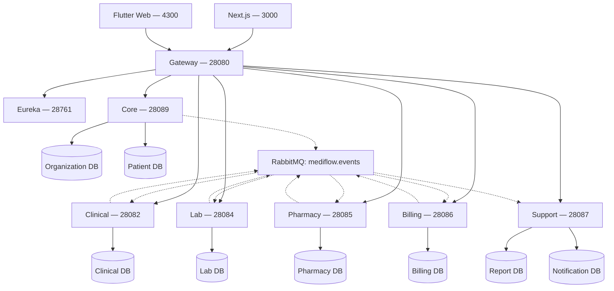
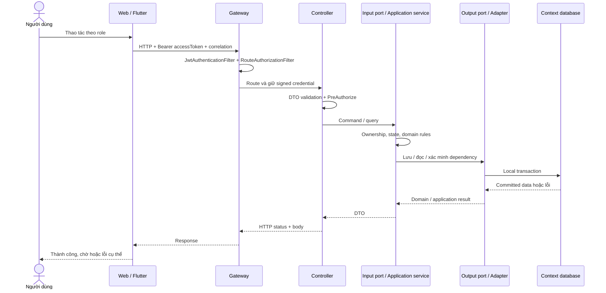
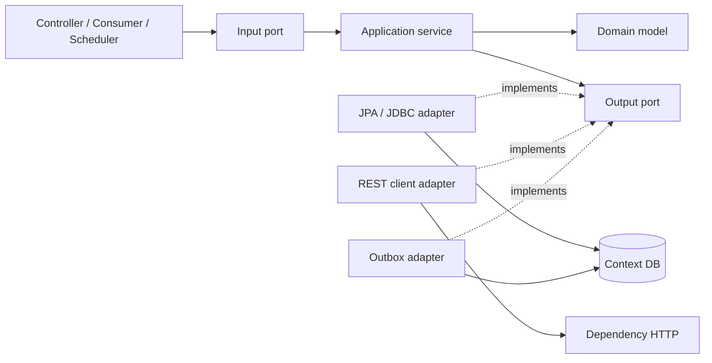
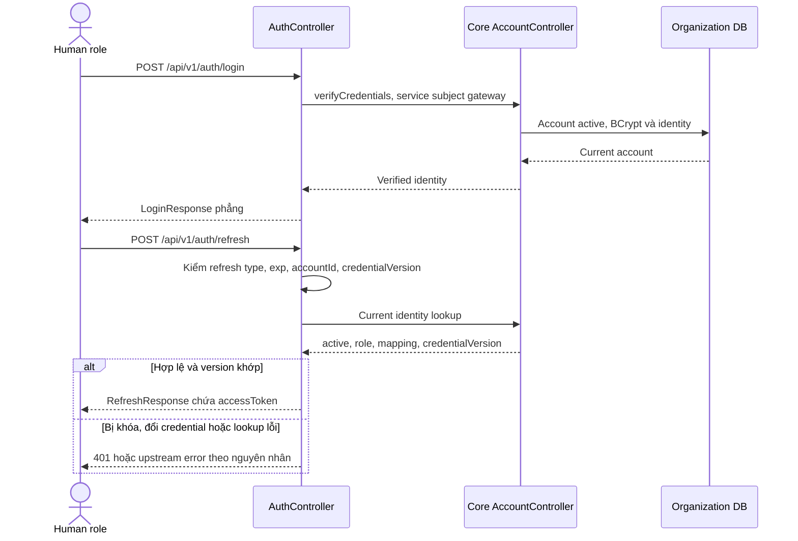
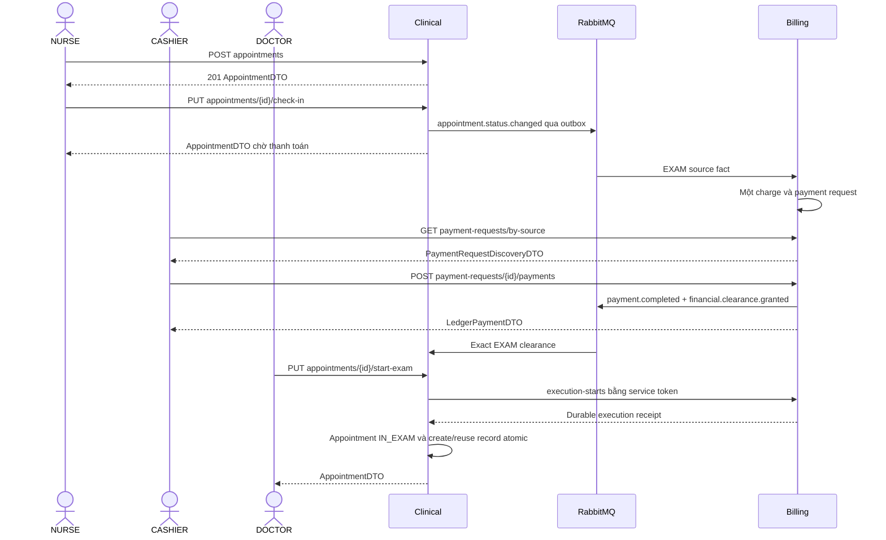
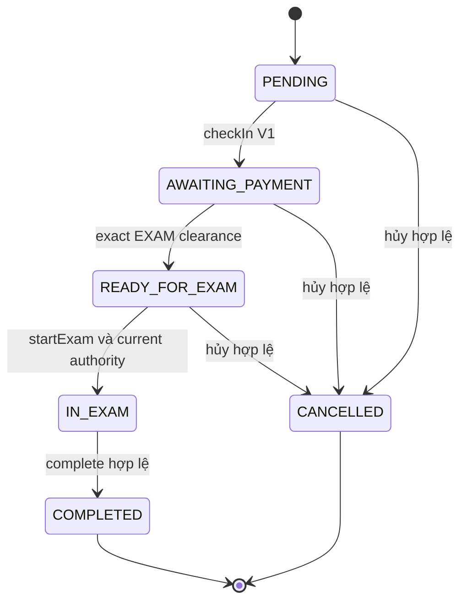
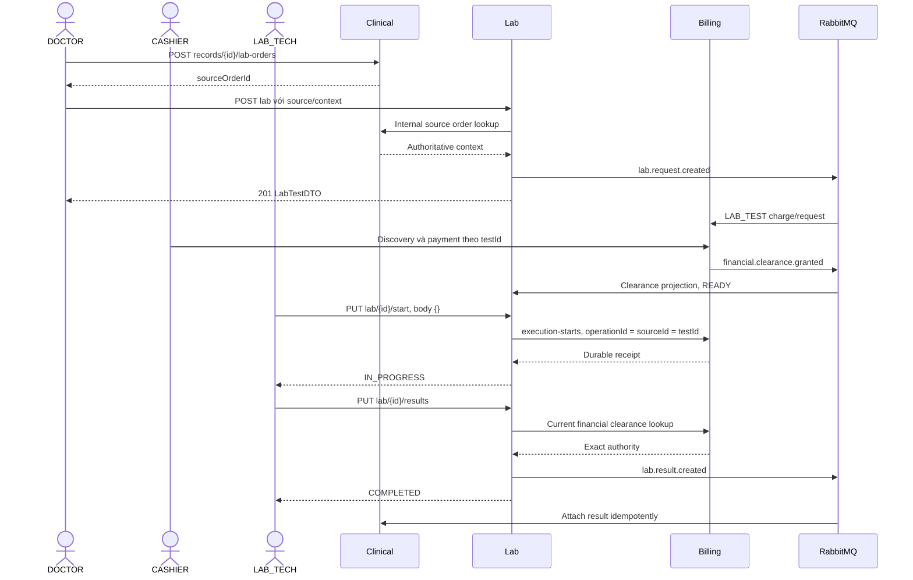
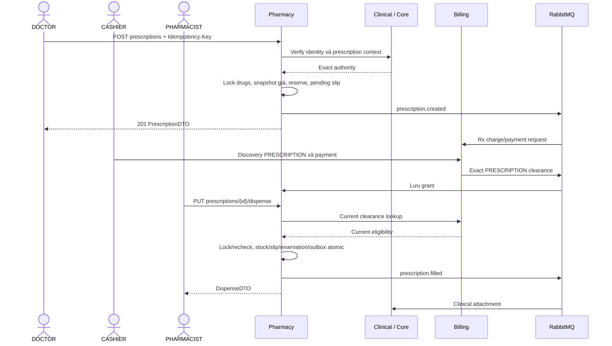
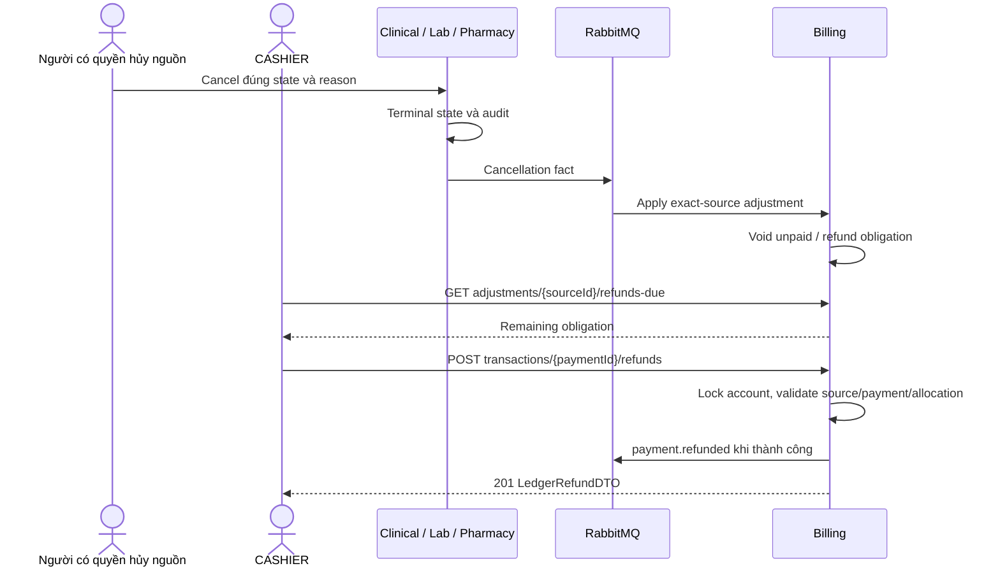
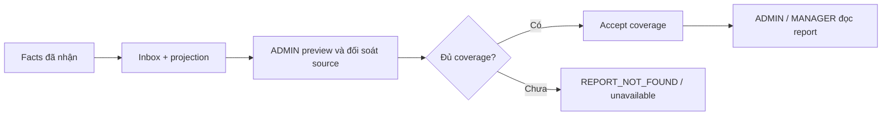

# MediFlow — Request/response, event, ports và kiểm thử use case theo role

> Biên soạn ngày **25/10/2026, Asia/Saigon**, đối chiếu revision **`eac2cd7b`** trên `master` sau khi đồng bộ `origin/master`.
> Đây là cẩm nang đọc source và tổng duyệt, **không phải xác nhận tất cả use case đã PASS**. JSON có `<...>` phải thay bằng dữ liệu thật. Tên hàm, class, field, role và event giữ tiếng Anh đúng code; phần diễn giải dùng tiếng Việt.

## Mục lục

1. [Phạm vi và cách dùng](#1-phạm-vi-và-cách-dùng)
2. [Topology và cổng mạng](#2-topology-và-cổng-mạng)
3. [Cơ chế request/response](#3-cơ-chế-requestresponse)
4. [Input port và output port](#4-input-port-và-output-port)
5. [Event, outbox, inbox và phục hồi](#5-event-outbox-inbox-và-phục-hồi)
6. [Đăng nhập và refresh](#6-đăng-nhập-và-refresh)
7. [Tiếp nhận, thu phí và khám](#7-tiếp-nhận-thu-phí-và-khám)
8. [Chỉ định và thực hiện Lab](#8-chỉ-định-và-thực-hiện-lab)
9. [Kê đơn, thanh toán và cấp thuốc](#9-kê-đơn-thanh-toán-và-cấp-thuốc)
10. [Hủy và hoàn tiền](#10-hủy-và-hoàn-tiền)
11. [Report và Notification](#11-report-và-notification)
12. [Chuẩn bị môi trường và sổ ID](#12-chuẩn-bị-môi-trường-và-sổ-id)
13. [Kịch bản theo từng role](#13-kịch-bản-theo-từng-role)
14. [Kiểm thử lỗi, đồng thời và phục hồi](#14-kiểm-thử-lỗi-đồng-thời-và-phục-hồi)
15. [Giới hạn cần trình bày đúng](#15-giới-hạn-cần-trình-bày-đúng)
16. [Toàn bộ HTTP use case](#16-toàn-bộ-http-use-case)
17. [Danh sách HTTP use case theo từng role](#17-danh-sách-http-use-case-theo-từng-role)
18. [Toàn bộ input ports](#18-toàn-bộ-input-ports)
19. [Toàn bộ output ports](#19-toàn-bộ-output-ports)
20. [DTO request/response](#20-dto-requestresponse)
21. [Consumers, jobs và routing constants](#21-consumers-jobs-và-routing-constants)
22. [Biên bản test và tiêu chí chốt](#22-biên-bản-test-và-tiêu-chí-chốt)

## 1. Phạm vi và cách dùng

Phạm vi bảo vệ là **MVP ngoại trú**. Sáu business deployments là Core, Clinical, Lab, Pharmacy, Billing, Support; tám contexts là Organization, Patient, Clinical, Lab, Pharmacy, Billing, Report, Notification. Inpatient/Surgery giữ source nhưng **DEFERRED**, không tự bật để hoàn thành checklist ngoại trú.

Đọc phần 2–5 để hiểu cơ chế chung; phần 6–11 theo một giao dịch xuyên hệ thống; phần 13 và 17 dùng khi đăng nhập lần lượt từng role. Mỗi endpoint phần 16 có mã `HTTP-nnn`, method/path, guard, input/response, lời gọi trực tiếp, source và điều kiện đăng ký bean. Phần 18–19 kiểm kê tất cả interface `application/port/in` và `application/port/out`, kể cả use case không có nút UI hoặc endpoint riêng.

| Nhãn | Ý nghĩa khi test |
|---|---|
| `MVP` | Ngoại trú; vẫn kiểm profile, flags, quyền và state |
| `INTERNAL` | Service-to-service, không dùng human token thay thế |
| `COMPATIBILITY` | API/kernel cũ; kết quả V0 không chứng minh V1 |
| `OPERATOR / GATED` | Bảo trì/replay/rebuild/publication, cần cấu hình và evidence riêng |
| `DEFERRED` | Có source nhưng không thuộc buổi demo MVP |
| `CHƯA_CHẠY` | Chưa có kết quả của lần tổng duyệt hiện tại |

Role trong annotation là điều kiện cần. Quyền thực tế còn phụ thuộc `tokenType`, signed identity, ownership, clinician authority, profile, flags, state và dependency. `ADMIN` trong guard không bảo đảm account thiếu `staffId`/eligibility thay được bác sĩ hoặc dược sĩ.

Nguồn canonical: [thiết kế](../../docs/plans/01-system-design.md), [nghiệp vụ](../../docs/plans/02-business-flows.md), [contracts](../../docs/plans/03-contracts.md), [reliability](../../docs/plans/04-data-reliability.md), [acceptance](../../docs/plans/06-acceptance-runbook.md). Xem thêm [cẩm nang demo bốn dev](MediFlow_Demo_4_Dev_Chi_Tiet_2026-10-25.md). Exact wire ưu tiên controller/DTO/serializer/fixture, không suy từ tên use case.

## 2. Topology và cổng mạng

**Cổng mạng** như `8080` khác **input/output port** là interface Java. Web gọi same-origin `/api/*` qua `src/lib/api.ts`; Flutter gọi Gateway qua `ApiClient`. UI không gọi trực tiếp service port.

| Thành phần | Cổng mặc định | Rehearsal 25/10 | Trách nhiệm |
|---|---:|---:|---|
| Next.js | 3000 | 3000 | UI và proxy tới Gateway |
| Flutter Web | 4300 theo demo | 4300 | `tool/dev_server.dart` proxy `/api` |
| Gateway | 8080 | 28080 | JWT, route/method/role, login/refresh facade |
| Eureka | 8761 | 28761 | Service discovery |
| Core | 8089 | 28089 | Organization và Patient, persistence riêng |
| Clinical | 8082 | 28082 | Appointment, record, diagnosis, source order |
| Lab | 8084 | 28084 | Test request, execution, result |
| Pharmacy | 8085 | 28085 | Drug, prescription, reservation, dispense |
| Billing | 8086 | 28086 | Charge/account/invoice/request/payment/refund/clearance |
| Support | 8087 theo host | 28087 | Report và Notification, stores/listeners riêng |
| PostgreSQL | 5432 | Loopback port ngẫu nhiên | Tám database context active |
| RabbitMQ AMQP | 5672 | Loopback port ngẫu nhiên | `mediflow.events` và queues riêng |
| Inpatient / Surgery | 8090 / 8091 | Không khởi động | DEFERRED |

Cổng/PID thực tế đọc từ `evidence/active-rehearsal.local.json` của **lần chạy hiện tại**. Launcher Report/Notification cũ được giữ cho compatibility/rollback; không chạy old/new writer cùng store.



Nét đứt là trao đổi event; các đường HTTP/lưu trữ dùng nét liền. Mỗi context giữ data authority; co-host Core/Support không cho cross-context SQL/JPA.

## 3. Cơ chế request/response

### 3.1. Đường đi của request



HTTP success của producer không đồng nghĩa mọi consumer đã cập nhật. Sau check-in, Billing request có thể chưa xuất hiện ngay. Đọc lại có giới hạn; không tạo lại nghiệp vụ chỉ vì event chưa đến.

Gateway `default deny` theo method/path/role; downstream xác minh JWT và `@PreAuthorize` riêng. `PATIENT` phải đúng owner. JWT `sub` là `accountId`, không tự lấy làm `patientId`. `SYSTEM` dùng service token/caller allowlist, không là human account.

### 3.2. Envelope và ngoại lệ Auth

Business API thường trả `ApiResponse<T>`:

```json
{
  "success": true,
  "data": { "id": "<UUID từ API>" },
  "error": null,
  "timestamp": "<Instant UTC>",
  "correlationId": "<correlation nếu có>"
}
```

`id` chỉ minh họa envelope. Payload thực dùng đúng `appointmentId`, `recordId`, `testId`, `maBenhNhan`… Không tự đổi wire name.

```json
{
  "success": false,
  "data": null,
  "error": {
    "code": "<error.code thực tế>",
    "message": "<thông báo>",
    "details": [{ "field": "<field>", "message": "<lỗi field>" }]
  },
  "timestamp": "<Instant UTC>",
  "correlationId": "<correlation nếu có>"
}
```

**Auth success là ngoại lệ:** login trả `LoginResponse(accessToken, refreshToken, role)` phẳng; refresh trả `RefreshResponse(accessToken)` phẳng. Lỗi Auth dùng envelope. Không đọc `data.accessToken` từ login success. Một số controller dùng `ApiResponse.ok(result)` không truyền correlation nên body có thể null; ghi đúng thực tế.

`PageResult<T>` gồm `content`, `totalElements`, `totalPages`, `number`, `size`. Không suy thành `items`/`page`.

| Kết quả | Cách kiểm |
|---|---|
| 200 / 201 | Kiểm DTO, state/effect và `Location` nếu có; không chỉ status |
| 204 nếu endpoint dùng | Không ép parse JSON body |
| 400 | Query/UUID/date/validation; kiểm details |
| 401 | Token thiếu/sai/hết hạn/sai type theo boundary |
| 403 | Role/owner/service caller không được phép; không effect |
| 404 | Resource không có; Report có thể thiếu coverage |
| 409 / 422 | Conflict/business rule theo advice từng module |
| 503 / 504 | Dependency unavailable/timeout, không giả absence/zero/eligible |
| Timeout sau mutation | Outcome chưa rõ; GET reconcile hoặc retry cùng intent đúng contract |

### 3.3. Idempotency

| Command | Khóa / cơ chế |
|---|---|
| Staff/account create có hỗ trợ | Header `Idempotency-Key`; đối chiếu từng controller |
| Outpatient prescription V1 create | Header `Idempotency-Key` canonical UUID |
| Ledger payment | Body `CompleteLedgerPaymentRequest.idempotencyKey` |
| Ledger refund | Body `RefundLedgerPaymentRequest.idempotencyKey` |
| Execution-start | Body `operationId`, stable bằng source ID |
| Event | `eventId`, raw bytes, logical business operation key |
| Report maintenance | `requestId`/generation/fingerprint theo DTO riêng |

Cùng key/cùng intent phải có outcome theo contract; cùng key/khác payload phải reject. Không đổi key chỉ vì timeout.

## 4. Input port và output port

**Input port** công bố việc context làm được, ví dụ `ManageExamGateUseCase.checkIn()`, `ManageLabTestUseCase.start()`. Controller/consumer/scheduler là các driving adapters.

**Output port** mô tả dependency application cần: repository, identity/clinical authority, Billing execution authority, outbox, clock/correlation. Adapter triển khai bằng JPA/JDBC, REST hoặc messaging. Output port không đồng nghĩa HTTP call.



`implements` là dependency code hướng vào interface. Runtime gọi implementation được inject. Theo use case: controller → input port → implementation → output ports → adapters → DB/HTTP/outbox. Phụ lục liên kết source và implementation trực tiếp; thiếu implementation trực tiếp phải xem wiring/subinterface, không tự coi là active.

TypeScript frontend vẫn feature-based, không tạo ports/domain theo backend. Flutter theo `presentation → domain ← data`, dùng repository/use case và Gateway chung.

## 5. Event, outbox, inbox và phục hồi

V1 envelope có `eventId`, `eventType`, `version`, `occurredAt`, `correlationId`, `producer`, `payload`. Routing key như `lab.result.created` không tự thêm `.v1`; envelope version khác `resultVersion`.

```json
{
  "eventId": "<event UUID>",
  "eventType": "lab.result.created",
  "version": 1,
  "occurredAt": "<Instant gốc>",
  "correlationId": "<correlation>",
  "producer": "lab-service",
  "payload": { "labId": "<testId>", "recordId": "<recordId>", "resultVersion": 1 }
}
```

Payload rút gọn chỉ để giải thích, không là fixture gửi được. Dùng producer fixture đầy đủ. Logical producer không đổi sang Core/Support vì đổi host.

```mermaid
sequenceDiagram
    participant A as Producer application
    participant PDB as Producer DB
    participant R as Outbox relay
    participant MQ as RabbitMQ
    participant C as Consumer
    participant CDB as Consumer DB
    A->>PDB: BEGIN: aggregate + receipt + outbox
    PDB-->>A: COMMIT
    A-->>A: Có thể trả HTTP success
    R->>PDB: Claim pending outbox
    R->>MQ: Publish original eventId và bytes
    MQ-->>R: Confirm / return
    R->>PDB: Mark theo outcome thực tế
    MQ->>C: Delivery
    C->>CDB: BEGIN: inbox claim + effect
    CDB-->>C: COMMIT
    C-->>MQ: ACK
    Note over MQ,CDB: Redelivery có thể xảy ra; effect phải chống lặp
```

Crash sau publish trước mark có thể publish lại; crash sau consumer commit trước ACK có thể redeliver. Cần chứng minh **một business effect** nhờ transaction/locks/uniqueness/inbox, không gọi broker là exactly-once. Poison/schema conflict dùng bounded retry rồi DLQ/quarantine. Không xóa receipts/queues/HELD để demo xanh.

| Event | Producer | Effect chính theo mode/gate |
|---|---|---|
| `patient.created` | Patient | Notification compatibility khi mapping hợp lệ |
| `appointment.created` | Clinical | In-app notice theo intake |
| `appointment.status.changed` | Clinical | EXAM issuer từ check-in transition |
| `medicalrecord.created` | Clinical | Compatibility readers; Billing V1 coi lifecycle hợp lệ là informational, không thu EXAM lần hai |
| `medicalrecord.completed` | Clinical | Report/Notification theo contract |
| `lab.request.created` | Lab | Billing planned LAB_TEST charge/request |
| `lab.request.cancelled` | Lab | Exact-source adjustment/refund obligation |
| `appointment.exam.cancelled` | Clinical | EXAM adjustment/cancellation evidence |
| `lab.result.created` | Lab | Clinical attachment/Report; Billing V1 không thu thêm lúc result |
| `prescription.created` | Pharmacy | Billing Rx charge/request |
| `financial.clearance.granted` | Billing | Exact EXAM/LAB_TEST/PRESCRIPTION authorization |
| `payment.completed` | Billing | V1 cash evidence/notice; V0 saga riêng, không tự dispense V1 |
| `prescription.filled` | Pharmacy | Clinical attachment, Report, Notification, saga theo mode |
| `prescription.dispense.failed` | Pharmacy | Adjustment/compensation theo mode |
| `payment.failed` | Billing | Compatibility failure/compensation/notice |
| `payment.refunded` | Billing | Completed cash refund projection/notice nếu activated |
| `invoice.created` | Billing | Payment-request notice theo mode |
| `stock.low` | Pharmacy | Ops notice theo intake |
| `notification.sent` | Notification | Delivery fact, không unlock care |

Event trong manifest không chứng minh consumer luôn active. Kiểm profile/binding ở phần 21 và config. Report/Notification dùng queues riêng; không có quyền gộp thành `support.q`.

## 6. Đăng nhập và refresh



Login request: `{"username":"<demo account>","password":"<password fixture>"}`. Refresh request: `{"refreshToken":"<refreshToken>"}`. Không dùng access token thay refresh token; không lưu password/token thật vào biên bản.

Test đúng/sai password; locked account; thiếu/hết `exp`; refresh sau khóa account/đổi credential; Core unavailable; ADMIN human gọi verify nội bộ bị deny. Khóa/đổi password trên account test riêng, không khóa tài khoản đang trình bày.

## 7. Tiếp nhận, thu phí và khám



Các HTTP từ human trong biểu đồ đều qua Gateway; lược bớt Gateway để dễ đọc. REST nội bộ dùng client/credential service, không phải UI gọi service port.

| ID | Role | Request / thao tác | Expected result |
|---|---|---|---|
| EXAM-01 | ADMIN / NURSE | Chọn/tạo Patient, `POST /appointments` | Ngày/slot/doctor/department hợp lệ; ID server |
| EXAM-02 | NURSE | `PUT /appointments/{id}/check-in` | Chờ thanh toán; fact đúng transition |
| EXAM-03 | DOCTOR | Start trước thu đủ | Reject; không mở khám/sinh record sai |
| EXAM-04 | CASHIER | Discovery đúng EXAM source | Đúng paymentRequestId, amount, remaining |
| EXAM-05 | CASHIER | Thu một phần nếu policy cho phép | Receipt thành công nhưng chưa unlock đầy đủ |
| EXAM-06 | CASHIER | Thu đủ remaining bằng intent mới | Tổng thu đúng; exact grant |
| EXAM-07 | DOCTOR đúng phụ trách | `start-exam`, body `{}` | Receipt Billing; một record; IN_EXAM |
| EXAM-08 | DOCTOR | Thêm diagnosis, cập nhật record | Đọc lại đúng dữ liệu |
| EXAM-09 | DOCTOR | Complete sau các nhánh Lab/Rx | COMPLETED; disposition ngoại trú; fact |

Discovery bắt buộc đúng **bốn query keys, mỗi key đúng một giá trị**:

```text
GET /api/v1/billing/payment-requests/by-source?purpose=EXAM&sourceId=<appointmentId>&patientId=<patientId>&careEpisodeId=<appointmentId>
```

Payment body mẫu:

```json
{
  "idempotencyKey": "<khóa lần thu này>",
  "amount": 100000,
  "currency": "VND",
  "paymentMethod": "CASH",
  "providerReference": null
}
```

Amount phải lấy từ discovery của môi trường, không mặc định luôn `100000`. Start bình thường dùng `{}`, không emergency override. Complete mẫu:

```json
{
  "disposition": "OUTPATIENT_FOLLOW_UP",
  "dispositionNote": "Đã xem kết quả và hướng dẫn tái khám"
}
```



Biểu đồ là nhánh V1 bình thường, không liệt kê mọi compatibility/override transition. Enum còn `ARRIVED` cho đường hiện có. Không dùng status update để bypass thanh toán/start. Complete hiện chưa có barrier chờ hết Lab/Rx liên context; test riêng giới hạn này.

## 8. Chỉ định và thực hiện Lab

Clinical source order và Lab test là hai định danh khác nhau. Bác sĩ tạo intent bằng `POST /api/v1/records/{id}/lab-orders`, lấy `sourceOrderId`, rồi `POST /api/v1/lab` với exact context. Lab lookup nguồn qua internal REST; không tự tạo test từ diagnosis/invoice/`medicalrecord.created`.



Clinical order body:

```json
{ "labType": "CBC", "requestedDate": "<ngày demo yyyy-MM-dd>", "priceCode": "<mã giá LAB cấu hình>" }
```

`CreateLabRequest` V1:

```json
{
  "recordId": "<recordId>",
  "patientId": "<patientId>",
  "requestingDepartmentId": "<departmentId>",
  "labType": "CBC",
  "requestedDate": "<ngày demo yyyy-MM-dd>",
  "sourceOrderId": "<sourceOrderId từ Clinical>",
  "careEpisodeType": "OUTPATIENT_VISIT",
  "careEpisodeId": "<appointmentId của record>",
  "priceCode": "<mã giá LAB cấu hình>"
}
```

Discovery dùng `purpose=LAB_TEST`, `sourceId=testId`, patient/episode đúng ca. Không dùng sourceOrderId/projection ID thay testId. Results body:

```json
{
  "results": [
    { "indicator": "Hemoglobin", "value": "13.2", "unit": "g/dL", "referenceRange": "12.0-16.0" }
  ],
  "conclusion": "Kết quả trong khoảng tham chiếu",
  "performedDate": "<ngày demo yyyy-MM-dd>"
}
```

| ID | Role | Ca test | Expected result |
|---|---|---|---|
| LAB-01 | DOCTOR | Source order → create test | Đúng record/patient/episode |
| LAB-02 | LAB_TECH | Start unpaid | Reject, không IN_PROGRESS |
| LAB-03 | CASHIER | Thu đúng LAB_TEST | Chỉ unlock đúng test |
| LAB-04 | LAB_TECH | Start paid bình thường | Receipt, IN_PROGRESS |
| LAB-05 | LAB_TECH | Results hợp lệ | COMPLETED; Clinical attach một lần |
| LAB-06 | LAB_TECH | Results rỗng/ngày sai/terminal rewrite | Reject, không sửa kết quả cũ |
| LAB-07 | DOCTOR / LAB_TECH | Cancel ca riêng chưa terminal, có reason | CANCELLED; exact-source adjustment |
| LAB-08 | NURSE / CASHIER | Gọi start/results | Deny, không effect |
| LAB-09 | LAB_TECH | Billing unavailable hoặc grant revoked/refunded | Fail closed dù local READY |

**Bản sửa 25/10:** `clearanceTargetId` là projection ID, không bắt buộc bằng business `testId`. PostgreSQL làm tròn TIMESTAMPTZ; Lab đọc instant gốc từ immutable inbox của chính mình để giữ exact comparison. Không sửa IDs/rows hoặc nới timestamp guard để demo. [Giải thích và evidence](LAB-NORMAL-VERIFICATION.md).

## 9. Kê đơn, thanh toán và cấp thuốc



Create V1 mẫu; header `Idempotency-Key` là canonical UUID:

```json
{
  "recordId": "<recordId>",
  "patientId": "<patientId>",
  "doctorId": "<staffId bác sĩ hợp lệ>",
  "departmentId": "<departmentId>",
  "prescribedDate": "<ngày demo yyyy-MM-dd>",
  "lines": [{ "drugId": "<drugId>", "quantity": 2, "dosage": "Theo chỉ định bác sĩ" }],
  "careContractVersion": 1,
  "careContext": "OUTPATIENT",
  "careEpisodeType": "OUTPATIENT_VISIT",
  "careEpisodeId": "<episode đúng của record>",
  "admissionId": null,
  "priceCode": "RX-DEMO"
}
```

`RX-DEMO` chỉ dùng khi có trong allowlist/catalog của môi trường. Client không gửi giá từng dòng; server chụp giá. Reserve chưa trừ tồn vật lý; dispense mới tạo stock effect. `payment.completed` không tự dispense V1; `paymentConfirmed` legacy không là authority V1.

| ID | Role | Ca test | Expected result |
|---|---|---|---|
| RX-01 | PHARMACIST | Search/create drug, adjust stock có reason | Catalog/stock/audit đúng |
| RX-02 | DOCTOR | Create đúng context | Giá server, reservation, pending slip |
| RX-03 | DOCTOR | Multi-drug có một dòng thiếu tồn/expired | Không reserve/ghi một phần |
| RX-04 | PHARMACIST | Dispense unpaid | Reject, stock không đổi |
| RX-05 | CASHIER | Thu đúng PRESCRIPTION request | Một payment/grant |
| RX-06 | PHARMACIST | Dispense sau paid | Một slip/stock effect; terminal đúng |
| RX-07 | PHARMACIST | Retry / hai dispense đồng thời | Không trừ tồn lần hai |
| RX-08 | DOCTOR | Cancel ca riêng trước dispense | Release reservation; adjustment |
| RX-09 | PHARMACIST | Cancel bằng pharmacist | Deny theo controller |
| RX-10 | DOCTOR khác phụ trách | Create/cancel sai authority | Reject dù cùng role |
| RX-11 | PHARMACIST | Stale/expired/revoked grant hoặc Billing down | Không dùng paid flag cũ để dispense |

## 10. Hủy và hoàn tiền

Hủy source, ghi nghĩa vụ phải hoàn và ghi giao dịch hoàn là ba việc khác nhau. Hủy không sửa phiếu thu gốc hoặc tự gọi ngân hàng. `RefundLedgerPaymentRequest` ghi khoản thực hoàn do thu ngân xác nhận theo contract.



EXAM hủy bằng `PUT /api/v1/appointments/{id}/status` với `status`/`reason`, không tự thêm `/cancel-exam`. Lab: `PUT /api/v1/lab/{id}/cancel`. Rx: `PUT /api/v1/pharmacy/prescriptions/{id}/cancel`.

| ID | Ca test | Invariant |
|---|---|---|
| REF-01 | Hủy unpaid | Không refund giả; source không collect/reopen sai |
| REF-02 | Hủy đã trả một phần/đủ | Obligation đúng source; payment cũ giữ nguyên |
| REF-03 | CASHIER đọc refunds-due | Đúng remaining, không gom nhầm episode |
| REF-04 | Refund một phần rồi phần còn lại | Link payment gốc; tổng không vượt giới hạn |
| REF-05 | Retry cùng key/body | Một refund effect |
| REF-06 | Key cũ khác amount/reason; vượt nghĩa vụ; sai source | Reject theo error thực tế |
| REF-07 | Refund đua start EXAM/LAB | Billing serialize dưới account lock |
| REF-08 | Refund EXAM/LAB chưa có applied cancellation | Reject; thiếu start receipt không chứng minh chưa làm |
| REF-09 | Late payment/grant sau cancel | Không reopen source terminal |

```json
{
  "idempotencyKey": "<intent hoàn ổn định>",
  "amount": 50000,
  "reason": "Hoàn phần chi phí đã được duyệt cho dịch vụ đã hủy",
  "paymentMethod": "CASH"
}
```

Không mặc định hoàn toàn bộ chỉ vì chưa có result. Rx trình bày theo adjustment-after-cancel đã chuẩn bị; không suy generic refund có cùng guard EXAM/LAB cho mọi Rx. Admission deposit/settlement và Surgery cancellation có trong source inventory nhưng DEFERRED.

## 11. Report và Notification

### 11.1. Report

Report nhận facts vào store riêng, dedupe event/operation; coverage/publication quyết định kỳ/scope đủ bằng chứng. Không GET producer DB để ráp report.



| ID | Role | Ca test | Expected result |
|---|---|---|---|
| REP-01 | ADMIN / MANAGER | Daily/monthly/top-medicines compatibility | DTO/ý nghĩa đúng; cash không trộn earned |
| REP-02 | ADMIN / MANAGER | Outpatient report kỳ/scope accepted | Có kết quả với coverage |
| REP-03 | ADMIN / MANAGER | Kỳ chưa accepted | REPORT_NOT_FOUND, không zero-fill |
| REP-04 | ADMIN | Preview và đối soát witness nguồn | Fingerprint/rowCount/pending đúng thực tế |
| REP-05 | ADMIN | Accept bằng requestId/fingerprint đã review | Đúng scope, retry đúng contract |
| REP-06 | MANAGER / DOCTOR | Gọi maintenance | Deny nơi ADMIN-only |
| REP-07 | ADMIN trên clone | Rebuild/publication/archive khi gate bật | Không resend Notification; không bỏ coverage guard |

Snapshot có accepted scope `2025-06-15`, department `9a6dd24a-1c1f-4122-9e31-7cfea345ec45`. Đây là kỳ lịch sử, không là report giao dịch hôm nay. Không chép preview thành tuyên bố completeness chưa đối soát; không sửa SQL để tạo coverage giả.

### 11.2. Notification

Intake tạo intent/history theo contract; delivery worker riêng với Report. Owner lấy signed `patientId`, không suy JWT `sub`.

| ID | Role | Ca test | Expected result |
|---|---|---|---|
| NOT-01 | ADMIN / NURSE / PATIENT | Notification list theo patient | PATIENT chỉ own, đúng paging |
| NOT-02 | ADMIN / PATIENT | Notification detail | PATIENT chỉ own |
| NOT-03 | ADMIN / SYSTEM hợp lệ | Manual send | DTO/history/status đúng, không tự nhận external delivery |
| NOT-04 | PATIENT | Send hoặc đổi URL sang người khác | Deny, không lộ dữ liệu |
| NOT-05 | Operator trên clone | Replay event / Report rebuild | Không tạo delivery nghiệp vụ trùng |

MVP là `IN_APP`, không phải email/SMS/push đã nghiệm thu. Không có resend/read-state API thì refresh không được mô tả thành gửi lại/đánh dấu đã đọc. V1 raw-byte receipt giữ exact inbound hash, không reset để học lại từ replay.

## 12. Chuẩn bị môi trường và sổ ID

### 12.1. Revision và môi trường

Source sync không làm JAR/Next/Flutter build cũ tự cập nhật. Kiểm Docker, Java 21, Maven, Python, Node 24 đã xác minh, pnpm và Flutter. Chạy tại root:

```powershell
git rev-parse HEAD
git status --short --branch
mvn -q -pl backend/core-service,backend/clinical-service,backend/lab-service,backend/pharmacy-service,backend/billing-service,backend/support-service,backend/gateway,backend/eureka-server -am -DskipTests package
python scripts/demo_25_10/rehearse_snapshot.py --keep
```

Runner dùng PostgreSQL/RabbitMQ disposable mới, không restore đè data hiện có. `--keep` giữ stack tối đa hai giờ; stop bằng stop file của đúng lượt. Không `docker compose down -v`, reset inbox hoặc xóa audit để tổng duyệt lại.

```powershell
./scripts/demo_25_10/Smoke-Gateway.ps1 -Gateway http://127.0.0.1:28080
./scripts/demo_25_10/Run-ClientChecks.ps1 -Gateway http://127.0.0.1:28080
# Chạy riêng để giảm tranh RAM/CPU với full topology.
./scripts/demo_25_10/Run-LabNormalAcceptance.ps1
```

UI gates, backend gates, profiles, EXAM/LAB price catalog và Rx allowlist phải thống nhất. Đọc [README demo](README.md) để start Next/Flutter đúng Gateway. Gateway rewrite của Next được lấy tại build time. Client flags không cấp quyền backend. Flag có tên `care-finance-v2` không tự đưa nội trú/phẫu thuật vào MVP.

### 12.2. Sổ định danh

| Ghi lại | Nguồn | Tránh nhầm |
|---|---|---|
| Login `accountId` | Core/verified identity | Khác Patient UUID và Billing account |
| `staffId`, `doctorId`, `departmentId` | Core/signed identity | Không random UUID để lấp field |
| `patientId` | `maBenhNhan`/authoritative mapping | Không dùng CCCD/JWT sub |
| `appointmentId` | Create appointment | EXAM source/episode của ca |
| `recordId` | Record của appointment | Không latest record theo patient |
| `sourceOrderId` | Clinical order | Khác Lab `testId` |
| `testId` | Create Lab response | Khác projection/clearanceId |
| `prescriptionId`, `dispenseId` | Pharmacy | Khác payment identity |
| Billing `accountId`, `paymentRequestId`, `invoiceId` | Discovery/response | Đúng source/episode |
| `transactionId` | Payment response | Refund link giao dịch gốc |
| `clearanceId` | Authority/event | Không paid flag patient-wide |
| `eventId`, `operationId`, `correlationId` | Event/receipt/header/log | Giữ đúng khi retry/replay |

Ghi amount/currency, quantity và stock trước/sau. Dùng ca riêng cho cancel/failure, không phá ca happy path đang trình bày.

## 13. Kịch bản theo từng role

Phần 17 liệt kê từng HTTP use case theo role; phần này là thứ tự test nghiệp vụ. Mọi mục bắt đầu `CHƯA_CHẠY` cho đến khi có evidence của lần tổng duyệt mới.

### 13.1. ADMIN

1. Login; đổi password account test riêng, đọc profile liên kết.
2. Create/read/update department; head theo department type/eligibility, thử bổ nhiệm/chuyển khoa trái ràng buộc.
3. Create staff đủ `identityNumber`/doctor license; retry cùng key; cùng key khác payload phải reject. Search/filter/page; update/chuyển khoa sau xử lý head constraint.
4. Create account đúng staff/patient mapping; lock/unlock/reset password trên account test; không tạo SYSTEM human.
5. Patient create/read/update/delete theo guard; duplicate identity/ngày sinh sai phải reject.
6. Đọc các context và test command có quyền nhưng vẫn cần signed staff/clinical authority.
7. Trên clone: outbox replay, coverage preview/accept, maintenance khi flags bật.
8. Negative: human ADMIN không được thay service caller gọi verify/internal lookups.

### 13.2. MANAGER

1. Đọc department/staff, tìm/filter/page; own staff department không lấy của người khác.
2. Đọc list appointments/Lab. **Quyền list không là quyền detail:** detail appointment/Lab không liệt kê MANAGER.
3. Đọc revenue/Report theo date/scope/coverage; hiểu cash khác earned.
4. Thử Patient create, check-in/start, Lab result, dispense, payment, coverage acceptance: deny theo endpoint.
5. Đổi password của mình, không quản trị account khác.

### 13.3. NURSE

1. Patient search/create/update; duplicate identity và field invalid.
2. Chọn department/doctor hợp lệ, create appointment tương lai hoặc ngày hợp lệ theo DTO; sửa đúng state.
3. Check-in; chờ payment; không dùng status để bypass gate.
4. Read record/Lab đúng quyền; notification list theo patient.
5. Negative: diagnosis/complete, create Lab, result, payment, dispense đều kiểm đúng role.
6. Hủy appointment ca riêng qua status/reason; CASHIER kiểm adjustment bước sau.

### 13.4. DOCTOR

1. Read Patient/directory/appointment/record; thử ca bác sĩ khác.
2. Start unpaid phải reject; sau CASHIER thu đủ EXAM mới start bằng doctor đúng phụ trách.
3. Update record/diagnosis; thử complete thiếu diagnosis theo domain rule.
4. Tạo source order và Lab đúng context; sai source/patient bị chặn; đọc result sau LAB_TECH hoàn tất.
5. Create V1 Rx bằng Idempotency-Key/giá server; read; cancel ca riêng chưa dispense.
6. Complete record sau nhánh Lab/Rx, disposition ngoại trú.
7. Negative: không check-in bằng DOCTOR; không ghi Lab result/dispense/payment; không dùng human token gọi context lookup nội bộ.

### 13.5. LAB_TECH

1. Lab list/detail, filter department/status/episode/page; own staff profile/department.
2. Start unpaid reject; sau payment đúng test thì start/results.
3. Results rỗng/ngày sai/terminal rewrite/wrong clearance phải reject.
4. Cancel ca riêng đúng state/reason, không xóa lịch sử test completed.
5. Negative: create source/test, payment, record trái role. Patient search không tự có quyền chỉ để lấy tên.

### 13.6. PHARMACIST

1. Drug search/detail/create, adjust stock có reason và signed actor.
2. Read prescription đã chuẩn bị. Không suy có list endpoint nếu source chỉ getById.
3. Dispense unpaid reject; sau payment exact source thì thành công.
4. So stock/reservation/slip; retry/hai request đồng thời trên clone; expiry/insufficient stock/Billing unavailable.
5. Negative: không create/cancel Rx hoặc collect payment thay role khác.

### 13.7. CASHIER

1. Discovery EXAM/LAB_TEST/PRESCRIPTION bằng đúng bốn keys/exact source.
2. Invoice/history đúng patient/episode; không gom mọi phí patient thành một account.
3. Thu partial/full, retry key, kiểm remaining/allocations/currency.
4. Same key/different amount và wrong source/episode phải reject.
5. Sau cancellation applied: refunds-due → partial/full refund, giữ payment link.
6. Negative: start exam, results, dispense, Patient/Staff management, ADMIN-only maintenance.
7. Billing role không mặc định có Patient directory; tên unavailable cần giải thích đúng quyền.

### 13.8. PATIENT

1. Login đúng mapping; GET own Patient profile và own notification list/detail.
2. Đổi patientId/notificationId sang người khác: deny, không lộ data.
3. Đổi password chính mình.
4. Token thiếu patient mapping không được fallback JWT sub.
5. Thử staff APIs: Patient search, appointments/records/Lab/pharmacy/billing theo ma trận. Không suy patient portal đã có tự đặt lịch/xem mọi hồ sơ nếu controller không mở role.

### 13.9. SYSTEM

SYSTEM không login bằng tài khoản demo. Dùng harness/service credential chính thức, không tự giả JWT để chứng minh PASS.

| Caller | Request | Expected guard |
|---|---|---|
| `gateway` | Core verify/current identity | Chỉ đúng subject/token type; active/version hiện tại |
| Clinical/Lab/Pharmacy được allowlist | Core exists/lookups | Absence khác unavailable; exact identity |
| `lab-service` | Clinical source-order context | Exact source/record/patient/episode |
| `pharmacy-service` | Clinical prescription-context | Exact doctor/department/record/visit |
| Clinical/Lab | Billing execution-start | Stable operation/source; serialize với refund |
| Caller Billing cho phép | Financial clearance lookup | Current authority, type/TTL/subject hợp lệ |
| Caller Notification cho phép | Send | SYSTEM không có quyền mọi business route |

Source có authority string `ROLE_SYSTEM` và `ROLE_SYSTEM_SERVICE` theo module. Không thêm các quyền này vào human account để đi vòng guard.

## 14. Kiểm thử lỗi, đồng thời và phục hồi

Chạy trên clone, ghi commit/flags/timestamp/correlation, request/response và before/after. Race/crash không chứng minh bằng bấm UI một lần; dùng PG/Rabbit và packaged harness thật.

| ID | Tình huống | Invariant / evidence |
|---|---|---|
| FAIL-01 | Sai role, đúng URL | Deny và không effect |
| FAIL-02 | Đúng role, sai owner/doctor | Không lộ data/command sai |
| FAIL-03 | Sai token type/thiếu exp | Không mint/access command |
| FAIL-04 | Core/Billing timeout | Fail closed, không giả absent/eligible |
| FAIL-05 | Payment network timeout | Retry key cũ không double payment |
| FAIL-06 | Hai start exam | Một record, appointment atomic |
| FAIL-07 | Hai dispense | Một slip/stock/outbox effect |
| FAIL-08 | Một drug trong nhiều lines fail | Không partial reservation/stock |
| FAIL-09 | Refund đua execution-start | Account lock, durable authority đúng |
| FAIL-10 | Producer chết sau commit | Outbox resume original ID/bytes |
| FAIL-11 | Consumer chết sau commit trước ACK | Replay không duplicate effect |
| FAIL-12 | Same eventId khác bytes | Conflict/quarantine, không overwrite |
| FAIL-13 | Same operation/new eventId | No-op khi snapshot khớp, conflict khi khác |
| FAIL-14 | Poison/schema invalid | Bounded retry, đúng DLQ |
| FAIL-15 | Report rebuild | Không resend Notification |
| FAIL-16 | Late payment sau cancel/expiry | Không reopen source |
| FAIL-17 | Restore target có data | Refuse trước load |
| FAIL-18 | Deferred flags OFF | Không route/job/effect deferred |

Evidence cũ ngày 25/10 là tham chiếu, không điền thành PASS của lượt mới. Skipped không là passed.

## 15. Giới hạn cần trình bày đúng

- Source đã sync; JAR/Next/Flutter cần build lại. Lượt biên soạn này không khởi động Docker hoặc chạy full business acceptance.
- Snapshot giữ `EMERGENCY_DEMO` lịch sử. Normal Lab phải dùng ca mới trả tiền thật, không đổi audit.
- Report hiện tại có thể chưa accepted coverage; kỳ 2025 không chứng minh giao dịch hôm nay đã đối soát.
- Clinical complete chưa chờ hết Lab/Rx liên context. Record UI chưa render mọi attachment collection; đối chiếu màn nguồn với cùng record/episode.
- Directory references bị giới hạn theo role; không cấp broad PII để thay UUID bằng tên.
- Mobile Organization create staff thiếu `identityNumber`, timestamps directory non-admin có nguy cơ mismatch parser. Test riêng và dùng web cho luồng chưa nghiệm thu.
- Flutter Web không chứng minh Android/iOS/Windows native.
- UI chưa bao mọi command backend; hủy EXAM V1 cần reason. Ghi UI/API acceptance riêng.
- Danh mục source có compatibility/deferred/gated; tồn tại class không chứng minh bean/route đang active.

## 16. Toàn bộ HTTP use case

Kiểm kê **152 operations** từ các class `@RestController`/`@Controller` trong `backend/*/src/main/java`. Mỗi operation là một method/path, không phải một màn hình. Không tính `/actuator` framework hoặc URL rewrite của client là business use case. Có source chưa đồng nghĩa route đang bật.

Cột Gateway bên dưới đối chiếu trực tiếp `RouteAuthorizationFilter.RULES` trên URI shape. Đây là **allowlist tĩnh**, chưa gồm service discovery, profile, internal-only handling và resource authority. `Không có human route` không phải lỗi cần mở quyền tự động. Các endpoint INTERNAL được kiểm bằng service caller, không đưa vào checklist human.

| Module | Operations | Phân loại |
|---|---|---|
| billing-service | 20 | COMPATIBILITY: 5; DEFERRED: 6; INTERNAL: 2; MVP: 6; OPERATOR / GATED: 1 |
| clinical-service | 18 | COMPATIBILITY: 1; DEFERRED: 1; INTERNAL: 2; MVP: 14 |
| core-service | 35 | DEFERRED: 5; INTERNAL: 7; MVP: 23 |
| gateway | 2 | MVP: 2 |
| inpatient-service | 18 | DEFERRED: 18 |
| lab-service | 8 | COMPATIBILITY: 1; MVP: 7 |
| notification-service | 3 | MVP: 3 |
| pharmacy-service | 11 | MVP: 10; OPERATOR / GATED: 1 |
| report-service | 25 | COMPATIBILITY: 3; MVP: 2; OPERATOR / GATED: 20 |
| surgery-service | 12 | DEFERRED: 12 |

### 16.1. Chỉ mục nhanh

| Mã | Module / nhãn | Method và URL | Role downstream |
|---|---|---|---|
| [HTTP-001](#http-001) | billing-service / DEFERRED | `POST /api/v1/billing/accounts/{id}/deposit-allocations` | ADMIN, CASHIER |
| [HTTP-002](#http-002) | billing-service / DEFERRED | `POST /api/v1/billing/accounts/{id}/settlement-reconciliations` | ADMIN, CASHIER |
| [HTTP-003](#http-003) | billing-service / DEFERRED | `GET /api/v1/billing/accounts/{id}/settlement-preview` | ADMIN, CASHIER |
| [HTTP-004](#http-004) | billing-service / OPERATOR / GATED | `POST /api/v1/billing/admin/outbox/{eventId}/replay` | ADMIN |
| [HTTP-005](#http-005) | billing-service / DEFERRED | `POST /api/v1/billing/accounts/{id}/final-settlements` | ADMIN, CASHIER |
| [HTTP-006](#http-006) | billing-service / INTERNAL | `GET /api/v1/billing/financial-clearances/{id}/lookup` | SYSTEM |
| [HTTP-007](#http-007) | billing-service / COMPATIBILITY | `GET /api/v1/billing/invoices/{id}` | ADMIN, CASHIER |
| [HTTP-008](#http-008) | billing-service / COMPATIBILITY | `GET /api/v1/billing/patient/{patientId}` | ADMIN, CASHIER |
| [HTTP-009](#http-009) | billing-service / COMPATIBILITY | `POST /api/v1/billing/invoices` | ADMIN, CASHIER |
| [HTTP-010](#http-010) | billing-service / COMPATIBILITY | `PUT /api/v1/billing/invoices/{id}/pay` | ADMIN, CASHIER |
| [HTTP-011](#http-011) | billing-service / MVP | `POST /api/v1/billing/payment-requests/{id}/payments` | ADMIN, CASHIER |
| [HTTP-012](#http-012) | billing-service / MVP | `POST /api/v1/billing/transactions/{id}/refunds` | ADMIN, CASHIER |
| [HTTP-013](#http-013) | billing-service / MVP | `GET /api/v1/billing/lab-adjustments/{id}/refunds-due` | ADMIN, CASHIER |
| [HTTP-014](#http-014) | billing-service / MVP | `GET /api/v1/billing/exam-adjustments/{id}/refunds-due` | ADMIN, CASHIER |
| [HTTP-015](#http-015) | billing-service / INTERNAL | `POST /api/v1/billing/financial-clearances/{id}/execution-starts` | SYSTEM |
| [HTTP-016](#http-016) | billing-service / MVP | `GET /api/v1/billing/payment-requests/by-source` | ADMIN, CASHIER |
| [HTTP-017](#http-017) | billing-service / MVP | `GET /api/v1/billing/prescription-adjustments/{id}/refunds-due` | ADMIN, CASHIER |
| [HTTP-018](#http-018) | billing-service / COMPATIBILITY | `GET /api/v1/billing/revenue` | ADMIN, MANAGER |
| [HTTP-019](#http-019) | billing-service / DEFERRED | `POST /api/v1/billing/accounts/{id}/settlements` | ADMIN, CASHIER |
| [HTTP-020](#http-020) | billing-service / DEFERRED | `GET /api/v1/billing/surgery-cancellations/{id}/refunds-due` | ADMIN, CASHIER |
| [HTTP-021](#http-021) | clinical-service / MVP | `GET /api/v1/appointments` | ADMIN, DOCTOR, MANAGER, NURSE |
| [HTTP-022](#http-022) | clinical-service / MVP | `GET /api/v1/appointments/{id}` | ADMIN, DOCTOR, NURSE |
| [HTTP-023](#http-023) | clinical-service / MVP | `GET /api/v1/appointments/patient/{patientId}` | ADMIN, DOCTOR, NURSE |
| [HTTP-024](#http-024) | clinical-service / MVP | `POST /api/v1/appointments` | ADMIN, NURSE |
| [HTTP-025](#http-025) | clinical-service / MVP | `PUT /api/v1/appointments/{id}` | ADMIN, DOCTOR, NURSE |
| [HTTP-026](#http-026) | clinical-service / MVP | `PUT /api/v1/appointments/{id}/status` | ADMIN, DOCTOR, NURSE |
| [HTTP-027](#http-027) | clinical-service / DEFERRED | `POST /api/v1/records/{id}/admission-referrals` | ADMIN, DOCTOR |
| [HTTP-028](#http-028) | clinical-service / MVP | `PUT /api/v1/appointments/{id}/check-in` | ADMIN, NURSE |
| [HTTP-029](#http-029) | clinical-service / MVP | `PUT /api/v1/appointments/{id}/start-exam` | ADMIN, DOCTOR |
| [HTTP-030](#http-030) | clinical-service / MVP | `PUT /api/v1/records/{id}/complete` | ADMIN, DOCTOR |
| [HTTP-031](#http-031) | clinical-service / INTERNAL | `GET /api/v1/lab-orders/{sourceOrderId}/context` | SYSTEM |
| [HTTP-032](#http-032) | clinical-service / MVP | `POST /api/v1/records/{id}/lab-orders` | ADMIN, DOCTOR |
| [HTTP-033](#http-033) | clinical-service / MVP | `GET /api/v1/records/{id}` | ADMIN, DOCTOR, NURSE |
| [HTTP-034](#http-034) | clinical-service / MVP | `GET /api/v1/records/patient/{patientId}` | ADMIN, DOCTOR, NURSE |
| [HTTP-035](#http-035) | clinical-service / COMPATIBILITY | `POST /api/v1/records` | ADMIN, DOCTOR |
| [HTTP-036](#http-036) | clinical-service / MVP | `PUT /api/v1/records/{id}` | ADMIN, DOCTOR |
| [HTTP-037](#http-037) | clinical-service / MVP | `POST /api/v1/records/{id}/diagnoses` | ADMIN, DOCTOR |
| [HTTP-038](#http-038) | clinical-service / INTERNAL | `GET /api/v1/records/{id}/prescription-context` | SYSTEM |
| [HTTP-039](#http-039) | core-service / INTERNAL | `GET /api/v1/org/accounts/{accountId}/identity` | SYSTEM |
| [HTTP-040](#http-040) | core-service / MVP | `POST /api/v1/org/accounts` | ADMIN |
| [HTTP-041](#http-041) | core-service / MVP | `PUT /api/v1/org/accounts/{accountId}/status` | ADMIN |
| [HTTP-042](#http-042) | core-service / INTERNAL | `POST /api/v1/org/accounts/verify` | SYSTEM |
| [HTTP-043](#http-043) | core-service / MVP | `GET /api/v1/org/accounts` | ADMIN |
| [HTTP-044](#http-044) | core-service / MVP | `GET /api/v1/org/accounts/{accountId}` | ADMIN |
| [HTTP-045](#http-045) | core-service / MVP | `PUT /api/v1/org/accounts/me/password` | ADMIN, CASHIER, DOCTOR, LAB_TECH, MANAGER, NURSE, PATIENT, PHARMACIST |
| [HTTP-046](#http-046) | core-service / MVP | `PUT /api/v1/org/accounts/{accountId}/password` | ADMIN |
| [HTTP-047](#http-047) | core-service / MVP | `POST /api/v1/org/departments` | ADMIN |
| [HTTP-048](#http-048) | core-service / MVP | `GET /api/v1/org/departments` | ADMIN, DOCTOR, MANAGER, NURSE |
| [HTTP-049](#http-049) | core-service / MVP | `GET /api/v1/org/departments/{id}` | ADMIN, DOCTOR, MANAGER, NURSE |
| [HTTP-050](#http-050) | core-service / INTERNAL | `GET /api/v1/org/departments/{id}/lookup` | SYSTEM |
| [HTTP-051](#http-051) | core-service / MVP | `PUT /api/v1/org/departments/{id}` | ADMIN |
| [HTTP-052](#http-052) | core-service / MVP | `GET /api/v1/org/staff/{id}/department` | ADMIN, CASHIER, DOCTOR, LAB_TECH, MANAGER, NURSE, PHARMACIST |
| [HTTP-053](#http-053) | core-service / INTERNAL | `GET /api/v1/org/rooms/{id}/lookup` | SYSTEM |
| [HTTP-054](#http-054) | core-service / MVP | `POST /api/v1/org/staff` | ADMIN |
| [HTTP-055](#http-055) | core-service / MVP | `PUT /api/v1/org/staff/{staffId}/department` | ADMIN |
| [HTTP-056](#http-056) | core-service / MVP | `GET /api/v1/org/staff` | ADMIN, DOCTOR, MANAGER, NURSE |
| [HTTP-057](#http-057) | core-service / MVP | `PUT /api/v1/org/staff/{staffId}` | ADMIN |
| [HTTP-058](#http-058) | core-service / MVP | `GET /api/v1/org/staff/{id}` | ADMIN, CASHIER, DOCTOR, LAB_TECH, MANAGER, NURSE, PHARMACIST |
| [HTTP-059](#http-059) | core-service / INTERNAL | `GET /api/v1/org/staff/{id}/exists` | SYSTEM |
| [HTTP-060](#http-060) | core-service / INTERNAL | `GET /api/v1/org/staff/{id}/lookup` | SYSTEM |
| [HTTP-061](#http-061) | core-service / DEFERRED | `POST /api/v1/org/operating-rooms` | ADMIN |
| [HTTP-062](#http-062) | core-service / DEFERRED | `PUT /api/v1/org/operating-rooms/{id}` | ADMIN |
| [HTTP-063](#http-063) | core-service / DEFERRED | `PUT /api/v1/org/staff/{id}/surgery-roles/{teamRole}` | ADMIN |
| [HTTP-064](#http-064) | core-service / DEFERRED | `GET /api/v1/org/operating-rooms/{id}/lookup` | SYSTEM |
| [HTTP-065](#http-065) | core-service / DEFERRED | `GET /api/v1/org/staff/{id}/surgery-eligibility` | SYSTEM |
| [HTTP-066](#http-066) | core-service / MVP | `POST /api/v1/patients` | ADMIN, NURSE |
| [HTTP-067](#http-067) | core-service / MVP | `GET /api/v1/patients/{id}` | ADMIN, DOCTOR, NURSE, PATIENT |
| [HTTP-068](#http-068) | core-service / MVP | `GET /api/v1/patients` | ADMIN, DOCTOR, NURSE |
| [HTTP-069](#http-069) | core-service / INTERNAL | `GET /api/v1/patients/{id}/exists` | SYSTEM |
| [HTTP-070](#http-070) | core-service / MVP | `PUT /api/v1/patients/{id}` | ADMIN, NURSE |
| [HTTP-071](#http-071) | core-service / MVP | `DELETE /api/v1/patients/{id}` | ADMIN |
| [HTTP-072](#http-072) | core-service / MVP | `GET /api/v1/patients/directory/search` | ADMIN, DOCTOR, PHARMACIST |
| [HTTP-073](#http-073) | core-service / MVP | `GET /api/v1/patients/directory/{id}` | ADMIN, DOCTOR, PHARMACIST |
| [HTTP-074](#http-074) | gateway / MVP | `POST /api/v1/auth/login` | Public Auth |
| [HTTP-075](#http-075) | gateway / MVP | `POST /api/v1/auth/refresh` | Public Auth |
| [HTTP-076](#http-076) | inpatient-service / DEFERRED | `GET /api/v1/inpatient/admissions/{id}/lookup` | SYSTEM |
| [HTTP-077](#http-077) | inpatient-service / DEFERRED | `GET /api/v1/inpatient/admissions/{id}/placement-lookup` | SYSTEM |
| [HTTP-078](#http-078) | inpatient-service / DEFERRED | `POST /api/v1/inpatient/admissions` | ADMIN, DOCTOR |
| [HTTP-079](#http-079) | inpatient-service / DEFERRED | `GET /api/v1/inpatient/admissions/{id}` | ADMIN, CASHIER, DOCTOR, NURSE |
| [HTTP-080](#http-080) | inpatient-service / DEFERRED | `GET /api/v1/inpatient/admissions` | ADMIN, CASHIER, DOCTOR, MANAGER, NURSE |
| [HTTP-081](#http-081) | inpatient-service / DEFERRED | `PUT /api/v1/inpatient/admissions/{id}/bed` | ADMIN, NURSE |
| [HTTP-082](#http-082) | inpatient-service / DEFERRED | `PUT /api/v1/inpatient/admissions/{id}/bed/transfer` | ADMIN, NURSE |
| [HTTP-083](#http-083) | inpatient-service / DEFERRED | `PUT /api/v1/inpatient/admissions/{id}/bed/release` | ADMIN, NURSE |
| [HTTP-084](#http-084) | inpatient-service / DEFERRED | `POST /api/v1/inpatient/admissions/{id}/admit` | ADMIN, DOCTOR, NURSE |
| [HTTP-085](#http-085) | inpatient-service / DEFERRED | `POST /api/v1/inpatient/admissions/{id}/treatments` | ADMIN, DOCTOR, NURSE |
| [HTTP-086](#http-086) | inpatient-service / DEFERRED | `POST /api/v1/inpatient/admissions/{id}/treatments/{entryId}/corrections` | ADMIN, DOCTOR, NURSE |
| [HTTP-087](#http-087) | inpatient-service / DEFERRED | `POST /api/v1/inpatient/admissions/{id}/order-references` | ADMIN, DOCTOR, NURSE |
| [HTTP-088](#http-088) | inpatient-service / DEFERRED | `POST /api/v1/inpatient/admissions/{id}/medical-discharge` | ADMIN, DOCTOR |
| [HTTP-089](#http-089) | inpatient-service / DEFERRED | `POST /api/v1/inpatient/admissions/{id}/close` | ADMIN, CASHIER |
| [HTTP-090](#http-090) | inpatient-service / DEFERRED | `POST /api/v1/inpatient/admissions/{id}/cancel` | ADMIN, DOCTOR |
| [HTTP-091](#http-091) | inpatient-service / DEFERRED | `POST /api/v1/inpatient/beds` | ADMIN, MANAGER |
| [HTTP-092](#http-092) | inpatient-service / DEFERRED | `PUT /api/v1/inpatient/beds/{id}` | ADMIN, MANAGER |
| [HTTP-093](#http-093) | inpatient-service / DEFERRED | `GET /api/v1/inpatient/beds` | ADMIN, DOCTOR, MANAGER, NURSE |
| [HTTP-094](#http-094) | lab-service / MVP | `GET /api/v1/lab` | ADMIN, DOCTOR, LAB_TECH, MANAGER, NURSE |
| [HTTP-095](#http-095) | lab-service / MVP | `GET /api/v1/lab/{id}` | ADMIN, DOCTOR, LAB_TECH, NURSE |
| [HTTP-096](#http-096) | lab-service / MVP | `GET /api/v1/lab/patient/{patientId}` | ADMIN, DOCTOR |
| [HTTP-097](#http-097) | lab-service / MVP | `POST /api/v1/lab` | ADMIN, DOCTOR |
| [HTTP-098](#http-098) | lab-service / MVP | `PUT /api/v1/lab/{id}/results` | ADMIN, LAB_TECH |
| [HTTP-099](#http-099) | lab-service / MVP | `PUT /api/v1/lab/{id}/start` | ADMIN, LAB_TECH |
| [HTTP-100](#http-100) | lab-service / MVP | `PUT /api/v1/lab/{id}/cancel` | ADMIN, DOCTOR, LAB_TECH |
| [HTTP-101](#http-101) | lab-service / COMPATIBILITY | `PUT /api/v1/lab/{id}/status` | ADMIN, LAB_TECH |
| [HTTP-102](#http-102) | notification-service / MVP | `GET /api/v1/notifications/patient/{patientId}` | ADMIN, NURSE, PATIENT |
| [HTTP-103](#http-103) | notification-service / MVP | `GET /api/v1/notifications/{id}` | ADMIN, PATIENT |
| [HTTP-104](#http-104) | notification-service / MVP | `POST /api/v1/notifications/send` | ADMIN, SYSTEM |
| [HTTP-105](#http-105) | pharmacy-service / MVP | `GET /api/v1/pharmacy/drugs` | ADMIN, DOCTOR, PHARMACIST |
| [HTTP-106](#http-106) | pharmacy-service / MVP | `GET /api/v1/pharmacy/drugs/{id}` | ADMIN, DOCTOR, PHARMACIST |
| [HTTP-107](#http-107) | pharmacy-service / MVP | `POST /api/v1/pharmacy/drugs` | ADMIN, PHARMACIST |
| [HTTP-108](#http-108) | pharmacy-service / MVP | `PUT /api/v1/pharmacy/drugs/{id}/stock` | ADMIN, PHARMACIST |
| [HTTP-109](#http-109) | pharmacy-service / OPERATOR / GATED | `POST /api/v1/pharmacy/admin/outbox/{eventId}/replay` | ADMIN |
| [HTTP-110](#http-110) | pharmacy-service / MVP | `POST /api/v1/pharmacy/prescriptions` | ADMIN, DOCTOR |
| [HTTP-111](#http-111) | pharmacy-service / MVP | `PUT /api/v1/pharmacy/prescriptions/{prescriptionId}/cancel` | ADMIN, DOCTOR |
| [HTTP-112](#http-112) | pharmacy-service / MVP | `GET /api/v1/pharmacy/prescriptions/{prescriptionId}` | ADMIN, DOCTOR, PHARMACIST |
| [HTTP-113](#http-113) | pharmacy-service / MVP | `PUT /api/v1/pharmacy/prescriptions/{prescriptionId}/dispense` | ADMIN, PHARMACIST |
| [HTTP-114](#http-114) | pharmacy-service / MVP | `GET /api/v1/pharmacy/prescriptions` | ADMIN, DOCTOR, PHARMACIST |
| [HTTP-115](#http-115) | pharmacy-service / MVP | `GET /api/v1/pharmacy/prescriptions/prescribing/context` | ADMIN, DOCTOR |
| [HTTP-116](#http-116) | report-service / OPERATOR / GATED | `POST /api/v1/reports/financial/publications` | ADMIN |
| [HTTP-117](#http-117) | report-service / OPERATOR / GATED | `POST /api/v1/reports/financial/publications/rollbacks` | ADMIN |
| [HTTP-118](#http-118) | report-service / OPERATOR / GATED | `POST /api/v1/reports/financial/rebuilds` | ADMIN |
| [HTTP-119](#http-119) | report-service / OPERATOR / GATED | `POST /api/v1/reports/financial/rebuilds/{generationId}/batches` | ADMIN |
| [HTTP-120](#http-120) | report-service / OPERATOR / GATED | `GET /api/v1/reports/financial/rebuilds/{generationId}` | ADMIN |
| [HTTP-121](#http-121) | report-service / OPERATOR / GATED | `GET /api/v1/reports/financial/daily` | ADMIN, MANAGER |
| [HTTP-122](#http-122) | report-service / OPERATOR / GATED | `GET /api/v1/reports/financial/monthly` | ADMIN, MANAGER |
| [HTTP-123](#http-123) | report-service / OPERATOR / GATED | `GET /api/v1/reports/financial/source-archives/{generationId}` | ADMIN |
| [HTTP-124](#http-124) | report-service / OPERATOR / GATED | `POST /api/v1/reports/financial/source-archives` | ADMIN |
| [HTTP-125](#http-125) | report-service / OPERATOR / GATED | `POST /api/v1/reports/operations/publications` | ADMIN |
| [HTTP-126](#http-126) | report-service / OPERATOR / GATED | `POST /api/v1/reports/operations/publications/rollbacks` | ADMIN |
| [HTTP-127](#http-127) | report-service / OPERATOR / GATED | `POST /api/v1/reports/operations/rebuilds` | ADMIN |
| [HTTP-128](#http-128) | report-service / OPERATOR / GATED | `POST /api/v1/reports/operations/rebuilds/{id}/batches` | ADMIN |
| [HTTP-129](#http-129) | report-service / OPERATOR / GATED | `GET /api/v1/reports/operations/rebuilds/{id}` | ADMIN |
| [HTTP-130](#http-130) | report-service / OPERATOR / GATED | `GET /api/v1/reports/operations/daily` | ADMIN, DOCTOR, MANAGER |
| [HTTP-131](#http-131) | report-service / OPERATOR / GATED | `GET /api/v1/reports/operations/surgery` | ADMIN, DOCTOR, MANAGER |
| [HTTP-132](#http-132) | report-service / OPERATOR / GATED | `GET /api/v1/reports/outpatient/coverage/preview` | ADMIN |
| [HTTP-133](#http-133) | report-service / OPERATOR / GATED | `POST /api/v1/reports/outpatient/coverage/acceptances` | ADMIN |
| [HTTP-134](#http-134) | report-service / MVP | `GET /api/v1/reports/outpatient/daily` | ADMIN, MANAGER |
| [HTTP-135](#http-135) | report-service / MVP | `GET /api/v1/reports/outpatient/monthly` | ADMIN, MANAGER |
| [HTTP-136](#http-136) | report-service / OPERATOR / GATED | `GET /api/v1/reports/financial/capabilities` | ADMIN |
| [HTTP-137](#http-137) | report-service / OPERATOR / GATED | `GET /api/v1/reports/financial/coverage` | ADMIN, MANAGER |
| [HTTP-138](#http-138) | report-service / COMPATIBILITY | `GET /api/v1/reports/daily` | ADMIN, MANAGER |
| [HTTP-139](#http-139) | report-service / COMPATIBILITY | `GET /api/v1/reports/monthly` | ADMIN, MANAGER |
| [HTTP-140](#http-140) | report-service / COMPATIBILITY | `GET /api/v1/reports/top-medicines` | ADMIN, MANAGER |
| [HTTP-141](#http-141) | surgery-service / DEFERRED | `POST /api/v1/surgery/cases/{surgeryCaseId}/cancel` | ADMIN, DOCTOR |
| [HTTP-142](#http-142) | surgery-service / DEFERRED | `POST /api/v1/surgery/cases` | ADMIN, DOCTOR |
| [HTTP-143](#http-143) | surgery-service / DEFERRED | `POST /api/v1/surgery/cases/{surgeryCaseId}/readiness/evaluate` | ADMIN, DOCTOR |
| [HTTP-144](#http-144) | surgery-service / DEFERRED | `POST /api/v1/surgery/cases/{surgeryCaseId}/schedule/finalize` | ADMIN, DOCTOR, MANAGER |
| [HTTP-145](#http-145) | surgery-service / DEFERRED | `POST /api/v1/surgery/cases/{surgeryCaseId}/start` | ADMIN, DOCTOR |
| [HTTP-146](#http-146) | surgery-service / DEFERRED | `POST /api/v1/surgery/cases/{surgeryCaseId}/complete` | ADMIN, DOCTOR |
| [HTTP-147](#http-147) | surgery-service / DEFERRED | `POST /api/v1/surgery/cases/{surgeryCaseId}/preop` | ADMIN, DOCTOR |
| [HTTP-148](#http-148) | surgery-service / DEFERRED | `PUT /api/v1/surgery/cases/{surgeryCaseId}/checklist` | ADMIN, DOCTOR, NURSE |
| [HTTP-149](#http-149) | surgery-service / DEFERRED | `POST /api/v1/surgery/cases/{surgeryCaseId}/consents` | ADMIN, DOCTOR, NURSE |
| [HTTP-150](#http-150) | surgery-service / DEFERRED | `GET /api/v1/surgery/cases/{surgeryCaseId}` | ADMIN, DOCTOR, MANAGER, NURSE |
| [HTTP-151](#http-151) | surgery-service / DEFERRED | `GET /api/v1/surgery/cases` | ADMIN, DOCTOR, MANAGER, NURSE |
| [HTTP-152](#http-152) | surgery-service / DEFERRED | `PUT /api/v1/surgery/cases/{surgeryCaseId}/schedule` | ADMIN, DOCTOR, MANAGER |

<a id="http-001"></a>

### HTTP-001 — AdmissionDepositAllocationController.allocate()

**DEFERRED** · `POST /api/v1/billing/accounts/{id}/deposit-allocations`

Nguồn: [AdmissionDepositAllocationController.java](../../backend/billing-service/src/main/java/com/mediflow/billing/web/AdmissionDepositAllocationController.java).

- Guard downstream nguyên văn: `"hasAnyRole('ADMIN','CASHIER')"`.
- Gateway allowlist tĩnh: Không có human route tương ứng trong RULES; INTERNAL hoặc gated/deferred cần boundary riêng.
- Trạng thái demo: **không chạy trong MVP**, kể cả khi source có role/handler.
- Điều kiện đăng ký controller/method: `ConditionalOnProperty(name = {"mediflow.billing.ledger.enabled", "mediflow.billing.settlement-preview.enabled", "mediflow.billing.deposit-allocation.enabled"}, havingValue = "true")`.
- Lời gọi dependency trực tiếp: `AllocateAdmissionDepositUseCase.allocate()`.
- Response type: `ApiResponse<DepositAllocatedPayload>`.
- HTTP success theo body: Mặc định controller return; xem advice/nhánh lỗi và DTO thực tế.

Input tại boundary (giữ nguyên annotations và tên field/parameter):

```java
@PathVariable UUID id, @RequestHeader("Idempotency-Key") String key,
            @Valid @RequestBody AllocateAdmissionDepositRequest request, Authentication actor
```

Schema record liên quan: [AllocateAdmissionDepositRequest — AllocateAdmissionDepositRequest](#dto-billing-service-allocateadmissiondepositrequest-90fd37c5), [DepositAllocatedPayload — LedgerIntegrationEvent](#dto-billing-service-depositallocatedpayload-42a20bff). Các validator bổ sung/serializer xem source.

**Cách test:** Giữ flags/profile deferred OFF trong demo. Kiểm route không hoạt động; ghi NOT_IN_MVP, không đánh dấu PASS từ sự hiện diện của class. **Kết quả lượt này:** `CHƯA_CHẠY`.

<a id="http-002"></a>

### HTTP-002 — AdmissionReconciliationController.reconcile()

**DEFERRED** · `POST /api/v1/billing/accounts/{id}/settlement-reconciliations`

Nguồn: [AdmissionReconciliationController.java](../../backend/billing-service/src/main/java/com/mediflow/billing/web/AdmissionReconciliationController.java).

- Guard downstream nguyên văn: `"hasAnyRole('ADMIN','CASHIER')"`.
- Gateway allowlist tĩnh: Không có human route tương ứng trong RULES; INTERNAL hoặc gated/deferred cần boundary riêng.
- Trạng thái demo: **không chạy trong MVP**, kể cả khi source có role/handler.
- Điều kiện đăng ký controller/method: `ConditionalOnProperty(name = {"mediflow.billing.ledger.enabled", "mediflow.billing.settlement-preview.enabled", "mediflow.billing.reconciliation.enabled"}, havingValue = "true")`.
- Lời gọi dependency trực tiếp: `ReconcileAdmissionUseCase.reconcile()`.
- Response type: `ApiResponse<SettlementReconciledPayload>`.
- HTTP success theo body: Mặc định controller return; xem advice/nhánh lỗi và DTO thực tế.

Input tại boundary (giữ nguyên annotations và tên field/parameter):

```java
@PathVariable UUID id,
            @RequestHeader("Idempotency-Key") String key, Authentication actor
```

Schema record liên quan: [SettlementReconciledPayload — LedgerIntegrationEvent](#dto-billing-service-settlementreconciledpayload-42a20bff). Các validator bổ sung/serializer xem source.

**Cách test:** Giữ flags/profile deferred OFF trong demo. Kiểm route không hoạt động; ghi NOT_IN_MVP, không đánh dấu PASS từ sự hiện diện của class. **Kết quả lượt này:** `CHƯA_CHẠY`.

<a id="http-003"></a>

### HTTP-003 — AdmissionSettlementPreviewController.get()

**DEFERRED** · `GET /api/v1/billing/accounts/{id}/settlement-preview`

Nguồn: [AdmissionSettlementPreviewController.java](../../backend/billing-service/src/main/java/com/mediflow/billing/web/AdmissionSettlementPreviewController.java).

- Guard downstream nguyên văn: `"hasAnyRole('ADMIN','CASHIER')"`.
- Gateway allowlist tĩnh: Không có human route tương ứng trong RULES; INTERNAL hoặc gated/deferred cần boundary riêng.
- Trạng thái demo: **không chạy trong MVP**, kể cả khi source có role/handler.
- Điều kiện đăng ký controller/method: `ConditionalOnProperty(name = {"mediflow.billing.ledger.enabled", "mediflow.billing.settlement-preview.enabled"}, havingValue = "true")`.
- Lời gọi dependency trực tiếp: `GetAdmissionSettlementPreviewUseCase.get()`.
- Response type: `ApiResponse<AdmissionSettlementPreviewDTO>`.
- HTTP success theo body: Mặc định controller return; xem advice/nhánh lỗi và DTO thực tế.

Input tại boundary (giữ nguyên annotations và tên field/parameter):

```java
@PathVariable UUID id
```

Schema record liên quan: [AdmissionSettlementPreviewDTO — AdmissionSettlementPreviewDTO](#dto-billing-service-admissionsettlementpreviewdto-56912fe2). Các validator bổ sung/serializer xem source.

**Cách test:** Giữ flags/profile deferred OFF trong demo. Kiểm route không hoạt động; ghi NOT_IN_MVP, không đánh dấu PASS từ sự hiện diện của class. **Kết quả lượt này:** `CHƯA_CHẠY`.

<a id="http-004"></a>

### HTTP-004 — BillingOutboxAdminController.replay()

**OPERATOR / GATED** · `POST /api/v1/billing/admin/outbox/{eventId}/replay`

Nguồn: [BillingOutboxAdminController.java](../../backend/billing-service/src/main/java/com/mediflow/billing/web/BillingOutboxAdminController.java).

- Guard downstream nguyên văn: `"hasRole('ADMIN')"`.
- Gateway allowlist tĩnh: ADMIN.
- Điều kiện đăng ký controller/method: `ConditionalOnProperty(name = { "mediflow.billing.outbox.enabled", "mediflow.billing.outbox.maintenance-enabled" }, havingValue = "true", matchIfMissing = true)`.
- Lời gọi dependency trực tiếp: `ReplayBillingOutboxUseCase.replay()`.
- Response type: `ResponseEntity<ApiResponse<OutboxReplayResult>>`.
- HTTP success theo body: HttpStatus.NOT_FOUND; 200 ở nhánh thành công.

Input tại boundary (giữ nguyên annotations và tên field/parameter):

```java
@PathVariable UUID eventId,
            @RequestHeader(value = JwtClaims.HEADER_CORRELATION_ID, required = false)
            String correlationId
```

Schema record liên quan: [OutboxReplayResult — OutboxReplayResult](#dto-billing-service-outboxreplayresult-1599010a). Các validator bổ sung/serializer xem source.

**Cách test:** Chạy trên clone, bật đúng gate khi được giao; kiểm role, request identity/fingerprint, pending/progress/result và retry. Rebuild/replay không được tạo effect tài chính hoặc delivery mới ngoài contract. **Kết quả lượt này:** `CHƯA_CHẠY`.

<a id="http-005"></a>

### HTTP-005 — FinalAdmissionSettlementController.finalizeAdmission()

**DEFERRED** · `POST /api/v1/billing/accounts/{id}/final-settlements`

Nguồn: [FinalAdmissionSettlementController.java](../../backend/billing-service/src/main/java/com/mediflow/billing/web/FinalAdmissionSettlementController.java).

- Guard downstream nguyên văn: `"hasAnyRole('ADMIN','CASHIER')"`.
- Gateway allowlist tĩnh: Không có human route tương ứng trong RULES; INTERNAL hoặc gated/deferred cần boundary riêng.
- Trạng thái demo: **không chạy trong MVP**, kể cả khi source có role/handler.
- Điều kiện đăng ký controller/method: `ConditionalOnProperty(name={"mediflow.billing.ledger.enabled","mediflow.billing.settlement-preview.enabled", "mediflow.billing.admission-charge-close.enabled","mediflow.billing.final-settlement.enabled"},havingValue="true")`.
- Lời gọi dependency trực tiếp: `FinalizeAdmissionUseCase.finalizeAdmission()`.
- Response type: `ApiResponse<FinalSettlementRecognitionPayload>`.
- HTTP success theo body: Mặc định controller return; xem advice/nhánh lỗi và DTO thực tế.

Input tại boundary (giữ nguyên annotations và tên field/parameter):

```java
@PathVariable UUID id,@RequestHeader("Idempotency-Key")String key,
            Authentication actor
```

Schema record liên quan: [FinalSettlementRecognitionPayload — LedgerIntegrationEvent](#dto-billing-service-finalsettlementrecognitionpayload-42a20bff). Các validator bổ sung/serializer xem source.

**Cách test:** Giữ flags/profile deferred OFF trong demo. Kiểm route không hoạt động; ghi NOT_IN_MVP, không đánh dấu PASS từ sự hiện diện của class. **Kết quả lượt này:** `CHƯA_CHẠY`.

<a id="http-006"></a>

### HTTP-006 — FinancialClearanceLookupController.lookup()

**INTERNAL** · `GET /api/v1/billing/financial-clearances/{id}/lookup`

Nguồn: [FinancialClearanceLookupController.java](../../backend/billing-service/src/main/java/com/mediflow/billing/web/FinancialClearanceLookupController.java).

- Guard downstream nguyên văn: `"hasRole('SYSTEM')"`.
- Gateway allowlist tĩnh: Không có human route tương ứng trong RULES; INTERNAL hoặc gated/deferred cần boundary riêng.
- Điều kiện đăng ký controller/method: `ConditionalOnProperty(name = "mediflow.billing.clearance-lookup.enabled", havingValue = "true")`.
- Lời gọi dependency trực tiếp: `LookupFinancialClearanceUseCase.lookup()`.
- Response type: `ResponseEntity<ApiResponse<FinancialClearanceLookupDTO>>`.
- HTTP success theo body: 200 ở nhánh thành công.

Input tại boundary (giữ nguyên annotations và tên field/parameter):

```java
@PathVariable UUID id,
            @RequestHeader(JwtClaims.HEADER_CORRELATION_ID) String correlation
```

Schema record liên quan: [FinancialClearanceLookupDTO — FinancialClearanceLookupDTO](#dto-billing-service-financialclearancelookupdto-1d388bea). Các validator bổ sung/serializer xem source.

**Cách test:** Dùng harness/đúng service subject, token type và allowlist. Thử human token/wrong caller; kiểm absence khác unavailable và không lộ private DTO. **Kết quả lượt này:** `CHƯA_CHẠY`.

<a id="http-007"></a>

### HTTP-007 — InvoiceController.getById()

**COMPATIBILITY** · `GET /api/v1/billing/invoices/{id}`

Nguồn: [InvoiceController.java](../../backend/billing-service/src/main/java/com/mediflow/billing/web/InvoiceController.java).

- Guard downstream nguyên văn: `"hasAnyRole('ADMIN', 'CASHIER')"`.
- Gateway allowlist tĩnh: ADMIN, CASHIER.
- Điều kiện bổ sung: kiểm bean/use-case/security/config của host; không có annotation controller không có nghĩa mọi dependency/gate đều bật.
- Lời gọi dependency trực tiếp: `ManageInvoiceUseCase.getById()`.
- Response type: `ResponseEntity<ApiResponse<InvoiceDTO>>`.
- HTTP success theo body: 200 ở nhánh thành công.

Input tại boundary (giữ nguyên annotations và tên field/parameter):

```java
@PathVariable UUID id
```

Schema record liên quan: [InvoiceDTO — InvoiceDTO](#dto-billing-service-invoicedto-aca8b431). Các validator bổ sung/serializer xem source.

**Cách test:** Đọc bằng token/role đúng; kiểm ID, scope, paging và không có write effect. Thử input invalid, resource sai, role ngoài allowlist và owner khác nếu có. Command không có idempotency contract thì không giả rằng mọi retry an toàn. **Kết quả lượt này:** `CHƯA_CHẠY`.

<a id="http-008"></a>

### HTTP-008 — InvoiceController.byPatient()

**COMPATIBILITY** · `GET /api/v1/billing/patient/{patientId}`

Nguồn: [InvoiceController.java](../../backend/billing-service/src/main/java/com/mediflow/billing/web/InvoiceController.java).

- Guard downstream nguyên văn: `"hasAnyRole('ADMIN', 'CASHIER')"`.
- Gateway allowlist tĩnh: ADMIN, CASHIER.
- Điều kiện bổ sung: kiểm bean/use-case/security/config của host; không có annotation controller không có nghĩa mọi dependency/gate đều bật.
- Lời gọi dependency trực tiếp: `ManageInvoiceUseCase.byPatient()`.
- Response type: `ResponseEntity<ApiResponse<PageResult<InvoiceDTO>>>`.
- HTTP success theo body: 200 ở nhánh thành công.

Input tại boundary (giữ nguyên annotations và tên field/parameter):

```java
@PathVariable UUID patientId,
            @RequestParam(required = false) Integer page,
            @RequestParam(required = false) Integer size
```

Schema record liên quan: [InvoiceDTO — InvoiceDTO](#dto-billing-service-invoicedto-aca8b431). Các validator bổ sung/serializer xem source.

**Cách test:** Đọc bằng token/role đúng; kiểm ID, scope, paging và không có write effect. Thử input invalid, resource sai, role ngoài allowlist và owner khác nếu có. Command không có idempotency contract thì không giả rằng mọi retry an toàn. **Kết quả lượt này:** `CHƯA_CHẠY`.

<a id="http-009"></a>

### HTTP-009 — InvoiceController.create()

**COMPATIBILITY** · `POST /api/v1/billing/invoices`

Nguồn: [InvoiceController.java](../../backend/billing-service/src/main/java/com/mediflow/billing/web/InvoiceController.java).

- Guard downstream nguyên văn: `"hasAnyRole('ADMIN', 'CASHIER')"`.
- Gateway allowlist tĩnh: ADMIN, CASHIER.
- Điều kiện bổ sung: kiểm bean/use-case/security/config của host; không có annotation controller không có nghĩa mọi dependency/gate đều bật.
- Lời gọi dependency trực tiếp: `ManageInvoiceUseCase.create()`.
- Response type: `ResponseEntity<ApiResponse<InvoiceDTO>>`.
- HTTP success theo body: 201 + Location ở nhánh create.

Input tại boundary (giữ nguyên annotations và tên field/parameter):

```java
@Valid @RequestBody CreateInvoiceRequest request
```

Schema record liên quan: [CreateInvoiceRequest — CreateInvoiceRequest](#dto-billing-service-createinvoicerequest-d1e2323f), [InvoiceDTO — InvoiceDTO](#dto-billing-service-invoicedto-aca8b431). Các validator bổ sung/serializer xem source.

**Cách test:** Gửi intent hợp lệ; đọc lại resource/effect và kiểm uniqueness/idempotency đúng contract. Thử input invalid, resource sai, role ngoài allowlist và owner khác nếu có. Command không có idempotency contract thì không giả rằng mọi retry an toàn. **Kết quả lượt này:** `CHƯA_CHẠY`.

<a id="http-010"></a>

### HTTP-010 — InvoiceController.pay()

**COMPATIBILITY** · `PUT /api/v1/billing/invoices/{id}/pay`

Nguồn: [InvoiceController.java](../../backend/billing-service/src/main/java/com/mediflow/billing/web/InvoiceController.java).

- Guard downstream nguyên văn: `"hasAnyRole('ADMIN', 'CASHIER')"`.
- Gateway allowlist tĩnh: ADMIN, CASHIER.
- Điều kiện bổ sung: kiểm bean/use-case/security/config của host; không có annotation controller không có nghĩa mọi dependency/gate đều bật.
- Lời gọi dependency trực tiếp: `ManageInvoiceUseCase.pay()`.
- Response type: `ResponseEntity<ApiResponse<PaymentResultDTO>>`.
- HTTP success theo body: 200 ở nhánh thành công.

Input tại boundary (giữ nguyên annotations và tên field/parameter):

```java
@PathVariable UUID id,
            @Valid @RequestBody PayInvoiceRequest request
```

Schema record liên quan: [PayInvoiceRequest — PayInvoiceRequest](#dto-billing-service-payinvoicerequest-f2dd2354), [PaymentResultDTO — PaymentResultDTO](#dto-billing-service-paymentresultdto-057f422c). Các validator bổ sung/serializer xem source.

**Cách test:** Gửi command đúng state; đọc lại để xác nhận transition, audit và effect. Thử input invalid, resource sai, role ngoài allowlist và owner khác nếu có. Command không có idempotency contract thì không giả rằng mọi retry an toàn. **Kết quả lượt này:** `CHƯA_CHẠY`.

<a id="http-011"></a>

### HTTP-011 — LedgerPaymentController.complete()

**MVP** · `POST /api/v1/billing/payment-requests/{id}/payments`

Nguồn: [LedgerPaymentController.java](../../backend/billing-service/src/main/java/com/mediflow/billing/web/LedgerPaymentController.java).

- Guard downstream nguyên văn: `"hasAnyRole('ADMIN', 'CASHIER')"`.
- Gateway allowlist tĩnh: ADMIN, CASHIER.
- Điều kiện đăng ký controller/method: `ConditionalOnProperty(name = "mediflow.billing.ledger.enabled", havingValue = "true")`.
- Lời gọi dependency trực tiếp: `ProcessLedgerPaymentUseCase.complete()`.
- Response type: `ApiResponse<LedgerPaymentDTO>`.
- HTTP success theo body: Mặc định controller return; xem advice/nhánh lỗi và DTO thực tế.

Input tại boundary (giữ nguyên annotations và tên field/parameter):

```java
@PathVariable UUID id,
            @Valid @RequestBody CompleteLedgerPaymentRequest command, Principal principal,
            @RequestHeader(value = JwtClaims.HEADER_CORRELATION_ID, required = false) String suppliedCorrelation
```

Schema record liên quan: [CompleteLedgerPaymentRequest — CompleteLedgerPaymentRequest](#dto-billing-service-completeledgerpaymentrequest-a45add21), [LedgerPaymentDTO — LedgerPaymentDTO](#dto-billing-service-ledgerpaymentdto-c4564a93). Các validator bổ sung/serializer xem source.

**Cách test:** Gửi intent hợp lệ; đọc lại resource/effect và kiểm uniqueness/idempotency đúng contract. Thử input invalid, resource sai, role ngoài allowlist và owner khác nếu có. Command không có idempotency contract thì không giả rằng mọi retry an toàn. **Kết quả lượt này:** `CHƯA_CHẠY`.

<a id="http-012"></a>

### HTTP-012 — LedgerRefundController.refund()

**MVP** · `POST /api/v1/billing/transactions/{id}/refunds`

Nguồn: [LedgerRefundController.java](../../backend/billing-service/src/main/java/com/mediflow/billing/web/LedgerRefundController.java).

- Guard downstream nguyên văn: `"hasAnyRole('ADMIN','CASHIER')"`.
- Gateway allowlist tĩnh: ADMIN, CASHIER.
- Điều kiện đăng ký controller/method: `ConditionalOnProperty(name = {"mediflow.billing.ledger.enabled", "mediflow.billing.refunds.enabled"}, havingValue = "true")`.
- Lời gọi dependency trực tiếp: `RefundLedgerPaymentUseCase.refund()`.
- Response type: `ResponseEntity<ApiResponse<LedgerRefundDTO>>`.
- HTTP success theo body: 201.

Input tại boundary (giữ nguyên annotations và tên field/parameter):

```java
@PathVariable UUID id,
            @Valid @RequestBody RefundLedgerPaymentRequest command, Principal principal,
            @RequestHeader(value = JwtClaims.HEADER_CORRELATION_ID, required = false) String suppliedCorrelation
```

Schema record liên quan: [LedgerRefundDTO — LedgerRefundDTO](#dto-billing-service-ledgerrefunddto-2145fcec), [RefundLedgerPaymentRequest — RefundLedgerPaymentRequest](#dto-billing-service-refundledgerpaymentrequest-984dd2b8). Các validator bổ sung/serializer xem source.

**Cách test:** Gửi intent hợp lệ; đọc lại resource/effect và kiểm uniqueness/idempotency đúng contract. Thử input invalid, resource sai, role ngoài allowlist và owner khác nếu có. Command không có idempotency contract thì không giả rằng mọi retry an toàn. **Kết quả lượt này:** `CHƯA_CHẠY`.

<a id="http-013"></a>

### HTTP-013 — OutpatientAdjustmentController.lab()

**MVP** · `GET /api/v1/billing/lab-adjustments/{id}/refunds-due`

Nguồn: [OutpatientAdjustmentController.java](../../backend/billing-service/src/main/java/com/mediflow/billing/web/OutpatientAdjustmentController.java).

- Guard downstream nguyên văn: `"hasAnyRole('ADMIN','CASHIER')"`.
- Gateway allowlist tĩnh: ADMIN, CASHIER.
- Điều kiện đăng ký controller/method: `ConditionalOnProperty(name = "mediflow.billing.ledger.enabled", havingValue = "true")`.
- Lời gọi dependency trực tiếp: `GetOutpatientAdjustmentUseCase.get()`.
- Response type: `ApiResponse<OutpatientAdjustmentDTO>`.
- HTTP success theo body: Mặc định controller return; xem advice/nhánh lỗi và DTO thực tế.

Input tại boundary (giữ nguyên annotations và tên field/parameter):

```java
@PathVariable UUID id
```

Schema record liên quan: [OutpatientAdjustmentDTO — OutpatientAdjustmentDTO](#dto-billing-service-outpatientadjustmentdto-12e895f3). Các validator bổ sung/serializer xem source.

**Cách test:** Đọc bằng token/role đúng; kiểm ID, scope, paging và không có write effect. Thử input invalid, resource sai, role ngoài allowlist và owner khác nếu có. Command không có idempotency contract thì không giả rằng mọi retry an toàn. **Kết quả lượt này:** `CHƯA_CHẠY`.

<a id="http-014"></a>

### HTTP-014 — OutpatientAdjustmentController.exam()

**MVP** · `GET /api/v1/billing/exam-adjustments/{id}/refunds-due`

Nguồn: [OutpatientAdjustmentController.java](../../backend/billing-service/src/main/java/com/mediflow/billing/web/OutpatientAdjustmentController.java).

- Guard downstream nguyên văn: `"hasAnyRole('ADMIN','CASHIER')"`.
- Gateway allowlist tĩnh: ADMIN, CASHIER.
- Điều kiện đăng ký controller/method: `ConditionalOnProperty(name = "mediflow.billing.ledger.enabled", havingValue = "true")`.
- Lời gọi dependency trực tiếp: `GetOutpatientAdjustmentUseCase.get()`.
- Response type: `ApiResponse<OutpatientAdjustmentDTO>`.
- HTTP success theo body: Mặc định controller return; xem advice/nhánh lỗi và DTO thực tế.

Input tại boundary (giữ nguyên annotations và tên field/parameter):

```java
@PathVariable UUID id
```

Schema record liên quan: [OutpatientAdjustmentDTO — OutpatientAdjustmentDTO](#dto-billing-service-outpatientadjustmentdto-12e895f3). Các validator bổ sung/serializer xem source.

**Cách test:** Đọc bằng token/role đúng; kiểm ID, scope, paging và không có write effect. Thử input invalid, resource sai, role ngoài allowlist và owner khác nếu có. Command không có idempotency contract thì không giả rằng mọi retry an toàn. **Kết quả lượt này:** `CHƯA_CHẠY`.

<a id="http-015"></a>

### HTTP-015 — OutpatientExecutionStartController.start()

**INTERNAL** · `POST /api/v1/billing/financial-clearances/{id}/execution-starts`

Nguồn: [OutpatientExecutionStartController.java](../../backend/billing-service/src/main/java/com/mediflow/billing/web/OutpatientExecutionStartController.java).

- Guard downstream nguyên văn: `"hasRole('SYSTEM')"`.
- Gateway allowlist tĩnh: SYSTEM.
- Điều kiện đăng ký controller/method: `ConditionalOnProperty(name = "mediflow.billing.clearance-lookup.enabled", havingValue = "true")`.
- Lời gọi dependency trực tiếp: `StartOutpatientExecutionUseCase.start()`.
- Response type: `ResponseEntity<ApiResponse<OutpatientExecutionStartDTO>>`.
- HTTP success theo body: 200 ở nhánh thành công.

Input tại boundary (giữ nguyên annotations và tên field/parameter):

```java
@PathVariable UUID id,
            @Valid @RequestBody StartOutpatientExecutionCommand command,
            @RequestHeader(JwtClaims.HEADER_CORRELATION_ID) String correlation,
            Authentication authentication
```

Schema record liên quan: [OutpatientExecutionStartDTO — OutpatientExecutionStartDTO](#dto-billing-service-outpatientexecutionstartdto-665303fc), [StartOutpatientExecutionCommand — StartOutpatientExecutionCommand](#dto-billing-service-startoutpatientexecutioncommand-5208b79d). Các validator bổ sung/serializer xem source.

**Cách test:** Dùng harness/đúng service subject, token type và allowlist. Thử human token/wrong caller; kiểm absence khác unavailable và không lộ private DTO. **Kết quả lượt này:** `CHƯA_CHẠY`.

<a id="http-016"></a>

### HTTP-016 — PaymentRequestDiscoveryController.bySource()

**MVP** · `GET /api/v1/billing/payment-requests/by-source`

Nguồn: [PaymentRequestDiscoveryController.java](../../backend/billing-service/src/main/java/com/mediflow/billing/web/PaymentRequestDiscoveryController.java).

- Guard downstream nguyên văn: `"hasAnyRole('ADMIN', 'CASHIER')"`.
- Gateway allowlist tĩnh: ADMIN, CASHIER.
- Điều kiện đăng ký controller/method: `ConditionalOnProperty(name = {"mediflow.billing.ledger.enabled", "mediflow.billing.payment-request-discovery.enabled"}, havingValue = "true")`.
- Lời gọi dependency trực tiếp: `DiscoverPaymentRequestUseCase.discover()`.
- Response type: `ResponseEntity<ApiResponse<PaymentRequestDiscoveryDTO>>`.
- HTTP success theo body: 200 ở nhánh thành công.

Input tại boundary (giữ nguyên annotations và tên field/parameter):

```java
HttpServletRequest request,
            @RequestHeader(value = JwtClaims.HEADER_CORRELATION_ID, required = false) String suppliedCorrelation
```

Schema record liên quan: [PaymentRequestDiscoveryDTO — PaymentRequestDiscoveryDTO](#dto-billing-service-paymentrequestdiscoverydto-9279e1a7). Các validator bổ sung/serializer xem source.

**Cách test:** Đọc bằng token/role đúng; kiểm ID, scope, paging và không có write effect. Thử input invalid, resource sai, role ngoài allowlist và owner khác nếu có. Command không có idempotency contract thì không giả rằng mọi retry an toàn. **Kết quả lượt này:** `CHƯA_CHẠY`.

<a id="http-017"></a>

### HTTP-017 — PrescriptionAdjustmentController.get()

**MVP** · `GET /api/v1/billing/prescription-adjustments/{id}/refunds-due`

Nguồn: [PrescriptionAdjustmentController.java](../../backend/billing-service/src/main/java/com/mediflow/billing/web/PrescriptionAdjustmentController.java).

- Guard downstream nguyên văn: `"hasAnyRole('ADMIN','CASHIER')"`.
- Gateway allowlist tĩnh: ADMIN, CASHIER.
- Điều kiện đăng ký controller/method: `ConditionalOnProperty(name = {"mediflow.billing.ledger.enabled", "mediflow.billing.prescription-charge-consumer.enabled"}, havingValue = "true")`.
- Lời gọi dependency trực tiếp: `GetPrescriptionAdjustmentUseCase.get()`.
- Response type: `ApiResponse<PrescriptionAdjustmentDTO>`.
- HTTP success theo body: Mặc định controller return; xem advice/nhánh lỗi và DTO thực tế.

Input tại boundary (giữ nguyên annotations và tên field/parameter):

```java
@PathVariable UUID id
```

Schema record liên quan: [PrescriptionAdjustmentDTO — PrescriptionAdjustmentDTO](#dto-billing-service-prescriptionadjustmentdto-a0a1d8b6). Các validator bổ sung/serializer xem source.

**Cách test:** Đọc bằng token/role đúng; kiểm ID, scope, paging và không có write effect. Thử input invalid, resource sai, role ngoài allowlist và owner khác nếu có. Command không có idempotency contract thì không giả rằng mọi retry an toàn. **Kết quả lượt này:** `CHƯA_CHẠY`.

<a id="http-018"></a>

### HTTP-018 — RevenueController.revenueByDepartment()

**COMPATIBILITY** · `GET /api/v1/billing/revenue`

Nguồn: [RevenueController.java](../../backend/billing-service/src/main/java/com/mediflow/billing/web/RevenueController.java).

- Guard downstream nguyên văn: `"hasAnyRole('ADMIN', 'MANAGER')"`.
- Gateway allowlist tĩnh: ADMIN, MANAGER.
- Điều kiện bổ sung: kiểm bean/use-case/security/config của host; không có annotation controller không có nghĩa mọi dependency/gate đều bật.
- Lời gọi dependency trực tiếp: `QueryRevenueUseCase.revenueByDepartment()`.
- Response type: `ResponseEntity<ApiResponse<List<RevenueByDeptDTO>>>`.
- HTTP success theo body: 200 ở nhánh thành công.

Input tại boundary (giữ nguyên annotations và tên field/parameter):

```java
@RequestParam(required = false) UUID departmentId,
            @RequestParam @DateTimeFormat(iso = DateTimeFormat.ISO.DATE) LocalDate fromDate,
            @RequestParam @DateTimeFormat(iso = DateTimeFormat.ISO.DATE) LocalDate toDate
```

Schema record liên quan: [RevenueByDeptDTO — RevenueByDeptDTO](#dto-billing-service-revenuebydeptdto-e3827bfb). Các validator bổ sung/serializer xem source.

**Cách test:** Đọc bằng token/role đúng; kiểm ID, scope, paging và không có write effect. Thử input invalid, resource sai, role ngoài allowlist và owner khác nếu có. Command không có idempotency contract thì không giả rằng mọi retry an toàn. **Kết quả lượt này:** `CHƯA_CHẠY`.

<a id="http-019"></a>

### HTTP-019 — SettlementController.settle()

**DEFERRED** · `POST /api/v1/billing/accounts/{id}/settlements`

Nguồn: [SettlementController.java](../../backend/billing-service/src/main/java/com/mediflow/billing/web/SettlementController.java).

- Guard downstream nguyên văn: `"hasAnyRole('ADMIN', 'CASHIER')"`.
- Gateway allowlist tĩnh: Không có human route tương ứng trong RULES; INTERNAL hoặc gated/deferred cần boundary riêng.
- Trạng thái demo: **không chạy trong MVP**, kể cả khi source có role/handler.
- Điều kiện đăng ký controller/method: `ConditionalOnProperty(name = {"mediflow.billing.ledger.enabled", "mediflow.billing.settlement.enabled"}, havingValue = "true")`.
- Lời gọi dependency trực tiếp: `SettleAdmissionUseCase.settle()`.
- Response type: `ApiResponse<SettlementDTO>`.
- HTTP success theo body: Mặc định controller return; xem advice/nhánh lỗi và DTO thực tế.

Input tại boundary (giữ nguyên annotations và tên field/parameter):

```java
@PathVariable UUID id,
            @Valid @RequestBody(required = false) SettleAdmissionRequest request, Principal principal,
            @RequestHeader(value = JwtClaims.HEADER_CORRELATION_ID, required = false) String suppliedCorrelation
```

Schema record liên quan: [SettleAdmissionRequest — SettleAdmissionRequest](#dto-billing-service-settleadmissionrequest-d691ab09), [SettlementDTO — SettlementDTO](#dto-billing-service-settlementdto-09bfef4f). Các validator bổ sung/serializer xem source.

**Cách test:** Giữ flags/profile deferred OFF trong demo. Kiểm route không hoạt động; ghi NOT_IN_MVP, không đánh dấu PASS từ sự hiện diện của class. **Kết quả lượt này:** `CHƯA_CHẠY`.

<a id="http-020"></a>

### HTTP-020 — SurgeryCancellationController.get()

**DEFERRED** · `GET /api/v1/billing/surgery-cancellations/{id}/refunds-due`

Nguồn: [SurgeryCancellationController.java](../../backend/billing-service/src/main/java/com/mediflow/billing/web/SurgeryCancellationController.java).

- Guard downstream nguyên văn: `"hasAnyRole('ADMIN','CASHIER')"`.
- Gateway allowlist tĩnh: Không có human route tương ứng trong RULES; INTERNAL hoặc gated/deferred cần boundary riêng.
- Trạng thái demo: **không chạy trong MVP**, kể cả khi source có role/handler.
- Điều kiện đăng ký controller/method: `ConditionalOnProperty(name = {"mediflow.billing.ledger.enabled", "mediflow.billing.surgery-charge-consumer.enabled"}, havingValue = "true")`.
- Lời gọi dependency trực tiếp: `GetSurgeryCancellationUseCase.get()`.
- Response type: `ApiResponse<SurgeryCancellationDTO>`.
- HTTP success theo body: Mặc định controller return; xem advice/nhánh lỗi và DTO thực tế.

Input tại boundary (giữ nguyên annotations và tên field/parameter):

```java
@PathVariable UUID id
```

Schema record liên quan: [SurgeryCancellationDTO — SurgeryCancellationDTO](#dto-billing-service-surgerycancellationdto-d0160f5c). Các validator bổ sung/serializer xem source.

**Cách test:** Giữ flags/profile deferred OFF trong demo. Kiểm route không hoạt động; ghi NOT_IN_MVP, không đánh dấu PASS từ sự hiện diện của class. **Kết quả lượt này:** `CHƯA_CHẠY`.

<a id="http-021"></a>

### HTTP-021 — AppointmentController.search()

**MVP** · `GET /api/v1/appointments`

Nguồn: [AppointmentController.java](../../backend/clinical-service/src/main/java/com/mediflow/clinical/web/AppointmentController.java).

- Guard downstream nguyên văn: `"hasAnyRole('ADMIN', 'MANAGER', 'DOCTOR', 'NURSE')"`.
- Gateway allowlist tĩnh: ADMIN, DOCTOR, MANAGER, NURSE.
- Điều kiện bổ sung: kiểm bean/use-case/security/config của host; không có annotation controller không có nghĩa mọi dependency/gate đều bật.
- Lời gọi dependency trực tiếp: `ManageAppointmentUseCase.search()`.
- Response type: `ResponseEntity<ApiResponse<PageResult<AppointmentDTO>>>`.
- HTTP success theo body: 200 ở nhánh thành công.

Input tại boundary (giữ nguyên annotations và tên field/parameter):

```java
@RequestParam(required = false) UUID departmentId,
            @RequestParam(required = false)
            @DateTimeFormat(iso = DateTimeFormat.ISO.DATE) LocalDate appointmentDate,
            @RequestParam(required = false) Integer page,
            @RequestParam(required = false) Integer size
```

Schema record liên quan: [AppointmentDTO — AppointmentDTO](#dto-clinical-service-appointmentdto-4b2b3e15). Các validator bổ sung/serializer xem source.

**Cách test:** Đọc bằng token/role đúng; kiểm ID, scope, paging và không có write effect. Thử input invalid, resource sai, role ngoài allowlist và owner khác nếu có. Command không có idempotency contract thì không giả rằng mọi retry an toàn. **Kết quả lượt này:** `CHƯA_CHẠY`.

<a id="http-022"></a>

### HTTP-022 — AppointmentController.getById()

**MVP** · `GET /api/v1/appointments/{id}`

Nguồn: [AppointmentController.java](../../backend/clinical-service/src/main/java/com/mediflow/clinical/web/AppointmentController.java).

- Guard downstream nguyên văn: `"hasAnyRole('ADMIN', 'DOCTOR', 'NURSE')"`.
- Gateway allowlist tĩnh: ADMIN, DOCTOR, NURSE.
- Điều kiện bổ sung: kiểm bean/use-case/security/config của host; không có annotation controller không có nghĩa mọi dependency/gate đều bật.
- Lời gọi dependency trực tiếp: `ManageAppointmentUseCase.getById()`.
- Response type: `ResponseEntity<ApiResponse<AppointmentDTO>>`.
- HTTP success theo body: 200 ở nhánh thành công.

Input tại boundary (giữ nguyên annotations và tên field/parameter):

```java
@PathVariable UUID id
```

Schema record liên quan: [AppointmentDTO — AppointmentDTO](#dto-clinical-service-appointmentdto-4b2b3e15). Các validator bổ sung/serializer xem source.

**Cách test:** Đọc bằng token/role đúng; kiểm ID, scope, paging và không có write effect. Thử input invalid, resource sai, role ngoài allowlist và owner khác nếu có. Command không có idempotency contract thì không giả rằng mọi retry an toàn. **Kết quả lượt này:** `CHƯA_CHẠY`.

<a id="http-023"></a>

### HTTP-023 — AppointmentController.getByPatient()

**MVP** · `GET /api/v1/appointments/patient/{patientId}`

Nguồn: [AppointmentController.java](../../backend/clinical-service/src/main/java/com/mediflow/clinical/web/AppointmentController.java).

- Guard downstream nguyên văn: `"hasAnyRole('ADMIN', 'DOCTOR', 'NURSE')"`.
- Gateway allowlist tĩnh: ADMIN, DOCTOR, NURSE.
- Điều kiện bổ sung: kiểm bean/use-case/security/config của host; không có annotation controller không có nghĩa mọi dependency/gate đều bật.
- Lời gọi dependency trực tiếp: `ManageAppointmentUseCase.byPatient()`.
- Response type: `ResponseEntity<ApiResponse<List<AppointmentDTO>>>`.
- HTTP success theo body: 200 ở nhánh thành công.

Input tại boundary (giữ nguyên annotations và tên field/parameter):

```java
@PathVariable UUID patientId
```

Schema record liên quan: [AppointmentDTO — AppointmentDTO](#dto-clinical-service-appointmentdto-4b2b3e15). Các validator bổ sung/serializer xem source.

**Cách test:** Đọc bằng token/role đúng; kiểm ID, scope, paging và không có write effect. Thử input invalid, resource sai, role ngoài allowlist và owner khác nếu có. Command không có idempotency contract thì không giả rằng mọi retry an toàn. **Kết quả lượt này:** `CHƯA_CHẠY`.

<a id="http-024"></a>

### HTTP-024 — AppointmentController.create()

**MVP** · `POST /api/v1/appointments`

Nguồn: [AppointmentController.java](../../backend/clinical-service/src/main/java/com/mediflow/clinical/web/AppointmentController.java).

- Guard downstream nguyên văn: `"hasAnyRole('ADMIN', 'NURSE')"`.
- Gateway allowlist tĩnh: ADMIN, NURSE.
- Điều kiện bổ sung: kiểm bean/use-case/security/config của host; không có annotation controller không có nghĩa mọi dependency/gate đều bật.
- Lời gọi dependency trực tiếp: `ManageAppointmentUseCase.create()`.
- Response type: `ResponseEntity<ApiResponse<AppointmentDTO>>`.
- HTTP success theo body: 201 + Location ở nhánh create.

Input tại boundary (giữ nguyên annotations và tên field/parameter):

```java
@Valid @RequestBody CreateAppointmentRequest request
```

Schema record liên quan: [AppointmentDTO — AppointmentDTO](#dto-clinical-service-appointmentdto-4b2b3e15), [CreateAppointmentRequest — CreateAppointmentRequest](#dto-clinical-service-createappointmentrequest-a50eb069). Các validator bổ sung/serializer xem source.

**Cách test:** Gửi intent hợp lệ; đọc lại resource/effect và kiểm uniqueness/idempotency đúng contract. Thử input invalid, resource sai, role ngoài allowlist và owner khác nếu có. Command không có idempotency contract thì không giả rằng mọi retry an toàn. **Kết quả lượt này:** `CHƯA_CHẠY`.

<a id="http-025"></a>

### HTTP-025 — AppointmentController.update()

**MVP** · `PUT /api/v1/appointments/{id}`

Nguồn: [AppointmentController.java](../../backend/clinical-service/src/main/java/com/mediflow/clinical/web/AppointmentController.java).

- Guard downstream nguyên văn: `"hasAnyRole('ADMIN', 'DOCTOR', 'NURSE')"`.
- Gateway allowlist tĩnh: ADMIN, DOCTOR, NURSE.
- Điều kiện bổ sung: kiểm bean/use-case/security/config của host; không có annotation controller không có nghĩa mọi dependency/gate đều bật.
- Lời gọi dependency trực tiếp: `ManageAppointmentUseCase.update()`.
- Response type: `ResponseEntity<ApiResponse<AppointmentDTO>>`.
- HTTP success theo body: 200 ở nhánh thành công.

Input tại boundary (giữ nguyên annotations và tên field/parameter):

```java
@PathVariable UUID id,
            @Valid @RequestBody UpdateAppointmentRequest request
```

Schema record liên quan: [AppointmentDTO — AppointmentDTO](#dto-clinical-service-appointmentdto-4b2b3e15), [UpdateAppointmentRequest — UpdateAppointmentRequest](#dto-clinical-service-updateappointmentrequest-a7b1c8d9). Các validator bổ sung/serializer xem source.

**Cách test:** Gửi command đúng state; đọc lại để xác nhận transition, audit và effect. Thử input invalid, resource sai, role ngoài allowlist và owner khác nếu có. Command không có idempotency contract thì không giả rằng mọi retry an toàn. **Kết quả lượt này:** `CHƯA_CHẠY`.

<a id="http-026"></a>

### HTTP-026 — AppointmentController.changeStatus()

**MVP** · `PUT /api/v1/appointments/{id}/status`

Nguồn: [AppointmentController.java](../../backend/clinical-service/src/main/java/com/mediflow/clinical/web/AppointmentController.java).

- Guard downstream nguyên văn: `"hasAnyRole('ADMIN', 'DOCTOR', 'NURSE')"`.
- Gateway allowlist tĩnh: ADMIN, DOCTOR, NURSE.
- Điều kiện bổ sung: kiểm bean/use-case/security/config của host; không có annotation controller không có nghĩa mọi dependency/gate đều bật.
- Lời gọi dependency trực tiếp: `ManageAppointmentUseCase.changeStatus()`.
- Response type: `ResponseEntity<ApiResponse<AppointmentDTO>>`.
- HTTP success theo body: 200 ở nhánh thành công.

Input tại boundary (giữ nguyên annotations và tên field/parameter):

```java
@PathVariable UUID id,
            @Valid @RequestBody ChangeStatusRequest request
```

Schema record liên quan: [AppointmentDTO — AppointmentDTO](#dto-clinical-service-appointmentdto-4b2b3e15), [ChangeStatusRequest — ChangeStatusRequest](#dto-clinical-service-changestatusrequest-8123259d). Các validator bổ sung/serializer xem source.

**Cách test:** Gửi command đúng state; đọc lại để xác nhận transition, audit và effect. Thử input invalid, resource sai, role ngoài allowlist và owner khác nếu có. Command không có idempotency contract thì không giả rằng mọi retry an toàn. **Kết quả lượt này:** `CHƯA_CHẠY`.

<a id="http-027"></a>

### HTTP-027 — ClinicalAdmissionReferralController.requestAdmission()

**DEFERRED** · `POST /api/v1/records/{id}/admission-referrals`

Nguồn: [ClinicalAdmissionReferralController.java](../../backend/clinical-service/src/main/java/com/mediflow/clinical/web/ClinicalAdmissionReferralController.java).

- Guard downstream nguyên văn: `"hasAnyRole('ADMIN','DOCTOR')"`.
- Gateway allowlist tĩnh: ADMIN, DOCTOR.
- Trạng thái demo: **không chạy trong MVP**, kể cả khi source có role/handler.
- Điều kiện bổ sung: kiểm bean/use-case/security/config của host; không có annotation controller không có nghĩa mọi dependency/gate đều bật.
- Lời gọi dependency trực tiếp: `CompleteMedicalRecordUseCase.requestAdmission()`.
- Response type: `ResponseEntity<ApiResponse<AdmissionReferralDTO>>`.
- HTTP success theo body: HttpStatus.CREATED.

Input tại boundary (giữ nguyên annotations và tên field/parameter):

```java
@PathVariable UUID id, @Valid @RequestBody CreateAdmissionReferralRequest request
```

Schema record liên quan: [AdmissionReferralDTO — AdmissionReferralDTO](#dto-clinical-service-admissionreferraldto-1a0da09f), [CreateAdmissionReferralRequest — CreateAdmissionReferralRequest](#dto-clinical-service-createadmissionreferralrequest-d049a8a1). Các validator bổ sung/serializer xem source.

**Cách test:** Giữ flags/profile deferred OFF trong demo. Kiểm route không hoạt động; ghi NOT_IN_MVP, không đánh dấu PASS từ sự hiện diện của class. **Kết quả lượt này:** `CHƯA_CHẠY`.

<a id="http-028"></a>

### HTTP-028 — ClinicalCareFinanceController.checkIn()

**MVP** · `PUT /api/v1/appointments/{id}/check-in`

Nguồn: [ClinicalCareFinanceController.java](../../backend/clinical-service/src/main/java/com/mediflow/clinical/web/ClinicalCareFinanceController.java).

- Guard downstream nguyên văn: `"hasAnyRole('ADMIN','NURSE')"`.
- Gateway allowlist tĩnh: ADMIN, NURSE.
- Điều kiện đăng ký controller/method: `ConditionalOnProperty(prefix = "mediflow.features.care-finance-v2", name = "enabled", havingValue = "true")`.
- Lời gọi dependency trực tiếp: `ManageExamGateUseCase.checkIn()`.
- Response type: `ResponseEntity<ApiResponse<AppointmentDTO>>`.
- HTTP success theo body: 200 ở nhánh thành công.

Input tại boundary (giữ nguyên annotations và tên field/parameter):

```java
@PathVariable UUID id
```

Schema record liên quan: [AppointmentDTO — AppointmentDTO](#dto-clinical-service-appointmentdto-4b2b3e15). Các validator bổ sung/serializer xem source.

**Cách test:** Gửi command đúng state; đọc lại để xác nhận transition, audit và effect. Thử input invalid, resource sai, role ngoài allowlist và owner khác nếu có. Command không có idempotency contract thì không giả rằng mọi retry an toàn. **Kết quả lượt này:** `CHƯA_CHẠY`.

<a id="http-029"></a>

### HTTP-029 — ClinicalCareFinanceController.startExam()

**MVP** · `PUT /api/v1/appointments/{id}/start-exam`

Nguồn: [ClinicalCareFinanceController.java](../../backend/clinical-service/src/main/java/com/mediflow/clinical/web/ClinicalCareFinanceController.java).

- Guard downstream nguyên văn: `"hasAnyRole('ADMIN','DOCTOR')"`.
- Gateway allowlist tĩnh: ADMIN, DOCTOR.
- Điều kiện đăng ký controller/method: `ConditionalOnProperty(prefix = "mediflow.features.care-finance-v2", name = "enabled", havingValue = "true")`.
- Lời gọi dependency trực tiếp: `ManageExamGateUseCase.startExam()`.
- Response type: `ResponseEntity<ApiResponse<AppointmentDTO>>`.
- HTTP success theo body: 200 ở nhánh thành công.

Input tại boundary (giữ nguyên annotations và tên field/parameter):

```java
@PathVariable UUID id, @Valid @RequestBody StartExamRequest request
```

Schema record liên quan: [AppointmentDTO — AppointmentDTO](#dto-clinical-service-appointmentdto-4b2b3e15), [StartExamRequest — StartExamRequest](#dto-clinical-service-startexamrequest-aea4a63b). Các validator bổ sung/serializer xem source.

**Cách test:** Gửi command đúng state; đọc lại để xác nhận transition, audit và effect. Thử input invalid, resource sai, role ngoài allowlist và owner khác nếu có. Command không có idempotency contract thì không giả rằng mọi retry an toàn. **Kết quả lượt này:** `CHƯA_CHẠY`.

<a id="http-030"></a>

### HTTP-030 — ClinicalCareFinanceController.complete()

**MVP** · `PUT /api/v1/records/{id}/complete`

Nguồn: [ClinicalCareFinanceController.java](../../backend/clinical-service/src/main/java/com/mediflow/clinical/web/ClinicalCareFinanceController.java).

- Guard downstream nguyên văn: `"hasAnyRole('ADMIN','DOCTOR')"`.
- Gateway allowlist tĩnh: ADMIN, DOCTOR.
- Điều kiện đăng ký controller/method: `ConditionalOnProperty(prefix = "mediflow.features.care-finance-v2", name = "enabled", havingValue = "true")`.
- Lời gọi dependency trực tiếp: `CompleteMedicalRecordUseCase.complete()`.
- Response type: `ResponseEntity<ApiResponse<MedicalRecordDTO>>`.
- HTTP success theo body: 200 ở nhánh thành công.

Input tại boundary (giữ nguyên annotations và tên field/parameter):

```java
@PathVariable UUID id, @Valid @RequestBody CompleteRecordRequest request
```

Schema record liên quan: [CompleteRecordRequest — CompleteRecordRequest](#dto-clinical-service-completerecordrequest-7eb3ae6f), [MedicalRecordDTO — MedicalRecordDTO](#dto-clinical-service-medicalrecorddto-44592c56). Các validator bổ sung/serializer xem source.

**Cách test:** Gửi command đúng state; đọc lại để xác nhận transition, audit và effect. Thử input invalid, resource sai, role ngoài allowlist và owner khác nếu có. Command không có idempotency contract thì không giả rằng mọi retry an toàn. **Kết quả lượt này:** `CHƯA_CHẠY`.

<a id="http-031"></a>

### HTTP-031 — ClinicalLabOrderContextController.get()

**INTERNAL** · `GET /api/v1/lab-orders/{sourceOrderId}/context`

Nguồn: [ClinicalLabOrderContextController.java](../../backend/clinical-service/src/main/java/com/mediflow/clinical/web/ClinicalLabOrderContextController.java).

- Guard downstream nguyên văn: `"hasRole('SYSTEM') and principal instanceof T(com.mediflow.clinical.infrastructure.security.ClinicalServicePrincipal)"`.
- Gateway allowlist tĩnh: Không có human route tương ứng trong RULES; INTERNAL hoặc gated/deferred cần boundary riêng.
- Điều kiện bổ sung: kiểm bean/use-case/security/config của host; không có annotation controller không có nghĩa mọi dependency/gate đều bật.
- Lời gọi dependency trực tiếp: `GetClinicalLabOrderContextUseCase.get()`.
- Response type: `ResponseEntity<ApiResponse<ClinicalLabOrderContextDTO>>`.
- HTTP success theo body: 503; 200 ở nhánh thành công.

Input tại boundary (giữ nguyên annotations và tên field/parameter):

```java
@PathVariable UUID sourceOrderId,
            @RequestHeader(value = "X-Correlation-Id", required = false) String correlation,
            @AuthenticationPrincipal ClinicalServicePrincipal principal
```

Schema record liên quan: [ClinicalLabOrderContextDTO — ClinicalLabOrderContextDTO](#dto-clinical-service-clinicallabordercontextdto-3038ddfc), [ClinicalServicePrincipal — ClinicalServicePrincipal](#dto-clinical-service-clinicalserviceprincipal-983057d6). Các validator bổ sung/serializer xem source.

**Cách test:** Dùng harness/đúng service subject, token type và allowlist. Thử human token/wrong caller; kiểm absence khác unavailable và không lộ private DTO. **Kết quả lượt này:** `CHƯA_CHẠY`.

<a id="http-032"></a>

### HTTP-032 — ClinicalLabOrderController.create()

**MVP** · `POST /api/v1/records/{id}/lab-orders`

Nguồn: [ClinicalLabOrderController.java](../../backend/clinical-service/src/main/java/com/mediflow/clinical/web/ClinicalLabOrderController.java).

- Guard downstream nguyên văn: `"hasAnyRole('ADMIN', 'DOCTOR')"`.
- Gateway allowlist tĩnh: ADMIN, DOCTOR.
- Điều kiện bổ sung: kiểm bean/use-case/security/config của host; không có annotation controller không có nghĩa mọi dependency/gate đều bật.
- Lời gọi dependency trực tiếp: `CreateClinicalLabOrderUseCase.create()`.
- Response type: `ResponseEntity<ApiResponse<ClinicalLabOrderDTO>>`.
- HTTP success theo body: 201.

Input tại boundary (giữ nguyên annotations và tên field/parameter):

```java
@PathVariable UUID id, @Valid @RequestBody CreateClinicalLabOrderRequest request
```

Schema record liên quan: [ClinicalLabOrderDTO — ClinicalLabOrderDTO](#dto-clinical-service-clinicallaborderdto-1fc2510d), [CreateClinicalLabOrderRequest — CreateClinicalLabOrderRequest](#dto-clinical-service-createclinicallaborderrequest-8ab29dc3). Các validator bổ sung/serializer xem source.

**Cách test:** Gửi intent hợp lệ; đọc lại resource/effect và kiểm uniqueness/idempotency đúng contract. Thử input invalid, resource sai, role ngoài allowlist và owner khác nếu có. Command không có idempotency contract thì không giả rằng mọi retry an toàn. **Kết quả lượt này:** `CHƯA_CHẠY`.

<a id="http-033"></a>

### HTTP-033 — MedicalRecordController.getById()

**MVP** · `GET /api/v1/records/{id}`

Nguồn: [MedicalRecordController.java](../../backend/clinical-service/src/main/java/com/mediflow/clinical/web/MedicalRecordController.java).

- Guard downstream nguyên văn: `"hasAnyRole('ADMIN', 'DOCTOR', 'NURSE')"`.
- Gateway allowlist tĩnh: ADMIN, DOCTOR, NURSE.
- Điều kiện bổ sung: kiểm bean/use-case/security/config của host; không có annotation controller không có nghĩa mọi dependency/gate đều bật.
- Lời gọi dependency trực tiếp: `ManageRecordUseCase.getById()`.
- Response type: `ResponseEntity<ApiResponse<MedicalRecordDTO>>`.
- HTTP success theo body: 200 ở nhánh thành công.

Input tại boundary (giữ nguyên annotations và tên field/parameter):

```java
@PathVariable UUID id
```

Schema record liên quan: [MedicalRecordDTO — MedicalRecordDTO](#dto-clinical-service-medicalrecorddto-44592c56). Các validator bổ sung/serializer xem source.

**Cách test:** Đọc bằng token/role đúng; kiểm ID, scope, paging và không có write effect. Thử input invalid, resource sai, role ngoài allowlist và owner khác nếu có. Command không có idempotency contract thì không giả rằng mọi retry an toàn. **Kết quả lượt này:** `CHƯA_CHẠY`.

<a id="http-034"></a>

### HTTP-034 — MedicalRecordController.getByPatient()

**MVP** · `GET /api/v1/records/patient/{patientId}`

Nguồn: [MedicalRecordController.java](../../backend/clinical-service/src/main/java/com/mediflow/clinical/web/MedicalRecordController.java).

- Guard downstream nguyên văn: `"hasAnyRole('ADMIN', 'DOCTOR', 'NURSE')"`.
- Gateway allowlist tĩnh: ADMIN, DOCTOR, NURSE.
- Điều kiện bổ sung: kiểm bean/use-case/security/config của host; không có annotation controller không có nghĩa mọi dependency/gate đều bật.
- Lời gọi dependency trực tiếp: `ManageRecordUseCase.byPatient()`.
- Response type: `ResponseEntity<ApiResponse<List<MedicalRecordDTO>>>`.
- HTTP success theo body: 200 ở nhánh thành công.

Input tại boundary (giữ nguyên annotations và tên field/parameter):

```java
@PathVariable UUID patientId
```

Schema record liên quan: [MedicalRecordDTO — MedicalRecordDTO](#dto-clinical-service-medicalrecorddto-44592c56). Các validator bổ sung/serializer xem source.

**Cách test:** Đọc bằng token/role đúng; kiểm ID, scope, paging và không có write effect. Thử input invalid, resource sai, role ngoài allowlist và owner khác nếu có. Command không có idempotency contract thì không giả rằng mọi retry an toàn. **Kết quả lượt này:** `CHƯA_CHẠY`.

<a id="http-035"></a>

### HTTP-035 — MedicalRecordController.create()

**COMPATIBILITY** · `POST /api/v1/records`

Nguồn: [MedicalRecordController.java](../../backend/clinical-service/src/main/java/com/mediflow/clinical/web/MedicalRecordController.java).

- Guard downstream nguyên văn: `"hasAnyRole('ADMIN', 'DOCTOR')"`.
- Gateway allowlist tĩnh: ADMIN, DOCTOR.
- Điều kiện bổ sung: kiểm bean/use-case/security/config của host; không có annotation controller không có nghĩa mọi dependency/gate đều bật.
- Lời gọi dependency trực tiếp: `ManageRecordUseCase.create()`.
- Response type: `ResponseEntity<ApiResponse<MedicalRecordDTO>>`.
- HTTP success theo body: 201 + Location ở nhánh create.

Input tại boundary (giữ nguyên annotations và tên field/parameter):

```java
@Valid @RequestBody CreateRecordRequest request
```

Schema record liên quan: [CreateRecordRequest — CreateRecordRequest](#dto-clinical-service-createrecordrequest-0fb30154), [MedicalRecordDTO — MedicalRecordDTO](#dto-clinical-service-medicalrecorddto-44592c56). Các validator bổ sung/serializer xem source.

**Cách test:** Gửi intent hợp lệ; đọc lại resource/effect và kiểm uniqueness/idempotency đúng contract. Thử input invalid, resource sai, role ngoài allowlist và owner khác nếu có. Command không có idempotency contract thì không giả rằng mọi retry an toàn. **Kết quả lượt này:** `CHƯA_CHẠY`.

<a id="http-036"></a>

### HTTP-036 — MedicalRecordController.update()

**MVP** · `PUT /api/v1/records/{id}`

Nguồn: [MedicalRecordController.java](../../backend/clinical-service/src/main/java/com/mediflow/clinical/web/MedicalRecordController.java).

- Guard downstream nguyên văn: `"hasAnyRole('ADMIN', 'DOCTOR')"`.
- Gateway allowlist tĩnh: ADMIN, DOCTOR.
- Điều kiện bổ sung: kiểm bean/use-case/security/config của host; không có annotation controller không có nghĩa mọi dependency/gate đều bật.
- Lời gọi dependency trực tiếp: `ManageRecordUseCase.update()`.
- Response type: `ResponseEntity<ApiResponse<MedicalRecordDTO>>`.
- HTTP success theo body: 200 ở nhánh thành công.

Input tại boundary (giữ nguyên annotations và tên field/parameter):

```java
@PathVariable UUID id,
            @Valid @RequestBody UpdateRecordRequest request
```

Schema record liên quan: [MedicalRecordDTO — MedicalRecordDTO](#dto-clinical-service-medicalrecorddto-44592c56), [UpdateRecordRequest — UpdateRecordRequest](#dto-clinical-service-updaterecordrequest-9b583b83). Các validator bổ sung/serializer xem source.

**Cách test:** Gửi command đúng state; đọc lại để xác nhận transition, audit và effect. Thử input invalid, resource sai, role ngoài allowlist và owner khác nếu có. Command không có idempotency contract thì không giả rằng mọi retry an toàn. **Kết quả lượt này:** `CHƯA_CHẠY`.

<a id="http-037"></a>

### HTTP-037 — MedicalRecordController.addDiagnosis()

**MVP** · `POST /api/v1/records/{id}/diagnoses`

Nguồn: [MedicalRecordController.java](../../backend/clinical-service/src/main/java/com/mediflow/clinical/web/MedicalRecordController.java).

- Guard downstream nguyên văn: `"hasAnyRole('ADMIN', 'DOCTOR')"`.
- Gateway allowlist tĩnh: ADMIN, DOCTOR.
- Điều kiện bổ sung: kiểm bean/use-case/security/config của host; không có annotation controller không có nghĩa mọi dependency/gate đều bật.
- Lời gọi dependency trực tiếp: `ManageRecordUseCase.addDiagnosis()`.
- Response type: `ResponseEntity<ApiResponse<DiagnosisDTO>>`.
- HTTP success theo body: 201 + Location ở nhánh create.

Input tại boundary (giữ nguyên annotations và tên field/parameter):

```java
@PathVariable UUID id,
            @Valid @RequestBody AddDiagnosisRequest request
```

Schema record liên quan: [AddDiagnosisRequest — AddDiagnosisRequest](#dto-clinical-service-adddiagnosisrequest-58f7b02d), [DiagnosisDTO — DiagnosisDTO](#dto-clinical-service-diagnosisdto-8817e3b7). Các validator bổ sung/serializer xem source.

**Cách test:** Gửi intent hợp lệ; đọc lại resource/effect và kiểm uniqueness/idempotency đúng contract. Thử input invalid, resource sai, role ngoài allowlist và owner khác nếu có. Command không có idempotency contract thì không giả rằng mọi retry an toàn. **Kết quả lượt này:** `CHƯA_CHẠY`.

<a id="http-038"></a>

### HTTP-038 — PrescriptionContextController.get()

**INTERNAL** · `GET /api/v1/records/{id}/prescription-context`

Nguồn: [PrescriptionContextController.java](../../backend/clinical-service/src/main/java/com/mediflow/clinical/web/PrescriptionContextController.java).

- Guard downstream nguyên văn: `"hasRole('SYSTEM') and principal instanceof T(com.mediflow.clinical.infrastructure.security.ClinicalServicePrincipal)"`.
- Gateway allowlist tĩnh: Không có human route tương ứng trong RULES; INTERNAL hoặc gated/deferred cần boundary riêng.
- Điều kiện đăng ký controller/method: `ConditionalOnProperty(name = "mediflow.clinical.prescription-context-lookup.enabled", havingValue = "true")`.
- Lời gọi dependency trực tiếp: `GetPrescriptionContextUseCase.get()`.
- Response type: `ResponseEntity<ApiResponse<PrescriptionContextDTO>>`.
- HTTP success theo body: 503; 200 ở nhánh thành công.

Input tại boundary (giữ nguyên annotations và tên field/parameter):

```java
@PathVariable UUID id,
            @RequestHeader(value = "X-Correlation-Id", required = false) String correlation
```

Schema record liên quan: [PrescriptionContextDTO — PrescriptionContextDTO](#dto-clinical-service-prescriptioncontextdto-bd2e9a5d). Các validator bổ sung/serializer xem source.

**Cách test:** Dùng harness/đúng service subject, token type và allowlist. Thử human token/wrong caller; kiểm absence khác unavailable và không lộ private DTO. **Kết quả lượt này:** `CHƯA_CHẠY`.

<a id="http-039"></a>

### HTTP-039 — AccountController.lookupIdentity()

**INTERNAL** · `GET /api/v1/org/accounts/{accountId}/identity`

Nguồn: [AccountController.java](../../backend/core-service/src/main/java/com/mediflow/organization/web/controller/AccountController.java).

- Guard downstream nguyên văn: `"hasAuthority('ROLE_SYSTEM_SERVICE') and authentication.name == 'gateway'"`.
- Gateway allowlist tĩnh: Không có human route tương ứng trong RULES; INTERNAL hoặc gated/deferred cần boundary riêng.
- Điều kiện bổ sung: kiểm bean/use-case/security/config của host; không có annotation controller không có nghĩa mọi dependency/gate đều bật.
- Lời gọi dependency trực tiếp: `LookupAccountIdentityUseCase.lookup()`.
- Response type: `ResponseEntity<ApiResponse<AccountIdentityLookupDTO>>`.
- HTTP success theo body: 200 ở nhánh thành công.

Input tại boundary (giữ nguyên annotations và tên field/parameter):

```java
@PathVariable UUID accountId
```

Schema record liên quan: [AccountIdentityLookupDTO — AccountIdentityLookupDTO](#dto-core-service-accountidentitylookupdto-09d53666). Các validator bổ sung/serializer xem source.

**Cách test:** Dùng harness/đúng service subject, token type và allowlist. Thử human token/wrong caller; kiểm absence khác unavailable và không lộ private DTO. **Kết quả lượt này:** `CHƯA_CHẠY`.

<a id="http-040"></a>

### HTTP-040 — AccountController.createAccount()

**MVP** · `POST /api/v1/org/accounts`

Nguồn: [AccountController.java](../../backend/core-service/src/main/java/com/mediflow/organization/web/controller/AccountController.java).

- Guard downstream nguyên văn: `"hasRole('ADMIN')"`.
- Gateway allowlist tĩnh: ADMIN.
- Điều kiện bổ sung: kiểm bean/use-case/security/config của host; không có annotation controller không có nghĩa mọi dependency/gate đều bật.
- Lời gọi dependency trực tiếp: `CreateAccountUseCase.executeWithIdempotency()`, `CreateAccountUseCase.execute()`.
- Response type: `ResponseEntity<ApiResponse<AccountResponse>>`.
- HTTP success theo body: result.replayed(.

Input tại boundary (giữ nguyên annotations và tên field/parameter):

```java
@Valid @RequestBody CreateAccountRequest request,
            @RequestHeader(name = "Idempotency-Key", required = false) String idempotencyKey,
            Authentication authentication
```

Schema record liên quan: [AccountResponse — AccountResponse](#dto-core-service-accountresponse-8ae82903), [CreateAccountRequest — CreateAccountRequest](#dto-core-service-createaccountrequest-7a071d2b). Các validator bổ sung/serializer xem source.

**Cách test:** Gửi intent hợp lệ; đọc lại resource/effect và kiểm uniqueness/idempotency đúng contract. Thử input invalid, resource sai, role ngoài allowlist và owner khác nếu có. Command không có idempotency contract thì không giả rằng mọi retry an toàn. **Kết quả lượt này:** `CHƯA_CHẠY`.

<a id="http-041"></a>

### HTTP-041 — AccountController.updateStatus()

**MVP** · `PUT /api/v1/org/accounts/{accountId}/status`

Nguồn: [AccountController.java](../../backend/core-service/src/main/java/com/mediflow/organization/web/controller/AccountController.java).

- Guard downstream nguyên văn: `"hasRole('ADMIN')"`.
- Gateway allowlist tĩnh: ADMIN.
- Điều kiện bổ sung: kiểm bean/use-case/security/config của host; không có annotation controller không có nghĩa mọi dependency/gate đều bật.
- Lời gọi dependency trực tiếp: `UpdateAccountStatusUseCase.execute()`.
- Response type: `ResponseEntity<ApiResponse<AccountResponse>>`.
- HTTP success theo body: 200 ở nhánh thành công.

Input tại boundary (giữ nguyên annotations và tên field/parameter):

```java
@PathVariable UUID accountId,
            @Valid @RequestBody UpdateAccountStatusRequest request
```

Schema record liên quan: [AccountResponse — AccountResponse](#dto-core-service-accountresponse-8ae82903), [UpdateAccountStatusRequest — UpdateAccountStatusRequest](#dto-core-service-updateaccountstatusrequest-667b2134). Các validator bổ sung/serializer xem source.

**Cách test:** Gửi command đúng state; đọc lại để xác nhận transition, audit và effect. Thử input invalid, resource sai, role ngoài allowlist và owner khác nếu có. Command không có idempotency contract thì không giả rằng mọi retry an toàn. **Kết quả lượt này:** `CHƯA_CHẠY`.

<a id="http-042"></a>

### HTTP-042 — AccountController.verifyCredentials()

**INTERNAL** · `POST /api/v1/org/accounts/verify`

Nguồn: [AccountController.java](../../backend/core-service/src/main/java/com/mediflow/organization/web/controller/AccountController.java).

- Guard downstream nguyên văn: `"hasAuthority('ROLE_SYSTEM_SERVICE') and authentication.name == 'gateway'"`.
- Gateway allowlist tĩnh: Không có human route tương ứng trong RULES; INTERNAL hoặc gated/deferred cần boundary riêng.
- Điều kiện bổ sung: kiểm bean/use-case/security/config của host; không có annotation controller không có nghĩa mọi dependency/gate đều bật.
- Lời gọi dependency trực tiếp: `VerifyCredentialsUseCase.execute()`.
- Response type: `ResponseEntity<ApiResponse<VerifiedAccountResponse>>`.
- HTTP success theo body: 200 ở nhánh thành công.

Input tại boundary (giữ nguyên annotations và tên field/parameter):

```java
@Valid @RequestBody VerifyCredentialsRequest request
```

Schema record liên quan: [VerifiedAccountResponse — VerifiedAccountResponse](#dto-core-service-verifiedaccountresponse-23d0a7c8), [VerifyCredentialsRequest — VerifyCredentialsRequest](#dto-core-service-verifycredentialsrequest-4cc927bb). Các validator bổ sung/serializer xem source.

**Cách test:** Dùng harness/đúng service subject, token type và allowlist. Thử human token/wrong caller; kiểm absence khác unavailable và không lộ private DTO. **Kết quả lượt này:** `CHƯA_CHẠY`.

<a id="http-043"></a>

### HTTP-043 — AccountManagementController.search()

**MVP** · `GET /api/v1/org/accounts`

Nguồn: [AccountManagementController.java](../../backend/core-service/src/main/java/com/mediflow/organization/web/controller/AccountManagementController.java).

- Guard downstream nguyên văn: `"hasRole('ADMIN')"`.
- Gateway allowlist tĩnh: ADMIN.
- Điều kiện bổ sung: kiểm bean/use-case/security/config của host; không có annotation controller không có nghĩa mọi dependency/gate đều bật.
- Lời gọi dependency trực tiếp: `ManageAccountsUseCase.search()`.
- Response type: `ResponseEntity<ApiResponse<PageResult<AccountResponse>>>`.
- HTTP success theo body: 200 ở nhánh thành công.

Input tại boundary (giữ nguyên annotations và tên field/parameter):

```java
@RequestParam(required = false) String keyword,
            @RequestParam(required = false) Role role,
            @RequestParam(required = false) Boolean active,
            @RequestParam(defaultValue = "0") int page, @RequestParam(defaultValue = "20") int size
```

Schema record liên quan: [AccountResponse — AccountResponse](#dto-core-service-accountresponse-8ae82903). Các validator bổ sung/serializer xem source.

**Cách test:** Đọc bằng token/role đúng; kiểm ID, scope, paging và không có write effect. Thử input invalid, resource sai, role ngoài allowlist và owner khác nếu có. Command không có idempotency contract thì không giả rằng mọi retry an toàn. **Kết quả lượt này:** `CHƯA_CHẠY`.

<a id="http-044"></a>

### HTTP-044 — AccountManagementController.getById()

**MVP** · `GET /api/v1/org/accounts/{accountId}`

Nguồn: [AccountManagementController.java](../../backend/core-service/src/main/java/com/mediflow/organization/web/controller/AccountManagementController.java).

- Guard downstream nguyên văn: `"hasRole('ADMIN')"`.
- Gateway allowlist tĩnh: ADMIN.
- Điều kiện bổ sung: kiểm bean/use-case/security/config của host; không có annotation controller không có nghĩa mọi dependency/gate đều bật.
- Lời gọi dependency trực tiếp: `ManageAccountsUseCase.getById()`.
- Response type: `ResponseEntity<ApiResponse<AccountResponse>>`.
- HTTP success theo body: 200 ở nhánh thành công.

Input tại boundary (giữ nguyên annotations và tên field/parameter):

```java
@PathVariable UUID accountId
```

Schema record liên quan: [AccountResponse — AccountResponse](#dto-core-service-accountresponse-8ae82903). Các validator bổ sung/serializer xem source.

**Cách test:** Đọc bằng token/role đúng; kiểm ID, scope, paging và không có write effect. Thử input invalid, resource sai, role ngoài allowlist và owner khác nếu có. Command không có idempotency contract thì không giả rằng mọi retry an toàn. **Kết quả lượt này:** `CHƯA_CHẠY`.

<a id="http-045"></a>

### HTTP-045 — AccountManagementController.changePassword()

**MVP** · `PUT /api/v1/org/accounts/me/password`

Nguồn: [AccountManagementController.java](../../backend/core-service/src/main/java/com/mediflow/organization/web/controller/AccountManagementController.java).

- Guard downstream nguyên văn: `"hasAnyRole('ADMIN','MANAGER','DOCTOR','NURSE','PHARMACIST','CASHIER','LAB_TECH','PATIENT')"`.
- Gateway allowlist tĩnh: ADMIN, CASHIER, DOCTOR, LAB_TECH, MANAGER, NURSE, PATIENT, PHARMACIST.
- Điều kiện bổ sung: kiểm bean/use-case/security/config của host; không có annotation controller không có nghĩa mọi dependency/gate đều bật.
- Lời gọi dependency trực tiếp: `ManageAccountsUseCase.changePassword()`.
- Response type: `ResponseEntity<ApiResponse<Boolean>>`.
- HTTP success theo body: 200 ở nhánh thành công.

Input tại boundary (giữ nguyên annotations và tên field/parameter):

```java
Authentication authentication,
            @Valid @RequestBody ChangePasswordRequest request
```

Schema record liên quan: [ChangePasswordRequest — ChangePasswordRequest](#dto-core-service-changepasswordrequest-3a40b846). Các validator bổ sung/serializer xem source.

**Cách test:** Gửi command đúng state; đọc lại để xác nhận transition, audit và effect. Thử input invalid, resource sai, role ngoài allowlist và owner khác nếu có. Command không có idempotency contract thì không giả rằng mọi retry an toàn. **Kết quả lượt này:** `CHƯA_CHẠY`.

<a id="http-046"></a>

### HTTP-046 — AccountManagementController.resetPassword()

**MVP** · `PUT /api/v1/org/accounts/{accountId}/password`

Nguồn: [AccountManagementController.java](../../backend/core-service/src/main/java/com/mediflow/organization/web/controller/AccountManagementController.java).

- Guard downstream nguyên văn: `"hasRole('ADMIN')"`.
- Gateway allowlist tĩnh: ADMIN.
- Điều kiện bổ sung: kiểm bean/use-case/security/config của host; không có annotation controller không có nghĩa mọi dependency/gate đều bật.
- Lời gọi dependency trực tiếp: `ManageAccountsUseCase.resetPassword()`.
- Response type: `ResponseEntity<ApiResponse<Boolean>>`.
- HTTP success theo body: 200 ở nhánh thành công.

Input tại boundary (giữ nguyên annotations và tên field/parameter):

```java
@PathVariable UUID accountId,
            @Valid @RequestBody ResetPasswordRequest request
```

Schema record liên quan: [ResetPasswordRequest — ResetPasswordRequest](#dto-core-service-resetpasswordrequest-4cb5dfc4). Các validator bổ sung/serializer xem source.

**Cách test:** Gửi command đúng state; đọc lại để xác nhận transition, audit và effect. Thử input invalid, resource sai, role ngoài allowlist và owner khác nếu có. Command không có idempotency contract thì không giả rằng mọi retry an toàn. **Kết quả lượt này:** `CHƯA_CHẠY`.

<a id="http-047"></a>

### HTTP-047 — DepartmentController.createDepartment()

**MVP** · `POST /api/v1/org/departments`

Nguồn: [DepartmentController.java](../../backend/core-service/src/main/java/com/mediflow/organization/web/controller/DepartmentController.java).

- Guard downstream nguyên văn: `"hasRole('ADMIN')"`.
- Gateway allowlist tĩnh: ADMIN.
- Điều kiện bổ sung: kiểm bean/use-case/security/config của host; không có annotation controller không có nghĩa mọi dependency/gate đều bật.
- Lời gọi dependency trực tiếp: `CreateDepartmentUseCase.execute()`.
- Response type: `ResponseEntity<ApiResponse<DepartmentResponse>>`.
- HTTP success theo body: Mặc định controller return; xem advice/nhánh lỗi và DTO thực tế.

Input tại boundary (giữ nguyên annotations và tên field/parameter):

```java
@Valid @RequestBody CreateDepartmentRequest request
```

Schema record liên quan: [CreateDepartmentRequest — CreateDepartmentRequest](#dto-core-service-createdepartmentrequest-647014dc), [DepartmentResponse — DepartmentResponse](#dto-core-service-departmentresponse-54cb20d6). Các validator bổ sung/serializer xem source.

**Cách test:** Gửi intent hợp lệ; đọc lại resource/effect và kiểm uniqueness/idempotency đúng contract. Thử input invalid, resource sai, role ngoài allowlist và owner khác nếu có. Command không có idempotency contract thì không giả rằng mọi retry an toàn. **Kết quả lượt này:** `CHƯA_CHẠY`.

<a id="http-048"></a>

### HTTP-048 — DepartmentController.getAllDepartments()

**MVP** · `GET /api/v1/org/departments`

Nguồn: [DepartmentController.java](../../backend/core-service/src/main/java/com/mediflow/organization/web/controller/DepartmentController.java).

- Guard downstream nguyên văn: `"hasAnyRole('ADMIN', 'MANAGER', 'DOCTOR', 'NURSE')"`.
- Gateway allowlist tĩnh: ADMIN, DOCTOR, MANAGER, NURSE.
- Điều kiện bổ sung: kiểm bean/use-case/security/config của host; không có annotation controller không có nghĩa mọi dependency/gate đều bật.
- Lời gọi dependency trực tiếp: `GetDepartmentUseCase.getAllDepartments()`.
- Response type: `ResponseEntity<ApiResponse<List<DepartmentResponse>>>`.
- HTTP success theo body: 200 ở nhánh thành công.

Input tại boundary (giữ nguyên annotations và tên field/parameter):

```java
@RequestParam(name = "activeOnly", required = false) Boolean activeOnly
```

Schema record liên quan: [DepartmentResponse — DepartmentResponse](#dto-core-service-departmentresponse-54cb20d6). Các validator bổ sung/serializer xem source.

**Cách test:** Đọc bằng token/role đúng; kiểm ID, scope, paging và không có write effect. Thử input invalid, resource sai, role ngoài allowlist và owner khác nếu có. Command không có idempotency contract thì không giả rằng mọi retry an toàn. **Kết quả lượt này:** `CHƯA_CHẠY`.

<a id="http-049"></a>

### HTTP-049 — DepartmentController.getDepartmentById()

**MVP** · `GET /api/v1/org/departments/{id}`

Nguồn: [DepartmentController.java](../../backend/core-service/src/main/java/com/mediflow/organization/web/controller/DepartmentController.java).

- Guard downstream nguyên văn: `"hasAnyRole('ADMIN', 'MANAGER', 'DOCTOR', 'NURSE')"`.
- Gateway allowlist tĩnh: ADMIN, DOCTOR, MANAGER, NURSE.
- Điều kiện bổ sung: kiểm bean/use-case/security/config của host; không có annotation controller không có nghĩa mọi dependency/gate đều bật.
- Lời gọi dependency trực tiếp: `GetDepartmentUseCase.getDepartmentById()`.
- Response type: `ResponseEntity<ApiResponse<DepartmentResponse>>`.
- HTTP success theo body: 200 ở nhánh thành công.

Input tại boundary (giữ nguyên annotations và tên field/parameter):

```java
@PathVariable UUID id
```

Schema record liên quan: [DepartmentResponse — DepartmentResponse](#dto-core-service-departmentresponse-54cb20d6). Các validator bổ sung/serializer xem source.

**Cách test:** Đọc bằng token/role đúng; kiểm ID, scope, paging và không có write effect. Thử input invalid, resource sai, role ngoài allowlist và owner khác nếu có. Command không có idempotency contract thì không giả rằng mọi retry an toàn. **Kết quả lượt này:** `CHƯA_CHẠY`.

<a id="http-050"></a>

### HTTP-050 — DepartmentController.lookupDepartment()

**INTERNAL** · `GET /api/v1/org/departments/{id}/lookup`

Nguồn: [DepartmentController.java](../../backend/core-service/src/main/java/com/mediflow/organization/web/controller/DepartmentController.java).

- Guard downstream nguyên văn: `"hasAuthority('ROLE_SYSTEM_SERVICE')"`.
- Gateway allowlist tĩnh: Không có human route tương ứng trong RULES; INTERNAL hoặc gated/deferred cần boundary riêng.
- Điều kiện bổ sung: kiểm bean/use-case/security/config của host; không có annotation controller không có nghĩa mọi dependency/gate đều bật.
- Lời gọi dependency trực tiếp: `LookupDepartmentUseCase.lookup()`.
- Response type: `ResponseEntity<ApiResponse<DepartmentLookupDTO>>`.
- HTTP success theo body: 200 ở nhánh thành công.

Input tại boundary (giữ nguyên annotations và tên field/parameter):

```java
@PathVariable UUID id
```

Schema record liên quan: [DepartmentLookupDTO — DepartmentLookupDTO](#dto-core-service-departmentlookupdto-6417ed27). Các validator bổ sung/serializer xem source.

**Cách test:** Dùng harness/đúng service subject, token type và allowlist. Thử human token/wrong caller; kiểm absence khác unavailable và không lộ private DTO. **Kết quả lượt này:** `CHƯA_CHẠY`.

<a id="http-051"></a>

### HTTP-051 — DepartmentController.updateDepartment()

**MVP** · `PUT /api/v1/org/departments/{id}`

Nguồn: [DepartmentController.java](../../backend/core-service/src/main/java/com/mediflow/organization/web/controller/DepartmentController.java).

- Guard downstream nguyên văn: `"hasRole('ADMIN')"`.
- Gateway allowlist tĩnh: ADMIN.
- Điều kiện bổ sung: kiểm bean/use-case/security/config của host; không có annotation controller không có nghĩa mọi dependency/gate đều bật.
- Lời gọi dependency trực tiếp: `UpdateDepartmentUseCase.execute()`.
- Response type: `ResponseEntity<ApiResponse<DepartmentResponse>>`.
- HTTP success theo body: 200 ở nhánh thành công.

Input tại boundary (giữ nguyên annotations và tên field/parameter):

```java
@PathVariable UUID id,
                        @Valid @RequestBody UpdateDepartmentRequest request
```

Schema record liên quan: [DepartmentResponse — DepartmentResponse](#dto-core-service-departmentresponse-54cb20d6), [UpdateDepartmentRequest — UpdateDepartmentRequest](#dto-core-service-updatedepartmentrequest-a2153e5d). Các validator bổ sung/serializer xem source.

**Cách test:** Gửi command đúng state; đọc lại để xác nhận transition, audit và effect. Thử input invalid, resource sai, role ngoài allowlist và owner khác nếu có. Command không có idempotency contract thì không giả rằng mọi retry an toàn. **Kết quả lượt này:** `CHƯA_CHẠY`.

<a id="http-052"></a>

### HTTP-052 — OwnStaffDepartmentController.read()

**MVP** · `GET /api/v1/org/staff/{id}/department`

Nguồn: [OwnStaffDepartmentController.java](../../backend/core-service/src/main/java/com/mediflow/organization/web/controller/OwnStaffDepartmentController.java).

- Guard downstream nguyên văn: `"hasAnyRole('ADMIN','MANAGER','DOCTOR','NURSE','PHARMACIST','CASHIER','LAB_TECH') and " + "authentication.details instanceof T(com.mediflow.organization.infrastructure.security.StaffIdentityDetails) " + "and authentication.details.staffId == #id"`.
- Gateway allowlist tĩnh: ADMIN, CASHIER, DOCTOR, LAB_TECH, MANAGER, NURSE, PHARMACIST.
- Điều kiện bổ sung: kiểm bean/use-case/security/config của host; không có annotation controller không có nghĩa mọi dependency/gate đều bật.
- Lời gọi dependency trực tiếp: `GetOwnStaffDepartmentUseCase.read()`.
- Response type: `ResponseEntity<ApiResponse<StaffDepartmentDTO>>`.
- HTTP success theo body: 200 ở nhánh thành công.

Input tại boundary (giữ nguyên annotations và tên field/parameter):

```java
@PathVariable UUID id, Authentication authentication
```

Schema record liên quan: [StaffDepartmentDTO — StaffDepartmentDTO](#dto-core-service-staffdepartmentdto-41a77523). Các validator bổ sung/serializer xem source.

**Cách test:** Đọc bằng token/role đúng; kiểm ID, scope, paging và không có write effect. Thử input invalid, resource sai, role ngoài allowlist và owner khác nếu có. Command không có idempotency contract thì không giả rằng mọi retry an toàn. **Kết quả lượt này:** `CHƯA_CHẠY`.

<a id="http-053"></a>

### HTTP-053 — RoomController.lookupRoom()

**INTERNAL** · `GET /api/v1/org/rooms/{id}/lookup`

Nguồn: [RoomController.java](../../backend/core-service/src/main/java/com/mediflow/organization/web/controller/RoomController.java).

- Guard downstream nguyên văn: `"hasAuthority('ROLE_SYSTEM_SERVICE')"`.
- Gateway allowlist tĩnh: Không có human route tương ứng trong RULES; INTERNAL hoặc gated/deferred cần boundary riêng.
- Điều kiện bổ sung: kiểm bean/use-case/security/config của host; không có annotation controller không có nghĩa mọi dependency/gate đều bật.
- Lời gọi dependency trực tiếp: `LookupRoomUseCase.lookup()`.
- Response type: `ResponseEntity<ApiResponse<RoomLookupDTO>>`.
- HTTP success theo body: 200 ở nhánh thành công.

Input tại boundary (giữ nguyên annotations và tên field/parameter):

```java
@PathVariable UUID id
```

Schema record liên quan: [RoomLookupDTO — RoomLookupDTO](#dto-core-service-roomlookupdto-69dcfa66). Các validator bổ sung/serializer xem source.

**Cách test:** Dùng harness/đúng service subject, token type và allowlist. Thử human token/wrong caller; kiểm absence khác unavailable và không lộ private DTO. **Kết quả lượt này:** `CHƯA_CHẠY`.

<a id="http-054"></a>

### HTTP-054 — StaffController.createStaff()

**MVP** · `POST /api/v1/org/staff`

Nguồn: [StaffController.java](../../backend/core-service/src/main/java/com/mediflow/organization/web/controller/StaffController.java).

- Guard downstream nguyên văn: `"hasRole('ADMIN')"`.
- Gateway allowlist tĩnh: ADMIN.
- Điều kiện bổ sung: kiểm bean/use-case/security/config của host; không có annotation controller không có nghĩa mọi dependency/gate đều bật.
- Lời gọi dependency trực tiếp: `CreateStaffUseCase.executeWithIdempotency()`, `CreateStaffUseCase.execute()`.
- Response type: `ResponseEntity<ApiResponse<StaffResponse>>`.
- HTTP success theo body: result.replayed(.

Input tại boundary (giữ nguyên annotations và tên field/parameter):

```java
@Valid @RequestBody CreateStaffRequest request,
                        @RequestHeader(name = "Idempotency-Key", required = false) String idempotencyKey,
                        Authentication authentication
```

Schema record liên quan: [CreateStaffRequest — CreateStaffRequest](#dto-core-service-createstaffrequest-0905f888), [StaffResponse — StaffResponse](#dto-core-service-staffresponse-482c4103). Các validator bổ sung/serializer xem source.

**Cách test:** Gửi intent hợp lệ; đọc lại resource/effect và kiểm uniqueness/idempotency đúng contract. Thử input invalid, resource sai, role ngoài allowlist và owner khác nếu có. Command không có idempotency contract thì không giả rằng mọi retry an toàn. **Kết quả lượt này:** `CHƯA_CHẠY`.

<a id="http-055"></a>

### HTTP-055 — StaffController.changeDepartment()

**MVP** · `PUT /api/v1/org/staff/{staffId}/department`

Nguồn: [StaffController.java](../../backend/core-service/src/main/java/com/mediflow/organization/web/controller/StaffController.java).

- Guard downstream nguyên văn: `"hasRole('ADMIN')"`.
- Gateway allowlist tĩnh: ADMIN.
- Điều kiện bổ sung: kiểm bean/use-case/security/config của host; không có annotation controller không có nghĩa mọi dependency/gate đều bật.
- Lời gọi dependency trực tiếp: `ChangeStaffDepartmentUseCase.execute()`.
- Response type: `ResponseEntity<ApiResponse<StaffResponse>>`.
- HTTP success theo body: 200 ở nhánh thành công.

Input tại boundary (giữ nguyên annotations và tên field/parameter):

```java
@PathVariable UUID staffId,
                        @Valid @RequestBody ChangeStaffDepartmentRequest request
```

Schema record liên quan: [ChangeStaffDepartmentRequest — ChangeStaffDepartmentRequest](#dto-core-service-changestaffdepartmentrequest-1e7fea29), [StaffResponse — StaffResponse](#dto-core-service-staffresponse-482c4103). Các validator bổ sung/serializer xem source.

**Cách test:** Gửi command đúng state; đọc lại để xác nhận transition, audit và effect. Thử input invalid, resource sai, role ngoài allowlist và owner khác nếu có. Command không có idempotency contract thì không giả rằng mọi retry an toàn. **Kết quả lượt này:** `CHƯA_CHẠY`.

<a id="http-056"></a>

### HTTP-056 — StaffController.getAllStaff()

**MVP** · `GET /api/v1/org/staff`

Nguồn: [StaffController.java](../../backend/core-service/src/main/java/com/mediflow/organization/web/controller/StaffController.java).

- Guard downstream nguyên văn: `"hasAnyRole('ADMIN', 'MANAGER', 'DOCTOR', 'NURSE')"`.
- Gateway allowlist tĩnh: ADMIN, DOCTOR, MANAGER, NURSE.
- Điều kiện bổ sung: kiểm bean/use-case/security/config của host; không có annotation controller không có nghĩa mọi dependency/gate đều bật.
- Lời gọi dependency trực tiếp: `GetStaffUseCase.search()`, `GetStaffUseCase.searchDirectory()`.
- Response type: `ResponseEntity<ApiResponse<PageResult<StaffResponse>>>`.
- HTTP success theo body: 200 ở nhánh thành công.

Input tại boundary (giữ nguyên annotations và tên field/parameter):

```java
@RequestParam(name = "departmentId", required = false) UUID departmentId,
                        @RequestParam(name = "jobTitle", required = false) JobTitle jobTitle,
                        @RequestParam(name = "keyword", required = false) String keyword,
                        @RequestParam(name = "activeOnly", defaultValue = "false") boolean activeOnly,
                        @RequestParam(name = "page", defaultValue = "0") int page,
                        @RequestParam(name = "size", defaultValue = "20") int size,
                        Authentication authentication
```

Schema record liên quan: [StaffResponse — StaffResponse](#dto-core-service-staffresponse-482c4103). Các validator bổ sung/serializer xem source.

**Cách test:** Đọc bằng token/role đúng; kiểm ID, scope, paging và không có write effect. Thử input invalid, resource sai, role ngoài allowlist và owner khác nếu có. Command không có idempotency contract thì không giả rằng mọi retry an toàn. **Kết quả lượt này:** `CHƯA_CHẠY`.

<a id="http-057"></a>

### HTTP-057 — StaffController.updateStaff()

**MVP** · `PUT /api/v1/org/staff/{staffId}`

Nguồn: [StaffController.java](../../backend/core-service/src/main/java/com/mediflow/organization/web/controller/StaffController.java).

- Guard downstream nguyên văn: `"hasRole('ADMIN')"`.
- Gateway allowlist tĩnh: ADMIN.
- Điều kiện bổ sung: kiểm bean/use-case/security/config của host; không có annotation controller không có nghĩa mọi dependency/gate đều bật.
- Lời gọi dependency trực tiếp: `UpdateStaffUseCase.execute()`.
- Response type: `ResponseEntity<ApiResponse<StaffResponse>>`.
- HTTP success theo body: 200 ở nhánh thành công.

Input tại boundary (giữ nguyên annotations và tên field/parameter):

```java
@PathVariable UUID staffId,
                        @Valid @RequestBody UpdateStaffRequest request
```

Schema record liên quan: [StaffResponse — StaffResponse](#dto-core-service-staffresponse-482c4103), [UpdateStaffRequest — UpdateStaffRequest](#dto-core-service-updatestaffrequest-771c545d). Các validator bổ sung/serializer xem source.

**Cách test:** Gửi command đúng state; đọc lại để xác nhận transition, audit và effect. Thử input invalid, resource sai, role ngoài allowlist và owner khác nếu có. Command không có idempotency contract thì không giả rằng mọi retry an toàn. **Kết quả lượt này:** `CHƯA_CHẠY`.

<a id="http-058"></a>

### HTTP-058 — StaffController.getStaffById()

**MVP** · `GET /api/v1/org/staff/{id}`

Nguồn: [StaffController.java](../../backend/core-service/src/main/java/com/mediflow/organization/web/controller/StaffController.java).

- Guard downstream nguyên văn: `"hasAnyRole('ADMIN', 'MANAGER', 'DOCTOR', 'NURSE') or " + "(hasAnyRole('PHARMACIST', 'CASHIER', 'LAB_TECH') and " + "authentication.details instanceof T(com.mediflow.organization.infrastructure.security.StaffIdentityDetails) " + "and authentication.details.staffId == #id)"`.
- Gateway allowlist tĩnh: ADMIN, CASHIER, DOCTOR, LAB_TECH, MANAGER, NURSE, PHARMACIST.
- Điều kiện bổ sung: kiểm bean/use-case/security/config của host; không có annotation controller không có nghĩa mọi dependency/gate đều bật.
- Lời gọi dependency trực tiếp: `GetStaffUseCase.getStaffById()`.
- Response type: `ResponseEntity<ApiResponse<StaffResponse>>`.
- HTTP success theo body: 200 ở nhánh thành công.

Input tại boundary (giữ nguyên annotations và tên field/parameter):

```java
@PathVariable UUID id, Authentication authentication
```

Schema record liên quan: [StaffResponse — StaffResponse](#dto-core-service-staffresponse-482c4103). Các validator bổ sung/serializer xem source.

**Cách test:** Đọc bằng token/role đúng; kiểm ID, scope, paging và không có write effect. Thử input invalid, resource sai, role ngoài allowlist và owner khác nếu có. Command không có idempotency contract thì không giả rằng mọi retry an toàn. **Kết quả lượt này:** `CHƯA_CHẠY`.

<a id="http-059"></a>

### HTTP-059 — StaffController.staffExists()

**INTERNAL** · `GET /api/v1/org/staff/{id}/exists`

Nguồn: [StaffController.java](../../backend/core-service/src/main/java/com/mediflow/organization/web/controller/StaffController.java).

- Guard downstream nguyên văn: `"hasAuthority('ROLE_SYSTEM_SERVICE')"`.
- Gateway allowlist tĩnh: Không có human route tương ứng trong RULES; INTERNAL hoặc gated/deferred cần boundary riêng.
- Điều kiện bổ sung: kiểm bean/use-case/security/config của host; không có annotation controller không có nghĩa mọi dependency/gate đều bật.
- Lời gọi dependency trực tiếp: `GetStaffUseCase.lookup()`.
- Response type: `ResponseEntity<ApiResponse<StaffLookupDTO>>`.
- HTTP success theo body: 200 ở nhánh thành công.

Input tại boundary (giữ nguyên annotations và tên field/parameter):

```java
@PathVariable UUID id
```

Schema record liên quan: [StaffLookupDTO — StaffLookupDTO](#dto-core-service-stafflookupdto-4ee1ac02). Các validator bổ sung/serializer xem source.

**Cách test:** Dùng harness/đúng service subject, token type và allowlist. Thử human token/wrong caller; kiểm absence khác unavailable và không lộ private DTO. **Kết quả lượt này:** `CHƯA_CHẠY`.

<a id="http-060"></a>

### HTTP-060 — StaffController.lookupStaffIdentity()

**INTERNAL** · `GET /api/v1/org/staff/{id}/lookup`

Nguồn: [StaffController.java](../../backend/core-service/src/main/java/com/mediflow/organization/web/controller/StaffController.java).

- Guard downstream nguyên văn: `"hasAuthority('ROLE_SYSTEM_SERVICE')"`.
- Gateway allowlist tĩnh: Không có human route tương ứng trong RULES; INTERNAL hoặc gated/deferred cần boundary riêng.
- Điều kiện bổ sung: kiểm bean/use-case/security/config của host; không có annotation controller không có nghĩa mọi dependency/gate đều bật.
- Lời gọi dependency trực tiếp: `LookupStaffIdentityUseCase.lookup()`.
- Response type: `ResponseEntity<ApiResponse<StaffIdentityLookupDTO>>`.
- HTTP success theo body: 200 ở nhánh thành công.

Input tại boundary (giữ nguyên annotations và tên field/parameter):

```java
@PathVariable UUID id
```

Schema record liên quan: [StaffIdentityLookupDTO — StaffIdentityLookupDTO](#dto-core-service-staffidentitylookupdto-1809e96c). Các validator bổ sung/serializer xem source.

**Cách test:** Dùng harness/đúng service subject, token type và allowlist. Thử human token/wrong caller; kiểm absence khác unavailable và không lộ private DTO. **Kết quả lượt này:** `CHƯA_CHẠY`.

<a id="http-061"></a>

### HTTP-061 — SurgeryAuthorityController.createRoom()

**DEFERRED** · `POST /api/v1/org/operating-rooms`

Nguồn: [SurgeryAuthorityController.java](../../backend/core-service/src/main/java/com/mediflow/organization/web/controller/SurgeryAuthorityController.java).

- Guard downstream nguyên văn: `"hasRole('ADMIN')"`.
- Gateway allowlist tĩnh: ADMIN.
- Trạng thái demo: **không chạy trong MVP**, kể cả khi source có role/handler.
- Điều kiện bổ sung: kiểm bean/use-case/security/config của host; không có annotation controller không có nghĩa mọi dependency/gate đều bật.
- Lời gọi dependency trực tiếp: `ManageSurgeryAuthorityUseCase.saveRoom()`.
- Response type: `ResponseEntity<ApiResponse<OperatingRoomDTO>>`.
- HTTP success theo body: 201 + Location ở nhánh create.

Input tại boundary (giữ nguyên annotations và tên field/parameter):

```java
@Valid @RequestBody OperatingRoomRequest request, Principal principal
```

Schema record liên quan: [OperatingRoomDTO — OperatingRoomDTO](#dto-core-service-operatingroomdto-1e8c5588), [OperatingRoomRequest — OperatingRoomRequest](#dto-core-service-operatingroomrequest-dee34438). Các validator bổ sung/serializer xem source.

**Cách test:** Giữ flags/profile deferred OFF trong demo. Kiểm route không hoạt động; ghi NOT_IN_MVP, không đánh dấu PASS từ sự hiện diện của class. **Kết quả lượt này:** `CHƯA_CHẠY`.

<a id="http-062"></a>

### HTTP-062 — SurgeryAuthorityController.updateRoom()

**DEFERRED** · `PUT /api/v1/org/operating-rooms/{id}`

Nguồn: [SurgeryAuthorityController.java](../../backend/core-service/src/main/java/com/mediflow/organization/web/controller/SurgeryAuthorityController.java).

- Guard downstream nguyên văn: `"hasRole('ADMIN')"`.
- Gateway allowlist tĩnh: ADMIN.
- Trạng thái demo: **không chạy trong MVP**, kể cả khi source có role/handler.
- Điều kiện bổ sung: kiểm bean/use-case/security/config của host; không có annotation controller không có nghĩa mọi dependency/gate đều bật.
- Lời gọi dependency trực tiếp: `ManageSurgeryAuthorityUseCase.saveRoom()`.
- Response type: `ApiResponse<OperatingRoomDTO>`.
- HTTP success theo body: Mặc định controller return; xem advice/nhánh lỗi và DTO thực tế.

Input tại boundary (giữ nguyên annotations và tên field/parameter):

```java
@PathVariable UUID id,
            @Valid @RequestBody OperatingRoomRequest request, Principal principal
```

Schema record liên quan: [OperatingRoomDTO — OperatingRoomDTO](#dto-core-service-operatingroomdto-1e8c5588), [OperatingRoomRequest — OperatingRoomRequest](#dto-core-service-operatingroomrequest-dee34438). Các validator bổ sung/serializer xem source.

**Cách test:** Giữ flags/profile deferred OFF trong demo. Kiểm route không hoạt động; ghi NOT_IN_MVP, không đánh dấu PASS từ sự hiện diện của class. **Kết quả lượt này:** `CHƯA_CHẠY`.

<a id="http-063"></a>

### HTTP-063 — SurgeryAuthorityController.decideCapability()

**DEFERRED** · `PUT /api/v1/org/staff/{id}/surgery-roles/{teamRole}`

Nguồn: [SurgeryAuthorityController.java](../../backend/core-service/src/main/java/com/mediflow/organization/web/controller/SurgeryAuthorityController.java).

- Guard downstream nguyên văn: `"hasRole('ADMIN')"`.
- Gateway allowlist tĩnh: Không có human route tương ứng trong RULES; INTERNAL hoặc gated/deferred cần boundary riêng.
- Trạng thái demo: **không chạy trong MVP**, kể cả khi source có role/handler.
- Điều kiện bổ sung: kiểm bean/use-case/security/config của host; không có annotation controller không có nghĩa mọi dependency/gate đều bật.
- Lời gọi dependency trực tiếp: `ManageSurgeryAuthorityUseCase.decideCapability()`.
- Response type: `ApiResponse<SurgicalCapabilityDTO>`.
- HTTP success theo body: Mặc định controller return; xem advice/nhánh lỗi và DTO thực tế.

Input tại boundary (giữ nguyên annotations và tên field/parameter):

```java
@PathVariable UUID id,
            @PathVariable SurgicalTeamRole teamRole, @Valid @RequestBody SurgicalCapabilityRequest request,
            Principal principal
```

Schema record liên quan: [SurgicalCapabilityDTO — SurgicalCapabilityDTO](#dto-core-service-surgicalcapabilitydto-1d3cf45a), [SurgicalCapabilityRequest — SurgicalCapabilityRequest](#dto-core-service-surgicalcapabilityrequest-de5a0741). Các validator bổ sung/serializer xem source.

**Cách test:** Giữ flags/profile deferred OFF trong demo. Kiểm route không hoạt động; ghi NOT_IN_MVP, không đánh dấu PASS từ sự hiện diện của class. **Kết quả lượt này:** `CHƯA_CHẠY`.

<a id="http-064"></a>

### HTTP-064 — SurgeryAuthorityController.lookupRoom()

**DEFERRED** · `GET /api/v1/org/operating-rooms/{id}/lookup`

Nguồn: [SurgeryAuthorityController.java](../../backend/core-service/src/main/java/com/mediflow/organization/web/controller/SurgeryAuthorityController.java).

- Guard downstream nguyên văn: `"hasAuthority('ROLE_SYSTEM_SERVICE')"`.
- Gateway allowlist tĩnh: Không có human route tương ứng trong RULES; INTERNAL hoặc gated/deferred cần boundary riêng.
- Trạng thái demo: **không chạy trong MVP**, kể cả khi source có role/handler.
- Điều kiện bổ sung: kiểm bean/use-case/security/config của host; không có annotation controller không có nghĩa mọi dependency/gate đều bật.
- Lời gọi dependency trực tiếp: `ManageSurgeryAuthorityUseCase.lookupRoom()`.
- Response type: `ApiResponse<OperatingRoomLookupDTO>`.
- HTTP success theo body: Mặc định controller return; xem advice/nhánh lỗi và DTO thực tế.

Input tại boundary (giữ nguyên annotations và tên field/parameter):

```java
@PathVariable UUID id
```

Schema record liên quan: [OperatingRoomLookupDTO — OperatingRoomLookupDTO](#dto-core-service-operatingroomlookupdto-8d8db82a). Các validator bổ sung/serializer xem source.

**Cách test:** Giữ flags/profile deferred OFF trong demo. Kiểm route không hoạt động; ghi NOT_IN_MVP, không đánh dấu PASS từ sự hiện diện của class. **Kết quả lượt này:** `CHƯA_CHẠY`.

<a id="http-065"></a>

### HTTP-065 — SurgeryAuthorityController.lookupEligibility()

**DEFERRED** · `GET /api/v1/org/staff/{id}/surgery-eligibility`

Nguồn: [SurgeryAuthorityController.java](../../backend/core-service/src/main/java/com/mediflow/organization/web/controller/SurgeryAuthorityController.java).

- Guard downstream nguyên văn: `"hasAuthority('ROLE_SYSTEM_SERVICE')"`.
- Gateway allowlist tĩnh: Không có human route tương ứng trong RULES; INTERNAL hoặc gated/deferred cần boundary riêng.
- Trạng thái demo: **không chạy trong MVP**, kể cả khi source có role/handler.
- Điều kiện bổ sung: kiểm bean/use-case/security/config của host; không có annotation controller không có nghĩa mọi dependency/gate đều bật.
- Lời gọi dependency trực tiếp: `ManageSurgeryAuthorityUseCase.lookupEligibility()`.
- Response type: `ApiResponse<SurgicalEligibilityDTO>`.
- HTTP success theo body: Mặc định controller return; xem advice/nhánh lỗi và DTO thực tế.

Input tại boundary (giữ nguyên annotations và tên field/parameter):

```java
@PathVariable UUID id,
            @RequestParam SurgicalTeamRole teamRole, @RequestParam Instant startsAt, @RequestParam Instant endsAt
```

Schema record liên quan: [SurgicalEligibilityDTO — SurgicalEligibilityDTO](#dto-core-service-surgicaleligibilitydto-d00f9d26). Các validator bổ sung/serializer xem source.

**Cách test:** Giữ flags/profile deferred OFF trong demo. Kiểm route không hoạt động; ghi NOT_IN_MVP, không đánh dấu PASS từ sự hiện diện của class. **Kết quả lượt này:** `CHƯA_CHẠY`.

<a id="http-066"></a>

### HTTP-066 — PatientController.create()

**MVP** · `POST /api/v1/patients`

Nguồn: [PatientController.java](../../backend/core-service/src/main/java/com/mediflow/patient/web/PatientController.java).

- Guard downstream nguyên văn: `"hasAnyRole('ADMIN','NURSE')"`.
- Gateway allowlist tĩnh: ADMIN, NURSE.
- Điều kiện bổ sung: kiểm bean/use-case/security/config của host; không có annotation controller không có nghĩa mọi dependency/gate đều bật.
- Lời gọi dependency trực tiếp: `CreatePatientUseCase.create()`.
- Response type: `ResponseEntity<ApiResponse<PatientDTO>>`.
- HTTP success theo body: Mặc định controller return; xem advice/nhánh lỗi và DTO thực tế.

Input tại boundary (giữ nguyên annotations và tên field/parameter):

```java
@Valid @RequestBody CreatePatientRequest request
```

Schema record liên quan: [CreatePatientRequest — CreatePatientRequest](#dto-core-service-createpatientrequest-87ee41cd), [PatientDTO — PatientDTO](#dto-core-service-patientdto-f2017279). Các validator bổ sung/serializer xem source.

**Cách test:** Gửi intent hợp lệ; đọc lại resource/effect và kiểm uniqueness/idempotency đúng contract. Thử input invalid, resource sai, role ngoài allowlist và owner khác nếu có. Command không có idempotency contract thì không giả rằng mọi retry an toàn. **Kết quả lượt này:** `CHƯA_CHẠY`.

<a id="http-067"></a>

### HTTP-067 — PatientController.getById()

**MVP** · `GET /api/v1/patients/{id}`

Nguồn: [PatientController.java](../../backend/core-service/src/main/java/com/mediflow/patient/web/PatientController.java).

- Guard downstream nguyên văn: `"hasAnyRole('ADMIN','DOCTOR','NURSE') or (hasRole('PATIENT') and " + "authentication.details instanceof T(com.mediflow.patient.infrastructure.security.PatientIdentityDetails) " + "and authentication.details.patientId == #id)"`.
- Gateway allowlist tĩnh: ADMIN, DOCTOR, NURSE, PATIENT.
- Điều kiện bổ sung: kiểm bean/use-case/security/config của host; không có annotation controller không có nghĩa mọi dependency/gate đều bật.
- Lời gọi dependency trực tiếp: `GetPatientUseCase.getOwnProfile()`, `GetPatientUseCase.getById()`.
- Response type: `ResponseEntity<ApiResponse<PatientDTO>>`.
- HTTP success theo body: 200 ở nhánh thành công.

Input tại boundary (giữ nguyên annotations và tên field/parameter):

```java
@PathVariable UUID id,
            org.springframework.security.core.Authentication authentication
```

Schema record liên quan: [PatientDTO — PatientDTO](#dto-core-service-patientdto-f2017279). Các validator bổ sung/serializer xem source.

**Cách test:** Đọc bằng token/role đúng; kiểm ID, scope, paging và không có write effect. Thử input invalid, resource sai, role ngoài allowlist và owner khác nếu có. Command không có idempotency contract thì không giả rằng mọi retry an toàn. **Kết quả lượt này:** `CHƯA_CHẠY`.

<a id="http-068"></a>

### HTTP-068 — PatientController.search()

**MVP** · `GET /api/v1/patients`

Nguồn: [PatientController.java](../../backend/core-service/src/main/java/com/mediflow/patient/web/PatientController.java).

- Guard downstream nguyên văn: `"hasAnyRole('ADMIN','DOCTOR','NURSE')"`.
- Gateway allowlist tĩnh: ADMIN, DOCTOR, NURSE.
- Điều kiện bổ sung: kiểm bean/use-case/security/config của host; không có annotation controller không có nghĩa mọi dependency/gate đều bật.
- Lời gọi dependency trực tiếp: `GetPatientUseCase.search()`.
- Response type: `ResponseEntity<ApiResponse<PageResult<PatientDTO>>>`.
- HTTP success theo body: 200 ở nhánh thành công.

Input tại boundary (giữ nguyên annotations và tên field/parameter):

```java
@RequestParam(required = false) String keyword,
            @RequestParam(required = false) Integer page,
            @RequestParam(required = false) Integer size
```

Schema record liên quan: [PatientDTO — PatientDTO](#dto-core-service-patientdto-f2017279). Các validator bổ sung/serializer xem source.

**Cách test:** Đọc bằng token/role đúng; kiểm ID, scope, paging và không có write effect. Thử input invalid, resource sai, role ngoài allowlist và owner khác nếu có. Command không có idempotency contract thì không giả rằng mọi retry an toàn. **Kết quả lượt này:** `CHƯA_CHẠY`.

<a id="http-069"></a>

### HTTP-069 — PatientController.exists()

**INTERNAL** · `GET /api/v1/patients/{id}/exists`

Nguồn: [PatientController.java](../../backend/core-service/src/main/java/com/mediflow/patient/web/PatientController.java).

- Guard downstream nguyên văn: `"hasAuthority('ROLE_SYSTEM')"`.
- Gateway allowlist tĩnh: Không có human route tương ứng trong RULES; INTERNAL hoặc gated/deferred cần boundary riêng.
- Điều kiện bổ sung: kiểm bean/use-case/security/config của host; không có annotation controller không có nghĩa mọi dependency/gate đều bật.
- Lời gọi dependency trực tiếp: `ReadPatientIdentityUseCase.exists()`.
- Response type: `ResponseEntity<ApiResponse<PatientLookupDTO>>`.
- HTTP success theo body: 200 ở nhánh thành công.

Input tại boundary (giữ nguyên annotations và tên field/parameter):

```java
@PathVariable UUID id
```

Schema record liên quan: [PatientLookupDTO — PatientLookupDTO](#dto-core-service-patientlookupdto-e6b12cb9). Các validator bổ sung/serializer xem source.

**Cách test:** Dùng harness/đúng service subject, token type và allowlist. Thử human token/wrong caller; kiểm absence khác unavailable và không lộ private DTO. **Kết quả lượt này:** `CHƯA_CHẠY`.

<a id="http-070"></a>

### HTTP-070 — PatientController.update()

**MVP** · `PUT /api/v1/patients/{id}`

Nguồn: [PatientController.java](../../backend/core-service/src/main/java/com/mediflow/patient/web/PatientController.java).

- Guard downstream nguyên văn: `"hasAnyRole('ADMIN','NURSE')"`.
- Gateway allowlist tĩnh: ADMIN, NURSE.
- Điều kiện bổ sung: kiểm bean/use-case/security/config của host; không có annotation controller không có nghĩa mọi dependency/gate đều bật.
- Lời gọi dependency trực tiếp: `UpdatePatientUseCase.update()`.
- Response type: `ResponseEntity<ApiResponse<PatientDTO>>`.
- HTTP success theo body: 200 ở nhánh thành công.

Input tại boundary (giữ nguyên annotations và tên field/parameter):

```java
@PathVariable UUID id, @Valid @RequestBody UpdatePatientRequest request
```

Schema record liên quan: [PatientDTO — PatientDTO](#dto-core-service-patientdto-f2017279), [UpdatePatientRequest — UpdatePatientRequest](#dto-core-service-updatepatientrequest-e863fe04). Các validator bổ sung/serializer xem source.

**Cách test:** Gửi command đúng state; đọc lại để xác nhận transition, audit và effect. Thử input invalid, resource sai, role ngoài allowlist và owner khác nếu có. Command không có idempotency contract thì không giả rằng mọi retry an toàn. **Kết quả lượt này:** `CHƯA_CHẠY`.

<a id="http-071"></a>

### HTTP-071 — PatientController.delete()

**MVP** · `DELETE /api/v1/patients/{id}`

Nguồn: [PatientController.java](../../backend/core-service/src/main/java/com/mediflow/patient/web/PatientController.java).

- Guard downstream nguyên văn: `"hasRole('ADMIN')"`.
- Gateway allowlist tĩnh: ADMIN.
- Điều kiện bổ sung: kiểm bean/use-case/security/config của host; không có annotation controller không có nghĩa mọi dependency/gate đều bật.
- Lời gọi dependency trực tiếp: `DeletePatientUseCase.delete()`.
- Response type: `ResponseEntity<Void>`.
- HTTP success theo body: 204 no-content.

Input tại boundary (giữ nguyên annotations và tên field/parameter):

```java
@PathVariable UUID id
```

**Cách test:** Dùng resource test riêng; xác nhận xử lý xóa đúng policy và không làm hỏng dữ liệu liên quan. Thử input invalid, resource sai, role ngoài allowlist và owner khác nếu có. Command không có idempotency contract thì không giả rằng mọi retry an toàn. **Kết quả lượt này:** `CHƯA_CHẠY`.

<a id="http-072"></a>

### HTTP-072 — PatientDirectoryController.search()

**MVP** · `GET /api/v1/patients/directory/search`

Nguồn: [PatientDirectoryController.java](../../backend/core-service/src/main/java/com/mediflow/patient/web/PatientDirectoryController.java).

- Guard downstream nguyên văn: `"hasAnyRole('ADMIN','DOCTOR','PHARMACIST')"`.
- Gateway allowlist tĩnh: ADMIN, DOCTOR, PHARMACIST.
- Điều kiện bổ sung: kiểm bean/use-case/security/config của host; không có annotation controller không có nghĩa mọi dependency/gate đều bật.
- Lời gọi dependency trực tiếp: `GetPatientUseCase.search()`.
- Response type: `ResponseEntity<ApiResponse<PageResult<PatientDirectoryDTO>>>`.
- HTTP success theo body: 200 ở nhánh thành công.

Input tại boundary (giữ nguyên annotations và tên field/parameter):

```java
@RequestParam(required = false) String keyword,
            @RequestParam(required = false) Integer page,
            @RequestParam(required = false) Integer size
```

Schema record liên quan: [PatientDirectoryDTO — PatientDirectoryDTO](#dto-core-service-patientdirectorydto-4dad6305). Các validator bổ sung/serializer xem source.

**Cách test:** Đọc bằng token/role đúng; kiểm ID, scope, paging và không có write effect. Thử input invalid, resource sai, role ngoài allowlist và owner khác nếu có. Command không có idempotency contract thì không giả rằng mọi retry an toàn. **Kết quả lượt này:** `CHƯA_CHẠY`.

<a id="http-073"></a>

### HTTP-073 — PatientDirectoryController.getById()

**MVP** · `GET /api/v1/patients/directory/{id}`

Nguồn: [PatientDirectoryController.java](../../backend/core-service/src/main/java/com/mediflow/patient/web/PatientDirectoryController.java).

- Guard downstream nguyên văn: `"hasAnyRole('ADMIN','DOCTOR','PHARMACIST')"`.
- Gateway allowlist tĩnh: ADMIN, DOCTOR, PHARMACIST.
- Điều kiện bổ sung: kiểm bean/use-case/security/config của host; không có annotation controller không có nghĩa mọi dependency/gate đều bật.
- Lời gọi dependency trực tiếp: `GetPatientUseCase.getById()`.
- Response type: `ResponseEntity<ApiResponse<PatientDirectoryDTO>>`.
- HTTP success theo body: 200 ở nhánh thành công.

Input tại boundary (giữ nguyên annotations và tên field/parameter):

```java
@PathVariable UUID id
```

Schema record liên quan: [PatientDirectoryDTO — PatientDirectoryDTO](#dto-core-service-patientdirectorydto-4dad6305). Các validator bổ sung/serializer xem source.

**Cách test:** Đọc bằng token/role đúng; kiểm ID, scope, paging và không có write effect. Thử input invalid, resource sai, role ngoài allowlist và owner khác nếu có. Command không có idempotency contract thì không giả rằng mọi retry an toàn. **Kết quả lượt này:** `CHƯA_CHẠY`.

<a id="http-074"></a>

### HTTP-074 — AuthController.login()

**MVP** · `POST /api/v1/auth/login`

Nguồn: [AuthController.java](../../backend/gateway/src/main/java/com/mediflow/gateway/auth/AuthController.java).

- Guard downstream nguyên văn: `AuthController`: public login/refresh, token/credential được kiểm trong method.
- Gateway allowlist tĩnh: Public Auth.
- Điều kiện bổ sung: kiểm bean/use-case/security/config của host; không có annotation controller không có nghĩa mọi dependency/gate đều bật.
- Lời gọi dependency trực tiếp: `OrganizationAuthClient.verify()`, `JwtTokenService.issueAccessToken()`, `JwtTokenService.issueRefreshToken()`.
- Response type: `Mono<ResponseEntity<Object>>`.
- HTTP success theo body: 200 ở nhánh thành công.

Input tại boundary (giữ nguyên annotations và tên field/parameter):

```java
@Valid @RequestBody LoginRequest request,
            @org.springframework.web.bind.annotation.RequestHeader(
                    value = JwtClaims.HEADER_CORRELATION_ID,
                    required = false) String requestedCorrelationId
```

Schema record liên quan: [LoginRequest — AuthDtos](#dto-gateway-loginrequest-065da0ae). Các validator bổ sung/serializer xem source.

**Cách test:** Gửi intent hợp lệ; đọc lại resource/effect và kiểm uniqueness/idempotency đúng contract. Thử input invalid, resource sai, role ngoài allowlist và owner khác nếu có. Command không có idempotency contract thì không giả rằng mọi retry an toàn. **Kết quả lượt này:** `CHƯA_CHẠY`.

<a id="http-075"></a>

### HTTP-075 — AuthController.refresh()

**MVP** · `POST /api/v1/auth/refresh`

Nguồn: [AuthController.java](../../backend/gateway/src/main/java/com/mediflow/gateway/auth/AuthController.java).

- Guard downstream nguyên văn: `AuthController`: public login/refresh, token/credential được kiểm trong method.
- Gateway allowlist tĩnh: Public Auth.
- Điều kiện bổ sung: kiểm bean/use-case/security/config của host; không có annotation controller không có nghĩa mọi dependency/gate đều bật.
- Lời gọi dependency trực tiếp: `JwtTokenService.parse()`, `OrganizationAuthClient.lookupCurrentIdentity()`, `JwtTokenService.issueAccessToken()`.
- Response type: `Mono<ResponseEntity<Object>>`.
- HTTP success theo body: 200 ở nhánh thành công.

Input tại boundary (giữ nguyên annotations và tên field/parameter):

```java
@Valid @RequestBody RefreshRequest request,
            @org.springframework.web.bind.annotation.RequestHeader(
                    value = JwtClaims.HEADER_CORRELATION_ID,
                    required = false) String requestedCorrelationId
```

Schema record liên quan: [RefreshRequest — AuthDtos](#dto-gateway-refreshrequest-065da0ae). Các validator bổ sung/serializer xem source.

**Cách test:** Gửi intent hợp lệ; đọc lại resource/effect và kiểm uniqueness/idempotency đúng contract. Thử input invalid, resource sai, role ngoài allowlist và owner khác nếu có. Command không có idempotency contract thì không giả rằng mọi retry an toàn. **Kết quả lượt này:** `CHƯA_CHẠY`.

<a id="http-076"></a>

### HTTP-076 — AdmissionAuthorityController.lookup()

**DEFERRED** · `GET /api/v1/inpatient/admissions/{id}/lookup`

Nguồn: [AdmissionAuthorityController.java](../../backend/inpatient-service/src/main/java/com/mediflow/inpatient/infrastructure/web/AdmissionAuthorityController.java).

- Guard downstream nguyên văn: `"hasAuthority('ROLE_SYSTEM_SERVICE')"`.
- Gateway allowlist tĩnh: Không có human route tương ứng trong RULES; INTERNAL hoặc gated/deferred cần boundary riêng.
- Trạng thái demo: **không chạy trong MVP**, kể cả khi source có role/handler.
- Điều kiện bổ sung: kiểm bean/use-case/security/config của host; không có annotation controller không có nghĩa mọi dependency/gate đều bật.
- Lời gọi dependency trực tiếp: `LookupAdmissionAuthorityUseCase.lookup()`.
- Response type: `ApiResponse<AdmissionLookupDTO>`.
- HTTP success theo body: Mặc định controller return; xem advice/nhánh lỗi và DTO thực tế.

Input tại boundary (giữ nguyên annotations và tên field/parameter):

```java
@PathVariable UUID id, HttpServletRequest request
```

Schema record liên quan: [AdmissionLookupDTO — AdmissionLookupDTO](#dto-inpatient-service-admissionlookupdto-3b6a70c1). Các validator bổ sung/serializer xem source.

**Cách test:** Giữ flags/profile deferred OFF trong demo. Kiểm route không hoạt động; ghi NOT_IN_MVP, không đánh dấu PASS từ sự hiện diện của class. **Kết quả lượt này:** `CHƯA_CHẠY`.

<a id="http-077"></a>

### HTTP-077 — AdmissionAuthorityController.placement()

**DEFERRED** · `GET /api/v1/inpatient/admissions/{id}/placement-lookup`

Nguồn: [AdmissionAuthorityController.java](../../backend/inpatient-service/src/main/java/com/mediflow/inpatient/infrastructure/web/AdmissionAuthorityController.java).

- Guard downstream nguyên văn: `"hasAuthority('ROLE_SYSTEM_SERVICE')"`.
- Gateway allowlist tĩnh: Không có human route tương ứng trong RULES; INTERNAL hoặc gated/deferred cần boundary riêng.
- Trạng thái demo: **không chạy trong MVP**, kể cả khi source có role/handler.
- Điều kiện bổ sung: kiểm bean/use-case/security/config của host; không có annotation controller không có nghĩa mọi dependency/gate đều bật.
- Lời gọi dependency trực tiếp: `LookupPlacementAuthorityUseCase.lookup()`.
- Response type: `ApiResponse<PlacementLookupDTO>`.
- HTTP success theo body: Mặc định controller return; xem advice/nhánh lỗi và DTO thực tế.

Input tại boundary (giữ nguyên annotations và tên field/parameter):

```java
@PathVariable UUID id, HttpServletRequest request
```

Schema record liên quan: [PlacementLookupDTO — PlacementLookupDTO](#dto-inpatient-service-placementlookupdto-d257e0ee). Các validator bổ sung/serializer xem source.

**Cách test:** Giữ flags/profile deferred OFF trong demo. Kiểm route không hoạt động; ghi NOT_IN_MVP, không đánh dấu PASS từ sự hiện diện của class. **Kết quả lượt này:** `CHƯA_CHẠY`.

<a id="http-078"></a>

### HTTP-078 — InpatientController.createAdmission()

**DEFERRED** · `POST /api/v1/inpatient/admissions`

Nguồn: [InpatientController.java](../../backend/inpatient-service/src/main/java/com/mediflow/inpatient/infrastructure/web/InpatientController.java).

- Guard downstream nguyên văn: `"hasAnyRole('ADMIN', 'DOCTOR')"`.
- Gateway allowlist tĩnh: ADMIN, DOCTOR.
- Trạng thái demo: **không chạy trong MVP**, kể cả khi source có role/handler.
- Điều kiện bổ sung: kiểm bean/use-case/security/config của host; không có annotation controller không có nghĩa mọi dependency/gate đều bật.
- Lời gọi dependency trực tiếp: `ActorIdentity.assertStaff()`, `ManageAdmissionUseCase.create()`.
- Response type: `ResponseEntity<ApiResponse<AdmissionDTO>>`.
- HTTP success theo body: 201 + Location ở nhánh create.

Input tại boundary (giữ nguyên annotations và tên field/parameter):

```java
@Valid @RequestBody CreateAdmissionRequest request
```

Schema record liên quan: [AdmissionDTO — AdmissionDTO](#dto-inpatient-service-admissiondto-fc09c55c), [CreateAdmissionRequest — CreateAdmissionRequest](#dto-inpatient-service-createadmissionrequest-a83c395f). Các validator bổ sung/serializer xem source.

**Cách test:** Giữ flags/profile deferred OFF trong demo. Kiểm route không hoạt động; ghi NOT_IN_MVP, không đánh dấu PASS từ sự hiện diện của class. **Kết quả lượt này:** `CHƯA_CHẠY`.

<a id="http-079"></a>

### HTTP-079 — InpatientController.getAdmission()

**DEFERRED** · `GET /api/v1/inpatient/admissions/{id}`

Nguồn: [InpatientController.java](../../backend/inpatient-service/src/main/java/com/mediflow/inpatient/infrastructure/web/InpatientController.java).

- Guard downstream nguyên văn: `"hasAnyRole('ADMIN', 'DOCTOR', 'NURSE', 'CASHIER')"`.
- Gateway allowlist tĩnh: ADMIN, CASHIER, DOCTOR, NURSE.
- Trạng thái demo: **không chạy trong MVP**, kể cả khi source có role/handler.
- Điều kiện bổ sung: kiểm bean/use-case/security/config của host; không có annotation controller không có nghĩa mọi dependency/gate đều bật.
- Lời gọi dependency trực tiếp: `ManageAdmissionUseCase.get()`.
- Response type: `ResponseEntity<ApiResponse<AdmissionDTO>>`.
- HTTP success theo body: 200 ở nhánh thành công.

Input tại boundary (giữ nguyên annotations và tên field/parameter):

```java
@PathVariable UUID id
```

Schema record liên quan: [AdmissionDTO — AdmissionDTO](#dto-inpatient-service-admissiondto-fc09c55c). Các validator bổ sung/serializer xem source.

**Cách test:** Giữ flags/profile deferred OFF trong demo. Kiểm route không hoạt động; ghi NOT_IN_MVP, không đánh dấu PASS từ sự hiện diện của class. **Kết quả lượt này:** `CHƯA_CHẠY`.

<a id="http-080"></a>

### HTTP-080 — InpatientController.searchAdmissions()

**DEFERRED** · `GET /api/v1/inpatient/admissions`

Nguồn: [InpatientController.java](../../backend/inpatient-service/src/main/java/com/mediflow/inpatient/infrastructure/web/InpatientController.java).

- Guard downstream nguyên văn: `"hasAnyRole('ADMIN', 'MANAGER', 'DOCTOR', 'NURSE', 'CASHIER')"`.
- Gateway allowlist tĩnh: ADMIN, CASHIER, DOCTOR, MANAGER, NURSE.
- Trạng thái demo: **không chạy trong MVP**, kể cả khi source có role/handler.
- Điều kiện bổ sung: kiểm bean/use-case/security/config của host; không có annotation controller không có nghĩa mọi dependency/gate đều bật.
- Lời gọi dependency trực tiếp: `ManageAdmissionUseCase.search()`.
- Response type: `ResponseEntity<ApiResponse<PageResult<AdmissionDTO>>>`.
- HTTP success theo body: 200 ở nhánh thành công.

Input tại boundary (giữ nguyên annotations và tên field/parameter):

```java
@RequestParam(required = false) UUID departmentId,
            @RequestParam(required = false) UUID patientId,
            @RequestParam(required = false) AdmissionStatus status,
            @RequestParam(required = false) @DateTimeFormat(iso = DateTimeFormat.ISO.DATE) LocalDate from,
            @RequestParam(required = false) @DateTimeFormat(iso = DateTimeFormat.ISO.DATE) LocalDate to,
            @RequestParam(required = false) Integer page,
            @RequestParam(required = false) Integer size
```

Schema record liên quan: [AdmissionDTO — AdmissionDTO](#dto-inpatient-service-admissiondto-fc09c55c). Các validator bổ sung/serializer xem source.

**Cách test:** Giữ flags/profile deferred OFF trong demo. Kiểm route không hoạt động; ghi NOT_IN_MVP, không đánh dấu PASS từ sự hiện diện của class. **Kết quả lượt này:** `CHƯA_CHẠY`.

<a id="http-081"></a>

### HTTP-081 — InpatientController.assignBed()

**DEFERRED** · `PUT /api/v1/inpatient/admissions/{id}/bed`

Nguồn: [InpatientController.java](../../backend/inpatient-service/src/main/java/com/mediflow/inpatient/infrastructure/web/InpatientController.java).

- Guard downstream nguyên văn: `"hasAnyRole('ADMIN', 'NURSE')"`.
- Gateway allowlist tĩnh: ADMIN, NURSE.
- Trạng thái demo: **không chạy trong MVP**, kể cả khi source có role/handler.
- Điều kiện bổ sung: kiểm bean/use-case/security/config của host; không có annotation controller không có nghĩa mọi dependency/gate đều bật.
- Lời gọi dependency trực tiếp: `ActorIdentity.assertStaff()`, `ManageBedUseCase.assign()`.
- Response type: `ResponseEntity<ApiResponse<AdmissionDTO>>`.
- HTTP success theo body: 200 ở nhánh thành công.

Input tại boundary (giữ nguyên annotations và tên field/parameter):

```java
@PathVariable UUID id, @Valid @RequestBody AssignBedRequest request
```

Schema record liên quan: [AdmissionDTO — AdmissionDTO](#dto-inpatient-service-admissiondto-fc09c55c), [AssignBedRequest — AssignBedRequest](#dto-inpatient-service-assignbedrequest-20e1b767). Các validator bổ sung/serializer xem source.

**Cách test:** Giữ flags/profile deferred OFF trong demo. Kiểm route không hoạt động; ghi NOT_IN_MVP, không đánh dấu PASS từ sự hiện diện của class. **Kết quả lượt này:** `CHƯA_CHẠY`.

<a id="http-082"></a>

### HTTP-082 — InpatientController.transferBed()

**DEFERRED** · `PUT /api/v1/inpatient/admissions/{id}/bed/transfer`

Nguồn: [InpatientController.java](../../backend/inpatient-service/src/main/java/com/mediflow/inpatient/infrastructure/web/InpatientController.java).

- Guard downstream nguyên văn: `"hasAnyRole('ADMIN', 'NURSE')"`.
- Gateway allowlist tĩnh: ADMIN, NURSE.
- Trạng thái demo: **không chạy trong MVP**, kể cả khi source có role/handler.
- Điều kiện bổ sung: kiểm bean/use-case/security/config của host; không có annotation controller không có nghĩa mọi dependency/gate đều bật.
- Lời gọi dependency trực tiếp: `ActorIdentity.assertStaff()`, `ManageBedUseCase.transfer()`.
- Response type: `ResponseEntity<ApiResponse<AdmissionDTO>>`.
- HTTP success theo body: 200 ở nhánh thành công.

Input tại boundary (giữ nguyên annotations và tên field/parameter):

```java
@PathVariable UUID id, @Valid @RequestBody TransferBedRequest request
```

Schema record liên quan: [AdmissionDTO — AdmissionDTO](#dto-inpatient-service-admissiondto-fc09c55c), [TransferBedRequest — TransferBedRequest](#dto-inpatient-service-transferbedrequest-82c4cc26). Các validator bổ sung/serializer xem source.

**Cách test:** Giữ flags/profile deferred OFF trong demo. Kiểm route không hoạt động; ghi NOT_IN_MVP, không đánh dấu PASS từ sự hiện diện của class. **Kết quả lượt này:** `CHƯA_CHẠY`.

<a id="http-083"></a>

### HTTP-083 — InpatientController.releaseBed()

**DEFERRED** · `PUT /api/v1/inpatient/admissions/{id}/bed/release`

Nguồn: [InpatientController.java](../../backend/inpatient-service/src/main/java/com/mediflow/inpatient/infrastructure/web/InpatientController.java).

- Guard downstream nguyên văn: `"hasAnyRole('ADMIN', 'NURSE')"`.
- Gateway allowlist tĩnh: ADMIN, NURSE.
- Trạng thái demo: **không chạy trong MVP**, kể cả khi source có role/handler.
- Điều kiện bổ sung: kiểm bean/use-case/security/config của host; không có annotation controller không có nghĩa mọi dependency/gate đều bật.
- Lời gọi dependency trực tiếp: `ActorIdentity.assertStaff()`, `ManageBedUseCase.release()`.
- Response type: `ResponseEntity<ApiResponse<AdmissionDTO>>`.
- HTTP success theo body: 200 ở nhánh thành công.

Input tại boundary (giữ nguyên annotations và tên field/parameter):

```java
@PathVariable UUID id, @Valid @RequestBody ReleaseBedRequest request
```

Schema record liên quan: [AdmissionDTO — AdmissionDTO](#dto-inpatient-service-admissiondto-fc09c55c), [ReleaseBedRequest — ReleaseBedRequest](#dto-inpatient-service-releasebedrequest-7ad54341). Các validator bổ sung/serializer xem source.

**Cách test:** Giữ flags/profile deferred OFF trong demo. Kiểm route không hoạt động; ghi NOT_IN_MVP, không đánh dấu PASS từ sự hiện diện của class. **Kết quả lượt này:** `CHƯA_CHẠY`.

<a id="http-084"></a>

### HTTP-084 — InpatientController.admit()

**DEFERRED** · `POST /api/v1/inpatient/admissions/{id}/admit`

Nguồn: [InpatientController.java](../../backend/inpatient-service/src/main/java/com/mediflow/inpatient/infrastructure/web/InpatientController.java).

- Guard downstream nguyên văn: `"hasAnyRole('ADMIN', 'DOCTOR', 'NURSE')"`.
- Gateway allowlist tĩnh: ADMIN, DOCTOR, NURSE.
- Trạng thái demo: **không chạy trong MVP**, kể cả khi source có role/handler.
- Điều kiện bổ sung: kiểm bean/use-case/security/config của host; không có annotation controller không có nghĩa mọi dependency/gate đều bật.
- Lời gọi dependency trực tiếp: `ActorIdentity.assertStaff()`, `ActorIdentity.assertApprover()`, `ManageAdmissionUseCase.admit()`.
- Response type: `ResponseEntity<ApiResponse<AdmissionDTO>>`.
- HTTP success theo body: 200 ở nhánh thành công.

Input tại boundary (giữ nguyên annotations và tên field/parameter):

```java
@PathVariable UUID id, @Valid @RequestBody AdmitRequest request
```

Schema record liên quan: [AdmissionDTO — AdmissionDTO](#dto-inpatient-service-admissiondto-fc09c55c), [AdmitRequest — AdmitRequest](#dto-inpatient-service-admitrequest-4707eb49). Các validator bổ sung/serializer xem source.

**Cách test:** Giữ flags/profile deferred OFF trong demo. Kiểm route không hoạt động; ghi NOT_IN_MVP, không đánh dấu PASS từ sự hiện diện của class. **Kết quả lượt này:** `CHƯA_CHẠY`.

<a id="http-085"></a>

### HTTP-085 — InpatientController.appendTreatment()

**DEFERRED** · `POST /api/v1/inpatient/admissions/{id}/treatments`

Nguồn: [InpatientController.java](../../backend/inpatient-service/src/main/java/com/mediflow/inpatient/infrastructure/web/InpatientController.java).

- Guard downstream nguyên văn: `"hasAnyRole('ADMIN', 'DOCTOR', 'NURSE')"`.
- Gateway allowlist tĩnh: ADMIN, DOCTOR, NURSE.
- Trạng thái demo: **không chạy trong MVP**, kể cả khi source có role/handler.
- Điều kiện bổ sung: kiểm bean/use-case/security/config của host; không có annotation controller không có nghĩa mọi dependency/gate đều bật.
- Lời gọi dependency trực tiếp: `ActorIdentity.assertStaff()`, `ManageTreatmentUseCase.append()`.
- Response type: `ResponseEntity<ApiResponse<TreatmentEntryDTO>>`.
- HTTP success theo body: 201.

Input tại boundary (giữ nguyên annotations và tên field/parameter):

```java
@PathVariable UUID id, @Valid @RequestBody CreateTreatmentEntryRequest request
```

Schema record liên quan: [CreateTreatmentEntryRequest — CreateTreatmentEntryRequest](#dto-inpatient-service-createtreatmententryrequest-862c75ad), [TreatmentEntryDTO — TreatmentEntryDTO](#dto-inpatient-service-treatmententrydto-2f06f72a). Các validator bổ sung/serializer xem source.

**Cách test:** Giữ flags/profile deferred OFF trong demo. Kiểm route không hoạt động; ghi NOT_IN_MVP, không đánh dấu PASS từ sự hiện diện của class. **Kết quả lượt này:** `CHƯA_CHẠY`.

<a id="http-086"></a>

### HTTP-086 — InpatientController.correctTreatment()

**DEFERRED** · `POST /api/v1/inpatient/admissions/{id}/treatments/{entryId}/corrections`

Nguồn: [InpatientController.java](../../backend/inpatient-service/src/main/java/com/mediflow/inpatient/infrastructure/web/InpatientController.java).

- Guard downstream nguyên văn: `"hasAnyRole('ADMIN', 'DOCTOR', 'NURSE')"`.
- Gateway allowlist tĩnh: ADMIN, DOCTOR, NURSE.
- Trạng thái demo: **không chạy trong MVP**, kể cả khi source có role/handler.
- Điều kiện bổ sung: kiểm bean/use-case/security/config của host; không có annotation controller không có nghĩa mọi dependency/gate đều bật.
- Lời gọi dependency trực tiếp: `ActorIdentity.assertStaff()`, `ManageTreatmentUseCase.correct()`.
- Response type: `ResponseEntity<ApiResponse<TreatmentEntryDTO>>`.
- HTTP success theo body: 200 ở nhánh thành công.

Input tại boundary (giữ nguyên annotations và tên field/parameter):

```java
@PathVariable UUID id, @PathVariable UUID entryId,
            @Valid @RequestBody CorrectTreatmentEntryRequest request
```

Schema record liên quan: [CorrectTreatmentEntryRequest — CorrectTreatmentEntryRequest](#dto-inpatient-service-correcttreatmententryrequest-5c3dd8bd), [TreatmentEntryDTO — TreatmentEntryDTO](#dto-inpatient-service-treatmententrydto-2f06f72a). Các validator bổ sung/serializer xem source.

**Cách test:** Giữ flags/profile deferred OFF trong demo. Kiểm route không hoạt động; ghi NOT_IN_MVP, không đánh dấu PASS từ sự hiện diện của class. **Kết quả lượt này:** `CHƯA_CHẠY`.

<a id="http-087"></a>

### HTTP-087 — InpatientController.registerOrder()

**DEFERRED** · `POST /api/v1/inpatient/admissions/{id}/order-references`

Nguồn: [InpatientController.java](../../backend/inpatient-service/src/main/java/com/mediflow/inpatient/infrastructure/web/InpatientController.java).

- Guard downstream nguyên văn: `"hasAnyRole('ADMIN', 'DOCTOR', 'NURSE')"`.
- Gateway allowlist tĩnh: ADMIN, DOCTOR, NURSE.
- Trạng thái demo: **không chạy trong MVP**, kể cả khi source có role/handler.
- Điều kiện bổ sung: kiểm bean/use-case/security/config của host; không có annotation controller không có nghĩa mọi dependency/gate đều bật.
- Lời gọi dependency trực tiếp: `ManageTreatmentUseCase.registerOrder()`.
- Response type: `ResponseEntity<ApiResponse<ClinicalOrderReferenceDTO>>`.
- HTTP success theo body: 201.

Input tại boundary (giữ nguyên annotations và tên field/parameter):

```java
@PathVariable UUID id, @Valid @RequestBody RegisterOrderReferenceRequest request
```

Schema record liên quan: [ClinicalOrderReferenceDTO — ClinicalOrderReferenceDTO](#dto-inpatient-service-clinicalorderreferencedto-f3fd8af8), [RegisterOrderReferenceRequest — RegisterOrderReferenceRequest](#dto-inpatient-service-registerorderreferencerequest-79703a8b). Các validator bổ sung/serializer xem source.

**Cách test:** Giữ flags/profile deferred OFF trong demo. Kiểm route không hoạt động; ghi NOT_IN_MVP, không đánh dấu PASS từ sự hiện diện của class. **Kết quả lượt này:** `CHƯA_CHẠY`.

<a id="http-088"></a>

### HTTP-088 — InpatientController.medicalDischarge()

**DEFERRED** · `POST /api/v1/inpatient/admissions/{id}/medical-discharge`

Nguồn: [InpatientController.java](../../backend/inpatient-service/src/main/java/com/mediflow/inpatient/infrastructure/web/InpatientController.java).

- Guard downstream nguyên văn: `"hasAnyRole('ADMIN', 'DOCTOR')"`.
- Gateway allowlist tĩnh: ADMIN, DOCTOR.
- Trạng thái demo: **không chạy trong MVP**, kể cả khi source có role/handler.
- Điều kiện bổ sung: kiểm bean/use-case/security/config của host; không có annotation controller không có nghĩa mọi dependency/gate đều bật.
- Lời gọi dependency trực tiếp: `ActorIdentity.assertStaff()`, `ManageDischargeUseCase.approveMedicalDischarge()`.
- Response type: `ResponseEntity<ApiResponse<AdmissionDTO>>`.
- HTTP success theo body: 200 ở nhánh thành công.

Input tại boundary (giữ nguyên annotations và tên field/parameter):

```java
@PathVariable UUID id, @Valid @RequestBody MedicalDischargeRequest request
```

Schema record liên quan: [AdmissionDTO — AdmissionDTO](#dto-inpatient-service-admissiondto-fc09c55c), [MedicalDischargeRequest — MedicalDischargeRequest](#dto-inpatient-service-medicaldischargerequest-e6936313). Các validator bổ sung/serializer xem source.

**Cách test:** Giữ flags/profile deferred OFF trong demo. Kiểm route không hoạt động; ghi NOT_IN_MVP, không đánh dấu PASS từ sự hiện diện của class. **Kết quả lượt này:** `CHƯA_CHẠY`.

<a id="http-089"></a>

### HTTP-089 — InpatientController.close()

**DEFERRED** · `POST /api/v1/inpatient/admissions/{id}/close`

Nguồn: [InpatientController.java](../../backend/inpatient-service/src/main/java/com/mediflow/inpatient/infrastructure/web/InpatientController.java).

- Guard downstream nguyên văn: `"hasAnyRole('ADMIN', 'CASHIER')"`.
- Gateway allowlist tĩnh: ADMIN, CASHIER.
- Trạng thái demo: **không chạy trong MVP**, kể cả khi source có role/handler.
- Điều kiện bổ sung: kiểm bean/use-case/security/config của host; không có annotation controller không có nghĩa mọi dependency/gate đều bật.
- Lời gọi dependency trực tiếp: `ActorIdentity.assertStaff()`, `ActorIdentity.assertApprover()`, `ManageDischargeUseCase.close()`.
- Response type: `ResponseEntity<ApiResponse<AdmissionDTO>>`.
- HTTP success theo body: 200 ở nhánh thành công.

Input tại boundary (giữ nguyên annotations và tên field/parameter):

```java
@PathVariable UUID id, @Valid @RequestBody CloseAdmissionRequest request
```

Schema record liên quan: [AdmissionDTO — AdmissionDTO](#dto-inpatient-service-admissiondto-fc09c55c), [CloseAdmissionRequest — CloseAdmissionRequest](#dto-inpatient-service-closeadmissionrequest-d1ea6ac8). Các validator bổ sung/serializer xem source.

**Cách test:** Giữ flags/profile deferred OFF trong demo. Kiểm route không hoạt động; ghi NOT_IN_MVP, không đánh dấu PASS từ sự hiện diện của class. **Kết quả lượt này:** `CHƯA_CHẠY`.

<a id="http-090"></a>

### HTTP-090 — InpatientController.cancel()

**DEFERRED** · `POST /api/v1/inpatient/admissions/{id}/cancel`

Nguồn: [InpatientController.java](../../backend/inpatient-service/src/main/java/com/mediflow/inpatient/infrastructure/web/InpatientController.java).

- Guard downstream nguyên văn: `"hasAnyRole('ADMIN', 'DOCTOR')"`.
- Gateway allowlist tĩnh: ADMIN, DOCTOR.
- Trạng thái demo: **không chạy trong MVP**, kể cả khi source có role/handler.
- Điều kiện bổ sung: kiểm bean/use-case/security/config của host; không có annotation controller không có nghĩa mọi dependency/gate đều bật.
- Lời gọi dependency trực tiếp: `ActorIdentity.assertStaff()`, `ManageAdmissionUseCase.cancel()`.
- Response type: `ResponseEntity<ApiResponse<AdmissionDTO>>`.
- HTTP success theo body: 200 ở nhánh thành công.

Input tại boundary (giữ nguyên annotations và tên field/parameter):

```java
@PathVariable UUID id, @Valid @RequestBody CancelAdmissionRequest request
```

Schema record liên quan: [AdmissionDTO — AdmissionDTO](#dto-inpatient-service-admissiondto-fc09c55c), [CancelAdmissionRequest — CancelAdmissionRequest](#dto-inpatient-service-canceladmissionrequest-becc692f). Các validator bổ sung/serializer xem source.

**Cách test:** Giữ flags/profile deferred OFF trong demo. Kiểm route không hoạt động; ghi NOT_IN_MVP, không đánh dấu PASS từ sự hiện diện của class. **Kết quả lượt này:** `CHƯA_CHẠY`.

<a id="http-091"></a>

### HTTP-091 — InpatientController.createBed()

**DEFERRED** · `POST /api/v1/inpatient/beds`

Nguồn: [InpatientController.java](../../backend/inpatient-service/src/main/java/com/mediflow/inpatient/infrastructure/web/InpatientController.java).

- Guard downstream nguyên văn: `"hasAnyRole('ADMIN', 'MANAGER')"`.
- Gateway allowlist tĩnh: ADMIN, MANAGER.
- Trạng thái demo: **không chạy trong MVP**, kể cả khi source có role/handler.
- Điều kiện bổ sung: kiểm bean/use-case/security/config của host; không có annotation controller không có nghĩa mọi dependency/gate đều bật.
- Lời gọi dependency trực tiếp: `ManageBedUseCase.create()`, `ActorIdentity.currentStaffId()`.
- Response type: `ResponseEntity<ApiResponse<BedDTO>>`.
- HTTP success theo body: 201 + Location ở nhánh create.

Input tại boundary (giữ nguyên annotations và tên field/parameter):

```java
@Valid @RequestBody CreateBedRequest request
```

Schema record liên quan: [BedDTO — BedDTO](#dto-inpatient-service-beddto-ecadc04b), [CreateBedRequest — CreateBedRequest](#dto-inpatient-service-createbedrequest-5bf4df16). Các validator bổ sung/serializer xem source.

**Cách test:** Giữ flags/profile deferred OFF trong demo. Kiểm route không hoạt động; ghi NOT_IN_MVP, không đánh dấu PASS từ sự hiện diện của class. **Kết quả lượt này:** `CHƯA_CHẠY`.

<a id="http-092"></a>

### HTTP-092 — InpatientController.updateBed()

**DEFERRED** · `PUT /api/v1/inpatient/beds/{id}`

Nguồn: [InpatientController.java](../../backend/inpatient-service/src/main/java/com/mediflow/inpatient/infrastructure/web/InpatientController.java).

- Guard downstream nguyên văn: `"hasAnyRole('ADMIN', 'MANAGER')"`.
- Gateway allowlist tĩnh: ADMIN, MANAGER.
- Trạng thái demo: **không chạy trong MVP**, kể cả khi source có role/handler.
- Điều kiện bổ sung: kiểm bean/use-case/security/config của host; không có annotation controller không có nghĩa mọi dependency/gate đều bật.
- Lời gọi dependency trực tiếp: `ManageBedUseCase.update()`, `ActorIdentity.currentStaffId()`.
- Response type: `ResponseEntity<ApiResponse<BedDTO>>`.
- HTTP success theo body: 200 ở nhánh thành công.

Input tại boundary (giữ nguyên annotations và tên field/parameter):

```java
@PathVariable UUID id, @Valid @RequestBody UpdateBedRequest request
```

Schema record liên quan: [BedDTO — BedDTO](#dto-inpatient-service-beddto-ecadc04b), [UpdateBedRequest — UpdateBedRequest](#dto-inpatient-service-updatebedrequest-98b6a428). Các validator bổ sung/serializer xem source.

**Cách test:** Giữ flags/profile deferred OFF trong demo. Kiểm route không hoạt động; ghi NOT_IN_MVP, không đánh dấu PASS từ sự hiện diện của class. **Kết quả lượt này:** `CHƯA_CHẠY`.

<a id="http-093"></a>

### HTTP-093 — InpatientController.searchBeds()

**DEFERRED** · `GET /api/v1/inpatient/beds`

Nguồn: [InpatientController.java](../../backend/inpatient-service/src/main/java/com/mediflow/inpatient/infrastructure/web/InpatientController.java).

- Guard downstream nguyên văn: `"hasAnyRole('ADMIN', 'MANAGER', 'DOCTOR', 'NURSE')"`.
- Gateway allowlist tĩnh: ADMIN, DOCTOR, MANAGER, NURSE.
- Trạng thái demo: **không chạy trong MVP**, kể cả khi source có role/handler.
- Điều kiện bổ sung: kiểm bean/use-case/security/config của host; không có annotation controller không có nghĩa mọi dependency/gate đều bật.
- Lời gọi dependency trực tiếp: `ManageBedUseCase.search()`.
- Response type: `ResponseEntity<ApiResponse<PageResult<BedDTO>>>`.
- HTTP success theo body: 200 ở nhánh thành công.

Input tại boundary (giữ nguyên annotations và tên field/parameter):

```java
@RequestParam(required = false) UUID departmentId,
            @RequestParam(required = false) String wardCode,
            @RequestParam(required = false) BedStatus status,
            @RequestParam(required = false) Integer page,
            @RequestParam(required = false) Integer size
```

Schema record liên quan: [BedDTO — BedDTO](#dto-inpatient-service-beddto-ecadc04b). Các validator bổ sung/serializer xem source.

**Cách test:** Giữ flags/profile deferred OFF trong demo. Kiểm route không hoạt động; ghi NOT_IN_MVP, không đánh dấu PASS từ sự hiện diện của class. **Kết quả lượt này:** `CHƯA_CHẠY`.

<a id="http-094"></a>

### HTTP-094 — LabController.search()

**MVP** · `GET /api/v1/lab`

Nguồn: [LabController.java](../../backend/lab-service/src/main/java/com/mediflow/lab/web/LabController.java).

- Guard downstream nguyên văn: `"hasAnyRole('ADMIN', 'MANAGER', 'DOCTOR', 'NURSE', 'LAB_TECH')"`.
- Gateway allowlist tĩnh: ADMIN, DOCTOR, LAB_TECH, MANAGER, NURSE.
- Điều kiện bổ sung: kiểm bean/use-case/security/config của host; không có annotation controller không có nghĩa mọi dependency/gate đều bật.
- Lời gọi dependency trực tiếp: `ManageLabTestUseCase.search()`.
- Response type: `ResponseEntity<ApiResponse<PageResult<LabTestDTO>>>`.
- HTTP success theo body: 200 ở nhánh thành công.

Input tại boundary (giữ nguyên annotations và tên field/parameter):

```java
@RequestParam(required = false) UUID departmentId,
            @RequestParam(required = false) LabTestStatus status,
            @RequestParam(required = false) CareEpisodeType episodeType,
            @RequestParam(required = false) UUID episodeId,
            @RequestParam(required = false) Integer page,
            @RequestParam(required = false) Integer size
```

Schema record liên quan: [LabTestDTO — LabTestDTO](#dto-lab-service-labtestdto-94c23709). Các validator bổ sung/serializer xem source.

**Cách test:** Đọc bằng token/role đúng; kiểm ID, scope, paging và không có write effect. Thử input invalid, resource sai, role ngoài allowlist và owner khác nếu có. Command không có idempotency contract thì không giả rằng mọi retry an toàn. **Kết quả lượt này:** `CHƯA_CHẠY`.

<a id="http-095"></a>

### HTTP-095 — LabController.getById()

**MVP** · `GET /api/v1/lab/{id}`

Nguồn: [LabController.java](../../backend/lab-service/src/main/java/com/mediflow/lab/web/LabController.java).

- Guard downstream nguyên văn: `"hasAnyRole('ADMIN', 'DOCTOR', 'NURSE', 'LAB_TECH')"`.
- Gateway allowlist tĩnh: ADMIN, DOCTOR, LAB_TECH, NURSE.
- Điều kiện bổ sung: kiểm bean/use-case/security/config của host; không có annotation controller không có nghĩa mọi dependency/gate đều bật.
- Lời gọi dependency trực tiếp: `ManageLabTestUseCase.getById()`.
- Response type: `ResponseEntity<ApiResponse<LabTestDTO>>`.
- HTTP success theo body: 200 ở nhánh thành công.

Input tại boundary (giữ nguyên annotations và tên field/parameter):

```java
@PathVariable UUID id
```

Schema record liên quan: [LabTestDTO — LabTestDTO](#dto-lab-service-labtestdto-94c23709). Các validator bổ sung/serializer xem source.

**Cách test:** Đọc bằng token/role đúng; kiểm ID, scope, paging và không có write effect. Thử input invalid, resource sai, role ngoài allowlist và owner khác nếu có. Command không có idempotency contract thì không giả rằng mọi retry an toàn. **Kết quả lượt này:** `CHƯA_CHẠY`.

<a id="http-096"></a>

### HTTP-096 — LabController.getByPatient()

**MVP** · `GET /api/v1/lab/patient/{patientId}`

Nguồn: [LabController.java](../../backend/lab-service/src/main/java/com/mediflow/lab/web/LabController.java).

- Guard downstream nguyên văn: `"hasAnyRole('ADMIN', 'DOCTOR')"`.
- Gateway allowlist tĩnh: ADMIN, DOCTOR.
- Điều kiện bổ sung: kiểm bean/use-case/security/config của host; không có annotation controller không có nghĩa mọi dependency/gate đều bật.
- Lời gọi dependency trực tiếp: `ManageLabTestUseCase.byPatient()`.
- Response type: `ResponseEntity<ApiResponse<List<LabTestDTO>>>`.
- HTTP success theo body: 200 ở nhánh thành công.

Input tại boundary (giữ nguyên annotations và tên field/parameter):

```java
@PathVariable UUID patientId
```

Schema record liên quan: [LabTestDTO — LabTestDTO](#dto-lab-service-labtestdto-94c23709). Các validator bổ sung/serializer xem source.

**Cách test:** Đọc bằng token/role đúng; kiểm ID, scope, paging và không có write effect. Thử input invalid, resource sai, role ngoài allowlist và owner khác nếu có. Command không có idempotency contract thì không giả rằng mọi retry an toàn. **Kết quả lượt này:** `CHƯA_CHẠY`.

<a id="http-097"></a>

### HTTP-097 — LabController.create()

**MVP** · `POST /api/v1/lab`

Nguồn: [LabController.java](../../backend/lab-service/src/main/java/com/mediflow/lab/web/LabController.java).

- Guard downstream nguyên văn: `"hasAnyRole('ADMIN', 'DOCTOR')"`.
- Gateway allowlist tĩnh: ADMIN, DOCTOR.
- Điều kiện bổ sung: kiểm bean/use-case/security/config của host; không có annotation controller không có nghĩa mọi dependency/gate đều bật.
- Lời gọi dependency trực tiếp: `ManageLabTestUseCase.create()`.
- Response type: `ResponseEntity<ApiResponse<LabTestDTO>>`.
- HTTP success theo body: 201 + Location ở nhánh create.

Input tại boundary (giữ nguyên annotations và tên field/parameter):

```java
@Valid @RequestBody CreateLabRequest request
```

Schema record liên quan: [CreateLabRequest — CreateLabRequest](#dto-lab-service-createlabrequest-46433959), [LabTestDTO — LabTestDTO](#dto-lab-service-labtestdto-94c23709). Các validator bổ sung/serializer xem source.

**Cách test:** Gửi intent hợp lệ; đọc lại resource/effect và kiểm uniqueness/idempotency đúng contract. Thử input invalid, resource sai, role ngoài allowlist và owner khác nếu có. Command không có idempotency contract thì không giả rằng mọi retry an toàn. **Kết quả lượt này:** `CHƯA_CHẠY`.

<a id="http-098"></a>

### HTTP-098 — LabController.addResults()

**MVP** · `PUT /api/v1/lab/{id}/results`

Nguồn: [LabController.java](../../backend/lab-service/src/main/java/com/mediflow/lab/web/LabController.java).

- Guard downstream nguyên văn: `"hasAnyRole('ADMIN', 'LAB_TECH')"`.
- Gateway allowlist tĩnh: ADMIN, LAB_TECH.
- Điều kiện bổ sung: kiểm bean/use-case/security/config của host; không có annotation controller không có nghĩa mọi dependency/gate đều bật.
- Lời gọi dependency trực tiếp: `ManageLabTestUseCase.addResults()`.
- Response type: `ResponseEntity<ApiResponse<LabTestDTO>>`.
- HTTP success theo body: 200 ở nhánh thành công.

Input tại boundary (giữ nguyên annotations và tên field/parameter):

```java
@PathVariable UUID id,
            @Valid @RequestBody AddResultRequest request
```

Schema record liên quan: [AddResultRequest — AddResultRequest](#dto-lab-service-addresultrequest-3da385ae), [LabTestDTO — LabTestDTO](#dto-lab-service-labtestdto-94c23709). Các validator bổ sung/serializer xem source.

**Cách test:** Gửi command đúng state; đọc lại để xác nhận transition, audit và effect. Thử input invalid, resource sai, role ngoài allowlist và owner khác nếu có. Command không có idempotency contract thì không giả rằng mọi retry an toàn. **Kết quả lượt này:** `CHƯA_CHẠY`.

<a id="http-099"></a>

### HTTP-099 — LabController.start()

**MVP** · `PUT /api/v1/lab/{id}/start`

Nguồn: [LabController.java](../../backend/lab-service/src/main/java/com/mediflow/lab/web/LabController.java).

- Guard downstream nguyên văn: `"hasAnyRole('ADMIN', 'LAB_TECH')"`.
- Gateway allowlist tĩnh: ADMIN, LAB_TECH.
- Điều kiện bổ sung: kiểm bean/use-case/security/config của host; không có annotation controller không có nghĩa mọi dependency/gate đều bật.
- Lời gọi dependency trực tiếp: `ManageLabTestUseCase.start()`.
- Response type: `ResponseEntity<ApiResponse<LabTestDTO>>`.
- HTTP success theo body: 200 ở nhánh thành công.

Input tại boundary (giữ nguyên annotations và tên field/parameter):

```java
@PathVariable UUID id,
            @Valid @RequestBody StartLabTestRequest request
```

Schema record liên quan: [LabTestDTO — LabTestDTO](#dto-lab-service-labtestdto-94c23709), [StartLabTestRequest — StartLabTestRequest](#dto-lab-service-startlabtestrequest-21ff39f9). Các validator bổ sung/serializer xem source.

**Cách test:** Gửi command đúng state; đọc lại để xác nhận transition, audit và effect. Thử input invalid, resource sai, role ngoài allowlist và owner khác nếu có. Command không có idempotency contract thì không giả rằng mọi retry an toàn. **Kết quả lượt này:** `CHƯA_CHẠY`.

<a id="http-100"></a>

### HTTP-100 — LabController.cancel()

**MVP** · `PUT /api/v1/lab/{id}/cancel`

Nguồn: [LabController.java](../../backend/lab-service/src/main/java/com/mediflow/lab/web/LabController.java).

- Guard downstream nguyên văn: `"hasAnyRole('ADMIN', 'DOCTOR', 'LAB_TECH')"`.
- Gateway allowlist tĩnh: ADMIN, DOCTOR, LAB_TECH.
- Điều kiện bổ sung: kiểm bean/use-case/security/config của host; không có annotation controller không có nghĩa mọi dependency/gate đều bật.
- Lời gọi dependency trực tiếp: `ManageLabTestUseCase.cancel()`.
- Response type: `ResponseEntity<ApiResponse<LabTestDTO>>`.
- HTTP success theo body: 200 ở nhánh thành công.

Input tại boundary (giữ nguyên annotations và tên field/parameter):

```java
@PathVariable UUID id,
            @Valid @RequestBody CancelLabTestRequest request
```

Schema record liên quan: [CancelLabTestRequest — CancelLabTestRequest](#dto-lab-service-cancellabtestrequest-f79c3511), [LabTestDTO — LabTestDTO](#dto-lab-service-labtestdto-94c23709). Các validator bổ sung/serializer xem source.

**Cách test:** Gửi command đúng state; đọc lại để xác nhận transition, audit và effect. Thử input invalid, resource sai, role ngoài allowlist và owner khác nếu có. Command không có idempotency contract thì không giả rằng mọi retry an toàn. **Kết quả lượt này:** `CHƯA_CHẠY`.

<a id="http-101"></a>

### HTTP-101 — LabController.changeStatus()

**COMPATIBILITY** · `PUT /api/v1/lab/{id}/status`

Nguồn: [LabController.java](../../backend/lab-service/src/main/java/com/mediflow/lab/web/LabController.java).

- Guard downstream nguyên văn: `"hasAnyRole('ADMIN', 'LAB_TECH')"`.
- Gateway allowlist tĩnh: ADMIN, LAB_TECH.
- Điều kiện bổ sung: kiểm bean/use-case/security/config của host; không có annotation controller không có nghĩa mọi dependency/gate đều bật.
- Lời gọi dependency trực tiếp: `ManageLabTestUseCase.changeStatus()`.
- Response type: `ResponseEntity<ApiResponse<LabTestDTO>>`.
- HTTP success theo body: 200 ở nhánh thành công.

Input tại boundary (giữ nguyên annotations và tên field/parameter):

```java
@PathVariable UUID id,
            @Valid @RequestBody ChangeStatusRequest request
```

Schema record liên quan: [ChangeStatusRequest — ChangeStatusRequest](#dto-lab-service-changestatusrequest-e29c3667), [LabTestDTO — LabTestDTO](#dto-lab-service-labtestdto-94c23709). Các validator bổ sung/serializer xem source.

**Cách test:** Gửi command đúng state; đọc lại để xác nhận transition, audit và effect. Thử input invalid, resource sai, role ngoài allowlist và owner khác nếu có. Command không có idempotency contract thì không giả rằng mọi retry an toàn. **Kết quả lượt này:** `CHƯA_CHẠY`.

<a id="http-102"></a>

### HTTP-102 — NotificationController.byPatient()

**MVP** · `GET /api/v1/notifications/patient/{patientId}`

Nguồn: [NotificationController.java](../../backend/notification-service/src/main/java/com/mediflow/notification/web/NotificationController.java).

- Guard downstream nguyên văn: `"hasAnyRole('ADMIN', 'NURSE', 'PATIENT')"`.
- Gateway allowlist tĩnh: ADMIN, NURSE, PATIENT.
- Điều kiện bổ sung: kiểm bean/use-case/security/config của host; không có annotation controller không có nghĩa mọi dependency/gate đều bật.
- Lời gọi dependency trực tiếp: `ReadNotificationUseCase.byPatient()`.
- Response type: `ResponseEntity<ApiResponse<PageResult<NotificationDTO>>>`.
- HTTP success theo body: 200 ở nhánh thành công.

Input tại boundary (giữ nguyên annotations và tên field/parameter):

```java
@PathVariable UUID patientId,
            @RequestParam(required = false) Integer page,
            @RequestParam(required = false) Integer size,
            Authentication authentication
```

Schema record liên quan: [NotificationDTO — NotificationDTO](#dto-notification-service-notificationdto-34e3ec96). Các validator bổ sung/serializer xem source.

**Cách test:** Đọc bằng token/role đúng; kiểm ID, scope, paging và không có write effect. Thử input invalid, resource sai, role ngoài allowlist và owner khác nếu có. Command không có idempotency contract thì không giả rằng mọi retry an toàn. **Kết quả lượt này:** `CHƯA_CHẠY`.

<a id="http-103"></a>

### HTTP-103 — NotificationController.getById()

**MVP** · `GET /api/v1/notifications/{id}`

Nguồn: [NotificationController.java](../../backend/notification-service/src/main/java/com/mediflow/notification/web/NotificationController.java).

- Guard downstream nguyên văn: `"hasAnyRole('ADMIN', 'PATIENT')"`.
- Gateway allowlist tĩnh: ADMIN, PATIENT.
- Điều kiện bổ sung: kiểm bean/use-case/security/config của host; không có annotation controller không có nghĩa mọi dependency/gate đều bật.
- Lời gọi dependency trực tiếp: `ReadNotificationUseCase.getById()`.
- Response type: `ResponseEntity<ApiResponse<NotificationDTO>>`.
- HTTP success theo body: 200 ở nhánh thành công.

Input tại boundary (giữ nguyên annotations và tên field/parameter):

```java
@PathVariable UUID id,
            Authentication authentication
```

Schema record liên quan: [NotificationDTO — NotificationDTO](#dto-notification-service-notificationdto-34e3ec96). Các validator bổ sung/serializer xem source.

**Cách test:** Đọc bằng token/role đúng; kiểm ID, scope, paging và không có write effect. Thử input invalid, resource sai, role ngoài allowlist và owner khác nếu có. Command không có idempotency contract thì không giả rằng mọi retry an toàn. **Kết quả lượt này:** `CHƯA_CHẠY`.

<a id="http-104"></a>

### HTTP-104 — NotificationController.send()

**MVP** · `POST /api/v1/notifications/send`

Nguồn: [NotificationController.java](../../backend/notification-service/src/main/java/com/mediflow/notification/web/NotificationController.java).

- Guard downstream nguyên văn: `"hasAnyRole('ADMIN', 'SYSTEM')"`.
- Gateway allowlist tĩnh: ADMIN, SYSTEM.
- Điều kiện bổ sung: kiểm bean/use-case/security/config của host; không có annotation controller không có nghĩa mọi dependency/gate đều bật.
- Lời gọi dependency trực tiếp: `SendNotificationUseCase.send()`.
- Response type: `ResponseEntity<ApiResponse<NotificationDTO>>`.
- HTTP success theo body: 201 + Location ở nhánh create.

Input tại boundary (giữ nguyên annotations và tên field/parameter):

```java
@Valid @RequestBody SendNotificationRequest request
```

Schema record liên quan: [NotificationDTO — NotificationDTO](#dto-notification-service-notificationdto-34e3ec96), [SendNotificationRequest — SendNotificationRequest](#dto-notification-service-sendnotificationrequest-ef9acad4). Các validator bổ sung/serializer xem source.

**Cách test:** Gửi intent hợp lệ; đọc lại resource/effect và kiểm uniqueness/idempotency đúng contract. Thử input invalid, resource sai, role ngoài allowlist và owner khác nếu có. Command không có idempotency contract thì không giả rằng mọi retry an toàn. **Kết quả lượt này:** `CHƯA_CHẠY`.

<a id="http-105"></a>

### HTTP-105 — DrugController.search()

**MVP** · `GET /api/v1/pharmacy/drugs`

Nguồn: [DrugController.java](../../backend/pharmacy-service/src/main/java/com/mediflow/pharmacy/web/DrugController.java).

- Guard downstream nguyên văn: `"hasAnyRole('ADMIN', 'DOCTOR', 'PHARMACIST')"`.
- Gateway allowlist tĩnh: ADMIN, DOCTOR, PHARMACIST.
- Điều kiện bổ sung: kiểm bean/use-case/security/config của host; không có annotation controller không có nghĩa mọi dependency/gate đều bật.
- Lời gọi dependency trực tiếp: `ManageDrugUseCase.search()`.
- Response type: `ResponseEntity<ApiResponse<PageResult<DrugDTO>>>`.
- HTTP success theo body: 200 ở nhánh thành công.

Input tại boundary (giữ nguyên annotations và tên field/parameter):

```java
@RequestParam(required = false) String keyword,
            @RequestParam(required = false) Integer page,
            @RequestParam(required = false) Integer size,
            @RequestParam(required = false) DrugCatalogFilter filter,
            @RequestHeader(
                    value = JwtClaims.HEADER_CORRELATION_ID,
                    required = false) String correlationId
```

Schema record liên quan: [DrugDTO — DrugDTO](#dto-pharmacy-service-drugdto-61a66504). Các validator bổ sung/serializer xem source.

**Cách test:** Đọc bằng token/role đúng; kiểm ID, scope, paging và không có write effect. Thử input invalid, resource sai, role ngoài allowlist và owner khác nếu có. Command không có idempotency contract thì không giả rằng mọi retry an toàn. **Kết quả lượt này:** `CHƯA_CHẠY`.

<a id="http-106"></a>

### HTTP-106 — DrugController.getById()

**MVP** · `GET /api/v1/pharmacy/drugs/{id}`

Nguồn: [DrugController.java](../../backend/pharmacy-service/src/main/java/com/mediflow/pharmacy/web/DrugController.java).

- Guard downstream nguyên văn: `"hasAnyRole('ADMIN', 'DOCTOR', 'PHARMACIST')"`.
- Gateway allowlist tĩnh: ADMIN, DOCTOR, PHARMACIST.
- Điều kiện bổ sung: kiểm bean/use-case/security/config của host; không có annotation controller không có nghĩa mọi dependency/gate đều bật.
- Lời gọi dependency trực tiếp: `ManageDrugUseCase.getById()`.
- Response type: `ResponseEntity<ApiResponse<DrugDTO>>`.
- HTTP success theo body: 200 ở nhánh thành công.

Input tại boundary (giữ nguyên annotations và tên field/parameter):

```java
@PathVariable UUID id,
            @RequestHeader(
                    value = JwtClaims.HEADER_CORRELATION_ID,
                    required = false) String correlationId
```

Schema record liên quan: [DrugDTO — DrugDTO](#dto-pharmacy-service-drugdto-61a66504). Các validator bổ sung/serializer xem source.

**Cách test:** Đọc bằng token/role đúng; kiểm ID, scope, paging và không có write effect. Thử input invalid, resource sai, role ngoài allowlist và owner khác nếu có. Command không có idempotency contract thì không giả rằng mọi retry an toàn. **Kết quả lượt này:** `CHƯA_CHẠY`.

<a id="http-107"></a>

### HTTP-107 — DrugController.create()

**MVP** · `POST /api/v1/pharmacy/drugs`

Nguồn: [DrugController.java](../../backend/pharmacy-service/src/main/java/com/mediflow/pharmacy/web/DrugController.java).

- Guard downstream nguyên văn: `"hasAnyRole('ADMIN', 'PHARMACIST')"`.
- Gateway allowlist tĩnh: ADMIN, PHARMACIST.
- Điều kiện bổ sung: kiểm bean/use-case/security/config của host; không có annotation controller không có nghĩa mọi dependency/gate đều bật.
- Lời gọi dependency trực tiếp: `ManageDrugUseCase.create()`.
- Response type: `ResponseEntity<ApiResponse<DrugDTO>>`.
- HTTP success theo body: 201 + Location ở nhánh create.

Input tại boundary (giữ nguyên annotations và tên field/parameter):

```java
@Valid @RequestBody CreateDrugRequest request,
            @RequestHeader(
                    value = JwtClaims.HEADER_CORRELATION_ID,
                    required = false) String correlationId
```

Schema record liên quan: [CreateDrugRequest — CreateDrugRequest](#dto-pharmacy-service-createdrugrequest-d842d27d), [DrugDTO — DrugDTO](#dto-pharmacy-service-drugdto-61a66504). Các validator bổ sung/serializer xem source.

**Cách test:** Gửi intent hợp lệ; đọc lại resource/effect và kiểm uniqueness/idempotency đúng contract. Thử input invalid, resource sai, role ngoài allowlist và owner khác nếu có. Command không có idempotency contract thì không giả rằng mọi retry an toàn. **Kết quả lượt này:** `CHƯA_CHẠY`.

<a id="http-108"></a>

### HTTP-108 — DrugController.adjustStock()

**MVP** · `PUT /api/v1/pharmacy/drugs/{id}/stock`

Nguồn: [DrugController.java](../../backend/pharmacy-service/src/main/java/com/mediflow/pharmacy/web/DrugController.java).

- Guard downstream nguyên văn: `"hasAnyRole('ADMIN', 'PHARMACIST')"`.
- Gateway allowlist tĩnh: ADMIN, PHARMACIST.
- Điều kiện bổ sung: kiểm bean/use-case/security/config của host; không có annotation controller không có nghĩa mọi dependency/gate đều bật.
- Lời gọi dependency trực tiếp: `ManageDrugUseCase.adjustStock()`.
- Response type: `ResponseEntity<ApiResponse<DrugDTO>>`.
- HTTP success theo body: 200 ở nhánh thành công.

Input tại boundary (giữ nguyên annotations và tên field/parameter):

```java
@PathVariable UUID id,
            @Valid @RequestBody AdjustStockRequest request,
            Authentication authentication,
            @RequestHeader(
                    value = JwtClaims.HEADER_CORRELATION_ID,
                    required = false) String correlationId
```

Schema record liên quan: [AdjustStockRequest — AdjustStockRequest](#dto-pharmacy-service-adjuststockrequest-2086c7f6), [DrugDTO — DrugDTO](#dto-pharmacy-service-drugdto-61a66504). Các validator bổ sung/serializer xem source.

**Cách test:** Gửi command đúng state; đọc lại để xác nhận transition, audit và effect. Thử input invalid, resource sai, role ngoài allowlist và owner khác nếu có. Command không có idempotency contract thì không giả rằng mọi retry an toàn. **Kết quả lượt này:** `CHƯA_CHẠY`.

<a id="http-109"></a>

### HTTP-109 — PharmacyOutboxAdminController.replay()

**OPERATOR / GATED** · `POST /api/v1/pharmacy/admin/outbox/{eventId}/replay`

Nguồn: [PharmacyOutboxAdminController.java](../../backend/pharmacy-service/src/main/java/com/mediflow/pharmacy/web/PharmacyOutboxAdminController.java).

- Guard downstream nguyên văn: `"hasRole('ADMIN')"`.
- Gateway allowlist tĩnh: ADMIN.
- Điều kiện đăng ký controller/method: `ConditionalOnProperty(name = { "mediflow.pharmacy.outbox.enabled", "mediflow.pharmacy.outbox.maintenance-enabled" }, havingValue = "true", matchIfMissing = true)`.
- Lời gọi dependency trực tiếp: `ReplayPharmacyOutboxUseCase.replay()`.
- Response type: `ResponseEntity<ApiResponse<OutboxReplayResult>>`.
- HTTP success theo body: HttpStatus.NOT_FOUND; 200 ở nhánh thành công.

Input tại boundary (giữ nguyên annotations và tên field/parameter):

```java
@PathVariable UUID eventId,
            @RequestHeader(
                    value = JwtClaims.HEADER_CORRELATION_ID,
                    required = false) String correlationId
```

Schema record liên quan: [OutboxReplayResult — OutboxReplayResult](#dto-pharmacy-service-outboxreplayresult-052e4764). Các validator bổ sung/serializer xem source.

**Cách test:** Chạy trên clone, bật đúng gate khi được giao; kiểm role, request identity/fingerprint, pending/progress/result và retry. Rebuild/replay không được tạo effect tài chính hoặc delivery mới ngoài contract. **Kết quả lượt này:** `CHƯA_CHẠY`.

<a id="http-110"></a>

### HTTP-110 — PrescriptionController.create()

**MVP** · `POST /api/v1/pharmacy/prescriptions`

Nguồn: [PrescriptionController.java](../../backend/pharmacy-service/src/main/java/com/mediflow/pharmacy/web/PrescriptionController.java).

- Guard downstream nguyên văn: `"hasAnyRole('ADMIN', 'DOCTOR')"`.
- Gateway allowlist tĩnh: ADMIN, DOCTOR.
- Điều kiện bổ sung: kiểm bean/use-case/security/config của host; không có annotation controller không có nghĩa mọi dependency/gate đều bật.
- Lời gọi dependency trực tiếp: `ObjectProvider<CreateOutpatientPrescriptionUseCase>.getIfAvailable()`, `CreatePrescriptionUseCase.create()`, `CreateOutpatientPrescriptionUseCase.create() [nhánh V1 qua provider]`.
- Response type: `ResponseEntity<ApiResponse<PrescriptionDTO>>`.
- HTTP success theo body: 201 + Location ở nhánh create.

Input tại boundary (giữ nguyên annotations và tên field/parameter):

```java
@Valid @RequestBody CreatePrescriptionRequest request,
            Authentication authentication,
            @RequestHeader(
                    value = JwtClaims.HEADER_CORRELATION_ID,
                    required = false) String correlationId,
            @RequestHeader(value = "Idempotency-Key", required = false) String idempotencyKey
```

Schema record liên quan: [CreatePrescriptionRequest — CreatePrescriptionRequest](#dto-pharmacy-service-createprescriptionrequest-ae869f9a), [PrescriptionDTO — PrescriptionDTO](#dto-pharmacy-service-prescriptiondto-74b7fa5c). Các validator bổ sung/serializer xem source.

**Cách test:** Gửi intent hợp lệ; đọc lại resource/effect và kiểm uniqueness/idempotency đúng contract. Thử input invalid, resource sai, role ngoài allowlist và owner khác nếu có. Command không có idempotency contract thì không giả rằng mọi retry an toàn. **Kết quả lượt này:** `CHƯA_CHẠY`.

<a id="http-111"></a>

### HTTP-111 — PrescriptionController.cancel()

**MVP** · `PUT /api/v1/pharmacy/prescriptions/{prescriptionId}/cancel`

Nguồn: [PrescriptionController.java](../../backend/pharmacy-service/src/main/java/com/mediflow/pharmacy/web/PrescriptionController.java).

- Guard downstream nguyên văn: `"hasAnyRole('ADMIN', 'DOCTOR')"`.
- Gateway allowlist tĩnh: ADMIN, DOCTOR.
- Điều kiện bổ sung: kiểm bean/use-case/security/config của host; không có annotation controller không có nghĩa mọi dependency/gate đều bật.
- Lời gọi dependency trực tiếp: `CancelPrescriptionUseCase.cancel()`, `OutpatientPrescriptionLifecycleUseCase.cancel() [nhánh outpatient]`.
- Response type: `ResponseEntity<ApiResponse<CancelPrescriptionResult>>`.
- HTTP success theo body: 200 ở nhánh thành công.

Input tại boundary (giữ nguyên annotations và tên field/parameter):

```java
@PathVariable UUID prescriptionId,
            @Valid @RequestBody CancelPrescriptionRequest request,
            Authentication authentication,
            @RequestHeader(
                    value = JwtClaims.HEADER_CORRELATION_ID,
                    required = false) String correlationId
```

Schema record liên quan: [CancelPrescriptionRequest — CancelPrescriptionRequest](#dto-pharmacy-service-cancelprescriptionrequest-f932e346), [CancelPrescriptionResult — CancelPrescriptionResult](#dto-pharmacy-service-cancelprescriptionresult-b757087c). Các validator bổ sung/serializer xem source.

**Cách test:** Gửi command đúng state; đọc lại để xác nhận transition, audit và effect. Thử input invalid, resource sai, role ngoài allowlist và owner khác nếu có. Command không có idempotency contract thì không giả rằng mọi retry an toàn. **Kết quả lượt này:** `CHƯA_CHẠY`.

<a id="http-112"></a>

### HTTP-112 — PrescriptionController.getById()

**MVP** · `GET /api/v1/pharmacy/prescriptions/{prescriptionId}`

Nguồn: [PrescriptionController.java](../../backend/pharmacy-service/src/main/java/com/mediflow/pharmacy/web/PrescriptionController.java).

- Guard downstream nguyên văn: `"hasAnyRole('ADMIN', 'DOCTOR', 'PHARMACIST')"`.
- Gateway allowlist tĩnh: ADMIN, DOCTOR, PHARMACIST.
- Điều kiện bổ sung: kiểm bean/use-case/security/config của host; không có annotation controller không có nghĩa mọi dependency/gate đều bật.
- Lời gọi dependency trực tiếp: `GetPrescriptionUseCase.getPrescriptionById()`.
- Response type: `ResponseEntity<ApiResponse<PrescriptionDTO>>`.
- HTTP success theo body: 200 ở nhánh thành công.

Input tại boundary (giữ nguyên annotations và tên field/parameter):

```java
@PathVariable UUID prescriptionId,
            @RequestHeader(
                    value = JwtClaims.HEADER_CORRELATION_ID,
                    required = false) String correlationId
```

Schema record liên quan: [PrescriptionDTO — PrescriptionDTO](#dto-pharmacy-service-prescriptiondto-74b7fa5c). Các validator bổ sung/serializer xem source.

**Cách test:** Đọc bằng token/role đúng; kiểm ID, scope, paging và không có write effect. Thử input invalid, resource sai, role ngoài allowlist và owner khác nếu có. Command không có idempotency contract thì không giả rằng mọi retry an toàn. **Kết quả lượt này:** `CHƯA_CHẠY`.

<a id="http-113"></a>

### HTTP-113 — PrescriptionController.dispense()

**MVP** · `PUT /api/v1/pharmacy/prescriptions/{prescriptionId}/dispense`

Nguồn: [PrescriptionController.java](../../backend/pharmacy-service/src/main/java/com/mediflow/pharmacy/web/PrescriptionController.java).

- Guard downstream nguyên văn: `"hasAnyRole('ADMIN', 'PHARMACIST')"`.
- Gateway allowlist tĩnh: ADMIN, PHARMACIST.
- Điều kiện bổ sung: kiểm bean/use-case/security/config của host; không có annotation controller không có nghĩa mọi dependency/gate đều bật.
- Lời gọi dependency trực tiếp: `DispensePrescriptionUseCase.dispense()`, `OutpatientPrescriptionLifecycleUseCase.dispense() [nhánh outpatient]`.
- Response type: `ResponseEntity<ApiResponse<DispenseDTO>>`.
- HTTP success theo body: 200 ở nhánh thành công.

Input tại boundary (giữ nguyên annotations và tên field/parameter):

```java
@PathVariable UUID prescriptionId,
            Authentication authentication,
            @RequestHeader(
                    value = JwtClaims.HEADER_CORRELATION_ID,
                    required = false) String correlationId
```

Schema record liên quan: [DispenseDTO — DispenseDTO](#dto-pharmacy-service-dispensedto-abf81128). Các validator bổ sung/serializer xem source.

**Cách test:** Gửi command đúng state; đọc lại để xác nhận transition, audit và effect. Thử input invalid, resource sai, role ngoài allowlist và owner khác nếu có. Command không có idempotency contract thì không giả rằng mọi retry an toàn. **Kết quả lượt này:** `CHƯA_CHẠY`.

<a id="http-114"></a>

### HTTP-114 — PrescriptionQueryController.search()

**MVP** · `GET /api/v1/pharmacy/prescriptions`

Nguồn: [PrescriptionQueryController.java](../../backend/pharmacy-service/src/main/java/com/mediflow/pharmacy/web/PrescriptionQueryController.java).

- Guard downstream nguyên văn: `"hasAnyRole('ADMIN','DOCTOR','PHARMACIST')"`.
- Gateway allowlist tĩnh: ADMIN, DOCTOR, PHARMACIST.
- Điều kiện bổ sung: kiểm bean/use-case/security/config của host; không có annotation controller không có nghĩa mọi dependency/gate đều bật.
- Lời gọi dependency trực tiếp: `SearchPrescriptionsUseCase.search()`.
- Response type: `ResponseEntity<ApiResponse<PageResult<PrescriptionDTO>>>`.
- HTTP success theo body: 200 ở nhánh thành công.

Input tại boundary (giữ nguyên annotations và tên field/parameter):

```java
@RequestParam(required=false) String keyword, @RequestParam(required=false) UUID patientId,
            @RequestParam(required=false) String status,
            @RequestParam(required=false) Integer page, @RequestParam(required=false) Integer size,
            @RequestHeader(value="X-Correlation-Id", required=false) String correlation
```

Schema record liên quan: [PrescriptionDTO — PrescriptionDTO](#dto-pharmacy-service-prescriptiondto-74b7fa5c). Các validator bổ sung/serializer xem source.

**Cách test:** Đọc bằng token/role đúng; kiểm ID, scope, paging và không có write effect. Thử input invalid, resource sai, role ngoài allowlist và owner khác nếu có. Command không có idempotency contract thì không giả rằng mọi retry an toàn. **Kết quả lượt này:** `CHƯA_CHẠY`.

<a id="http-115"></a>

### HTTP-115 — PrescriptionQueryController.context()

**MVP** · `GET /api/v1/pharmacy/prescriptions/prescribing/context`

Nguồn: [PrescriptionQueryController.java](../../backend/pharmacy-service/src/main/java/com/mediflow/pharmacy/web/PrescriptionQueryController.java).

- Guard downstream nguyên văn: `"hasAnyRole('ADMIN','DOCTOR')"`.
- Gateway allowlist tĩnh: ADMIN, DOCTOR.
- Điều kiện bổ sung: kiểm bean/use-case/security/config của host; không có annotation controller không có nghĩa mọi dependency/gate đều bật.
- Lời gọi dependency trực tiếp: `ObjectProvider<GetPrescribingContextUseCase>.getIfAvailable()`.
- Response type: `ResponseEntity<ApiResponse<PrescribingContextDTO>>`.
- HTTP success theo body: 200 ở nhánh thành công.

Input tại boundary (giữ nguyên annotations và tên field/parameter):

```java
@RequestParam UUID recordId, Authentication authentication,
            @RequestHeader(value="X-Correlation-Id", required=false) String correlation
```

Schema record liên quan: [PrescribingContextDTO — PrescribingContextDTO](#dto-pharmacy-service-prescribingcontextdto-e8916924). Các validator bổ sung/serializer xem source.

**Cách test:** Đọc bằng token/role đúng; kiểm ID, scope, paging và không có write effect. Thử input invalid, resource sai, role ngoài allowlist và owner khác nếu có. Command không có idempotency contract thì không giả rằng mọi retry an toàn. **Kết quả lượt này:** `CHƯA_CHẠY`.

<a id="http-116"></a>

### HTTP-116 — FinancialPublicationController.publish()

**OPERATOR / GATED** · `POST /api/v1/reports/financial/publications`

Nguồn: [FinancialPublicationController.java](../../backend/report-service/src/main/java/com/mediflow/report/web/FinancialPublicationController.java).

- Guard downstream nguyên văn: `"hasRole('ADMIN')"`.
- Gateway allowlist tĩnh: Không có human route tương ứng trong RULES; INTERNAL hoặc gated/deferred cần boundary riêng.
- Điều kiện đăng ký controller/method: `ConditionalOnProperty(name={"mediflow.features.care-finance-v2", "mediflow.report.financial-publication.enabled"}, havingValue="true")`.
- Lời gọi dependency trực tiếp: `PublishFinancialSnapshotsUseCase.publish()`.
- Response type: `ResponseEntity<ApiResponse<FinancialPublicationDTO>>`.
- HTTP success theo body: 201.

Input tại boundary (giữ nguyên annotations và tên field/parameter):

```java
@Valid @RequestBody PublishFinancialSnapshotRequest request, Authentication actor, HttpServletRequest http
```

Schema record liên quan: [FinancialPublicationDTO — FinancialPublicationDTO](#dto-report-service-financialpublicationdto-ecbc3d9d), [PublishFinancialSnapshotRequest — PublishFinancialSnapshotRequest](#dto-report-service-publishfinancialsnapshotrequest-a8d62485). Các validator bổ sung/serializer xem source.

**Cách test:** Chạy trên clone, bật đúng gate khi được giao; kiểm role, request identity/fingerprint, pending/progress/result và retry. Rebuild/replay không được tạo effect tài chính hoặc delivery mới ngoài contract. **Kết quả lượt này:** `CHƯA_CHẠY`.

<a id="http-117"></a>

### HTTP-117 — FinancialPublicationController.rollback()

**OPERATOR / GATED** · `POST /api/v1/reports/financial/publications/rollbacks`

Nguồn: [FinancialPublicationController.java](../../backend/report-service/src/main/java/com/mediflow/report/web/FinancialPublicationController.java).

- Guard downstream nguyên văn: `"hasRole('ADMIN')"`.
- Gateway allowlist tĩnh: Không có human route tương ứng trong RULES; INTERNAL hoặc gated/deferred cần boundary riêng.
- Điều kiện đăng ký controller/method: `ConditionalOnProperty(name={"mediflow.features.care-finance-v2", "mediflow.report.financial-publication.enabled"}, havingValue="true")`.
- Lời gọi dependency trực tiếp: `PublishFinancialSnapshotsUseCase.rollback()`.
- Response type: `ResponseEntity<ApiResponse<FinancialPublicationDTO>>`.
- HTTP success theo body: 201.

Input tại boundary (giữ nguyên annotations và tên field/parameter):

```java
@Valid @RequestBody RollbackFinancialSnapshotRequest request, Authentication actor, HttpServletRequest http
```

Schema record liên quan: [FinancialPublicationDTO — FinancialPublicationDTO](#dto-report-service-financialpublicationdto-ecbc3d9d), [RollbackFinancialSnapshotRequest — RollbackFinancialSnapshotRequest](#dto-report-service-rollbackfinancialsnapshotrequest-9c355154). Các validator bổ sung/serializer xem source.

**Cách test:** Chạy trên clone, bật đúng gate khi được giao; kiểm role, request identity/fingerprint, pending/progress/result và retry. Rebuild/replay không được tạo effect tài chính hoặc delivery mới ngoài contract. **Kết quả lượt này:** `CHƯA_CHẠY`.

<a id="http-118"></a>

### HTTP-118 — FinancialRebuildController.start()

**OPERATOR / GATED** · `POST /api/v1/reports/financial/rebuilds`

Nguồn: [FinancialRebuildController.java](../../backend/report-service/src/main/java/com/mediflow/report/web/FinancialRebuildController.java).

- Guard downstream nguyên văn: `"hasRole('ADMIN')"`.
- Gateway allowlist tĩnh: Không có human route tương ứng trong RULES; INTERNAL hoặc gated/deferred cần boundary riêng.
- Điều kiện đăng ký controller/method: `ConditionalOnProperty(name={"mediflow.features.care-finance-v2", "mediflow.report.financial-publication.enabled"}, havingValue="true")`.
- Lời gọi dependency trực tiếp: `RebuildFinancialSourcesUseCase.start()`.
- Response type: `ResponseEntity<ApiResponse<FinancialRebuildProgress>>`.
- HTTP success theo body: 201.

Input tại boundary (giữ nguyên annotations và tên field/parameter):

```java
@Valid @RequestBody StartFinancialRebuildRequest request, HttpServletRequest http
```

Schema record liên quan: [FinancialRebuildProgress — FinancialRebuildProgress](#dto-report-service-financialrebuildprogress-2c6fd31d), [StartFinancialRebuildRequest — StartFinancialRebuildRequest](#dto-report-service-startfinancialrebuildrequest-85d51f42). Các validator bổ sung/serializer xem source.

**Cách test:** Chạy trên clone, bật đúng gate khi được giao; kiểm role, request identity/fingerprint, pending/progress/result và retry. Rebuild/replay không được tạo effect tài chính hoặc delivery mới ngoài contract. **Kết quả lượt này:** `CHƯA_CHẠY`.

<a id="http-119"></a>

### HTTP-119 — FinancialRebuildController.advance()

**OPERATOR / GATED** · `POST /api/v1/reports/financial/rebuilds/{generationId}/batches`

Nguồn: [FinancialRebuildController.java](../../backend/report-service/src/main/java/com/mediflow/report/web/FinancialRebuildController.java).

- Guard downstream nguyên văn: `"hasRole('ADMIN')"`.
- Gateway allowlist tĩnh: Không có human route tương ứng trong RULES; INTERNAL hoặc gated/deferred cần boundary riêng.
- Điều kiện đăng ký controller/method: `ConditionalOnProperty(name={"mediflow.features.care-finance-v2", "mediflow.report.financial-publication.enabled"}, havingValue="true")`.
- Lời gọi dependency trực tiếp: `RebuildFinancialSourcesUseCase.advance()`.
- Response type: `ApiResponse<FinancialRebuildProgress>`.
- HTTP success theo body: Mặc định controller return; xem advice/nhánh lỗi và DTO thực tế.

Input tại boundary (giữ nguyên annotations và tên field/parameter):

```java
@PathVariable UUID generationId, @RequestParam(defaultValue="31") int days, HttpServletRequest http
```

Schema record liên quan: [FinancialRebuildProgress — FinancialRebuildProgress](#dto-report-service-financialrebuildprogress-2c6fd31d). Các validator bổ sung/serializer xem source.

**Cách test:** Chạy trên clone, bật đúng gate khi được giao; kiểm role, request identity/fingerprint, pending/progress/result và retry. Rebuild/replay không được tạo effect tài chính hoặc delivery mới ngoài contract. **Kết quả lượt này:** `CHƯA_CHẠY`.

<a id="http-120"></a>

### HTTP-120 — FinancialRebuildController.progress()

**OPERATOR / GATED** · `GET /api/v1/reports/financial/rebuilds/{generationId}`

Nguồn: [FinancialRebuildController.java](../../backend/report-service/src/main/java/com/mediflow/report/web/FinancialRebuildController.java).

- Guard downstream nguyên văn: `"hasRole('ADMIN')"`.
- Gateway allowlist tĩnh: ADMIN.
- Điều kiện đăng ký controller/method: `ConditionalOnProperty(name={"mediflow.features.care-finance-v2", "mediflow.report.financial-publication.enabled"}, havingValue="true")`.
- Lời gọi dependency trực tiếp: `RebuildFinancialSourcesUseCase.progress()`.
- Response type: `ApiResponse<FinancialRebuildProgress>`.
- HTTP success theo body: Mặc định controller return; xem advice/nhánh lỗi và DTO thực tế.

Input tại boundary (giữ nguyên annotations và tên field/parameter):

```java
@PathVariable UUID generationId, HttpServletRequest http
```

Schema record liên quan: [FinancialRebuildProgress — FinancialRebuildProgress](#dto-report-service-financialrebuildprogress-2c6fd31d). Các validator bổ sung/serializer xem source.

**Cách test:** Chạy trên clone, bật đúng gate khi được giao; kiểm role, request identity/fingerprint, pending/progress/result và retry. Rebuild/replay không được tạo effect tài chính hoặc delivery mới ngoài contract. **Kết quả lượt này:** `CHƯA_CHẠY`.

<a id="http-121"></a>

### HTTP-121 — FinancialSnapshotReportController.daily()

**OPERATOR / GATED** · `GET /api/v1/reports/financial/daily`

Nguồn: [FinancialSnapshotReportController.java](../../backend/report-service/src/main/java/com/mediflow/report/web/FinancialSnapshotReportController.java).

- Guard downstream nguyên văn: `"hasAnyRole('ADMIN','MANAGER')"`.
- Gateway allowlist tĩnh: ADMIN, MANAGER.
- Điều kiện đăng ký controller/method: `ConditionalOnProperty(name={"mediflow.features.care-finance-v2","mediflow.report.financial-read.enabled"},havingValue="true")`.
- Lời gọi dependency trực tiếp: `ReadFinancialSnapshotUseCase.daily()`.
- Response type: `ApiResponse<FinancialSnapshotReportDTO>`.
- HTTP success theo body: Mặc định controller return; xem advice/nhánh lỗi và DTO thực tế.

Input tại boundary (giữ nguyên annotations và tên field/parameter):

```java
@RequestParam @DateTimeFormat(iso=DateTimeFormat.ISO.DATE) LocalDate from,
            @RequestParam @DateTimeFormat(iso=DateTimeFormat.ISO.DATE) LocalDate to,
            @RequestParam(required=false) UUID departmentId,HttpServletRequest request
```

Schema record liên quan: [FinancialSnapshotReportDTO — FinancialSnapshotReportDTO](#dto-report-service-financialsnapshotreportdto-b92ebdfa). Các validator bổ sung/serializer xem source.

**Cách test:** Chạy trên clone, bật đúng gate khi được giao; kiểm role, request identity/fingerprint, pending/progress/result và retry. Rebuild/replay không được tạo effect tài chính hoặc delivery mới ngoài contract. **Kết quả lượt này:** `CHƯA_CHẠY`.

<a id="http-122"></a>

### HTTP-122 — FinancialSnapshotReportController.monthly()

**OPERATOR / GATED** · `GET /api/v1/reports/financial/monthly`

Nguồn: [FinancialSnapshotReportController.java](../../backend/report-service/src/main/java/com/mediflow/report/web/FinancialSnapshotReportController.java).

- Guard downstream nguyên văn: `"hasAnyRole('ADMIN','MANAGER')"`.
- Gateway allowlist tĩnh: ADMIN, MANAGER.
- Điều kiện đăng ký controller/method: `ConditionalOnProperty(name={"mediflow.features.care-finance-v2","mediflow.report.financial-read.enabled"},havingValue="true")`.
- Lời gọi dependency trực tiếp: `ReadFinancialSnapshotUseCase.monthly()`.
- Response type: `ApiResponse<FinancialSnapshotReportDTO>`.
- HTTP success theo body: Mặc định controller return; xem advice/nhánh lỗi và DTO thực tế.

Input tại boundary (giữ nguyên annotations và tên field/parameter):

```java
@RequestParam int year,
            @RequestParam(required=false) UUID departmentId,HttpServletRequest request
```

Schema record liên quan: [FinancialSnapshotReportDTO — FinancialSnapshotReportDTO](#dto-report-service-financialsnapshotreportdto-b92ebdfa). Các validator bổ sung/serializer xem source.

**Cách test:** Chạy trên clone, bật đúng gate khi được giao; kiểm role, request identity/fingerprint, pending/progress/result và retry. Rebuild/replay không được tạo effect tài chính hoặc delivery mới ngoài contract. **Kết quả lượt này:** `CHƯA_CHẠY`.

<a id="http-123"></a>

### HTTP-123 — FinancialSourceArchiveController.export()

**OPERATOR / GATED** · `GET /api/v1/reports/financial/source-archives/{generationId}`

Nguồn: [FinancialSourceArchiveController.java](../../backend/report-service/src/main/java/com/mediflow/report/web/FinancialSourceArchiveController.java).

- Guard downstream nguyên văn: `"hasRole('ADMIN')"`.
- Gateway allowlist tĩnh: ADMIN.
- Điều kiện đăng ký controller/method: `ConditionalOnProperty(name={"mediflow.features.care-finance-v2", "mediflow.report.financial-archive.enabled"}, havingValue="true")`.
- Lời gọi dependency trực tiếp: `ManageFinancialSourceArchivesUseCase.exportArchive()`.
- Response type: `ResponseEntity<byte[]>`.
- HTTP success theo body: 200 ở nhánh thành công.

Input tại boundary (giữ nguyên annotations và tên field/parameter):

```java
@PathVariable UUID generationId
```

**Cách test:** Chạy trên clone, bật đúng gate khi được giao; kiểm role, request identity/fingerprint, pending/progress/result và retry. Rebuild/replay không được tạo effect tài chính hoặc delivery mới ngoài contract. **Kết quả lượt này:** `CHƯA_CHẠY`.

<a id="http-124"></a>

### HTTP-124 — FinancialSourceArchiveController.restore()

**OPERATOR / GATED** · `POST /api/v1/reports/financial/source-archives`

Nguồn: [FinancialSourceArchiveController.java](../../backend/report-service/src/main/java/com/mediflow/report/web/FinancialSourceArchiveController.java).

- Guard downstream nguyên văn: `"hasRole('ADMIN')"`.
- Gateway allowlist tĩnh: Không có human route tương ứng trong RULES; INTERNAL hoặc gated/deferred cần boundary riêng.
- Điều kiện đăng ký controller/method: `ConditionalOnProperty(name={"mediflow.features.care-finance-v2", "mediflow.report.financial-archive.enabled"}, havingValue="true")`.
- Lời gọi dependency trực tiếp: `ManageFinancialSourceArchivesUseCase.restoreArchive()`.
- Response type: `ApiResponse<FinancialArchiveRestoreDTO>`.
- HTTP success theo body: Mặc định controller return; xem advice/nhánh lỗi và DTO thực tế.

Input tại boundary (giữ nguyên annotations và tên field/parameter):

```java
HttpServletRequest request, Authentication actor
```

Schema record liên quan: [FinancialArchiveRestoreDTO — FinancialArchiveRestoreDTO](#dto-report-service-financialarchiverestoredto-328caa30). Các validator bổ sung/serializer xem source.

**Cách test:** Chạy trên clone, bật đúng gate khi được giao; kiểm role, request identity/fingerprint, pending/progress/result và retry. Rebuild/replay không được tạo effect tài chính hoặc delivery mới ngoài contract. **Kết quả lượt này:** `CHƯA_CHẠY`.

<a id="http-125"></a>

### HTTP-125 — OperationalPublicationController.publish()

**OPERATOR / GATED** · `POST /api/v1/reports/operations/publications`

Nguồn: [OperationalPublicationController.java](../../backend/report-service/src/main/java/com/mediflow/report/web/OperationalPublicationController.java).

- Guard downstream nguyên văn: `"hasRole('ADMIN')"`.
- Gateway allowlist tĩnh: Không có human route tương ứng trong RULES; INTERNAL hoặc gated/deferred cần boundary riêng.
- Điều kiện đăng ký controller/method: `ConditionalOnProperty(name={"mediflow.features.care-finance-v2", "mediflow.report.operational-publication.enabled"}, havingValue="true")`.
- Lời gọi dependency trực tiếp: `PublishOperationalSnapshotsUseCase.publish()`.
- Response type: `ResponseEntity<ApiResponse<OperationalPublicationDTO>>`.
- HTTP success theo body: 201.

Input tại boundary (giữ nguyên annotations và tên field/parameter):

```java
@Valid @RequestBody PublishOperationalSnapshotRequest request,
            Authentication actor, HttpServletRequest http
```

Schema record liên quan: [OperationalPublicationDTO — OperationalPublicationDTO](#dto-report-service-operationalpublicationdto-0db82eb7), [PublishOperationalSnapshotRequest — PublishOperationalSnapshotRequest](#dto-report-service-publishoperationalsnapshotrequest-80a7317b). Các validator bổ sung/serializer xem source.

**Cách test:** Chạy trên clone, bật đúng gate khi được giao; kiểm role, request identity/fingerprint, pending/progress/result và retry. Rebuild/replay không được tạo effect tài chính hoặc delivery mới ngoài contract. **Kết quả lượt này:** `CHƯA_CHẠY`.

<a id="http-126"></a>

### HTTP-126 — OperationalPublicationController.rollback()

**OPERATOR / GATED** · `POST /api/v1/reports/operations/publications/rollbacks`

Nguồn: [OperationalPublicationController.java](../../backend/report-service/src/main/java/com/mediflow/report/web/OperationalPublicationController.java).

- Guard downstream nguyên văn: `"hasRole('ADMIN')"`.
- Gateway allowlist tĩnh: Không có human route tương ứng trong RULES; INTERNAL hoặc gated/deferred cần boundary riêng.
- Điều kiện đăng ký controller/method: `ConditionalOnProperty(name={"mediflow.features.care-finance-v2", "mediflow.report.operational-publication.enabled"}, havingValue="true")`.
- Lời gọi dependency trực tiếp: `PublishOperationalSnapshotsUseCase.rollback()`.
- Response type: `ResponseEntity<ApiResponse<OperationalPublicationDTO>>`.
- HTTP success theo body: 201.

Input tại boundary (giữ nguyên annotations và tên field/parameter):

```java
@Valid @RequestBody RollbackOperationalSnapshotRequest request,
            Authentication actor, HttpServletRequest http
```

Schema record liên quan: [OperationalPublicationDTO — OperationalPublicationDTO](#dto-report-service-operationalpublicationdto-0db82eb7), [RollbackOperationalSnapshotRequest — RollbackOperationalSnapshotRequest](#dto-report-service-rollbackoperationalsnapshotrequest-156ede36). Các validator bổ sung/serializer xem source.

**Cách test:** Chạy trên clone, bật đúng gate khi được giao; kiểm role, request identity/fingerprint, pending/progress/result và retry. Rebuild/replay không được tạo effect tài chính hoặc delivery mới ngoài contract. **Kết quả lượt này:** `CHƯA_CHẠY`.

<a id="http-127"></a>

### HTTP-127 — OperationalRebuildController.start()

**OPERATOR / GATED** · `POST /api/v1/reports/operations/rebuilds`

Nguồn: [OperationalRebuildController.java](../../backend/report-service/src/main/java/com/mediflow/report/web/OperationalRebuildController.java).

- Guard downstream nguyên văn: `"hasRole('ADMIN')"`.
- Gateway allowlist tĩnh: Không có human route tương ứng trong RULES; INTERNAL hoặc gated/deferred cần boundary riêng.
- Điều kiện đăng ký controller/method: `ConditionalOnProperty(name={"mediflow.features.care-finance-v2", "mediflow.report.operational-publication.enabled"}, havingValue="true")`.
- Lời gọi dependency trực tiếp: `ReplayOperationalProjectionUseCase.start()`.
- Response type: `ResponseEntity<ApiResponse<OperationalReplayProgress>>`.
- HTTP success theo body: 201.

Input tại boundary (giữ nguyên annotations và tên field/parameter):

```java
HttpServletRequest http
```

Schema record liên quan: [OperationalReplayProgress — OperationalReplayProgress](#dto-report-service-operationalreplayprogress-943667b3). Các validator bổ sung/serializer xem source.

**Cách test:** Chạy trên clone, bật đúng gate khi được giao; kiểm role, request identity/fingerprint, pending/progress/result và retry. Rebuild/replay không được tạo effect tài chính hoặc delivery mới ngoài contract. **Kết quả lượt này:** `CHƯA_CHẠY`.

<a id="http-128"></a>

### HTTP-128 — OperationalRebuildController.advance()

**OPERATOR / GATED** · `POST /api/v1/reports/operations/rebuilds/{id}/batches`

Nguồn: [OperationalRebuildController.java](../../backend/report-service/src/main/java/com/mediflow/report/web/OperationalRebuildController.java).

- Guard downstream nguyên văn: `"hasRole('ADMIN')"`.
- Gateway allowlist tĩnh: Không có human route tương ứng trong RULES; INTERNAL hoặc gated/deferred cần boundary riêng.
- Điều kiện đăng ký controller/method: `ConditionalOnProperty(name={"mediflow.features.care-finance-v2", "mediflow.report.operational-publication.enabled"}, havingValue="true")`.
- Lời gọi dependency trực tiếp: `ReplayOperationalProjectionUseCase.advance()`.
- Response type: `ResponseEntity<ApiResponse<OperationalReplayProgress>>`.
- HTTP success theo body: 200 ở nhánh thành công.

Input tại boundary (giữ nguyên annotations và tên field/parameter):

```java
@PathVariable UUID id,
            @Valid @RequestBody AdvanceOperationalReplayRequest request, HttpServletRequest http
```

Schema record liên quan: [AdvanceOperationalReplayRequest — AdvanceOperationalReplayRequest](#dto-report-service-advanceoperationalreplayrequest-33b07035), [OperationalReplayProgress — OperationalReplayProgress](#dto-report-service-operationalreplayprogress-943667b3). Các validator bổ sung/serializer xem source.

**Cách test:** Chạy trên clone, bật đúng gate khi được giao; kiểm role, request identity/fingerprint, pending/progress/result và retry. Rebuild/replay không được tạo effect tài chính hoặc delivery mới ngoài contract. **Kết quả lượt này:** `CHƯA_CHẠY`.

<a id="http-129"></a>

### HTTP-129 — OperationalRebuildController.candidate()

**OPERATOR / GATED** · `GET /api/v1/reports/operations/rebuilds/{id}`

Nguồn: [OperationalRebuildController.java](../../backend/report-service/src/main/java/com/mediflow/report/web/OperationalRebuildController.java).

- Guard downstream nguyên văn: `"hasRole('ADMIN')"`.
- Gateway allowlist tĩnh: ADMIN.
- Điều kiện đăng ký controller/method: `ConditionalOnProperty(name={"mediflow.features.care-finance-v2", "mediflow.report.operational-publication.enabled"}, havingValue="true")`.
- Lời gọi dependency trực tiếp: `GetOperationalPublicationCandidateUseCase.candidate()`.
- Response type: `ResponseEntity<ApiResponse<OperationalPublicationCandidateDTO>>`.
- HTTP success theo body: 200 ở nhánh thành công.

Input tại boundary (giữ nguyên annotations và tên field/parameter):

```java
@PathVariable UUID id, HttpServletRequest http
```

Schema record liên quan: [OperationalPublicationCandidateDTO — OperationalPublicationCandidateDTO](#dto-report-service-operationalpublicationcandidatedto-1fa66fae). Các validator bổ sung/serializer xem source.

**Cách test:** Chạy trên clone, bật đúng gate khi được giao; kiểm role, request identity/fingerprint, pending/progress/result và retry. Rebuild/replay không được tạo effect tài chính hoặc delivery mới ngoài contract. **Kết quả lượt này:** `CHƯA_CHẠY`.

<a id="http-130"></a>

### HTTP-130 — OperationalSnapshotReportController.daily()

**OPERATOR / GATED** · `GET /api/v1/reports/operations/daily`

Nguồn: [OperationalSnapshotReportController.java](../../backend/report-service/src/main/java/com/mediflow/report/web/OperationalSnapshotReportController.java).

- Guard downstream nguyên văn: `"hasAnyRole('ADMIN', 'MANAGER', 'DOCTOR')"`.
- Gateway allowlist tĩnh: ADMIN, DOCTOR, MANAGER.
- Điều kiện đăng ký controller/method: `ConditionalOnProperty(name = "mediflow.features.care-finance-v2", havingValue = "true")`.
- Lời gọi dependency trực tiếp: `ReadOperationalSnapshotUseCase.daily()`.
- Response type: `ApiResponse<OperationalSnapshotReportDTO>`.
- HTTP success theo body: Mặc định controller return; xem advice/nhánh lỗi và DTO thực tế.

Input tại boundary (giữ nguyên annotations và tên field/parameter):

```java
@RequestParam @DateTimeFormat(iso = DateTimeFormat.ISO.DATE) LocalDate from,
            @RequestParam @DateTimeFormat(iso = DateTimeFormat.ISO.DATE) LocalDate to,
            @RequestParam(required = false) UUID departmentId, HttpServletRequest request
```

Schema record liên quan: [OperationalSnapshotReportDTO — OperationalSnapshotReportDTO](#dto-report-service-operationalsnapshotreportdto-2629e823). Các validator bổ sung/serializer xem source.

**Cách test:** Chạy trên clone, bật đúng gate khi được giao; kiểm role, request identity/fingerprint, pending/progress/result và retry. Rebuild/replay không được tạo effect tài chính hoặc delivery mới ngoài contract. **Kết quả lượt này:** `CHƯA_CHẠY`.

<a id="http-131"></a>

### HTTP-131 — OperationalSnapshotReportController.surgery()

**OPERATOR / GATED** · `GET /api/v1/reports/operations/surgery`

Nguồn: [OperationalSnapshotReportController.java](../../backend/report-service/src/main/java/com/mediflow/report/web/OperationalSnapshotReportController.java).

- Guard downstream nguyên văn: `"hasAnyRole('ADMIN', 'MANAGER', 'DOCTOR')"`.
- Gateway allowlist tĩnh: ADMIN, DOCTOR, MANAGER.
- Điều kiện đăng ký controller/method: `ConditionalOnProperty(name = "mediflow.features.care-finance-v2", havingValue = "true")`.
- Lời gọi dependency trực tiếp: `ReadOperationalSnapshotUseCase.surgery()`.
- Response type: `ApiResponse<OperationalSnapshotReportDTO>`.
- HTTP success theo body: Mặc định controller return; xem advice/nhánh lỗi và DTO thực tế.

Input tại boundary (giữ nguyên annotations và tên field/parameter):

```java
@RequestParam @DateTimeFormat(iso = DateTimeFormat.ISO.DATE) LocalDate from,
            @RequestParam @DateTimeFormat(iso = DateTimeFormat.ISO.DATE) LocalDate to,
            @RequestParam(required = false) UUID departmentId, HttpServletRequest request
```

Schema record liên quan: [OperationalSnapshotReportDTO — OperationalSnapshotReportDTO](#dto-report-service-operationalsnapshotreportdto-2629e823). Các validator bổ sung/serializer xem source.

**Cách test:** Chạy trên clone, bật đúng gate khi được giao; kiểm role, request identity/fingerprint, pending/progress/result và retry. Rebuild/replay không được tạo effect tài chính hoặc delivery mới ngoài contract. **Kết quả lượt này:** `CHƯA_CHẠY`.

<a id="http-132"></a>

### HTTP-132 — OutpatientCoverageAcceptanceController.preview()

**OPERATOR / GATED** · `GET /api/v1/reports/outpatient/coverage/preview`

Nguồn: [OutpatientCoverageAcceptanceController.java](../../backend/report-service/src/main/java/com/mediflow/report/web/OutpatientCoverageAcceptanceController.java).

- Guard downstream nguyên văn: `"hasRole('ADMIN')"`.
- Gateway allowlist tĩnh: ADMIN.
- Điều kiện đăng ký controller/method: `Profile("mvp-outpatient &#124; outpatient-mvp")`; `ConditionalOnProperty(name={"mediflow.features.care-finance-v2", "mediflow.report.outpatient-read.enabled", "mediflow.report.outpatient-coverage-acceptance.enabled"}, havingValue="true")`.
- Lời gọi dependency trực tiếp: `AcceptOutpatientCoverageUseCase.preview()`.
- Response type: `ResponseEntity<ApiResponse<Snapshot>>`.
- HTTP success theo body: 200 ở nhánh thành công.

Input tại boundary (giữ nguyên annotations và tên field/parameter):

```java
@RequestParam @DateTimeFormat(iso=DateTimeFormat.ISO.DATE) LocalDate fromDate,
            @RequestParam @DateTimeFormat(iso=DateTimeFormat.ISO.DATE) LocalDate toDate,
            @RequestParam(required=false) UUID departmentId, HttpServletRequest http
```

Schema record liên quan: [Snapshot — OutpatientCoverageEvidencePort](#dto-report-service-snapshot-9469c6f1). Các validator bổ sung/serializer xem source.

**Cách test:** Chạy trên clone, bật đúng gate khi được giao; kiểm role, request identity/fingerprint, pending/progress/result và retry. Rebuild/replay không được tạo effect tài chính hoặc delivery mới ngoài contract. **Kết quả lượt này:** `CHƯA_CHẠY`.

<a id="http-133"></a>

### HTTP-133 — OutpatientCoverageAcceptanceController.accept()

**OPERATOR / GATED** · `POST /api/v1/reports/outpatient/coverage/acceptances`

Nguồn: [OutpatientCoverageAcceptanceController.java](../../backend/report-service/src/main/java/com/mediflow/report/web/OutpatientCoverageAcceptanceController.java).

- Guard downstream nguyên văn: `"hasRole('ADMIN')"`.
- Gateway allowlist tĩnh: ADMIN.
- Điều kiện đăng ký controller/method: `Profile("mvp-outpatient &#124; outpatient-mvp")`; `ConditionalOnProperty(name={"mediflow.features.care-finance-v2", "mediflow.report.outpatient-read.enabled", "mediflow.report.outpatient-coverage-acceptance.enabled"}, havingValue="true")`.
- Lời gọi dependency trực tiếp: `AcceptOutpatientCoverageUseCase.accept()`.
- Response type: `ResponseEntity<ApiResponse<OutpatientCoverageDTO>>`.
- HTTP success theo body: 200 ở nhánh thành công.

Input tại boundary (giữ nguyên annotations và tên field/parameter):

```java
@RequestBody AcceptOutpatientCoverageRequest request,
            Authentication actor, HttpServletRequest http
```

Schema record liên quan: [AcceptOutpatientCoverageRequest — AcceptOutpatientCoverageRequest](#dto-report-service-acceptoutpatientcoveragerequest-b8827023), [OutpatientCoverageDTO — OutpatientCoverageDTO](#dto-report-service-outpatientcoveragedto-4d36a687). Các validator bổ sung/serializer xem source.

**Cách test:** Chạy trên clone, bật đúng gate khi được giao; kiểm role, request identity/fingerprint, pending/progress/result và retry. Rebuild/replay không được tạo effect tài chính hoặc delivery mới ngoài contract. **Kết quả lượt này:** `CHƯA_CHẠY`.

<a id="http-134"></a>

### HTTP-134 — OutpatientReportController.daily()

**MVP** · `GET /api/v1/reports/outpatient/daily`

Nguồn: [OutpatientReportController.java](../../backend/report-service/src/main/java/com/mediflow/report/web/OutpatientReportController.java).

- Guard downstream nguyên văn: `"hasAnyRole('ADMIN','MANAGER')"`.
- Gateway allowlist tĩnh: ADMIN, MANAGER.
- Điều kiện đăng ký controller/method: `Profile("mvp-outpatient &#124; outpatient-mvp")`; `ConditionalOnProperty(name={"mediflow.features.care-finance-v2","mediflow.report.outpatient-read.enabled"},havingValue="true")`.
- Lời gọi dependency trực tiếp: `ReadOutpatientReportUseCase.daily()`.
- Response type: `ApiResponse<OutpatientReportDTO>`.
- HTTP success theo body: Mặc định controller return; xem advice/nhánh lỗi và DTO thực tế.

Input tại boundary (giữ nguyên annotations và tên field/parameter):

```java
@RequestParam @DateTimeFormat(iso=DateTimeFormat.ISO.DATE)LocalDate fromDate,
            @RequestParam @DateTimeFormat(iso=DateTimeFormat.ISO.DATE)LocalDate toDate,@RequestParam(required=false)UUID departmentId,
            HttpServletRequest request
```

Schema record liên quan: [OutpatientReportDTO — OutpatientReportDTO](#dto-report-service-outpatientreportdto-5103b119). Các validator bổ sung/serializer xem source.

**Cách test:** Đọc bằng token/role đúng; kiểm ID, scope, paging và không có write effect. Thử input invalid, resource sai, role ngoài allowlist và owner khác nếu có. Command không có idempotency contract thì không giả rằng mọi retry an toàn. **Kết quả lượt này:** `CHƯA_CHẠY`.

<a id="http-135"></a>

### HTTP-135 — OutpatientReportController.monthly()

**MVP** · `GET /api/v1/reports/outpatient/monthly`

Nguồn: [OutpatientReportController.java](../../backend/report-service/src/main/java/com/mediflow/report/web/OutpatientReportController.java).

- Guard downstream nguyên văn: `"hasAnyRole('ADMIN','MANAGER')"`.
- Gateway allowlist tĩnh: ADMIN, MANAGER.
- Điều kiện đăng ký controller/method: `Profile("mvp-outpatient &#124; outpatient-mvp")`; `ConditionalOnProperty(name={"mediflow.features.care-finance-v2","mediflow.report.outpatient-read.enabled"},havingValue="true")`.
- Lời gọi dependency trực tiếp: `ReadOutpatientReportUseCase.monthly()`.
- Response type: `ApiResponse<OutpatientReportDTO>`.
- HTTP success theo body: Mặc định controller return; xem advice/nhánh lỗi và DTO thực tế.

Input tại boundary (giữ nguyên annotations và tên field/parameter):

```java
@RequestParam @Min(2000) @Max(2100)int year,
            @RequestParam(required=false)UUID departmentId,HttpServletRequest request
```

Schema record liên quan: [OutpatientReportDTO — OutpatientReportDTO](#dto-report-service-outpatientreportdto-5103b119). Các validator bổ sung/serializer xem source.

**Cách test:** Đọc bằng token/role đúng; kiểm ID, scope, paging và không có write effect. Thử input invalid, resource sai, role ngoài allowlist và owner khác nếu có. Command không có idempotency contract thì không giả rằng mọi retry an toàn. **Kết quả lượt này:** `CHƯA_CHẠY`.

<a id="http-136"></a>

### HTTP-136 — ReportCapabilityController.capabilities()

**OPERATOR / GATED** · `GET /api/v1/reports/financial/capabilities`

Nguồn: [ReportCapabilityController.java](../../backend/report-service/src/main/java/com/mediflow/report/web/ReportCapabilityController.java).

- Guard downstream nguyên văn: `"hasRole('ADMIN')"`.
- Gateway allowlist tĩnh: ADMIN.
- Điều kiện đăng ký controller/method: `ConditionalOnProperty(name={"mediflow.features.care-finance-v2", "mediflow.report.financial-publication.enabled"}, havingValue="true")`.
- Lời gọi dependency trực tiếp: `InspectReportCapabilitiesUseCase.capabilities()`.
- Response type: `ApiResponse<ReportCapabilitiesDTO>`.
- HTTP success theo body: Mặc định controller return; xem advice/nhánh lỗi và DTO thực tế.

Input tại boundary (giữ nguyên annotations và tên field/parameter):

```java
HttpServletRequest http
```

Schema record liên quan: [ReportCapabilitiesDTO — ReportCapabilitiesDTO](#dto-report-service-reportcapabilitiesdto-9eb02b96). Các validator bổ sung/serializer xem source.

**Cách test:** Chạy trên clone, bật đúng gate khi được giao; kiểm role, request identity/fingerprint, pending/progress/result và retry. Rebuild/replay không được tạo effect tài chính hoặc delivery mới ngoài contract. **Kết quả lượt này:** `CHƯA_CHẠY`.

<a id="http-137"></a>

### HTTP-137 — ReportCapabilityController.coverage()

**OPERATOR / GATED** · `GET /api/v1/reports/financial/coverage`

Nguồn: [ReportCapabilityController.java](../../backend/report-service/src/main/java/com/mediflow/report/web/ReportCapabilityController.java).

- Guard downstream nguyên văn: `"hasAnyRole('ADMIN','MANAGER')"`.
- Gateway allowlist tĩnh: ADMIN, MANAGER.
- Điều kiện đăng ký controller/method: `ConditionalOnProperty(name={"mediflow.features.care-finance-v2", "mediflow.report.financial-publication.enabled"}, havingValue="true")`.
- Lời gọi dependency trực tiếp: `InspectReportCapabilitiesUseCase.coverage()`.
- Response type: `ApiResponse<ReportCoverageDTO>`.
- HTTP success theo body: Mặc định controller return; xem advice/nhánh lỗi và DTO thực tế.

Input tại boundary (giữ nguyên annotations và tên field/parameter):

```java
@RequestParam LocalDate from, @RequestParam LocalDate to, HttpServletRequest http
```

Schema record liên quan: [ReportCoverageDTO — ReportCoverageDTO](#dto-report-service-reportcoveragedto-308220e0). Các validator bổ sung/serializer xem source.

**Cách test:** Chạy trên clone, bật đúng gate khi được giao; kiểm role, request identity/fingerprint, pending/progress/result và retry. Rebuild/replay không được tạo effect tài chính hoặc delivery mới ngoài contract. **Kết quả lượt này:** `CHƯA_CHẠY`.

<a id="http-138"></a>

### HTTP-138 — ReportController.daily()

**COMPATIBILITY** · `GET /api/v1/reports/daily`

Nguồn: [ReportController.java](../../backend/report-service/src/main/java/com/mediflow/report/web/ReportController.java).

- Guard downstream nguyên văn: `"hasAnyRole('ADMIN', 'MANAGER')"`.
- Gateway allowlist tĩnh: ADMIN, MANAGER.
- Điều kiện bổ sung: kiểm bean/use-case/security/config của host; không có annotation controller không có nghĩa mọi dependency/gate đều bật.
- Lời gọi dependency trực tiếp: `ReadReportUseCase.daily()`.
- Response type: `ResponseEntity<ApiResponse<DailyReportDTO>>`.
- HTTP success theo body: 200 ở nhánh thành công.

Input tại boundary (giữ nguyên annotations và tên field/parameter):

```java
@RequestParam @DateTimeFormat(iso = DateTimeFormat.ISO.DATE) LocalDate date,
            @RequestParam(required = false) UUID departmentId,
            HttpServletRequest request
```

Schema record liên quan: [DailyReportDTO — DailyReportDTO](#dto-report-service-dailyreportdto-1f1853a1). Các validator bổ sung/serializer xem source.

**Cách test:** Đọc bằng token/role đúng; kiểm ID, scope, paging và không có write effect. Thử input invalid, resource sai, role ngoài allowlist và owner khác nếu có. Command không có idempotency contract thì không giả rằng mọi retry an toàn. **Kết quả lượt này:** `CHƯA_CHẠY`.

<a id="http-139"></a>

### HTTP-139 — ReportController.monthly()

**COMPATIBILITY** · `GET /api/v1/reports/monthly`

Nguồn: [ReportController.java](../../backend/report-service/src/main/java/com/mediflow/report/web/ReportController.java).

- Guard downstream nguyên văn: `"hasAnyRole('ADMIN', 'MANAGER')"`.
- Gateway allowlist tĩnh: ADMIN, MANAGER.
- Điều kiện bổ sung: kiểm bean/use-case/security/config của host; không có annotation controller không có nghĩa mọi dependency/gate đều bật.
- Lời gọi dependency trực tiếp: `ReadReportUseCase.monthly()`.
- Response type: `ResponseEntity<ApiResponse<MonthlyReportDTO>>`.
- HTTP success theo body: 200 ở nhánh thành công.

Input tại boundary (giữ nguyên annotations và tên field/parameter):

```java
@RequestParam @Min(1) @Max(12) int month,
            @RequestParam @Min(2000) @Max(2100) int year,
            @RequestParam(required = false) UUID departmentId,
            HttpServletRequest request
```

Schema record liên quan: [MonthlyReportDTO — MonthlyReportDTO](#dto-report-service-monthlyreportdto-36bb3f99). Các validator bổ sung/serializer xem source.

**Cách test:** Đọc bằng token/role đúng; kiểm ID, scope, paging và không có write effect. Thử input invalid, resource sai, role ngoài allowlist và owner khác nếu có. Command không có idempotency contract thì không giả rằng mọi retry an toàn. **Kết quả lượt này:** `CHƯA_CHẠY`.

<a id="http-140"></a>

### HTTP-140 — ReportController.topMedicines()

**COMPATIBILITY** · `GET /api/v1/reports/top-medicines`

Nguồn: [ReportController.java](../../backend/report-service/src/main/java/com/mediflow/report/web/ReportController.java).

- Guard downstream nguyên văn: `"hasAnyRole('ADMIN', 'MANAGER')"`.
- Gateway allowlist tĩnh: ADMIN, MANAGER.
- Điều kiện bổ sung: kiểm bean/use-case/security/config của host; không có annotation controller không có nghĩa mọi dependency/gate đều bật.
- Lời gọi dependency trực tiếp: `ReadReportUseCase.topMedicines()`.
- Response type: `ResponseEntity<ApiResponse<java.util.List<TopMedicineDTO>>>`.
- HTTP success theo body: 200 ở nhánh thành công.

Input tại boundary (giữ nguyên annotations và tên field/parameter):

```java
@RequestParam @DateTimeFormat(iso = DateTimeFormat.ISO.DATE) LocalDate fromDate,
            @RequestParam @DateTimeFormat(iso = DateTimeFormat.ISO.DATE) LocalDate toDate,
            @RequestParam(required = false) UUID departmentId,
            @RequestParam(defaultValue = "10") @Min(1) @Max(50) int limit,
            HttpServletRequest request
```

Schema record liên quan: [TopMedicineDTO — TopMedicineDTO](#dto-report-service-topmedicinedto-81fd7abb). Các validator bổ sung/serializer xem source.

**Cách test:** Đọc bằng token/role đúng; kiểm ID, scope, paging và không có write effect. Thử input invalid, resource sai, role ngoài allowlist và owner khác nếu có. Command không có idempotency contract thì không giả rằng mọi retry an toàn. **Kết quả lượt này:** `CHƯA_CHẠY`.

<a id="http-141"></a>

### HTTP-141 — SurgeryCancellationController.cancel()

**DEFERRED** · `POST /api/v1/surgery/cases/{surgeryCaseId}/cancel`

Nguồn: [SurgeryCancellationController.java](../../backend/surgery-service/src/main/java/com/mediflow/surgery/web/SurgeryCancellationController.java).

- Guard downstream nguyên văn: `"hasAnyRole('ADMIN', 'DOCTOR')"`.
- Gateway allowlist tĩnh: ADMIN, DOCTOR.
- Trạng thái demo: **không chạy trong MVP**, kể cả khi source có role/handler.
- Điều kiện đăng ký controller/method: `ConditionalOnProperty(prefix = "mediflow.features.surgery", name = "enabled", havingValue = "true")`.
- Lời gọi dependency trực tiếp: `CancelSurgeryUseCase.cancel()`.
- Response type: `ResponseEntity<ApiResponse<CancelSurgeryResponse>>`.
- HTTP success theo body: 200 ở nhánh thành công.

Input tại boundary (giữ nguyên annotations và tên field/parameter):

```java
@PathVariable UUID surgeryCaseId,
            @Valid @RequestBody CancelSurgeryRequest request,
            @RequestHeader(IDEMPOTENCY_HEADER) @NotBlank @Size(max = 160) String idempotencyKey,
            Authentication authentication,
            HttpServletRequest servletRequest
```

Schema record liên quan: [CancelSurgeryRequest — CancelSurgeryRequest](#dto-surgery-service-cancelsurgeryrequest-ce2df1e7), [CancelSurgeryResponse — CancelSurgeryResponse](#dto-surgery-service-cancelsurgeryresponse-c1fbe00c). Các validator bổ sung/serializer xem source.

**Cách test:** Giữ flags/profile deferred OFF trong demo. Kiểm route không hoạt động; ghi NOT_IN_MVP, không đánh dấu PASS từ sự hiện diện của class. **Kết quả lượt này:** `CHƯA_CHẠY`.

<a id="http-142"></a>

### HTTP-142 — SurgeryCreationController.create()

**DEFERRED** · `POST /api/v1/surgery/cases`

Nguồn: [SurgeryCreationController.java](../../backend/surgery-service/src/main/java/com/mediflow/surgery/web/SurgeryCreationController.java).

- Guard downstream nguyên văn: `"hasAnyRole('ADMIN', 'DOCTOR')"`.
- Gateway allowlist tĩnh: Không có human route tương ứng trong RULES; INTERNAL hoặc gated/deferred cần boundary riêng.
- Trạng thái demo: **không chạy trong MVP**, kể cả khi source có role/handler.
- Điều kiện đăng ký controller/method: `ConditionalOnProperty(name = {"mediflow.features.surgery.enabled", "mediflow.surgery.creation.api.enabled"}, havingValue = "true")`.
- Lời gọi dependency trực tiếp: `CreateSurgeryCaseUseCase.create()`.
- Response type: `ResponseEntity<ApiResponse<SurgeryCreationOutcome>>`.
- HTTP success theo body: outcome.replayed(.

Input tại boundary (giữ nguyên annotations và tên field/parameter):

```java
@Valid @RequestBody CreateSurgeryRequest request,
            @RequestHeader("Idempotency-Key") @NotBlank @Size(max = 160) String key,
            Authentication authentication, HttpServletRequest servletRequest
```

Schema record liên quan: [CreateSurgeryRequest — CreateSurgeryRequest](#dto-surgery-service-createsurgeryrequest-6533a111), [Key — SurgeryCommandReceiptPort](#dto-surgery-service-key-228cd353), [SurgeryCreationOutcome — SurgeryCreationOutcome](#dto-surgery-service-surgerycreationoutcome-efff6b8a). Các validator bổ sung/serializer xem source.

**Cách test:** Giữ flags/profile deferred OFF trong demo. Kiểm route không hoạt động; ghi NOT_IN_MVP, không đánh dấu PASS từ sự hiện diện của class. **Kết quả lượt này:** `CHƯA_CHẠY`.

<a id="http-143"></a>

### HTTP-143 — SurgeryLifecycleController.evaluate()

**DEFERRED** · `POST /api/v1/surgery/cases/{surgeryCaseId}/readiness/evaluate`

Nguồn: [SurgeryLifecycleController.java](../../backend/surgery-service/src/main/java/com/mediflow/surgery/web/SurgeryLifecycleController.java).

- Guard downstream nguyên văn: `"hasAnyRole('ADMIN','DOCTOR')"`.
- Gateway allowlist tĩnh: Không có human route tương ứng trong RULES; INTERNAL hoặc gated/deferred cần boundary riêng.
- Trạng thái demo: **không chạy trong MVP**, kể cả khi source có role/handler.
- Điều kiện đăng ký controller/method: `ConditionalOnProperty(name={"mediflow.features.surgery.enabled","mediflow.surgery.lifecycle.api.enabled"},havingValue="true")`.
- Lời gọi dependency trực tiếp: `EvaluateSurgeryReadinessUseCase.evaluate()`.
- Response type: `ApiResponse<SurgeryCommandOutcome>`.
- HTTP success theo body: Mặc định controller return; xem advice/nhánh lỗi và DTO thực tế.

Input tại boundary (giữ nguyên annotations và tên field/parameter):

```java
@PathVariable UUID surgeryCaseId,
            @Valid @RequestBody SurgeryLifecycleRequest request,
            @RequestHeader("Idempotency-Key") @NotBlank @Size(max=160) String key,
            Authentication authentication, HttpServletRequest servletRequest
```

Schema record liên quan: [Key — SurgeryCommandReceiptPort](#dto-surgery-service-key-228cd353), [SurgeryCommandOutcome — SurgeryCommandOutcome](#dto-surgery-service-surgerycommandoutcome-59175213), [SurgeryLifecycleRequest — SurgeryLifecycleRequest](#dto-surgery-service-surgerylifecyclerequest-ae060b83). Các validator bổ sung/serializer xem source.

**Cách test:** Giữ flags/profile deferred OFF trong demo. Kiểm route không hoạt động; ghi NOT_IN_MVP, không đánh dấu PASS từ sự hiện diện của class. **Kết quả lượt này:** `CHƯA_CHẠY`.

<a id="http-144"></a>

### HTTP-144 — SurgeryLifecycleController.finalizeSchedule()

**DEFERRED** · `POST /api/v1/surgery/cases/{surgeryCaseId}/schedule/finalize`

Nguồn: [SurgeryLifecycleController.java](../../backend/surgery-service/src/main/java/com/mediflow/surgery/web/SurgeryLifecycleController.java).

- Guard downstream nguyên văn: `"hasAnyRole('ADMIN','MANAGER','DOCTOR')"`.
- Gateway allowlist tĩnh: Không có human route tương ứng trong RULES; INTERNAL hoặc gated/deferred cần boundary riêng.
- Trạng thái demo: **không chạy trong MVP**, kể cả khi source có role/handler.
- Điều kiện đăng ký controller/method: `ConditionalOnProperty(name={"mediflow.features.surgery.enabled","mediflow.surgery.lifecycle.api.enabled"},havingValue="true")`.
- Lời gọi dependency trực tiếp: `FinalizeSurgeryScheduleUseCase.finalizeSchedule()`.
- Response type: `ApiResponse<SurgeryCommandOutcome>`.
- HTTP success theo body: Mặc định controller return; xem advice/nhánh lỗi và DTO thực tế.

Input tại boundary (giữ nguyên annotations và tên field/parameter):

```java
@PathVariable UUID surgeryCaseId,
            @Valid @RequestBody SurgeryLifecycleRequest request,
            @RequestHeader("Idempotency-Key") @NotBlank @Size(max=160) String key,
            Authentication authentication, HttpServletRequest servletRequest
```

Schema record liên quan: [Key — SurgeryCommandReceiptPort](#dto-surgery-service-key-228cd353), [SurgeryCommandOutcome — SurgeryCommandOutcome](#dto-surgery-service-surgerycommandoutcome-59175213), [SurgeryLifecycleRequest — SurgeryLifecycleRequest](#dto-surgery-service-surgerylifecyclerequest-ae060b83). Các validator bổ sung/serializer xem source.

**Cách test:** Giữ flags/profile deferred OFF trong demo. Kiểm route không hoạt động; ghi NOT_IN_MVP, không đánh dấu PASS từ sự hiện diện của class. **Kết quả lượt này:** `CHƯA_CHẠY`.

<a id="http-145"></a>

### HTTP-145 — SurgeryLifecycleController.start()

**DEFERRED** · `POST /api/v1/surgery/cases/{surgeryCaseId}/start`

Nguồn: [SurgeryLifecycleController.java](../../backend/surgery-service/src/main/java/com/mediflow/surgery/web/SurgeryLifecycleController.java).

- Guard downstream nguyên văn: `"hasAnyRole('ADMIN','DOCTOR')"`.
- Gateway allowlist tĩnh: Không có human route tương ứng trong RULES; INTERNAL hoặc gated/deferred cần boundary riêng.
- Trạng thái demo: **không chạy trong MVP**, kể cả khi source có role/handler.
- Điều kiện đăng ký controller/method: `ConditionalOnProperty(name={"mediflow.features.surgery.enabled","mediflow.surgery.lifecycle.api.enabled"},havingValue="true")`.
- Lời gọi dependency trực tiếp: `StartSurgeryUseCase.start()`.
- Response type: `ApiResponse<SurgeryCommandOutcome>`.
- HTTP success theo body: Mặc định controller return; xem advice/nhánh lỗi và DTO thực tế.

Input tại boundary (giữ nguyên annotations và tên field/parameter):

```java
@PathVariable UUID surgeryCaseId,
            @Valid @RequestBody SurgeryLifecycleRequest request,
            @RequestHeader("Idempotency-Key") @NotBlank @Size(max=160) String key,
            Authentication authentication, HttpServletRequest servletRequest
```

Schema record liên quan: [Key — SurgeryCommandReceiptPort](#dto-surgery-service-key-228cd353), [SurgeryCommandOutcome — SurgeryCommandOutcome](#dto-surgery-service-surgerycommandoutcome-59175213), [SurgeryLifecycleRequest — SurgeryLifecycleRequest](#dto-surgery-service-surgerylifecyclerequest-ae060b83). Các validator bổ sung/serializer xem source.

**Cách test:** Giữ flags/profile deferred OFF trong demo. Kiểm route không hoạt động; ghi NOT_IN_MVP, không đánh dấu PASS từ sự hiện diện của class. **Kết quả lượt này:** `CHƯA_CHẠY`.

<a id="http-146"></a>

### HTTP-146 — SurgeryLifecycleController.complete()

**DEFERRED** · `POST /api/v1/surgery/cases/{surgeryCaseId}/complete`

Nguồn: [SurgeryLifecycleController.java](../../backend/surgery-service/src/main/java/com/mediflow/surgery/web/SurgeryLifecycleController.java).

- Guard downstream nguyên văn: `"hasAnyRole('ADMIN','DOCTOR')"`.
- Gateway allowlist tĩnh: Không có human route tương ứng trong RULES; INTERNAL hoặc gated/deferred cần boundary riêng.
- Trạng thái demo: **không chạy trong MVP**, kể cả khi source có role/handler.
- Điều kiện đăng ký controller/method: `ConditionalOnProperty(name={"mediflow.features.surgery.enabled","mediflow.surgery.lifecycle.api.enabled"},havingValue="true")`.
- Lời gọi dependency trực tiếp: `CompleteSurgeryUseCase.complete()`.
- Response type: `ApiResponse<SurgeryCommandOutcome>`.
- HTTP success theo body: Mặc định controller return; xem advice/nhánh lỗi và DTO thực tế.

Input tại boundary (giữ nguyên annotations và tên field/parameter):

```java
@PathVariable UUID surgeryCaseId,
            @Valid @RequestBody CompleteSurgeryRequest request,
            @RequestHeader("Idempotency-Key") @NotBlank @Size(max=160) String key,
            Authentication authentication, HttpServletRequest servletRequest
```

Schema record liên quan: [CompleteSurgeryRequest — CompleteSurgeryRequest](#dto-surgery-service-completesurgeryrequest-cb42de17), [Key — SurgeryCommandReceiptPort](#dto-surgery-service-key-228cd353), [SurgeryCommandOutcome — SurgeryCommandOutcome](#dto-surgery-service-surgerycommandoutcome-59175213). Các validator bổ sung/serializer xem source.

**Cách test:** Giữ flags/profile deferred OFF trong demo. Kiểm route không hoạt động; ghi NOT_IN_MVP, không đánh dấu PASS từ sự hiện diện của class. **Kết quả lượt này:** `CHƯA_CHẠY`.

<a id="http-147"></a>

### HTTP-147 — SurgeryPreopController.begin()

**DEFERRED** · `POST /api/v1/surgery/cases/{surgeryCaseId}/preop`

Nguồn: [SurgeryPreopController.java](../../backend/surgery-service/src/main/java/com/mediflow/surgery/web/SurgeryPreopController.java).

- Guard downstream nguyên văn: `"hasAnyRole('ADMIN', 'DOCTOR')"`.
- Gateway allowlist tĩnh: ADMIN, DOCTOR.
- Trạng thái demo: **không chạy trong MVP**, kể cả khi source có role/handler.
- Điều kiện đăng ký controller/method: `ConditionalOnProperty(prefix = "mediflow.features.surgery", name = "enabled", havingValue = "true")`.
- Lời gọi dependency trực tiếp: `BeginPreopUseCase.begin()`.
- Response type: `ResponseEntity<ApiResponse<BeginPreopResponse>>`.
- HTTP success theo body: 200 ở nhánh thành công.

Input tại boundary (giữ nguyên annotations và tên field/parameter):

```java
@PathVariable UUID surgeryCaseId,
            @Valid @RequestBody BeginPreopRequest request,
            @RequestHeader(IDEMPOTENCY_HEADER) @NotBlank @Size(max = 160) String idempotencyKey,
            Authentication authentication,
            HttpServletRequest servletRequest
```

Schema record liên quan: [BeginPreopRequest — BeginPreopRequest](#dto-surgery-service-beginpreoprequest-2917d2b4), [BeginPreopResponse — BeginPreopResponse](#dto-surgery-service-beginpreopresponse-6dd13313). Các validator bổ sung/serializer xem source.

**Cách test:** Giữ flags/profile deferred OFF trong demo. Kiểm route không hoạt động; ghi NOT_IN_MVP, không đánh dấu PASS từ sự hiện diện của class. **Kết quả lượt này:** `CHƯA_CHẠY`.

<a id="http-148"></a>

### HTTP-148 — SurgeryPreopMutationController.checklist()

**DEFERRED** · `PUT /api/v1/surgery/cases/{surgeryCaseId}/checklist`

Nguồn: [SurgeryPreopMutationController.java](../../backend/surgery-service/src/main/java/com/mediflow/surgery/web/SurgeryPreopMutationController.java).

- Guard downstream nguyên văn: `"hasAnyRole('ADMIN','DOCTOR','NURSE')"`.
- Gateway allowlist tĩnh: Không có human route tương ứng trong RULES; INTERNAL hoặc gated/deferred cần boundary riêng.
- Trạng thái demo: **không chạy trong MVP**, kể cả khi source có role/handler.
- Điều kiện đăng ký controller/method: `ConditionalOnProperty(name = {"mediflow.features.surgery.enabled", "mediflow.surgery.preop.api.enabled"}, havingValue = "true")`.
- Lời gọi dependency trực tiếp: `RecordSurgeryPreopUseCase.updateChecklist()`.
- Response type: `ApiResponse<SurgeryCommandOutcome>`.
- HTTP success theo body: Mặc định controller return; xem advice/nhánh lỗi và DTO thực tế.

Input tại boundary (giữ nguyên annotations và tên field/parameter):

```java
@PathVariable UUID surgeryCaseId,
            @Valid @RequestBody UpdateSurgeryChecklistRequest request,
            @RequestHeader("Idempotency-Key") @NotBlank @Size(max = 160) String key,
            Authentication authentication, HttpServletRequest servletRequest
```

Schema record liên quan: [Key — SurgeryCommandReceiptPort](#dto-surgery-service-key-228cd353), [SurgeryCommandOutcome — SurgeryCommandOutcome](#dto-surgery-service-surgerycommandoutcome-59175213), [UpdateSurgeryChecklistRequest — UpdateSurgeryChecklistRequest](#dto-surgery-service-updatesurgerychecklistrequest-762cd6df). Các validator bổ sung/serializer xem source.

**Cách test:** Giữ flags/profile deferred OFF trong demo. Kiểm route không hoạt động; ghi NOT_IN_MVP, không đánh dấu PASS từ sự hiện diện của class. **Kết quả lượt này:** `CHƯA_CHẠY`.

<a id="http-149"></a>

### HTTP-149 — SurgeryPreopMutationController.consent()

**DEFERRED** · `POST /api/v1/surgery/cases/{surgeryCaseId}/consents`

Nguồn: [SurgeryPreopMutationController.java](../../backend/surgery-service/src/main/java/com/mediflow/surgery/web/SurgeryPreopMutationController.java).

- Guard downstream nguyên văn: `"hasAnyRole('ADMIN','DOCTOR','NURSE')"`.
- Gateway allowlist tĩnh: Không có human route tương ứng trong RULES; INTERNAL hoặc gated/deferred cần boundary riêng.
- Trạng thái demo: **không chạy trong MVP**, kể cả khi source có role/handler.
- Điều kiện đăng ký controller/method: `ConditionalOnProperty(name = {"mediflow.features.surgery.enabled", "mediflow.surgery.preop.api.enabled"}, havingValue = "true")`.
- Lời gọi dependency trực tiếp: `RecordSurgeryPreopUseCase.recordConsent()`.
- Response type: `ResponseEntity<ApiResponse<SurgeryCommandOutcome>>`.
- HTTP success theo body: outcome.replayed(.

Input tại boundary (giữ nguyên annotations và tên field/parameter):

```java
@PathVariable UUID surgeryCaseId,
            @Valid @RequestBody RecordSurgeryConsentRequest request,
            @RequestHeader("Idempotency-Key") @NotBlank @Size(max = 160) String key,
            Authentication authentication, HttpServletRequest servletRequest
```

Schema record liên quan: [Key — SurgeryCommandReceiptPort](#dto-surgery-service-key-228cd353), [RecordSurgeryConsentRequest — RecordSurgeryConsentRequest](#dto-surgery-service-recordsurgeryconsentrequest-5a67a9d7), [SurgeryCommandOutcome — SurgeryCommandOutcome](#dto-surgery-service-surgerycommandoutcome-59175213). Các validator bổ sung/serializer xem source.

**Cách test:** Giữ flags/profile deferred OFF trong demo. Kiểm route không hoạt động; ghi NOT_IN_MVP, không đánh dấu PASS từ sự hiện diện của class. **Kết quả lượt này:** `CHƯA_CHẠY`.

<a id="http-150"></a>

### HTTP-150 — SurgeryQueryController.detail()

**DEFERRED** · `GET /api/v1/surgery/cases/{surgeryCaseId}`

Nguồn: [SurgeryQueryController.java](../../backend/surgery-service/src/main/java/com/mediflow/surgery/web/SurgeryQueryController.java).

- Guard downstream nguyên văn: `"hasAnyRole('ADMIN', 'MANAGER', 'DOCTOR', 'NURSE')"`.
- Gateway allowlist tĩnh: ADMIN, DOCTOR, MANAGER, NURSE.
- Trạng thái demo: **không chạy trong MVP**, kể cả khi source có role/handler.
- Điều kiện đăng ký controller/method: `ConditionalOnProperty(prefix = "mediflow.features.surgery", name = "enabled", havingValue = "true")`.
- Lời gọi dependency trực tiếp: `QuerySurgeryCasesUseCase.detail()`.
- Response type: `ApiResponse<SurgeryCaseDetails>`.
- HTTP success theo body: Mặc định controller return; xem advice/nhánh lỗi và DTO thực tế.

Input tại boundary (giữ nguyên annotations và tên field/parameter):

```java
@PathVariable UUID surgeryCaseId,
            Authentication authentication, HttpServletRequest request
```

Schema record liên quan: [SurgeryCaseDetails — SurgeryCaseDetails](#dto-surgery-service-surgerycasedetails-dcf2c3a8). Các validator bổ sung/serializer xem source.

**Cách test:** Giữ flags/profile deferred OFF trong demo. Kiểm route không hoạt động; ghi NOT_IN_MVP, không đánh dấu PASS từ sự hiện diện của class. **Kết quả lượt này:** `CHƯA_CHẠY`.

<a id="http-151"></a>

### HTTP-151 — SurgeryQueryController.list()

**DEFERRED** · `GET /api/v1/surgery/cases`

Nguồn: [SurgeryQueryController.java](../../backend/surgery-service/src/main/java/com/mediflow/surgery/web/SurgeryQueryController.java).

- Guard downstream nguyên văn: `"hasAnyRole('ADMIN', 'MANAGER', 'DOCTOR', 'NURSE')"`.
- Gateway allowlist tĩnh: ADMIN, DOCTOR, MANAGER, NURSE.
- Trạng thái demo: **không chạy trong MVP**, kể cả khi source có role/handler.
- Điều kiện đăng ký controller/method: `ConditionalOnProperty(prefix = "mediflow.features.surgery", name = "enabled", havingValue = "true")`.
- Lời gọi dependency trực tiếp: `QuerySurgeryCasesUseCase.list()`.
- Response type: `ApiResponse<PageResult<SurgeryCaseBoardItem>>`.
- HTTP success theo body: Mặc định controller return; xem advice/nhánh lỗi và DTO thực tế.

Input tại boundary (giữ nguyên annotations và tên field/parameter):

```java
@RequestParam(required = false) UUID departmentId,
            @RequestParam(required = false) @jakarta.validation.constraints.Pattern(
                    regexp = "REQUESTED|PREOP_IN_PROGRESS|READY|SCHEDULED|IN_PROGRESS|COMPLETED|CANCELLED") String status,
            @RequestParam(required = false) Instant requestedFrom,
            @RequestParam(required = false) Instant requestedUntil,
            @RequestParam(required = false) Instant scheduledFrom,
            @RequestParam(required = false) Instant scheduledUntil,
            @RequestParam(required = false) Integer page,
            @RequestParam(required = false) Integer size,
            Authentication authentication, HttpServletRequest request
```

Schema record liên quan: [SurgeryCaseBoardItem — SurgeryCaseBoardItem](#dto-surgery-service-surgerycaseboarditem-d64c2221). Các validator bổ sung/serializer xem source.

**Cách test:** Giữ flags/profile deferred OFF trong demo. Kiểm route không hoạt động; ghi NOT_IN_MVP, không đánh dấu PASS từ sự hiện diện của class. **Kết quả lượt này:** `CHƯA_CHẠY`.

<a id="http-152"></a>

### HTTP-152 — SurgeryScheduleController.prepare()

**DEFERRED** · `PUT /api/v1/surgery/cases/{surgeryCaseId}/schedule`

Nguồn: [SurgeryScheduleController.java](../../backend/surgery-service/src/main/java/com/mediflow/surgery/web/SurgeryScheduleController.java).

- Guard downstream nguyên văn: `"hasAnyRole('ADMIN', 'MANAGER', 'DOCTOR')"`.
- Gateway allowlist tĩnh: ADMIN, DOCTOR, MANAGER.
- Trạng thái demo: **không chạy trong MVP**, kể cả khi source có role/handler.
- Điều kiện đăng ký controller/method: `ConditionalOnProperty(prefix = "mediflow.features.surgery", name = "enabled", havingValue = "true")`.
- Lời gọi dependency trực tiếp: `PrepareSurgeryScheduleUseCase.prepare()`.
- Response type: `ApiResponse<PrepareSurgeryScheduleResponse>`.
- HTTP success theo body: Mặc định controller return; xem advice/nhánh lỗi và DTO thực tế.

Input tại boundary (giữ nguyên annotations và tên field/parameter):

```java
@PathVariable UUID surgeryCaseId,
            @Valid @RequestBody PrepareSurgeryScheduleRequest request,
            @RequestHeader("Idempotency-Key") @NotBlank @Size(max = 160) String key,
            Authentication authentication, HttpServletRequest servletRequest
```

Schema record liên quan: [Key — SurgeryCommandReceiptPort](#dto-surgery-service-key-228cd353), [PrepareSurgeryScheduleRequest — PrepareSurgeryScheduleRequest](#dto-surgery-service-preparesurgeryschedulerequest-3ac94d20), [PrepareSurgeryScheduleResponse — PrepareSurgeryScheduleResponse](#dto-surgery-service-preparesurgeryscheduleresponse-3f982b80). Các validator bổ sung/serializer xem source.

**Cách test:** Giữ flags/profile deferred OFF trong demo. Kiểm route không hoạt động; ghi NOT_IN_MVP, không đánh dấu PASS từ sự hiện diện của class. **Kết quả lượt này:** `CHƯA_CHẠY`.

## 17. Danh sách HTTP use case theo từng role

Các mục bên dưới lấy giao giữa role annotation downstream và allowlist Gateway tĩnh. Chúng là **ứng viên được gọi**, không là xác nhận command được thực hiện trên mọi resource. Với own-staff/PATIENT/assigned-doctor còn phải thỏa biểu thức đầy đủ ở phần 16. `DEFERRED` và maintenance được tách để tránh gọi nhầm. Login/refresh dùng cho mọi human role.

### ADMIN

**Ngoại trú / compatibility**

| Use case | Request | Điều kiện bổ sung |
|---|---|---|
| [HTTP-007](#http-007) | `GET /api/v1/billing/invoices/{id}` | Kiểm owner/state/authority, DTO và gate ở mục tương ứng |
| [HTTP-008](#http-008) | `GET /api/v1/billing/patient/{patientId}` | Kiểm owner/state/authority, DTO và gate ở mục tương ứng |
| [HTTP-009](#http-009) | `POST /api/v1/billing/invoices` | Kiểm owner/state/authority, DTO và gate ở mục tương ứng |
| [HTTP-010](#http-010) | `PUT /api/v1/billing/invoices/{id}/pay` | Kiểm owner/state/authority, DTO và gate ở mục tương ứng |
| [HTTP-011](#http-011) | `POST /api/v1/billing/payment-requests/{id}/payments` | Kiểm owner/state/authority, DTO và gate ở mục tương ứng |
| [HTTP-012](#http-012) | `POST /api/v1/billing/transactions/{id}/refunds` | Kiểm owner/state/authority, DTO và gate ở mục tương ứng |
| [HTTP-013](#http-013) | `GET /api/v1/billing/lab-adjustments/{id}/refunds-due` | Kiểm owner/state/authority, DTO và gate ở mục tương ứng |
| [HTTP-014](#http-014) | `GET /api/v1/billing/exam-adjustments/{id}/refunds-due` | Kiểm owner/state/authority, DTO và gate ở mục tương ứng |
| [HTTP-016](#http-016) | `GET /api/v1/billing/payment-requests/by-source` | Kiểm owner/state/authority, DTO và gate ở mục tương ứng |
| [HTTP-017](#http-017) | `GET /api/v1/billing/prescription-adjustments/{id}/refunds-due` | Kiểm owner/state/authority, DTO và gate ở mục tương ứng |
| [HTTP-018](#http-018) | `GET /api/v1/billing/revenue` | Kiểm owner/state/authority, DTO và gate ở mục tương ứng |
| [HTTP-021](#http-021) | `GET /api/v1/appointments` | Kiểm owner/state/authority, DTO và gate ở mục tương ứng |
| [HTTP-022](#http-022) | `GET /api/v1/appointments/{id}` | Kiểm owner/state/authority, DTO và gate ở mục tương ứng |
| [HTTP-023](#http-023) | `GET /api/v1/appointments/patient/{patientId}` | Kiểm owner/state/authority, DTO và gate ở mục tương ứng |
| [HTTP-024](#http-024) | `POST /api/v1/appointments` | Kiểm owner/state/authority, DTO và gate ở mục tương ứng |
| [HTTP-025](#http-025) | `PUT /api/v1/appointments/{id}` | Kiểm owner/state/authority, DTO và gate ở mục tương ứng |
| [HTTP-026](#http-026) | `PUT /api/v1/appointments/{id}/status` | Kiểm owner/state/authority, DTO và gate ở mục tương ứng |
| [HTTP-028](#http-028) | `PUT /api/v1/appointments/{id}/check-in` | Kiểm owner/state/authority, DTO và gate ở mục tương ứng |
| [HTTP-029](#http-029) | `PUT /api/v1/appointments/{id}/start-exam` | Kiểm owner/state/authority, DTO và gate ở mục tương ứng |
| [HTTP-030](#http-030) | `PUT /api/v1/records/{id}/complete` | Kiểm owner/state/authority, DTO và gate ở mục tương ứng |
| [HTTP-032](#http-032) | `POST /api/v1/records/{id}/lab-orders` | Kiểm owner/state/authority, DTO và gate ở mục tương ứng |
| [HTTP-033](#http-033) | `GET /api/v1/records/{id}` | Kiểm owner/state/authority, DTO và gate ở mục tương ứng |
| [HTTP-034](#http-034) | `GET /api/v1/records/patient/{patientId}` | Kiểm owner/state/authority, DTO và gate ở mục tương ứng |
| [HTTP-035](#http-035) | `POST /api/v1/records` | Kiểm owner/state/authority, DTO và gate ở mục tương ứng |
| [HTTP-036](#http-036) | `PUT /api/v1/records/{id}` | Kiểm owner/state/authority, DTO và gate ở mục tương ứng |
| [HTTP-037](#http-037) | `POST /api/v1/records/{id}/diagnoses` | Kiểm owner/state/authority, DTO và gate ở mục tương ứng |
| [HTTP-040](#http-040) | `POST /api/v1/org/accounts` | Kiểm owner/state/authority, DTO và gate ở mục tương ứng |
| [HTTP-041](#http-041) | `PUT /api/v1/org/accounts/{accountId}/status` | Kiểm owner/state/authority, DTO và gate ở mục tương ứng |
| [HTTP-043](#http-043) | `GET /api/v1/org/accounts` | Kiểm owner/state/authority, DTO và gate ở mục tương ứng |
| [HTTP-044](#http-044) | `GET /api/v1/org/accounts/{accountId}` | Kiểm owner/state/authority, DTO và gate ở mục tương ứng |
| [HTTP-045](#http-045) | `PUT /api/v1/org/accounts/me/password` | Kiểm owner/state/authority, DTO và gate ở mục tương ứng |
| [HTTP-046](#http-046) | `PUT /api/v1/org/accounts/{accountId}/password` | Kiểm owner/state/authority, DTO và gate ở mục tương ứng |
| [HTTP-047](#http-047) | `POST /api/v1/org/departments` | Kiểm owner/state/authority, DTO và gate ở mục tương ứng |
| [HTTP-048](#http-048) | `GET /api/v1/org/departments` | Kiểm owner/state/authority, DTO và gate ở mục tương ứng |
| [HTTP-049](#http-049) | `GET /api/v1/org/departments/{id}` | Kiểm owner/state/authority, DTO và gate ở mục tương ứng |
| [HTTP-051](#http-051) | `PUT /api/v1/org/departments/{id}` | Kiểm owner/state/authority, DTO và gate ở mục tương ứng |
| [HTTP-052](#http-052) | `GET /api/v1/org/staff/{id}/department` | Kiểm owner/state/authority, DTO và gate ở mục tương ứng |
| [HTTP-054](#http-054) | `POST /api/v1/org/staff` | Kiểm owner/state/authority, DTO và gate ở mục tương ứng |
| [HTTP-055](#http-055) | `PUT /api/v1/org/staff/{staffId}/department` | Kiểm owner/state/authority, DTO và gate ở mục tương ứng |
| [HTTP-056](#http-056) | `GET /api/v1/org/staff` | Kiểm owner/state/authority, DTO và gate ở mục tương ứng |
| [HTTP-057](#http-057) | `PUT /api/v1/org/staff/{staffId}` | Kiểm owner/state/authority, DTO và gate ở mục tương ứng |
| [HTTP-058](#http-058) | `GET /api/v1/org/staff/{id}` | Kiểm owner/state/authority, DTO và gate ở mục tương ứng |
| [HTTP-066](#http-066) | `POST /api/v1/patients` | Kiểm owner/state/authority, DTO và gate ở mục tương ứng |
| [HTTP-067](#http-067) | `GET /api/v1/patients/{id}` | Kiểm owner/state/authority, DTO và gate ở mục tương ứng |
| [HTTP-068](#http-068) | `GET /api/v1/patients` | Kiểm owner/state/authority, DTO và gate ở mục tương ứng |
| [HTTP-070](#http-070) | `PUT /api/v1/patients/{id}` | Kiểm owner/state/authority, DTO và gate ở mục tương ứng |
| [HTTP-071](#http-071) | `DELETE /api/v1/patients/{id}` | Kiểm owner/state/authority, DTO và gate ở mục tương ứng |
| [HTTP-072](#http-072) | `GET /api/v1/patients/directory/search` | Kiểm owner/state/authority, DTO và gate ở mục tương ứng |
| [HTTP-073](#http-073) | `GET /api/v1/patients/directory/{id}` | Kiểm owner/state/authority, DTO và gate ở mục tương ứng |
| [HTTP-094](#http-094) | `GET /api/v1/lab` | Kiểm owner/state/authority, DTO và gate ở mục tương ứng |
| [HTTP-095](#http-095) | `GET /api/v1/lab/{id}` | Kiểm owner/state/authority, DTO và gate ở mục tương ứng |
| [HTTP-096](#http-096) | `GET /api/v1/lab/patient/{patientId}` | Kiểm owner/state/authority, DTO và gate ở mục tương ứng |
| [HTTP-097](#http-097) | `POST /api/v1/lab` | Kiểm owner/state/authority, DTO và gate ở mục tương ứng |
| [HTTP-098](#http-098) | `PUT /api/v1/lab/{id}/results` | Kiểm owner/state/authority, DTO và gate ở mục tương ứng |
| [HTTP-099](#http-099) | `PUT /api/v1/lab/{id}/start` | Kiểm owner/state/authority, DTO và gate ở mục tương ứng |
| [HTTP-100](#http-100) | `PUT /api/v1/lab/{id}/cancel` | Kiểm owner/state/authority, DTO và gate ở mục tương ứng |
| [HTTP-101](#http-101) | `PUT /api/v1/lab/{id}/status` | Kiểm owner/state/authority, DTO và gate ở mục tương ứng |
| [HTTP-102](#http-102) | `GET /api/v1/notifications/patient/{patientId}` | Kiểm owner/state/authority, DTO và gate ở mục tương ứng |
| [HTTP-103](#http-103) | `GET /api/v1/notifications/{id}` | Kiểm owner/state/authority, DTO và gate ở mục tương ứng |
| [HTTP-104](#http-104) | `POST /api/v1/notifications/send` | Kiểm owner/state/authority, DTO và gate ở mục tương ứng |
| [HTTP-105](#http-105) | `GET /api/v1/pharmacy/drugs` | Kiểm owner/state/authority, DTO và gate ở mục tương ứng |
| [HTTP-106](#http-106) | `GET /api/v1/pharmacy/drugs/{id}` | Kiểm owner/state/authority, DTO và gate ở mục tương ứng |
| [HTTP-107](#http-107) | `POST /api/v1/pharmacy/drugs` | Kiểm owner/state/authority, DTO và gate ở mục tương ứng |
| [HTTP-108](#http-108) | `PUT /api/v1/pharmacy/drugs/{id}/stock` | Kiểm owner/state/authority, DTO và gate ở mục tương ứng |
| [HTTP-110](#http-110) | `POST /api/v1/pharmacy/prescriptions` | Kiểm owner/state/authority, DTO và gate ở mục tương ứng |
| [HTTP-111](#http-111) | `PUT /api/v1/pharmacy/prescriptions/{prescriptionId}/cancel` | Kiểm owner/state/authority, DTO và gate ở mục tương ứng |
| [HTTP-112](#http-112) | `GET /api/v1/pharmacy/prescriptions/{prescriptionId}` | Kiểm owner/state/authority, DTO và gate ở mục tương ứng |
| [HTTP-113](#http-113) | `PUT /api/v1/pharmacy/prescriptions/{prescriptionId}/dispense` | Kiểm owner/state/authority, DTO và gate ở mục tương ứng |
| [HTTP-114](#http-114) | `GET /api/v1/pharmacy/prescriptions` | Kiểm owner/state/authority, DTO và gate ở mục tương ứng |
| [HTTP-115](#http-115) | `GET /api/v1/pharmacy/prescriptions/prescribing/context` | Kiểm owner/state/authority, DTO và gate ở mục tương ứng |
| [HTTP-134](#http-134) | `GET /api/v1/reports/outpatient/daily` | Kiểm owner/state/authority, DTO và gate ở mục tương ứng |
| [HTTP-135](#http-135) | `GET /api/v1/reports/outpatient/monthly` | Kiểm owner/state/authority, DTO và gate ở mục tương ứng |
| [HTTP-138](#http-138) | `GET /api/v1/reports/daily` | Kiểm owner/state/authority, DTO và gate ở mục tương ứng |
| [HTTP-139](#http-139) | `GET /api/v1/reports/monthly` | Kiểm owner/state/authority, DTO và gate ở mục tương ứng |
| [HTTP-140](#http-140) | `GET /api/v1/reports/top-medicines` | Kiểm owner/state/authority, DTO và gate ở mục tương ứng |

**Vận hành có gate**

| Use case | Request | Điều kiện bổ sung |
|---|---|---|
| [HTTP-004](#http-004) | `POST /api/v1/billing/admin/outbox/{eventId}/replay` | Kiểm owner/state/authority, DTO và gate ở mục tương ứng |
| [HTTP-109](#http-109) | `POST /api/v1/pharmacy/admin/outbox/{eventId}/replay` | Kiểm owner/state/authority, DTO và gate ở mục tương ứng |
| [HTTP-120](#http-120) | `GET /api/v1/reports/financial/rebuilds/{generationId}` | Kiểm owner/state/authority, DTO và gate ở mục tương ứng |
| [HTTP-121](#http-121) | `GET /api/v1/reports/financial/daily` | Kiểm owner/state/authority, DTO và gate ở mục tương ứng |
| [HTTP-122](#http-122) | `GET /api/v1/reports/financial/monthly` | Kiểm owner/state/authority, DTO và gate ở mục tương ứng |
| [HTTP-123](#http-123) | `GET /api/v1/reports/financial/source-archives/{generationId}` | Kiểm owner/state/authority, DTO và gate ở mục tương ứng |
| [HTTP-129](#http-129) | `GET /api/v1/reports/operations/rebuilds/{id}` | Kiểm owner/state/authority, DTO và gate ở mục tương ứng |
| [HTTP-130](#http-130) | `GET /api/v1/reports/operations/daily` | Kiểm owner/state/authority, DTO và gate ở mục tương ứng |
| [HTTP-131](#http-131) | `GET /api/v1/reports/operations/surgery` | Kiểm owner/state/authority, DTO và gate ở mục tương ứng |
| [HTTP-132](#http-132) | `GET /api/v1/reports/outpatient/coverage/preview` | Kiểm owner/state/authority, DTO và gate ở mục tương ứng |
| [HTTP-133](#http-133) | `POST /api/v1/reports/outpatient/coverage/acceptances` | Kiểm owner/state/authority, DTO và gate ở mục tương ứng |
| [HTTP-136](#http-136) | `GET /api/v1/reports/financial/capabilities` | Kiểm owner/state/authority, DTO và gate ở mục tương ứng |
| [HTTP-137](#http-137) | `GET /api/v1/reports/financial/coverage` | Kiểm owner/state/authority, DTO và gate ở mục tương ứng |

**Có role trong source nhưng deferred**

| Use case | Request | Điều kiện bổ sung |
|---|---|---|
| [HTTP-027](#http-027) | `POST /api/v1/records/{id}/admission-referrals` | Kiểm owner/state/authority, DTO và gate ở mục tương ứng |
| [HTTP-061](#http-061) | `POST /api/v1/org/operating-rooms` | Kiểm owner/state/authority, DTO và gate ở mục tương ứng |
| [HTTP-062](#http-062) | `PUT /api/v1/org/operating-rooms/{id}` | Kiểm owner/state/authority, DTO và gate ở mục tương ứng |
| [HTTP-078](#http-078) | `POST /api/v1/inpatient/admissions` | Kiểm owner/state/authority, DTO và gate ở mục tương ứng |
| [HTTP-079](#http-079) | `GET /api/v1/inpatient/admissions/{id}` | Kiểm owner/state/authority, DTO và gate ở mục tương ứng |
| [HTTP-080](#http-080) | `GET /api/v1/inpatient/admissions` | Kiểm owner/state/authority, DTO và gate ở mục tương ứng |
| [HTTP-081](#http-081) | `PUT /api/v1/inpatient/admissions/{id}/bed` | Kiểm owner/state/authority, DTO và gate ở mục tương ứng |
| [HTTP-082](#http-082) | `PUT /api/v1/inpatient/admissions/{id}/bed/transfer` | Kiểm owner/state/authority, DTO và gate ở mục tương ứng |
| [HTTP-083](#http-083) | `PUT /api/v1/inpatient/admissions/{id}/bed/release` | Kiểm owner/state/authority, DTO và gate ở mục tương ứng |
| [HTTP-084](#http-084) | `POST /api/v1/inpatient/admissions/{id}/admit` | Kiểm owner/state/authority, DTO và gate ở mục tương ứng |
| [HTTP-085](#http-085) | `POST /api/v1/inpatient/admissions/{id}/treatments` | Kiểm owner/state/authority, DTO và gate ở mục tương ứng |
| [HTTP-086](#http-086) | `POST /api/v1/inpatient/admissions/{id}/treatments/{entryId}/corrections` | Kiểm owner/state/authority, DTO và gate ở mục tương ứng |
| [HTTP-087](#http-087) | `POST /api/v1/inpatient/admissions/{id}/order-references` | Kiểm owner/state/authority, DTO và gate ở mục tương ứng |
| [HTTP-088](#http-088) | `POST /api/v1/inpatient/admissions/{id}/medical-discharge` | Kiểm owner/state/authority, DTO và gate ở mục tương ứng |
| [HTTP-089](#http-089) | `POST /api/v1/inpatient/admissions/{id}/close` | Kiểm owner/state/authority, DTO và gate ở mục tương ứng |
| [HTTP-090](#http-090) | `POST /api/v1/inpatient/admissions/{id}/cancel` | Kiểm owner/state/authority, DTO và gate ở mục tương ứng |
| [HTTP-091](#http-091) | `POST /api/v1/inpatient/beds` | Kiểm owner/state/authority, DTO và gate ở mục tương ứng |
| [HTTP-092](#http-092) | `PUT /api/v1/inpatient/beds/{id}` | Kiểm owner/state/authority, DTO và gate ở mục tương ứng |
| [HTTP-093](#http-093) | `GET /api/v1/inpatient/beds` | Kiểm owner/state/authority, DTO và gate ở mục tương ứng |
| [HTTP-141](#http-141) | `POST /api/v1/surgery/cases/{surgeryCaseId}/cancel` | Kiểm owner/state/authority, DTO và gate ở mục tương ứng |
| [HTTP-147](#http-147) | `POST /api/v1/surgery/cases/{surgeryCaseId}/preop` | Kiểm owner/state/authority, DTO và gate ở mục tương ứng |
| [HTTP-150](#http-150) | `GET /api/v1/surgery/cases/{surgeryCaseId}` | Kiểm owner/state/authority, DTO và gate ở mục tương ứng |
| [HTTP-151](#http-151) | `GET /api/v1/surgery/cases` | Kiểm owner/state/authority, DTO và gate ở mục tương ứng |
| [HTTP-152](#http-152) | `PUT /api/v1/surgery/cases/{surgeryCaseId}/schedule` | Kiểm owner/state/authority, DTO và gate ở mục tương ứng |

Negative test: dùng cùng request hợp lệ của một role khác nhưng thay bằng token ADMIN; kỳ vọng deny khi role này không nằm trong guard/edge, không có effect. Với route public Auth kiểm credential/token thay RBAC.

### MANAGER

**Ngoại trú / compatibility**

| Use case | Request | Điều kiện bổ sung |
|---|---|---|
| [HTTP-018](#http-018) | `GET /api/v1/billing/revenue` | Kiểm owner/state/authority, DTO và gate ở mục tương ứng |
| [HTTP-021](#http-021) | `GET /api/v1/appointments` | Kiểm owner/state/authority, DTO và gate ở mục tương ứng |
| [HTTP-045](#http-045) | `PUT /api/v1/org/accounts/me/password` | Kiểm owner/state/authority, DTO và gate ở mục tương ứng |
| [HTTP-048](#http-048) | `GET /api/v1/org/departments` | Kiểm owner/state/authority, DTO và gate ở mục tương ứng |
| [HTTP-049](#http-049) | `GET /api/v1/org/departments/{id}` | Kiểm owner/state/authority, DTO và gate ở mục tương ứng |
| [HTTP-052](#http-052) | `GET /api/v1/org/staff/{id}/department` | Kiểm owner/state/authority, DTO và gate ở mục tương ứng |
| [HTTP-056](#http-056) | `GET /api/v1/org/staff` | Kiểm owner/state/authority, DTO và gate ở mục tương ứng |
| [HTTP-058](#http-058) | `GET /api/v1/org/staff/{id}` | Kiểm owner/state/authority, DTO và gate ở mục tương ứng |
| [HTTP-094](#http-094) | `GET /api/v1/lab` | Kiểm owner/state/authority, DTO và gate ở mục tương ứng |
| [HTTP-134](#http-134) | `GET /api/v1/reports/outpatient/daily` | Kiểm owner/state/authority, DTO và gate ở mục tương ứng |
| [HTTP-135](#http-135) | `GET /api/v1/reports/outpatient/monthly` | Kiểm owner/state/authority, DTO và gate ở mục tương ứng |
| [HTTP-138](#http-138) | `GET /api/v1/reports/daily` | Kiểm owner/state/authority, DTO và gate ở mục tương ứng |
| [HTTP-139](#http-139) | `GET /api/v1/reports/monthly` | Kiểm owner/state/authority, DTO và gate ở mục tương ứng |
| [HTTP-140](#http-140) | `GET /api/v1/reports/top-medicines` | Kiểm owner/state/authority, DTO và gate ở mục tương ứng |

**Vận hành có gate**

| Use case | Request | Điều kiện bổ sung |
|---|---|---|
| [HTTP-121](#http-121) | `GET /api/v1/reports/financial/daily` | Kiểm owner/state/authority, DTO và gate ở mục tương ứng |
| [HTTP-122](#http-122) | `GET /api/v1/reports/financial/monthly` | Kiểm owner/state/authority, DTO và gate ở mục tương ứng |
| [HTTP-130](#http-130) | `GET /api/v1/reports/operations/daily` | Kiểm owner/state/authority, DTO và gate ở mục tương ứng |
| [HTTP-131](#http-131) | `GET /api/v1/reports/operations/surgery` | Kiểm owner/state/authority, DTO và gate ở mục tương ứng |
| [HTTP-137](#http-137) | `GET /api/v1/reports/financial/coverage` | Kiểm owner/state/authority, DTO và gate ở mục tương ứng |

**Có role trong source nhưng deferred**

| Use case | Request | Điều kiện bổ sung |
|---|---|---|
| [HTTP-080](#http-080) | `GET /api/v1/inpatient/admissions` | Kiểm owner/state/authority, DTO và gate ở mục tương ứng |
| [HTTP-091](#http-091) | `POST /api/v1/inpatient/beds` | Kiểm owner/state/authority, DTO và gate ở mục tương ứng |
| [HTTP-092](#http-092) | `PUT /api/v1/inpatient/beds/{id}` | Kiểm owner/state/authority, DTO và gate ở mục tương ứng |
| [HTTP-093](#http-093) | `GET /api/v1/inpatient/beds` | Kiểm owner/state/authority, DTO và gate ở mục tương ứng |
| [HTTP-150](#http-150) | `GET /api/v1/surgery/cases/{surgeryCaseId}` | Kiểm owner/state/authority, DTO và gate ở mục tương ứng |
| [HTTP-151](#http-151) | `GET /api/v1/surgery/cases` | Kiểm owner/state/authority, DTO và gate ở mục tương ứng |
| [HTTP-152](#http-152) | `PUT /api/v1/surgery/cases/{surgeryCaseId}/schedule` | Kiểm owner/state/authority, DTO và gate ở mục tương ứng |

Negative test: dùng cùng request hợp lệ của một role khác nhưng thay bằng token MANAGER; kỳ vọng deny khi role này không nằm trong guard/edge, không có effect. Với route public Auth kiểm credential/token thay RBAC.

### DOCTOR

**Ngoại trú / compatibility**

| Use case | Request | Điều kiện bổ sung |
|---|---|---|
| [HTTP-021](#http-021) | `GET /api/v1/appointments` | Kiểm owner/state/authority, DTO và gate ở mục tương ứng |
| [HTTP-022](#http-022) | `GET /api/v1/appointments/{id}` | Kiểm owner/state/authority, DTO và gate ở mục tương ứng |
| [HTTP-023](#http-023) | `GET /api/v1/appointments/patient/{patientId}` | Kiểm owner/state/authority, DTO và gate ở mục tương ứng |
| [HTTP-025](#http-025) | `PUT /api/v1/appointments/{id}` | Kiểm owner/state/authority, DTO và gate ở mục tương ứng |
| [HTTP-026](#http-026) | `PUT /api/v1/appointments/{id}/status` | Kiểm owner/state/authority, DTO và gate ở mục tương ứng |
| [HTTP-029](#http-029) | `PUT /api/v1/appointments/{id}/start-exam` | Kiểm owner/state/authority, DTO và gate ở mục tương ứng |
| [HTTP-030](#http-030) | `PUT /api/v1/records/{id}/complete` | Kiểm owner/state/authority, DTO và gate ở mục tương ứng |
| [HTTP-032](#http-032) | `POST /api/v1/records/{id}/lab-orders` | Kiểm owner/state/authority, DTO và gate ở mục tương ứng |
| [HTTP-033](#http-033) | `GET /api/v1/records/{id}` | Kiểm owner/state/authority, DTO và gate ở mục tương ứng |
| [HTTP-034](#http-034) | `GET /api/v1/records/patient/{patientId}` | Kiểm owner/state/authority, DTO và gate ở mục tương ứng |
| [HTTP-035](#http-035) | `POST /api/v1/records` | Kiểm owner/state/authority, DTO và gate ở mục tương ứng |
| [HTTP-036](#http-036) | `PUT /api/v1/records/{id}` | Kiểm owner/state/authority, DTO và gate ở mục tương ứng |
| [HTTP-037](#http-037) | `POST /api/v1/records/{id}/diagnoses` | Kiểm owner/state/authority, DTO và gate ở mục tương ứng |
| [HTTP-045](#http-045) | `PUT /api/v1/org/accounts/me/password` | Kiểm owner/state/authority, DTO và gate ở mục tương ứng |
| [HTTP-048](#http-048) | `GET /api/v1/org/departments` | Kiểm owner/state/authority, DTO và gate ở mục tương ứng |
| [HTTP-049](#http-049) | `GET /api/v1/org/departments/{id}` | Kiểm owner/state/authority, DTO và gate ở mục tương ứng |
| [HTTP-052](#http-052) | `GET /api/v1/org/staff/{id}/department` | Kiểm owner/state/authority, DTO và gate ở mục tương ứng |
| [HTTP-056](#http-056) | `GET /api/v1/org/staff` | Kiểm owner/state/authority, DTO và gate ở mục tương ứng |
| [HTTP-058](#http-058) | `GET /api/v1/org/staff/{id}` | Kiểm owner/state/authority, DTO và gate ở mục tương ứng |
| [HTTP-067](#http-067) | `GET /api/v1/patients/{id}` | Kiểm owner/state/authority, DTO và gate ở mục tương ứng |
| [HTTP-068](#http-068) | `GET /api/v1/patients` | Kiểm owner/state/authority, DTO và gate ở mục tương ứng |
| [HTTP-072](#http-072) | `GET /api/v1/patients/directory/search` | Kiểm owner/state/authority, DTO và gate ở mục tương ứng |
| [HTTP-073](#http-073) | `GET /api/v1/patients/directory/{id}` | Kiểm owner/state/authority, DTO và gate ở mục tương ứng |
| [HTTP-094](#http-094) | `GET /api/v1/lab` | Kiểm owner/state/authority, DTO và gate ở mục tương ứng |
| [HTTP-095](#http-095) | `GET /api/v1/lab/{id}` | Kiểm owner/state/authority, DTO và gate ở mục tương ứng |
| [HTTP-096](#http-096) | `GET /api/v1/lab/patient/{patientId}` | Kiểm owner/state/authority, DTO và gate ở mục tương ứng |
| [HTTP-097](#http-097) | `POST /api/v1/lab` | Kiểm owner/state/authority, DTO và gate ở mục tương ứng |
| [HTTP-100](#http-100) | `PUT /api/v1/lab/{id}/cancel` | Kiểm owner/state/authority, DTO và gate ở mục tương ứng |
| [HTTP-105](#http-105) | `GET /api/v1/pharmacy/drugs` | Kiểm owner/state/authority, DTO và gate ở mục tương ứng |
| [HTTP-106](#http-106) | `GET /api/v1/pharmacy/drugs/{id}` | Kiểm owner/state/authority, DTO và gate ở mục tương ứng |
| [HTTP-110](#http-110) | `POST /api/v1/pharmacy/prescriptions` | Kiểm owner/state/authority, DTO và gate ở mục tương ứng |
| [HTTP-111](#http-111) | `PUT /api/v1/pharmacy/prescriptions/{prescriptionId}/cancel` | Kiểm owner/state/authority, DTO và gate ở mục tương ứng |
| [HTTP-112](#http-112) | `GET /api/v1/pharmacy/prescriptions/{prescriptionId}` | Kiểm owner/state/authority, DTO và gate ở mục tương ứng |
| [HTTP-114](#http-114) | `GET /api/v1/pharmacy/prescriptions` | Kiểm owner/state/authority, DTO và gate ở mục tương ứng |
| [HTTP-115](#http-115) | `GET /api/v1/pharmacy/prescriptions/prescribing/context` | Kiểm owner/state/authority, DTO và gate ở mục tương ứng |

**Vận hành có gate**

| Use case | Request | Điều kiện bổ sung |
|---|---|---|
| [HTTP-130](#http-130) | `GET /api/v1/reports/operations/daily` | Kiểm owner/state/authority, DTO và gate ở mục tương ứng |
| [HTTP-131](#http-131) | `GET /api/v1/reports/operations/surgery` | Kiểm owner/state/authority, DTO và gate ở mục tương ứng |

**Có role trong source nhưng deferred**

| Use case | Request | Điều kiện bổ sung |
|---|---|---|
| [HTTP-027](#http-027) | `POST /api/v1/records/{id}/admission-referrals` | Kiểm owner/state/authority, DTO và gate ở mục tương ứng |
| [HTTP-078](#http-078) | `POST /api/v1/inpatient/admissions` | Kiểm owner/state/authority, DTO và gate ở mục tương ứng |
| [HTTP-079](#http-079) | `GET /api/v1/inpatient/admissions/{id}` | Kiểm owner/state/authority, DTO và gate ở mục tương ứng |
| [HTTP-080](#http-080) | `GET /api/v1/inpatient/admissions` | Kiểm owner/state/authority, DTO và gate ở mục tương ứng |
| [HTTP-084](#http-084) | `POST /api/v1/inpatient/admissions/{id}/admit` | Kiểm owner/state/authority, DTO và gate ở mục tương ứng |
| [HTTP-085](#http-085) | `POST /api/v1/inpatient/admissions/{id}/treatments` | Kiểm owner/state/authority, DTO và gate ở mục tương ứng |
| [HTTP-086](#http-086) | `POST /api/v1/inpatient/admissions/{id}/treatments/{entryId}/corrections` | Kiểm owner/state/authority, DTO và gate ở mục tương ứng |
| [HTTP-087](#http-087) | `POST /api/v1/inpatient/admissions/{id}/order-references` | Kiểm owner/state/authority, DTO và gate ở mục tương ứng |
| [HTTP-088](#http-088) | `POST /api/v1/inpatient/admissions/{id}/medical-discharge` | Kiểm owner/state/authority, DTO và gate ở mục tương ứng |
| [HTTP-090](#http-090) | `POST /api/v1/inpatient/admissions/{id}/cancel` | Kiểm owner/state/authority, DTO và gate ở mục tương ứng |
| [HTTP-093](#http-093) | `GET /api/v1/inpatient/beds` | Kiểm owner/state/authority, DTO và gate ở mục tương ứng |
| [HTTP-141](#http-141) | `POST /api/v1/surgery/cases/{surgeryCaseId}/cancel` | Kiểm owner/state/authority, DTO và gate ở mục tương ứng |
| [HTTP-147](#http-147) | `POST /api/v1/surgery/cases/{surgeryCaseId}/preop` | Kiểm owner/state/authority, DTO và gate ở mục tương ứng |
| [HTTP-150](#http-150) | `GET /api/v1/surgery/cases/{surgeryCaseId}` | Kiểm owner/state/authority, DTO và gate ở mục tương ứng |
| [HTTP-151](#http-151) | `GET /api/v1/surgery/cases` | Kiểm owner/state/authority, DTO và gate ở mục tương ứng |
| [HTTP-152](#http-152) | `PUT /api/v1/surgery/cases/{surgeryCaseId}/schedule` | Kiểm owner/state/authority, DTO và gate ở mục tương ứng |

Negative test: dùng cùng request hợp lệ của một role khác nhưng thay bằng token DOCTOR; kỳ vọng deny khi role này không nằm trong guard/edge, không có effect. Với route public Auth kiểm credential/token thay RBAC.

### NURSE

**Ngoại trú / compatibility**

| Use case | Request | Điều kiện bổ sung |
|---|---|---|
| [HTTP-021](#http-021) | `GET /api/v1/appointments` | Kiểm owner/state/authority, DTO và gate ở mục tương ứng |
| [HTTP-022](#http-022) | `GET /api/v1/appointments/{id}` | Kiểm owner/state/authority, DTO và gate ở mục tương ứng |
| [HTTP-023](#http-023) | `GET /api/v1/appointments/patient/{patientId}` | Kiểm owner/state/authority, DTO và gate ở mục tương ứng |
| [HTTP-024](#http-024) | `POST /api/v1/appointments` | Kiểm owner/state/authority, DTO và gate ở mục tương ứng |
| [HTTP-025](#http-025) | `PUT /api/v1/appointments/{id}` | Kiểm owner/state/authority, DTO và gate ở mục tương ứng |
| [HTTP-026](#http-026) | `PUT /api/v1/appointments/{id}/status` | Kiểm owner/state/authority, DTO và gate ở mục tương ứng |
| [HTTP-028](#http-028) | `PUT /api/v1/appointments/{id}/check-in` | Kiểm owner/state/authority, DTO và gate ở mục tương ứng |
| [HTTP-033](#http-033) | `GET /api/v1/records/{id}` | Kiểm owner/state/authority, DTO và gate ở mục tương ứng |
| [HTTP-034](#http-034) | `GET /api/v1/records/patient/{patientId}` | Kiểm owner/state/authority, DTO và gate ở mục tương ứng |
| [HTTP-045](#http-045) | `PUT /api/v1/org/accounts/me/password` | Kiểm owner/state/authority, DTO và gate ở mục tương ứng |
| [HTTP-048](#http-048) | `GET /api/v1/org/departments` | Kiểm owner/state/authority, DTO và gate ở mục tương ứng |
| [HTTP-049](#http-049) | `GET /api/v1/org/departments/{id}` | Kiểm owner/state/authority, DTO và gate ở mục tương ứng |
| [HTTP-052](#http-052) | `GET /api/v1/org/staff/{id}/department` | Kiểm owner/state/authority, DTO và gate ở mục tương ứng |
| [HTTP-056](#http-056) | `GET /api/v1/org/staff` | Kiểm owner/state/authority, DTO và gate ở mục tương ứng |
| [HTTP-058](#http-058) | `GET /api/v1/org/staff/{id}` | Kiểm owner/state/authority, DTO và gate ở mục tương ứng |
| [HTTP-066](#http-066) | `POST /api/v1/patients` | Kiểm owner/state/authority, DTO và gate ở mục tương ứng |
| [HTTP-067](#http-067) | `GET /api/v1/patients/{id}` | Kiểm owner/state/authority, DTO và gate ở mục tương ứng |
| [HTTP-068](#http-068) | `GET /api/v1/patients` | Kiểm owner/state/authority, DTO và gate ở mục tương ứng |
| [HTTP-070](#http-070) | `PUT /api/v1/patients/{id}` | Kiểm owner/state/authority, DTO và gate ở mục tương ứng |
| [HTTP-094](#http-094) | `GET /api/v1/lab` | Kiểm owner/state/authority, DTO và gate ở mục tương ứng |
| [HTTP-095](#http-095) | `GET /api/v1/lab/{id}` | Kiểm owner/state/authority, DTO và gate ở mục tương ứng |
| [HTTP-102](#http-102) | `GET /api/v1/notifications/patient/{patientId}` | Kiểm owner/state/authority, DTO và gate ở mục tương ứng |

**Vận hành có gate**

Không có operation phù hợp trong giao allowlist đã đối chiếu.

**Có role trong source nhưng deferred**

| Use case | Request | Điều kiện bổ sung |
|---|---|---|
| [HTTP-079](#http-079) | `GET /api/v1/inpatient/admissions/{id}` | Kiểm owner/state/authority, DTO và gate ở mục tương ứng |
| [HTTP-080](#http-080) | `GET /api/v1/inpatient/admissions` | Kiểm owner/state/authority, DTO và gate ở mục tương ứng |
| [HTTP-081](#http-081) | `PUT /api/v1/inpatient/admissions/{id}/bed` | Kiểm owner/state/authority, DTO và gate ở mục tương ứng |
| [HTTP-082](#http-082) | `PUT /api/v1/inpatient/admissions/{id}/bed/transfer` | Kiểm owner/state/authority, DTO và gate ở mục tương ứng |
| [HTTP-083](#http-083) | `PUT /api/v1/inpatient/admissions/{id}/bed/release` | Kiểm owner/state/authority, DTO và gate ở mục tương ứng |
| [HTTP-084](#http-084) | `POST /api/v1/inpatient/admissions/{id}/admit` | Kiểm owner/state/authority, DTO và gate ở mục tương ứng |
| [HTTP-085](#http-085) | `POST /api/v1/inpatient/admissions/{id}/treatments` | Kiểm owner/state/authority, DTO và gate ở mục tương ứng |
| [HTTP-086](#http-086) | `POST /api/v1/inpatient/admissions/{id}/treatments/{entryId}/corrections` | Kiểm owner/state/authority, DTO và gate ở mục tương ứng |
| [HTTP-087](#http-087) | `POST /api/v1/inpatient/admissions/{id}/order-references` | Kiểm owner/state/authority, DTO và gate ở mục tương ứng |
| [HTTP-093](#http-093) | `GET /api/v1/inpatient/beds` | Kiểm owner/state/authority, DTO và gate ở mục tương ứng |
| [HTTP-150](#http-150) | `GET /api/v1/surgery/cases/{surgeryCaseId}` | Kiểm owner/state/authority, DTO và gate ở mục tương ứng |
| [HTTP-151](#http-151) | `GET /api/v1/surgery/cases` | Kiểm owner/state/authority, DTO và gate ở mục tương ứng |

Negative test: dùng cùng request hợp lệ của một role khác nhưng thay bằng token NURSE; kỳ vọng deny khi role này không nằm trong guard/edge, không có effect. Với route public Auth kiểm credential/token thay RBAC.

### LAB_TECH

**Ngoại trú / compatibility**

| Use case | Request | Điều kiện bổ sung |
|---|---|---|
| [HTTP-045](#http-045) | `PUT /api/v1/org/accounts/me/password` | Kiểm owner/state/authority, DTO và gate ở mục tương ứng |
| [HTTP-052](#http-052) | `GET /api/v1/org/staff/{id}/department` | Kiểm owner/state/authority, DTO và gate ở mục tương ứng |
| [HTTP-058](#http-058) | `GET /api/v1/org/staff/{id}` | Kiểm owner/state/authority, DTO và gate ở mục tương ứng |
| [HTTP-094](#http-094) | `GET /api/v1/lab` | Kiểm owner/state/authority, DTO và gate ở mục tương ứng |
| [HTTP-095](#http-095) | `GET /api/v1/lab/{id}` | Kiểm owner/state/authority, DTO và gate ở mục tương ứng |
| [HTTP-098](#http-098) | `PUT /api/v1/lab/{id}/results` | Kiểm owner/state/authority, DTO và gate ở mục tương ứng |
| [HTTP-099](#http-099) | `PUT /api/v1/lab/{id}/start` | Kiểm owner/state/authority, DTO và gate ở mục tương ứng |
| [HTTP-100](#http-100) | `PUT /api/v1/lab/{id}/cancel` | Kiểm owner/state/authority, DTO và gate ở mục tương ứng |
| [HTTP-101](#http-101) | `PUT /api/v1/lab/{id}/status` | Kiểm owner/state/authority, DTO và gate ở mục tương ứng |

**Vận hành có gate**

Không có operation phù hợp trong giao allowlist đã đối chiếu.

**Có role trong source nhưng deferred**

Không có operation phù hợp trong giao allowlist đã đối chiếu.

Negative test: dùng cùng request hợp lệ của một role khác nhưng thay bằng token LAB_TECH; kỳ vọng deny khi role này không nằm trong guard/edge, không có effect. Với route public Auth kiểm credential/token thay RBAC.

### PHARMACIST

**Ngoại trú / compatibility**

| Use case | Request | Điều kiện bổ sung |
|---|---|---|
| [HTTP-045](#http-045) | `PUT /api/v1/org/accounts/me/password` | Kiểm owner/state/authority, DTO và gate ở mục tương ứng |
| [HTTP-052](#http-052) | `GET /api/v1/org/staff/{id}/department` | Kiểm owner/state/authority, DTO và gate ở mục tương ứng |
| [HTTP-058](#http-058) | `GET /api/v1/org/staff/{id}` | Kiểm owner/state/authority, DTO và gate ở mục tương ứng |
| [HTTP-072](#http-072) | `GET /api/v1/patients/directory/search` | Kiểm owner/state/authority, DTO và gate ở mục tương ứng |
| [HTTP-073](#http-073) | `GET /api/v1/patients/directory/{id}` | Kiểm owner/state/authority, DTO và gate ở mục tương ứng |
| [HTTP-105](#http-105) | `GET /api/v1/pharmacy/drugs` | Kiểm owner/state/authority, DTO và gate ở mục tương ứng |
| [HTTP-106](#http-106) | `GET /api/v1/pharmacy/drugs/{id}` | Kiểm owner/state/authority, DTO và gate ở mục tương ứng |
| [HTTP-107](#http-107) | `POST /api/v1/pharmacy/drugs` | Kiểm owner/state/authority, DTO và gate ở mục tương ứng |
| [HTTP-108](#http-108) | `PUT /api/v1/pharmacy/drugs/{id}/stock` | Kiểm owner/state/authority, DTO và gate ở mục tương ứng |
| [HTTP-112](#http-112) | `GET /api/v1/pharmacy/prescriptions/{prescriptionId}` | Kiểm owner/state/authority, DTO và gate ở mục tương ứng |
| [HTTP-113](#http-113) | `PUT /api/v1/pharmacy/prescriptions/{prescriptionId}/dispense` | Kiểm owner/state/authority, DTO và gate ở mục tương ứng |
| [HTTP-114](#http-114) | `GET /api/v1/pharmacy/prescriptions` | Kiểm owner/state/authority, DTO và gate ở mục tương ứng |

**Vận hành có gate**

Không có operation phù hợp trong giao allowlist đã đối chiếu.

**Có role trong source nhưng deferred**

Không có operation phù hợp trong giao allowlist đã đối chiếu.

Negative test: dùng cùng request hợp lệ của một role khác nhưng thay bằng token PHARMACIST; kỳ vọng deny khi role này không nằm trong guard/edge, không có effect. Với route public Auth kiểm credential/token thay RBAC.

### CASHIER

**Ngoại trú / compatibility**

| Use case | Request | Điều kiện bổ sung |
|---|---|---|
| [HTTP-007](#http-007) | `GET /api/v1/billing/invoices/{id}` | Kiểm owner/state/authority, DTO và gate ở mục tương ứng |
| [HTTP-008](#http-008) | `GET /api/v1/billing/patient/{patientId}` | Kiểm owner/state/authority, DTO và gate ở mục tương ứng |
| [HTTP-009](#http-009) | `POST /api/v1/billing/invoices` | Kiểm owner/state/authority, DTO và gate ở mục tương ứng |
| [HTTP-010](#http-010) | `PUT /api/v1/billing/invoices/{id}/pay` | Kiểm owner/state/authority, DTO và gate ở mục tương ứng |
| [HTTP-011](#http-011) | `POST /api/v1/billing/payment-requests/{id}/payments` | Kiểm owner/state/authority, DTO và gate ở mục tương ứng |
| [HTTP-012](#http-012) | `POST /api/v1/billing/transactions/{id}/refunds` | Kiểm owner/state/authority, DTO và gate ở mục tương ứng |
| [HTTP-013](#http-013) | `GET /api/v1/billing/lab-adjustments/{id}/refunds-due` | Kiểm owner/state/authority, DTO và gate ở mục tương ứng |
| [HTTP-014](#http-014) | `GET /api/v1/billing/exam-adjustments/{id}/refunds-due` | Kiểm owner/state/authority, DTO và gate ở mục tương ứng |
| [HTTP-016](#http-016) | `GET /api/v1/billing/payment-requests/by-source` | Kiểm owner/state/authority, DTO và gate ở mục tương ứng |
| [HTTP-017](#http-017) | `GET /api/v1/billing/prescription-adjustments/{id}/refunds-due` | Kiểm owner/state/authority, DTO và gate ở mục tương ứng |
| [HTTP-045](#http-045) | `PUT /api/v1/org/accounts/me/password` | Kiểm owner/state/authority, DTO và gate ở mục tương ứng |
| [HTTP-052](#http-052) | `GET /api/v1/org/staff/{id}/department` | Kiểm owner/state/authority, DTO và gate ở mục tương ứng |
| [HTTP-058](#http-058) | `GET /api/v1/org/staff/{id}` | Kiểm owner/state/authority, DTO và gate ở mục tương ứng |

**Vận hành có gate**

Không có operation phù hợp trong giao allowlist đã đối chiếu.

**Có role trong source nhưng deferred**

| Use case | Request | Điều kiện bổ sung |
|---|---|---|
| [HTTP-079](#http-079) | `GET /api/v1/inpatient/admissions/{id}` | Kiểm owner/state/authority, DTO và gate ở mục tương ứng |
| [HTTP-080](#http-080) | `GET /api/v1/inpatient/admissions` | Kiểm owner/state/authority, DTO và gate ở mục tương ứng |
| [HTTP-089](#http-089) | `POST /api/v1/inpatient/admissions/{id}/close` | Kiểm owner/state/authority, DTO và gate ở mục tương ứng |

Negative test: dùng cùng request hợp lệ của một role khác nhưng thay bằng token CASHIER; kỳ vọng deny khi role này không nằm trong guard/edge, không có effect. Với route public Auth kiểm credential/token thay RBAC.

### PATIENT

**Ngoại trú / compatibility**

| Use case | Request | Điều kiện bổ sung |
|---|---|---|
| [HTTP-045](#http-045) | `PUT /api/v1/org/accounts/me/password` | Kiểm owner/state/authority, DTO và gate ở mục tương ứng |
| [HTTP-067](#http-067) | `GET /api/v1/patients/{id}` | Kiểm owner/state/authority, DTO và gate ở mục tương ứng |
| [HTTP-102](#http-102) | `GET /api/v1/notifications/patient/{patientId}` | Kiểm owner/state/authority, DTO và gate ở mục tương ứng |
| [HTTP-103](#http-103) | `GET /api/v1/notifications/{id}` | Kiểm owner/state/authority, DTO và gate ở mục tương ứng |

**Vận hành có gate**

Không có operation phù hợp trong giao allowlist đã đối chiếu.

**Có role trong source nhưng deferred**

Không có operation phù hợp trong giao allowlist đã đối chiếu.

Negative test: dùng cùng request hợp lệ của một role khác nhưng thay bằng token PATIENT; kỳ vọng deny khi role này không nằm trong guard/edge, không có effect. Với route public Auth kiểm credential/token thay RBAC.

### SYSTEM và các endpoint chỉ có trong source

| Use case | Request | Guard/caller |
|---|---|---|
| [HTTP-006](#http-006) | `GET /api/v1/billing/financial-clearances/{id}/lookup` | `"hasRole('SYSTEM')"` |
| [HTTP-015](#http-015) | `POST /api/v1/billing/financial-clearances/{id}/execution-starts` | `"hasRole('SYSTEM')"` |
| [HTTP-031](#http-031) | `GET /api/v1/lab-orders/{sourceOrderId}/context` | `"hasRole('SYSTEM') and principal instanceof T(com.mediflow.clinical.infrastructure.security.ClinicalServicePrincipal)"` |
| [HTTP-038](#http-038) | `GET /api/v1/records/{id}/prescription-context` | `"hasRole('SYSTEM') and principal instanceof T(com.mediflow.clinical.infrastructure.security.ClinicalServicePrincipal)"` |
| [HTTP-039](#http-039) | `GET /api/v1/org/accounts/{accountId}/identity` | `"hasAuthority('ROLE_SYSTEM_SERVICE') and authentication.name == 'gateway'"` |
| [HTTP-042](#http-042) | `POST /api/v1/org/accounts/verify` | `"hasAuthority('ROLE_SYSTEM_SERVICE') and authentication.name == 'gateway'"` |
| [HTTP-050](#http-050) | `GET /api/v1/org/departments/{id}/lookup` | `"hasAuthority('ROLE_SYSTEM_SERVICE')"` |
| [HTTP-053](#http-053) | `GET /api/v1/org/rooms/{id}/lookup` | `"hasAuthority('ROLE_SYSTEM_SERVICE')"` |
| [HTTP-059](#http-059) | `GET /api/v1/org/staff/{id}/exists` | `"hasAuthority('ROLE_SYSTEM_SERVICE')"` |
| [HTTP-060](#http-060) | `GET /api/v1/org/staff/{id}/lookup` | `"hasAuthority('ROLE_SYSTEM_SERVICE')"` |
| [HTTP-064](#http-064) | `GET /api/v1/org/operating-rooms/{id}/lookup` | `"hasAuthority('ROLE_SYSTEM_SERVICE')"` |
| [HTTP-065](#http-065) | `GET /api/v1/org/staff/{id}/surgery-eligibility` | `"hasAuthority('ROLE_SYSTEM_SERVICE')"` |
| [HTTP-069](#http-069) | `GET /api/v1/patients/{id}/exists` | `"hasAuthority('ROLE_SYSTEM')"` |
| [HTTP-076](#http-076) | `GET /api/v1/inpatient/admissions/{id}/lookup` | `"hasAuthority('ROLE_SYSTEM_SERVICE')"` |
| [HTTP-077](#http-077) | `GET /api/v1/inpatient/admissions/{id}/placement-lookup` | `"hasAuthority('ROLE_SYSTEM_SERVICE')"` |
| [HTTP-104](#http-104) | `POST /api/v1/notifications/send` | `"hasAnyRole('ADMIN', 'SYSTEM')"` |

### Human guard có nhưng không có allowlist Gateway tương ứng

Danh sách này giúp phát hiện source-only/maintenance/deferred khi test qua Gateway. Không gọi service port từ UI để đi vòng; ghi BLOCKED hoặc NOT_IN_MVP tùy trường hợp.

| Use case | Request | Nhãn |
|---|---|---|
| [HTTP-001](#http-001) | `POST /api/v1/billing/accounts/{id}/deposit-allocations` | DEFERRED |
| [HTTP-002](#http-002) | `POST /api/v1/billing/accounts/{id}/settlement-reconciliations` | DEFERRED |
| [HTTP-003](#http-003) | `GET /api/v1/billing/accounts/{id}/settlement-preview` | DEFERRED |
| [HTTP-005](#http-005) | `POST /api/v1/billing/accounts/{id}/final-settlements` | DEFERRED |
| [HTTP-019](#http-019) | `POST /api/v1/billing/accounts/{id}/settlements` | DEFERRED |
| [HTTP-020](#http-020) | `GET /api/v1/billing/surgery-cancellations/{id}/refunds-due` | DEFERRED |
| [HTTP-063](#http-063) | `PUT /api/v1/org/staff/{id}/surgery-roles/{teamRole}` | DEFERRED |
| [HTTP-116](#http-116) | `POST /api/v1/reports/financial/publications` | OPERATOR / GATED |
| [HTTP-117](#http-117) | `POST /api/v1/reports/financial/publications/rollbacks` | OPERATOR / GATED |
| [HTTP-118](#http-118) | `POST /api/v1/reports/financial/rebuilds` | OPERATOR / GATED |
| [HTTP-119](#http-119) | `POST /api/v1/reports/financial/rebuilds/{generationId}/batches` | OPERATOR / GATED |
| [HTTP-124](#http-124) | `POST /api/v1/reports/financial/source-archives` | OPERATOR / GATED |
| [HTTP-125](#http-125) | `POST /api/v1/reports/operations/publications` | OPERATOR / GATED |
| [HTTP-126](#http-126) | `POST /api/v1/reports/operations/publications/rollbacks` | OPERATOR / GATED |
| [HTTP-127](#http-127) | `POST /api/v1/reports/operations/rebuilds` | OPERATOR / GATED |
| [HTTP-128](#http-128) | `POST /api/v1/reports/operations/rebuilds/{id}/batches` | OPERATOR / GATED |
| [HTTP-142](#http-142) | `POST /api/v1/surgery/cases` | DEFERRED |
| [HTTP-143](#http-143) | `POST /api/v1/surgery/cases/{surgeryCaseId}/readiness/evaluate` | DEFERRED |
| [HTTP-144](#http-144) | `POST /api/v1/surgery/cases/{surgeryCaseId}/schedule/finalize` | DEFERRED |
| [HTTP-145](#http-145) | `POST /api/v1/surgery/cases/{surgeryCaseId}/start` | DEFERRED |
| [HTTP-146](#http-146) | `POST /api/v1/surgery/cases/{surgeryCaseId}/complete` | DEFERRED |
| [HTTP-148](#http-148) | `PUT /api/v1/surgery/cases/{surgeryCaseId}/checklist` | DEFERRED |
| [HTTP-149](#http-149) | `POST /api/v1/surgery/cases/{surgeryCaseId}/consents` | DEFERRED |

## 18. Toàn bộ input ports

Có **167 interface** trong `application/port/in`. Bên dưới giữ phần thân interface từ source (bỏ comment/import), gồm overloads và default methods nếu có. Không tự gán role HTTP cho event/job/internal use case. Các interface không có hậu tố `UseCase` vẫn được kiểm kê theo đúng vị trí source.

### billing-service

#### AccrueFeeUseCase

Nguồn: [AccrueFeeUseCase.java](../../backend/billing-service/src/main/java/com/mediflow/billing/application/port/in/AccrueFeeUseCase.java).

Implementation trực tiếp trong module: [FeeAccrualService](../../backend/billing-service/src/main/java/com/mediflow/billing/application/service/FeeAccrualService.java). Bean active còn phụ thuộc wiring/profile/flags.

HTTP adapter tham chiếu: Không thấy lời gọi trực tiếp từ controller trong kiểm kê; có thể do consumer/job/provider hoặc use case composition.

```java
void onMedicalRecordCreated(MedicalRecordCreatedEvent e);


    void onLabResultCreated(LabResultCreatedEvent e);


    void onAppointmentStatusChanged(AppointmentStatusChangedEvent e);


    void onPrescriptionCreated(PrescriptionCreatedEvent e);
```

#### AllocateAdmissionDepositUseCase

Nguồn: [AllocateAdmissionDepositUseCase.java](../../backend/billing-service/src/main/java/com/mediflow/billing/application/port/in/AllocateAdmissionDepositUseCase.java).

Implementation trực tiếp trong module: [AdmissionDepositAllocationService](../../backend/billing-service/src/main/java/com/mediflow/billing/application/service/AdmissionDepositAllocationService.java). Bean active còn phụ thuộc wiring/profile/flags.

HTTP adapter tham chiếu: [HTTP-001](#http-001).

```java
DepositAllocatedPayload allocate(AllocateAdmissionDepositCommand command);
```

#### ApplyPrescriptionTerminalUseCase

Nguồn: [ApplyPrescriptionTerminalUseCase.java](../../backend/billing-service/src/main/java/com/mediflow/billing/application/port/in/ApplyPrescriptionTerminalUseCase.java).

Implementation trực tiếp trong module: [PrescriptionTerminalService](../../backend/billing-service/src/main/java/com/mediflow/billing/application/service/PrescriptionTerminalService.java). Bean active còn phụ thuộc wiring/profile/flags.

HTTP adapter tham chiếu: Không thấy lời gọi trực tiếp từ controller trong kiểm kê; có thể do consumer/job/provider hoặc use case composition.

```java
void apply(PrescriptionTerminalCommand command);
```

#### CloseAdmissionChargesUseCase

Nguồn: [CloseAdmissionChargesUseCase.java](../../backend/billing-service/src/main/java/com/mediflow/billing/application/port/in/CloseAdmissionChargesUseCase.java).

Implementation trực tiếp trong module: [AdmissionChargeCloseService](../../backend/billing-service/src/main/java/com/mediflow/billing/application/service/AdmissionChargeCloseService.java). Bean active còn phụ thuộc wiring/profile/flags.

HTTP adapter tham chiếu: Không thấy lời gọi trực tiếp từ controller trong kiểm kê; có thể do consumer/job/provider hoặc use case composition.

```java
void close(CloseAdmissionChargesCommand command);
```

#### ConsumeAdmissionMedicalDischargeUseCase

Nguồn: [ConsumeAdmissionMedicalDischargeUseCase.java](../../backend/billing-service/src/main/java/com/mediflow/billing/application/port/in/ConsumeAdmissionMedicalDischargeUseCase.java).

Chưa thấy class `implements` trực tiếp trong module; kiểm subinterface/provider/bean composition tại source, không suy là đang active.

HTTP adapter tham chiếu: Không thấy lời gọi trực tiếp từ controller trong kiểm kê; có thể do consumer/job/provider hoặc use case composition.

```java
void receive(String routingKey, byte[] bytes);
```

#### ConsumePrescriptionChargeFactUseCase

Nguồn: [ConsumePrescriptionChargeFactUseCase.java](../../backend/billing-service/src/main/java/com/mediflow/billing/application/port/in/ConsumePrescriptionChargeFactUseCase.java).

Implementation trực tiếp trong module: [PrescriptionChargeConsumer](../../backend/billing-service/src/main/java/com/mediflow/billing/infrastructure/messaging/consumer/PrescriptionChargeConsumer.java). Bean active còn phụ thuộc wiring/profile/flags.

HTTP adapter tham chiếu: Không thấy lời gọi trực tiếp từ controller trong kiểm kê; có thể do consumer/job/provider hoặc use case composition.

```java
boolean receiveIfVersioned(String routingKey, byte[] body);
```

#### ConsumeSurgeryCompletionUseCase

Nguồn: [ConsumeSurgeryCompletionUseCase.java](../../backend/billing-service/src/main/java/com/mediflow/billing/application/port/in/ConsumeSurgeryCompletionUseCase.java).

Chưa thấy class `implements` trực tiếp trong module; kiểm subinterface/provider/bean composition tại source, không suy là đang active.

HTTP adapter tham chiếu: Không thấy lời gọi trực tiếp từ controller trong kiểm kê; có thể do consumer/job/provider hoặc use case composition.

```java
void receive(String routingKey, byte[] originalBytes);
```

#### DiscoverPaymentRequestUseCase

Nguồn: [DiscoverPaymentRequestUseCase.java](../../backend/billing-service/src/main/java/com/mediflow/billing/application/port/in/DiscoverPaymentRequestUseCase.java).

Implementation trực tiếp trong module: [PaymentRequestDiscoveryService](../../backend/billing-service/src/main/java/com/mediflow/billing/application/service/PaymentRequestDiscoveryService.java). Bean active còn phụ thuộc wiring/profile/flags.

HTTP adapter tham chiếu: [HTTP-016](#http-016).

```java
PaymentRequestDiscoveryDTO discover(PaymentRequestSourceQuery query);
```

#### FinalizeAdmissionUseCase

Nguồn: [FinalizeAdmissionUseCase.java](../../backend/billing-service/src/main/java/com/mediflow/billing/application/port/in/FinalizeAdmissionUseCase.java).

Implementation trực tiếp trong module: [FinalAdmissionSettlementService](../../backend/billing-service/src/main/java/com/mediflow/billing/application/service/FinalAdmissionSettlementService.java). Bean active còn phụ thuộc wiring/profile/flags.

HTTP adapter tham chiếu: [HTTP-005](#http-005).

```java
FinalSettlementRecognitionPayload finalizeAdmission(FinalizeAdmissionCommand command);
```

#### GetAdmissionSettlementPreviewUseCase

Nguồn: [GetAdmissionSettlementPreviewUseCase.java](../../backend/billing-service/src/main/java/com/mediflow/billing/application/port/in/GetAdmissionSettlementPreviewUseCase.java).

Implementation trực tiếp trong module: [AdmissionSettlementPreviewService](../../backend/billing-service/src/main/java/com/mediflow/billing/application/service/AdmissionSettlementPreviewService.java). Bean active còn phụ thuộc wiring/profile/flags.

HTTP adapter tham chiếu: [HTTP-003](#http-003).

```java
AdmissionSettlementPreviewDTO get(UUID accountId);
```

#### GetOutpatientAdjustmentUseCase

Nguồn: [GetOutpatientAdjustmentUseCase.java](../../backend/billing-service/src/main/java/com/mediflow/billing/application/port/in/GetOutpatientAdjustmentUseCase.java).

Chưa thấy class `implements` trực tiếp trong module; kiểm subinterface/provider/bean composition tại source, không suy là đang active.

HTTP adapter tham chiếu: [HTTP-013](#http-013), [HTTP-014](#http-014).

```java
OutpatientAdjustmentDTO get(String sourceType, UUID sourceId);
```

#### GetPrescriptionAdjustmentUseCase

Nguồn: [GetPrescriptionAdjustmentUseCase.java](../../backend/billing-service/src/main/java/com/mediflow/billing/application/port/in/GetPrescriptionAdjustmentUseCase.java).

Chưa thấy class `implements` trực tiếp trong module; kiểm subinterface/provider/bean composition tại source, không suy là đang active.

HTTP adapter tham chiếu: [HTTP-017](#http-017).

```java
PrescriptionAdjustmentDTO get(UUID prescriptionId);
```

#### GetSurgeryCancellationUseCase

Nguồn: [GetSurgeryCancellationUseCase.java](../../backend/billing-service/src/main/java/com/mediflow/billing/application/port/in/GetSurgeryCancellationUseCase.java).

Chưa thấy class `implements` trực tiếp trong module; kiểm subinterface/provider/bean composition tại source, không suy là đang active.

HTTP adapter tham chiếu: [HTTP-020](#http-020).

```java
SurgeryCancellationDTO get(UUID surgeryCaseId);
```

#### IssueAdmissionDepositRequestUseCase

Nguồn: [IssueAdmissionDepositRequestUseCase.java](../../backend/billing-service/src/main/java/com/mediflow/billing/application/port/in/IssueAdmissionDepositRequestUseCase.java).

Implementation trực tiếp trong module: [AdmissionDepositRequestService](../../backend/billing-service/src/main/java/com/mediflow/billing/application/service/AdmissionDepositRequestService.java). Bean active còn phụ thuộc wiring/profile/flags.

HTTP adapter tham chiếu: Không thấy lời gọi trực tiếp từ controller trong kiểm kê; có thể do consumer/job/provider hoặc use case composition.

```java
UUID issue(AdmissionDepositRequestCommand command);
```

#### IssueExamChargeUseCase

Nguồn: [IssueExamChargeUseCase.java](../../backend/billing-service/src/main/java/com/mediflow/billing/application/port/in/IssueExamChargeUseCase.java).

Implementation trực tiếp trong module: [ExamChargePlannedRequestService](../../backend/billing-service/src/main/java/com/mediflow/billing/application/service/ExamChargePlannedRequestService.java). Bean active còn phụ thuộc wiring/profile/flags.

HTTP adapter tham chiếu: Không thấy lời gọi trực tiếp từ controller trong kiểm kê; có thể do consumer/job/provider hoặc use case composition.

```java
UUID issue(ExamChargeCommand command);
```

#### IssueLabTestChargeUseCase

Nguồn: [IssueLabTestChargeUseCase.java](../../backend/billing-service/src/main/java/com/mediflow/billing/application/port/in/IssueLabTestChargeUseCase.java).

Implementation trực tiếp trong module: [LabTestPlannedRequestService](../../backend/billing-service/src/main/java/com/mediflow/billing/application/service/LabTestPlannedRequestService.java). Bean active còn phụ thuộc wiring/profile/flags.

HTTP adapter tham chiếu: Không thấy lời gọi trực tiếp từ controller trong kiểm kê; có thể do consumer/job/provider hoặc use case composition.

```java
UUID issue(LabTestChargeCommand command);
```

#### IssuePrescriptionChargeUseCase

Nguồn: [IssuePrescriptionChargeUseCase.java](../../backend/billing-service/src/main/java/com/mediflow/billing/application/port/in/IssuePrescriptionChargeUseCase.java).

Implementation trực tiếp trong module: [PrescriptionChargeService](../../backend/billing-service/src/main/java/com/mediflow/billing/application/service/PrescriptionChargeService.java). Bean active còn phụ thuộc wiring/profile/flags.

HTTP adapter tham chiếu: Không thấy lời gọi trực tiếp từ controller trong kiểm kê; có thể do consumer/job/provider hoặc use case composition.

```java
IssuedCharge issue(PrescriptionChargeCommand command);
```

#### IssueSurgeryChargeUseCase

Nguồn: [IssueSurgeryChargeUseCase.java](../../backend/billing-service/src/main/java/com/mediflow/billing/application/port/in/IssueSurgeryChargeUseCase.java).

Implementation trực tiếp trong module: [SurgeryPlannedRequestService](../../backend/billing-service/src/main/java/com/mediflow/billing/application/service/SurgeryPlannedRequestService.java). Bean active còn phụ thuộc wiring/profile/flags.

HTTP adapter tham chiếu: Không thấy lời gọi trực tiếp từ controller trong kiểm kê; có thể do consumer/job/provider hoặc use case composition.

```java
UUID issue(SurgeryChargeCommand command);
```

#### LookupFinancialClearanceUseCase

Nguồn: [LookupFinancialClearanceUseCase.java](../../backend/billing-service/src/main/java/com/mediflow/billing/application/port/in/LookupFinancialClearanceUseCase.java).

Implementation trực tiếp trong module: [LookupFinancialClearanceService](../../backend/billing-service/src/main/java/com/mediflow/billing/application/service/LookupFinancialClearanceService.java). Bean active còn phụ thuộc wiring/profile/flags.

HTTP adapter tham chiếu: [HTTP-006](#http-006).

```java
FinancialClearanceLookupDTO lookup(UUID clearanceId);
```

#### ManageInvoiceUseCase

Nguồn: [ManageInvoiceUseCase.java](../../backend/billing-service/src/main/java/com/mediflow/billing/application/port/in/ManageInvoiceUseCase.java).

Implementation trực tiếp trong module: [BillingApplicationService](../../backend/billing-service/src/main/java/com/mediflow/billing/application/service/BillingApplicationService.java). Bean active còn phụ thuộc wiring/profile/flags.

HTTP adapter tham chiếu: [HTTP-007](#http-007), [HTTP-008](#http-008), [HTTP-009](#http-009), [HTTP-010](#http-010).

```java
InvoiceDTO create(CreateInvoiceRequest r);


    InvoiceDTO getById(UUID id);


    PageResult<InvoiceDTO> byPatient(UUID patientId, PageQuery page);


    PaymentResultDTO pay(UUID id, PayInvoiceRequest r);
```

#### ProcessLedgerPaymentUseCase

Nguồn: [ProcessLedgerPaymentUseCase.java](../../backend/billing-service/src/main/java/com/mediflow/billing/application/port/in/ProcessLedgerPaymentUseCase.java).

Implementation trực tiếp trong module: [LedgerPaymentService](../../backend/billing-service/src/main/java/com/mediflow/billing/application/service/LedgerPaymentService.java). Bean active còn phụ thuộc wiring/profile/flags.

HTTP adapter tham chiếu: [HTTP-011](#http-011).

```java
LedgerPaymentDTO complete(UUID requestId, CompleteLedgerPaymentRequest command,
                              UUID actorAccountId, String correlationId);
```

#### ProcessOutpatientCancellationUseCase

Nguồn: [ProcessOutpatientCancellationUseCase.java](../../backend/billing-service/src/main/java/com/mediflow/billing/application/port/in/ProcessOutpatientCancellationUseCase.java).

Implementation trực tiếp trong module: [OutpatientCancellationService](../../backend/billing-service/src/main/java/com/mediflow/billing/application/service/OutpatientCancellationService.java). Bean active còn phụ thuộc wiring/profile/flags.

HTTP adapter tham chiếu: Không thấy lời gọi trực tiếp từ controller trong kiểm kê; có thể do consumer/job/provider hoặc use case composition.

```java
void receive(OutpatientCancellationCommand command);
```

#### ProcessSurgeryCancellationUseCase

Nguồn: [ProcessSurgeryCancellationUseCase.java](../../backend/billing-service/src/main/java/com/mediflow/billing/application/port/in/ProcessSurgeryCancellationUseCase.java).

Chưa thấy class `implements` trực tiếp trong module; kiểm subinterface/provider/bean composition tại source, không suy là đang active.

HTTP adapter tham chiếu: Không thấy lời gọi trực tiếp từ controller trong kiểm kê; có thể do consumer/job/provider hoặc use case composition.

```java
void receive(SurgeryCancellationCommand command);
    void recover(UUID surgeryCaseId);
    void recoverPending();
```

#### QueryRevenueUseCase

Nguồn: [QueryRevenueUseCase.java](../../backend/billing-service/src/main/java/com/mediflow/billing/application/port/in/QueryRevenueUseCase.java).

Implementation trực tiếp trong module: [BillingApplicationService](../../backend/billing-service/src/main/java/com/mediflow/billing/application/service/BillingApplicationService.java). Bean active còn phụ thuộc wiring/profile/flags.

HTTP adapter tham chiếu: [HTTP-018](#http-018).

```java
List<RevenueByDeptDTO> revenueByDepartment(UUID departmentId, LocalDate fromDate, LocalDate toDate);
```

#### ReactToDischargeApprovalUseCase

Nguồn: [ReactToDischargeApprovalUseCase.java](../../backend/billing-service/src/main/java/com/mediflow/billing/application/port/in/ReactToDischargeApprovalUseCase.java).

Implementation trực tiếp trong module: [AdmissionSettlementService](../../backend/billing-service/src/main/java/com/mediflow/billing/application/service/AdmissionSettlementService.java). Bean active còn phụ thuộc wiring/profile/flags.

HTTP adapter tham chiếu: Không thấy lời gọi trực tiếp từ controller trong kiểm kê; có thể do consumer/job/provider hoặc use case composition.

```java
void onDischargeMedicallyApproved(DischargeMedicallyApprovedEvent event);
```

#### ReconcileAdmissionUseCase

Nguồn: [ReconcileAdmissionUseCase.java](../../backend/billing-service/src/main/java/com/mediflow/billing/application/port/in/ReconcileAdmissionUseCase.java).

Implementation trực tiếp trong module: [AdmissionReconciliationService](../../backend/billing-service/src/main/java/com/mediflow/billing/application/service/AdmissionReconciliationService.java). Bean active còn phụ thuộc wiring/profile/flags.

HTTP adapter tham chiếu: [HTTP-002](#http-002).

```java
SettlementReconciledPayload reconcile(ReconcileAdmissionCommand command);
```

#### RefundLedgerPaymentUseCase

Nguồn: [RefundLedgerPaymentUseCase.java](../../backend/billing-service/src/main/java/com/mediflow/billing/application/port/in/RefundLedgerPaymentUseCase.java).

Implementation trực tiếp trong module: [LedgerRefundService](../../backend/billing-service/src/main/java/com/mediflow/billing/application/service/LedgerRefundService.java). Bean active còn phụ thuộc wiring/profile/flags.

HTTP adapter tham chiếu: [HTTP-012](#http-012).

```java
LedgerRefundDTO refund(UUID originalTransactionId, RefundLedgerPaymentRequest command,
                            UUID actorAccountId, String correlationId);
```

#### ReplayBillingOutboxUseCase

Nguồn: [ReplayBillingOutboxUseCase.java](../../backend/billing-service/src/main/java/com/mediflow/billing/application/port/in/ReplayBillingOutboxUseCase.java).

Implementation trực tiếp trong module: [BillingOutboxMaintenance](../../backend/billing-service/src/main/java/com/mediflow/billing/infrastructure/messaging/BillingOutboxMaintenance.java). Bean active còn phụ thuộc wiring/profile/flags.

HTTP adapter tham chiếu: [HTTP-004](#http-004).

```java
boolean replay(UUID eventId);
```

#### SagaCompensationUseCase

Nguồn: [SagaCompensationUseCase.java](../../backend/billing-service/src/main/java/com/mediflow/billing/application/port/in/SagaCompensationUseCase.java).

Implementation trực tiếp trong module: [SagaCompensationService](../../backend/billing-service/src/main/java/com/mediflow/billing/application/service/SagaCompensationService.java). Bean active còn phụ thuộc wiring/profile/flags.

HTTP adapter tham chiếu: Không thấy lời gọi trực tiếp từ controller trong kiểm kê; có thể do consumer/job/provider hoặc use case composition.

```java
void onDispenseFailed(PrescriptionDispenseFailedEvent e);


    void onPrescriptionFilled(PrescriptionFilledEvent e);


    void onPrescriptionCancelled(PrescriptionCancelledEvent e);


    void onPrescriptionExpired(PrescriptionExpiredEvent e);
```

#### SettleAdmissionUseCase

Nguồn: [SettleAdmissionUseCase.java](../../backend/billing-service/src/main/java/com/mediflow/billing/application/port/in/SettleAdmissionUseCase.java).

Implementation trực tiếp trong module: [AdmissionSettlementService](../../backend/billing-service/src/main/java/com/mediflow/billing/application/service/AdmissionSettlementService.java). Bean active còn phụ thuộc wiring/profile/flags.

HTTP adapter tham chiếu: [HTTP-019](#http-019).

```java
SettlementDTO settle(UUID accountId, SettleAdmissionRequest request, UUID actorAccountId, String correlationId);
```

#### StartOutpatientExecutionUseCase

Nguồn: [StartOutpatientExecutionUseCase.java](../../backend/billing-service/src/main/java/com/mediflow/billing/application/port/in/StartOutpatientExecutionUseCase.java).

Implementation trực tiếp trong module: [StartOutpatientExecutionService](../../backend/billing-service/src/main/java/com/mediflow/billing/application/service/StartOutpatientExecutionService.java). Bean active còn phụ thuộc wiring/profile/flags.

HTTP adapter tham chiếu: [HTTP-015](#http-015).

```java
OutpatientExecutionStartDTO start(UUID clearanceId, StartOutpatientExecutionCommand command, String correlationId);
```

#### SurgeryChargeUseCase

Nguồn: [SurgeryChargeUseCase.java](../../backend/billing-service/src/main/java/com/mediflow/billing/application/port/in/SurgeryChargeUseCase.java).

Implementation trực tiếp trong module: [SurgeryChargeService](../../backend/billing-service/src/main/java/com/mediflow/billing/application/service/SurgeryChargeService.java). Bean active còn phụ thuộc wiring/profile/flags.

HTTP adapter tham chiếu: Không thấy lời gọi trực tiếp từ controller trong kiểm kê; có thể do consumer/job/provider hoặc use case composition.

```java
void onSurgeryCaseCreated(SurgeryCaseCreatedEvent e);


    void onSurgeryCompleted(SurgeryCompletedEvent e);


    void onSurgeryCancelled(SurgeryCancelledEvent e);
```

### clinical-service

#### AttachExternalResultUseCase

Nguồn: [AttachExternalResultUseCase.java](../../backend/clinical-service/src/main/java/com/mediflow/clinical/application/port/in/AttachExternalResultUseCase.java).

Implementation trực tiếp trong module: [ExternalResultApplicationService](../../backend/clinical-service/src/main/java/com/mediflow/clinical/application/service/ExternalResultApplicationService.java). Bean active còn phụ thuộc wiring/profile/flags.

HTTP adapter tham chiếu: Không thấy lời gọi trực tiếp từ controller trong kiểm kê; có thể do consumer/job/provider hoặc use case composition.

```java
boolean attachLabResult(UUID recordId, UUID labTestId, String conclusion);
    boolean attachPrescription(UUID recordId, UUID prescriptionId);
```

#### CancelCareFinanceExamUseCase

Nguồn: [CancelCareFinanceExamUseCase.java](../../backend/clinical-service/src/main/java/com/mediflow/clinical/application/port/in/CancelCareFinanceExamUseCase.java).

Implementation trực tiếp trong module: [ClinicalCareFinanceApplicationService](../../backend/clinical-service/src/main/java/com/mediflow/clinical/application/service/ClinicalCareFinanceApplicationService.java). Bean active còn phụ thuộc wiring/profile/flags.

HTTP adapter tham chiếu: Không thấy lời gọi trực tiếp từ controller trong kiểm kê; có thể do consumer/job/provider hoặc use case composition.

```java
AppointmentDTO cancelCareFinanceExam(UUID appointmentId, String reason);
```

#### CompleteMedicalRecordUseCase

Nguồn: [CompleteMedicalRecordUseCase.java](../../backend/clinical-service/src/main/java/com/mediflow/clinical/application/port/in/CompleteMedicalRecordUseCase.java).

Implementation trực tiếp trong module: [ClinicalCareFinanceApplicationService](../../backend/clinical-service/src/main/java/com/mediflow/clinical/application/service/ClinicalCareFinanceApplicationService.java). Bean active còn phụ thuộc wiring/profile/flags.

HTTP adapter tham chiếu: [HTTP-027](#http-027), [HTTP-030](#http-030).

```java
MedicalRecordDTO complete(UUID recordId, CompleteRecordRequest request);
    AdmissionReferralDTO requestAdmission(UUID recordId, CreateAdmissionReferralRequest request);
```

#### CreateClinicalLabOrderUseCase

Nguồn: [CreateClinicalLabOrderUseCase.java](../../backend/clinical-service/src/main/java/com/mediflow/clinical/application/port/in/CreateClinicalLabOrderUseCase.java).

Implementation trực tiếp trong module: [ClinicalLabOrderApplicationService](../../backend/clinical-service/src/main/java/com/mediflow/clinical/application/service/ClinicalLabOrderApplicationService.java). Bean active còn phụ thuộc wiring/profile/flags.

HTTP adapter tham chiếu: [HTTP-032](#http-032).

```java
ClinicalLabOrderDTO create(UUID recordId, CreateClinicalLabOrderRequest request);
```

#### GetClinicalLabOrderContextUseCase

Nguồn: [GetClinicalLabOrderContextUseCase.java](../../backend/clinical-service/src/main/java/com/mediflow/clinical/application/port/in/GetClinicalLabOrderContextUseCase.java).

Implementation trực tiếp trong module: [ClinicalLabOrderApplicationService](../../backend/clinical-service/src/main/java/com/mediflow/clinical/application/service/ClinicalLabOrderApplicationService.java). Bean active còn phụ thuộc wiring/profile/flags.

HTTP adapter tham chiếu: [HTTP-031](#http-031).

```java
ClinicalLabOrderContextDTO get(UUID sourceOrderId);
```

#### GetPrescriptionContextUseCase

Nguồn: [GetPrescriptionContextUseCase.java](../../backend/clinical-service/src/main/java/com/mediflow/clinical/application/port/in/GetPrescriptionContextUseCase.java).

Chưa thấy class `implements` trực tiếp trong module; kiểm subinterface/provider/bean composition tại source, không suy là đang active.

HTTP adapter tham chiếu: [HTTP-038](#http-038).

```java
PrescriptionContextDTO get(UUID recordId);
```

#### ManageAppointmentUseCase

Nguồn: [ManageAppointmentUseCase.java](../../backend/clinical-service/src/main/java/com/mediflow/clinical/application/port/in/ManageAppointmentUseCase.java).

Implementation trực tiếp trong module: [AppointmentApplicationService](../../backend/clinical-service/src/main/java/com/mediflow/clinical/application/service/AppointmentApplicationService.java). Bean active còn phụ thuộc wiring/profile/flags.

HTTP adapter tham chiếu: [HTTP-021](#http-021), [HTTP-022](#http-022), [HTTP-023](#http-023), [HTTP-024](#http-024), [HTTP-025](#http-025), [HTTP-026](#http-026).

```java
AppointmentDTO create(CreateAppointmentRequest request);
    AppointmentDTO update(UUID id, UpdateAppointmentRequest request);
    AppointmentDTO changeStatus(UUID id, AppointmentStatus status);
    default AppointmentDTO changeStatus(UUID id, AppointmentStatus status, String reason) {
        return changeStatus(id, status);
    }
    AppointmentDTO getById(UUID id);
    List<AppointmentDTO> byPatient(UUID patientId);
    PageResult<AppointmentDTO> search(UUID departmentId, LocalDate appointmentDate, PageQuery page);
```

#### ManageExamGateUseCase

Nguồn: [ManageExamGateUseCase.java](../../backend/clinical-service/src/main/java/com/mediflow/clinical/application/port/in/ManageExamGateUseCase.java).

Implementation trực tiếp trong module: [ClinicalCareFinanceApplicationService](../../backend/clinical-service/src/main/java/com/mediflow/clinical/application/service/ClinicalCareFinanceApplicationService.java). Bean active còn phụ thuộc wiring/profile/flags.

HTTP adapter tham chiếu: [HTTP-028](#http-028), [HTTP-029](#http-029).

```java
AppointmentDTO checkIn(UUID appointmentId);
    AppointmentDTO startExam(UUID appointmentId, StartExamRequest request);
```

#### ManageRecordUseCase

Nguồn: [ManageRecordUseCase.java](../../backend/clinical-service/src/main/java/com/mediflow/clinical/application/port/in/ManageRecordUseCase.java).

Implementation trực tiếp trong module: [MedicalRecordApplicationService](../../backend/clinical-service/src/main/java/com/mediflow/clinical/application/service/MedicalRecordApplicationService.java). Bean active còn phụ thuộc wiring/profile/flags.

HTTP adapter tham chiếu: [HTTP-033](#http-033), [HTTP-034](#http-034), [HTTP-035](#http-035), [HTTP-036](#http-036), [HTTP-037](#http-037).

```java
MedicalRecordDTO create(CreateRecordRequest request);
    MedicalRecordDTO update(UUID id, UpdateRecordRequest request);
    MedicalRecordDTO getById(UUID id);
    List<MedicalRecordDTO> byPatient(UUID patientId);
    DiagnosisDTO addDiagnosis(UUID recordId, AddDiagnosisRequest request);
```

#### ReactToFinancialClearanceUseCase

Nguồn: [ReactToFinancialClearanceUseCase.java](../../backend/clinical-service/src/main/java/com/mediflow/clinical/application/port/in/ReactToFinancialClearanceUseCase.java).

Implementation trực tiếp trong module: [ClinicalCareFinanceApplicationService](../../backend/clinical-service/src/main/java/com/mediflow/clinical/application/service/ClinicalCareFinanceApplicationService.java). Bean active còn phụ thuộc wiring/profile/flags.

HTTP adapter tham chiếu: Không thấy lời gọi trực tiếp từ controller trong kiểm kê; có thể do consumer/job/provider hoặc use case composition.

```java
void onFinancialClearance(FinancialClearanceCommand command);
```

#### ReactToLabResultUseCase

Nguồn: [ReactToLabResultUseCase.java](../../backend/clinical-service/src/main/java/com/mediflow/clinical/application/port/in/ReactToLabResultUseCase.java).

Implementation trực tiếp trong module: [ClinicalIntegrationService](../../backend/clinical-service/src/main/java/com/mediflow/clinical/application/service/ClinicalIntegrationService.java). Bean active còn phụ thuộc wiring/profile/flags.

HTTP adapter tham chiếu: Không thấy lời gọi trực tiếp từ controller trong kiểm kê; có thể do consumer/job/provider hoặc use case composition.

```java
void onLabResultCreated(LabResultCreatedCommand command);
```

#### ReactToPrescriptionFilledUseCase

Nguồn: [ReactToPrescriptionFilledUseCase.java](../../backend/clinical-service/src/main/java/com/mediflow/clinical/application/port/in/ReactToPrescriptionFilledUseCase.java).

Implementation trực tiếp trong module: [ClinicalIntegrationService](../../backend/clinical-service/src/main/java/com/mediflow/clinical/application/service/ClinicalIntegrationService.java). Bean active còn phụ thuộc wiring/profile/flags.

HTTP adapter tham chiếu: Không thấy lời gọi trực tiếp từ controller trong kiểm kê; có thể do consumer/job/provider hoặc use case composition.

```java
void onPrescriptionFilled(PrescriptionFilledCommand command);
```

### core-service

#### BootstrapAdminUseCase

Nguồn: [BootstrapAdminUseCase.java](../../backend/core-service/src/main/java/com/mediflow/organization/application/port/in/BootstrapAdminUseCase.java).

Implementation trực tiếp trong module: [BootstrapAdminService](../../backend/core-service/src/main/java/com/mediflow/organization/application/service/BootstrapAdminService.java). Bean active còn phụ thuộc wiring/profile/flags.

HTTP adapter tham chiếu: Không thấy lời gọi trực tiếp từ controller trong kiểm kê; có thể do consumer/job/provider hoặc use case composition.

```java
void execute(String username, String password, String identityNumber, String fullName, String departmentAbbreviation);
```

#### ChangeStaffDepartmentUseCase

Nguồn: [ChangeStaffDepartmentUseCase.java](../../backend/core-service/src/main/java/com/mediflow/organization/application/port/in/ChangeStaffDepartmentUseCase.java).

Implementation trực tiếp trong module: [ChangeStaffDepartmentService](../../backend/core-service/src/main/java/com/mediflow/organization/application/service/ChangeStaffDepartmentService.java). Bean active còn phụ thuộc wiring/profile/flags.

HTTP adapter tham chiếu: [HTTP-055](#http-055).

```java
Staff execute(
            UUID staffId,
            UUID newDepartmentId
    );
```

#### CreateAccountUseCase

Nguồn: [CreateAccountUseCase.java](../../backend/core-service/src/main/java/com/mediflow/organization/application/port/in/CreateAccountUseCase.java).

Implementation trực tiếp trong module: [CreateAccountService](../../backend/core-service/src/main/java/com/mediflow/organization/application/service/CreateAccountService.java). Bean active còn phụ thuộc wiring/profile/flags.

HTTP adapter tham chiếu: [HTTP-040](#http-040).

```java
default CreationResult executeWithIdempotency(UUID actorAccountId, String idempotencyKey,
            String username, String rawPassword, UUID staffId, UUID patientId, Role role, boolean replaceActiveAccount) {
        if (replaceActiveAccount) throw new UnsupportedOperationException("Account replacement is not configured");
        return executeWithIdempotency(actorAccountId, idempotencyKey, username, rawPassword, staffId, patientId, role);
    }

    default Account execute(String username, String rawPassword, UUID staffId, UUID patientId,
            Role role, boolean replaceActiveAccount) {
        if (replaceActiveAccount) throw new UnsupportedOperationException("Account replacement is not configured");
        return execute(username, rawPassword, staffId, patientId, role);
    }

    default CreationResult executeWithIdempotency(UUID actorAccountId, String idempotencyKey,
            String username, String rawPassword, UUID staffId, UUID patientId, Role role) {
        throw new UnsupportedOperationException("Account creation receipts are not configured");
    }

    record CreationResult(Account account, boolean replayed) {}

    default Account execute(
            String username,
            String rawPassword,
            UUID staffId,
            Role role) {
        return execute(username, rawPassword, staffId, null, role);
    }

    Account execute(
            String username,
            String rawPassword,
            UUID staffId,
            UUID patientId,
            Role role);
```

#### CreateDepartmentUseCase

Nguồn: [CreateDepartmentUseCase.java](../../backend/core-service/src/main/java/com/mediflow/organization/application/port/in/CreateDepartmentUseCase.java).

Implementation trực tiếp trong module: [CreateDepartmentService](../../backend/core-service/src/main/java/com/mediflow/organization/application/service/CreateDepartmentService.java). Bean active còn phụ thuộc wiring/profile/flags.

HTTP adapter tham chiếu: [HTTP-047](#http-047).

```java
Department execute(
            String departmentName,
            String abbreviation,
            DepartmentType departmentType,
            String location
    );
    Department execute(String departmentName, String abbreviation, DepartmentType departmentType, String location, DepartmentProfile profile);
```

#### CreateStaffUseCase

Nguồn: [CreateStaffUseCase.java](../../backend/core-service/src/main/java/com/mediflow/organization/application/port/in/CreateStaffUseCase.java).

Implementation trực tiếp trong module: [CreateStaffService](../../backend/core-service/src/main/java/com/mediflow/organization/application/service/CreateStaffService.java). Bean active còn phụ thuộc wiring/profile/flags.

HTTP adapter tham chiếu: [HTTP-054](#http-054).

```java
record CreationResult(Staff staff, boolean replayed) {}

    Staff execute(
            String fullName,
            UUID departmentId,
            JobTitle jobTitle,
            String specialization,
            String licenseNumber,
            String phoneNumber,
            String email,
            String identityNumber
    );


    default CreationResult executeWithIdempotency(
            UUID actorAccountId,
            String idempotencyKey,
            String fullName,
            UUID departmentId,
            JobTitle jobTitle,
            String specialization,
            String licenseNumber,
            String phoneNumber,
            String email,
            String identityNumber) {
        return new CreationResult(execute(fullName, departmentId, jobTitle, specialization,
                licenseNumber, phoneNumber, email, identityNumber), false);
    }
    Staff execute(String fullName, UUID departmentId, JobTitle jobTitle, String specialization, String licenseNumber, String phoneNumber, String email, String identityNumber, StaffProfile profile);
    CreationResult executeWithIdempotency(UUID actorAccountId, String idempotencyKey, String fullName, UUID departmentId, JobTitle jobTitle, String specialization, String licenseNumber, String phoneNumber, String email, String identityNumber, StaffProfile profile);
```

#### GetDepartmentUseCase

Nguồn: [GetDepartmentUseCase.java](../../backend/core-service/src/main/java/com/mediflow/organization/application/port/in/GetDepartmentUseCase.java).

Implementation trực tiếp trong module: [GetDepartmentService](../../backend/core-service/src/main/java/com/mediflow/organization/application/service/GetDepartmentService.java). Bean active còn phụ thuộc wiring/profile/flags.

HTTP adapter tham chiếu: [HTTP-048](#http-048), [HTTP-049](#http-049).

```java
Department getDepartmentById(UUID id);
    List<Department> getAllDepartments();
```

#### GetOwnStaffDepartmentUseCase

Nguồn: [GetOwnStaffDepartmentUseCase.java](../../backend/core-service/src/main/java/com/mediflow/organization/application/port/in/GetOwnStaffDepartmentUseCase.java).

Implementation trực tiếp trong module: [GetOwnStaffDepartmentService](../../backend/core-service/src/main/java/com/mediflow/organization/application/service/GetOwnStaffDepartmentService.java). Bean active còn phụ thuộc wiring/profile/flags.

HTTP adapter tham chiếu: [HTTP-052](#http-052).

```java
StaffDepartmentDTO read(UUID requestedStaffId, UUID signedStaffId);
```

#### GetStaffUseCase

Nguồn: [GetStaffUseCase.java](../../backend/core-service/src/main/java/com/mediflow/organization/application/port/in/GetStaffUseCase.java).

Implementation trực tiếp trong module: [GetStaffService](../../backend/core-service/src/main/java/com/mediflow/organization/application/service/GetStaffService.java). Bean active còn phụ thuộc wiring/profile/flags.

HTTP adapter tham chiếu: [HTTP-056](#http-056), [HTTP-058](#http-058), [HTTP-059](#http-059).

```java
Staff getStaffById(UUID id);

    StaffLookupDTO lookup(UUID id);

    PageResult<Staff> search(UUID departmentId, JobTitle jobTitle, PageQuery pageQuery);

    PageResult<Staff> searchDirectory(UUID departmentId, JobTitle jobTitle, String keyword, boolean activeOnly, boolean includeIdentity, PageQuery pageQuery);
```

#### LookupAccountIdentityUseCase

Nguồn: [LookupAccountIdentityUseCase.java](../../backend/core-service/src/main/java/com/mediflow/organization/application/port/in/LookupAccountIdentityUseCase.java).

Implementation trực tiếp trong module: [LookupAccountIdentityService](../../backend/core-service/src/main/java/com/mediflow/organization/application/service/LookupAccountIdentityService.java). Bean active còn phụ thuộc wiring/profile/flags.

HTTP adapter tham chiếu: [HTTP-039](#http-039).

```java
AccountIdentityLookupDTO lookup(UUID accountId);
```

#### LookupDepartmentUseCase

Nguồn: [LookupDepartmentUseCase.java](../../backend/core-service/src/main/java/com/mediflow/organization/application/port/in/LookupDepartmentUseCase.java).

Implementation trực tiếp trong module: [LookupDepartmentService](../../backend/core-service/src/main/java/com/mediflow/organization/application/service/LookupDepartmentService.java). Bean active còn phụ thuộc wiring/profile/flags.

HTTP adapter tham chiếu: [HTTP-050](#http-050).

```java
DepartmentLookupDTO lookup(UUID departmentId);
```

#### LookupRoomUseCase

Nguồn: [LookupRoomUseCase.java](../../backend/core-service/src/main/java/com/mediflow/organization/application/port/in/LookupRoomUseCase.java).

Implementation trực tiếp trong module: [LookupRoomService](../../backend/core-service/src/main/java/com/mediflow/organization/application/service/LookupRoomService.java). Bean active còn phụ thuộc wiring/profile/flags.

HTTP adapter tham chiếu: [HTTP-053](#http-053).

```java
RoomLookupDTO lookup(UUID roomId);
```

#### LookupStaffIdentityUseCase

Nguồn: [LookupStaffIdentityUseCase.java](../../backend/core-service/src/main/java/com/mediflow/organization/application/port/in/LookupStaffIdentityUseCase.java).

Implementation trực tiếp trong module: [LookupStaffIdentityService](../../backend/core-service/src/main/java/com/mediflow/organization/application/service/LookupStaffIdentityService.java). Bean active còn phụ thuộc wiring/profile/flags.

HTTP adapter tham chiếu: [HTTP-060](#http-060).

```java
StaffIdentityLookupDTO lookup(UUID staffId);
```

#### ManageAccountsUseCase

Nguồn: [ManageAccountsUseCase.java](../../backend/core-service/src/main/java/com/mediflow/organization/application/port/in/ManageAccountsUseCase.java).

Implementation trực tiếp trong module: [ManageAccountsService](../../backend/core-service/src/main/java/com/mediflow/organization/application/service/ManageAccountsService.java). Bean active còn phụ thuộc wiring/profile/flags.

HTTP adapter tham chiếu: [HTTP-043](#http-043), [HTTP-044](#http-044), [HTTP-045](#http-045), [HTTP-046](#http-046).

```java
Account getById(UUID accountId);
    PageResult<Account> search(String keyword, Role role, Boolean active, PageQuery page);
    void changePassword(UUID accountId, String currentPassword, String newPassword);
    void resetPassword(UUID accountId, String newPassword);
```

#### ManageSurgeryAuthorityUseCase

Nguồn: [ManageSurgeryAuthorityUseCase.java](../../backend/core-service/src/main/java/com/mediflow/organization/application/port/in/ManageSurgeryAuthorityUseCase.java).

Implementation trực tiếp trong module: [SurgeryAuthorityService](../../backend/core-service/src/main/java/com/mediflow/organization/application/service/SurgeryAuthorityService.java). Bean active còn phụ thuộc wiring/profile/flags.

HTTP adapter tham chiếu: [HTTP-061](#http-061), [HTTP-062](#http-062), [HTTP-063](#http-063), [HTTP-064](#http-064), [HTTP-065](#http-065).

```java
OperatingRoomDTO saveRoom(UUID roomId, OperatingRoomRequest request, UUID actorAccountId);
    SurgicalCapabilityDTO decideCapability(UUID staffId, SurgicalTeamRole role,
            SurgicalCapabilityRequest request, UUID actorAccountId);
    OperatingRoomLookupDTO lookupRoom(UUID roomId);
    SurgicalEligibilityDTO lookupEligibility(UUID staffId, SurgicalTeamRole role,
            Instant startsAt, Instant endsAt);
```

#### UpdateAccountStatusUseCase

Nguồn: [UpdateAccountStatusUseCase.java](../../backend/core-service/src/main/java/com/mediflow/organization/application/port/in/UpdateAccountStatusUseCase.java).

Implementation trực tiếp trong module: [UpdateAccountStatusService](../../backend/core-service/src/main/java/com/mediflow/organization/application/service/UpdateAccountStatusService.java). Bean active còn phụ thuộc wiring/profile/flags.

HTTP adapter tham chiếu: [HTTP-041](#http-041).

```java
default Account execute(UUID accountId, boolean active, boolean replaceActiveAccount) {
        if (replaceActiveAccount) throw new UnsupportedOperationException("Account replacement is not configured");
        return execute(accountId, active);
    }

    Account execute(UUID accountId, boolean active);
```

#### UpdateDepartmentUseCase

Nguồn: [UpdateDepartmentUseCase.java](../../backend/core-service/src/main/java/com/mediflow/organization/application/port/in/UpdateDepartmentUseCase.java).

Implementation trực tiếp trong module: [UpdateDepartmentService](../../backend/core-service/src/main/java/com/mediflow/organization/application/service/UpdateDepartmentService.java). Bean active còn phụ thuộc wiring/profile/flags.

HTTP adapter tham chiếu: [HTTP-051](#http-051).

```java
Department execute(
            UUID departmentId,
            String departmentName,
            DepartmentType departmentType,
            String location,
            UUID departmentHeadId,
            Boolean active
    );
    Department execute(UUID departmentId, String departmentName, DepartmentType departmentType, String location, UUID departmentHeadId, Boolean active, DepartmentProfile profile);
```

#### UpdateStaffUseCase

Nguồn: [UpdateStaffUseCase.java](../../backend/core-service/src/main/java/com/mediflow/organization/application/port/in/UpdateStaffUseCase.java).

Implementation trực tiếp trong module: [UpdateStaffService](../../backend/core-service/src/main/java/com/mediflow/organization/application/service/UpdateStaffService.java). Bean active còn phụ thuộc wiring/profile/flags.

HTTP adapter tham chiếu: [HTTP-057](#http-057).

```java
Staff execute(
            UUID staffId,
            String fullName,
            JobTitle jobTitle,
            String specialization,
            String licenseNumber,
            String phoneNumber,
            String email
    );
    Staff execute(UUID staffId, String fullName, JobTitle jobTitle, String specialization, String licenseNumber, String phoneNumber, String email, StaffProfile profile);
```

#### VerifyCredentialsUseCase

Nguồn: [VerifyCredentialsUseCase.java](../../backend/core-service/src/main/java/com/mediflow/organization/application/port/in/VerifyCredentialsUseCase.java).

Implementation trực tiếp trong module: [VerifyCredentialsService](../../backend/core-service/src/main/java/com/mediflow/organization/application/service/VerifyCredentialsService.java). Bean active còn phụ thuộc wiring/profile/flags.

HTTP adapter tham chiếu: [HTTP-042](#http-042).

```java
VerifiedAccount execute(String username, String rawPassword);

    record VerifiedAccount(
            UUID accountId,
            UUID staffId,
            UUID departmentId,
            UUID patientId,
            Role role,
            long credentialVersion) {
        public VerifiedAccount(UUID accountId, UUID staffId, UUID departmentId, UUID patientId, Role role) {
            this(accountId, staffId, departmentId, patientId, role, 0);
        }
    }
```

#### CreatePatientUseCase

Nguồn: [CreatePatientUseCase.java](../../backend/core-service/src/main/java/com/mediflow/patient/application/port/in/CreatePatientUseCase.java).

Implementation trực tiếp trong module: [PatientWriteApplicationService](../../backend/core-service/src/main/java/com/mediflow/patient/application/service/PatientWriteApplicationService.java). Bean active còn phụ thuộc wiring/profile/flags.

HTTP adapter tham chiếu: [HTTP-066](#http-066).

```java
PatientDTO create(CreatePatientRequest request);
```

#### DeletePatientUseCase

Nguồn: [DeletePatientUseCase.java](../../backend/core-service/src/main/java/com/mediflow/patient/application/port/in/DeletePatientUseCase.java).

Implementation trực tiếp trong module: [PatientWriteApplicationService](../../backend/core-service/src/main/java/com/mediflow/patient/application/service/PatientWriteApplicationService.java). Bean active còn phụ thuộc wiring/profile/flags.

HTTP adapter tham chiếu: [HTTP-071](#http-071).

```java
void delete(UUID patientId);
```

#### GetPatientUseCase

Nguồn: [GetPatientUseCase.java](../../backend/core-service/src/main/java/com/mediflow/patient/application/port/in/GetPatientUseCase.java).

Implementation trực tiếp trong module: [PatientReadApplicationService](../../backend/core-service/src/main/java/com/mediflow/patient/application/service/PatientReadApplicationService.java). Bean active còn phụ thuộc wiring/profile/flags.

HTTP adapter tham chiếu: [HTTP-067](#http-067), [HTTP-068](#http-068), [HTTP-072](#http-072), [HTTP-073](#http-073).

```java
PatientDTO getById(UUID patientId);

    PatientDTO getOwnProfile(UUID patientId, UUID authenticatedPatientId);

    PageResult<PatientDTO> search(String keyword, PageQuery page);
```

#### ReadPatientIdentityUseCase

Nguồn: [ReadPatientIdentityUseCase.java](../../backend/core-service/src/main/java/com/mediflow/patient/application/port/in/ReadPatientIdentityUseCase.java).

Implementation trực tiếp trong module: [PatientReadApplicationService](../../backend/core-service/src/main/java/com/mediflow/patient/application/service/PatientReadApplicationService.java). Bean active còn phụ thuộc wiring/profile/flags.

HTTP adapter tham chiếu: [HTTP-069](#http-069).

```java
PatientLookupDTO exists(UUID patientId);
```

#### UpdatePatientUseCase

Nguồn: [UpdatePatientUseCase.java](../../backend/core-service/src/main/java/com/mediflow/patient/application/port/in/UpdatePatientUseCase.java).

Implementation trực tiếp trong module: [PatientWriteApplicationService](../../backend/core-service/src/main/java/com/mediflow/patient/application/service/PatientWriteApplicationService.java). Bean active còn phụ thuộc wiring/profile/flags.

HTTP adapter tham chiếu: [HTTP-070](#http-070).

```java
PatientDTO update(UUID patientId, UpdatePatientRequest request);
```

### inpatient-service

#### LookupAdmissionAuthorityUseCase

Nguồn: [LookupAdmissionAuthorityUseCase.java](../../backend/inpatient-service/src/main/java/com/mediflow/inpatient/application/port/in/LookupAdmissionAuthorityUseCase.java).

Implementation trực tiếp trong module: [LookupAdmissionAuthorityService](../../backend/inpatient-service/src/main/java/com/mediflow/inpatient/application/service/LookupAdmissionAuthorityService.java). Bean active còn phụ thuộc wiring/profile/flags.

Phạm vi: **DEFERRED** trong demo ngoại trú.

HTTP adapter tham chiếu: [HTTP-076](#http-076).

```java
AdmissionLookupDTO lookup(UUID admissionId);
```

#### LookupPlacementAuthorityUseCase

Nguồn: [LookupPlacementAuthorityUseCase.java](../../backend/inpatient-service/src/main/java/com/mediflow/inpatient/application/port/in/LookupPlacementAuthorityUseCase.java).

Implementation trực tiếp trong module: [LookupPlacementAuthorityService](../../backend/inpatient-service/src/main/java/com/mediflow/inpatient/application/service/LookupPlacementAuthorityService.java). Bean active còn phụ thuộc wiring/profile/flags.

Phạm vi: **DEFERRED** trong demo ngoại trú.

HTTP adapter tham chiếu: [HTTP-077](#http-077).

```java
PlacementLookupDTO lookup(UUID admissionId);
```

#### ManageAdmissionUseCase

Nguồn: [ManageAdmissionUseCase.java](../../backend/inpatient-service/src/main/java/com/mediflow/inpatient/application/port/in/ManageAdmissionUseCase.java).

Implementation trực tiếp trong module: [InpatientApplicationService](../../backend/inpatient-service/src/main/java/com/mediflow/inpatient/application/service/InpatientApplicationService.java). Bean active còn phụ thuộc wiring/profile/flags.

Phạm vi: **DEFERRED** trong demo ngoại trú.

HTTP adapter tham chiếu: [HTTP-078](#http-078), [HTTP-079](#http-079), [HTTP-080](#http-080), [HTTP-084](#http-084), [HTTP-090](#http-090).

```java
AdmissionDTO create(CreateAdmissionRequest request, String correlationId);
    AdmissionDTO get(UUID admissionId);
    PageResult<AdmissionDTO> search(AdmissionSearchQuery query);
    AdmissionDTO admit(UUID admissionId, AdmitRequest request, String correlationId);
    AdmissionDTO cancel(UUID admissionId, CancelAdmissionRequest request, String correlationId);
```

#### ManageBedUseCase

Nguồn: [ManageBedUseCase.java](../../backend/inpatient-service/src/main/java/com/mediflow/inpatient/application/port/in/ManageBedUseCase.java).

Implementation trực tiếp trong module: [InpatientApplicationService](../../backend/inpatient-service/src/main/java/com/mediflow/inpatient/application/service/InpatientApplicationService.java). Bean active còn phụ thuộc wiring/profile/flags.

Phạm vi: **DEFERRED** trong demo ngoại trú.

HTTP adapter tham chiếu: [HTTP-081](#http-081), [HTTP-082](#http-082), [HTTP-083](#http-083), [HTTP-091](#http-091), [HTTP-092](#http-092), [HTTP-093](#http-093).

```java
BedDTO create(CreateBedRequest request, UUID actorId, String correlationId);
    BedDTO update(UUID bedId, UpdateBedRequest request, UUID actorId, String correlationId);
    PageResult<BedDTO> search(BedSearchQuery query);
    AdmissionDTO assign(UUID admissionId, AssignBedRequest request, String correlationId);
    AdmissionDTO transfer(UUID admissionId, TransferBedRequest request, String correlationId);
    AdmissionDTO release(UUID admissionId, ReleaseBedRequest request, String correlationId);
```

#### ManageDischargeUseCase

Nguồn: [ManageDischargeUseCase.java](../../backend/inpatient-service/src/main/java/com/mediflow/inpatient/application/port/in/ManageDischargeUseCase.java).

Implementation trực tiếp trong module: [InpatientApplicationService](../../backend/inpatient-service/src/main/java/com/mediflow/inpatient/application/service/InpatientApplicationService.java). Bean active còn phụ thuộc wiring/profile/flags.

Phạm vi: **DEFERRED** trong demo ngoại trú.

HTTP adapter tham chiếu: [HTTP-088](#http-088), [HTTP-089](#http-089).

```java
AdmissionDTO approveMedicalDischarge(UUID admissionId, MedicalDischargeRequest request,
                                         String correlationId);
    AdmissionDTO close(UUID admissionId, CloseAdmissionRequest request, String correlationId);
```

#### ManageTreatmentUseCase

Nguồn: [ManageTreatmentUseCase.java](../../backend/inpatient-service/src/main/java/com/mediflow/inpatient/application/port/in/ManageTreatmentUseCase.java).

Implementation trực tiếp trong module: [InpatientApplicationService](../../backend/inpatient-service/src/main/java/com/mediflow/inpatient/application/service/InpatientApplicationService.java). Bean active còn phụ thuộc wiring/profile/flags.

Phạm vi: **DEFERRED** trong demo ngoại trú.

HTTP adapter tham chiếu: [HTTP-085](#http-085), [HTTP-086](#http-086), [HTTP-087](#http-087).

```java
TreatmentEntryDTO append(UUID admissionId, CreateTreatmentEntryRequest request);
    TreatmentEntryDTO correct(UUID admissionId, UUID entryId, CorrectTreatmentEntryRequest request);
    ClinicalOrderReferenceDTO registerOrder(UUID admissionId, RegisterOrderReferenceRequest request);
```

#### ReactToAdmissionReferralUseCase

Nguồn: [ReactToAdmissionReferralUseCase.java](../../backend/inpatient-service/src/main/java/com/mediflow/inpatient/application/port/in/ReactToAdmissionReferralUseCase.java).

Implementation trực tiếp trong module: [InpatientApplicationService](../../backend/inpatient-service/src/main/java/com/mediflow/inpatient/application/service/InpatientApplicationService.java). Bean active còn phụ thuộc wiring/profile/flags.

Phạm vi: **DEFERRED** trong demo ngoại trú.

HTTP adapter tham chiếu: Không thấy lời gọi trực tiếp từ controller trong kiểm kê; có thể do consumer/job/provider hoặc use case composition.

```java
void onAdmissionRequested(AdmissionRequestedCommand command);
```

#### ReactToDepositTopupUseCase

Nguồn: [ReactToDepositTopupUseCase.java](../../backend/inpatient-service/src/main/java/com/mediflow/inpatient/application/port/in/ReactToDepositTopupUseCase.java).

Implementation trực tiếp trong module: [InpatientApplicationService](../../backend/inpatient-service/src/main/java/com/mediflow/inpatient/application/service/InpatientApplicationService.java). Bean active còn phụ thuộc wiring/profile/flags.

Phạm vi: **DEFERRED** trong demo ngoại trú.

HTTP adapter tham chiếu: Không thấy lời gọi trực tiếp từ controller trong kiểm kê; có thể do consumer/job/provider hoặc use case composition.

```java
void onDepositTopupRequired(DepositTopupRequiredCommand command);
```

#### ReactToExternalOrderUseCase

Nguồn: [ReactToExternalOrderUseCase.java](../../backend/inpatient-service/src/main/java/com/mediflow/inpatient/application/port/in/ReactToExternalOrderUseCase.java).

Implementation trực tiếp trong module: [InpatientApplicationService](../../backend/inpatient-service/src/main/java/com/mediflow/inpatient/application/service/InpatientApplicationService.java). Bean active còn phụ thuộc wiring/profile/flags.

Phạm vi: **DEFERRED** trong demo ngoại trú.

HTTP adapter tham chiếu: Không thấy lời gọi trực tiếp từ controller trong kiểm kê; có thể do consumer/job/provider hoặc use case composition.

```java
void onSurgeryCaseCreated(SurgeryCaseCreatedCommand command);
    void onExternalOrderFact(ExternalOrderFactCommand command);
```

#### ReactToFinancialClearanceUseCase

Nguồn: [ReactToFinancialClearanceUseCase.java](../../backend/inpatient-service/src/main/java/com/mediflow/inpatient/application/port/in/ReactToFinancialClearanceUseCase.java).

Implementation trực tiếp trong module: [InpatientApplicationService](../../backend/inpatient-service/src/main/java/com/mediflow/inpatient/application/service/InpatientApplicationService.java). Bean active còn phụ thuộc wiring/profile/flags.

Phạm vi: **DEFERRED** trong demo ngoại trú.

HTTP adapter tham chiếu: Không thấy lời gọi trực tiếp từ controller trong kiểm kê; có thể do consumer/job/provider hoặc use case composition.

```java
void onFinancialClearance(FinancialClearanceCommand command);
```

#### ReactToSettlementUseCase

Nguồn: [ReactToSettlementUseCase.java](../../backend/inpatient-service/src/main/java/com/mediflow/inpatient/application/port/in/ReactToSettlementUseCase.java).

Implementation trực tiếp trong module: [InpatientApplicationService](../../backend/inpatient-service/src/main/java/com/mediflow/inpatient/application/service/InpatientApplicationService.java). Bean active còn phụ thuộc wiring/profile/flags.

Phạm vi: **DEFERRED** trong demo ngoại trú.

HTTP adapter tham chiếu: Không thấy lời gọi trực tiếp từ controller trong kiểm kê; có thể do consumer/job/provider hoặc use case composition.

```java
void onSettlementCompleted(SettlementCompletedCommand command);
```

### lab-service

#### CreateLabRequestUseCase

Nguồn: [CreateLabRequestUseCase.java](../../backend/lab-service/src/main/java/com/mediflow/lab/application/port/in/CreateLabRequestUseCase.java).

Implementation trực tiếp trong module: [LabRequestCreationApplicationService](../../backend/lab-service/src/main/java/com/mediflow/lab/application/service/LabRequestCreationApplicationService.java). Bean active còn phụ thuộc wiring/profile/flags.

HTTP adapter tham chiếu: Không thấy lời gọi trực tiếp từ controller trong kiểm kê; có thể do consumer/job/provider hoặc use case composition.

```java
LabTestDTO createCompatibility(CreateLabRequest request);
    LabTestDTO createCareFinance(CreateLabRequest request, String correlationId);
```

#### ManageLabTestUseCase

Nguồn: [ManageLabTestUseCase.java](../../backend/lab-service/src/main/java/com/mediflow/lab/application/port/in/ManageLabTestUseCase.java).

Implementation trực tiếp trong module: [LabApplicationService](../../backend/lab-service/src/main/java/com/mediflow/lab/application/service/LabApplicationService.java). Bean active còn phụ thuộc wiring/profile/flags.

HTTP adapter tham chiếu: [HTTP-094](#http-094), [HTTP-095](#http-095), [HTTP-096](#http-096), [HTTP-097](#http-097), [HTTP-098](#http-098), [HTTP-099](#http-099), [HTTP-100](#http-100), [HTTP-101](#http-101).

```java
LabTestDTO create(CreateLabRequest request);

    LabTestDTO getById(UUID id);

    List<LabTestDTO> byPatient(UUID patientId);

    default PageResult<LabTestDTO> search(UUID departmentId, LabTestStatus status, PageQuery page) {
        return search(departmentId, status, null, null, page);
    }

    PageResult<LabTestDTO> search(UUID departmentId, LabTestStatus status,
                                  CareEpisodeType episodeType, UUID episodeId, PageQuery page);

    LabTestDTO start(UUID id, StartLabTestRequest request);

    LabTestDTO cancel(UUID id, CancelLabTestRequest request);

    LabTestDTO addResults(UUID id, AddResultRequest request);

    LabTestDTO changeStatus(UUID id, LabTestStatus status);
```

#### ReactToClinicalUseCase

Nguồn: [ReactToClinicalUseCase.java](../../backend/lab-service/src/main/java/com/mediflow/lab/application/port/in/ReactToClinicalUseCase.java).

Implementation trực tiếp trong module: [LabApplicationService](../../backend/lab-service/src/main/java/com/mediflow/lab/application/service/LabApplicationService.java). Bean active còn phụ thuộc wiring/profile/flags.

HTTP adapter tham chiếu: Không thấy lời gọi trực tiếp từ controller trong kiểm kê; có thể do consumer/job/provider hoặc use case composition.

```java
void autoCreateFromRecord(UUID recordId, UUID patientId, UUID departmentId, String labType);
```

#### ReactToFinancialClearanceUseCase

Nguồn: [ReactToFinancialClearanceUseCase.java](../../backend/lab-service/src/main/java/com/mediflow/lab/application/port/in/ReactToFinancialClearanceUseCase.java).

Implementation trực tiếp trong module: [LabApplicationService](../../backend/lab-service/src/main/java/com/mediflow/lab/application/service/LabApplicationService.java). Bean active còn phụ thuộc wiring/profile/flags.

HTTP adapter tham chiếu: Không thấy lời gọi trực tiếp từ controller trong kiểm kê; có thể do consumer/job/provider hoặc use case composition.

```java
void onFinancialClearance(FinancialClearanceCommand command);
```

#### ReactToMedicalRecordUseCase

Nguồn: [ReactToMedicalRecordUseCase.java](../../backend/lab-service/src/main/java/com/mediflow/lab/application/port/in/ReactToMedicalRecordUseCase.java).

Implementation trực tiếp trong module: [LabIntegrationService](../../backend/lab-service/src/main/java/com/mediflow/lab/application/service/LabIntegrationService.java). Bean active còn phụ thuộc wiring/profile/flags.

HTTP adapter tham chiếu: Không thấy lời gọi trực tiếp từ controller trong kiểm kê; có thể do consumer/job/provider hoặc use case composition.

```java
void onMedicalRecordCreated(MedicalRecordCreatedCommand command);
```

#### ReactToPaymentUseCase

Nguồn: [ReactToPaymentUseCase.java](../../backend/lab-service/src/main/java/com/mediflow/lab/application/port/in/ReactToPaymentUseCase.java).

Implementation trực tiếp trong module: [LabIntegrationService](../../backend/lab-service/src/main/java/com/mediflow/lab/application/service/LabIntegrationService.java). Bean active còn phụ thuộc wiring/profile/flags.

HTTP adapter tham chiếu: Không thấy lời gọi trực tiếp từ controller trong kiểm kê; có thể do consumer/job/provider hoặc use case composition.

```java
void onPaymentCompleted(PaymentCompletedCommand command);
```

#### UpdateLabPaymentUseCase

Nguồn: [UpdateLabPaymentUseCase.java](../../backend/lab-service/src/main/java/com/mediflow/lab/application/port/in/UpdateLabPaymentUseCase.java).

Implementation trực tiếp trong module: [LabApplicationService](../../backend/lab-service/src/main/java/com/mediflow/lab/application/service/LabApplicationService.java). Bean active còn phụ thuộc wiring/profile/flags.

HTTP adapter tham chiếu: Không thấy lời gọi trực tiếp từ controller trong kiểm kê; có thể do consumer/job/provider hoặc use case composition.

```java
void markPaid(UUID testId);
```

### notification-service

#### ReactToCarePaymentReceiptUseCase

Nguồn: [ReactToCarePaymentReceiptUseCase.java](../../backend/notification-service/src/main/java/com/mediflow/notification/application/port/in/ReactToCarePaymentReceiptUseCase.java).

Implementation trực tiếp trong module: [CarePaymentReceiptService](../../backend/notification-service/src/main/java/com/mediflow/notification/application/service/CarePaymentReceiptService.java). Bean active còn phụ thuộc wiring/profile/flags.

HTTP adapter tham chiếu: Không thấy lời gọi trực tiếp từ controller trong kiểm kê; có thể do consumer/job/provider hoặc use case composition.

```java
void receive(CarePaymentReceiptCommand receipt);
```

#### ReactToCareProjectionUseCase

Nguồn: [ReactToCareProjectionUseCase.java](../../backend/notification-service/src/main/java/com/mediflow/notification/application/port/in/ReactToCareProjectionUseCase.java).

Implementation trực tiếp trong module: [CareProjectionService](../../backend/notification-service/src/main/java/com/mediflow/notification/application/service/CareProjectionService.java). Bean active còn phụ thuộc wiring/profile/flags.

HTTP adapter tham chiếu: Không thấy lời gọi trực tiếp từ controller trong kiểm kê; có thể do consumer/job/provider hoặc use case composition.

```java
void onAdmissionDepositRequested(AdmissionDepositRequestedCommand command);
    void onAdmissionStarted(AdmissionStartedCommand command);
    void onAdmissionClosed(AdmissionClosedCommand command);
    void onSurgeryReady(SurgeryReadyCommand command);
    void onSurgeryCancelled(SurgeryCancelledNoticeCommand command);
    void onSettlementCompleted(SettlementCompletedCommand command);
```

#### ReactToPrescriptionNoticeUseCase

Nguồn: [ReactToPrescriptionNoticeUseCase.java](../../backend/notification-service/src/main/java/com/mediflow/notification/application/port/in/ReactToPrescriptionNoticeUseCase.java).

Implementation trực tiếp trong module: [PrescriptionNoticeService](../../backend/notification-service/src/main/java/com/mediflow/notification/application/service/PrescriptionNoticeService.java). Bean active còn phụ thuộc wiring/profile/flags.

HTTP adapter tham chiếu: Không thấy lời gọi trực tiếp từ controller trong kiểm kê; có thể do consumer/job/provider hoặc use case composition.

```java
void receive(PrescriptionNoticeCommand command);
```

#### ReactToRefundNoticeUseCase

Nguồn: [ReactToRefundNoticeUseCase.java](../../backend/notification-service/src/main/java/com/mediflow/notification/application/port/in/ReactToRefundNoticeUseCase.java).

Implementation trực tiếp trong module: [RefundNoticeService](../../backend/notification-service/src/main/java/com/mediflow/notification/application/service/RefundNoticeService.java). Bean active còn phụ thuộc wiring/profile/flags.

HTTP adapter tham chiếu: Không thấy lời gọi trực tiếp từ controller trong kiểm kê; có thể do consumer/job/provider hoặc use case composition.

```java
void receive(RefundNoticeCommand command);
```

#### ReactToSurgeryNoticeUseCase

Nguồn: [ReactToSurgeryNoticeUseCase.java](../../backend/notification-service/src/main/java/com/mediflow/notification/application/port/in/ReactToSurgeryNoticeUseCase.java).

Implementation trực tiếp trong module: [SurgeryNoticeService](../../backend/notification-service/src/main/java/com/mediflow/notification/application/service/SurgeryNoticeService.java). Bean active còn phụ thuộc wiring/profile/flags.

HTTP adapter tham chiếu: Không thấy lời gọi trực tiếp từ controller trong kiểm kê; có thể do consumer/job/provider hoặc use case composition.

```java
void receive(SurgeryNoticeCommand command);
```

#### ReactToSurgeryPaymentNoticeUseCase

Nguồn: [ReactToSurgeryPaymentNoticeUseCase.java](../../backend/notification-service/src/main/java/com/mediflow/notification/application/port/in/ReactToSurgeryPaymentNoticeUseCase.java).

Implementation trực tiếp trong module: [SurgeryPaymentNoticeService](../../backend/notification-service/src/main/java/com/mediflow/notification/application/service/SurgeryPaymentNoticeService.java). Bean active còn phụ thuộc wiring/profile/flags.

HTTP adapter tham chiếu: Không thấy lời gọi trực tiếp từ controller trong kiểm kê; có thể do consumer/job/provider hoặc use case composition.

```java
void receive(SurgeryPaymentNoticeCommand command);
```

#### ReadNotificationUseCase

Nguồn: [ReadNotificationUseCase.java](../../backend/notification-service/src/main/java/com/mediflow/notification/application/port/in/ReadNotificationUseCase.java).

Implementation trực tiếp trong module: [NotificationApplicationService](../../backend/notification-service/src/main/java/com/mediflow/notification/application/service/NotificationApplicationService.java). Bean active còn phụ thuộc wiring/profile/flags.

HTTP adapter tham chiếu: [HTTP-102](#http-102), [HTTP-103](#http-103).

```java
NotificationDTO getById(UUID id, UUID callerPatientId, boolean isStaff);


    PageResult<NotificationDTO> byPatient(UUID patientId, PageQuery page, UUID callerPatientId, boolean isStaff);
```

#### SendNotificationUseCase

Nguồn: [SendNotificationUseCase.java](../../backend/notification-service/src/main/java/com/mediflow/notification/application/port/in/SendNotificationUseCase.java).

Implementation trực tiếp trong module: [NotificationApplicationService](../../backend/notification-service/src/main/java/com/mediflow/notification/application/service/NotificationApplicationService.java). Bean active còn phụ thuộc wiring/profile/flags.

HTTP adapter tham chiếu: [HTTP-104](#http-104).

```java
NotificationDTO send(SendNotificationRequest r);


    void handleEvent(NotificationTrigger trigger);
```

### pharmacy-service

#### CancelCarePrescriptionUseCase

Nguồn: [CancelCarePrescriptionUseCase.java](../../backend/pharmacy-service/src/main/java/com/mediflow/pharmacy/application/port/in/CancelCarePrescriptionUseCase.java).

Implementation trực tiếp trong module: [CarePrescriptionTerminalService](../../backend/pharmacy-service/src/main/java/com/mediflow/pharmacy/application/service/CarePrescriptionTerminalService.java). Bean active còn phụ thuộc wiring/profile/flags.

HTTP adapter tham chiếu: Không thấy lời gọi trực tiếp từ controller trong kiểm kê; có thể do consumer/job/provider hoặc use case composition.

```java
CancelPrescriptionResult cancelCare(CancelPrescriptionCommand command);
```

#### CancelPrescriptionUseCase

Nguồn: [CancelPrescriptionUseCase.java](../../backend/pharmacy-service/src/main/java/com/mediflow/pharmacy/application/port/in/CancelPrescriptionUseCase.java).

Implementation trực tiếp trong module: [CancelPrescriptionService](../../backend/pharmacy-service/src/main/java/com/mediflow/pharmacy/application/service/CancelPrescriptionService.java). Bean active còn phụ thuộc wiring/profile/flags.

HTTP adapter tham chiếu: [HTTP-111](#http-111).

```java
CancelPrescriptionResult cancel(CancelPrescriptionCommand command);
```

#### CapturePrescriptionCareEventUseCase

Nguồn: [CapturePrescriptionCareEventUseCase.java](../../backend/pharmacy-service/src/main/java/com/mediflow/pharmacy/application/port/in/CapturePrescriptionCareEventUseCase.java).

Implementation trực tiếp trong module: [PrescriptionCareEventCaptureService](../../backend/pharmacy-service/src/main/java/com/mediflow/pharmacy/application/service/PrescriptionCareEventCaptureService.java). Bean active còn phụ thuộc wiring/profile/flags.

HTTP adapter tham chiếu: Không thấy lời gọi trực tiếp từ controller trong kiểm kê; có thể do consumer/job/provider hoặc use case composition.

```java
void capture(UUID prescriptionId, UUID eventId, EventType type, String correlationId);
```

#### CreateCarePrescriptionUseCase

Nguồn: [CreateCarePrescriptionUseCase.java](../../backend/pharmacy-service/src/main/java/com/mediflow/pharmacy/application/port/in/CreateCarePrescriptionUseCase.java).

Implementation trực tiếp trong module: [CarePrescriptionCreationService](../../backend/pharmacy-service/src/main/java/com/mediflow/pharmacy/application/service/CarePrescriptionCreationService.java). Bean active còn phụ thuộc wiring/profile/flags.

HTTP adapter tham chiếu: Không thấy lời gọi trực tiếp từ controller trong kiểm kê; có thể do consumer/job/provider hoặc use case composition.

```java
UUID createCare(UUID commandId, CreatePrescriptionCommand command);
```

#### CreateCarePrescriptionWithContextUseCase

Nguồn: [CreateCarePrescriptionWithContextUseCase.java](../../backend/pharmacy-service/src/main/java/com/mediflow/pharmacy/application/port/in/CreateCarePrescriptionWithContextUseCase.java).

Implementation trực tiếp trong module: [CarePrescriptionCreationService](../../backend/pharmacy-service/src/main/java/com/mediflow/pharmacy/application/service/CarePrescriptionCreationService.java). Bean active còn phụ thuộc wiring/profile/flags.

HTTP adapter tham chiếu: Không thấy lời gọi trực tiếp từ controller trong kiểm kê; có thể do consumer/job/provider hoặc use case composition.

```java
UUID createCare(UUID commandId, CreatePrescriptionCommand command, Observation context);
    UUID createCare(UUID commandId, CreatePrescriptionCommand command, Observation context,
            com.mediflow.pharmacy.application.port.out.PrescriptionIdentityPort.Observation identities);
```

#### CreateContextCheckedPrescriptionUseCase

Nguồn: [CreateContextCheckedPrescriptionUseCase.java](../../backend/pharmacy-service/src/main/java/com/mediflow/pharmacy/application/port/in/CreateContextCheckedPrescriptionUseCase.java).

Implementation trực tiếp trong module: [ContextCheckedPrescriptionCreationService](../../backend/pharmacy-service/src/main/java/com/mediflow/pharmacy/application/service/ContextCheckedPrescriptionCreationService.java). Bean active còn phụ thuộc wiring/profile/flags.

HTTP adapter tham chiếu: Không thấy lời gọi trực tiếp từ controller trong kiểm kê; có thể do consumer/job/provider hoặc use case composition.

```java
UUID createWithContext(UUID commandId, CreatePrescriptionCommand command);
```

#### CreateOutpatientPrescriptionUseCase

Nguồn: [CreateOutpatientPrescriptionUseCase.java](../../backend/pharmacy-service/src/main/java/com/mediflow/pharmacy/application/port/in/CreateOutpatientPrescriptionUseCase.java).

Implementation trực tiếp trong module: [PublicOutpatientPrescriptionCreationService](../../backend/pharmacy-service/src/main/java/com/mediflow/pharmacy/application/service/PublicOutpatientPrescriptionCreationService.java). Bean active còn phụ thuộc wiring/profile/flags.

HTTP adapter tham chiếu: [HTTP-110](#http-110).

```java
PrescriptionDTO create(UUID commandId, CreatePrescriptionCommand command);
```

#### CreatePrescriptionUseCase

Nguồn: [CreatePrescriptionUseCase.java](../../backend/pharmacy-service/src/main/java/com/mediflow/pharmacy/application/port/in/CreatePrescriptionUseCase.java).

Implementation trực tiếp trong module: [PrescriptionApplicationService](../../backend/pharmacy-service/src/main/java/com/mediflow/pharmacy/application/service/PrescriptionApplicationService.java). Bean active còn phụ thuộc wiring/profile/flags.

HTTP adapter tham chiếu: [HTTP-110](#http-110).

```java
PrescriptionDTO create(CreatePrescriptionCommand command);
```

#### DispenseCarePrescriptionUseCase

Nguồn: [DispenseCarePrescriptionUseCase.java](../../backend/pharmacy-service/src/main/java/com/mediflow/pharmacy/application/port/in/DispenseCarePrescriptionUseCase.java).

Implementation trực tiếp trong module: [CareDispenseTransactionService](../../backend/pharmacy-service/src/main/java/com/mediflow/pharmacy/application/service/CareDispenseTransactionService.java). Bean active còn phụ thuộc wiring/profile/flags.

HTTP adapter tham chiếu: Không thấy lời gọi trực tiếp từ controller trong kiểm kê; có thể do consumer/job/provider hoặc use case composition.

```java
DispenseDTO execute(UUID prescriptionId, DispenseActor actor, String correlationId);
```

#### DispensePrescriptionUseCase

Nguồn: [DispensePrescriptionUseCase.java](../../backend/pharmacy-service/src/main/java/com/mediflow/pharmacy/application/port/in/DispensePrescriptionUseCase.java).

Implementation trực tiếp trong module: [DispenseApplicationService](../../backend/pharmacy-service/src/main/java/com/mediflow/pharmacy/application/service/DispenseApplicationService.java). Bean active còn phụ thuộc wiring/profile/flags.

HTTP adapter tham chiếu: [HTTP-113](#http-113).

```java
DispenseDTO dispense(UUID prescriptionId, UUID dispensedBy);


    default DispenseDTO dispense(UUID prescriptionId, UUID dispensedBy, String correlationId) {
        return dispense(prescriptionId, dispensedBy);
    }


    DispenseDTO dispense(
            UUID prescriptionId,
            DispenseActor actor,
            String correlationId);


    DispenseDTO dispense(
            UUID prescriptionId,
            ActorIdentity actor,
            String correlationId);


    DispenseDTO dispenseWithPaymentProof(
            UUID prescriptionId,
            DispenseActor actor,
            UUID invoiceId,
            String correlationId);
```

#### ExpireCarePrescriptionUseCase

Nguồn: [ExpireCarePrescriptionUseCase.java](../../backend/pharmacy-service/src/main/java/com/mediflow/pharmacy/application/port/in/ExpireCarePrescriptionUseCase.java).

Implementation trực tiếp trong module: [CarePrescriptionTerminalService](../../backend/pharmacy-service/src/main/java/com/mediflow/pharmacy/application/service/CarePrescriptionTerminalService.java). Bean active còn phụ thuộc wiring/profile/flags.

HTTP adapter tham chiếu: Không thấy lời gọi trực tiếp từ controller trong kiểm kê; có thể do consumer/job/provider hoặc use case composition.

```java
int expireCare(UUID prescriptionId, String correlationId);
```

#### GetPrescribingContextUseCase

Nguồn: [GetPrescribingContextUseCase.java](../../backend/pharmacy-service/src/main/java/com/mediflow/pharmacy/application/port/in/GetPrescribingContextUseCase.java).

Implementation trực tiếp trong module: [PrescribingContextService](../../backend/pharmacy-service/src/main/java/com/mediflow/pharmacy/application/service/PrescribingContextService.java). Bean active còn phụ thuộc wiring/profile/flags.

HTTP adapter tham chiếu: [HTTP-115](#http-115).

```java
PrescribingContextDTO get(UUID recordId, ActorIdentity actor, String correlationId);
```

#### GetPrescriptionUseCase

Nguồn: [GetPrescriptionUseCase.java](../../backend/pharmacy-service/src/main/java/com/mediflow/pharmacy/application/port/in/GetPrescriptionUseCase.java).

Implementation trực tiếp trong module: [PrescriptionApplicationService](../../backend/pharmacy-service/src/main/java/com/mediflow/pharmacy/application/service/PrescriptionApplicationService.java). Bean active còn phụ thuộc wiring/profile/flags.

HTTP adapter tham chiếu: [HTTP-112](#http-112).

```java
PrescriptionDTO getPrescriptionById(UUID prescriptionId);
```

#### ManageDrugUseCase

Nguồn: [ManageDrugUseCase.java](../../backend/pharmacy-service/src/main/java/com/mediflow/pharmacy/application/port/in/ManageDrugUseCase.java).

Implementation trực tiếp trong module: [DrugApplicationService](../../backend/pharmacy-service/src/main/java/com/mediflow/pharmacy/application/service/DrugApplicationService.java). Bean active còn phụ thuộc wiring/profile/flags.

HTTP adapter tham chiếu: [HTTP-105](#http-105), [HTTP-106](#http-106), [HTTP-107](#http-107), [HTTP-108](#http-108).

```java
DrugDTO create(CreateDrugRequest rq);


    DrugDTO getById(UUID id);


    PageResult<DrugDTO> search(String keyword, PageQuery page);

    PageResult<DrugDTO> search(String keyword,
            DrugCatalogFilter filter, PageQuery page);


    DrugDTO adjustStock(UUID id, AdjustStockRequest arq);


    default DrugDTO adjustStock(UUID id, AdjustStockRequest request, UUID actorId, String correlationId) {
        return adjustStock(id, request);
    }
```

#### OutpatientPrescriptionLifecycleUseCase

Nguồn: [OutpatientPrescriptionLifecycleUseCase.java](../../backend/pharmacy-service/src/main/java/com/mediflow/pharmacy/application/port/in/OutpatientPrescriptionLifecycleUseCase.java).

Implementation trực tiếp trong module: [OutpatientPrescriptionLifecycleApplicationService](../../backend/pharmacy-service/src/main/java/com/mediflow/pharmacy/application/service/OutpatientPrescriptionLifecycleApplicationService.java). Bean active còn phụ thuộc wiring/profile/flags.

HTTP adapter tham chiếu: [HTTP-111](#http-111), [HTTP-113](#http-113).

```java
DispenseDTO dispense(UUID prescriptionId, ActorIdentity actor, String correlationId);
    CancelPrescriptionResult cancel(CancelPrescriptionCommand command);
    int expire(UUID prescriptionId, String correlationId);
```

#### ProjectAdmissionLifecycleUseCase

Nguồn: [ProjectAdmissionLifecycleUseCase.java](../../backend/pharmacy-service/src/main/java/com/mediflow/pharmacy/application/port/in/ProjectAdmissionLifecycleUseCase.java).

Implementation trực tiếp trong module: [AdmissionLifecycleApplicationService](../../backend/pharmacy-service/src/main/java/com/mediflow/pharmacy/application/service/AdmissionLifecycleApplicationService.java). Bean active còn phụ thuộc wiring/profile/flags.

HTTP adapter tham chiếu: Không thấy lời gọi trực tiếp từ controller trong kiểm kê; có thể do consumer/job/provider hoặc use case composition.

```java
void project(AdmissionLifecycleCommand command);
```

#### ProjectPrescriptionClearanceUseCase

Nguồn: [ProjectPrescriptionClearanceUseCase.java](../../backend/pharmacy-service/src/main/java/com/mediflow/pharmacy/application/port/in/ProjectPrescriptionClearanceUseCase.java).

Implementation trực tiếp trong module: [PrescriptionClearanceApplicationService](../../backend/pharmacy-service/src/main/java/com/mediflow/pharmacy/application/service/PrescriptionClearanceApplicationService.java). Bean active còn phụ thuộc wiring/profile/flags.

HTTP adapter tham chiếu: Không thấy lời gọi trực tiếp từ controller trong kiểm kê; có thể do consumer/job/provider hoặc use case composition.

```java
void project(PrescriptionClearanceCommand command);
```

#### ReactToPaymentUseCase

Nguồn: [ReactToPaymentUseCase.java](../../backend/pharmacy-service/src/main/java/com/mediflow/pharmacy/application/port/in/ReactToPaymentUseCase.java).

Implementation trực tiếp trong module: [PaymentApplicationService](../../backend/pharmacy-service/src/main/java/com/mediflow/pharmacy/application/service/PaymentApplicationService.java). Bean active còn phụ thuộc wiring/profile/flags.

HTTP adapter tham chiếu: Không thấy lời gọi trực tiếp từ controller trong kiểm kê; có thể do consumer/job/provider hoặc use case composition.

```java
void onPaymentCompleted(PaymentCompletedCommand command);
```

#### ReconcilePharmacyUseCase

Nguồn: [ReconcilePharmacyUseCase.java](../../backend/pharmacy-service/src/main/java/com/mediflow/pharmacy/application/port/in/ReconcilePharmacyUseCase.java).

Implementation trực tiếp trong module: [ReconciliationService](../../backend/pharmacy-service/src/main/java/com/mediflow/pharmacy/application/service/ReconciliationService.java). Bean active còn phụ thuộc wiring/profile/flags.

HTTP adapter tham chiếu: Không thấy lời gọi trực tiếp từ controller trong kiểm kê; có thể do consumer/job/provider hoặc use case composition.

```java
ReconciliationReport reconcileDryRun(int limit);
```

#### RecordCareStockFailureUseCase

Nguồn: [RecordCareStockFailureUseCase.java](../../backend/pharmacy-service/src/main/java/com/mediflow/pharmacy/application/port/in/RecordCareStockFailureUseCase.java).

Implementation trực tiếp trong module: [CareDispenseTransactionService](../../backend/pharmacy-service/src/main/java/com/mediflow/pharmacy/application/service/CareDispenseTransactionService.java). Bean active còn phụ thuộc wiring/profile/flags.

HTTP adapter tham chiếu: Không thấy lời gọi trực tiếp từ controller trong kiểm kê; có thể do consumer/job/provider hoặc use case composition.

```java
Optional<DispenseDTO> recordStockFailure(UUID prescriptionId, DispenseActor actor, String correlationId);
```

#### ReleaseExpiredReservationsUseCase

Nguồn: [ReleaseExpiredReservationsUseCase.java](../../backend/pharmacy-service/src/main/java/com/mediflow/pharmacy/application/port/in/ReleaseExpiredReservationsUseCase.java).

Implementation trực tiếp trong module: [ReleaseExpiredReservationsService](../../backend/pharmacy-service/src/main/java/com/mediflow/pharmacy/application/service/ReleaseExpiredReservationsService.java). Bean active còn phụ thuộc wiring/profile/flags.

HTTP adapter tham chiếu: Không thấy lời gọi trực tiếp từ controller trong kiểm kê; có thể do consumer/job/provider hoặc use case composition.

```java
int releaseExpiredReservations();
```

#### ReplayPharmacyOutboxUseCase

Nguồn: [ReplayPharmacyOutboxUseCase.java](../../backend/pharmacy-service/src/main/java/com/mediflow/pharmacy/application/port/in/ReplayPharmacyOutboxUseCase.java).

Implementation trực tiếp trong module: [PharmacyOutboxMaintenance](../../backend/pharmacy-service/src/main/java/com/mediflow/pharmacy/infrastructure/messaging/PharmacyOutboxMaintenance.java). Bean active còn phụ thuộc wiring/profile/flags.

HTTP adapter tham chiếu: [HTTP-109](#http-109).

```java
boolean replay(UUID eventId);
```

#### SearchPrescriptionsUseCase

Nguồn: [SearchPrescriptionsUseCase.java](../../backend/pharmacy-service/src/main/java/com/mediflow/pharmacy/application/port/in/SearchPrescriptionsUseCase.java).

Implementation trực tiếp trong module: [PrescriptionSearchService](../../backend/pharmacy-service/src/main/java/com/mediflow/pharmacy/application/service/PrescriptionSearchService.java). Bean active còn phụ thuộc wiring/profile/flags.

HTTP adapter tham chiếu: [HTTP-114](#http-114).

```java
PageResult<PrescriptionDTO> search(String keyword, UUID patientId, String status, PageQuery page);
```

### report-service

#### AcceptOutpatientCoverageUseCase

Nguồn: [AcceptOutpatientCoverageUseCase.java](../../backend/report-service/src/main/java/com/mediflow/report/application/port/in/AcceptOutpatientCoverageUseCase.java).

Implementation trực tiếp trong module: [OutpatientCoverageAcceptanceService](../../backend/report-service/src/main/java/com/mediflow/report/application/service/OutpatientCoverageAcceptanceService.java). Bean active còn phụ thuộc wiring/profile/flags.

HTTP adapter tham chiếu: [HTTP-132](#http-132), [HTTP-133](#http-133).

```java
Snapshot preview(LocalDate from, LocalDate to, UUID department);
    OutpatientCoverageDTO accept(AcceptOutpatientCoverageRequest request, UUID actor);
```

#### ApplyCashReceiptUseCase

Nguồn: [ApplyCashReceiptUseCase.java](../../backend/report-service/src/main/java/com/mediflow/report/application/port/in/ApplyCashReceiptUseCase.java).

Implementation trực tiếp trong module: [CashReceiptApplicationService](../../backend/report-service/src/main/java/com/mediflow/report/application/service/CashReceiptApplicationService.java). Bean active còn phụ thuộc wiring/profile/flags.

HTTP adapter tham chiếu: Không thấy lời gọi trực tiếp từ controller trong kiểm kê; có thể do consumer/job/provider hoặc use case composition.

```java
void apply(DecodedCareFinanceEvent event);
```

#### ApplyCashRefundUseCase

Nguồn: [ApplyCashRefundUseCase.java](../../backend/report-service/src/main/java/com/mediflow/report/application/port/in/ApplyCashRefundUseCase.java).

Implementation trực tiếp trong module: [CashRefundApplicationService](../../backend/report-service/src/main/java/com/mediflow/report/application/service/CashRefundApplicationService.java). Bean active còn phụ thuộc wiring/profile/flags.

HTTP adapter tham chiếu: Không thấy lời gọi trực tiếp từ controller trong kiểm kê; có thể do consumer/job/provider hoặc use case composition.

```java
void apply(DecodedCareFinanceEvent event);
    void recover(UUID originalTransactionId);
```

#### ApplyFinalSettlementRecognitionUseCase

Nguồn: [ApplyFinalSettlementRecognitionUseCase.java](../../backend/report-service/src/main/java/com/mediflow/report/application/port/in/ApplyFinalSettlementRecognitionUseCase.java).

Implementation trực tiếp trong module: [FinalSettlementRecognitionApplicationService](../../backend/report-service/src/main/java/com/mediflow/report/application/service/FinalSettlementRecognitionApplicationService.java). Bean active còn phụ thuộc wiring/profile/flags.

HTTP adapter tham chiếu: Không thấy lời gọi trực tiếp từ controller trong kiểm kê; có thể do consumer/job/provider hoặc use case composition.

```java
void apply(DecodedCareFinanceEvent event);
    void recover(UUID operationId);
```

#### ApplyOperationalContributionUseCase

Nguồn: [ApplyOperationalContributionUseCase.java](../../backend/report-service/src/main/java/com/mediflow/report/application/port/in/ApplyOperationalContributionUseCase.java).

Implementation trực tiếp trong module: [OperationalContributionApplicationService](../../backend/report-service/src/main/java/com/mediflow/report/application/service/OperationalContributionApplicationService.java). Bean active còn phụ thuộc wiring/profile/flags.

HTTP adapter tham chiếu: Không thấy lời gọi trực tiếp từ controller trong kiểm kê; có thể do consumer/job/provider hoặc use case composition.

```java
void apply(ApplyOperationalContributionCommand command);
```

#### ApplySettlementSnapshotUseCase

Nguồn: [ApplySettlementSnapshotUseCase.java](../../backend/report-service/src/main/java/com/mediflow/report/application/port/in/ApplySettlementSnapshotUseCase.java).

Implementation trực tiếp trong module: [SettlementSnapshotApplicationService](../../backend/report-service/src/main/java/com/mediflow/report/application/service/SettlementSnapshotApplicationService.java). Bean active còn phụ thuộc wiring/profile/flags.

HTTP adapter tham chiếu: Không thấy lời gọi trực tiếp từ controller trong kiểm kê; có thể do consumer/job/provider hoặc use case composition.

```java
void apply(DecodedCareFinanceEvent event);
```

#### GetOperationalPublicationCandidateUseCase

Nguồn: [GetOperationalPublicationCandidateUseCase.java](../../backend/report-service/src/main/java/com/mediflow/report/application/port/in/GetOperationalPublicationCandidateUseCase.java).

Implementation trực tiếp trong module: [OperationalPublicationApplicationService](../../backend/report-service/src/main/java/com/mediflow/report/application/service/OperationalPublicationApplicationService.java). Bean active còn phụ thuộc wiring/profile/flags.

HTTP adapter tham chiếu: [HTTP-129](#http-129).

```java
OperationalPublicationCandidateDTO candidate(UUID generationId);
```

#### InspectReportCapabilitiesUseCase

Nguồn: [InspectReportCapabilitiesUseCase.java](../../backend/report-service/src/main/java/com/mediflow/report/application/port/in/InspectReportCapabilitiesUseCase.java).

Implementation trực tiếp trong module: [ReportCapabilityApplicationService](../../backend/report-service/src/main/java/com/mediflow/report/application/service/ReportCapabilityApplicationService.java). Bean active còn phụ thuộc wiring/profile/flags.

HTTP adapter tham chiếu: [HTTP-136](#http-136), [HTTP-137](#http-137).

```java
ReportCapabilitiesDTO capabilities();
    ReportCoverageDTO coverage(LocalDate from, LocalDate to, String currency, String reportZone);
```

#### ManageFinancialSourceArchivesUseCase

Nguồn: [ManageFinancialSourceArchivesUseCase.java](../../backend/report-service/src/main/java/com/mediflow/report/application/port/in/ManageFinancialSourceArchivesUseCase.java).

Implementation trực tiếp trong module: [FinancialSourceArchiveApplicationService](../../backend/report-service/src/main/java/com/mediflow/report/application/service/FinancialSourceArchiveApplicationService.java). Bean active còn phụ thuộc wiring/profile/flags.

HTTP adapter tham chiếu: [HTTP-123](#http-123), [HTTP-124](#http-124).

```java
byte[] exportArchive(UUID generationId);
    FinancialArchiveRestoreDTO restoreArchive(byte[] archiveBytes, UUID actorAccountId);
```

#### ProjectAdmissionReportEvidenceUseCase

Nguồn: [ProjectAdmissionReportEvidenceUseCase.java](../../backend/report-service/src/main/java/com/mediflow/report/application/port/in/ProjectAdmissionReportEvidenceUseCase.java).

Implementation trực tiếp trong module: [AdmissionReportEvidenceApplicationService](../../backend/report-service/src/main/java/com/mediflow/report/application/service/AdmissionReportEvidenceApplicationService.java). Bean active còn phụ thuộc wiring/profile/flags.

HTTP adapter tham chiếu: Không thấy lời gọi trực tiếp từ controller trong kiểm kê; có thể do consumer/job/provider hoặc use case composition.

```java
AdmissionReportHistory project(DecodedCareFinanceEvent event);
```

#### ProjectCareFinanceEventUseCase

Nguồn: [ProjectCareFinanceEventUseCase.java](../../backend/report-service/src/main/java/com/mediflow/report/application/port/in/ProjectCareFinanceEventUseCase.java).

Chưa thấy class `implements` trực tiếp trong module; kiểm subinterface/provider/bean composition tại source, không suy là đang active.

HTTP adapter tham chiếu: Không thấy lời gọi trực tiếp từ controller trong kiểm kê; có thể do consumer/job/provider hoặc use case composition.

```java
void onPaymentCompleted(PaymentCompletedCommand command);

    void onPaymentRefunded(PaymentRefundedCommand command);

    void onSettlementCompleted(SettlementCompletedCommand command);

    void onOperationalEvent(OperationalProjectionCommand command);
```

#### ProjectMedicalDischargeUseCase

Nguồn: [ProjectMedicalDischargeUseCase.java](../../backend/report-service/src/main/java/com/mediflow/report/application/port/in/ProjectMedicalDischargeUseCase.java).

Implementation trực tiếp trong module: [MedicalDischargeApplicationService](../../backend/report-service/src/main/java/com/mediflow/report/application/service/MedicalDischargeApplicationService.java). Bean active còn phụ thuộc wiring/profile/flags.

HTTP adapter tham chiếu: Không thấy lời gọi trực tiếp từ controller trong kiểm kê; có thể do consumer/job/provider hoặc use case composition.

```java
void receive(DecodedCareFinanceEvent event);
    void recover(UUID admissionId);
```

#### PublishFinancialSnapshotsUseCase

Nguồn: [PublishFinancialSnapshotsUseCase.java](../../backend/report-service/src/main/java/com/mediflow/report/application/port/in/PublishFinancialSnapshotsUseCase.java).

Implementation trực tiếp trong module: [FinancialPublicationApplicationService](../../backend/report-service/src/main/java/com/mediflow/report/application/service/FinancialPublicationApplicationService.java). Bean active còn phụ thuộc wiring/profile/flags.

HTTP adapter tham chiếu: [HTTP-116](#http-116), [HTTP-117](#http-117).

```java
FinancialPublicationDTO publish(PublishFinancialSnapshotRequest request, UUID actorAccountId);
    FinancialPublicationDTO rollback(RollbackFinancialSnapshotRequest request, UUID actorAccountId);
```

#### PublishOperationalSnapshotsUseCase

Nguồn: [PublishOperationalSnapshotsUseCase.java](../../backend/report-service/src/main/java/com/mediflow/report/application/port/in/PublishOperationalSnapshotsUseCase.java).

Implementation trực tiếp trong module: [OperationalPublicationApplicationService](../../backend/report-service/src/main/java/com/mediflow/report/application/service/OperationalPublicationApplicationService.java). Bean active còn phụ thuộc wiring/profile/flags.

HTTP adapter tham chiếu: [HTTP-125](#http-125), [HTTP-126](#http-126).

```java
OperationalPublicationDTO publish(PublishOperationalSnapshotRequest request, UUID actorAccountId);
    OperationalPublicationDTO rollback(RollbackOperationalSnapshotRequest request, UUID actorAccountId);
```

#### ReadFinancialSnapshotUseCase

Nguồn: [ReadFinancialSnapshotUseCase.java](../../backend/report-service/src/main/java/com/mediflow/report/application/port/in/ReadFinancialSnapshotUseCase.java).

Implementation trực tiếp trong module: [FinancialSnapshotReadService](../../backend/report-service/src/main/java/com/mediflow/report/application/service/FinancialSnapshotReadService.java). Bean active còn phụ thuộc wiring/profile/flags.

HTTP adapter tham chiếu: [HTTP-121](#http-121), [HTTP-122](#http-122).

```java
FinancialSnapshotReportDTO daily(LocalDate from, LocalDate to, UUID departmentId);
    FinancialSnapshotReportDTO monthly(int year, UUID departmentId);
```

#### ReadOperationalSnapshotUseCase

Nguồn: [ReadOperationalSnapshotUseCase.java](../../backend/report-service/src/main/java/com/mediflow/report/application/port/in/ReadOperationalSnapshotUseCase.java).

Implementation trực tiếp trong module: [OperationalSnapshotReadService](../../backend/report-service/src/main/java/com/mediflow/report/application/service/OperationalSnapshotReadService.java). Bean active còn phụ thuộc wiring/profile/flags.

HTTP adapter tham chiếu: [HTTP-130](#http-130), [HTTP-131](#http-131).

```java
OperationalSnapshotReportDTO daily(LocalDate from, LocalDate to, UUID departmentId);
    OperationalSnapshotReportDTO surgery(LocalDate from, LocalDate to, UUID departmentId);
```

#### ReadOutpatientReportUseCase

Nguồn: [ReadOutpatientReportUseCase.java](../../backend/report-service/src/main/java/com/mediflow/report/application/port/in/ReadOutpatientReportUseCase.java).

Implementation trực tiếp trong module: [OutpatientReportReadService](../../backend/report-service/src/main/java/com/mediflow/report/application/service/OutpatientReportReadService.java). Bean active còn phụ thuộc wiring/profile/flags.

HTTP adapter tham chiếu: [HTTP-134](#http-134), [HTTP-135](#http-135).

```java
OutpatientReportDTO daily(LocalDate from,LocalDate to,UUID departmentId);
    OutpatientReportDTO monthly(int year,UUID departmentId);
```

#### ReadReportTelemetryUseCase

Nguồn: [ReadReportTelemetryUseCase.java](../../backend/report-service/src/main/java/com/mediflow/report/application/port/in/ReadReportTelemetryUseCase.java).

Implementation trực tiếp trong module: [ReportTelemetryApplicationService](../../backend/report-service/src/main/java/com/mediflow/report/application/service/ReportTelemetryApplicationService.java). Bean active còn phụ thuộc wiring/profile/flags.

HTTP adapter tham chiếu: Không thấy lời gọi trực tiếp từ controller trong kiểm kê; có thể do consumer/job/provider hoặc use case composition.

```java
ReportTelemetrySnapshot capture();
```

#### ReadReportUseCase

Nguồn: [ReadReportUseCase.java](../../backend/report-service/src/main/java/com/mediflow/report/application/port/in/ReadReportUseCase.java).

Implementation trực tiếp trong module: [ReportApplicationService](../../backend/report-service/src/main/java/com/mediflow/report/application/service/ReportApplicationService.java). Bean active còn phụ thuộc wiring/profile/flags.

HTTP adapter tham chiếu: [HTTP-138](#http-138), [HTTP-139](#http-139), [HTTP-140](#http-140).

```java
DailyReportDTO daily(LocalDate date, UUID departmentId);

    MonthlyReportDTO monthly(int month, int year, UUID departmentId);

    List<TopMedicineDTO> topMedicines(LocalDate fromDate, LocalDate toDate,
                                      UUID departmentId, int limit);
```

#### RebuildFinancialSourcesUseCase

Nguồn: [RebuildFinancialSourcesUseCase.java](../../backend/report-service/src/main/java/com/mediflow/report/application/port/in/RebuildFinancialSourcesUseCase.java).

Implementation trực tiếp trong module: [FinancialRebuildApplicationService](../../backend/report-service/src/main/java/com/mediflow/report/application/service/FinancialRebuildApplicationService.java). Bean active còn phụ thuộc wiring/profile/flags.

HTTP adapter tham chiếu: [HTTP-118](#http-118), [HTTP-119](#http-119), [HTTP-120](#http-120).

```java
FinancialRebuildProgress start(LocalDate from, LocalDate to, String reportZone);
    FinancialRebuildProgress advance(UUID generationId, int batchDays);
    FinancialRebuildProgress progress(UUID generationId);
```

#### ReceiveOperationalReportFactUseCase

Nguồn: [ReceiveOperationalReportFactUseCase.java](../../backend/report-service/src/main/java/com/mediflow/report/application/port/in/ReceiveOperationalReportFactUseCase.java).

Implementation trực tiếp trong module: [OperationalReportFactReceiver](../../backend/report-service/src/main/java/com/mediflow/report/application/service/OperationalReportFactReceiver.java). Bean active còn phụ thuộc wiring/profile/flags.

HTTP adapter tham chiếu: Không thấy lời gọi trực tiếp từ controller trong kiểm kê; có thể do consumer/job/provider hoặc use case composition.

```java
void receive(DecodedCareFinanceEvent event);
```

#### ReceiveOutpatientReportFactUseCase

Nguồn: [ReceiveOutpatientReportFactUseCase.java](../../backend/report-service/src/main/java/com/mediflow/report/application/port/in/ReceiveOutpatientReportFactUseCase.java).

Implementation trực tiếp trong module: [OutpatientReportFactReceiver](../../backend/report-service/src/main/java/com/mediflow/report/application/service/OutpatientReportFactReceiver.java). Bean active còn phụ thuộc wiring/profile/flags.

HTTP adapter tham chiếu: Không thấy lời gọi trực tiếp từ controller trong kiểm kê; có thể do consumer/job/provider hoặc use case composition.

```java
void receive(DecodedCareFinanceEvent event);
```

#### ReplayCashReceiptsUseCase

Nguồn: [ReplayCashReceiptsUseCase.java](../../backend/report-service/src/main/java/com/mediflow/report/application/port/in/ReplayCashReceiptsUseCase.java).

Implementation trực tiếp trong module: [CashReplayApplicationService](../../backend/report-service/src/main/java/com/mediflow/report/application/service/CashReplayApplicationService.java). Bean active còn phụ thuộc wiring/profile/flags.

HTTP adapter tham chiếu: Không thấy lời gọi trực tiếp từ controller trong kiểm kê; có thể do consumer/job/provider hoặc use case composition.

```java
CashReplayProgress start();
    CashReplayProgress advance(UUID generationId, int batchSize);
    CashReplayProgress progress(UUID generationId);
```

#### ReplayCashRefundsUseCase

Nguồn: [ReplayCashRefundsUseCase.java](../../backend/report-service/src/main/java/com/mediflow/report/application/port/in/ReplayCashRefundsUseCase.java).

Implementation trực tiếp trong module: [RefundReplayApplicationService](../../backend/report-service/src/main/java/com/mediflow/report/application/service/RefundReplayApplicationService.java). Bean active còn phụ thuộc wiring/profile/flags.

HTTP adapter tham chiếu: Không thấy lời gọi trực tiếp từ controller trong kiểm kê; có thể do consumer/job/provider hoặc use case composition.

```java
RefundReplayProgress start();
    RefundReplayProgress advance(UUID generationId, int batchSize);
    RefundReplayProgress progress(UUID generationId);
```

#### ReplayOperationalProjectionUseCase

Nguồn: [ReplayOperationalProjectionUseCase.java](../../backend/report-service/src/main/java/com/mediflow/report/application/port/in/ReplayOperationalProjectionUseCase.java).

Implementation trực tiếp trong module: [OperationalReplayApplicationService](../../backend/report-service/src/main/java/com/mediflow/report/application/service/OperationalReplayApplicationService.java). Bean active còn phụ thuộc wiring/profile/flags.

HTTP adapter tham chiếu: [HTTP-127](#http-127), [HTTP-128](#http-128).

```java
OperationalReplayProgress start();
    OperationalReplayProgress advance(UUID generationId, int batchSize);
```

#### UpdateAggregateUseCase

Nguồn: [UpdateAggregateUseCase.java](../../backend/report-service/src/main/java/com/mediflow/report/application/port/in/UpdateAggregateUseCase.java).

Implementation trực tiếp trong module: [AggregateUpdaterService](../../backend/report-service/src/main/java/com/mediflow/report/application/service/AggregateUpdaterService.java). Bean active còn phụ thuộc wiring/profile/flags.

HTTP adapter tham chiếu: Không thấy lời gọi trực tiếp từ controller trong kiểm kê; có thể do consumer/job/provider hoặc use case composition.

```java
void onMedicalRecordCreated(UUID eventId, LocalDate reportDate, UUID departmentId);

    void onLabResultCreated(UUID eventId, LocalDate reportDate, UUID departmentId);

    void onPrescriptionFilled(UUID eventId, Instant occurredAt, UUID departmentId,
                              UUID prescriptionId, List<DispensedItem> items);

    void onPaymentCompleted(UUID eventId, Instant occurredAt, UUID invoiceId,
                            UUID departmentId, BigDecimal amount);

    void onPaymentFailed(UUID eventId, Instant occurredAt, UUID invoiceId);
```

### surgery-service

#### ApplySurgeryAuthorityInvalidationUseCase

Nguồn: [ApplySurgeryAuthorityInvalidationUseCase.java](../../backend/surgery-service/src/main/java/com/mediflow/surgery/application/port/in/ApplySurgeryAuthorityInvalidationUseCase.java).

Implementation trực tiếp trong module: [SurgeryAuthorityInvalidationService](../../backend/surgery-service/src/main/java/com/mediflow/surgery/application/service/SurgeryAuthorityInvalidationService.java). Bean active còn phụ thuộc wiring/profile/flags.

Phạm vi: **DEFERRED** trong demo ngoại trú.

HTTP adapter tham chiếu: Không thấy lời gọi trực tiếp từ controller trong kiểm kê; có thể do consumer/job/provider hoặc use case composition.

```java
boolean apply(QuerySurgeryAuthorityInvalidationsUseCase.Candidate candidate);
```

#### BeginPreopUseCase

Nguồn: [BeginPreopUseCase.java](../../backend/surgery-service/src/main/java/com/mediflow/surgery/application/port/in/BeginPreopUseCase.java).

Implementation trực tiếp trong module: [SurgeryPreopApplicationService](../../backend/surgery-service/src/main/java/com/mediflow/surgery/application/service/SurgeryPreopApplicationService.java). Bean active còn phụ thuộc wiring/profile/flags.

Phạm vi: **DEFERRED** trong demo ngoại trú.

HTTP adapter tham chiếu: [HTTP-147](#http-147).

```java
SurgeryCommandOutcome begin(Command command);

    record Command(UUID surgeryCaseId, long expectedCaseRevision, String idempotencyKey,
                   SurgeryActorIdentity actor, String correlationId) {
        public Command {
            if (surgeryCaseId == null || expectedCaseRevision < 0 || idempotencyKey == null
                    || idempotencyKey.isBlank() || actor == null || correlationId == null
                    || correlationId.isBlank()) {
                throw new IllegalArgumentException("Begin-preop command is invalid");
            }
        }
    }
```

#### CancelSurgeryUseCase

Nguồn: [CancelSurgeryUseCase.java](../../backend/surgery-service/src/main/java/com/mediflow/surgery/application/port/in/CancelSurgeryUseCase.java).

Implementation trực tiếp trong module: [SurgeryCancellationApplicationService](../../backend/surgery-service/src/main/java/com/mediflow/surgery/application/service/SurgeryCancellationApplicationService.java). Bean active còn phụ thuộc wiring/profile/flags.

Phạm vi: **DEFERRED** trong demo ngoại trú.

HTTP adapter tham chiếu: [HTTP-141](#http-141).

```java
SurgeryCommandOutcome cancel(Command command);

    record Command(UUID surgeryCaseId, long expectedCaseRevision, String reason,
                   String idempotencyKey, SurgeryActorIdentity actor, String correlationId) {
        public Command {
            if (surgeryCaseId == null || expectedCaseRevision < 0 || reason == null
                    || reason.isBlank() || reason.length() > 1_000
                    || idempotencyKey == null || idempotencyKey.isBlank()
                    || idempotencyKey.length() > 160
                    || actor == null || correlationId == null || correlationId.isBlank()) {
                throw new IllegalArgumentException("Cancel surgery command is invalid");
            }
            reason = reason.trim();
        }
    }
```

#### CaptureSurgeryCaseCreatedUseCase

Nguồn: [CaptureSurgeryCaseCreatedUseCase.java](../../backend/surgery-service/src/main/java/com/mediflow/surgery/application/port/in/CaptureSurgeryCaseCreatedUseCase.java).

Implementation trực tiếp trong module: [SurgeryCaseCreatedCaptureService](../../backend/surgery-service/src/main/java/com/mediflow/surgery/application/service/SurgeryCaseCreatedCaptureService.java). Bean active còn phụ thuộc wiring/profile/flags.

Phạm vi: **DEFERRED** trong demo ngoại trú.

HTTP adapter tham chiếu: Không thấy lời gọi trực tiếp từ controller trong kiểm kê; có thể do consumer/job/provider hoặc use case composition.

```java
void capture(UUID surgeryCaseId,List<SurgeryPlannedItem> plannedItems);
```

#### CompleteSurgeryUseCase

Nguồn: [CompleteSurgeryUseCase.java](../../backend/surgery-service/src/main/java/com/mediflow/surgery/application/port/in/CompleteSurgeryUseCase.java).

Implementation trực tiếp trong module: [SurgeryLifecycleApplicationService](../../backend/surgery-service/src/main/java/com/mediflow/surgery/application/service/SurgeryLifecycleApplicationService.java). Bean active còn phụ thuộc wiring/profile/flags.

Phạm vi: **DEFERRED** trong demo ngoại trú.

HTTP adapter tham chiếu: [HTTP-146](#http-146).

```java
SurgeryCommandOutcome complete(Command command);
    record Command(SurgeryLifecycleCommand identity, String procedureCode, String methodCode,
            String outcomeCode, String complicationGroupCode, Instant actualStartAt,
            Instant actualEndAt, List<SurgeryPerformedItem> performedItems) {
        public Command {
            if (identity == null || performedItems == null) throw new IllegalArgumentException("Completion identity/items required");
            performedItems = List.copyOf(performedItems);
        }
    }
```

#### CreateSurgeryCaseUseCase

Nguồn: [CreateSurgeryCaseUseCase.java](../../backend/surgery-service/src/main/java/com/mediflow/surgery/application/port/in/CreateSurgeryCaseUseCase.java).

Implementation trực tiếp trong module: [SurgeryCreationApplicationService](../../backend/surgery-service/src/main/java/com/mediflow/surgery/application/service/SurgeryCreationApplicationService.java). Bean active còn phụ thuộc wiring/profile/flags.

Phạm vi: **DEFERRED** trong demo ngoại trú.

HTTP adapter tham chiếu: [HTTP-142](#http-142).

```java
SurgeryCreationOutcome create(Command command);

    record Command(UUID requestId, CareEpisode careEpisode, UUID patientId, UUID departmentId,
                   UUID requestedBy, String procedureCode, String indication, SurgeryPriority priority,
                   Instant requestedAt, long templateRevision, List<SurgeryPlannedItem> plannedItems,
                   SurgeryAuditActor actor, String correlationId) {
        public Command {
            Objects.requireNonNull(requestId);
            Objects.requireNonNull(careEpisode);
            Objects.requireNonNull(patientId);
            Objects.requireNonNull(departmentId);
            Objects.requireNonNull(requestedBy);
            Objects.requireNonNull(priority);
            Objects.requireNonNull(requestedAt);
            Objects.requireNonNull(actor);
            if (procedureCode == null || !procedureCode.matches("[A-Za-z0-9._-]{1,64}")
                    || indication == null || indication.isBlank() || indication.length() > 4_000
                    || templateRevision < 1 || correlationId == null || correlationId.isBlank()
                    || correlationId.length() > 128 || plannedItems == null || plannedItems.isEmpty()
                    || plannedItems.size() > 100) {
                throw new IllegalArgumentException("Invalid Surgery creation command");
            }
            indication = indication.trim();
            plannedItems = List.copyOf(plannedItems);
            var itemCodes = new HashSet<String>();
            for (var item : plannedItems) {
                if (!itemCodes.add(item.itemCode())) throw new IllegalArgumentException("Duplicate planned item code");
            }
        }
    }
```

#### EvaluateSurgeryReadinessUseCase

Nguồn: [EvaluateSurgeryReadinessUseCase.java](../../backend/surgery-service/src/main/java/com/mediflow/surgery/application/port/in/EvaluateSurgeryReadinessUseCase.java).

Implementation trực tiếp trong module: [SurgeryLifecycleApplicationService](../../backend/surgery-service/src/main/java/com/mediflow/surgery/application/service/SurgeryLifecycleApplicationService.java). Bean active còn phụ thuộc wiring/profile/flags.

Phạm vi: **DEFERRED** trong demo ngoại trú.

HTTP adapter tham chiếu: [HTTP-143](#http-143).

```java
SurgeryCommandOutcome evaluate(SurgeryLifecycleCommand command);
```

#### ExpireSurgeryReadinessUseCase

Nguồn: [ExpireSurgeryReadinessUseCase.java](../../backend/surgery-service/src/main/java/com/mediflow/surgery/application/port/in/ExpireSurgeryReadinessUseCase.java).

Implementation trực tiếp trong module: [SurgeryReadinessExpiryService](../../backend/surgery-service/src/main/java/com/mediflow/surgery/application/service/SurgeryReadinessExpiryService.java). Bean active còn phụ thuộc wiring/profile/flags.

Phạm vi: **DEFERRED** trong demo ngoại trú.

HTTP adapter tham chiếu: Không thấy lời gọi trực tiếp từ controller trong kiểm kê; có thể do consumer/job/provider hoặc use case composition.

```java
boolean expire(QueryExpiredSurgeryReadinessUseCase.Candidate candidate, String correlationId);
```

#### FinalizeSurgeryScheduleUseCase

Nguồn: [FinalizeSurgeryScheduleUseCase.java](../../backend/surgery-service/src/main/java/com/mediflow/surgery/application/port/in/FinalizeSurgeryScheduleUseCase.java).

Implementation trực tiếp trong module: [SurgeryLifecycleApplicationService](../../backend/surgery-service/src/main/java/com/mediflow/surgery/application/service/SurgeryLifecycleApplicationService.java). Bean active còn phụ thuộc wiring/profile/flags.

Phạm vi: **DEFERRED** trong demo ngoại trú.

HTTP adapter tham chiếu: [HTTP-144](#http-144).

```java
SurgeryCommandOutcome finalizeSchedule(SurgeryLifecycleCommand command);
```

#### ManageSurgeryConsentUseCase

Nguồn: [ManageSurgeryConsentUseCase.java](../../backend/surgery-service/src/main/java/com/mediflow/surgery/application/port/in/ManageSurgeryConsentUseCase.java).

Implementation trực tiếp trong module: [SurgeryConsentApplicationService](../../backend/surgery-service/src/main/java/com/mediflow/surgery/application/service/SurgeryConsentApplicationService.java). Bean active còn phụ thuộc wiring/profile/flags.

Phạm vi: **DEFERRED** trong demo ngoại trú.

HTTP adapter tham chiếu: Không thấy lời gọi trực tiếp từ controller trong kiểm kê; có thể do consumer/job/provider hoặc use case composition.

```java
SurgeryCommandOutcome sign(SignCommand command);

    SurgeryCommandOutcome revoke(RevokeCommand command);

    record SignCommand(UUID surgeryCaseId, long expectedCaseRevision,
                       SurgeryConsentType consentType, UUID signerId,
                       SurgeryConsentSignerType signerType, UUID evidenceDocumentId,
                       String idempotencyKey, SurgeryAuditActor recordedBy, String correlationId) {
        public SignCommand {
            if (surgeryCaseId == null || expectedCaseRevision < 0 || consentType == null
                    || signerId == null || signerType == null || idempotencyKey == null
                    || idempotencyKey.isBlank() || recordedBy == null
                    || correlationId == null || correlationId.isBlank()) {
                throw new IllegalArgumentException("Consent sign command is invalid");
            }
        }
    }

    record RevokeCommand(UUID surgeryCaseId, UUID consentId, long expectedCaseRevision,
                         String reason, String idempotencyKey,
                         SurgeryAuditActor recordedBy, String correlationId) {
        public RevokeCommand {
            if (surgeryCaseId == null || consentId == null || expectedCaseRevision < 0
                    || reason == null || reason.isBlank() || idempotencyKey == null
                    || idempotencyKey.isBlank() || recordedBy == null
                    || correlationId == null || correlationId.isBlank()) {
                throw new IllegalArgumentException("Consent revoke command is invalid");
            }
        }
    }
```

#### PrepareSurgeryScheduleUseCase

Nguồn: [PrepareSurgeryScheduleUseCase.java](../../backend/surgery-service/src/main/java/com/mediflow/surgery/application/port/in/PrepareSurgeryScheduleUseCase.java).

Implementation trực tiếp trong module: [SurgeryScheduleApplicationService](../../backend/surgery-service/src/main/java/com/mediflow/surgery/application/service/SurgeryScheduleApplicationService.java). Bean active còn phụ thuộc wiring/profile/flags.

Phạm vi: **DEFERRED** trong demo ngoại trú.

HTTP adapter tham chiếu: [HTTP-152](#http-152).

```java
SurgeryCommandOutcome prepare(Command command);

    record TeamMember(UUID staffId, SurgeryTeamRole role) {
        public TeamMember {
            if (staffId == null || role == null) {
                throw new IllegalArgumentException("A schedule team member requires staff and role");
            }
        }
    }

    record Command(UUID surgeryCaseId, long expectedCaseRevision, long expectedScheduleRevision,
                   UUID roomId, Instant startsAt, Instant endsAt, List<TeamMember> team,
                   String idempotencyKey, SurgeryAuditActor actor, String correlationId) {
        public static Command fromRequest(UUID caseId,
                com.mediflow.surgery.application.dto.request.PrepareSurgeryScheduleRequest request,
                String key, com.mediflow.surgery.application.dto.SurgeryActorIdentity identity, String correlation) {
            return new Command(caseId,request.expectedCaseRevision(),request.expectedScheduleRevision(),
                    request.roomId(),request.startsAt(),request.endsAt(),request.team().stream()
                    .map(member -> new TeamMember(member.staffId(),member.role())).toList(),key,
                    SurgeryAuditActor.human(identity.accountId(),identity.verifiedStaffId()),correlation);
        }
        public Command {
            if (surgeryCaseId == null || expectedCaseRevision < 0 || expectedScheduleRevision < 0
                    || roomId == null || startsAt == null || endsAt == null || !endsAt.isAfter(startsAt)
                    || team == null || team.isEmpty() || team.stream().anyMatch(java.util.Objects::isNull)
                    || new HashSet<>(team.stream().map(TeamMember::staffId).toList()).size() != team.size()
                    || idempotencyKey == null || idempotencyKey.isBlank() || actor == null
                    || correlationId == null || correlationId.isBlank()) {
                throw new IllegalArgumentException("Prepare surgery schedule command is invalid");
            }
            team = List.copyOf(team);
        }
    }
```

#### QueryExpiredSurgeryReadinessUseCase

Nguồn: [QueryExpiredSurgeryReadinessUseCase.java](../../backend/surgery-service/src/main/java/com/mediflow/surgery/application/port/in/QueryExpiredSurgeryReadinessUseCase.java).

Implementation trực tiếp trong module: [ExpiredSurgeryReadinessQueryService](../../backend/surgery-service/src/main/java/com/mediflow/surgery/application/service/ExpiredSurgeryReadinessQueryService.java). Bean active còn phụ thuộc wiring/profile/flags.

Phạm vi: **DEFERRED** trong demo ngoại trú.

HTTP adapter tham chiếu: Không thấy lời gọi trực tiếp từ controller trong kiểm kê; có thể do consumer/job/provider hoặc use case composition.

```java
List<Candidate> findDue(int limit);

    record Candidate(UUID surgeryCaseId, UUID readinessSnapshotId) {
        public Candidate {
            if (surgeryCaseId == null || readinessSnapshotId == null) {
                throw new IllegalArgumentException("Readiness expiry identity is required");
            }
        }
    }
```

#### QueryPendingSurgeryClearancesUseCase

Nguồn: [QueryPendingSurgeryClearancesUseCase.java](../../backend/surgery-service/src/main/java/com/mediflow/surgery/application/port/in/QueryPendingSurgeryClearancesUseCase.java).

Implementation trực tiếp trong module: [PendingSurgeryClearanceQueryService](../../backend/surgery-service/src/main/java/com/mediflow/surgery/application/service/PendingSurgeryClearanceQueryService.java). Bean active còn phụ thuộc wiring/profile/flags.

Phạm vi: **DEFERRED** trong demo ngoại trú.

HTTP adapter tham chiếu: Không thấy lời gọi trực tiếp từ controller trong kiểm kê; có thể do consumer/job/provider hoặc use case composition.

```java
List<IncomingEvent> due(int limit);
```

#### QuerySurgeryAuthorityInvalidationsUseCase

Nguồn: [QuerySurgeryAuthorityInvalidationsUseCase.java](../../backend/surgery-service/src/main/java/com/mediflow/surgery/application/port/in/QuerySurgeryAuthorityInvalidationsUseCase.java).

Implementation trực tiếp trong module: [SurgeryAuthorityInvalidationQueryService](../../backend/surgery-service/src/main/java/com/mediflow/surgery/application/service/SurgeryAuthorityInvalidationQueryService.java). Bean active còn phụ thuộc wiring/profile/flags.

Phạm vi: **DEFERRED** trong demo ngoại trú.

HTTP adapter tham chiếu: Không thấy lời gọi trực tiếp từ controller trong kiểm kê; có thể do consumer/job/provider hoặc use case composition.

```java
List<Candidate> findDue(int limit);
    record Candidate(UUID eventId, UUID surgeryCaseId, UUID readinessSnapshotId, UUID scheduleId, long scheduleRevision) {
        public Candidate {
            if (eventId == null || surgeryCaseId == null || readinessSnapshotId == null || scheduleId == null || scheduleRevision < 1) {
                throw new IllegalArgumentException("Invalid authority invalidation candidate");
            }
        }
    }
```

#### QuerySurgeryCasesUseCase

Nguồn: [QuerySurgeryCasesUseCase.java](../../backend/surgery-service/src/main/java/com/mediflow/surgery/application/port/in/QuerySurgeryCasesUseCase.java).

Implementation trực tiếp trong module: [SurgeryQueryApplicationService](../../backend/surgery-service/src/main/java/com/mediflow/surgery/application/service/SurgeryQueryApplicationService.java). Bean active còn phụ thuộc wiring/profile/flags.

Phạm vi: **DEFERRED** trong demo ngoại trú.

HTTP adapter tham chiếu: [HTTP-150](#http-150), [HTTP-151](#http-151).

```java
SurgeryCaseDetails detail(UUID caseId, Viewer viewer, String correlationId);
    PageResult<SurgeryCaseBoardItem> list(Filter filter, Viewer viewer, String correlationId);

    enum ReadRole { ADMIN, MANAGER, DOCTOR, NURSE }

    record Viewer(UUID accountId, UUID staffId, ReadRole role) {
        public Viewer {
            if (accountId == null || role == null) throw new IllegalArgumentException("Verified reader required");
        }
    }
    record Filter(UUID departmentId, SurgeryStatus status, Instant requestedFrom,
            Instant requestedUntil, Instant scheduledFrom, Instant scheduledUntil, PageQuery page) {
        public static Filter fromRaw(UUID departmentId, String status, Instant requestedFrom,
                Instant requestedUntil, Instant scheduledFrom, Instant scheduledUntil, PageQuery page) {
            return new Filter(departmentId,status == null ? null : SurgeryStatus.valueOf(status),
                    requestedFrom,requestedUntil,scheduledFrom,scheduledUntil,page);
        }
        public Filter {
            if (page == null) throw new IllegalArgumentException("Page required");
            page = PageQuery.of(page.page(), page.size());
            validInterval(requestedFrom, requestedUntil);
            validInterval(scheduledFrom, scheduledUntil);
        }
        private static void validInterval(Instant from, Instant until) {
            if (from != null && until != null && !until.isAfter(from)) {
                throw new com.mediflow.surgery.domain.exception.SurgeryRuleException(
                        "SURGERY_QUERY_INTERVAL_INVALID", "Query end must be after start");
            }
        }
        public Filter inDepartment(UUID department) {
            return new Filter(department, status, requestedFrom, requestedUntil,
                    scheduledFrom, scheduledUntil, page);
        }
    }
```

#### ReactToSurgeryClearanceUseCase

Nguồn: [ReactToSurgeryClearanceUseCase.java](../../backend/surgery-service/src/main/java/com/mediflow/surgery/application/port/in/ReactToSurgeryClearanceUseCase.java).

Implementation trực tiếp trong module: [SurgeryFinancialClearanceService](../../backend/surgery-service/src/main/java/com/mediflow/surgery/application/service/SurgeryFinancialClearanceService.java). Bean active còn phụ thuộc wiring/profile/flags.

Phạm vi: **DEFERRED** trong demo ngoại trú.

HTTP adapter tham chiếu: Không thấy lời gọi trực tiếp từ controller trong kiểm kê; có thể do consumer/job/provider hoặc use case composition.

```java
Outcome receive(Command command);
    enum Outcome { APPLIED, REPLAYED, DEFERRED, CONFLICT, QUARANTINED }
    record Command(IncomingEvent incoming, SurgeryFinancialClearance clearance, String correlationId) {
        public Command {
            if (incoming == null || clearance == null || correlationId == null || correlationId.isBlank()
                    || correlationId.length() > 128 || !incoming.eventType().equals("financial.clearance.granted")
                    || incoming.version() != 1 || !incoming.producer().equals("billing-service"))
                throw new IllegalArgumentException("Invalid Surgery clearance command");
        }
    }
```

#### ReceiveSurgeryAuthorityChangeUseCase

Nguồn: [ReceiveSurgeryAuthorityChangeUseCase.java](../../backend/surgery-service/src/main/java/com/mediflow/surgery/application/port/in/ReceiveSurgeryAuthorityChangeUseCase.java).

Implementation trực tiếp trong module: [SurgeryAuthorityChangeService](../../backend/surgery-service/src/main/java/com/mediflow/surgery/application/service/SurgeryAuthorityChangeService.java). Bean active còn phụ thuộc wiring/profile/flags.

Phạm vi: **DEFERRED** trong demo ngoại trú.

HTTP adapter tham chiếu: Không thấy lời gọi trực tiếp từ controller trong kiểm kê; có thể do consumer/job/provider hoặc use case composition.

```java
String EVENT_TYPE = "organization.surgery.authority.changed";
    Outcome receive(Command command);
    enum Outcome { APPLIED, REPLAYED, CONFLICT, QUARANTINED }
    record Command(IncomingEvent incoming, SurgeryAuthorityChange change, String correlationId) {
        public Command {
            if (incoming == null || change == null || !EVENT_TYPE.equals(incoming.eventType())
                    || incoming.version() != 1 || !"organization-service".equals(incoming.producer())
                    || !incoming.semanticKey().equals(EVENT_TYPE + ":" + incoming.eventId())
                    || correlationId == null || !correlationId.matches(
                    "[0-9a-f]{8}-[0-9a-f]{4}-[0-9a-f]{4}-[0-9a-f]{4}-[0-9a-f]{12}")) {
                throw new IllegalArgumentException("Invalid Organization authority command");
            }
        }
    }
```

#### RecordSurgeryAuthorityInvalidationRetryUseCase

Nguồn: [RecordSurgeryAuthorityInvalidationRetryUseCase.java](../../backend/surgery-service/src/main/java/com/mediflow/surgery/application/port/in/RecordSurgeryAuthorityInvalidationRetryUseCase.java).

Implementation trực tiếp trong module: [SurgeryAuthorityInvalidationRetryService](../../backend/surgery-service/src/main/java/com/mediflow/surgery/application/service/SurgeryAuthorityInvalidationRetryService.java). Bean active còn phụ thuộc wiring/profile/flags.

Phạm vi: **DEFERRED** trong demo ngoại trú.

HTTP adapter tham chiếu: Không thấy lời gọi trực tiếp từ controller trong kiểm kê; có thể do consumer/job/provider hoặc use case composition.

```java
void defer(QuerySurgeryAuthorityInvalidationsUseCase.Candidate candidate, String failureCode);
```

#### RecordSurgeryClearanceRetryUseCase

Nguồn: [RecordSurgeryClearanceRetryUseCase.java](../../backend/surgery-service/src/main/java/com/mediflow/surgery/application/port/in/RecordSurgeryClearanceRetryUseCase.java).

Implementation trực tiếp trong module: [SurgeryClearanceRetryService](../../backend/surgery-service/src/main/java/com/mediflow/surgery/application/service/SurgeryClearanceRetryService.java). Bean active còn phụ thuộc wiring/profile/flags.

Phạm vi: **DEFERRED** trong demo ngoại trú.

HTTP adapter tham chiếu: Không thấy lời gọi trực tiếp từ controller trong kiểm kê; có thể do consumer/job/provider hoặc use case composition.

```java
void deferFailure(IncomingEvent event);
```

#### RecordSurgeryPreopUseCase

Nguồn: [RecordSurgeryPreopUseCase.java](../../backend/surgery-service/src/main/java/com/mediflow/surgery/application/port/in/RecordSurgeryPreopUseCase.java).

Implementation trực tiếp trong module: [AuthorizedSurgeryPreopService](../../backend/surgery-service/src/main/java/com/mediflow/surgery/application/service/AuthorizedSurgeryPreopService.java). Bean active còn phụ thuộc wiring/profile/flags.

Phạm vi: **DEFERRED** trong demo ngoại trú.

HTTP adapter tham chiếu: [HTTP-148](#http-148), [HTTP-149](#http-149).

```java
SurgeryCommandOutcome updateChecklist(UpdateChecklistItemUseCase.Command command);
    SurgeryCommandOutcome recordConsent(ManageSurgeryConsentUseCase.SignCommand command);
```

#### RecordSurgeryReadinessExpiryRetryUseCase

Nguồn: [RecordSurgeryReadinessExpiryRetryUseCase.java](../../backend/surgery-service/src/main/java/com/mediflow/surgery/application/port/in/RecordSurgeryReadinessExpiryRetryUseCase.java).

Implementation trực tiếp trong module: [SurgeryReadinessExpiryRetryService](../../backend/surgery-service/src/main/java/com/mediflow/surgery/application/service/SurgeryReadinessExpiryRetryService.java). Bean active còn phụ thuộc wiring/profile/flags.

Phạm vi: **DEFERRED** trong demo ngoại trú.

HTTP adapter tham chiếu: Không thấy lời gọi trực tiếp từ controller trong kiểm kê; có thể do consumer/job/provider hoặc use case composition.

```java
void defer(QueryExpiredSurgeryReadinessUseCase.Candidate candidate, String failureCode);
```

#### RecordSurgerySafetyPauseUseCase

Nguồn: [RecordSurgerySafetyPauseUseCase.java](../../backend/surgery-service/src/main/java/com/mediflow/surgery/application/port/in/RecordSurgerySafetyPauseUseCase.java).

Implementation trực tiếp trong module: [SurgerySafetyPauseApplicationService](../../backend/surgery-service/src/main/java/com/mediflow/surgery/application/service/SurgerySafetyPauseApplicationService.java). Bean active còn phụ thuộc wiring/profile/flags.

Phạm vi: **DEFERRED** trong demo ngoại trú.

HTTP adapter tham chiếu: Không thấy lời gọi trực tiếp từ controller trong kiểm kê; có thể do consumer/job/provider hoặc use case composition.

```java
SurgerySafetyPause record(SurgerySafetyPause proposal);
```

#### RevokeSurgeryConsentUseCase

Nguồn: [RevokeSurgeryConsentUseCase.java](../../backend/surgery-service/src/main/java/com/mediflow/surgery/application/port/in/RevokeSurgeryConsentUseCase.java).

Implementation trực tiếp trong module: [AuthorizedSurgeryConsentRevocationService](../../backend/surgery-service/src/main/java/com/mediflow/surgery/application/service/AuthorizedSurgeryConsentRevocationService.java). Bean active còn phụ thuộc wiring/profile/flags.

Phạm vi: **DEFERRED** trong demo ngoại trú.

HTTP adapter tham chiếu: Không thấy lời gọi trực tiếp từ controller trong kiểm kê; có thể do consumer/job/provider hoặc use case composition.

```java
SurgeryCommandOutcome revoke(ManageSurgeryConsentUseCase.RevokeCommand command);
```

#### StartSurgeryUseCase

Nguồn: [StartSurgeryUseCase.java](../../backend/surgery-service/src/main/java/com/mediflow/surgery/application/port/in/StartSurgeryUseCase.java).

Implementation trực tiếp trong module: [SurgeryLifecycleApplicationService](../../backend/surgery-service/src/main/java/com/mediflow/surgery/application/service/SurgeryLifecycleApplicationService.java). Bean active còn phụ thuộc wiring/profile/flags.

Phạm vi: **DEFERRED** trong demo ngoại trú.

HTTP adapter tham chiếu: [HTTP-145](#http-145).

```java
SurgeryCommandOutcome start(SurgeryLifecycleCommand command);
```

#### UpdateChecklistItemUseCase

Nguồn: [UpdateChecklistItemUseCase.java](../../backend/surgery-service/src/main/java/com/mediflow/surgery/application/port/in/UpdateChecklistItemUseCase.java).

Implementation trực tiếp trong module: [SurgeryChecklistApplicationService](../../backend/surgery-service/src/main/java/com/mediflow/surgery/application/service/SurgeryChecklistApplicationService.java). Bean active còn phụ thuộc wiring/profile/flags.

Phạm vi: **DEFERRED** trong demo ngoại trú.

HTTP adapter tham chiếu: Không thấy lời gọi trực tiếp từ controller trong kiểm kê; có thể do consumer/job/provider hoặc use case composition.

```java
SurgeryCommandOutcome update(Command command);

    record Command(UUID surgeryCaseId, UUID checklistItemId,
                   long expectedCaseRevision, long expectedSnapshotRevision, long expectedItemRevision,
                   SurgeryChecklistStatus status, UUID evidenceReferenceId, Long evidenceRevision,
                   String idempotencyKey, SurgeryAuditActor actor, String correlationId) {
        public Command {
            if (surgeryCaseId == null || checklistItemId == null || expectedCaseRevision < 0
                    || expectedSnapshotRevision < 0 || expectedItemRevision < 0 || status == null
                    || idempotencyKey == null || idempotencyKey.isBlank() || actor == null
                    || correlationId == null || correlationId.isBlank()) {
                throw new IllegalArgumentException("Checklist update command is invalid");
            }
        }
    }
```

## 19. Toàn bộ output ports

Có **190 interface** trong `application/port/out`. Bên dưới giữ phần thân interface từ source (bỏ comment/import), gồm overloads và default methods nếu có. Không tự gán role HTTP cho event/job/internal use case. Các interface không có hậu tố `UseCase` vẫn được kiểm kê theo đúng vị trí source.

### billing-service

#### AdmissionChargeCloseStorePort

Nguồn: [AdmissionChargeCloseStorePort.java](../../backend/billing-service/src/main/java/com/mediflow/billing/application/port/out/AdmissionChargeCloseStorePort.java).

Implementation trực tiếp trong module: [AdmissionChargeCloseStoreAdapter](../../backend/billing-service/src/main/java/com/mediflow/billing/infrastructure/persistence/adapter/AdmissionChargeCloseStoreAdapter.java). Bean active còn phụ thuộc wiring/profile/flags.

```java
void acceptAndClose(CloseAdmissionChargesCommand command);
```

#### AdmissionChargeCloseWirePort

Nguồn: [AdmissionChargeCloseWirePort.java](../../backend/billing-service/src/main/java/com/mediflow/billing/application/port/out/AdmissionChargeCloseWirePort.java).

Implementation trực tiếp trong module: [AdmissionChargeCloseDecoder](../../backend/billing-service/src/main/java/com/mediflow/billing/infrastructure/messaging/AdmissionChargeCloseDecoder.java). Bean active còn phụ thuộc wiring/profile/flags.

```java
CloseAdmissionChargesCommand decode(String routingKey, byte[] bytes);
```

#### AdmissionDepositAllocationStorePort

Nguồn: [AdmissionDepositAllocationStorePort.java](../../backend/billing-service/src/main/java/com/mediflow/billing/application/port/out/AdmissionDepositAllocationStorePort.java).

Implementation trực tiếp trong module: [AdmissionDepositAllocationStoreAdapter](../../backend/billing-service/src/main/java/com/mediflow/billing/infrastructure/persistence/adapter/AdmissionDepositAllocationStoreAdapter.java). Bean active còn phụ thuộc wiring/profile/flags.

```java
Optional<DepositAllocatedPayload> lockAndFindReplay(AllocateAdmissionDepositCommand command);
    void lockMedicallyClosedAccount(UUID accountId);
    void save(AllocateAdmissionDepositCommand command, DepositAllocatedPayload payload);
```

#### AdmissionDepositRequestRepositoryPort

Nguồn: [AdmissionDepositRequestRepositoryPort.java](../../backend/billing-service/src/main/java/com/mediflow/billing/application/port/out/AdmissionDepositRequestRepositoryPort.java).

Implementation trực tiếp trong module: [AdmissionDepositRequestRepositoryAdapter](../../backend/billing-service/src/main/java/com/mediflow/billing/infrastructure/persistence/adapter/AdmissionDepositRequestRepositoryAdapter.java). Bean active còn phụ thuộc wiring/profile/flags.

```java
void claimDelivery(AdmissionDepositRequestCommand command);
    Optional<UUID> lockRecordedSource(AdmissionDepositRequestCommand command);
    UUID openAndLockExactAccount(AdmissionDepositRequestCommand command);
    UUID saveRequest(AdmissionDepositRequestCommand command, UUID accountId);
```

#### AdmissionDepositRequestWirePort

Nguồn: [AdmissionDepositRequestWirePort.java](../../backend/billing-service/src/main/java/com/mediflow/billing/application/port/out/AdmissionDepositRequestWirePort.java).

Implementation trực tiếp trong module: [AdmissionDepositRequestDecoder](../../backend/billing-service/src/main/java/com/mediflow/billing/infrastructure/messaging/AdmissionDepositRequestDecoder.java). Bean active còn phụ thuộc wiring/profile/flags.

```java
AdmissionDepositRequestCommand decode(String routingKey, byte[] body);
```

#### AdmissionLedgerReadPort

Nguồn: [AdmissionLedgerReadPort.java](../../backend/billing-service/src/main/java/com/mediflow/billing/application/port/out/AdmissionLedgerReadPort.java).

Implementation trực tiếp trong module: [AdmissionLedgerReadAdapter](../../backend/billing-service/src/main/java/com/mediflow/billing/infrastructure/persistence/adapter/AdmissionLedgerReadAdapter.java). Bean active còn phụ thuộc wiring/profile/flags.

```java
Optional<AdmissionLedgerSnapshot> read(UUID accountId);
```

#### AdmissionReconciliationStorePort

Nguồn: [AdmissionReconciliationStorePort.java](../../backend/billing-service/src/main/java/com/mediflow/billing/application/port/out/AdmissionReconciliationStorePort.java).

Implementation trực tiếp trong module: [AdmissionReconciliationStoreAdapter](../../backend/billing-service/src/main/java/com/mediflow/billing/infrastructure/persistence/adapter/AdmissionReconciliationStoreAdapter.java). Bean active còn phụ thuộc wiring/profile/flags.

```java
Optional<SettlementReconciledPayload> lockAndFindReplay(ReconcileAdmissionCommand command);
    Revision lockAndFindRevision(UUID accountId);
    void save(ReconcileAdmissionCommand command, SettlementReconciledPayload payload);
    record Revision(int version, UUID previousId, Instant previousAt) {
        public Revision {
            if (version < 1 || ((version == 1) != (previousId == null))
                    || ((previousId == null) != (previousAt == null))) {
                throw new IllegalArgumentException("Consistent reconciliation revision required");
            }
        }
    }
```

#### AdmissionSettlementRepositoryPort

Nguồn: [AdmissionSettlementRepositoryPort.java](../../backend/billing-service/src/main/java/com/mediflow/billing/application/port/out/AdmissionSettlementRepositoryPort.java).

Implementation trực tiếp trong module: [AdmissionSettlementRepositoryAdapter](../../backend/billing-service/src/main/java/com/mediflow/billing/infrastructure/persistence/adapter/AdmissionSettlementRepositoryAdapter.java). Bean active còn phụ thuộc wiring/profile/flags.

```java
BillingAccount lockAccountByAdmission(UUID admissionId);

    BillingAccount lockAccountById(UUID accountId);
    void updateAccountStatus(BillingAccount account);


    void recordInsuranceAdjustment(InsuranceAdjustment adjustment);
    SettlementContext loadContext(UUID accountId);

    UUID createSettlementPaymentRequest(UUID accountId, BigDecimal amount, List<ChargeRemaining> charges, UUID createdBy);
    Settlement saveSettlement(Settlement settlement);

    record ChargeRemaining(UUID chargeId, BigDecimal remaining) { }


    record SettlementContext(BigDecimal grossAmount, BigDecimal completedPayments, BigDecimal completedRefunds,
                             BigDecimal cumulativeInsurance, List<ChargeRemaining> remainingCharges,
                             int nextVersion, UUID previousSettlementId) { }
```

#### BillingEventPublisherPort

Nguồn: [BillingEventPublisherPort.java](../../backend/billing-service/src/main/java/com/mediflow/billing/application/port/out/BillingEventPublisherPort.java).

Implementation trực tiếp trong module: [BillingEventPublisherAdapter](../../backend/billing-service/src/main/java/com/mediflow/billing/infrastructure/messaging/BillingEventPublisherAdapter.java). Bean active còn phụ thuộc wiring/profile/flags.

```java
void publishInvoiceCreated(InvoiceCreatedEvent e);


    void publishPaymentCompleted(PaymentCompletedEvent e);


    void publishPaymentFailed(PaymentFailedEvent e);
```

#### ExamChargeRepositoryPort

Nguồn: [ExamChargeRepositoryPort.java](../../backend/billing-service/src/main/java/com/mediflow/billing/application/port/out/ExamChargeRepositoryPort.java).

Implementation trực tiếp trong module: [ExamChargeRepositoryAdapter](../../backend/billing-service/src/main/java/com/mediflow/billing/infrastructure/persistence/adapter/ExamChargeRepositoryAdapter.java). Bean active còn phụ thuộc wiring/profile/flags.

```java
void claimDelivery(ExamChargeCommand command);
    Optional<UUID> lockRecordedSource(ExamChargeCommand command);
    UUID openAndLockExactAccount(ExamChargeCommand command);
    IssuedRequest saveChargeAndRequest(ExamChargeCommand command, UUID accountId, Charge charge);
    record IssuedRequest(UUID paymentRequestId, UUID invoiceId, BigDecimal requestedAmount) { }
```

#### ExamChargeWirePort

Nguồn: [ExamChargeWirePort.java](../../backend/billing-service/src/main/java/com/mediflow/billing/application/port/out/ExamChargeWirePort.java).

Implementation trực tiếp trong module: [ExamChargeDecoder](../../backend/billing-service/src/main/java/com/mediflow/billing/infrastructure/messaging/ExamChargeDecoder.java). Bean active còn phụ thuộc wiring/profile/flags.

```java
Optional<ExamChargeCommand> decodeApplicable(String routingKey, byte[] body);
```

#### FeeRepositoryPort

Nguồn: [FeeRepositoryPort.java](../../backend/billing-service/src/main/java/com/mediflow/billing/application/port/out/FeeRepositoryPort.java).

Implementation trực tiếp trong module: [FeePersistenceAdapter](../../backend/billing-service/src/main/java/com/mediflow/billing/infrastructure/persistence/adapter/FeePersistenceAdapter.java). Bean active còn phụ thuộc wiring/profile/flags.

```java
Fee save(Fee fee);


    List<Fee> saveAll(List<Fee> list);


    Optional<Fee> findById(UUID id);


    List<Fee> findUnpaidByPatient(UUID patientId);


    List<Fee> findByInvoice(UUID invoiceId);


    boolean existsBySource(FeeType feeType, UUID sourceRefId);
```

#### FinalAdmissionSettlementStorePort

Nguồn: [FinalAdmissionSettlementStorePort.java](../../backend/billing-service/src/main/java/com/mediflow/billing/application/port/out/FinalAdmissionSettlementStorePort.java).

Implementation trực tiếp trong module: [FinalAdmissionSettlementStoreAdapter](../../backend/billing-service/src/main/java/com/mediflow/billing/infrastructure/persistence/adapter/FinalAdmissionSettlementStoreAdapter.java). Bean active còn phụ thuộc wiring/profile/flags.

```java
Optional<FinalSettlementRecognitionPayload> lockAndFindReplay(FinalizeAdmissionCommand command);

    Evidence lockAndReadEvidence(UUID accountId);
    void save(FinalizeAdmissionCommand command,FinalSettlementRecognitionPayload payload);

    record Evidence(Instant medicalApprovedAt,List<AdmissionFinalizationPlan.PerformedCharge> performedCharges,
            List<FinalSettlementRecognitionPayload.AllocationEvidence> allocations) {
        public Evidence {performedCharges=List.copyOf(performedCharges);allocations=List.copyOf(allocations);}
    }
```

#### FinancialClearanceAuthorityPort

Nguồn: [FinancialClearanceAuthorityPort.java](../../backend/billing-service/src/main/java/com/mediflow/billing/application/port/out/FinancialClearanceAuthorityPort.java).

Implementation trực tiếp trong module: [FinancialClearanceAuthorityAdapter](../../backend/billing-service/src/main/java/com/mediflow/billing/infrastructure/persistence/adapter/FinancialClearanceAuthorityAdapter.java). Bean active còn phụ thuộc wiring/profile/flags.

```java
Optional<FinancialClearanceAuthority> find(UUID clearanceId);
```

#### InvoiceRepositoryPort

Nguồn: [InvoiceRepositoryPort.java](../../backend/billing-service/src/main/java/com/mediflow/billing/application/port/out/InvoiceRepositoryPort.java).

Implementation trực tiếp trong module: [InvoicePersistenceAdapter](../../backend/billing-service/src/main/java/com/mediflow/billing/infrastructure/persistence/adapter/InvoicePersistenceAdapter.java). Bean active còn phụ thuộc wiring/profile/flags.

```java
Invoice save(Invoice invoice);


    Optional<Invoice> findById(UUID id);


    Optional<Invoice> findByIdForUpdate(UUID id);


    Optional<Invoice> findByPrescriptionForUpdate(UUID prescriptionId);


    Optional<Invoice> findByPrescription(UUID prescriptionId);


    PageResult<Invoice> findByPatient(UUID patientId, PageQuery page);


    List<DepartmentRevenue> sumRevenueByDepartment(UUID departmentId, LocalDate fromDate, LocalDate toDate);


    record DepartmentRevenue(UUID departmentId, java.math.BigDecimal totalRevenue, long invoiceCount) {}
```

#### LabTestChargeRepositoryPort

Nguồn: [LabTestChargeRepositoryPort.java](../../backend/billing-service/src/main/java/com/mediflow/billing/application/port/out/LabTestChargeRepositoryPort.java).

Implementation trực tiếp trong module: [LabTestChargeRepositoryAdapter](../../backend/billing-service/src/main/java/com/mediflow/billing/infrastructure/persistence/adapter/LabTestChargeRepositoryAdapter.java). Bean active còn phụ thuộc wiring/profile/flags.

```java
void claimDelivery(LabTestChargeCommand command);
    Optional<UUID> lockRecordedSource(LabTestChargeCommand command);
    UUID openAndLockExactAccount(LabTestChargeCommand command);
    IssuedRequest saveChargeAndRequest(LabTestChargeCommand command, UUID accountId, Charge charge);
    record IssuedRequest(UUID paymentRequestId, UUID invoiceId, BigDecimal requestedAmount) { }
```

#### LabTestChargeWirePort

Nguồn: [LabTestChargeWirePort.java](../../backend/billing-service/src/main/java/com/mediflow/billing/application/port/out/LabTestChargeWirePort.java).

Implementation trực tiếp trong module: [LabTestChargeDecoder](../../backend/billing-service/src/main/java/com/mediflow/billing/infrastructure/messaging/LabTestChargeDecoder.java). Bean active còn phụ thuộc wiring/profile/flags.

```java
LabTestChargeCommand decode(String routingKey, byte[] body);
```

#### LabTestTypePort

Nguồn: [LabTestTypePort.java](../../backend/billing-service/src/main/java/com/mediflow/billing/application/port/out/LabTestTypePort.java).

Implementation trực tiếp trong module: [LabTestTypeProjectionAdapter](../../backend/billing-service/src/main/java/com/mediflow/billing/infrastructure/persistence/adapter/LabTestTypeProjectionAdapter.java). Bean active còn phụ thuộc wiring/profile/flags.

```java
Optional<String> labType(UUID labId);
```

#### LedgerEventPort

Nguồn: [LedgerEventPort.java](../../backend/billing-service/src/main/java/com/mediflow/billing/application/port/out/LedgerEventPort.java).

Implementation trực tiếp trong module: [LedgerEventOutboxAdapter](../../backend/billing-service/src/main/java/com/mediflow/billing/infrastructure/messaging/LedgerEventOutboxAdapter.java). Bean active còn phụ thuộc wiring/profile/flags.

```java
void appendHeld(UUID accountId, LedgerIntegrationEvent event);


    void appendForOutpatientRequest(UUID accountId, UUID paymentRequestId, LedgerIntegrationEvent event);
```

#### LedgerPaymentRepositoryPort

Nguồn: [LedgerPaymentRepositoryPort.java](../../backend/billing-service/src/main/java/com/mediflow/billing/application/port/out/LedgerPaymentRepositoryPort.java).

Implementation trực tiếp trong module: [LedgerPaymentRepositoryAdapter](../../backend/billing-service/src/main/java/com/mediflow/billing/infrastructure/persistence/adapter/LedgerPaymentRepositoryAdapter.java). Bean active còn phụ thuộc wiring/profile/flags.

```java
void lockIdempotencyKey(String key);
    PaymentContext lockRequest(UUID requestId);
    void verifyRequestTargets(PaymentContext context);
    Optional<RecordedPayment> findByIdempotencyKey(String key);
    void save(PaymentTransaction transaction, PaymentRequest request, UUID actorAccountId);
    FinancialClearance saveClearance(FinancialClearance clearance);
    void allocate(PaymentTransaction transaction);

    record PaymentContext(BillingAccount account, PaymentRequest request, ClearanceTarget target,
                          BigDecimal completedAmount) { }
    record RecordedPayment(PaymentTransaction transaction, UUID actorAccountId) { }
```

#### LedgerRefundRepositoryPort

Nguồn: [LedgerRefundRepositoryPort.java](../../backend/billing-service/src/main/java/com/mediflow/billing/application/port/out/LedgerRefundRepositoryPort.java).

Implementation trực tiếp trong module: [LedgerRefundRepositoryAdapter](../../backend/billing-service/src/main/java/com/mediflow/billing/infrastructure/persistence/adapter/LedgerRefundRepositoryAdapter.java). Bean active còn phụ thuộc wiring/profile/flags.

```java
RefundContext lockOriginal(UUID originalTransactionId);
    Optional<String> refundReason(UUID refundTransactionId);
    void append(PaymentTransaction refund, String reason, UUID actorAccountId);
    void reverseAllocations(PaymentTransaction original, PaymentTransaction refund);
    void revokeUnsatisfiedClearance(UUID paymentRequestId, Instant revokedAt);
    default OutpatientRefundEligibility outpatientRefundEligibility(UUID originalTransactionId) {
        return new OutpatientRefundEligibility(false, false, false, BigDecimal.ZERO);
    }

    record RefundContext(BillingAccount account, PaymentTransaction original, BigDecimal completedRefunds) { }
    record OutpatientRefundEligibility(boolean outpatientServicePayment, boolean executionStarted,
            boolean cancellationApplied, BigDecimal refundDue) { }
```

#### OutpatientCancellationRepositoryPort

Nguồn: [OutpatientCancellationRepositoryPort.java](../../backend/billing-service/src/main/java/com/mediflow/billing/application/port/out/OutpatientCancellationRepositoryPort.java).

Implementation trực tiếp trong module: [OutpatientCancellationRepositoryAdapter](../../backend/billing-service/src/main/java/com/mediflow/billing/infrastructure/persistence/adapter/OutpatientCancellationRepositoryAdapter.java). Bean active còn phụ thuộc wiring/profile/flags.

```java
void receive(OutpatientCancellationCommand command);
    void recoverDuringIssuance(String sourceType, UUID sourceId);
    OutpatientAdjustmentDTO get(String sourceType, UUID sourceId);
```

#### OutpatientCancellationWirePort

Nguồn: [OutpatientCancellationWirePort.java](../../backend/billing-service/src/main/java/com/mediflow/billing/application/port/out/OutpatientCancellationWirePort.java).

Implementation trực tiếp trong module: [OutpatientCancellationDecoder](../../backend/billing-service/src/main/java/com/mediflow/billing/infrastructure/messaging/OutpatientCancellationDecoder.java). Bean active còn phụ thuộc wiring/profile/flags.

```java
OutpatientCancellationCommand decode(String routingKey, byte[] body);
```

#### OutpatientExecutionStartRepositoryPort

Nguồn: [OutpatientExecutionStartRepositoryPort.java](../../backend/billing-service/src/main/java/com/mediflow/billing/application/port/out/OutpatientExecutionStartRepositoryPort.java).

Implementation trực tiếp trong module: [OutpatientExecutionStartRepositoryAdapter](../../backend/billing-service/src/main/java/com/mediflow/billing/infrastructure/persistence/adapter/OutpatientExecutionStartRepositoryAdapter.java). Bean active còn phụ thuộc wiring/profile/flags.

```java
Optional<UUID> lockAccount(UUID clearanceId);
    Optional<OutpatientExecutionStartDTO> find(UUID operationId);
    OutpatientExecutionStartDTO save(UUID clearanceId, UUID accountId, StartOutpatientExecutionCommand command, Instant startedAt);
```

#### OutpatientPublicationCohortPort

Nguồn: [OutpatientPublicationCohortPort.java](../../backend/billing-service/src/main/java/com/mediflow/billing/application/port/out/OutpatientPublicationCohortPort.java).

Implementation trực tiếp trong module: [OutpatientPublicationCohortAdapter](../../backend/billing-service/src/main/java/com/mediflow/billing/infrastructure/persistence/adapter/OutpatientPublicationCohortAdapter.java). Bean active còn phụ thuộc wiring/profile/flags.

```java
void enrollIfEligible(UUID paymentRequestId);
```

#### PaymentRequestDiscoveryPort

Nguồn: [PaymentRequestDiscoveryPort.java](../../backend/billing-service/src/main/java/com/mediflow/billing/application/port/out/PaymentRequestDiscoveryPort.java).

Implementation trực tiếp trong module: [PaymentRequestDiscoveryAdapter](../../backend/billing-service/src/main/java/com/mediflow/billing/infrastructure/persistence/adapter/PaymentRequestDiscoveryAdapter.java). Bean active còn phụ thuộc wiring/profile/flags.

```java
Optional<PaymentRequestDiscoveryDTO> findExact(PaymentRequestSourceQuery query);
```

#### PrescriptionChargeRepositoryPort

Nguồn: [PrescriptionChargeRepositoryPort.java](../../backend/billing-service/src/main/java/com/mediflow/billing/application/port/out/PrescriptionChargeRepositoryPort.java).

Implementation trực tiếp trong module: [PrescriptionChargeRepositoryAdapter](../../backend/billing-service/src/main/java/com/mediflow/billing/infrastructure/persistence/adapter/PrescriptionChargeRepositoryAdapter.java). Bean active còn phụ thuộc wiring/profile/flags.

```java
void claimDelivery(PrescriptionChargeCommand command);
    Optional<IssuedCharge> lockRecordedSource(PrescriptionChargeCommand command);
    UUID openAndLockExactAccount(PrescriptionChargeCommand command);
    IssuedCharge saveChargeAndRequest(PrescriptionChargeCommand command, UUID accountId, Charge charge, Instant issuedAt);


    record IssuedCharge(UUID chargeId, UUID accountId, UUID paymentRequestId, UUID invoiceId) { }
```

#### PrescriptionChargeWirePort

Nguồn: [PrescriptionChargeWirePort.java](../../backend/billing-service/src/main/java/com/mediflow/billing/application/port/out/PrescriptionChargeWirePort.java).

Implementation trực tiếp trong module: [PrescriptionChargeDecoder](../../backend/billing-service/src/main/java/com/mediflow/billing/infrastructure/messaging/PrescriptionChargeDecoder.java). Bean active còn phụ thuộc wiring/profile/flags.

```java
PrescriptionChargeCommand decode(String routingKey, byte[] body);
    com.mediflow.billing.application.dto.command.PrescriptionTerminalCommand decodeTerminal(String routingKey, byte[] body);
```

#### PrescriptionPricePolicyPort

Nguồn: [PrescriptionPricePolicyPort.java](../../backend/billing-service/src/main/java/com/mediflow/billing/application/port/out/PrescriptionPricePolicyPort.java).

Chưa thấy class `implements` trực tiếp trong module; kiểm subinterface/provider/bean composition tại source, không suy là đang active.

```java
void requireAllowed(String priceCode);
```

#### PrescriptionTerminalRepositoryPort

Nguồn: [PrescriptionTerminalRepositoryPort.java](../../backend/billing-service/src/main/java/com/mediflow/billing/application/port/out/PrescriptionTerminalRepositoryPort.java).

Implementation trực tiếp trong module: [PrescriptionTerminalRepositoryAdapter](../../backend/billing-service/src/main/java/com/mediflow/billing/infrastructure/persistence/adapter/PrescriptionTerminalRepositoryAdapter.java). Bean active còn phụ thuộc wiring/profile/flags.

```java
void receive(PrescriptionTerminalCommand command);
    void recoverDuringIssuance(UUID prescriptionId);
    com.mediflow.billing.application.dto.response.PrescriptionAdjustmentDTO get(UUID prescriptionId);
```

#### PriceCatalogPort

Nguồn: [PriceCatalogPort.java](../../backend/billing-service/src/main/java/com/mediflow/billing/application/port/out/PriceCatalogPort.java).

Implementation trực tiếp trong module: [CareFinancePriceCatalogAdapter](../../backend/billing-service/src/main/java/com/mediflow/billing/infrastructure/pricing/CareFinancePriceCatalogAdapter.java). Bean active còn phụ thuộc wiring/profile/flags.

```java
PriceSnapshot requireActive(String priceCode, Instant at);

    record PriceSnapshot(String description, BigDecimal unitAmount) {
    }
```

#### PriceListPort

Nguồn: [PriceListPort.java](../../backend/billing-service/src/main/java/com/mediflow/billing/application/port/out/PriceListPort.java).

Implementation trực tiếp trong module: [PriceListAdapter](../../backend/billing-service/src/main/java/com/mediflow/billing/infrastructure/pricing/PriceListAdapter.java). Bean active còn phụ thuộc wiring/profile/flags.

```java
BigDecimal examFee(UUID departmentId);


    BigDecimal labFee(String labType);
```

#### ProcessedEventPort

Nguồn: [ProcessedEventPort.java](../../backend/billing-service/src/main/java/com/mediflow/billing/application/port/out/ProcessedEventPort.java).

Implementation trực tiếp trong module: [ProcessedEventPersistenceAdapter](../../backend/billing-service/src/main/java/com/mediflow/billing/infrastructure/persistence/adapter/ProcessedEventPersistenceAdapter.java). Bean active còn phụ thuộc wiring/profile/flags.

```java
boolean alreadyProcessed(UUID eventId);


    void markProcessed(UUID eventId, String routingKey);
```

#### SurgeryCancellationRepositoryPort

Nguồn: [SurgeryCancellationRepositoryPort.java](../../backend/billing-service/src/main/java/com/mediflow/billing/application/port/out/SurgeryCancellationRepositoryPort.java).

Implementation trực tiếp trong module: [SurgeryCancellationRepositoryAdapter](../../backend/billing-service/src/main/java/com/mediflow/billing/infrastructure/persistence/adapter/SurgeryCancellationRepositoryAdapter.java). Bean active còn phụ thuộc wiring/profile/flags.

```java
void claimAndLock(SurgeryCancellationCommand command);
    Optional<SurgeryCancellationCommand> lockPending(UUID surgeryCaseId);

    boolean apply(SurgeryCancellationCommand command);

    boolean recoverDuringIssuance(UUID surgeryCaseId);
    List<UUID> dueCases(int limit);
    void defer(UUID surgeryCaseId, Instant retryAt);
    void reject(UUID surgeryCaseId, String code);
    com.mediflow.billing.application.dto.response.SurgeryCancellationDTO get(UUID surgeryCaseId);
```

#### SurgeryCancellationWirePort

Nguồn: [SurgeryCancellationWirePort.java](../../backend/billing-service/src/main/java/com/mediflow/billing/application/port/out/SurgeryCancellationWirePort.java).

Implementation trực tiếp trong module: [SurgeryCancellationDecoder](../../backend/billing-service/src/main/java/com/mediflow/billing/infrastructure/messaging/SurgeryCancellationDecoder.java). Bean active còn phụ thuộc wiring/profile/flags.

```java
SurgeryCancellationCommand decode(String routingKey, byte[] body);
```

#### SurgeryChargeRepositoryPort

Nguồn: [SurgeryChargeRepositoryPort.java](../../backend/billing-service/src/main/java/com/mediflow/billing/application/port/out/SurgeryChargeRepositoryPort.java).

Implementation trực tiếp trong module: [SurgeryChargeRepositoryAdapter](../../backend/billing-service/src/main/java/com/mediflow/billing/infrastructure/persistence/adapter/SurgeryChargeRepositoryAdapter.java). Bean active còn phụ thuộc wiring/profile/flags.

```java
BillingAccount findOrOpenAccount(UUID patientId, UUID departmentId, CareEpisodeType careEpisodeType,
                                      UUID careEpisodeId, String currency, Instant openedAt);

    Optional<BillingAccount> findAccountById(UUID accountId);

    Optional<Charge> findChargeBySource(String sourceType, UUID sourceId, String priceCode);


    List<Charge> findChargesBySource(String sourceType, UUID sourceId);

    Charge saveCharge(Charge charge);


    void updateCharge(Charge charge);


    List<ChargeAllocation> findCompletedAllocations(UUID chargeId);

    boolean refundTransactionExists(String idempotencyKey);


    void saveRefund(PaymentTransaction refund, UUID chargeId);

    record ChargeAllocation(UUID transactionId, BigDecimal amount, UUID paymentRequestId,
                            String currency, String paymentMethod) { }
```

#### SurgeryChargeWirePort

Nguồn: [SurgeryChargeWirePort.java](../../backend/billing-service/src/main/java/com/mediflow/billing/application/port/out/SurgeryChargeWirePort.java).

Implementation trực tiếp trong module: [SurgeryChargeDecoder](../../backend/billing-service/src/main/java/com/mediflow/billing/infrastructure/messaging/SurgeryChargeDecoder.java). Bean active còn phụ thuộc wiring/profile/flags.

```java
SurgeryChargeCommand decode(String routingKey, byte[] body);
```

#### SurgeryCompletionStorePort

Nguồn: [SurgeryCompletionStorePort.java](../../backend/billing-service/src/main/java/com/mediflow/billing/application/port/out/SurgeryCompletionStorePort.java).

Implementation trực tiếp trong module: [SurgeryCompletionStoreAdapter](../../backend/billing-service/src/main/java/com/mediflow/billing/infrastructure/persistence/adapter/SurgeryCompletionStoreAdapter.java). Bean active còn phụ thuộc wiring/profile/flags.

```java
boolean lockAndFindReplay(CaptureSurgeryCompletionCommand command);

    void save(CaptureSurgeryCompletionCommand command);
```

#### SurgeryCompletionWirePort

Nguồn: [SurgeryCompletionWirePort.java](../../backend/billing-service/src/main/java/com/mediflow/billing/application/port/out/SurgeryCompletionWirePort.java).

Implementation trực tiếp trong module: [SurgeryCompletionDecoder](../../backend/billing-service/src/main/java/com/mediflow/billing/infrastructure/messaging/SurgeryCompletionDecoder.java). Bean active còn phụ thuộc wiring/profile/flags.

```java
CaptureSurgeryCompletionCommand decode(String routingKey, byte[] originalBytes);
```

#### SurgeryPlannedRequestRepositoryPort

Nguồn: [SurgeryPlannedRequestRepositoryPort.java](../../backend/billing-service/src/main/java/com/mediflow/billing/application/port/out/SurgeryPlannedRequestRepositoryPort.java).

Implementation trực tiếp trong module: [SurgeryPlannedRequestRepositoryAdapter](../../backend/billing-service/src/main/java/com/mediflow/billing/infrastructure/persistence/adapter/SurgeryPlannedRequestRepositoryAdapter.java). Bean active còn phụ thuộc wiring/profile/flags.

```java
void claimDelivery(SurgeryChargeCommand command);
    Optional<UUID> lockRecordedSource(SurgeryChargeCommand command);
    UUID openAndLockExactAccount(SurgeryChargeCommand command);
    IssuedRequest saveChargesAndRequest(SurgeryChargeCommand command, UUID accountId, List<Charge> charges);
    record IssuedRequest(UUID paymentRequestId, UUID invoiceId, BigDecimal requestedAmount) { }
```

### clinical-service

#### AdmissionReferralRepositoryPort

Nguồn: [AdmissionReferralRepositoryPort.java](../../backend/clinical-service/src/main/java/com/mediflow/clinical/application/port/out/AdmissionReferralRepositoryPort.java).

Implementation trực tiếp trong module: [AdmissionReferralPersistenceAdapter](../../backend/clinical-service/src/main/java/com/mediflow/clinical/infrastructure/persistence/adapter/AdmissionReferralPersistenceAdapter.java). Bean active còn phụ thuộc wiring/profile/flags.

```java
boolean existsByRecordId(UUID recordId);
    AdmissionReferral save(AdmissionReferral referral);
```

#### AppointmentRepositoryPort

Nguồn: [AppointmentRepositoryPort.java](../../backend/clinical-service/src/main/java/com/mediflow/clinical/application/port/out/AppointmentRepositoryPort.java).

Implementation trực tiếp trong module: [AppointmentPersistenceAdapter](../../backend/clinical-service/src/main/java/com/mediflow/clinical/infrastructure/persistence/adapter/AppointmentPersistenceAdapter.java). Bean active còn phụ thuộc wiring/profile/flags.

```java
Appointment save(Appointment appointment);
    Optional<Appointment> findById(UUID id);
    Optional<Appointment> findByIdForUpdate(UUID id);
    List<Appointment> findByPatient(UUID patientId);
    PageResult<Appointment> search(UUID departmentId, LocalDate appointmentDate, PageQuery page);
    boolean existsPendingSameDay(UUID patientId, LocalDate appointmentDate);


    boolean existsPendingSameDayExcludingId(UUID patientId, LocalDate appointmentDate, UUID excludedId);
```

#### ClinicalEventPublisherPort

Nguồn: [ClinicalEventPublisherPort.java](../../backend/clinical-service/src/main/java/com/mediflow/clinical/application/port/out/ClinicalEventPublisherPort.java).

Implementation trực tiếp trong module: [ClinicalEventPublisherAdapter](../../backend/clinical-service/src/main/java/com/mediflow/clinical/infrastructure/messaging/ClinicalEventPublisherAdapter.java). Bean active còn phụ thuộc wiring/profile/flags.

```java
void publishAppointmentCreated(AppointmentCreatedEvent event);
    void publishAppointmentStatusChanged(AppointmentStatusChangedEvent event);
    void publishMedicalRecordCreated(MedicalRecordCreatedEvent event);
    void publishDiagnosisAdded(DiagnosisAddedEvent event);
```

#### ClinicalLabOrderRepositoryPort

Nguồn: [ClinicalLabOrderRepositoryPort.java](../../backend/clinical-service/src/main/java/com/mediflow/clinical/application/port/out/ClinicalLabOrderRepositoryPort.java).

Implementation trực tiếp trong module: [ClinicalLabOrderPersistenceAdapter](../../backend/clinical-service/src/main/java/com/mediflow/clinical/infrastructure/persistence/adapter/ClinicalLabOrderPersistenceAdapter.java). Bean active còn phụ thuộc wiring/profile/flags.

```java
ClinicalLabOrder save(ClinicalLabOrder order);
    Optional<ClinicalLabOrder> findById(UUID sourceOrderId);
```

#### ClinicalOutboxPort

Nguồn: [ClinicalOutboxPort.java](../../backend/clinical-service/src/main/java/com/mediflow/clinical/application/port/out/ClinicalOutboxPort.java).

Implementation trực tiếp trong module: [ClinicalOutboxPersistenceAdapter](../../backend/clinical-service/src/main/java/com/mediflow/clinical/infrastructure/persistence/adapter/ClinicalOutboxPersistenceAdapter.java). Bean active còn phụ thuộc wiring/profile/flags.

```java
void append(DomainEventEnvelope<?> event);


    void appendLegacyEvent(LegacyClinicalEventMetadata metadata, byte[] wirePayload);
```

#### ConsumerInboxPort

Nguồn: [ConsumerInboxPort.java](../../backend/clinical-service/src/main/java/com/mediflow/clinical/application/port/out/ConsumerInboxPort.java).

Implementation trực tiếp trong module: [ConsumerInboxPersistenceAdapter](../../backend/clinical-service/src/main/java/com/mediflow/clinical/infrastructure/persistence/adapter/ConsumerInboxPersistenceAdapter.java). Bean active còn phụ thuộc wiring/profile/flags.

```java
InboxOutcome claim(ConsumerInboxClaim claim);

    enum InboxOutcome {
        APPLIED,
        DUPLICATE_EVENT,
        DUPLICATE_OPERATION
    }
```

#### CorrelationIdProvider

Nguồn: [CorrelationIdProvider.java](../../backend/clinical-service/src/main/java/com/mediflow/clinical/application/port/out/CorrelationIdProvider.java).

Implementation trực tiếp trong module: [ThreadLocalCorrelationIdProvider](../../backend/clinical-service/src/main/java/com/mediflow/clinical/infrastructure/correlation/ThreadLocalCorrelationIdProvider.java). Bean active còn phụ thuộc wiring/profile/flags.

```java
UUID currentOrCreate();
```

#### CurrentClinicalActorPort

Nguồn: [CurrentClinicalActorPort.java](../../backend/clinical-service/src/main/java/com/mediflow/clinical/application/port/out/CurrentClinicalActorPort.java).

Implementation trực tiếp trong module: [CurrentClinicalActorAdapter](../../backend/clinical-service/src/main/java/com/mediflow/clinical/infrastructure/security/CurrentClinicalActorAdapter.java). Bean active còn phụ thuộc wiring/profile/flags.

```java
ActorIdentity current();
```

#### EmergencyOverrideRepositoryPort

Nguồn: [EmergencyOverrideRepositoryPort.java](../../backend/clinical-service/src/main/java/com/mediflow/clinical/application/port/out/EmergencyOverrideRepositoryPort.java).

Implementation trực tiếp trong module: [EmergencyOverridePersistenceAdapter](../../backend/clinical-service/src/main/java/com/mediflow/clinical/infrastructure/persistence/adapter/EmergencyOverridePersistenceAdapter.java). Bean active còn phụ thuộc wiring/profile/flags.

```java
EmergencyOverride save(EmergencyOverride override);
```

#### ExamClearanceRepositoryPort

Nguồn: [ExamClearanceRepositoryPort.java](../../backend/clinical-service/src/main/java/com/mediflow/clinical/application/port/out/ExamClearanceRepositoryPort.java).

Implementation trực tiếp trong module: [ExamClearancePersistenceAdapter](../../backend/clinical-service/src/main/java/com/mediflow/clinical/infrastructure/persistence/adapter/ExamClearancePersistenceAdapter.java). Bean active còn phụ thuộc wiring/profile/flags.

```java
boolean claimAndSave(ExamClearance clearance);
    Optional<ExamClearance> findByAppointment(UUID appointmentId);
    Optional<ExamClearance> findByRecord(UUID recordId);
    Optional<ExamClearance> findValidForAppointment(UUID appointmentId, Instant at);
    Optional<ExamClearance> findValidForRecord(UUID recordId, Instant at);
```

#### ExamPricePolicyPort

Nguồn: [ExamPricePolicyPort.java](../../backend/clinical-service/src/main/java/com/mediflow/clinical/application/port/out/ExamPricePolicyPort.java).

Implementation trực tiếp trong module: [ConfiguredExamPricePolicyAdapter](../../backend/clinical-service/src/main/java/com/mediflow/clinical/infrastructure/client/ConfiguredExamPricePolicyAdapter.java). Bean active còn phụ thuộc wiring/profile/flags.

```java
String resolvePriceCode(UUID departmentId);
```

#### ExternalResultRepositoryPort

Nguồn: [ExternalResultRepositoryPort.java](../../backend/clinical-service/src/main/java/com/mediflow/clinical/application/port/out/ExternalResultRepositoryPort.java).

Implementation trực tiếp trong module: [ExternalResultPersistenceAdapter](../../backend/clinical-service/src/main/java/com/mediflow/clinical/infrastructure/persistence/adapter/ExternalResultPersistenceAdapter.java). Bean active còn phụ thuộc wiring/profile/flags.

```java
boolean attach(UUID recordId, ExternalResultType type, UUID referenceId, String summary);
```

#### FinancialExecutionAuthorityPort

Nguồn: [FinancialExecutionAuthorityPort.java](../../backend/clinical-service/src/main/java/com/mediflow/clinical/application/port/out/FinancialExecutionAuthorityPort.java).

Implementation trực tiếp trong module: [ClinicalBillingExecutionAdapter](../../backend/clinical-service/src/main/java/com/mediflow/clinical/infrastructure/client/ClinicalBillingExecutionAdapter.java). Bean active còn phụ thuộc wiring/profile/flags.

```java
void start(UUID clearanceId, FinancialExecutionStartRequest request, String correlationId);
```

#### MedicalRecordRepositoryPort

Nguồn: [MedicalRecordRepositoryPort.java](../../backend/clinical-service/src/main/java/com/mediflow/clinical/application/port/out/MedicalRecordRepositoryPort.java).

Implementation trực tiếp trong module: [MedicalRecordPersistenceAdapter](../../backend/clinical-service/src/main/java/com/mediflow/clinical/infrastructure/persistence/adapter/MedicalRecordPersistenceAdapter.java). Bean active còn phụ thuộc wiring/profile/flags.

```java
MedicalRecord save(MedicalRecord record);
    Optional<MedicalRecord> findById(UUID id);
    Optional<MedicalRecord> findByIdForUpdate(UUID id);
    List<MedicalRecord> findByPatient(UUID patientId);


    Optional<MedicalRecord> findByAppointmentId(UUID appointmentId);
```

#### PatientLookupPort

Nguồn: [PatientLookupPort.java](../../backend/clinical-service/src/main/java/com/mediflow/clinical/application/port/out/PatientLookupPort.java).

Implementation trực tiếp trong module: [PatientLookupAdapter](../../backend/clinical-service/src/main/java/com/mediflow/clinical/infrastructure/client/PatientLookupAdapter.java). Bean active còn phụ thuộc wiring/profile/flags.

```java
boolean exists(UUID patientId);
```

#### PrescriptionContextReadPort

Nguồn: [PrescriptionContextReadPort.java](../../backend/clinical-service/src/main/java/com/mediflow/clinical/application/port/out/PrescriptionContextReadPort.java).

Implementation trực tiếp trong module: [PrescriptionContextReadAdapter](../../backend/clinical-service/src/main/java/com/mediflow/clinical/infrastructure/persistence/adapter/PrescriptionContextReadAdapter.java). Bean active còn phụ thuộc wiring/profile/flags.

```java
PrescriptionContextDTO find(UUID recordId);
```

#### ProcessedEventPort

Nguồn: [ProcessedEventPort.java](../../backend/clinical-service/src/main/java/com/mediflow/clinical/application/port/out/ProcessedEventPort.java).

Implementation trực tiếp trong module: [ProcessedEventPersistenceAdapter](../../backend/clinical-service/src/main/java/com/mediflow/clinical/infrastructure/persistence/adapter/ProcessedEventPersistenceAdapter.java). Bean active còn phụ thuộc wiring/profile/flags.

```java
boolean tryClaim(UUID eventId, String eventType);
```

#### StaffLookupPort

Nguồn: [StaffLookupPort.java](../../backend/clinical-service/src/main/java/com/mediflow/clinical/application/port/out/StaffLookupPort.java).

Implementation trực tiếp trong module: [StaffLookupAdapter](../../backend/clinical-service/src/main/java/com/mediflow/clinical/infrastructure/client/StaffLookupAdapter.java). Bean active còn phụ thuộc wiring/profile/flags.

```java
Optional<UUID> departmentOf(UUID staffId);
```

### core-service

#### AccountCreationReceiptRepository

Nguồn: [AccountCreationReceiptRepository.java](../../backend/core-service/src/main/java/com/mediflow/organization/application/port/out/AccountCreationReceiptRepository.java).

Implementation trực tiếp trong module: [AccountCreationReceiptRepositoryAdapter](../../backend/core-service/src/main/java/com/mediflow/organization/infrastructure/persistence/adapter/AccountCreationReceiptRepositoryAdapter.java). Bean active còn phụ thuộc wiring/profile/flags.

```java
void lockKey(UUID actorAccountId, String idempotencyKey);
    Optional<Receipt> find(UUID actorAccountId, String idempotencyKey);
    void save(Receipt receipt);

    record Receipt(UUID actorAccountId, String idempotencyKey, String requestFingerprint,
                   String passwordHash, UUID accountId) {}
```

#### AccountRepository

Nguồn: [AccountRepository.java](../../backend/core-service/src/main/java/com/mediflow/organization/application/port/out/AccountRepository.java).

Implementation trực tiếp trong module: [AccountRepositoryAdapter](../../backend/core-service/src/main/java/com/mediflow/organization/infrastructure/persistence/adapter/AccountRepositoryAdapter.java). Bean active còn phụ thuộc wiring/profile/flags.

```java
void lockOwner(UUID staffId, UUID patientId);

    java.util.List<Account> findActiveByOwner(UUID staffId, UUID patientId);

    boolean existsByUsername(String username);

    Optional<Account> findById(UUID accountId);

    Optional<Account> findByUsername(String username);

    Optional<Account> findByIdForUpdate(UUID accountId);

    Optional<Account> findByUsernameForUpdate(String username);

    com.mediflow.common.api.PageResult<Account> search(String keyword,
            com.mediflow.organization.domain.model.Role role, Boolean active,
            com.mediflow.common.api.PageQuery page);

    long credentialVersion(UUID accountId);

    void incrementCredentialVersion(UUID accountId);

    Account save(Account account);
```

#### CorrelationIdProvider

Nguồn: [CorrelationIdProvider.java](../../backend/core-service/src/main/java/com/mediflow/organization/application/port/out/CorrelationIdProvider.java).

Implementation trực tiếp trong module: [ThreadLocalCorrelationIdProvider](../../backend/core-service/src/main/java/com/mediflow/patient/infrastructure/correlation/ThreadLocalCorrelationIdProvider.java), [ThreadLocalCorrelationIdProvider](../../backend/core-service/src/main/java/com/mediflow/organization/infrastructure/correlation/ThreadLocalCorrelationIdProvider.java). Bean active còn phụ thuộc wiring/profile/flags.

```java
UUID currentOrCreate();
```

#### DepartmentRepository

Nguồn: [DepartmentRepository.java](../../backend/core-service/src/main/java/com/mediflow/organization/application/port/out/DepartmentRepository.java).

Implementation trực tiếp trong module: [DepartmentRepositoryAdapter](../../backend/core-service/src/main/java/com/mediflow/organization/infrastructure/persistence/adapter/DepartmentRepositoryAdapter.java). Bean active còn phụ thuộc wiring/profile/flags.

```java
boolean existsByAbbreviation(String abbreviation);

        Optional<Department> findById(UUID departmentId);


    Optional<Department> findByIdForUpdate(UUID departmentId);

        Department save(Department department);
    List<Department> findAll();
```

#### EventPublisher

Nguồn: [EventPublisher.java](../../backend/core-service/src/main/java/com/mediflow/organization/application/port/out/EventPublisher.java).

Implementation trực tiếp trong module: [OrganizationEventOutboxAdapter](../../backend/core-service/src/main/java/com/mediflow/organization/infrastructure/messaging/OrganizationEventOutboxAdapter.java). Bean active còn phụ thuộc wiring/profile/flags.

```java
void publishDepartmentCreated(DepartmentCreatedEvent event);

    void publishStaffCreated(StaffCreatedEvent event);

    void publishStaffDepartmentChanged(StaffDepartmentChangedEvent event);
```

#### PasswordHasher

Nguồn: [PasswordHasher.java](../../backend/core-service/src/main/java/com/mediflow/organization/application/port/out/PasswordHasher.java).

Implementation trực tiếp trong module: [BCryptPasswordHasher](../../backend/core-service/src/main/java/com/mediflow/organization/infrastructure/security/BCryptPasswordHasher.java). Bean active còn phụ thuộc wiring/profile/flags.

```java
String hash(String rawPassword);

    boolean matches(String rawPassword, String passwordHash);
```

#### RoomRepository

Nguồn: [RoomRepository.java](../../backend/core-service/src/main/java/com/mediflow/organization/application/port/out/RoomRepository.java).

Implementation trực tiếp trong module: [RoomRepositoryAdapter](../../backend/core-service/src/main/java/com/mediflow/organization/infrastructure/persistence/adapter/RoomRepositoryAdapter.java). Bean active còn phụ thuộc wiring/profile/flags.

```java
Optional<Room> findById(UUID roomId);
```

#### StaffCreationReceiptRepository

Nguồn: [StaffCreationReceiptRepository.java](../../backend/core-service/src/main/java/com/mediflow/organization/application/port/out/StaffCreationReceiptRepository.java).

Implementation trực tiếp trong module: [StaffCreationReceiptRepositoryAdapter](../../backend/core-service/src/main/java/com/mediflow/organization/infrastructure/persistence/adapter/StaffCreationReceiptRepositoryAdapter.java). Bean active còn phụ thuộc wiring/profile/flags.

```java
void lockKey(UUID actorAccountId, String idempotencyKey);
    Optional<Receipt> find(UUID actorAccountId, String idempotencyKey);
    void save(Receipt receipt);

    record Receipt(UUID actorAccountId, String idempotencyKey, String requestFingerprint, UUID staffId) {}
```

#### StaffRepository

Nguồn: [StaffRepository.java](../../backend/core-service/src/main/java/com/mediflow/organization/application/port/out/StaffRepository.java).

Implementation trực tiếp trong module: [StaffRepositoryAdapter](../../backend/core-service/src/main/java/com/mediflow/organization/infrastructure/persistence/adapter/StaffRepositoryAdapter.java). Bean active còn phụ thuộc wiring/profile/flags.

```java
PageResult<Staff> searchDirectory(UUID departmentId, JobTitle jobTitle, String keyword, boolean activeOnly, boolean includeIdentity, PageQuery pageQuery);
    Optional<Staff> findByIdForUpdate(UUID staffId);

        boolean existsByDepartmentIdAndActiveTrue(UUID departmentId);

        Optional<Staff> findById(UUID staffId);

        Staff save(Staff staff);

        PageResult<Staff> search(
                UUID departmentId,
                JobTitle jobTitle,
                PageQuery pageQuery);
```

#### SurgeryAuthorityEventPort

Nguồn: [SurgeryAuthorityEventPort.java](../../backend/core-service/src/main/java/com/mediflow/organization/application/port/out/SurgeryAuthorityEventPort.java).

Implementation trực tiếp trong module: [SurgeryAuthorityOutboxAdapter](../../backend/core-service/src/main/java/com/mediflow/organization/infrastructure/messaging/SurgeryAuthorityOutboxAdapter.java). Bean active còn phụ thuộc wiring/profile/flags.

```java
void append(SurgeryAuthorityChangedEvent event);
```

#### SurgeryAuthorityRepository

Nguồn: [SurgeryAuthorityRepository.java](../../backend/core-service/src/main/java/com/mediflow/organization/application/port/out/SurgeryAuthorityRepository.java).

Implementation trực tiếp trong module: [SurgeryAuthorityRepositoryAdapter](../../backend/core-service/src/main/java/com/mediflow/organization/infrastructure/persistence/adapter/SurgeryAuthorityRepositoryAdapter.java). Bean active còn phụ thuộc wiring/profile/flags.

```java
Optional<OperatingRoom> findRoom(UUID roomId);
    void saveRoom(OperatingRoom room, long expectedRevision);
    Optional<SurgicalCapability> findCapability(UUID staffId, SurgicalTeamRole role);
    void saveCapability(SurgicalCapability capability, long expectedRevision);
```

#### CorrelationIdProvider

Nguồn: [CorrelationIdProvider.java](../../backend/core-service/src/main/java/com/mediflow/patient/application/port/out/CorrelationIdProvider.java).

Implementation trực tiếp trong module: [ThreadLocalCorrelationIdProvider](../../backend/core-service/src/main/java/com/mediflow/patient/infrastructure/correlation/ThreadLocalCorrelationIdProvider.java), [ThreadLocalCorrelationIdProvider](../../backend/core-service/src/main/java/com/mediflow/organization/infrastructure/correlation/ThreadLocalCorrelationIdProvider.java). Bean active còn phụ thuộc wiring/profile/flags.

```java
UUID currentOrCreate();
```

#### PatientEventPublisherPort

Nguồn: [PatientEventPublisherPort.java](../../backend/core-service/src/main/java/com/mediflow/patient/application/port/out/PatientEventPublisherPort.java).

Implementation trực tiếp trong module: [PatientEventPublisherAdapter](../../backend/core-service/src/main/java/com/mediflow/patient/infrastructure/messaging/PatientEventPublisherAdapter.java). Bean active còn phụ thuộc wiring/profile/flags.

```java
void publishCreated(PatientCreatedEvent event);

    void publishUpdated(PatientUpdatedEvent event);
```

#### PatientRepositoryPort

Nguồn: [PatientRepositoryPort.java](../../backend/core-service/src/main/java/com/mediflow/patient/application/port/out/PatientRepositoryPort.java).

Implementation trực tiếp trong module: [PatientPersistenceAdapter](../../backend/core-service/src/main/java/com/mediflow/patient/infrastructure/persistence/PatientPersistenceAdapter.java). Bean active còn phụ thuộc wiring/profile/flags.

```java
Patient save(Patient patient);

    Optional<Patient> findById(UUID patientId);

    PageResult<Patient> search(String keyword, PageQuery page);

    boolean existsById(UUID patientId);

    boolean existsByIdentityNumber(String identityNumber);

    boolean existsByIdentityNumberAndPatientIdNot(String identityNumber, UUID patientId);

    void deleteById(UUID patientId);
```

### inpatient-service

#### AdmissionAuthorityRepositoryPort

Nguồn: [AdmissionAuthorityRepositoryPort.java](../../backend/inpatient-service/src/main/java/com/mediflow/inpatient/application/port/out/AdmissionAuthorityRepositoryPort.java).

Implementation trực tiếp trong module: [AdmissionAuthorityPersistenceAdapter](../../backend/inpatient-service/src/main/java/com/mediflow/inpatient/infrastructure/persistence/adapter/AdmissionAuthorityPersistenceAdapter.java). Bean active còn phụ thuộc wiring/profile/flags.

Phạm vi: **DEFERRED** trong demo ngoại trú.

```java
Optional<AdmissionAuthoritySnapshot> findById(UUID admissionId);
```

#### AdmissionRepositoryPort

Nguồn: [AdmissionRepositoryPort.java](../../backend/inpatient-service/src/main/java/com/mediflow/inpatient/application/port/out/AdmissionRepositoryPort.java).

Implementation trực tiếp trong module: [AdmissionPersistenceAdapter](../../backend/inpatient-service/src/main/java/com/mediflow/inpatient/infrastructure/persistence/adapter/AdmissionPersistenceAdapter.java). Bean active còn phụ thuộc wiring/profile/flags.

Phạm vi: **DEFERRED** trong demo ngoại trú.

```java
Optional<Admission> findById(UUID admissionId);
    Optional<Admission> findByIdForUpdate(UUID admissionId);
    Optional<Admission> findByAdmissionRequestId(UUID requestId);
    Admission save(Admission admission);
    Admission saveAndFlush(Admission admission);
    PageResult<Admission> search(AdmissionSearchQuery query);
```

#### BedAssignmentRepositoryPort

Nguồn: [BedAssignmentRepositoryPort.java](../../backend/inpatient-service/src/main/java/com/mediflow/inpatient/application/port/out/BedAssignmentRepositoryPort.java).

Implementation trực tiếp trong module: [BedPersistenceAdapter](../../backend/inpatient-service/src/main/java/com/mediflow/inpatient/infrastructure/persistence/adapter/BedPersistenceAdapter.java). Bean active còn phụ thuộc wiring/profile/flags.

Phạm vi: **DEFERRED** trong demo ngoại trú.

```java
Optional<BedAssignment> findActiveByAdmissionId(UUID admissionId);
    Optional<BedAssignment> findActiveByBedId(UUID bedId);
    BedAssignment save(BedAssignment assignment);
    BedAssignment saveAndFlush(BedAssignment assignment);
```

#### BedCapacityHistoryPort

Nguồn: [BedCapacityHistoryPort.java](../../backend/inpatient-service/src/main/java/com/mediflow/inpatient/application/port/out/BedCapacityHistoryPort.java).

Implementation trực tiếp trong module: [BedCapacityHistoryPersistenceAdapter](../../backend/inpatient-service/src/main/java/com/mediflow/inpatient/infrastructure/persistence/adapter/BedCapacityHistoryPersistenceAdapter.java). Bean active còn phụ thuộc wiring/profile/flags.

Phạm vi: **DEFERRED** trong demo ngoại trú.

```java
void append(BedCapacitySnapshot snapshot);
```

#### BedRepositoryPort

Nguồn: [BedRepositoryPort.java](../../backend/inpatient-service/src/main/java/com/mediflow/inpatient/application/port/out/BedRepositoryPort.java).

Implementation trực tiếp trong module: [BedPersistenceAdapter](../../backend/inpatient-service/src/main/java/com/mediflow/inpatient/infrastructure/persistence/adapter/BedPersistenceAdapter.java). Bean active còn phụ thuộc wiring/profile/flags.

Phạm vi: **DEFERRED** trong demo ngoại trú.

```java
Optional<Bed> findById(UUID bedId);
    Optional<Bed> findByIdForUpdate(UUID bedId);
    List<Bed> findByIdsForUpdateInOrder(List<UUID> bedIds);
    Bed save(Bed bed);
    Bed saveAndFlush(Bed bed);
    PageResult<Bed> search(BedSearchQuery query);
```

#### ClinicalOrderReferenceRepositoryPort

Nguồn: [ClinicalOrderReferenceRepositoryPort.java](../../backend/inpatient-service/src/main/java/com/mediflow/inpatient/application/port/out/ClinicalOrderReferenceRepositoryPort.java).

Implementation trực tiếp trong module: [InpatientClinicalPersistenceAdapter](../../backend/inpatient-service/src/main/java/com/mediflow/inpatient/infrastructure/persistence/adapter/InpatientClinicalPersistenceAdapter.java). Bean active còn phụ thuộc wiring/profile/flags.

Phạm vi: **DEFERRED** trong demo ngoại trú.

```java
Optional<ClinicalOrderReference> findByTypeAndExternalId(ClinicalOrderType type, UUID externalId);
    List<ClinicalOrderReference> findByAdmissionId(UUID admissionId);
    ClinicalOrderReference save(ClinicalOrderReference reference);
```

#### DepositSuggestionPolicyPort

Nguồn: [DepositSuggestionPolicyPort.java](../../backend/inpatient-service/src/main/java/com/mediflow/inpatient/application/port/out/DepositSuggestionPolicyPort.java).

Implementation trực tiếp trong module: [ConfigurableDepositSuggestionPolicy](../../backend/inpatient-service/src/main/java/com/mediflow/inpatient/infrastructure/persistence/adapter/ConfigurableDepositSuggestionPolicy.java). Bean active còn phụ thuộc wiring/profile/flags.

Phạm vi: **DEFERRED** trong demo ngoại trú.

```java
DepositSuggestion suggest(AdmissionPriority priority, UUID departmentId);
```

#### DischargeSummaryRepositoryPort

Nguồn: [DischargeSummaryRepositoryPort.java](../../backend/inpatient-service/src/main/java/com/mediflow/inpatient/application/port/out/DischargeSummaryRepositoryPort.java).

Implementation trực tiếp trong module: [DischargeSummaryPersistenceAdapter](../../backend/inpatient-service/src/main/java/com/mediflow/inpatient/infrastructure/persistence/adapter/DischargeSummaryPersistenceAdapter.java). Bean active còn phụ thuộc wiring/profile/flags.

Phạm vi: **DEFERRED** trong demo ngoại trú.

```java
Optional<DischargeSummary> findByAdmissionId(UUID admissionId);
    DischargeSummary save(DischargeSummary summary);
```

#### InpatientEventStorePort

Nguồn: [InpatientEventStorePort.java](../../backend/inpatient-service/src/main/java/com/mediflow/inpatient/application/port/out/InpatientEventStorePort.java).

Implementation trực tiếp trong module: [InpatientEventStorePersistenceAdapter](../../backend/inpatient-service/src/main/java/com/mediflow/inpatient/infrastructure/persistence/adapter/InpatientEventStorePersistenceAdapter.java). Bean active còn phụ thuộc wiring/profile/flags.

Phạm vi: **DEFERRED** trong demo ngoại trú.

```java
void appendHistory(AdmissionStatusHistory history);
    void saveClearance(FinancialClearance clearance);
    void saveSettlement(SettlementSnapshot settlement);
    Optional<SettlementSnapshot> findLatestSettlement(UUID admissionId);
    void saveTopupRequest(DepositTopupRequest request);
    void saveOverride(UUID overrideId, UUID admissionId, OverrideType type, UUID approvedBy,
                      String approverRole, String reason, Instant approvedAt);
```

#### InpatientOutboxPort

Nguồn: [InpatientOutboxPort.java](../../backend/inpatient-service/src/main/java/com/mediflow/inpatient/application/port/out/InpatientOutboxPort.java).

Implementation trực tiếp trong module: [InpatientOutboxPersistenceAdapter](../../backend/inpatient-service/src/main/java/com/mediflow/inpatient/infrastructure/persistence/adapter/InpatientOutboxPersistenceAdapter.java). Bean active còn phụ thuộc wiring/profile/flags.

Phạm vi: **DEFERRED** trong demo ngoại trú.

```java
default void append(UUID aggregateId, DomainEventEnvelope<?> event) {
        append("ADMISSION", aggregateId, event);
    }
    void append(String aggregateType, UUID aggregateId, DomainEventEnvelope<?> event);
    List<PendingOutboxEvent> claimPending(int limit);
    void markPublished(UUID eventId, Instant publishedAt);
    void markPublishFailed(UUID eventId, String reason);

    record PendingOutboxEvent(UUID eventId, String eventType, String payloadJson) {
    }
```

#### PlacementAuthorityRepositoryPort

Nguồn: [PlacementAuthorityRepositoryPort.java](../../backend/inpatient-service/src/main/java/com/mediflow/inpatient/application/port/out/PlacementAuthorityRepositoryPort.java).

Implementation trực tiếp trong module: [PlacementAuthorityPersistenceAdapter](../../backend/inpatient-service/src/main/java/com/mediflow/inpatient/infrastructure/persistence/adapter/PlacementAuthorityPersistenceAdapter.java). Bean active còn phụ thuộc wiring/profile/flags.

Phạm vi: **DEFERRED** trong demo ngoại trú.

```java
Optional<PlacementAuthoritySnapshot> findByAdmissionId(UUID admissionId);
```

#### ProcessedEventPort

Nguồn: [ProcessedEventPort.java](../../backend/inpatient-service/src/main/java/com/mediflow/inpatient/application/port/out/ProcessedEventPort.java).

Implementation trực tiếp trong module: [ProcessedEventPersistenceAdapter](../../backend/inpatient-service/src/main/java/com/mediflow/inpatient/infrastructure/persistence/adapter/ProcessedEventPersistenceAdapter.java). Bean active còn phụ thuộc wiring/profile/flags.

Phạm vi: **DEFERRED** trong demo ngoại trú.

```java
boolean tryClaim(UUID eventId, String eventType);
```

#### SurgeryEventReceiptRepositoryPort

Nguồn: [SurgeryEventReceiptRepositoryPort.java](../../backend/inpatient-service/src/main/java/com/mediflow/inpatient/application/port/out/SurgeryEventReceiptRepositoryPort.java).

Implementation trực tiếp trong module: [SurgeryEventReceiptPersistenceAdapter](../../backend/inpatient-service/src/main/java/com/mediflow/inpatient/infrastructure/persistence/adapter/SurgeryEventReceiptPersistenceAdapter.java). Bean active còn phụ thuộc wiring/profile/flags.

Phạm vi: **DEFERRED** trong demo ngoại trú.

```java
Optional<SurgeryEventReceipt> findByEventId(UUID eventId);
    Optional<SurgeryEventReceipt> findByBusinessOperation(String eventType, UUID operationId);
    List<SurgeryEventReceipt> findByCaseId(UUID surgeryCaseId);
    SurgeryEventReceipt save(SurgeryEventReceipt receipt);
```

#### TreatmentEntryRepositoryPort

Nguồn: [TreatmentEntryRepositoryPort.java](../../backend/inpatient-service/src/main/java/com/mediflow/inpatient/application/port/out/TreatmentEntryRepositoryPort.java).

Implementation trực tiếp trong module: [InpatientClinicalPersistenceAdapter](../../backend/inpatient-service/src/main/java/com/mediflow/inpatient/infrastructure/persistence/adapter/InpatientClinicalPersistenceAdapter.java). Bean active còn phụ thuộc wiring/profile/flags.

Phạm vi: **DEFERRED** trong demo ngoại trú.

```java
Optional<TreatmentEntry> findByAdmissionAndEntryId(UUID admissionId, UUID entryId);
    TreatmentEntry save(TreatmentEntry entry);
```

### lab-service

#### AuthenticatedStaffContextPort

Nguồn: [AuthenticatedStaffContextPort.java](../../backend/lab-service/src/main/java/com/mediflow/lab/application/port/out/AuthenticatedStaffContextPort.java).

Implementation trực tiếp trong module: [AuthenticatedStaffContextAdapter](../../backend/lab-service/src/main/java/com/mediflow/lab/infrastructure/security/AuthenticatedStaffContextAdapter.java). Bean active còn phụ thuộc wiring/profile/flags.

```java
Optional<AuthenticatedStaffContext> currentStaff();
```

#### ConsumerInboxPort

Nguồn: [ConsumerInboxPort.java](../../backend/lab-service/src/main/java/com/mediflow/lab/application/port/out/ConsumerInboxPort.java).

Implementation trực tiếp trong module: [ConsumerInboxPersistenceAdapter](../../backend/lab-service/src/main/java/com/mediflow/lab/infrastructure/persistence/adapter/ConsumerInboxPersistenceAdapter.java). Bean active còn phụ thuộc wiring/profile/flags.

```java
InboxOutcome claim(ConsumerInboxClaim claim);

    enum InboxOutcome {
        APPLIED,
        DUPLICATE_EVENT,
        DUPLICATE_OPERATION
    }
```

#### CorrelationIdProvider

Nguồn: [CorrelationIdProvider.java](../../backend/lab-service/src/main/java/com/mediflow/lab/application/port/out/CorrelationIdProvider.java).

Implementation trực tiếp trong module: [ThreadLocalCorrelationIdProvider](../../backend/lab-service/src/main/java/com/mediflow/lab/infrastructure/correlation/ThreadLocalCorrelationIdProvider.java). Bean active còn phụ thuộc wiring/profile/flags.

```java
UUID currentOrCreate();
```

#### LabClearanceRepositoryPort

Nguồn: [LabClearanceRepositoryPort.java](../../backend/lab-service/src/main/java/com/mediflow/lab/application/port/out/LabClearanceRepositoryPort.java).

Implementation trực tiếp trong module: [LabClearancePersistenceAdapter](../../backend/lab-service/src/main/java/com/mediflow/lab/infrastructure/persistence/adapter/LabClearancePersistenceAdapter.java). Bean active còn phụ thuộc wiring/profile/flags.

```java
boolean claimAndSave(UUID eventId, List<LabFinancialClearance> clearances);

    Optional<LabFinancialClearance> findValidByTestId(UUID testId, Instant at);

    Optional<LabFinancialClearance> findLatestByTestId(UUID testId);

    Optional<LabFinancialClearance> findByTestIdAndClearanceId(UUID testId, UUID clearanceId);
```

#### LabClinicalOrderContextPort

Nguồn: [LabClinicalOrderContextPort.java](../../backend/lab-service/src/main/java/com/mediflow/lab/application/port/out/LabClinicalOrderContextPort.java).

Implementation trực tiếp trong module: [LabClinicalOrderContextAdapter](../../backend/lab-service/src/main/java/com/mediflow/lab/infrastructure/client/LabClinicalOrderContextAdapter.java). Bean active còn phụ thuộc wiring/profile/flags.

```java
Optional<LabClinicalOrderContext> findById(UUID sourceOrderId, String correlationId,
            AuthenticatedStaffContext actor);
```

#### LabEmergencyOverrideRepositoryPort

Nguồn: [LabEmergencyOverrideRepositoryPort.java](../../backend/lab-service/src/main/java/com/mediflow/lab/application/port/out/LabEmergencyOverrideRepositoryPort.java).

Implementation trực tiếp trong module: [LabEmergencyOverridePersistenceAdapter](../../backend/lab-service/src/main/java/com/mediflow/lab/infrastructure/persistence/adapter/LabEmergencyOverridePersistenceAdapter.java). Bean active còn phụ thuộc wiring/profile/flags.

```java
void save(LabEmergencyOverride override);
```

#### LabEventPublisherPort

Nguồn: [LabEventPublisherPort.java](../../backend/lab-service/src/main/java/com/mediflow/lab/application/port/out/LabEventPublisherPort.java).

Implementation trực tiếp trong module: [LabEventPublisherAdapter](../../backend/lab-service/src/main/java/com/mediflow/lab/infrastructure/messaging/LabEventPublisherAdapter.java). Bean active còn phụ thuộc wiring/profile/flags.

```java
void publishRequestCreated(LabRequestCreatedEvent event);

    void publishResultCreated(LabResultCreatedEvent event);
```

#### LabExecutionAuthorityPort

Nguồn: [LabExecutionAuthorityPort.java](../../backend/lab-service/src/main/java/com/mediflow/lab/application/port/out/LabExecutionAuthorityPort.java).

Implementation trực tiếp trong module: [LabBillingExecutionAuthorityAdapter](../../backend/lab-service/src/main/java/com/mediflow/lab/infrastructure/client/LabBillingExecutionAuthorityAdapter.java). Bean active còn phụ thuộc wiring/profile/flags.

```java
void start(LabFinancialClearance clearance, UUID testId, String correlationId);


    void requireCurrent(LabFinancialClearance clearance, UUID testId, String correlationId);


    static LabExecutionAuthorityPort unavailable() {
        return new LabExecutionAuthorityPort() {
            @Override
            public void start(LabFinancialClearance clearance, UUID testId, String correlationId) {
                throw new LabUpstreamUnavailableException();
            }

            @Override
            public void requireCurrent(LabFinancialClearance clearance, UUID testId, String correlationId) {
                throw new LabUpstreamUnavailableException();
            }
        };
    }
```

#### LabOutboxPort

Nguồn: [LabOutboxPort.java](../../backend/lab-service/src/main/java/com/mediflow/lab/application/port/out/LabOutboxPort.java).

Implementation trực tiếp trong module: [LabOutboxPersistenceAdapter](../../backend/lab-service/src/main/java/com/mediflow/lab/infrastructure/persistence/adapter/LabOutboxPersistenceAdapter.java). Bean active còn phụ thuộc wiring/profile/flags.

```java
void append(DomainEventEnvelope<?> event);
```

#### LabTestRepositoryPort

Nguồn: [LabTestRepositoryPort.java](../../backend/lab-service/src/main/java/com/mediflow/lab/application/port/out/LabTestRepositoryPort.java).

Implementation trực tiếp trong module: [LabTestPersistenceAdapter](../../backend/lab-service/src/main/java/com/mediflow/lab/infrastructure/persistence/adapter/LabTestPersistenceAdapter.java). Bean active còn phụ thuộc wiring/profile/flags.

```java
LabTest save(LabTest labTest);

    Optional<LabTest> findById(UUID id);

    Optional<LabTest> findByIdForUpdate(UUID id);

    boolean existsBySourceOrderId(UUID sourceOrderId);

    List<LabTest> findByPatient(UUID patientId);

    List<LabTest> findByRecord(UUID recordId);

    PageResult<LabTest> search(UUID departmentId, LabTestStatus status, PageQuery page);

    PageResult<LabTest> search(UUID departmentId, LabTestStatus status,
                               CareEpisodeType episodeType, UUID episodeId, PageQuery page);
```

#### ProcessedEventPort

Nguồn: [ProcessedEventPort.java](../../backend/lab-service/src/main/java/com/mediflow/lab/application/port/out/ProcessedEventPort.java).

Implementation trực tiếp trong module: [ProcessedEventPersistenceAdapter](../../backend/lab-service/src/main/java/com/mediflow/lab/infrastructure/persistence/adapter/ProcessedEventPersistenceAdapter.java). Bean active còn phụ thuộc wiring/profile/flags.

```java
boolean tryClaim(UUID eventId, String eventType);
```

### notification-service

#### CareNotificationRepositoryPort

Nguồn: [CareNotificationRepositoryPort.java](../../backend/notification-service/src/main/java/com/mediflow/notification/application/port/out/CareNotificationRepositoryPort.java).

Implementation trực tiếp trong module: [CareNotificationRepositoryAdapter](../../backend/notification-service/src/main/java/com/mediflow/notification/infrastructure/persistence/adapter/CareNotificationRepositoryAdapter.java). Bean active còn phụ thuộc wiring/profile/flags.

```java
boolean claim(UUID eventId, String eventType, String fingerprint);
    boolean claimPaymentReceipt(UUID eventId, String rawFingerprint, String legacyFingerprint);
    void deliverInApp(CareNotificationIntent intent);
    void recordSuppressedInApp(CareNotificationIntent intent);
```

#### NotificationEventPublisherPort

Nguồn: [NotificationEventPublisherPort.java](../../backend/notification-service/src/main/java/com/mediflow/notification/application/port/out/NotificationEventPublisherPort.java).

Implementation trực tiếp trong module: [NotificationEventPublisherAdapter](../../backend/notification-service/src/main/java/com/mediflow/notification/infrastructure/messaging/NotificationEventPublisherAdapter.java). Bean active còn phụ thuộc wiring/profile/flags.

```java
void publishSent(NotificationSentEvent e);
```

#### NotificationRepositoryPort

Nguồn: [NotificationRepositoryPort.java](../../backend/notification-service/src/main/java/com/mediflow/notification/application/port/out/NotificationRepositoryPort.java).

Implementation trực tiếp trong module: [NotificationPersistenceAdapter](../../backend/notification-service/src/main/java/com/mediflow/notification/infrastructure/persistence/adapter/NotificationPersistenceAdapter.java). Bean active còn phụ thuộc wiring/profile/flags.

```java
Notification save(Notification n);


    Optional<Notification> findById(UUID id);


    PageResult<Notification> findByPatient(UUID patientId, PageQuery page);
```

#### NotificationSenderPort

Nguồn: [NotificationSenderPort.java](../../backend/notification-service/src/main/java/com/mediflow/notification/application/port/out/NotificationSenderPort.java).

Implementation trực tiếp trong module: [InAppSender](../../backend/notification-service/src/main/java/com/mediflow/notification/infrastructure/channel/InAppSender.java), [MockEmailSender](../../backend/notification-service/src/main/java/com/mediflow/notification/infrastructure/channel/MockEmailSender.java), [MockSmsSender](../../backend/notification-service/src/main/java/com/mediflow/notification/infrastructure/channel/MockSmsSender.java). Bean active còn phụ thuộc wiring/profile/flags.

```java
NotificationChannel channel();


    Optional<String> send(Notification n);
```

#### NotificationSourcePort

Nguồn: [NotificationSourcePort.java](../../backend/notification-service/src/main/java/com/mediflow/notification/application/port/out/NotificationSourcePort.java).

Implementation trực tiếp trong module: [NotificationSourceAdapter](../../backend/notification-service/src/main/java/com/mediflow/notification/infrastructure/persistence/adapter/NotificationSourceAdapter.java). Bean active còn phụ thuộc wiring/profile/flags.

```java
boolean claim(String eventType, UUID sourceId, String sourceFingerprint);
```

#### PrescriptionNoticeWirePort

Nguồn: [PrescriptionNoticeWirePort.java](../../backend/notification-service/src/main/java/com/mediflow/notification/application/port/out/PrescriptionNoticeWirePort.java).

Implementation trực tiếp trong module: [PrescriptionNoticeDecoder](../../backend/notification-service/src/main/java/com/mediflow/notification/infrastructure/messaging/PrescriptionNoticeDecoder.java). Bean active còn phụ thuộc wiring/profile/flags.

```java
PrescriptionNoticeCommand decode(String routingKey, byte[] body);
```

#### ProcessedEventPort

Nguồn: [ProcessedEventPort.java](../../backend/notification-service/src/main/java/com/mediflow/notification/application/port/out/ProcessedEventPort.java).

Implementation trực tiếp trong module: [ProcessedEventPersistenceAdapter](../../backend/notification-service/src/main/java/com/mediflow/notification/infrastructure/persistence/adapter/ProcessedEventPersistenceAdapter.java). Bean active còn phụ thuộc wiring/profile/flags.

```java
boolean alreadyProcessed(UUID eventId);


    void markProcessed(UUID eventId, String routingKey);
```

#### RefundNoticeWirePort

Nguồn: [RefundNoticeWirePort.java](../../backend/notification-service/src/main/java/com/mediflow/notification/application/port/out/RefundNoticeWirePort.java).

Implementation trực tiếp trong module: [RefundNoticeDecoder](../../backend/notification-service/src/main/java/com/mediflow/notification/infrastructure/messaging/RefundNoticeDecoder.java). Bean active còn phụ thuộc wiring/profile/flags.

```java
RefundNoticeCommand decode(String key, byte[] body);
```

#### SurgeryNoticeStatePort

Nguồn: [SurgeryNoticeStatePort.java](../../backend/notification-service/src/main/java/com/mediflow/notification/application/port/out/SurgeryNoticeStatePort.java).

Implementation trực tiếp trong module: [SurgeryNoticeStateAdapter](../../backend/notification-service/src/main/java/com/mediflow/notification/infrastructure/persistence/adapter/SurgeryNoticeStateAdapter.java). Bean active còn phụ thuộc wiring/profile/flags.

```java
void lockExactCase(SurgeryNoticeCommand.Context context);
    boolean recordSource(SurgeryNoticeCommand command);
    boolean readyIsSuppressed(SurgeryNoticeCommand command);
    void invalidateSnapshot(SurgeryNoticeCommand command);
    void markTerminal(SurgeryNoticeCommand command);
```

#### SurgeryNoticeWirePort

Nguồn: [SurgeryNoticeWirePort.java](../../backend/notification-service/src/main/java/com/mediflow/notification/application/port/out/SurgeryNoticeWirePort.java).

Implementation trực tiếp trong module: [SurgeryNoticeDecoder](../../backend/notification-service/src/main/java/com/mediflow/notification/infrastructure/messaging/SurgeryNoticeDecoder.java). Bean active còn phụ thuộc wiring/profile/flags.

```java
SurgeryNoticeCommand decode(String routingKey, byte[] body);
```

#### SurgeryPaymentNoticeWirePort

Nguồn: [SurgeryPaymentNoticeWirePort.java](../../backend/notification-service/src/main/java/com/mediflow/notification/application/port/out/SurgeryPaymentNoticeWirePort.java).

Implementation trực tiếp trong module: [SurgeryPaymentNoticeDecoder](../../backend/notification-service/src/main/java/com/mediflow/notification/infrastructure/messaging/SurgeryPaymentNoticeDecoder.java). Bean active còn phụ thuộc wiring/profile/flags.

```java
SurgeryPaymentNoticeCommand decode(String routingKey, byte[] body);
```

### pharmacy-service

#### AdmissionAuthorityPort

Nguồn: [AdmissionAuthorityPort.java](../../backend/pharmacy-service/src/main/java/com/mediflow/pharmacy/application/port/out/AdmissionAuthorityPort.java).

Implementation trực tiếp trong module: [PharmacyAdmissionAuthorityAdapter](../../backend/pharmacy-service/src/main/java/com/mediflow/pharmacy/infrastructure/client/PharmacyAdmissionAuthorityAdapter.java). Bean active còn phụ thuộc wiring/profile/flags.

```java
Observation findAdmission(UUID admissionId, String correlationId);

    record Observation(UUID admissionId, UUID patientId, UUID departmentId, UUID sourceRecordId,
            boolean exists, boolean eligible, String status, String sourceRevision, Instant observedAt) {

        public void requireExactActive(UUID expectedPatient, UUID expectedDepartment, Instant at) {
            if (at == null || observedAt == null || observedAt.isBefore(at.minusSeconds(30))
                    || observedAt.isAfter(at.plusSeconds(5))) throw new PharmacyUpstreamUnavailableException();
            if (!exists || !eligible || !"ADMITTED".equals(status))
                throw new BusinessRuleException("PHARMACY_ADMISSION_INACTIVE", "Admission is not medication eligible");
            if (expectedPatient == null || expectedDepartment == null || !expectedPatient.equals(patientId)
                    || !expectedDepartment.equals(departmentId))
                throw new BusinessRuleException("PHARMACY_CARE_CONTEXT_INVALID", "Admission context does not match");
        }
    }
```

#### AdmissionLifecycleWirePort

Nguồn: [AdmissionLifecycleWirePort.java](../../backend/pharmacy-service/src/main/java/com/mediflow/pharmacy/application/port/out/AdmissionLifecycleWirePort.java).

Implementation trực tiếp trong module: [AdmissionLifecycleDecoder](../../backend/pharmacy-service/src/main/java/com/mediflow/pharmacy/infrastructure/messaging/AdmissionLifecycleDecoder.java). Bean active còn phụ thuộc wiring/profile/flags.

```java
AdmissionLifecycleCommand decode(String routingKey, byte[] body);
```

#### AdmissionMedicationContextPort

Nguồn: [AdmissionMedicationContextPort.java](../../backend/pharmacy-service/src/main/java/com/mediflow/pharmacy/application/port/out/AdmissionMedicationContextPort.java).

Implementation trực tiếp trong module: [AdmissionMedicationContextPersistenceAdapter](../../backend/pharmacy-service/src/main/java/com/mediflow/pharmacy/infrastructure/persistence/adapter/AdmissionMedicationContextPersistenceAdapter.java). Bean active còn phụ thuộc wiring/profile/flags.

```java
boolean claim(UUID eventId, String eventFingerprint);


    AdmissionMedicationContext lockOrCreate(UUID admissionId, UUID patientId);

    void save(AdmissionMedicationContext context);
```

#### CarePrescriptionCreationPort

Nguồn: [CarePrescriptionCreationPort.java](../../backend/pharmacy-service/src/main/java/com/mediflow/pharmacy/application/port/out/CarePrescriptionCreationPort.java).

Implementation trực tiếp trong module: [CarePrescriptionCreationPersistenceAdapter](../../backend/pharmacy-service/src/main/java/com/mediflow/pharmacy/infrastructure/persistence/adapter/CarePrescriptionCreationPersistenceAdapter.java). Bean active còn phụ thuộc wiring/profile/flags.

```java
Optional<UUID> claim(UUID commandId, UUID accountId, String fingerprint);
    void complete(UUID commandId, UUID prescriptionId);
```

#### DispenseSlipRepositoryPort

Nguồn: [DispenseSlipRepositoryPort.java](../../backend/pharmacy-service/src/main/java/com/mediflow/pharmacy/application/port/out/DispenseSlipRepositoryPort.java).

Implementation trực tiếp trong module: [DispenseSlipPersistenceAdapter](../../backend/pharmacy-service/src/main/java/com/mediflow/pharmacy/infrastructure/persistence/adapter/DispenseSlipPersistenceAdapter.java). Bean active còn phụ thuộc wiring/profile/flags.

```java
DispenseSlip save(DispenseSlip dispenseSlip);


    Optional<DispenseSlip> findById(UUID id);


    Optional<DispenseSlip> findByPrescription(UUID prescriptionId);


    Optional<DispenseSlip> findByPrescriptionForUpdate(UUID prescriptionId);
```

#### DrugRepositoryPort

Nguồn: [DrugRepositoryPort.java](../../backend/pharmacy-service/src/main/java/com/mediflow/pharmacy/application/port/out/DrugRepositoryPort.java).

Implementation trực tiếp trong module: [DrugPersistenceAdapter](../../backend/pharmacy-service/src/main/java/com/mediflow/pharmacy/infrastructure/persistence/adapter/DrugPersistenceAdapter.java). Bean active còn phụ thuộc wiring/profile/flags.

```java
Drug save(Drug drug);


    Optional<Drug> findById(UUID id);


    List<Drug> findByIds(List<UUID> ids);


    Optional<Drug> findByIdForUpdate(UUID id);


    PageResult<Drug> search(String keyword, PageQuery page);

    PageResult<Drug> search(String keyword,
            DrugCatalogFilter filter,
            java.time.LocalDate businessDate, PageQuery page);
```

#### LifecycleReconciliationRepositoryPort

Nguồn: [LifecycleReconciliationRepositoryPort.java](../../backend/pharmacy-service/src/main/java/com/mediflow/pharmacy/application/port/out/LifecycleReconciliationRepositoryPort.java).

Implementation trực tiếp trong module: [LifecycleReconciliationPersistenceAdapter](../../backend/pharmacy-service/src/main/java/com/mediflow/pharmacy/infrastructure/persistence/adapter/LifecycleReconciliationPersistenceAdapter.java). Bean active còn phụ thuộc wiring/profile/flags.

```java
List<ReconciliationFinding> findMismatches(int limit);
```

#### OutpatientPrescriptionContextPort

Nguồn: [OutpatientPrescriptionContextPort.java](../../backend/pharmacy-service/src/main/java/com/mediflow/pharmacy/application/port/out/OutpatientPrescriptionContextPort.java).

Implementation trực tiếp trong module: [PharmacyClinicalContextAdapter](../../backend/pharmacy-service/src/main/java/com/mediflow/pharmacy/infrastructure/client/PharmacyClinicalContextAdapter.java). Bean active còn phụ thuộc wiring/profile/flags.

```java
Observation findRecord(UUID recordId, String correlationId);

    record Observation(boolean exists, UUID recordId, UUID patientId, UUID doctorId, UUID departmentId,
            String careEpisodeType, UUID careEpisodeId, String recordStatus, String disposition, Instant observedAt) {

        public void requireExact(UUID record, UUID patient, UUID doctor, UUID department, UUID episode, Instant at) {
            if (at == null || observedAt == null || observedAt.isBefore(at.minusSeconds(30))
                    || observedAt.isAfter(at.plusSeconds(5))) throw new PharmacyUpstreamUnavailableException();
            if (!exists || record == null || !record.equals(recordId) || patient == null || !patient.equals(patientId)
                    || doctor == null || !doctor.equals(doctorId) || department == null || !department.equals(departmentId)
                    || episode == null || !episode.equals(careEpisodeId) || !"OUTPATIENT_VISIT".equals(careEpisodeType)
                    || "ADMISSION".equals(disposition) || "TRANSFER".equals(disposition))
                throw new BusinessRuleException("PHARMACY_CARE_CONTEXT_INVALID", "Clinical relationship does not match");
        }
    }
```

#### PaymentReceiptRepositoryPort

Nguồn: [PaymentReceiptRepositoryPort.java](../../backend/pharmacy-service/src/main/java/com/mediflow/pharmacy/application/port/out/PaymentReceiptRepositoryPort.java).

Implementation trực tiếp trong module: [PaymentReceiptPersistenceAdapter](../../backend/pharmacy-service/src/main/java/com/mediflow/pharmacy/infrastructure/persistence/adapter/PaymentReceiptPersistenceAdapter.java). Bean active còn phụ thuộc wiring/profile/flags.

```java
PaymentReceiptClaimResult claim(PaymentReceipt receipt);


    Optional<PaymentReceipt> findByEventId(UUID eventId);


    List<PaymentReceipt> findByPrescriptionId(UUID prescriptionId);


    PaymentReceipt save(PaymentReceipt receipt);
```

#### PharmacyEventPublisherPort

Nguồn: [PharmacyEventPublisherPort.java](../../backend/pharmacy-service/src/main/java/com/mediflow/pharmacy/application/port/out/PharmacyEventPublisherPort.java).

Implementation trực tiếp trong module: [PharmacyEventPublisherAdapter](../../backend/pharmacy-service/src/main/java/com/mediflow/pharmacy/infrastructure/messaging/PharmacyEventPublisherAdapter.java). Bean active còn phụ thuộc wiring/profile/flags.

```java
void publishPrescriptionCancelled(PrescriptionCancelledEvent event);


    void publishPrescriptionCreated(PrescriptionCreatedEvent event);


    void publishPrescriptionFilled(PrescriptionFilledEvent event);


    void publishPrescriptionDispenseFailed(PrescriptionDispenseFailedEvent event);


    void publishPrescriptionExpired(PrescriptionExpiredEvent event);


    void publishStockLow(StockLowEvent event);


    void publishStockAdjusted(StockAdjustedEvent event);
```

#### PrescriptionCareEventWriterPort

Nguồn: [PrescriptionCareEventWriterPort.java](../../backend/pharmacy-service/src/main/java/com/mediflow/pharmacy/application/port/out/PrescriptionCareEventWriterPort.java).

Implementation trực tiếp trong module: [PrescriptionCareEventWriterAdapter](../../backend/pharmacy-service/src/main/java/com/mediflow/pharmacy/infrastructure/messaging/PrescriptionCareEventWriterAdapter.java). Bean active còn phụ thuộc wiring/profile/flags.

```java
void storeHeld(PrescriptionCareEvent event);

    Optional<PrescriptionCareEvent> findHeld(UUID prescriptionId, PrescriptionCareEvent.EventType type);
```

#### PrescriptionClearanceAuthorityPort

Nguồn: [PrescriptionClearanceAuthorityPort.java](../../backend/pharmacy-service/src/main/java/com/mediflow/pharmacy/application/port/out/PrescriptionClearanceAuthorityPort.java).

Implementation trực tiếp trong module: [PharmacyBillingClearanceAdapter](../../backend/pharmacy-service/src/main/java/com/mediflow/pharmacy/infrastructure/client/PharmacyBillingClearanceAdapter.java). Bean active còn phụ thuộc wiring/profile/flags.

```java
Observation lookup(UUID clearanceId, String correlationId);

    record Observation(boolean exists, UUID clearanceId, boolean eligible, UUID invoiceId, UUID accountId,
            UUID patientId, String purpose, String careEpisodeType, UUID careEpisodeId, UUID admissionId,
            UUID surgeryCaseId, Instant grantedAt, Instant expiresAt, Instant observedAt) {
        public void requireCurrent(PrescriptionClearance grant, Instant at) {
            if (at == null || observedAt == null || observedAt.isBefore(at.minusSeconds(5))
                    || observedAt.isAfter(at.plusSeconds(2))) throw new PharmacyUpstreamUnavailableException();
            if (!exists || !eligible || !grant.clearanceId().equals(clearanceId)
                    || !grant.invoiceId().equals(invoiceId) || !grant.accountId().equals(accountId)
                    || !grant.patientId().equals(patientId) || !"PRESCRIPTION".equals(purpose)
                    || !"OUTPATIENT_VISIT".equals(careEpisodeType) || !grant.episode().id().equals(careEpisodeId)
                    || admissionId != null || surgeryCaseId != null || !grant.grantedAt().equals(grantedAt)
                    || !Objects.equals(grant.expiresAt(), expiresAt) || !grant.isValidAt(at)) {
                throw new DispenseAuthorizationException("PHARMACY_CLEARANCE_REQUIRED",
                        "Current Billing authorization does not allow this outpatient prescription");
            }
        }
    }
```

#### PrescriptionClearancePort

Nguồn: [PrescriptionClearancePort.java](../../backend/pharmacy-service/src/main/java/com/mediflow/pharmacy/application/port/out/PrescriptionClearancePort.java).

Implementation trực tiếp trong module: [PrescriptionClearancePersistenceAdapter](../../backend/pharmacy-service/src/main/java/com/mediflow/pharmacy/infrastructure/persistence/adapter/PrescriptionClearancePersistenceAdapter.java). Bean active còn phụ thuộc wiring/profile/flags.

```java
boolean claim(UUID eventId, String eventFingerprint, PrescriptionClearance clearance);
    void lockTarget(UUID prescriptionId);
    void store(PrescriptionClearance clearance, boolean targetVerified);
    List<PrescriptionClearance> findByTargetForUpdate(UUID prescriptionId);

    List<PrescriptionClearance> findVerifiedByTarget(UUID prescriptionId);
    void markVerified(UUID clearanceId);
```

#### PrescriptionClearanceWirePort

Nguồn: [PrescriptionClearanceWirePort.java](../../backend/pharmacy-service/src/main/java/com/mediflow/pharmacy/application/port/out/PrescriptionClearanceWirePort.java).

Implementation trực tiếp trong module: [PrescriptionClearanceDecoder](../../backend/pharmacy-service/src/main/java/com/mediflow/pharmacy/infrastructure/messaging/PrescriptionClearanceDecoder.java). Bean active còn phụ thuộc wiring/profile/flags.

```java
Optional<PrescriptionClearanceCommand> decodeApplicable(String routingKey, byte[] body);
```

#### PrescriptionIdentityPort

Nguồn: [PrescriptionIdentityPort.java](../../backend/pharmacy-service/src/main/java/com/mediflow/pharmacy/application/port/out/PrescriptionIdentityPort.java).

Implementation trực tiếp trong module: [PrescriptionIdentityAdapter](../../backend/pharmacy-service/src/main/java/com/mediflow/pharmacy/infrastructure/client/PrescriptionIdentityAdapter.java). Bean active còn phụ thuộc wiring/profile/flags.

```java
Observation lookup(UUID patientId, UUID doctorId, UUID departmentId, String correlationId);


    record Observation(UUID patientId, boolean patientExists, UUID doctorId, boolean doctorExists,
            boolean eligibleDoctor, UUID doctorDepartmentId, UUID departmentId, boolean departmentActive,
            Instant checkedAt) {
        public void requireExact(UUID patient, UUID doctor, UUID department, Instant at) {
            if (checkedAt == null || at == null || checkedAt.isBefore(at.minusSeconds(30))
                    || checkedAt.isAfter(at.plusSeconds(5))) throw new PharmacyUpstreamUnavailableException();
            if (patient == null || doctor == null || department == null || !patient.equals(patientId)
                    || !doctor.equals(doctorId) || !department.equals(departmentId))
                throw new PharmacyUpstreamUnavailableException();
            if (!patientExists) throw denied("PHARMACY_PATIENT_NOT_FOUND", "Patient does not exist");
            if (!doctorExists || !eligibleDoctor)
                throw denied("PHARMACY_PRESCRIBER_INELIGIBLE", "An active doctor is required");
            if (!departmentActive || !department.equals(doctorDepartmentId))
                throw denied("PHARMACY_PRESCRIBER_DEPARTMENT_MISMATCH", "Active prescribing department must match");
        }
        private static BusinessRuleException denied(String code, String message) {
            return new BusinessRuleException(code, message);
        }
    }
```

#### PrescriptionRepositoryPort

Nguồn: [PrescriptionRepositoryPort.java](../../backend/pharmacy-service/src/main/java/com/mediflow/pharmacy/application/port/out/PrescriptionRepositoryPort.java).

Implementation trực tiếp trong module: [PrescriptionPersistenceAdapter](../../backend/pharmacy-service/src/main/java/com/mediflow/pharmacy/infrastructure/persistence/adapter/PrescriptionPersistenceAdapter.java). Bean active còn phụ thuộc wiring/profile/flags.

```java
Prescription save(Prescription prescription);


    Optional<Prescription> findById(UUID id);


    Optional<Prescription> findByIdForUpdate(UUID id);


    List<Prescription> findByPatient(UUID patientId);
```

#### PrescriptionSearchPort

Nguồn: [PrescriptionSearchPort.java](../../backend/pharmacy-service/src/main/java/com/mediflow/pharmacy/application/port/out/PrescriptionSearchPort.java).

Implementation trực tiếp trong module: [PrescriptionSearchAdapter](../../backend/pharmacy-service/src/main/java/com/mediflow/pharmacy/infrastructure/persistence/adapter/PrescriptionSearchAdapter.java). Bean active còn phụ thuộc wiring/profile/flags.

```java
PageResult<UUID> search(String keyword, UUID patientId, PrescriptionStatus status, PageQuery page);
```

#### ProcessedEventPort

Nguồn: [ProcessedEventPort.java](../../backend/pharmacy-service/src/main/java/com/mediflow/pharmacy/application/port/out/ProcessedEventPort.java).

Implementation trực tiếp trong module: [ProcessedEventPersistenceAdapter](../../backend/pharmacy-service/src/main/java/com/mediflow/pharmacy/infrastructure/persistence/adapter/ProcessedEventPersistenceAdapter.java). Bean active còn phụ thuộc wiring/profile/flags.

```java
boolean alreadyProcessed(UUID eventId);


    boolean claimIfAbsent(UUID eventId, String routingKey);
```

#### ReservationExpiryLeaseRepositoryPort

Nguồn: [ReservationExpiryLeaseRepositoryPort.java](../../backend/pharmacy-service/src/main/java/com/mediflow/pharmacy/application/port/out/ReservationExpiryLeaseRepositoryPort.java).

Implementation trực tiếp trong module: [PharmacySchedulerLeasePersistenceAdapter](../../backend/pharmacy-service/src/main/java/com/mediflow/pharmacy/infrastructure/persistence/adapter/PharmacySchedulerLeasePersistenceAdapter.java). Bean active còn phụ thuộc wiring/profile/flags.

```java
Optional<ReservationExpiryLeaseClaim> tryAcquire(
            String jobName, String owner, Instant now, Duration leaseDuration);


    boolean advance(String jobName, String owner, UUID leaseToken, UUID cursor, Instant now);


    void release(String jobName, String owner, UUID leaseToken, Instant now);
```

#### StockAdjustmentRepositoryPort

Nguồn: [StockAdjustmentRepositoryPort.java](../../backend/pharmacy-service/src/main/java/com/mediflow/pharmacy/application/port/out/StockAdjustmentRepositoryPort.java).

Implementation trực tiếp trong module: [StockAdjustmentPersistenceAdapter](../../backend/pharmacy-service/src/main/java/com/mediflow/pharmacy/infrastructure/persistence/adapter/StockAdjustmentPersistenceAdapter.java). Bean active còn phụ thuộc wiring/profile/flags.

```java
StockAdjustment save(StockAdjustment adjustment);
```

#### StockReservationRepositoryPort

Nguồn: [StockReservationRepositoryPort.java](../../backend/pharmacy-service/src/main/java/com/mediflow/pharmacy/application/port/out/StockReservationRepositoryPort.java).

Implementation trực tiếp trong module: [StockReservationPersistenceAdapter](../../backend/pharmacy-service/src/main/java/com/mediflow/pharmacy/infrastructure/persistence/adapter/StockReservationPersistenceAdapter.java). Bean active còn phụ thuộc wiring/profile/flags.

```java
StockReservation save(StockReservation reservation);


    List<StockReservation> findByPrescription(UUID prescriptionId);


    List<StockReservation> findByPrescriptionForUpdate(UUID prescriptionId);


    List<StockReservation> findReservedByDrug(UUID drugId);


    List<UUID> findExpiredPrescriptionIds(Instant now, int limit);


    default List<UUID> findExpiredPrescriptionIdsAfter(
            Instant now, UUID afterPrescriptionId, int limit) {
        return findExpiredPrescriptionIds(now, limit);
    }


    Optional<StockReservation> findReservedByPrescriptionForUpdate(UUID prescriptionId, UUID drugId);
```

#### TransientFailureClassifierPort

Nguồn: [TransientFailureClassifierPort.java](../../backend/pharmacy-service/src/main/java/com/mediflow/pharmacy/application/port/out/TransientFailureClassifierPort.java).

Implementation trực tiếp trong module: [SpringTransientFailureClassifierAdapter](../../backend/pharmacy-service/src/main/java/com/mediflow/pharmacy/infrastructure/persistence/adapter/SpringTransientFailureClassifierAdapter.java). Bean active còn phụ thuộc wiring/profile/flags.

```java
boolean isTransient(RuntimeException exception);
```

### report-service

#### AdmissionReportEvidencePort

Nguồn: [AdmissionReportEvidencePort.java](../../backend/report-service/src/main/java/com/mediflow/report/application/port/out/AdmissionReportEvidencePort.java).

Implementation trực tiếp trong module: [AdmissionReportEvidencePersistenceAdapter](../../backend/report-service/src/main/java/com/mediflow/report/infrastructure/persistence/adapter/AdmissionReportEvidencePersistenceAdapter.java). Bean active còn phụ thuộc wiring/profile/flags.

```java
void lockAdmission(UUID admissionId);
    boolean claimDelivery(DecodedCareFinanceEvent event);
    AdmissionReportHistory findHistory(UUID admissionId);
    void store(AdmissionReportFact fact);
```

#### CareFinanceWirePort

Nguồn: [CareFinanceWirePort.java](../../backend/report-service/src/main/java/com/mediflow/report/application/port/out/CareFinanceWirePort.java).

Implementation trực tiếp trong module: [CareFinanceEnvelopeDecoder](../../backend/report-service/src/main/java/com/mediflow/report/infrastructure/messaging/carefinance/CareFinanceEnvelopeDecoder.java). Bean active còn phụ thuộc wiring/profile/flags.

```java
DecodedCareFinanceEvent decode(String routingKey, byte[] body);
```

#### CashReceiptStorePort

Nguồn: [CashReceiptStorePort.java](../../backend/report-service/src/main/java/com/mediflow/report/application/port/out/CashReceiptStorePort.java).

Implementation trực tiếp trong module: [CashReceiptPersistenceAdapter](../../backend/report-service/src/main/java/com/mediflow/report/infrastructure/persistence/adapter/CashReceiptPersistenceAdapter.java). Bean active còn phụ thuộc wiring/profile/flags.

```java
boolean record(DecodedCareFinanceEvent event, CashReceipt receipt);
    void incrementGrossReceipts(CashReceipt receipt, UUID departmentId);
```

#### CashRefundStorePort

Nguồn: [CashRefundStorePort.java](../../backend/report-service/src/main/java/com/mediflow/report/application/port/out/CashRefundStorePort.java).

Implementation trực tiếp trong module: [CashRefundPersistenceAdapter](../../backend/report-service/src/main/java/com/mediflow/report/infrastructure/persistence/adapter/CashRefundPersistenceAdapter.java). Bean active còn phụ thuộc wiring/profile/flags.

```java
void lockAccount(UUID accountId);
    void lockOriginal(UUID originalTransactionId);
    boolean record(DecodedCareFinanceEvent event, CashRefund refund);
    Optional<CashReceipt> original(UUID originalTransactionId);
    BigDecimal appliedTotal(UUID originalTransactionId);
    boolean finalized(UUID accountId);
    List<CashRefund> pending(UUID originalTransactionId, int limit);
    void apply(CashRefund refund, CashReceipt original);
    void reject(UUID refundTransactionId, String reasonCode);
    List<UUID> readyOriginals(int limit);
    List<UUID> readyOutpatientOriginals(int limit);
    void defer(UUID originalTransactionId);
```

#### CashReplayStorePort

Nguồn: [CashReplayStorePort.java](../../backend/report-service/src/main/java/com/mediflow/report/application/port/out/CashReplayStorePort.java).

Implementation trực tiếp trong module: [CashReplayPersistenceAdapter](../../backend/report-service/src/main/java/com/mediflow/report/infrastructure/persistence/adapter/CashReplayPersistenceAdapter.java). Bean active còn phụ thuộc wiring/profile/flags.

```java
CashReplayProgress freeze(UUID generationId);
    CashReplayProgress lock(UUID generationId);
    CashReplayProgress progress(UUID generationId);
    List<CashReplayInput> pending(UUID generationId, int limit);
    boolean insertReceipt(UUID generationId, CashReplayInput input);
    void incrementScope(UUID generationId, CashReceipt receipt, UUID departmentId);
    void markApplied(UUID generationId, UUID transactionId);
    CashReplayProgress reconcile(UUID generationId);
```

#### DailyVisitReportRepositoryPort

Nguồn: [DailyVisitReportRepositoryPort.java](../../backend/report-service/src/main/java/com/mediflow/report/application/port/out/DailyVisitReportRepositoryPort.java).

Implementation trực tiếp trong module: [DailyVisitReportPersistenceAdapter](../../backend/report-service/src/main/java/com/mediflow/report/infrastructure/persistence/adapter/DailyVisitReportPersistenceAdapter.java). Bean active còn phụ thuộc wiring/profile/flags.

```java
DailyVisitReport findOrCreate(LocalDate reportDate, UUID departmentId);

    DailyVisitReport save(DailyVisitReport report);

    Optional<DailyVisitReport> find(LocalDate reportDate, UUID departmentId);

    List<DailyVisitReport> findRange(LocalDate fromDate, LocalDate toDate, UUID departmentId);
```

#### DrugStatisticRepositoryPort

Nguồn: [DrugStatisticRepositoryPort.java](../../backend/report-service/src/main/java/com/mediflow/report/application/port/out/DrugStatisticRepositoryPort.java).

Implementation trực tiếp trong module: [DrugStatisticPersistenceAdapter](../../backend/report-service/src/main/java/com/mediflow/report/infrastructure/persistence/adapter/DrugStatisticPersistenceAdapter.java). Bean active còn phụ thuộc wiring/profile/flags.

```java
DrugStatistic findOrCreate(UUID drugId, String drugName, LocalDate reportDate, UUID departmentId);

    DrugStatistic save(DrugStatistic statistic);

    List<TopMedicineSummary> topMedicines(LocalDate fromDate, LocalDate toDate,
                                           UUID departmentId, int limit);
```

#### FinalSettlementRecognitionStorePort

Nguồn: [FinalSettlementRecognitionStorePort.java](../../backend/report-service/src/main/java/com/mediflow/report/application/port/out/FinalSettlementRecognitionStorePort.java).

Implementation trực tiếp trong module: [FinalSettlementRecognitionStoreAdapter](../../backend/report-service/src/main/java/com/mediflow/report/infrastructure/persistence/adapter/FinalSettlementRecognitionStoreAdapter.java). Bean active còn phụ thuộc wiring/profile/flags.

```java
void apply(DecodedCareFinanceEvent event,FinalSettlementRecognition fact);
    void recover(UUID operationId);
    List<UUID> pending(int limit);
    void defer(UUID operationId);
```

#### FinancialArchiveCodecPort

Nguồn: [FinancialArchiveCodecPort.java](../../backend/report-service/src/main/java/com/mediflow/report/application/port/out/FinancialArchiveCodecPort.java).

Implementation trực tiếp trong module: [FinancialArchiveJsonCodec](../../backend/report-service/src/main/java/com/mediflow/report/infrastructure/persistence/adapter/FinancialArchiveJsonCodec.java). Bean active còn phụ thuộc wiring/profile/flags.

```java
byte[] encode(FinancialEvidenceArchive archive);
    FinancialEvidenceArchive decode(byte[] bytes);
```

#### FinancialPublicationStorePort

Nguồn: [FinancialPublicationStorePort.java](../../backend/report-service/src/main/java/com/mediflow/report/application/port/out/FinancialPublicationStorePort.java).

Implementation trực tiếp trong module: [FinancialPublicationPersistenceAdapter](../../backend/report-service/src/main/java/com/mediflow/report/infrastructure/persistence/adapter/FinancialPublicationPersistenceAdapter.java). Bean active còn phụ thuộc wiring/profile/flags.

```java
FinancialPublicationDTO publish(PublishFinancialSnapshotRequest request, UUID actorAccountId);
    FinancialPublicationDTO rollback(RollbackFinancialSnapshotRequest request, UUID actorAccountId);
```

#### FinancialRebuildStorePort

Nguồn: [FinancialRebuildStorePort.java](../../backend/report-service/src/main/java/com/mediflow/report/application/port/out/FinancialRebuildStorePort.java).

Implementation trực tiếp trong module: [FinancialRebuildPersistenceAdapter](../../backend/report-service/src/main/java/com/mediflow/report/infrastructure/persistence/adapter/FinancialRebuildPersistenceAdapter.java). Bean active còn phụ thuộc wiring/profile/flags.

```java
FinancialRebuildProgress freeze(UUID generationId, LocalDate from, LocalDate to, String zone);
    FinancialRebuildProgress lock(UUID generationId);
    FinancialRebuildProgress progress(UUID generationId);
    FinancialSourceManifest manifest(FinancialRebuildProgress progress);
    void writeDays(FinancialRebuildProgress progress, LocalDate through, List<FinancialSourceProjection.Day> rows);
    FinancialRebuildProgress reconcile(FinancialRebuildProgress progress, List<FinancialSourceProjection.Day> expected);
    FinancialRebuildProgress fail(UUID generationId, String reasonCode);
```

#### FinancialSnapshotReadPort

Nguồn: [FinancialSnapshotReadPort.java](../../backend/report-service/src/main/java/com/mediflow/report/application/port/out/FinancialSnapshotReadPort.java).

Implementation trực tiếp trong module: [FinancialSnapshotReadPersistenceAdapter](../../backend/report-service/src/main/java/com/mediflow/report/infrastructure/persistence/adapter/FinancialSnapshotReadPersistenceAdapter.java). Bean active còn phụ thuộc wiring/profile/flags.

```java
Optional<FinancialReportPublication> publication(String currency, String reportZone);
    List<Day> read(UUID generationId, LocalDate from, LocalDate to, UUID departmentId);
    record Day(LocalDate date, FinancialAmounts amounts) { }
```

#### FinancialSourceArchiveStorePort

Nguồn: [FinancialSourceArchiveStorePort.java](../../backend/report-service/src/main/java/com/mediflow/report/application/port/out/FinancialSourceArchiveStorePort.java).

Implementation trực tiếp trong module: [FinancialRebuildPersistenceAdapter](../../backend/report-service/src/main/java/com/mediflow/report/infrastructure/persistence/adapter/FinancialRebuildPersistenceAdapter.java). Bean active còn phụ thuộc wiring/profile/flags.

```java
FinancialEvidenceArchive exportArchive(UUID generationId);
    FinancialArchiveRestoreDTO restoreArchive(FinancialEvidenceArchive archive, UUID actorAccountId);
```

#### MedicalDischargeStorePort

Nguồn: [MedicalDischargeStorePort.java](../../backend/report-service/src/main/java/com/mediflow/report/application/port/out/MedicalDischargeStorePort.java).

Implementation trực tiếp trong module: [MedicalDischargeStoreAdapter](../../backend/report-service/src/main/java/com/mediflow/report/infrastructure/persistence/adapter/MedicalDischargeStoreAdapter.java). Bean active còn phụ thuộc wiring/profile/flags.

```java
void accept(DecodedCareFinanceEvent event, MedicalDischargeFact fact);
    Optional<DecodedCareFinanceEvent> find(UUID admissionId);
    void markApplied(UUID admissionId);
    boolean pending(UUID admissionId);
    void reject(UUID admissionId);
```

#### MonthlyRevenueReportRepositoryPort

Nguồn: [MonthlyRevenueReportRepositoryPort.java](../../backend/report-service/src/main/java/com/mediflow/report/application/port/out/MonthlyRevenueReportRepositoryPort.java).

Implementation trực tiếp trong module: [MonthlyRevenueReportPersistenceAdapter](../../backend/report-service/src/main/java/com/mediflow/report/infrastructure/persistence/adapter/MonthlyRevenueReportPersistenceAdapter.java). Bean active còn phụ thuộc wiring/profile/flags.

```java
MonthlyRevenueReport findOrCreate(int year, int month, UUID departmentId);

    MonthlyRevenueReport save(MonthlyRevenueReport report);

    Optional<MonthlyRevenueReport> find(int year, int month, UUID departmentId);
```

#### OperationalContributionStorePort

Nguồn: [OperationalContributionStorePort.java](../../backend/report-service/src/main/java/com/mediflow/report/application/port/out/OperationalContributionStorePort.java).

Implementation trực tiếp trong module: [OperationalContributionPersistenceAdapter](../../backend/report-service/src/main/java/com/mediflow/report/infrastructure/persistence/adapter/OperationalContributionPersistenceAdapter.java). Bean active còn phụ thuộc wiring/profile/flags.

```java
void recordEvent(ApplyOperationalContributionCommand command);


    boolean claimDelivery(OperationalContribution contribution);


    boolean insertContribution(OperationalContribution contribution);


    void incrementScope(OperationalContribution contribution, UUID departmentId);
```

#### OperationalPublicationStorePort

Nguồn: [OperationalPublicationStorePort.java](../../backend/report-service/src/main/java/com/mediflow/report/application/port/out/OperationalPublicationStorePort.java).

Implementation trực tiếp trong module: [OperationalPublicationPersistenceAdapter](../../backend/report-service/src/main/java/com/mediflow/report/infrastructure/persistence/adapter/OperationalPublicationPersistenceAdapter.java). Bean active còn phụ thuộc wiring/profile/flags.

```java
OperationalPublicationDTO publish(PublishOperationalSnapshotRequest request, UUID actorAccountId);
    OperationalPublicationDTO rollback(RollbackOperationalSnapshotRequest request, UUID actorAccountId);
    OperationalPublicationCandidateDTO candidate(UUID generationId);
```

#### OperationalReplayStorePort

Nguồn: [OperationalReplayStorePort.java](../../backend/report-service/src/main/java/com/mediflow/report/application/port/out/OperationalReplayStorePort.java).

Implementation trực tiếp trong module: [OperationalReplayPersistenceAdapter](../../backend/report-service/src/main/java/com/mediflow/report/infrastructure/persistence/adapter/OperationalReplayPersistenceAdapter.java). Bean active còn phụ thuộc wiring/profile/flags.

```java
OperationalReplayProgress freeze(UUID generationId);
    OperationalReplayProgress lock(UUID generationId);
    List<ApplyOperationalContributionCommand> pending(UUID generationId, int limit);
    boolean insertContribution(UUID generationId, OperationalContribution fact);
    void incrementScope(UUID generationId, OperationalContribution fact, UUID departmentId);
    void markApplied(UUID generationId, UUID eventId);
    OperationalReplayProgress progress(UUID generationId);
    OperationalReplayProgress reconcile(UUID generationId);
```

#### OperationalSnapshotReadPort

Nguồn: [OperationalSnapshotReadPort.java](../../backend/report-service/src/main/java/com/mediflow/report/application/port/out/OperationalSnapshotReadPort.java).

Implementation trực tiếp trong module: [OperationalSnapshotReadPersistenceAdapter](../../backend/report-service/src/main/java/com/mediflow/report/infrastructure/persistence/adapter/OperationalSnapshotReadPersistenceAdapter.java). Bean active còn phụ thuộc wiring/profile/flags.

```java
Optional<OperationalReportPublication> publication(String reportKind);
    List<Value> read(UUID generationId, LocalDate from, LocalDate to, UUID departmentId, Set<Metric> metrics);
    record Value(LocalDate date, Metric metric, long value) { }
```

#### OutpatientCoverageAcceptancePort

Nguồn: [OutpatientCoverageAcceptancePort.java](../../backend/report-service/src/main/java/com/mediflow/report/application/port/out/OutpatientCoverageAcceptancePort.java).

Implementation trực tiếp trong module: [OutpatientCoverageAcceptancePersistenceAdapter](../../backend/report-service/src/main/java/com/mediflow/report/infrastructure/persistence/adapter/OutpatientCoverageAcceptancePersistenceAdapter.java). Bean active còn phụ thuộc wiring/profile/flags.

```java
void lock();
    Optional<Saved> find(UUID requestId);
    void save(AcceptOutpatientCoverageRequest request, UUID actor, OutpatientCoverage coverage);
    record Saved(AcceptOutpatientCoverageRequest request, UUID actor, OutpatientCoverage coverage) { }
```

#### OutpatientCoverageEvidencePort

Nguồn: [OutpatientCoverageEvidencePort.java](../../backend/report-service/src/main/java/com/mediflow/report/application/port/out/OutpatientCoverageEvidencePort.java).

Implementation trực tiếp trong module: [OutpatientReportReadPersistenceAdapter](../../backend/report-service/src/main/java/com/mediflow/report/infrastructure/persistence/adapter/OutpatientReportReadPersistenceAdapter.java). Bean active còn phụ thuộc wiring/profile/flags.

```java
Snapshot inspect(LocalDate from, LocalDate to, UUID department, String zone, String currency);

    record SourceWitness(long rowCount, String fingerprint) { }
    record Snapshot(String fingerprint, boolean pendingOrInvalid, Map<String, SourceWitness> sources) {
        public Snapshot { sources = Map.copyOf(sources); }
    }
```

#### OutpatientReportReadPort

Nguồn: [OutpatientReportReadPort.java](../../backend/report-service/src/main/java/com/mediflow/report/application/port/out/OutpatientReportReadPort.java).

Implementation trực tiếp trong module: [OutpatientReportReadPersistenceAdapter](../../backend/report-service/src/main/java/com/mediflow/report/infrastructure/persistence/adapter/OutpatientReportReadPersistenceAdapter.java). Bean active còn phụ thuộc wiring/profile/flags.

```java
Optional<Evidence> load(LocalDate from,LocalDate to,UUID departmentId,String zone,String currency);
    record Day(LocalDate date,long completedVisits,long labTests,long dispensedPrescriptions,long dispensedUnits,
            BigDecimal cashReceived,BigDecimal refunds){ }
    record Evidence(OutpatientCoverage coverage,String currentFingerprint,boolean pendingOrInvalid,List<Day> days){
        public Evidence {days=List.copyOf(days);}
    }
```

#### PaymentContributionRepositoryPort

Nguồn: [PaymentContributionRepositoryPort.java](../../backend/report-service/src/main/java/com/mediflow/report/application/port/out/PaymentContributionRepositoryPort.java).

Implementation trực tiếp trong module: [PaymentContributionPersistenceAdapter](../../backend/report-service/src/main/java/com/mediflow/report/infrastructure/persistence/adapter/PaymentContributionPersistenceAdapter.java). Bean active còn phụ thuộc wiring/profile/flags.

```java
PaymentContribution findOrCreateForUpdate(UUID invoiceId);

    PaymentContribution save(PaymentContribution contribution);
```

#### PrescriptionFillReceiptPort

Nguồn: [PrescriptionFillReceiptPort.java](../../backend/report-service/src/main/java/com/mediflow/report/application/port/out/PrescriptionFillReceiptPort.java).

Implementation trực tiếp trong module: [PrescriptionFillReceiptAdapter](../../backend/report-service/src/main/java/com/mediflow/report/infrastructure/persistence/adapter/PrescriptionFillReceiptAdapter.java). Bean active còn phụ thuộc wiring/profile/flags.

```java
boolean claim(UUID prescriptionId, Instant filledAt, UUID departmentId, ZoneId reportZone,
                  List<DispensedItem> groupedItems);
```

#### ProcessedEventPort

Nguồn: [ProcessedEventPort.java](../../backend/report-service/src/main/java/com/mediflow/report/application/port/out/ProcessedEventPort.java).

Implementation trực tiếp trong module: [ProcessedEventPersistenceAdapter](../../backend/report-service/src/main/java/com/mediflow/report/infrastructure/persistence/adapter/ProcessedEventPersistenceAdapter.java). Bean active còn phụ thuộc wiring/profile/flags.

```java
boolean claimIfAbsent(UUID eventId, String routingKey);
```

#### RefundReplayStorePort

Nguồn: [RefundReplayStorePort.java](../../backend/report-service/src/main/java/com/mediflow/report/application/port/out/RefundReplayStorePort.java).

Implementation trực tiếp trong module: [RefundReplayPersistenceAdapter](../../backend/report-service/src/main/java/com/mediflow/report/infrastructure/persistence/adapter/RefundReplayPersistenceAdapter.java). Bean active còn phụ thuộc wiring/profile/flags.

```java
RefundReplayProgress freeze(UUID receiptGenerationId);
    RefundReplayProgress lock(UUID generationId);
    RefundReplayProgress progress(UUID generationId);
    List<RefundReplayInput> pending(UUID generationId, int batchSize);
    CashReceipt original(UUID generationId, UUID transactionId);
    BigDecimal acceptedRefundTotal(UUID generationId, UUID originalId);
    void restore(UUID generationId, RefundReplayInput input);
    RefundReplayProgress reconcile(UUID generationId);
```

#### ReportTelemetryReadPort

Nguồn: [ReportTelemetryReadPort.java](../../backend/report-service/src/main/java/com/mediflow/report/application/port/out/ReportTelemetryReadPort.java).

Implementation trực tiếp trong module: [ReportTelemetryPersistenceAdapter](../../backend/report-service/src/main/java/com/mediflow/report/infrastructure/persistence/adapter/ReportTelemetryPersistenceAdapter.java). Bean active còn phụ thuộc wiring/profile/flags.

```java
ReportTelemetrySnapshot capture();
```

#### SettlementReceivableStorePort

Nguồn: [SettlementReceivableStorePort.java](../../backend/report-service/src/main/java/com/mediflow/report/application/port/out/SettlementReceivableStorePort.java).

Implementation trực tiếp trong module: [SettlementReceivableStoreAdapter](../../backend/report-service/src/main/java/com/mediflow/report/infrastructure/persistence/adapter/SettlementReceivableStoreAdapter.java). Bean active còn phụ thuộc wiring/profile/flags.

```java
void apply(DecodedCareFinanceEvent event, SettlementReceivableSnapshot snapshot);
```

### surgery-service

#### AdmissionLookupPort

Nguồn: [AdmissionLookupPort.java](../../backend/surgery-service/src/main/java/com/mediflow/surgery/application/port/out/AdmissionLookupPort.java).

Implementation trực tiếp trong module: [AdmissionLookupAdapter](../../backend/surgery-service/src/main/java/com/mediflow/surgery/infrastructure/client/AdmissionLookupAdapter.java). Bean active còn phụ thuộc wiring/profile/flags.

Phạm vi: **DEFERRED** trong demo ngoại trú.

```java
AdmissionSnapshot findAdmission(UUID admissionId,String correlationId);


    record AdmissionSnapshot(UUID admissionId,UUID patientId,UUID departmentId,UUID sourceRecordId,
            String status,OrganizationLookupPort.ReferenceState state,String sourceRevision,Instant observedAt) {}
```

#### FinancialClearanceLookupPort

Nguồn: [FinancialClearanceLookupPort.java](../../backend/surgery-service/src/main/java/com/mediflow/surgery/application/port/out/FinancialClearanceLookupPort.java).

Implementation trực tiếp trong module: [FinancialClearanceLookupAdapter](../../backend/surgery-service/src/main/java/com/mediflow/surgery/infrastructure/client/FinancialClearanceLookupAdapter.java). Bean active còn phụ thuộc wiring/profile/flags.

Phạm vi: **DEFERRED** trong demo ngoại trú.

```java
Observation observe(SurgeryFinancialClearance expected, String correlationId);
    record Observation(boolean eligible, Instant observedAt, Instant validUntil) {
        public Observation {

            if (observedAt == null || eligible && validUntil != null && !validUntil.isAfter(observedAt))
                throw new IllegalArgumentException("Valid financial observation required");
        }
    }
```

#### OrganizationLookupPort

Nguồn: [OrganizationLookupPort.java](../../backend/surgery-service/src/main/java/com/mediflow/surgery/application/port/out/OrganizationLookupPort.java).

Implementation trực tiếp trong module: [OrganizationLookupAdapter](../../backend/surgery-service/src/main/java/com/mediflow/surgery/infrastructure/client/OrganizationLookupAdapter.java). Bean active còn phụ thuộc wiring/profile/flags.

Phạm vi: **DEFERRED** trong demo ngoại trú.

```java
OrganizationLookupSnapshot findRoom(UUID roomId, String correlationId);

    OrganizationLookupSnapshot findStaff(UUID staffId, String correlationId);

    OrganizationLookupSnapshot findDepartment(UUID departmentId, String correlationId);

    SurgicalEligibilitySnapshot findSurgicalEligibility(UUID staffId, SurgeryTeamRole role,
            Instant startsAt, Instant endsAt, String correlationId);

    record SurgicalEligibilitySnapshot(UUID staffId, SurgeryTeamRole teamRole, ReferenceState state,
            UUID departmentId, Instant observedAt, String sourceRevision, Instant startsAt, Instant endsAt) {
        public SurgicalEligibilitySnapshot {
            if (staffId == null || teamRole == null || state == null || observedAt == null
                    || startsAt == null || endsAt == null || !endsAt.isAfter(startsAt)) {
                throw new IllegalArgumentException("Surgical eligibility identity/interval is required");
            }
        }
    }

    enum ReferenceKind {
        ROOM,
        STAFF,
        DEPARTMENT
    }

    enum ReferenceState {
        ACTIVE,
        INACTIVE,
        NOT_FOUND,
        UNKNOWN
    }

    record OrganizationLookupSnapshot(
            ReferenceKind kind,
            UUID referenceId,
            ReferenceState state,
            Instant observedAt,
            String sourceRevision,
            String jobTitleCode,
            UUID staffDepartmentId,
            UUID roomDepartmentId) {

        public OrganizationLookupSnapshot(ReferenceKind kind, UUID referenceId,
                                          ReferenceState state, Instant observedAt,
                                          String sourceRevision, String jobTitleCode,
                                          UUID staffDepartmentId) {
            this(kind, referenceId, state, observedAt, sourceRevision, jobTitleCode, staffDepartmentId, null);
        }

        public OrganizationLookupSnapshot(ReferenceKind kind, UUID referenceId,
                                          ReferenceState state, Instant observedAt,
                                          String sourceRevision, String jobTitleCode) {
            this(kind, referenceId, state, observedAt, sourceRevision, jobTitleCode, null);
        }

        public OrganizationLookupSnapshot {
            if (kind == null || referenceId == null || state == null || observedAt == null) {
                throw new IllegalArgumentException("Organization lookup identity and observation are required");
            }
            if (sourceRevision != null && sourceRevision.isBlank()) {
                throw new IllegalArgumentException("Organization source revision must not be blank");
            }
            if (jobTitleCode != null && jobTitleCode.isBlank()) {
                throw new IllegalArgumentException("Organization job title must not be blank");
            }
            if (jobTitleCode != null && kind != ReferenceKind.STAFF) {
                throw new IllegalArgumentException("Job title applies only to a staff lookup");
            }
            if (staffDepartmentId != null && kind != ReferenceKind.STAFF) {
                throw new IllegalArgumentException("Staff department applies only to a staff lookup");
            }
            if (roomDepartmentId != null && kind != ReferenceKind.ROOM) {
                throw new IllegalArgumentException("Room department applies only to a room lookup");
            }
            sourceRevision = sourceRevision == null ? null : sourceRevision.trim();
            jobTitleCode = jobTitleCode == null ? null : jobTitleCode.trim();
        }
    }
```

#### PatientLookupPort

Nguồn: [PatientLookupPort.java](../../backend/surgery-service/src/main/java/com/mediflow/surgery/application/port/out/PatientLookupPort.java).

Implementation trực tiếp trong module: [PatientLookupAdapter](../../backend/surgery-service/src/main/java/com/mediflow/surgery/infrastructure/client/PatientLookupAdapter.java). Bean active còn phụ thuộc wiring/profile/flags.

Phạm vi: **DEFERRED** trong demo ngoại trú.

```java
boolean exists(UUID patientId, UUID correlationId);
```

#### SurgeryAuthorityChangeWirePort

Nguồn: [SurgeryAuthorityChangeWirePort.java](../../backend/surgery-service/src/main/java/com/mediflow/surgery/application/port/out/SurgeryAuthorityChangeWirePort.java).

Implementation trực tiếp trong module: [SurgeryAuthorityChangeDecoder](../../backend/surgery-service/src/main/java/com/mediflow/surgery/infrastructure/messaging/SurgeryAuthorityChangeDecoder.java). Bean active còn phụ thuộc wiring/profile/flags.

Phạm vi: **DEFERRED** trong demo ngoại trú.

```java
Command decode(String routingKey, byte[] body, Instant receivedAt);
```

#### SurgeryAuthorityInvalidationPort

Nguồn: [SurgeryAuthorityInvalidationPort.java](../../backend/surgery-service/src/main/java/com/mediflow/surgery/application/port/out/SurgeryAuthorityInvalidationPort.java).

Implementation trực tiếp trong module: [SurgeryAuthorityInvalidationAdapter](../../backend/surgery-service/src/main/java/com/mediflow/surgery/infrastructure/persistence/SurgeryAuthorityInvalidationAdapter.java). Bean active còn phụ thuộc wiring/profile/flags.

Phạm vi: **DEFERRED** trong demo ngoại trú.

```java
Capture capture(UUID eventId, SurgeryAuthorityChange change, String correlationId, Instant now);
    List<Candidate> findDue(Instant now, int limit);

    Optional<Work> lockPending(Candidate candidate, Instant now);
    void finish(Candidate candidate, Completion completion, Instant now);
    void defer(Candidate candidate, String failureCode, Instant now);
    enum Capture { CREATED, MATCHING, CONFLICT }
    enum Completion { APPLIED, SUPERSEDED }
    record Work(SurgeryAuthorityChange change, String correlationId) {}
```

#### SurgeryCareEventCapturePort

Nguồn: [SurgeryCareEventCapturePort.java](../../backend/surgery-service/src/main/java/com/mediflow/surgery/application/port/out/SurgeryCareEventCapturePort.java).

Implementation trực tiếp trong module: [SurgeryCareEventCaptureAdapter](../../backend/surgery-service/src/main/java/com/mediflow/surgery/infrastructure/persistence/SurgeryCareEventCaptureAdapter.java). Bean active còn phụ thuộc wiring/profile/flags.

Phạm vi: **DEFERRED** trong demo ngoại trú.

```java
void hold(SurgeryCareEvent event, long caseRevision);
```

#### SurgeryCaseQueryPort

Nguồn: [SurgeryCaseQueryPort.java](../../backend/surgery-service/src/main/java/com/mediflow/surgery/application/port/out/SurgeryCaseQueryPort.java).

Implementation trực tiếp trong module: [SurgeryCaseQueryAdapter](../../backend/surgery-service/src/main/java/com/mediflow/surgery/infrastructure/persistence/SurgeryCaseQueryAdapter.java). Bean active còn phụ thuộc wiring/profile/flags.

Phạm vi: **DEFERRED** trong demo ngoại trú.

```java
PageResult<SurgeryCaseBoardItem> search(QuerySurgeryCasesUseCase.Filter filter);
```

#### SurgeryCaseRepositoryPort

Nguồn: [SurgeryCaseRepositoryPort.java](../../backend/surgery-service/src/main/java/com/mediflow/surgery/application/port/out/SurgeryCaseRepositoryPort.java).

Implementation trực tiếp trong module: [SurgeryCasePersistenceAdapter](../../backend/surgery-service/src/main/java/com/mediflow/surgery/infrastructure/persistence/SurgeryCasePersistenceAdapter.java). Bean active còn phụ thuộc wiring/profile/flags.

Phạm vi: **DEFERRED** trong demo ngoại trú.

```java
Optional<SurgeryCase> findById(UUID caseId);

    Optional<SurgeryCase> findByRequestId(UUID requestId);

    Optional<SurgeryCase> lockById(UUID caseId);

    SurgeryCase save(SurgeryCase surgeryCase, long expectedRevision);
```

#### SurgeryChecklistRepositoryPort

Nguồn: [SurgeryChecklistRepositoryPort.java](../../backend/surgery-service/src/main/java/com/mediflow/surgery/application/port/out/SurgeryChecklistRepositoryPort.java).

Implementation trực tiếp trong module: [SurgeryChecklistPersistenceAdapter](../../backend/surgery-service/src/main/java/com/mediflow/surgery/infrastructure/persistence/SurgeryChecklistPersistenceAdapter.java). Bean active còn phụ thuộc wiring/profile/flags.

Phạm vi: **DEFERRED** trong demo ngoại trú.

```java
void createTemplate(SurgeryChecklistTemplate template, Instant createdAt);

    Optional<SurgeryChecklistTemplate> findTemplate(String procedureCode, long revision);

    void createSnapshot(SurgeryChecklistSnapshot snapshot);

    Optional<SurgeryChecklistSnapshot> findSnapshotByCaseId(UUID caseId);

    SurgeryChecklistSnapshot saveItemChange(SurgeryChecklistSnapshot snapshot,
                                            long expectedSnapshotRevision,
                                            SurgeryChecklistItemChange change);
```

#### SurgeryClearanceWirePort

Nguồn: [SurgeryClearanceWirePort.java](../../backend/surgery-service/src/main/java/com/mediflow/surgery/application/port/out/SurgeryClearanceWirePort.java).

Implementation trực tiếp trong module: [SurgeryClearanceDecoder](../../backend/surgery-service/src/main/java/com/mediflow/surgery/infrastructure/messaging/SurgeryClearanceDecoder.java). Bean active còn phụ thuộc wiring/profile/flags.

Phạm vi: **DEFERRED** trong demo ngoại trú.

```java
Command decode(String routingKey, byte[] body, Instant receivedAt);
    Optional<Command> decodeApplicable(String routingKey, byte[] body, Instant receivedAt);
```

#### SurgeryClockPort

Nguồn: [SurgeryClockPort.java](../../backend/surgery-service/src/main/java/com/mediflow/surgery/application/port/out/SurgeryClockPort.java).

Implementation trực tiếp trong module: [SystemSurgeryClockAdapter](../../backend/surgery-service/src/main/java/com/mediflow/surgery/infrastructure/config/SystemSurgeryClockAdapter.java). Bean active còn phụ thuộc wiring/profile/flags.

Phạm vi: **DEFERRED** trong demo ngoại trú.

```java
Instant now();
```

#### SurgeryCommandReceiptPort

Nguồn: [SurgeryCommandReceiptPort.java](../../backend/surgery-service/src/main/java/com/mediflow/surgery/application/port/out/SurgeryCommandReceiptPort.java).

Implementation trực tiếp trong module: [SurgeryCommandReceiptAdapter](../../backend/surgery-service/src/main/java/com/mediflow/surgery/infrastructure/persistence/SurgeryCommandReceiptAdapter.java). Bean active còn phụ thuộc wiring/profile/flags.

Phạm vi: **DEFERRED** trong demo ngoại trú.

```java
Optional<Claim> find(Key key, String fingerprint);

    Claim claim(Key key, String fingerprint);

    void complete(UUID receiptId, UUID caseId, String responseCode, byte[] response, Instant at);

    record Key(String actorScope, String operation, String idempotencyKey) {
        public Key {
            if (actorScope == null || actorScope.isBlank() || actorScope.length() > 160
                    || operation == null || operation.isBlank() || operation.length() > 64
                    || idempotencyKey == null || idempotencyKey.isBlank()
                    || idempotencyKey.length() > 160) {
                throw new IllegalArgumentException("Command receipt key không hợp lệ");
            }
        }
    }

    enum State { NEW, REPLAY, CONFLICT, IN_PROGRESS }

    record Claim(State state, UUID receiptId, String responseCode, byte[] response) {
        public Claim {
            response = response == null ? null : response.clone();
        }

        @Override
        public byte[] response() {
            return response == null ? null : response.clone();
        }
    }
```

#### SurgeryConsentRepositoryPort

Nguồn: [SurgeryConsentRepositoryPort.java](../../backend/surgery-service/src/main/java/com/mediflow/surgery/application/port/out/SurgeryConsentRepositoryPort.java).

Implementation trực tiếp trong module: [SurgeryConsentPersistenceAdapter](../../backend/surgery-service/src/main/java/com/mediflow/surgery/infrastructure/persistence/SurgeryConsentPersistenceAdapter.java). Bean active còn phụ thuộc wiring/profile/flags.

Phạm vi: **DEFERRED** trong demo ngoại trú.

```java
List<SurgeryConsentRecord> findByCaseId(UUID caseId);

    Optional<SurgeryConsentRecord> findById(UUID consentId);

    SurgeryConsentRecord save(SurgeryConsentRecord consent);
```

#### SurgeryConsentRevocationAuthorityPort

Nguồn: [SurgeryConsentRevocationAuthorityPort.java](../../backend/surgery-service/src/main/java/com/mediflow/surgery/application/port/out/SurgeryConsentRevocationAuthorityPort.java).

Chưa thấy class `implements` trực tiếp trong module; kiểm subinterface/provider/bean composition tại source, không suy là đang active.

Phạm vi: **DEFERRED** trong demo ngoại trú.

```java
SurgeryPreopAuthorityPort.Approval approve(SurgeryPreopAuthorityPort.Context context,
            SurgeryConsentRecord currentConsent, ManageSurgeryConsentUseCase.RevokeCommand command,
            String fingerprint);
```

#### SurgeryCreationAuthorityPort

Nguồn: [SurgeryCreationAuthorityPort.java](../../backend/surgery-service/src/main/java/com/mediflow/surgery/application/port/out/SurgeryCreationAuthorityPort.java).

Chưa thấy class `implements` trực tiếp trong module; kiểm subinterface/provider/bean composition tại source, không suy là đang active.

Phạm vi: **DEFERRED** trong demo ngoại trú.

```java
void authorize(Command command);


    Approval observe(Command command, String intentFingerprint);

    record Approval(String intentFingerprint, UUID templateId, long templateRevision,
                    Instant observedAt, Instant validUntil) {
        public Approval {
            if (intentFingerprint == null || !intentFingerprint.matches("[a-f0-9]{64}")
                    || templateRevision < 1) throw new IllegalArgumentException("Invalid creation authority proof");
            Objects.requireNonNull(templateId);
            Objects.requireNonNull(observedAt);
            Objects.requireNonNull(validUntil);
            if (!validUntil.isAfter(observedAt)) throw new IllegalArgumentException("Invalid creation authority interval");
        }
    }
```

#### SurgeryCreationReceiptPort

Nguồn: [SurgeryCreationReceiptPort.java](../../backend/surgery-service/src/main/java/com/mediflow/surgery/application/port/out/SurgeryCreationReceiptPort.java).

Implementation trực tiếp trong module: [SurgeryCreationReceiptAdapter](../../backend/surgery-service/src/main/java/com/mediflow/surgery/infrastructure/persistence/SurgeryCreationReceiptAdapter.java). Bean active còn phụ thuộc wiring/profile/flags.

Phạm vi: **DEFERRED** trong demo ngoại trú.

```java
Optional<SurgeryCreationOutcome> find(UUID requestId, String intentFingerprint);
    Claim claim(UUID requestId, String intentFingerprint);
    void complete(UUID receiptId, SurgeryCreationOutcome outcome);

    record Claim(UUID receiptId, SurgeryCreationOutcome outcome) { }
```

#### SurgeryEventPublisherPort

Nguồn: [SurgeryEventPublisherPort.java](../../backend/surgery-service/src/main/java/com/mediflow/surgery/application/port/out/SurgeryEventPublisherPort.java).

Implementation trực tiếp trong module: [RabbitSurgeryEventPublisherAdapter](../../backend/surgery-service/src/main/java/com/mediflow/surgery/infrastructure/messaging/RabbitSurgeryEventPublisherAdapter.java). Bean active còn phụ thuộc wiring/profile/flags.

Phạm vi: **DEFERRED** trong demo ngoại trú.

```java
void publish(OutgoingMessage message);

    record OutgoingMessage(
            UUID eventId,
            String eventType,
            int eventVersion,
            String correlationId,
            byte[] payload) {
        public OutgoingMessage {
            if (eventId == null || eventType == null || eventType.isBlank()
                    || eventVersion < 1 || correlationId == null || correlationId.isBlank()
                    || payload == null || payload.length == 0) {
                throw new IllegalArgumentException("Surgery message identity/payload is invalid");
            }
            payload = payload.clone();
        }

        @Override
        public byte[] payload() {
            return payload.clone();
        }
    }
```

#### SurgeryFinancialClearanceRepositoryPort

Nguồn: [SurgeryFinancialClearanceRepositoryPort.java](../../backend/surgery-service/src/main/java/com/mediflow/surgery/application/port/out/SurgeryFinancialClearanceRepositoryPort.java).

Implementation trực tiếp trong module: [SurgeryFinancialClearanceAdapter](../../backend/surgery-service/src/main/java/com/mediflow/surgery/infrastructure/persistence/SurgeryFinancialClearanceAdapter.java). Bean active còn phụ thuộc wiring/profile/flags.

Phạm vi: **DEFERRED** trong demo ngoại trú.

```java
SaveDecision saveIfAbsentAndMatching(SurgeryFinancialClearance clearance);
    Optional<SurgeryFinancialClearance> lockById(UUID clearanceId);
    Optional<SurgeryFinancialClearance> findById(UUID clearanceId);
    enum SaveDecision { CREATED, MATCHING, CONFLICT }
```

#### SurgeryInboxPort

Nguồn: [SurgeryInboxPort.java](../../backend/surgery-service/src/main/java/com/mediflow/surgery/application/port/out/SurgeryInboxPort.java).

Implementation trực tiếp trong module: [SurgeryInboxAdapter](../../backend/surgery-service/src/main/java/com/mediflow/surgery/infrastructure/persistence/SurgeryInboxAdapter.java). Bean active còn phụ thuộc wiring/profile/flags.

Phạm vi: **DEFERRED** trong demo ngoại trú.

```java
Decision begin(IncomingEvent event);

    void markApplied(UUID eventId, Instant at);

    void defer(UUID eventId, String reason, Instant nextAttempt);

    void quarantine(UUID eventId, String reason);


    java.util.List<IncomingEvent> findDue(String eventType, Instant now, int limit);

    enum Decision { NEW, RETRY_PENDING, ALREADY_APPLIED, CONFLICT, QUARANTINED }

    record IncomingEvent(UUID eventId, String eventType, int version, String producer,
                         String fingerprint, String semanticKey, byte[] payload, Instant receivedAt) {
        public IncomingEvent {
            if (eventId == null || eventType == null || eventType.isBlank()
                    || eventType.length() > 100 || version < 1
                    || producer == null || producer.isBlank() || producer.length() > 100
                    || fingerprint == null || !fingerprint.matches("[0-9a-f]{64}")
                    || semanticKey == null || semanticKey.isBlank() || semanticKey.length() > 200
                    || payload == null || payload.length == 0 || payload.length > 1_048_576
                    || receivedAt == null) {
                throw new IllegalArgumentException("Surgery inbox event không hợp lệ");
            }
            payload = payload.clone();
        }

        @Override
        public byte[] payload() {
            return payload.clone();
        }
    }
```

#### SurgeryLifecycleIntentPort

Nguồn: [SurgeryLifecycleIntentPort.java](../../backend/surgery-service/src/main/java/com/mediflow/surgery/application/port/out/SurgeryLifecycleIntentPort.java).

Implementation trực tiếp trong module: [SurgeryLifecycleIntentAdapter](../../backend/surgery-service/src/main/java/com/mediflow/surgery/infrastructure/persistence/SurgeryLifecycleIntentAdapter.java). Bean active còn phụ thuộc wiring/profile/flags.

Phạm vi: **DEFERRED** trong demo ngoại trú.

```java
void holdReady(SurgeryCase value, SurgerySchedule schedule, ReadinessSnapshot snapshot, String correlationId);
    void holdCompleted(SurgeryCase value, SurgerySchedule schedule, SurgeryResult result, String correlationId);
```

#### SurgeryOutboxPort

Nguồn: [SurgeryOutboxPort.java](../../backend/surgery-service/src/main/java/com/mediflow/surgery/application/port/out/SurgeryOutboxPort.java).

Implementation trực tiếp trong module: [SurgeryOutboxAdapter](../../backend/surgery-service/src/main/java/com/mediflow/surgery/infrastructure/persistence/SurgeryOutboxAdapter.java). Bean active còn phụ thuộc wiring/profile/flags.

Phạm vi: **DEFERRED** trong demo ngoại trú.

```java
void append(OutgoingEvent event);

    Optional<Delivery> claimNext(Instant now, Duration lease);

    boolean markPublished(UUID eventId, UUID attemptToken, Instant at);

    boolean markReturned(UUID eventId, UUID attemptToken, String reason, Instant at);

    boolean retry(UUID eventId, UUID attemptToken, String reason, Instant at);

    record OutgoingEvent(UUID eventId, UUID caseId, long aggregateRevision, int order,
                         String eventType, int eventVersion, String correlationId,
                         byte[] payload, Instant occurredAt) {
        public OutgoingEvent {
            if (eventId == null || caseId == null || aggregateRevision < 0 || order < 0
                    || eventType == null || eventType.isBlank() || eventType.length() > 100
                    || eventVersion < 1 || correlationId == null || correlationId.isBlank()
                    || correlationId.length() > 128 || payload == null || payload.length == 0
                    || payload.length > 1_048_576 || occurredAt == null) {
                throw new IllegalArgumentException("Surgery outbox event không hợp lệ");
            }
            payload = payload.clone();
        }

        @Override
        public byte[] payload() {
            return payload.clone();
        }
    }

    record Delivery(UUID eventId, UUID caseId, long aggregateRevision, int order,
                    String eventType, int eventVersion, String correlationId,
                    byte[] payload, UUID attemptToken, Instant leaseUntil, int attempts) {
        public Delivery {
            payload = payload.clone();
        }

        @Override
        public byte[] payload() {
            return payload.clone();
        }
    }
```

#### SurgeryPreopAuthorityPort

Nguồn: [SurgeryPreopAuthorityPort.java](../../backend/surgery-service/src/main/java/com/mediflow/surgery/application/port/out/SurgeryPreopAuthorityPort.java).

Chưa thấy class `implements` trực tiếp trong module; kiểm subinterface/provider/bean composition tại source, không suy là đang active.

Phạm vi: **DEFERRED** trong demo ngoại trú.

```java
Approval approveChecklist(Context context, UpdateChecklistItemUseCase.Command command, String fingerprint);
    Approval approveConsent(Context context, ManageSurgeryConsentUseCase.SignCommand command, String fingerprint);

    record Context(UUID surgeryCaseId, UUID surgeryRequestId, UUID patientId, UUID departmentId,
                   CareEpisode careEpisode, String procedureCode, long caseRevision) {
        public Context {
            Objects.requireNonNull(surgeryCaseId); Objects.requireNonNull(surgeryRequestId);
            Objects.requireNonNull(patientId); Objects.requireNonNull(departmentId);
            Objects.requireNonNull(careEpisode); Objects.requireNonNull(procedureCode);
            if (caseRevision < 0) throw new IllegalArgumentException("Invalid authority context revision");
        }
        public static Context from(SurgeryCase surgeryCase) {
            return new Context(surgeryCase.getSurgeryCaseId(), surgeryCase.getSurgeryRequestId(),
                    surgeryCase.getPatientId(), surgeryCase.getDepartmentId(), surgeryCase.getCareEpisode(),
                    surgeryCase.getProcedureCode(), surgeryCase.getRevision());
        }
    }

    record Approval(String fingerprint, Instant observedAt, Instant validUntil) {
        public Approval {
            if (fingerprint == null || !fingerprint.matches("[a-f0-9]{64}"))
                throw new IllegalArgumentException("Invalid pre-op authority fingerprint");
            Objects.requireNonNull(observedAt); Objects.requireNonNull(validUntil);
            if (!validUntil.isAfter(observedAt)) throw new IllegalArgumentException("Invalid authority interval");
        }
    }
```

#### SurgeryReadinessAuthorityPort

Nguồn: [SurgeryReadinessAuthorityPort.java](../../backend/surgery-service/src/main/java/com/mediflow/surgery/application/port/out/SurgeryReadinessAuthorityPort.java).

Chưa thấy class `implements` trực tiếp trong module; kiểm subinterface/provider/bean composition tại source, không suy là đang active.

Phạm vi: **DEFERRED** trong demo ngoại trú.

```java
void authorize(SurgeryActorIdentity actor, String operation, java.util.UUID caseId);

    SurgeryReadinessEvidence observe(SurgeryCase value, SurgerySchedule schedule, String correlationId);

    void reconcile(SurgeryCase value, SurgerySchedule schedule, SurgeryReadinessEvidence evidence);

    void verifyResult(SurgeryCase value, SurgeryResult result, String correlationId);
```

#### SurgeryReadinessExpiryPort

Nguồn: [SurgeryReadinessExpiryPort.java](../../backend/surgery-service/src/main/java/com/mediflow/surgery/application/port/out/SurgeryReadinessExpiryPort.java).

Implementation trực tiếp trong module: [SurgeryReadinessExpiryAdapter](../../backend/surgery-service/src/main/java/com/mediflow/surgery/infrastructure/persistence/SurgeryReadinessExpiryAdapter.java). Bean active còn phụ thuộc wiring/profile/flags.

Phạm vi: **DEFERRED** trong demo ngoại trú.

```java
List<Candidate> findDue(Instant now, int limit);
    void deferIfStillDue(Candidate candidate, Instant now, String failureCode);
```

#### SurgeryReadinessSnapshotPort

Nguồn: [SurgeryReadinessSnapshotPort.java](../../backend/surgery-service/src/main/java/com/mediflow/surgery/application/port/out/SurgeryReadinessSnapshotPort.java).

Implementation trực tiếp trong module: [SurgeryCasePersistenceAdapter](../../backend/surgery-service/src/main/java/com/mediflow/surgery/infrastructure/persistence/SurgeryCasePersistenceAdapter.java). Bean active còn phụ thuộc wiring/profile/flags.

Phạm vi: **DEFERRED** trong demo ngoại trú.

```java
void store(ReadinessSnapshot snapshot);
    Optional<ReadinessSnapshot> findSnapshot(UUID snapshotId);
```

#### SurgeryResourceReservationPort

Nguồn: [SurgeryResourceReservationPort.java](../../backend/surgery-service/src/main/java/com/mediflow/surgery/application/port/out/SurgeryResourceReservationPort.java).

Implementation trực tiếp trong module: [SurgeryResourceReservationAdapter](../../backend/surgery-service/src/main/java/com/mediflow/surgery/infrastructure/persistence/SurgeryResourceReservationAdapter.java). Bean active còn phụ thuộc wiring/profile/flags.

Phạm vi: **DEFERRED** trong demo ngoại trú.

```java
void lockForMutation(SurgerySchedule schedule);

    void reserve(SurgerySchedule schedule, Instant at);

    void markInUse(UUID caseId, UUID scheduleId, long scheduleRevision, Instant at);

    void release(UUID caseId, UUID scheduleId, long scheduleRevision, Instant at);
```

#### SurgeryResultRepositoryPort

Nguồn: [SurgeryResultRepositoryPort.java](../../backend/surgery-service/src/main/java/com/mediflow/surgery/application/port/out/SurgeryResultRepositoryPort.java).

Implementation trực tiếp trong module: [SurgeryResultPersistenceAdapter](../../backend/surgery-service/src/main/java/com/mediflow/surgery/infrastructure/persistence/SurgeryResultPersistenceAdapter.java). Bean active còn phụ thuộc wiring/profile/flags.

Phạm vi: **DEFERRED** trong demo ngoại trú.

```java
Optional<SurgeryResult> findByCaseId(UUID caseId);

    SurgeryResult create(SurgeryResult result);
```

#### SurgerySafetyPauseAuthorityPort

Nguồn: [SurgerySafetyPauseAuthorityPort.java](../../backend/surgery-service/src/main/java/com/mediflow/surgery/application/port/out/SurgerySafetyPauseAuthorityPort.java).

Chưa thấy class `implements` trực tiếp trong module; kiểm subinterface/provider/bean composition tại source, không suy là đang active.

Phạm vi: **DEFERRED** trong demo ngoại trú.

```java
SurgeryPreopAuthorityPort.Approval approve(SurgeryPreopAuthorityPort.Context context,
            SurgerySafetyPause proposal, String contextFingerprint);
```

#### SurgerySafetyPauseStorePort

Nguồn: [SurgerySafetyPauseStorePort.java](../../backend/surgery-service/src/main/java/com/mediflow/surgery/application/port/out/SurgerySafetyPauseStorePort.java).

Implementation trực tiếp trong module: [SurgerySafetyPausePersistenceAdapter](../../backend/surgery-service/src/main/java/com/mediflow/surgery/infrastructure/persistence/SurgerySafetyPausePersistenceAdapter.java). Bean active còn phụ thuộc wiring/profile/flags.

Phạm vi: **DEFERRED** trong demo ngoại trú.

```java
SurgerySafetyPause append(SurgerySafetyPause pause);
```

#### SurgeryScheduleRepositoryPort

Nguồn: [SurgeryScheduleRepositoryPort.java](../../backend/surgery-service/src/main/java/com/mediflow/surgery/application/port/out/SurgeryScheduleRepositoryPort.java).

Implementation trực tiếp trong module: [SurgerySchedulePersistenceAdapter](../../backend/surgery-service/src/main/java/com/mediflow/surgery/infrastructure/persistence/SurgerySchedulePersistenceAdapter.java). Bean active còn phụ thuộc wiring/profile/flags.

Phạm vi: **DEFERRED** trong demo ngoại trú.

```java
Optional<SurgerySchedule> findByCaseId(UUID caseId);

    Optional<SurgerySchedule> findRevision(UUID caseId, long revision);

    void saveDraft(SurgerySchedule schedule, long expectedRevision, Instant at);
```

#### SurgeryUnitOfWorkPort

Nguồn: [SurgeryUnitOfWorkPort.java](../../backend/surgery-service/src/main/java/com/mediflow/surgery/application/port/out/SurgeryUnitOfWorkPort.java).

Implementation trực tiếp trong module: [SurgeryUnitOfWorkAdapter](../../backend/surgery-service/src/main/java/com/mediflow/surgery/infrastructure/persistence/adapter/SurgeryUnitOfWorkAdapter.java). Bean active còn phụ thuộc wiring/profile/flags.

Phạm vi: **DEFERRED** trong demo ngoại trú.

```java
<T> T read(Supplier<T> action);
    <T> T write(Supplier<T> action);
    <T> T outside(Supplier<T> action);
```

## 20. DTO request/response

Các record dưới đây được tham chiếu trực tiếp/gián tiếp bởi boundary HTTP hoặc application ports. Giữ field names/types/validation annotations trong record header. Header không biểu diễn hết `@JsonProperty`, custom validator, constructor và serializer: mở source khi tạo payload hoặc đánh giá nullability. Cùng tên record ở module khác không được dùng thay thế. `Principal`, `Authentication`, servlet request và header parameter không phải field JSON body.

<a id="dto-billing-service-admissiondepositrequestcommand-cc2aa203"></a>

### billing-service — AdmissionDepositRequestCommand

Nguồn: [AdmissionDepositRequestCommand.java](../../backend/billing-service/src/main/java/com/mediflow/billing/application/dto/command/AdmissionDepositRequestCommand.java).

```java
record AdmissionDepositRequestCommand(
UUID eventId, String deliveryFingerprint, String sourceFingerprint,
        String correlationId, UUID admissionId, UUID patientId, UUID departmentId, String careEpisodeType,
        UUID careEpisodeId, String priceCode, BigDecimal suggestedAmount, String reason, Instant occurredAt
)
```

<a id="dto-billing-service-allocateadmissiondepositcommand-d57e4d28"></a>

### billing-service — AllocateAdmissionDepositCommand

Nguồn: [AllocateAdmissionDepositCommand.java](../../backend/billing-service/src/main/java/com/mediflow/billing/application/dto/command/AllocateAdmissionDepositCommand.java).

```java
record AllocateAdmissionDepositCommand(
UUID accountId, UUID originalTransactionId, UUID actorId,
        String idempotencyKey, Map<UUID, BigDecimal> amounts
)
```

<a id="dto-billing-service-capturesurgerycompletioncommand-c6211854"></a>

### billing-service — CaptureSurgeryCompletionCommand

Nguồn: [CaptureSurgeryCompletionCommand.java](../../backend/billing-service/src/main/java/com/mediflow/billing/application/dto/command/CaptureSurgeryCompletionCommand.java).

```java
record CaptureSurgeryCompletionCommand(
SurgeryCompletedEvent event, UUID surgeryRequestId,
        String careEpisodeType, UUID careEpisodeId, int caseRevision, int sourceRevision,
        String completedAtIso, String recordedAtIso, String sourceFingerprint, String deliveryFingerprint
)
```

<a id="dto-billing-service-closeadmissionchargescommand-40c4e241"></a>

### billing-service — CloseAdmissionChargesCommand

Nguồn: [CloseAdmissionChargesCommand.java](../../backend/billing-service/src/main/java/com/mediflow/billing/application/dto/command/CloseAdmissionChargesCommand.java).

```java
record CloseAdmissionChargesCommand(
UUID eventId, UUID admissionId, UUID patientId,
        UUID summaryId, UUID approvedBy, Instant approvedAt, String approvedAtIso,
        String correlationId, String sourceFingerprint, String deliveryFingerprint
)
```

<a id="dto-billing-service-examchargecommand-034909c0"></a>

### billing-service — ExamChargeCommand

Nguồn: [ExamChargeCommand.java](../../backend/billing-service/src/main/java/com/mediflow/billing/application/dto/command/ExamChargeCommand.java).

```java
record ExamChargeCommand(
UUID eventId, String deliveryFingerprint, String sourceFingerprint,
        String correlationId, UUID appointmentId, UUID patientId, UUID departmentId,
        String careEpisodeType, UUID careEpisodeId, String priceCode, Instant changedAt
)
```

<a id="dto-billing-service-finalizeadmissioncommand-8d069087"></a>

### billing-service — FinalizeAdmissionCommand

Nguồn: [FinalizeAdmissionCommand.java](../../backend/billing-service/src/main/java/com/mediflow/billing/application/dto/command/FinalizeAdmissionCommand.java).

```java
record FinalizeAdmissionCommand(
UUID accountId,UUID actorId,String idempotencyKey
)
```

<a id="dto-billing-service-labtestchargecommand-e09fb18f"></a>

### billing-service — LabTestChargeCommand

Nguồn: [LabTestChargeCommand.java](../../backend/billing-service/src/main/java/com/mediflow/billing/application/dto/command/LabTestChargeCommand.java).

```java
record LabTestChargeCommand(
UUID eventId, String deliveryFingerprint, String sourceFingerprint,
        String correlationId, UUID labId, UUID sourceOrderId, UUID patientId, UUID departmentId,
        String careEpisodeType, UUID careEpisodeId, UUID recordId, String priceCode, String labType,
        Instant requestedAt, UUID emergencyOverrideId
)
```

<a id="dto-billing-service-outpatientcancellationcommand-501218c7"></a>

### billing-service — OutpatientCancellationCommand

Nguồn: [OutpatientCancellationCommand.java](../../backend/billing-service/src/main/java/com/mediflow/billing/application/dto/command/OutpatientCancellationCommand.java).

```java
record OutpatientCancellationCommand(
UUID eventId, String deliveryFingerprint, String sourceFingerprint,
        String correlationId, String sourceType, UUID sourceId, UUID sourceOrderId, UUID patientId,
        UUID departmentId, UUID recordId, String careEpisodeType, UUID careEpisodeId, String priceCode,
        String labType, UUID cancelledBy, String reason, Instant cancelledAt
)
```

<a id="dto-billing-service-paymentrequestsourcequery-d50e96aa"></a>

### billing-service — PaymentRequestSourceQuery

Nguồn: [PaymentRequestSourceQuery.java](../../backend/billing-service/src/main/java/com/mediflow/billing/application/dto/command/PaymentRequestSourceQuery.java).

```java
record PaymentRequestSourceQuery(
PaymentRequestSourcePurpose purpose, UUID sourceId,
                                         UUID patientId, UUID careEpisodeId
)
```

<a id="dto-billing-service-item-f943b098"></a>

### billing-service — Item

Nguồn: [PrescriptionChargeCommand.java](../../backend/billing-service/src/main/java/com/mediflow/billing/application/dto/command/PrescriptionChargeCommand.java).

```java
record Item(
UUID drugId, String drugName, int quantity, BigDecimal unitPrice
)
```

<a id="dto-billing-service-prescriptionchargecommand-f943b098"></a>

### billing-service — PrescriptionChargeCommand

Nguồn: [PrescriptionChargeCommand.java](../../backend/billing-service/src/main/java/com/mediflow/billing/application/dto/command/PrescriptionChargeCommand.java).

```java
record PrescriptionChargeCommand(
UUID eventId, String deliveryFingerprint, String sourceFingerprint,
        String correlationId, UUID prescriptionId, UUID recordId, UUID patientId, UUID departmentId,
        String careContext, String careEpisodeType, UUID careEpisodeId, UUID admissionId,
        String priceCode, List<Item> items, BigDecimal totalAmount, Instant createdAt, String snapshotFingerprint
)
```

<a id="dto-billing-service-prescriptionterminalcommand-7635a0b4"></a>

### billing-service — PrescriptionTerminalCommand

Nguồn: [PrescriptionTerminalCommand.java](../../backend/billing-service/src/main/java/com/mediflow/billing/application/dto/command/PrescriptionTerminalCommand.java).

```java
record PrescriptionTerminalCommand(
String eventType, PrescriptionChargeCommand snapshot
)
```

<a id="dto-billing-service-reconcileadmissioncommand-8dd55ae9"></a>

### billing-service — ReconcileAdmissionCommand

Nguồn: [ReconcileAdmissionCommand.java](../../backend/billing-service/src/main/java/com/mediflow/billing/application/dto/command/ReconcileAdmissionCommand.java).

```java
record ReconcileAdmissionCommand(
UUID accountId, UUID actorId, String idempotencyKey
)
```

<a id="dto-billing-service-startoutpatientexecutioncommand-5208b79d"></a>

### billing-service — StartOutpatientExecutionCommand

Nguồn: [StartOutpatientExecutionCommand.java](../../backend/billing-service/src/main/java/com/mediflow/billing/application/dto/command/StartOutpatientExecutionCommand.java).

```java
record StartOutpatientExecutionCommand(
@NotNull UUID operationId,
        @NotNull @Pattern(regexp = "EXAM|LAB_TEST") String sourceType, @NotNull UUID sourceId,
        @NotNull UUID patientId, @NotNull @Pattern(regexp = "OUTPATIENT_VISIT|ADMISSION") String careEpisodeType,
        @NotNull UUID careEpisodeId
)
```

<a id="dto-billing-service-surgerycancellationcommand-e821095e"></a>

### billing-service — SurgeryCancellationCommand

Nguồn: [SurgeryCancellationCommand.java](../../backend/billing-service/src/main/java/com/mediflow/billing/application/dto/command/SurgeryCancellationCommand.java).

```java
record SurgeryCancellationCommand(
UUID eventId, String deliveryFingerprint, String sourceFingerprint,
        String correlationId, UUID surgeryCaseId, UUID surgeryRequestId, UUID cancellationId,
        UUID patientId, UUID departmentId, String careEpisodeType, UUID careEpisodeId,
        UUID admissionId, UUID recordId, long caseRevision, String cancellationStage,
        UUID cancelledBy, UUID cancelledByStaffId, Instant cancelledAt
)
```

<a id="dto-billing-service-item-9707960b"></a>

### billing-service — Item

Nguồn: [SurgeryChargeCommand.java](../../backend/billing-service/src/main/java/com/mediflow/billing/application/dto/command/SurgeryChargeCommand.java).

```java
record Item(
String itemCode, String priceCode, BigDecimal quantity
)
```

<a id="dto-billing-service-surgerychargecommand-9707960b"></a>

### billing-service — SurgeryChargeCommand

Nguồn: [SurgeryChargeCommand.java](../../backend/billing-service/src/main/java/com/mediflow/billing/application/dto/command/SurgeryChargeCommand.java).

```java
record SurgeryChargeCommand(
UUID eventId, String deliveryFingerprint, String sourceFingerprint,
        String correlationId, UUID surgeryCaseId, UUID surgeryRequestId, UUID patientId, UUID departmentId,
        String careEpisodeType, UUID careEpisodeId, UUID admissionId, UUID recordId,
        UUID requestedBy, Instant requestedAt, List<Item> plannedItems
)
```

<a id="dto-billing-service-allocateadmissiondepositrequest-90fd37c5"></a>

### billing-service — AllocateAdmissionDepositRequest

Nguồn: [AllocateAdmissionDepositRequest.java](../../backend/billing-service/src/main/java/com/mediflow/billing/application/dto/request/AllocateAdmissionDepositRequest.java).

```java
record AllocateAdmissionDepositRequest(
@NotNull UUID originalTransactionId,
        @NotNull @Size(min = 1, max = 1000) List<@NotNull @Valid Line> allocations
)
```

<a id="dto-billing-service-line-90fd37c5"></a>

### billing-service — Line

Nguồn: [AllocateAdmissionDepositRequest.java](../../backend/billing-service/src/main/java/com/mediflow/billing/application/dto/request/AllocateAdmissionDepositRequest.java).

```java
record Line(
@NotNull UUID chargeId,
            @NotNull @Positive @Digits(integer = 17, fraction = 2) BigDecimal amount
)
```

<a id="dto-billing-service-completeledgerpaymentrequest-a45add21"></a>

### billing-service — CompleteLedgerPaymentRequest

Nguồn: [CompleteLedgerPaymentRequest.java](../../backend/billing-service/src/main/java/com/mediflow/billing/application/dto/request/CompleteLedgerPaymentRequest.java).

```java
record CompleteLedgerPaymentRequest(
@NotBlank @Size(max = 120) String idempotencyKey,
        @NotNull @DecimalMin(value = "0", inclusive = false) @Digits(integer = 17, fraction = 2) BigDecimal amount,
        @NotBlank @Pattern(regexp = "[A-Z]{3}") String currency,
        @NotNull PaymentMethod paymentMethod,
        @Size(max = 120) String providerReference
)
```

<a id="dto-billing-service-createinvoicerequest-d1e2323f"></a>

### billing-service — CreateInvoiceRequest

Nguồn: [CreateInvoiceRequest.java](../../backend/billing-service/src/main/java/com/mediflow/billing/application/dto/request/CreateInvoiceRequest.java).

```java
record CreateInvoiceRequest(
@NotNull UUID patientId,
        @NotNull @PastOrPresent LocalDate createdDate
)
```

<a id="dto-billing-service-payinvoicerequest-f2dd2354"></a>

### billing-service — PayInvoiceRequest

Nguồn: [PayInvoiceRequest.java](../../backend/billing-service/src/main/java/com/mediflow/billing/application/dto/request/PayInvoiceRequest.java).

```java
record PayInvoiceRequest(
@NotNull PaymentMethod paymentMethod
)
```

<a id="dto-billing-service-refundledgerpaymentrequest-984dd2b8"></a>

### billing-service — RefundLedgerPaymentRequest

Nguồn: [RefundLedgerPaymentRequest.java](../../backend/billing-service/src/main/java/com/mediflow/billing/application/dto/request/RefundLedgerPaymentRequest.java).

```java
record RefundLedgerPaymentRequest(
@NotBlank @Size(max = 120) String idempotencyKey,
        @NotNull @DecimalMin(value = "0", inclusive = false) @Digits(integer = 17, fraction = 2) BigDecimal amount,
        @NotBlank @Size(max = 500) String reason,
        @NotNull PaymentMethod paymentMethod
)
```

<a id="dto-billing-service-settleadmissionrequest-d691ab09"></a>

### billing-service — SettleAdmissionRequest

Nguồn: [SettleAdmissionRequest.java](../../backend/billing-service/src/main/java/com/mediflow/billing/application/dto/request/SettleAdmissionRequest.java).

```java
record SettleAdmissionRequest(
@DecimalMin(value = "0", inclusive = true) @Digits(integer = 17, fraction = 2) BigDecimal approvedInsuranceAmount,
        @Size(max = 120) String insuranceDecisionReference,
        SettlementOutcome approvedExceptionalOutcome
)
```

<a id="dto-billing-service-admissionsettlementpreviewdto-56912fe2"></a>

### billing-service — AdmissionSettlementPreviewDTO

Nguồn: [AdmissionSettlementPreviewDTO.java](../../backend/billing-service/src/main/java/com/mediflow/billing/application/dto/response/AdmissionSettlementPreviewDTO.java).

```java
record AdmissionSettlementPreviewDTO(
UUID accountId, UUID admissionId, UUID departmentId,
        String currency, AccountStatus accountStatus, Instant chargeClosedAt, Instant observedAt,
        BigDecimal grossAmount, BigDecimal insuranceAmount, BigDecimal patientLiability,
        BigDecimal completedPayments, BigDecimal completedRefunds, BigDecimal completedReversals,
        BigDecimal netAllocatedPayments, BigDecimal unappliedNetPayments, BigDecimal unallocatedDeposit,
        BigDecimal balance, SettlementOutcome estimatedOutcome, boolean snapshotOnly, boolean finalSettlement
)
```

<a id="dto-billing-service-feedto-4521e738"></a>

### billing-service — FeeDTO

Nguồn: [FeeDTO.java](../../backend/billing-service/src/main/java/com/mediflow/billing/application/dto/response/FeeDTO.java).

```java
record FeeDTO(
UUID feeId,
        FeeType feeType,
        UUID departmentId,
        LocalDate incurredDate,
        BigDecimal amount,
        boolean isPaid
)
```

<a id="dto-billing-service-financialclearancelookupdto-1d388bea"></a>

### billing-service — FinancialClearanceLookupDTO

Nguồn: [FinancialClearanceLookupDTO.java](../../backend/billing-service/src/main/java/com/mediflow/billing/application/dto/response/FinancialClearanceLookupDTO.java).

```java
record FinancialClearanceLookupDTO(
boolean exists, UUID clearanceId, boolean eligible, UUID invoiceId,
        UUID accountId, UUID patientId, String purpose, String careEpisodeType, UUID careEpisodeId,
        UUID admissionId, UUID surgeryCaseId, Instant grantedAt, Instant expiresAt, Instant observedAt,
        String sourceType, UUID sourceId
)
```

<a id="dto-billing-service-invoicedto-aca8b431"></a>

### billing-service — InvoiceDTO

Nguồn: [InvoiceDTO.java](../../backend/billing-service/src/main/java/com/mediflow/billing/application/dto/response/InvoiceDTO.java).

```java
record InvoiceDTO(
UUID invoiceId,
        UUID patientId,
        LocalDate createdDate,
        BigDecimal totalAmount,
        boolean isPaid,
        PaymentMethod paymentMethod,
        UUID prescriptionId,
        SagaStatus sagaStatus,
        Instant paidAt,
        List<FeeDTO> fees
)
```

<a id="dto-billing-service-ledgerpaymentdto-c4564a93"></a>

### billing-service — LedgerPaymentDTO

Nguồn: [LedgerPaymentDTO.java](../../backend/billing-service/src/main/java/com/mediflow/billing/application/dto/response/LedgerPaymentDTO.java).

```java
record LedgerPaymentDTO(
UUID transactionId, UUID accountId, UUID paymentRequestId,
                               PaymentClassification classification, PaymentTransactionStatus status,
                               BigDecimal amount, String currency, String paymentMethod, Instant completedAt
)
```

<a id="dto-billing-service-ledgerrefunddto-2145fcec"></a>

### billing-service — LedgerRefundDTO

Nguồn: [LedgerRefundDTO.java](../../backend/billing-service/src/main/java/com/mediflow/billing/application/dto/response/LedgerRefundDTO.java).

```java
record LedgerRefundDTO(
UUID refundTransactionId, UUID originalTransactionId, UUID accountId,
        UUID paymentRequestId, PaymentClassification classification, PaymentTransactionStatus status,
        BigDecimal amount, String currency, String paymentMethod, Instant completedAt
)
```

<a id="dto-billing-service-outboxreplayresult-1599010a"></a>

### billing-service — OutboxReplayResult

Nguồn: [OutboxReplayResult.java](../../backend/billing-service/src/main/java/com/mediflow/billing/application/dto/response/OutboxReplayResult.java).

```java
record OutboxReplayResult(
UUID eventId, boolean replayed
)
```

<a id="dto-billing-service-outpatientadjustmentdto-12e895f3"></a>

### billing-service — OutpatientAdjustmentDTO

Nguồn: [OutpatientAdjustmentDTO.java](../../backend/billing-service/src/main/java/com/mediflow/billing/application/dto/response/OutpatientAdjustmentDTO.java).

```java
record OutpatientAdjustmentDTO(
UUID sourceId, String sourceType, String eventType,
        String status, String rejectionCode, List<RefundDue> refundsDue
)
```

<a id="dto-billing-service-refunddue-12e895f3"></a>

### billing-service — RefundDue

Nguồn: [OutpatientAdjustmentDTO.java](../../backend/billing-service/src/main/java/com/mediflow/billing/application/dto/response/OutpatientAdjustmentDTO.java).

```java
record RefundDue(
UUID originalTransactionId, BigDecimal amount, String currency
)
```

<a id="dto-billing-service-outpatientexecutionstartdto-665303fc"></a>

### billing-service — OutpatientExecutionStartDTO

Nguồn: [OutpatientExecutionStartDTO.java](../../backend/billing-service/src/main/java/com/mediflow/billing/application/dto/response/OutpatientExecutionStartDTO.java).

```java
record OutpatientExecutionStartDTO(
UUID operationId, UUID clearanceId, String sourceType,
        UUID sourceId, String state, Instant startedAt
)
```

<a id="dto-billing-service-paymentrequestdiscoverydto-9279e1a7"></a>

### billing-service — PaymentRequestDiscoveryDTO

Nguồn: [PaymentRequestDiscoveryDTO.java](../../backend/billing-service/src/main/java/com/mediflow/billing/application/dto/response/PaymentRequestDiscoveryDTO.java).

```java
record PaymentRequestDiscoveryDTO(
UUID paymentRequestId, UUID invoiceId, UUID accountId, UUID patientId, UUID departmentId,
        String purpose, String sourceType, UUID sourceId, UUID careEpisodeId, String careEpisodeType,
        UUID appointmentId, UUID recordId, UUID prescriptionId, List<UUID> labTestIds,
        BigDecimal requestedAmount, BigDecimal paidAmount, BigDecimal remainingAmount,
        String currency, String status, String accountStatus, Instant expiresAt, Instant observedAt
)
```

<a id="dto-billing-service-paymentresultdto-057f422c"></a>

### billing-service — PaymentResultDTO

Nguồn: [PaymentResultDTO.java](../../backend/billing-service/src/main/java/com/mediflow/billing/application/dto/response/PaymentResultDTO.java).

```java
record PaymentResultDTO(
UUID invoiceId,
        boolean success,
        BigDecimal totalAmount,
        PaymentMethod paymentMethod,
        Instant paidAt,
        SagaStatus sagaStatus
)
```

<a id="dto-billing-service-prescriptionadjustmentdto-a0a1d8b6"></a>

### billing-service — PrescriptionAdjustmentDTO

Nguồn: [PrescriptionAdjustmentDTO.java](../../backend/billing-service/src/main/java/com/mediflow/billing/application/dto/response/PrescriptionAdjustmentDTO.java).

```java
record PrescriptionAdjustmentDTO(
UUID prescriptionId, String eventType, String status, String rejectionCode,
        List<RefundDue> refundsDue
)
```

<a id="dto-billing-service-refunddue-a0a1d8b6"></a>

### billing-service — RefundDue

Nguồn: [PrescriptionAdjustmentDTO.java](../../backend/billing-service/src/main/java/com/mediflow/billing/application/dto/response/PrescriptionAdjustmentDTO.java).

```java
record RefundDue(
UUID originalTransactionId, BigDecimal amount, String currency
)
```

<a id="dto-billing-service-revenuebydeptdto-e3827bfb"></a>

### billing-service — RevenueByDeptDTO

Nguồn: [RevenueByDeptDTO.java](../../backend/billing-service/src/main/java/com/mediflow/billing/application/dto/response/RevenueByDeptDTO.java).

```java
record RevenueByDeptDTO(
UUID departmentId,
        BigDecimal totalRevenue,
        long invoiceCount
)
```

<a id="dto-billing-service-settlementdto-09bfef4f"></a>

### billing-service — SettlementDTO

Nguồn: [SettlementDTO.java](../../backend/billing-service/src/main/java/com/mediflow/billing/application/dto/response/SettlementDTO.java).

```java
record SettlementDTO(
UUID settlementId, UUID accountId, UUID admissionId, int settlementVersion,
                            BigDecimal grossAmount, BigDecimal insuranceAmount, BigDecimal patientLiability,
                            BigDecimal completedPayments, BigDecimal completedRefunds, BigDecimal balance,
                            SettlementOutcome outcome, Instant completedAt, UUID settlementPaymentRequestId
)
```

<a id="dto-billing-service-refunddue-d0160f5c"></a>

### billing-service — RefundDue

Nguồn: [SurgeryCancellationDTO.java](../../backend/billing-service/src/main/java/com/mediflow/billing/application/dto/response/SurgeryCancellationDTO.java).

```java
record RefundDue(
UUID originalTransactionId, BigDecimal amount, String currency
)
```

<a id="dto-billing-service-surgerycancellationdto-d0160f5c"></a>

### billing-service — SurgeryCancellationDTO

Nguồn: [SurgeryCancellationDTO.java](../../backend/billing-service/src/main/java/com/mediflow/billing/application/dto/response/SurgeryCancellationDTO.java).

```java
record SurgeryCancellationDTO(
UUID surgeryCaseId, UUID cancellationId, String status,
        String rejectionCode, List<RefundDue> refundsDue
)
```

<a id="dto-billing-service-appointmentstatuschangedevent-2b33af9f"></a>

### billing-service — AppointmentStatusChangedEvent

Nguồn: [AppointmentStatusChangedEvent.java](../../backend/billing-service/src/main/java/com/mediflow/billing/application/event/AppointmentStatusChangedEvent.java).

```java
record AppointmentStatusChangedEvent(
UUID eventId, Instant occurredAt, String correlationId,
        UUID appointmentId, UUID patientId, UUID departmentId, String status, UUID recordId
)
```

<a id="dto-billing-service-dischargemedicallyapprovedevent-a3621b86"></a>

### billing-service — DischargeMedicallyApprovedEvent

Nguồn: [DischargeMedicallyApprovedEvent.java](../../backend/billing-service/src/main/java/com/mediflow/billing/application/event/DischargeMedicallyApprovedEvent.java).

```java
record DischargeMedicallyApprovedEvent(
UUID eventId,
        Instant occurredAt,
        String correlationId,
        Payload payload
)
```

<a id="dto-billing-service-payload-a3621b86"></a>

### billing-service — Payload

Nguồn: [DischargeMedicallyApprovedEvent.java](../../backend/billing-service/src/main/java/com/mediflow/billing/application/event/DischargeMedicallyApprovedEvent.java).

```java
record Payload(
UUID admissionId,
            UUID patientId,
            UUID summaryId,
            UUID approvedBy,
            Instant approvedAt
)
```

<a id="dto-billing-service-invoicecreatedevent-1ceae8ed"></a>

### billing-service — InvoiceCreatedEvent

Nguồn: [InvoiceCreatedEvent.java](../../backend/billing-service/src/main/java/com/mediflow/billing/application/event/InvoiceCreatedEvent.java).

```java
record InvoiceCreatedEvent(
UUID eventId,
        Instant occurredAt,
        String correlationId,
        UUID invoiceId,
        UUID patientId,
        UUID departmentId,
        BigDecimal totalAmount,
        List<Item> items
)
```

<a id="dto-billing-service-item-1ceae8ed"></a>

### billing-service — Item

Nguồn: [InvoiceCreatedEvent.java](../../backend/billing-service/src/main/java/com/mediflow/billing/application/event/InvoiceCreatedEvent.java).

```java
record Item(
UUID feeId, FeeType type, BigDecimal amount
)
```

<a id="dto-billing-service-labresultcreatedevent-f9d2341b"></a>

### billing-service — LabResultCreatedEvent

Nguồn: [LabResultCreatedEvent.java](../../backend/billing-service/src/main/java/com/mediflow/billing/application/event/LabResultCreatedEvent.java).

```java
record LabResultCreatedEvent(
UUID eventId, Instant occurredAt, String correlationId,
        UUID labId, UUID patientId, UUID recordId, UUID departmentId,
        String labType, LocalDate performedDate
)
```

<a id="dto-billing-service-allocationevidence-42a20bff"></a>

### billing-service — AllocationEvidence

Nguồn: [LedgerIntegrationEvent.java](../../backend/billing-service/src/main/java/com/mediflow/billing/application/event/LedgerIntegrationEvent.java).

```java
record AllocationEvidence(
UUID allocationId,UUID transactionId,UUID originalTransactionId,UUID chargeId,
                String transactionType,String classification,BigDecimal amount
)
```

<a id="dto-billing-service-chargerecognition-42a20bff"></a>

### billing-service — ChargeRecognition

Nguồn: [LedgerIntegrationEvent.java](../../backend/billing-service/src/main/java/com/mediflow/billing/application/event/LedgerIntegrationEvent.java).

```java
record ChargeRecognition(
UUID chargeId,UUID departmentId,String sourceType,UUID sourceId,
                UUID performedOperationId,String performedFingerprint,Instant performedAt,BigDecimal earnedAmount
)
```

<a id="dto-billing-service-depositallocatedpayload-42a20bff"></a>

### billing-service — DepositAllocatedPayload

Nguồn: [LedgerIntegrationEvent.java](../../backend/billing-service/src/main/java/com/mediflow/billing/application/event/LedgerIntegrationEvent.java).

```java
record DepositAllocatedPayload(
UUID allocationOperationId, UUID accountId, UUID admissionId,
            UUID patientId, UUID originalTransactionId, String currency, BigDecimal allocatedAmount,
            List<DepositAllocationLine> allocations, Instant allocatedAt, boolean finalSettlement
)
```

<a id="dto-billing-service-depositallocationline-42a20bff"></a>

### billing-service — DepositAllocationLine

Nguồn: [LedgerIntegrationEvent.java](../../backend/billing-service/src/main/java/com/mediflow/billing/application/event/LedgerIntegrationEvent.java).

```java
record DepositAllocationLine(
UUID allocationId, UUID chargeId, BigDecimal amount
)
```

<a id="dto-billing-service-depositrelease-42a20bff"></a>

### billing-service — DepositRelease

Nguồn: [LedgerIntegrationEvent.java](../../backend/billing-service/src/main/java/com/mediflow/billing/application/event/LedgerIntegrationEvent.java).

```java
record DepositRelease(
UUID originalTransactionId,UUID receiptDepartmentId,BigDecimal amount
)
```

<a id="dto-billing-service-finalsettlementrecognitionpayload-42a20bff"></a>

### billing-service — FinalSettlementRecognitionPayload

Nguồn: [LedgerIntegrationEvent.java](../../backend/billing-service/src/main/java/com/mediflow/billing/application/event/LedgerIntegrationEvent.java).

```java
record FinalSettlementRecognitionPayload(
UUID recognitionOperationId,int recognitionRevision,UUID supersedesOperationId,
            UUID settlementId,int settlementVersion,UUID supersedesSettlementId,UUID accountId,UUID admissionId,
            UUID patientId,UUID accountDepartmentId,String currency,BigDecimal grossAmount,BigDecimal insuranceAmount,
            BigDecimal patientLiability,BigDecimal completedPayments,BigDecimal completedRefunds,BigDecimal completedReversals,
            BigDecimal netAllocatedPayments,BigDecimal balance,String outcome,Instant completedAt,boolean finalSettlement,
            List<ChargeRecognition> charges,List<AllocationEvidence> allocations,List<DepositRelease> depositReleases
)
```

<a id="dto-billing-service-ledgerintegrationevent-42a20bff"></a>

### billing-service — LedgerIntegrationEvent

Nguồn: [LedgerIntegrationEvent.java](../../backend/billing-service/src/main/java/com/mediflow/billing/application/event/LedgerIntegrationEvent.java).

```java
record LedgerIntegrationEvent(
UUID eventId, String eventType, int version, Instant occurredAt,
                                     String correlationId, String producer, Object payload
)
```

<a id="dto-billing-service-settlementreconciledpayload-42a20bff"></a>

### billing-service — SettlementReconciledPayload

Nguồn: [LedgerIntegrationEvent.java](../../backend/billing-service/src/main/java/com/mediflow/billing/application/event/LedgerIntegrationEvent.java).

```java
record SettlementReconciledPayload(
UUID settlementId, int settlementVersion,
            UUID supersedesSettlementId, UUID accountId, UUID admissionId, UUID patientId,
            UUID departmentId, String currency, BigDecimal grossAmount, BigDecimal insuranceAmount,
            BigDecimal patientLiability, BigDecimal completedPayments, BigDecimal completedRefunds,
            BigDecimal completedReversals, BigDecimal netAllocatedPayments, BigDecimal balance,
            String estimatedOutcome, Instant reconciledAt, boolean finalSettlement
)
```

<a id="dto-billing-service-medicalrecordcreatedevent-69faacc4"></a>

### billing-service — MedicalRecordCreatedEvent

Nguồn: [MedicalRecordCreatedEvent.java](../../backend/billing-service/src/main/java/com/mediflow/billing/application/event/MedicalRecordCreatedEvent.java).

```java
record MedicalRecordCreatedEvent(
UUID eventId,
        Instant occurredAt,
        String correlationId,
        UUID recordId,
        UUID patientId,
        UUID departmentId,
        LocalDate examinationDate
)
```

<a id="dto-billing-service-paymentcompletedevent-0c4bc1be"></a>

### billing-service — PaymentCompletedEvent

Nguồn: [PaymentCompletedEvent.java](../../backend/billing-service/src/main/java/com/mediflow/billing/application/event/PaymentCompletedEvent.java).

```java
record PaymentCompletedEvent(
UUID eventId,
        Instant occurredAt,
        String correlationId,
        UUID invoiceId,
        UUID patientId,
        UUID departmentId,
        UUID prescriptionId,
        BigDecimal totalAmount,
        PaymentMethod paymentMethod,
        List<UUID> labTestIds
)
```

<a id="dto-billing-service-paymentfailedevent-5f6a19d5"></a>

### billing-service — PaymentFailedEvent

Nguồn: [PaymentFailedEvent.java](../../backend/billing-service/src/main/java/com/mediflow/billing/application/event/PaymentFailedEvent.java).

```java
record PaymentFailedEvent(
UUID eventId,
        Instant occurredAt,
        String correlationId,
        UUID invoiceId,
        UUID patientId,
        String reason
)
```

<a id="dto-billing-service-prescriptioncancelledevent-3f2150d8"></a>

### billing-service — PrescriptionCancelledEvent

Nguồn: [PrescriptionCancelledEvent.java](../../backend/billing-service/src/main/java/com/mediflow/billing/application/event/PrescriptionCancelledEvent.java).

```java
record PrescriptionCancelledEvent(
UUID eventId,
        Instant occurredAt,
        String correlationId,
        UUID prescriptionId,
        UUID patientId,
        UUID cancelledBy,
        String reason
)
```

<a id="dto-billing-service-item-ac70afaa"></a>

### billing-service — Item

Nguồn: [PrescriptionCreatedEvent.java](../../backend/billing-service/src/main/java/com/mediflow/billing/application/event/PrescriptionCreatedEvent.java).

```java
record Item(
UUID drugId, String drugName, int quantity, BigDecimal price
)
```

<a id="dto-billing-service-prescriptioncreatedevent-ac70afaa"></a>

### billing-service — PrescriptionCreatedEvent

Nguồn: [PrescriptionCreatedEvent.java](../../backend/billing-service/src/main/java/com/mediflow/billing/application/event/PrescriptionCreatedEvent.java).

```java
record PrescriptionCreatedEvent(
UUID eventId,
        Instant occurredAt,
        String correlationId,
        UUID prescriptionId,
        UUID patientId,
        UUID recordId,
        UUID departmentId,
        BigDecimal totalAmount,
        List<Item> items
)
```

<a id="dto-billing-service-faileditem-629fe02b"></a>

### billing-service — FailedItem

Nguồn: [PrescriptionDispenseFailedEvent.java](../../backend/billing-service/src/main/java/com/mediflow/billing/application/event/PrescriptionDispenseFailedEvent.java).

```java
record FailedItem(
UUID drugId, String drugName, int requestedQty, int availableQty
)
```

<a id="dto-billing-service-prescriptiondispensefailedevent-629fe02b"></a>

### billing-service — PrescriptionDispenseFailedEvent

Nguồn: [PrescriptionDispenseFailedEvent.java](../../backend/billing-service/src/main/java/com/mediflow/billing/application/event/PrescriptionDispenseFailedEvent.java).

```java
record PrescriptionDispenseFailedEvent(
UUID eventId,
        Instant occurredAt,
        String correlationId,
        UUID prescriptionId,
        UUID invoiceId,
        UUID patientId,
        String reason,
        List<FailedItem> failedItems
)
```

<a id="dto-billing-service-prescriptionexpiredevent-cef974e4"></a>

### billing-service — PrescriptionExpiredEvent

Nguồn: [PrescriptionExpiredEvent.java](../../backend/billing-service/src/main/java/com/mediflow/billing/application/event/PrescriptionExpiredEvent.java).

```java
record PrescriptionExpiredEvent(
UUID eventId,
        Instant occurredAt,
        String correlationId,
        UUID prescriptionId,
        UUID patientId,
        int expiredReservations
)
```

<a id="dto-billing-service-dispenseditem-857ecd4b"></a>

### billing-service — DispensedItem

Nguồn: [PrescriptionFilledEvent.java](../../backend/billing-service/src/main/java/com/mediflow/billing/application/event/PrescriptionFilledEvent.java).

```java
record DispensedItem(
UUID drugId, String drugName, int quantity
)
```

<a id="dto-billing-service-prescriptionfilledevent-857ecd4b"></a>

### billing-service — PrescriptionFilledEvent

Nguồn: [PrescriptionFilledEvent.java](../../backend/billing-service/src/main/java/com/mediflow/billing/application/event/PrescriptionFilledEvent.java).

```java
record PrescriptionFilledEvent(
UUID eventId,
        Instant occurredAt,
        String correlationId,
        UUID prescriptionId,
        UUID patientId,
        UUID departmentId,
        BigDecimal totalAmount,
        List<DispensedItem> dispensedItems
)
```

<a id="dto-billing-service-payload-fed7c854"></a>

### billing-service — Payload

Nguồn: [SurgeryCancelledEvent.java](../../backend/billing-service/src/main/java/com/mediflow/billing/application/event/SurgeryCancelledEvent.java).

```java
record Payload(
UUID surgeryCaseId,
            UUID admissionId,
            UUID recordId,
            UUID cancellationId,
            String cancellationStage,
            String reason,
            UUID cancelledBy,
            Instant cancelledAt
)
```

<a id="dto-billing-service-surgerycancelledevent-fed7c854"></a>

### billing-service — SurgeryCancelledEvent

Nguồn: [SurgeryCancelledEvent.java](../../backend/billing-service/src/main/java/com/mediflow/billing/application/event/SurgeryCancelledEvent.java).

```java
record SurgeryCancelledEvent(
UUID eventId,
        Instant occurredAt,
        String correlationId,
        Payload payload
)
```

<a id="dto-billing-service-payload-09dac3c6"></a>

### billing-service — Payload

Nguồn: [SurgeryCaseCreatedEvent.java](../../backend/billing-service/src/main/java/com/mediflow/billing/application/event/SurgeryCaseCreatedEvent.java).

```java
record Payload(
UUID surgeryCaseId,
            UUID surgeryRequestId,
            UUID patientId,
            UUID departmentId,
            String careEpisodeType,
            UUID careEpisodeId,
            UUID admissionId,
            UUID recordId,
            List<PlannedItem> plannedItems,
            Instant requestedAt
)
```

<a id="dto-billing-service-planneditem-09dac3c6"></a>

### billing-service — PlannedItem

Nguồn: [SurgeryCaseCreatedEvent.java](../../backend/billing-service/src/main/java/com/mediflow/billing/application/event/SurgeryCaseCreatedEvent.java).

```java
record PlannedItem(
String itemCode, String priceCode, BigDecimal quantity
)
```

<a id="dto-billing-service-surgerycasecreatedevent-09dac3c6"></a>

### billing-service — SurgeryCaseCreatedEvent

Nguồn: [SurgeryCaseCreatedEvent.java](../../backend/billing-service/src/main/java/com/mediflow/billing/application/event/SurgeryCaseCreatedEvent.java).

```java
record SurgeryCaseCreatedEvent(
UUID eventId,
        Instant occurredAt,
        String correlationId,
        Payload payload
)
```

<a id="dto-billing-service-payload-9b705963"></a>

### billing-service — Payload

Nguồn: [SurgeryCompletedEvent.java](../../backend/billing-service/src/main/java/com/mediflow/billing/application/event/SurgeryCompletedEvent.java).

```java
record Payload(
UUID surgeryCaseId,
            UUID patientId,
            UUID departmentId,
            UUID admissionId,
            UUID recordId,
            UUID resultId,
            List<PerformedItem> performedItems,
            Instant startedAt,
            Instant completedAt,
            Instant recordedAt
)
```

<a id="dto-billing-service-performeditem-9b705963"></a>

### billing-service — PerformedItem

Nguồn: [SurgeryCompletedEvent.java](../../backend/billing-service/src/main/java/com/mediflow/billing/application/event/SurgeryCompletedEvent.java).

```java
record PerformedItem(
UUID performedItemId, String itemCode, String priceCode, BigDecimal quantity
)
```

<a id="dto-billing-service-surgerycompletedevent-9b705963"></a>

### billing-service — SurgeryCompletedEvent

Nguồn: [SurgeryCompletedEvent.java](../../backend/billing-service/src/main/java/com/mediflow/billing/application/event/SurgeryCompletedEvent.java).

```java
record SurgeryCompletedEvent(
UUID eventId,
        Instant occurredAt,
        String correlationId,
        Payload payload
)
```

<a id="dto-billing-service-revision-20306b51"></a>

### billing-service — Revision

Nguồn: [AdmissionReconciliationStorePort.java](../../backend/billing-service/src/main/java/com/mediflow/billing/application/port/out/AdmissionReconciliationStorePort.java).

```java
record Revision(
int version, UUID previousId, Instant previousAt
)
```

<a id="dto-billing-service-chargeremaining-b9840600"></a>

### billing-service — ChargeRemaining

Nguồn: [AdmissionSettlementRepositoryPort.java](../../backend/billing-service/src/main/java/com/mediflow/billing/application/port/out/AdmissionSettlementRepositoryPort.java).

```java
record ChargeRemaining(
UUID chargeId, BigDecimal remaining
)
```

<a id="dto-billing-service-settlementcontext-b9840600"></a>

### billing-service — SettlementContext

Nguồn: [AdmissionSettlementRepositoryPort.java](../../backend/billing-service/src/main/java/com/mediflow/billing/application/port/out/AdmissionSettlementRepositoryPort.java).

```java
record SettlementContext(
BigDecimal grossAmount, BigDecimal completedPayments, BigDecimal completedRefunds,
                             BigDecimal cumulativeInsurance, List<ChargeRemaining> remainingCharges,
                             int nextVersion, UUID previousSettlementId
)
```

<a id="dto-billing-service-issuedrequest-7026d0e0"></a>

### billing-service — IssuedRequest

Nguồn: [ExamChargeRepositoryPort.java](../../backend/billing-service/src/main/java/com/mediflow/billing/application/port/out/ExamChargeRepositoryPort.java).

```java
record IssuedRequest(
UUID paymentRequestId, UUID invoiceId, BigDecimal requestedAmount
)
```

<a id="dto-billing-service-evidence-02896894"></a>

### billing-service — Evidence

Nguồn: [FinalAdmissionSettlementStorePort.java](../../backend/billing-service/src/main/java/com/mediflow/billing/application/port/out/FinalAdmissionSettlementStorePort.java).

```java
record Evidence(
Instant medicalApprovedAt,List<AdmissionFinalizationPlan.PerformedCharge> performedCharges,
            List<FinalSettlementRecognitionPayload.AllocationEvidence> allocations
)
```

<a id="dto-billing-service-departmentrevenue-e89dbf48"></a>

### billing-service — DepartmentRevenue

Nguồn: [InvoiceRepositoryPort.java](../../backend/billing-service/src/main/java/com/mediflow/billing/application/port/out/InvoiceRepositoryPort.java).

```java
record DepartmentRevenue(
UUID departmentId, java.math.BigDecimal totalRevenue, long invoiceCount
)
```

<a id="dto-billing-service-issuedrequest-0234eaaf"></a>

### billing-service — IssuedRequest

Nguồn: [LabTestChargeRepositoryPort.java](../../backend/billing-service/src/main/java/com/mediflow/billing/application/port/out/LabTestChargeRepositoryPort.java).

```java
record IssuedRequest(
UUID paymentRequestId, UUID invoiceId, BigDecimal requestedAmount
)
```

<a id="dto-billing-service-paymentcontext-a6eb2c54"></a>

### billing-service — PaymentContext

Nguồn: [LedgerPaymentRepositoryPort.java](../../backend/billing-service/src/main/java/com/mediflow/billing/application/port/out/LedgerPaymentRepositoryPort.java).

```java
record PaymentContext(
BillingAccount account, PaymentRequest request, ClearanceTarget target,
                          BigDecimal completedAmount
)
```

<a id="dto-billing-service-recordedpayment-a6eb2c54"></a>

### billing-service — RecordedPayment

Nguồn: [LedgerPaymentRepositoryPort.java](../../backend/billing-service/src/main/java/com/mediflow/billing/application/port/out/LedgerPaymentRepositoryPort.java).

```java
record RecordedPayment(
PaymentTransaction transaction, UUID actorAccountId
)
```

<a id="dto-billing-service-outpatientrefundeligibility-ae899750"></a>

### billing-service — OutpatientRefundEligibility

Nguồn: [LedgerRefundRepositoryPort.java](../../backend/billing-service/src/main/java/com/mediflow/billing/application/port/out/LedgerRefundRepositoryPort.java).

```java
record OutpatientRefundEligibility(
boolean outpatientServicePayment, boolean executionStarted,
            boolean cancellationApplied, BigDecimal refundDue
)
```

<a id="dto-billing-service-refundcontext-ae899750"></a>

### billing-service — RefundContext

Nguồn: [LedgerRefundRepositoryPort.java](../../backend/billing-service/src/main/java/com/mediflow/billing/application/port/out/LedgerRefundRepositoryPort.java).

```java
record RefundContext(
BillingAccount account, PaymentTransaction original, BigDecimal completedRefunds
)
```

<a id="dto-billing-service-issuedcharge-1223dff4"></a>

### billing-service — IssuedCharge

Nguồn: [PrescriptionChargeRepositoryPort.java](../../backend/billing-service/src/main/java/com/mediflow/billing/application/port/out/PrescriptionChargeRepositoryPort.java).

```java
record IssuedCharge(
UUID chargeId, UUID accountId, UUID paymentRequestId, UUID invoiceId
)
```

<a id="dto-billing-service-pricesnapshot-419fb636"></a>

### billing-service — PriceSnapshot

Nguồn: [PriceCatalogPort.java](../../backend/billing-service/src/main/java/com/mediflow/billing/application/port/out/PriceCatalogPort.java).

```java
record PriceSnapshot(
String description, BigDecimal unitAmount
)
```

<a id="dto-billing-service-chargeallocation-8b595cef"></a>

### billing-service — ChargeAllocation

Nguồn: [SurgeryChargeRepositoryPort.java](../../backend/billing-service/src/main/java/com/mediflow/billing/application/port/out/SurgeryChargeRepositoryPort.java).

```java
record ChargeAllocation(
UUID transactionId, BigDecimal amount, UUID paymentRequestId,
                            String currency, String paymentMethod
)
```

<a id="dto-billing-service-issuedrequest-89885555"></a>

### billing-service — IssuedRequest

Nguồn: [SurgeryPlannedRequestRepositoryPort.java](../../backend/billing-service/src/main/java/com/mediflow/billing/application/port/out/SurgeryPlannedRequestRepositoryPort.java).

```java
record IssuedRequest(
UUID paymentRequestId, UUID invoiceId, BigDecimal requestedAmount
)
```

<a id="dto-billing-service-line-60f68bfe"></a>

### billing-service — Line

Nguồn: [AdmissionDepositAllocation.java](../../backend/billing-service/src/main/java/com/mediflow/billing/domain/model/AdmissionDepositAllocation.java).

```java
record Line(
UUID chargeId, BigDecimal amount
)
```

<a id="dto-billing-service-performedcharge-f8e23be6"></a>

### billing-service — PerformedCharge

Nguồn: [AdmissionFinalizationPlan.java](../../backend/billing-service/src/main/java/com/mediflow/billing/domain/model/AdmissionFinalizationPlan.java).

```java
record PerformedCharge(
UUID chargeId,UUID departmentId,String sourceType,UUID sourceId,
            UUID performedOperationId,String performedFingerprint,Instant performedAt
)
```

<a id="dto-billing-service-admissionledgersnapshot-cd5a1902"></a>

### billing-service — AdmissionLedgerSnapshot

Nguồn: [AdmissionLedgerSnapshot.java](../../backend/billing-service/src/main/java/com/mediflow/billing/domain/model/AdmissionLedgerSnapshot.java).

```java
record AdmissionLedgerSnapshot(
UUID accountId, UUID admissionId, UUID patientId,
        UUID departmentId, String currency, AccountStatus accountStatus, Instant chargeClosedAt,
        Instant observedAt, List<ChargeLine> charges, List<TransactionLine> transactions,
        List<AllocationLine> allocations, List<InsuranceLine> insurance
)
```

<a id="dto-billing-service-allocationline-cd5a1902"></a>

### billing-service — AllocationLine

Nguồn: [AdmissionLedgerSnapshot.java](../../backend/billing-service/src/main/java/com/mediflow/billing/domain/model/AdmissionLedgerSnapshot.java).

```java
record AllocationLine(
UUID transactionId, UUID chargeId, BigDecimal amount
)
```

<a id="dto-billing-service-chargeline-cd5a1902"></a>

### billing-service — ChargeLine

Nguồn: [AdmissionLedgerSnapshot.java](../../backend/billing-service/src/main/java/com/mediflow/billing/domain/model/AdmissionLedgerSnapshot.java).

```java
record ChargeLine(
UUID id, UUID accountId, UUID patientId, ChargeStatus status, BigDecimal grossAmount
)
```

<a id="dto-billing-service-insuranceline-cd5a1902"></a>

### billing-service — InsuranceLine

Nguồn: [AdmissionLedgerSnapshot.java](../../backend/billing-service/src/main/java/com/mediflow/billing/domain/model/AdmissionLedgerSnapshot.java).

```java
record InsuranceLine(
UUID id, UUID accountId, UUID admissionId, UUID originalId,
            InsuranceAdjustmentType type, BigDecimal amount
)
```

<a id="dto-billing-service-totals-cd5a1902"></a>

### billing-service — Totals

Nguồn: [AdmissionLedgerSnapshot.java](../../backend/billing-service/src/main/java/com/mediflow/billing/domain/model/AdmissionLedgerSnapshot.java).

```java
record Totals(
BigDecimal grossAmount, BigDecimal insuranceAmount, BigDecimal patientLiability,
            BigDecimal completedPayments, BigDecimal completedRefunds, BigDecimal completedReversals,
            BigDecimal netAllocatedPayments, BigDecimal unappliedNetPayments,
            BigDecimal unallocatedDeposit, BigDecimal balance, SettlementOutcome estimatedOutcome
)
```

<a id="dto-billing-service-transactionline-cd5a1902"></a>

### billing-service — TransactionLine

Nguồn: [AdmissionLedgerSnapshot.java](../../backend/billing-service/src/main/java/com/mediflow/billing/domain/model/AdmissionLedgerSnapshot.java).

```java
record TransactionLine(
UUID id, UUID accountId, UUID originalId, PaymentTransactionType type, PaymentClassification classification,
            PaymentTransactionStatus status, BigDecimal amount, String currency, Instant completedAt
)
```

<a id="dto-billing-service-clearancetarget-018fc98c"></a>

### billing-service — ClearanceTarget

Nguồn: [ClearanceTarget.java](../../backend/billing-service/src/main/java/com/mediflow/billing/domain/model/ClearanceTarget.java).

```java
record ClearanceTarget(
UUID appointmentId, UUID recordId, List<UUID> labTestIds,
                              UUID prescriptionId, UUID admissionId, UUID surgeryCaseId
)
```

<a id="dto-billing-service-financialclearanceauthority-1e948fa9"></a>

### billing-service — FinancialClearanceAuthority

Nguồn: [FinancialClearanceAuthority.java](../../backend/billing-service/src/main/java/com/mediflow/billing/domain/model/FinancialClearanceAuthority.java).

```java
record FinancialClearanceAuthority(
UUID clearanceId, UUID invoiceId, UUID accountId, UUID patientId,
        String purpose, String careEpisodeType, UUID careEpisodeId, UUID admissionId, UUID surgeryCaseId,
        Instant grantedAt, Instant expiresAt, Instant revokedAt, boolean ledgerEligible, Instant observedAt,
        UUID appointmentId, UUID recordId, List<UUID> labTestIds, UUID prescriptionId
)
```

<a id="dto-clinical-service-actoridentity-22c28f97"></a>

### clinical-service — ActorIdentity

Nguồn: [ActorIdentity.java](../../backend/clinical-service/src/main/java/com/mediflow/clinical/application/dto/command/ActorIdentity.java).

```java
record ActorIdentity(
UUID staffId, String role
)
```

<a id="dto-clinical-service-financialclearancecommand-4f27acf9"></a>

### clinical-service — FinancialClearanceCommand

Nguồn: [FinancialClearanceCommand.java](../../backend/clinical-service/src/main/java/com/mediflow/clinical/application/dto/command/FinancialClearanceCommand.java).

```java
record FinancialClearanceCommand(
UUID eventId,
        String eventType,
        int version,
        Instant occurredAt,
        String correlationId,
        String producer,
        UUID clearanceId,
        UUID invoiceId,
        UUID accountId,
        UUID patientId,
        CareEpisodeType careEpisodeType,
        UUID careEpisodeId,
        ClearancePurpose purpose,
        UUID appointmentId,
        UUID recordId,
        List<UUID> labTestIds,
        UUID prescriptionId,
        UUID admissionId,
        UUID surgeryCaseId,
        BigDecimal amount,
        String currency,
        String paymentMethod,
        Instant expiresAt,
        boolean emergencyOverride
)
```

<a id="dto-clinical-service-financialexecutionstartrequest-43f48ea0"></a>

### clinical-service — FinancialExecutionStartRequest

Nguồn: [FinancialExecutionStartRequest.java](../../backend/clinical-service/src/main/java/com/mediflow/clinical/application/dto/command/FinancialExecutionStartRequest.java).

```java
record FinancialExecutionStartRequest(
UUID operationId,
        String sourceType,
        UUID sourceId,
        UUID patientId,
        String careEpisodeType,
        UUID careEpisodeId
)
```

<a id="dto-clinical-service-labresultcreatedcommand-7a1d8420"></a>

### clinical-service — LabResultCreatedCommand

Nguồn: [LabResultCreatedCommand.java](../../backend/clinical-service/src/main/java/com/mediflow/clinical/application/dto/command/LabResultCreatedCommand.java).

```java
record LabResultCreatedCommand(
UUID eventId,
        UUID recordId,
        UUID labId,
        String conclusion,
        int sourceVersion,
        UUID patientId,
        UUID departmentId,
        CareEpisodeType careEpisodeType,
        UUID careEpisodeId,
        Integer resultVersion
)
```

<a id="dto-clinical-service-prescriptionfilledcommand-12fd6fc2"></a>

### clinical-service — PrescriptionFilledCommand

Nguồn: [PrescriptionFilledCommand.java](../../backend/clinical-service/src/main/java/com/mediflow/clinical/application/dto/command/PrescriptionFilledCommand.java).

```java
record PrescriptionFilledCommand(
UUID eventId,
        UUID recordId,
        UUID prescriptionId,
        int sourceVersion,
        UUID patientId,
        UUID departmentId,
        String careEpisodeType,
        UUID careEpisodeId,
        UUID dispenseId
)
```

<a id="dto-clinical-service-adddiagnosisrequest-58f7b02d"></a>

### clinical-service — AddDiagnosisRequest

Nguồn: [AddDiagnosisRequest.java](../../backend/clinical-service/src/main/java/com/mediflow/clinical/application/dto/request/AddDiagnosisRequest.java).

```java
record AddDiagnosisRequest(
@NotBlank @Size(max = 255) String diagnosisName,
        @Size(max = 2000) String description,
        @Pattern(regexp = "^[A-Z]\\d{2}(\\.\\d{1,2})?$") String icdCode
)
```

<a id="dto-clinical-service-changestatusrequest-8123259d"></a>

### clinical-service — ChangeStatusRequest

Nguồn: [ChangeStatusRequest.java](../../backend/clinical-service/src/main/java/com/mediflow/clinical/application/dto/request/ChangeStatusRequest.java).

```java
record ChangeStatusRequest(
@NotNull AppointmentStatus status,
        @Size(max = 500) String reason
)
```

<a id="dto-clinical-service-completerecordrequest-7eb3ae6f"></a>

### clinical-service — CompleteRecordRequest

Nguồn: [CompleteRecordRequest.java](../../backend/clinical-service/src/main/java/com/mediflow/clinical/application/dto/request/CompleteRecordRequest.java).

```java
record CompleteRecordRequest(
@NotNull RecordDisposition disposition,
        @Size(max = 2000) String dispositionNote
)
```

<a id="dto-clinical-service-createadmissionreferralrequest-d049a8a1"></a>

### clinical-service — CreateAdmissionReferralRequest

Nguồn: [CreateAdmissionReferralRequest.java](../../backend/clinical-service/src/main/java/com/mediflow/clinical/application/dto/request/CreateAdmissionReferralRequest.java).

```java
record CreateAdmissionReferralRequest(
@NotBlank @Size(max = 4000) String diagnosisSummary,
        @NotNull AdmissionPriority priority,
        boolean emergency
)
```

<a id="dto-clinical-service-createappointmentrequest-a50eb069"></a>

### clinical-service — CreateAppointmentRequest

Nguồn: [CreateAppointmentRequest.java](../../backend/clinical-service/src/main/java/com/mediflow/clinical/application/dto/request/CreateAppointmentRequest.java).

```java
record CreateAppointmentRequest(
@NotNull UUID patientId, @NotNull UUID doctorId, @NotNull UUID departmentId,
        @NotNull @FutureOrPresent LocalDate appointmentDate,
        @NotNull @JsonFormat(pattern = "HH:mm") LocalTime appointmentTime,
        @Size(max = 1000) String reason
)
```

<a id="dto-clinical-service-createclinicallaborderrequest-8ab29dc3"></a>

### clinical-service — CreateClinicalLabOrderRequest

Nguồn: [CreateClinicalLabOrderRequest.java](../../backend/clinical-service/src/main/java/com/mediflow/clinical/application/dto/request/CreateClinicalLabOrderRequest.java).

```java
record CreateClinicalLabOrderRequest(
@NotBlank @Size(max = 50) String labType,
        @NotNull LocalDate requestedDate,
        @NotBlank @Size(max = 64) String priceCode
)
```

<a id="dto-clinical-service-createrecordrequest-0fb30154"></a>

### clinical-service — CreateRecordRequest

Nguồn: [CreateRecordRequest.java](../../backend/clinical-service/src/main/java/com/mediflow/clinical/application/dto/request/CreateRecordRequest.java).

```java
record CreateRecordRequest(
@NotNull UUID patientId, @NotNull UUID doctorId, @NotNull UUID departmentId,
        @NotNull @PastOrPresent LocalDate examinationDate,
        @Size(max = 4000) String symptoms, UUID appointmentId,
        @NotEmpty @Valid List<@NotNull AddDiagnosisRequest> diagnoses
)
```

<a id="dto-clinical-service-emergencyoverriderequest-78fa5960"></a>

### clinical-service — EmergencyOverrideRequest

Nguồn: [EmergencyOverrideRequest.java](../../backend/clinical-service/src/main/java/com/mediflow/clinical/application/dto/request/EmergencyOverrideRequest.java).

```java
record EmergencyOverrideRequest(
@NotNull UUID overrideId,
        @NotNull UUID approvedBy,
        @NotBlank @Size(max = 32) String approverRole,
        @NotBlank @Size(max = 1000) String reason,
        @NotNull @PastOrPresent Instant approvedAt
)
```

<a id="dto-clinical-service-startexamrequest-aea4a63b"></a>

### clinical-service — StartExamRequest

Nguồn: [StartExamRequest.java](../../backend/clinical-service/src/main/java/com/mediflow/clinical/application/dto/request/StartExamRequest.java).

```java
record StartExamRequest(
@Valid EmergencyOverrideRequest emergencyOverride
)
```

<a id="dto-clinical-service-updateappointmentrequest-a7b1c8d9"></a>

### clinical-service — UpdateAppointmentRequest

Nguồn: [UpdateAppointmentRequest.java](../../backend/clinical-service/src/main/java/com/mediflow/clinical/application/dto/request/UpdateAppointmentRequest.java).

```java
record UpdateAppointmentRequest(
@NotNull @FutureOrPresent LocalDate appointmentDate,
        @NotNull @JsonFormat(pattern = "HH:mm") LocalTime appointmentTime,
        @Size(max = 1000) String reason
)
```

<a id="dto-clinical-service-updaterecordrequest-9b583b83"></a>

### clinical-service — UpdateRecordRequest

Nguồn: [UpdateRecordRequest.java](../../backend/clinical-service/src/main/java/com/mediflow/clinical/application/dto/request/UpdateRecordRequest.java).

```java
record UpdateRecordRequest(
@Size(max = 4000) String symptoms
)
```

<a id="dto-clinical-service-admissionreferraldto-1a0da09f"></a>

### clinical-service — AdmissionReferralDTO

Nguồn: [AdmissionReferralDTO.java](../../backend/clinical-service/src/main/java/com/mediflow/clinical/application/dto/response/AdmissionReferralDTO.java).

```java
record AdmissionReferralDTO(
UUID admissionRequestId,
        UUID recordId,
        UUID patientId,
        UUID departmentId,
        UUID requestedBy,
        String diagnosisSummary,
        AdmissionPriority priority,
        boolean emergency,
        Instant requestedAt
)
```

<a id="dto-clinical-service-appointmentdto-4b2b3e15"></a>

### clinical-service — AppointmentDTO

Nguồn: [AppointmentDTO.java](../../backend/clinical-service/src/main/java/com/mediflow/clinical/application/dto/response/AppointmentDTO.java).

```java
record AppointmentDTO(
UUID appointmentId,
        UUID patientId,
        UUID doctorId,
        UUID departmentId,
        LocalDate appointmentDate,
        @JsonFormat(pattern = "HH:mm") LocalTime appointmentTime,
        AppointmentStatus status,
        String reason,
        Instant createdAt,
        Instant updatedAt,
        short careContractVersion,
        UUID examClearanceId,
        Instant examClearanceAt,
        UUID emergencyOverrideId,
        String examPriceCode,
        Instant checkedInAt,
        Instant examinationStartedAt,
        Instant completedAt,
        UUID cancelledBy,
        String cancellationReason,
        Instant cancelledAt
)
```

<a id="dto-clinical-service-clinicallabordercontextdto-3038ddfc"></a>

### clinical-service — ClinicalLabOrderContextDTO

Nguồn: [ClinicalLabOrderContextDTO.java](../../backend/clinical-service/src/main/java/com/mediflow/clinical/application/dto/response/ClinicalLabOrderContextDTO.java).

```java
record ClinicalLabOrderContextDTO(
boolean exists,
        UUID sourceOrderId,
        UUID recordId,
        UUID patientId,
        UUID requestingDoctorId,
        UUID requestingDepartmentId,
        CareEpisodeType careEpisodeType,
        UUID careEpisodeId,
        String labType,
        LocalDate requestedDate,
        String priceCode,
        Instant orderedAt,
        Instant observedAt
)
```

<a id="dto-clinical-service-clinicallaborderdto-1fc2510d"></a>

### clinical-service — ClinicalLabOrderDTO

Nguồn: [ClinicalLabOrderDTO.java](../../backend/clinical-service/src/main/java/com/mediflow/clinical/application/dto/response/ClinicalLabOrderDTO.java).

```java
record ClinicalLabOrderDTO(
UUID sourceOrderId,
        UUID recordId,
        UUID patientId,
        UUID requestingDoctorId,
        UUID requestingDepartmentId,
        CareEpisodeType careEpisodeType,
        UUID careEpisodeId,
        String labType,
        LocalDate requestedDate,
        String priceCode,
        Instant orderedAt
)
```

<a id="dto-clinical-service-diagnosisdto-8817e3b7"></a>

### clinical-service — DiagnosisDTO

Nguồn: [DiagnosisDTO.java](../../backend/clinical-service/src/main/java/com/mediflow/clinical/application/dto/response/DiagnosisDTO.java).

```java
record DiagnosisDTO(
UUID diagnosisId, String diagnosisName, String description, String icdCode
)
```

<a id="dto-clinical-service-medicalrecorddto-44592c56"></a>

### clinical-service — MedicalRecordDTO

Nguồn: [MedicalRecordDTO.java](../../backend/clinical-service/src/main/java/com/mediflow/clinical/application/dto/response/MedicalRecordDTO.java).

```java
record MedicalRecordDTO(
UUID recordId,
        UUID patientId,
        UUID doctorId,
        UUID departmentId,
        LocalDate examinationDate,
        String symptoms,
        UUID appointmentId,
        List<DiagnosisDTO> diagnoses,
        Instant createdAt,
        Instant updatedAt,
        MedicalRecordStatus status,
        RecordDisposition disposition,
        String dispositionNote,
        Instant completedAt
)
```

<a id="dto-clinical-service-prescriptioncontextdto-bd2e9a5d"></a>

### clinical-service — PrescriptionContextDTO

Nguồn: [PrescriptionContextDTO.java](../../backend/clinical-service/src/main/java/com/mediflow/clinical/application/dto/response/PrescriptionContextDTO.java).

```java
record PrescriptionContextDTO(
boolean exists, UUID recordId, UUID patientId, UUID doctorId,
        UUID departmentId, String careEpisodeType, UUID careEpisodeId, String recordStatus,
        String disposition, Instant observedAt
)
```

<a id="dto-clinical-service-appointmentcreatedevent-8710d6a4"></a>

### clinical-service — AppointmentCreatedEvent

Nguồn: [AppointmentCreatedEvent.java](../../backend/clinical-service/src/main/java/com/mediflow/clinical/application/event/AppointmentCreatedEvent.java).

```java
record AppointmentCreatedEvent(
UUID eventId, Instant occurredAt, String correlationId,
        UUID appointmentId, UUID patientId, UUID doctorId, UUID departmentId,
        LocalDate appointmentDate, @JsonFormat(pattern = "HH:mm") LocalTime appointmentTime
)
```

<a id="dto-clinical-service-appointmentstatuschangedevent-901f9564"></a>

### clinical-service — AppointmentStatusChangedEvent

Nguồn: [AppointmentStatusChangedEvent.java](../../backend/clinical-service/src/main/java/com/mediflow/clinical/application/event/AppointmentStatusChangedEvent.java).

```java
record AppointmentStatusChangedEvent(
UUID eventId, Instant occurredAt, String correlationId,
        UUID appointmentId, UUID recordId, UUID patientId, UUID departmentId, AppointmentStatus status
)
```

<a id="dto-clinical-service-diagnosisaddedevent-3bd470d0"></a>

### clinical-service — DiagnosisAddedEvent

Nguồn: [DiagnosisAddedEvent.java](../../backend/clinical-service/src/main/java/com/mediflow/clinical/application/event/DiagnosisAddedEvent.java).

```java
record DiagnosisAddedEvent(
UUID eventId, Instant occurredAt, String correlationId,
        UUID recordId, String diagnosisCode, String diagnosisName
)
```

<a id="dto-clinical-service-domaineventenvelope-67993be1"></a>

### clinical-service — DomainEventEnvelope

Nguồn: [DomainEventEnvelope.java](../../backend/clinical-service/src/main/java/com/mediflow/clinical/application/event/DomainEventEnvelope.java).

```java
record DomainEventEnvelope(
UUID eventId,
        String eventType,
        int version,
        Instant occurredAt,
        String correlationId,
        String producer,
        T payload
)
```

<a id="dto-clinical-service-medicalrecordcreatedevent-fd43f38a"></a>

### clinical-service — MedicalRecordCreatedEvent

Nguồn: [MedicalRecordCreatedEvent.java](../../backend/clinical-service/src/main/java/com/mediflow/clinical/application/event/MedicalRecordCreatedEvent.java).

```java
record MedicalRecordCreatedEvent(
UUID eventId, Instant occurredAt, String correlationId,
        UUID recordId, UUID patientId, UUID doctorId, UUID departmentId,
        String diagnosis, LocalDate examinationDate
)
```

<a id="dto-clinical-service-legacyclinicaleventmetadata-857f37eb"></a>

### clinical-service — LegacyClinicalEventMetadata

Nguồn: [LegacyClinicalEventMetadata.java](../../backend/clinical-service/src/main/java/com/mediflow/clinical/application/port/out/LegacyClinicalEventMetadata.java).

```java
record LegacyClinicalEventMetadata(
UUID eventId,
        String eventType,
        String correlationId,
        UUID aggregateId,
        Instant occurredAt
)
```

<a id="dto-clinical-service-clinicallaborder-e0833b90"></a>

### clinical-service — ClinicalLabOrder

Nguồn: [ClinicalLabOrder.java](../../backend/clinical-service/src/main/java/com/mediflow/clinical/domain/model/ClinicalLabOrder.java).

```java
record ClinicalLabOrder(
UUID sourceOrderId,
        UUID recordId,
        UUID patientId,
        UUID requestingDoctorId,
        UUID requestingDepartmentId,
        CareEpisodeType careEpisodeType,
        UUID careEpisodeId,
        String labType,
        LocalDate requestedDate,
        String priceCode,
        Instant orderedAt
)
```

<a id="dto-clinical-service-clinicalserviceprincipal-983057d6"></a>

### clinical-service — ClinicalServicePrincipal

Nguồn: [ClinicalServicePrincipal.java](../../backend/clinical-service/src/main/java/com/mediflow/clinical/infrastructure/security/ClinicalServicePrincipal.java).

```java
record ClinicalServicePrincipal(
String serviceName, UUID actorStaffId, String actorRole
)
```

<a id="dto-clinical-service-payload-e4f387e0"></a>

### clinical-service — Payload

Nguồn: [LabResultCreatedEnvelope.java](../../backend/clinical-service/src/main/java/com/mediflow/clinical/messaging/consumer/payload/LabResultCreatedEnvelope.java).

```java
record Payload(
UUID labId,
            UUID patientId,
            UUID recordId,
            UUID departmentId,
            String careEpisodeType,
            UUID careEpisodeId,
            String labType,
            Integer resultVersion,
            LocalDate performedDate,
            List<LabResultCreatedPayload.Result> results,
            String conclusion
)
```

<a id="dto-clinical-service-labresultcreatedpayload-cd2ce846"></a>

### clinical-service — LabResultCreatedPayload

Nguồn: [LabResultCreatedPayload.java](../../backend/clinical-service/src/main/java/com/mediflow/clinical/messaging/consumer/payload/LabResultCreatedPayload.java).

```java
record LabResultCreatedPayload(
UUID eventId,
        Instant occurredAt,
        String correlationId,
        UUID labId,
        UUID patientId,
        UUID recordId,
        UUID departmentId,
        String labType,
        LocalDate performedDate,
        List<Result> results,
        String conclusion,
        int sourceVersion,
        String careEpisodeType,
        UUID careEpisodeId,
        Integer resultVersion
)
```

<a id="dto-clinical-service-result-cd2ce846"></a>

### clinical-service — Result

Nguồn: [LabResultCreatedPayload.java](../../backend/clinical-service/src/main/java/com/mediflow/clinical/messaging/consumer/payload/LabResultCreatedPayload.java).

```java
record Result(
UUID resultId,
            String indicator,
            String value,
            String unit,
            String referenceRange
)
```

<a id="dto-clinical-service-payload-3849d0cf"></a>

### clinical-service — Payload

Nguồn: [PrescriptionFilledEnvelope.java](../../backend/clinical-service/src/main/java/com/mediflow/clinical/messaging/consumer/payload/PrescriptionFilledEnvelope.java).

```java
record Payload(
UUID prescriptionId, UUID recordId, UUID patientId, UUID departmentId,
            String careContext, String careEpisodeType, UUID careEpisodeId, UUID admissionId,
            String sourceType, UUID sourceId, UUID dispenseId, Instant filledAt
)
```

<a id="dto-common-apierror-e4281e84"></a>

### common — ApiError

Nguồn: [ApiResponse.java](../../backend/common/src/main/java/com/mediflow/common/api/ApiResponse.java).

```java
record ApiError(
String code,
            String message,
            List<ErrorDetail> details
)
```

<a id="dto-common-apiresponse-e4281e84"></a>

### common — ApiResponse

Nguồn: [ApiResponse.java](../../backend/common/src/main/java/com/mediflow/common/api/ApiResponse.java).

```java
record ApiResponse(
boolean success,
        T data,
        ApiError error,
        Instant timestamp,
        String correlationId
)
```

<a id="dto-common-errordetail-e4281e84"></a>

### common — ErrorDetail

Nguồn: [ApiResponse.java](../../backend/common/src/main/java/com/mediflow/common/api/ApiResponse.java).

```java
record ErrorDetail(
String field, String message
)
```

<a id="dto-common-pagequery-e1570f56"></a>

### common — PageQuery

Nguồn: [PageQuery.java](../../backend/common/src/main/java/com/mediflow/common/api/PageQuery.java).

```java
record PageQuery(
int page, int size
)
```

<a id="dto-common-pageresult-bcefddbb"></a>

### common — PageResult

Nguồn: [PageResult.java](../../backend/common/src/main/java/com/mediflow/common/api/PageResult.java).

```java
record PageResult(
List<T> content,
        long totalElements,
        int totalPages,
        int number,
        int size
)
```

<a id="dto-core-service-operatingroomrequest-dee34438"></a>

### core-service — OperatingRoomRequest

Nguồn: [OperatingRoomRequest.java](../../backend/core-service/src/main/java/com/mediflow/organization/application/dto/request/OperatingRoomRequest.java).

```java
record OperatingRoomRequest(
@NotNull @PositiveOrZero Long expectedRevision,
        @NotBlank @Pattern(regexp="[A-Za-z0-9_-]{1,40}") String roomCode,
        @NotBlank @Size(max=100) String roomName, @NotNull UUID departmentId,
        @NotNull Boolean active, @NotBlank @Size(max=500) String reason
)
```

<a id="dto-core-service-surgicalcapabilityrequest-de5a0741"></a>

### core-service — SurgicalCapabilityRequest

Nguồn: [SurgicalCapabilityRequest.java](../../backend/core-service/src/main/java/com/mediflow/organization/application/dto/request/SurgicalCapabilityRequest.java).

```java
record SurgicalCapabilityRequest(
@NotNull @PositiveOrZero Long expectedRevision,
        @NotNull Boolean active, @NotNull Instant validFrom, @NotNull Instant validUntil,
        @NotBlank @Size(max=500) String reason
)
```

<a id="dto-core-service-accountidentitylookupdto-09d53666"></a>

### core-service — AccountIdentityLookupDTO

Nguồn: [AccountIdentityLookupDTO.java](../../backend/core-service/src/main/java/com/mediflow/organization/application/dto/response/AccountIdentityLookupDTO.java).

```java
record AccountIdentityLookupDTO(
boolean exists,
        boolean active,
        UUID accountId,
        String role,
        UUID staffId,
        UUID departmentId,
        UUID patientId,
        long credentialVersion
)
```

<a id="dto-core-service-departmentlookupdto-6417ed27"></a>

### core-service — DepartmentLookupDTO

Nguồn: [DepartmentLookupDTO.java](../../backend/core-service/src/main/java/com/mediflow/organization/application/dto/response/DepartmentLookupDTO.java).

```java
record DepartmentLookupDTO(
boolean exists,
        boolean active,
        UUID departmentId,
        String departmentName,
        String departmentType
)
```

<a id="dto-core-service-operatingroomdto-1e8c5588"></a>

### core-service — OperatingRoomDTO

Nguồn: [OperatingRoomDTO.java](../../backend/core-service/src/main/java/com/mediflow/organization/application/dto/response/OperatingRoomDTO.java).

```java
record OperatingRoomDTO(
UUID roomId, String roomCode, String roomName, UUID departmentId,
                               boolean active, long revision, Instant updatedAt
)
```

<a id="dto-core-service-operatingroomlookupdto-8d8db82a"></a>

### core-service — OperatingRoomLookupDTO

Nguồn: [OperatingRoomLookupDTO.java](../../backend/core-service/src/main/java/com/mediflow/organization/application/dto/response/OperatingRoomLookupDTO.java).

```java
record OperatingRoomLookupDTO(
boolean exists, boolean active, UUID roomId,
        UUID departmentId, String sourceRevision, Instant observedAt
)
```

<a id="dto-core-service-roomlookupdto-69dcfa66"></a>

### core-service — RoomLookupDTO

Nguồn: [RoomLookupDTO.java](../../backend/core-service/src/main/java/com/mediflow/organization/application/dto/response/RoomLookupDTO.java).

```java
record RoomLookupDTO(
boolean exists,
        boolean active,
        UUID roomId,
        UUID departmentId,
        String roomName,
        String roomType
)
```

<a id="dto-core-service-staffdepartmentdto-41a77523"></a>

### core-service — StaffDepartmentDTO

Nguồn: [StaffDepartmentDTO.java](../../backend/core-service/src/main/java/com/mediflow/organization/application/dto/response/StaffDepartmentDTO.java).

```java
record StaffDepartmentDTO(
UUID departmentId, String departmentName
)
```

<a id="dto-core-service-staffidentitylookupdto-1809e96c"></a>

### core-service — StaffIdentityLookupDTO

Nguồn: [StaffIdentityLookupDTO.java](../../backend/core-service/src/main/java/com/mediflow/organization/application/dto/response/StaffIdentityLookupDTO.java).

```java
record StaffIdentityLookupDTO(
boolean exists,
        boolean active,
        String jobTitle,
        UUID departmentId,
        List<String> eligibleTeamRoles
)
```

<a id="dto-core-service-stafflookupdto-4ee1ac02"></a>

### core-service — StaffLookupDTO

Nguồn: [StaffLookupDTO.java](../../backend/core-service/src/main/java/com/mediflow/organization/application/dto/response/StaffLookupDTO.java).

```java
record StaffLookupDTO(
boolean exists,
        boolean eligibleDoctor,
        UUID departmentId
)
```

<a id="dto-core-service-surgicalcapabilitydto-1d3cf45a"></a>

### core-service — SurgicalCapabilityDTO

Nguồn: [SurgicalCapabilityDTO.java](../../backend/core-service/src/main/java/com/mediflow/organization/application/dto/response/SurgicalCapabilityDTO.java).

```java
record SurgicalCapabilityDTO(
UUID staffId, String teamRole, UUID departmentId,
        boolean active, Instant validFrom, Instant validUntil, long revision, Instant updatedAt
)
```

<a id="dto-core-service-surgicaleligibilitydto-d00f9d26"></a>

### core-service — SurgicalEligibilityDTO

Nguồn: [SurgicalEligibilityDTO.java](../../backend/core-service/src/main/java/com/mediflow/organization/application/dto/response/SurgicalEligibilityDTO.java).

```java
record SurgicalEligibilityDTO(
boolean exists, boolean eligible, UUID staffId,
        String teamRole, UUID departmentId, String sourceRevision, Instant observedAt,
        Instant startsAt, Instant endsAt
)
```

<a id="dto-core-service-departmentcreatedevent-6a02fd2c"></a>

### core-service — DepartmentCreatedEvent

Nguồn: [DepartmentCreatedEvent.java](../../backend/core-service/src/main/java/com/mediflow/organization/application/event/DepartmentCreatedEvent.java).

```java
record DepartmentCreatedEvent(
UUID eventId,
        Instant occurredAt,
        String correlationId,
        UUID departmentId,
        String departmentName,
        String departmentType
)
```

<a id="dto-core-service-staffcreatedevent-4eca5eb8"></a>

### core-service — StaffCreatedEvent

Nguồn: [StaffCreatedEvent.java](../../backend/core-service/src/main/java/com/mediflow/organization/application/event/StaffCreatedEvent.java).

```java
record StaffCreatedEvent(
UUID eventId,
        Instant occurredAt,
        String correlationId,
        UUID staffId,
        String fullName,
        UUID departmentId,
        String jobTitle
)
```

<a id="dto-core-service-staffdepartmentchangedevent-e3d3e6ff"></a>

### core-service — StaffDepartmentChangedEvent

Nguồn: [StaffDepartmentChangedEvent.java](../../backend/core-service/src/main/java/com/mediflow/organization/application/event/StaffDepartmentChangedEvent.java).

```java
record StaffDepartmentChangedEvent(
UUID eventId,
        Instant occurredAt,
        String correlationId,
        UUID staffId,
        UUID oldDepartmentId,
        UUID newDepartmentId
)
```

<a id="dto-core-service-payload-8b711c88"></a>

### core-service — Payload

Nguồn: [SurgeryAuthorityChangedEvent.java](../../backend/core-service/src/main/java/com/mediflow/organization/application/event/SurgeryAuthorityChangedEvent.java).

```java
record Payload(
String referenceKind, UUID referenceId, String teamRole,
                          long revision, UUID actorAccountId, String reason
)
```

<a id="dto-core-service-surgeryauthoritychangedevent-8b711c88"></a>

### core-service — SurgeryAuthorityChangedEvent

Nguồn: [SurgeryAuthorityChangedEvent.java](../../backend/core-service/src/main/java/com/mediflow/organization/application/event/SurgeryAuthorityChangedEvent.java).

```java
record SurgeryAuthorityChangedEvent(
UUID eventId, String eventType, int version,
        Instant occurredAt, UUID correlationId, String producer, Payload payload
)
```

<a id="dto-core-service-creationresult-5fe5638a"></a>

### core-service — CreationResult

Nguồn: [CreateAccountUseCase.java](../../backend/core-service/src/main/java/com/mediflow/organization/application/port/in/CreateAccountUseCase.java).

```java
record CreationResult(
Account account, boolean replayed
)
```

<a id="dto-core-service-creationresult-6e034979"></a>

### core-service — CreationResult

Nguồn: [CreateStaffUseCase.java](../../backend/core-service/src/main/java/com/mediflow/organization/application/port/in/CreateStaffUseCase.java).

```java
record CreationResult(
Staff staff, boolean replayed
)
```

<a id="dto-core-service-verifiedaccount-cc1c3918"></a>

### core-service — VerifiedAccount

Nguồn: [VerifyCredentialsUseCase.java](../../backend/core-service/src/main/java/com/mediflow/organization/application/port/in/VerifyCredentialsUseCase.java).

```java
record VerifiedAccount(
UUID accountId,
            UUID staffId,
            UUID departmentId,
            UUID patientId,
            Role role,
            long credentialVersion
)
```

<a id="dto-core-service-receipt-351b0644"></a>

### core-service — Receipt

Nguồn: [AccountCreationReceiptRepository.java](../../backend/core-service/src/main/java/com/mediflow/organization/application/port/out/AccountCreationReceiptRepository.java).

```java
record Receipt(
UUID actorAccountId, String idempotencyKey, String requestFingerprint,
                   String passwordHash, UUID accountId
)
```

<a id="dto-core-service-receipt-8f45fdac"></a>

### core-service — Receipt

Nguồn: [StaffCreationReceiptRepository.java](../../backend/core-service/src/main/java/com/mediflow/organization/application/port/out/StaffCreationReceiptRepository.java).

```java
record Receipt(
UUID actorAccountId, String idempotencyKey, String requestFingerprint, UUID staffId
)
```

<a id="dto-core-service-departmentprofile-d76c0e8e"></a>

### core-service — DepartmentProfile

Nguồn: [DepartmentProfile.java](../../backend/core-service/src/main/java/com/mediflow/organization/domain/model/DepartmentProfile.java).

```java
record DepartmentProfile(
String description, String phoneNumber, String email
)
```

<a id="dto-core-service-operatingroom-2069c8e7"></a>

### core-service — OperatingRoom

Nguồn: [OperatingRoom.java](../../backend/core-service/src/main/java/com/mediflow/organization/domain/model/OperatingRoom.java).

```java
record OperatingRoom(
UUID roomId, String roomCode, String roomName, UUID departmentId,
                            boolean active, long revision, Instant updatedAt
)
```

<a id="dto-core-service-staffprofile-16797de2"></a>

### core-service — StaffProfile

Nguồn: [StaffProfile.java](../../backend/core-service/src/main/java/com/mediflow/organization/domain/model/StaffProfile.java).

```java
record StaffProfile(
LocalDate dateOfBirth, Gender gender, String address, LocalDate hireDate, String qualification
)
```

<a id="dto-core-service-surgicalcapability-40a9b8d2"></a>

### core-service — SurgicalCapability

Nguồn: [SurgicalCapability.java](../../backend/core-service/src/main/java/com/mediflow/organization/domain/model/SurgicalCapability.java).

```java
record SurgicalCapability(
UUID staffId, SurgicalTeamRole teamRole, UUID departmentId,
                                 boolean active, Instant validFrom, Instant validUntil,
                                 long revision, Instant updatedAt
)
```

<a id="dto-core-service-delivery-c39f43eb"></a>

### core-service — Delivery

Nguồn: [OrganizationEventOutboxStore.java](../../backend/core-service/src/main/java/com/mediflow/organization/infrastructure/messaging/OrganizationEventOutboxStore.java).

```java
record Delivery(
UUID id, String correlationId, String routingKey, String typeId,
                           String payload, int attempts
)
```

<a id="dto-core-service-delivery-c66b528b"></a>

### core-service — Delivery

Nguồn: [SurgeryAuthorityOutboxDispatcher.java](../../backend/core-service/src/main/java/com/mediflow/organization/infrastructure/messaging/SurgeryAuthorityOutboxDispatcher.java).

```java
record Delivery(
UUID id, String routingKey, String payload
)
```

<a id="dto-core-service-changepasswordrequest-3a40b846"></a>

### core-service — ChangePasswordRequest

Nguồn: [ChangePasswordRequest.java](../../backend/core-service/src/main/java/com/mediflow/organization/web/dto/request/ChangePasswordRequest.java).

```java
record ChangePasswordRequest(
@NotBlank @Size(max = 72) String currentPassword,
        @NotBlank @Size(min = 8, max = 72) String newPassword
)
```

<a id="dto-core-service-changestaffdepartmentrequest-1e7fea29"></a>

### core-service — ChangeStaffDepartmentRequest

Nguồn: [ChangeStaffDepartmentRequest.java](../../backend/core-service/src/main/java/com/mediflow/organization/web/dto/request/ChangeStaffDepartmentRequest.java).

```java
record ChangeStaffDepartmentRequest(
@NotNull(message = "New department ID must not be null")
        UUID newDepartmentId
)
```

<a id="dto-core-service-createaccountrequest-7a071d2b"></a>

### core-service — CreateAccountRequest

Nguồn: [CreateAccountRequest.java](../../backend/core-service/src/main/java/com/mediflow/organization/web/dto/request/CreateAccountRequest.java).

```java
record CreateAccountRequest(
@NotBlank(message = "Username must not be blank")
        @Size(min = 3, max = 50, message = "Username must contain 3 to 50 characters")
        @Pattern(
                regexp = "^[a-zA-Z0-9._-]+$",
                message = "Username contains invalid characters")
        String username,

        @NotBlank(message = "Password must not be blank")
        @Size(min = 8, max = 72, message = "Password must contain 8 to 72 characters")
        String password,

        UUID staffId,

        UUID patientId,

        @NotNull(message = "Role must not be null")
        Role role,
        boolean replaceActiveAccount
)
```

<a id="dto-core-service-createdepartmentrequest-647014dc"></a>

### core-service — CreateDepartmentRequest

Nguồn: [CreateDepartmentRequest.java](../../backend/core-service/src/main/java/com/mediflow/organization/web/dto/request/CreateDepartmentRequest.java).

```java
record CreateDepartmentRequest(
@NotBlank(message = "Department name must not be blank")
        @Size(max = 100, message = "Department name must not exceed 100 characters")
        String departmentName,
        @NotBlank(message = "Abbreviation must not be blank")
        @Size(max = 20, message = "Abbreviation must not exceed 20 characters")
        String abbreviation,
        @NotNull(message = "Department type must not be null")
        DepartmentType departmentType,
        @Size(max = 255, message = "Location must not exceed 255 characters")
        String location,
        @jakarta.validation.Valid DepartmentProfileRequest profile
)
```

<a id="dto-core-service-createstaffrequest-0905f888"></a>

### core-service — CreateStaffRequest

Nguồn: [CreateStaffRequest.java](../../backend/core-service/src/main/java/com/mediflow/organization/web/dto/request/CreateStaffRequest.java).

```java
record CreateStaffRequest(
@NotBlank(message = "Full name must not be blank")
        @Size(max = 100, message = "Full name must not exceed 100 characters")
        String fullName,
        @NotNull(message = "Department ID must not be null")
        UUID departmentId,
        @NotNull(message = "Job title must not be null")
        JobTitle jobTitle,
        @Size(max = 100, message = "Specialization must not exceed 100 characters")
        String specialization,
        @Size(max = 50, message = "License number must not exceed 50 characters")
        String licenseNumber,
        @Pattern(regexp = "\\d{10,15}", message = "Phone number must contain 10 to 15 digits")
        String phoneNumber,
        @Email(message = "Email must be valid")
        @Size(max = 100, message = "Email must not exceed 100 characters")
        String email,
        @NotBlank(message = "Identity number must not be blank")
        @Pattern(regexp = "[0-9]{12}", message = "Identity number must contain exactly 12 digits")
        String identityNumber,
        @jakarta.validation.Valid StaffProfileRequest profile
)
```

<a id="dto-core-service-departmentprofilerequest-f185e756"></a>

### core-service — DepartmentProfileRequest

Nguồn: [DepartmentProfileRequest.java](../../backend/core-service/src/main/java/com/mediflow/organization/web/dto/request/DepartmentProfileRequest.java).

```java
record DepartmentProfileRequest(
@jakarta.validation.constraints.Size(max = 2000) String description,
        @jakarta.validation.constraints.Size(max = 30) @jakarta.validation.constraints.Pattern(regexp = "[0-9+() .-]{3,30}") String phoneNumber,
        @jakarta.validation.constraints.Size(max = 100) @jakarta.validation.constraints.Email String email
)
```

<a id="dto-core-service-resetpasswordrequest-4cb5dfc4"></a>

### core-service — ResetPasswordRequest

Nguồn: [ResetPasswordRequest.java](../../backend/core-service/src/main/java/com/mediflow/organization/web/dto/request/ResetPasswordRequest.java).

```java
record ResetPasswordRequest(
@NotBlank @Size(min = 8, max = 72) String newPassword
)
```

<a id="dto-core-service-staffprofilerequest-ed6610de"></a>

### core-service — StaffProfileRequest

Nguồn: [StaffProfileRequest.java](../../backend/core-service/src/main/java/com/mediflow/organization/web/dto/request/StaffProfileRequest.java).

```java
record StaffProfileRequest(
@jakarta.validation.constraints.Past java.time.LocalDate dateOfBirth,
        com.mediflow.organization.domain.model.StaffProfile.Gender gender,
        @jakarta.validation.constraints.Size(max = 255) String address,
        java.time.LocalDate hireDate,
        @jakarta.validation.constraints.Size(max = 100) String qualification
)
```

<a id="dto-core-service-updateaccountstatusrequest-667b2134"></a>

### core-service — UpdateAccountStatusRequest

Nguồn: [UpdateAccountStatusRequest.java](../../backend/core-service/src/main/java/com/mediflow/organization/web/dto/request/UpdateAccountStatusRequest.java).

```java
record UpdateAccountStatusRequest(
@NotNull(message = "Active status must be provided")
        Boolean isActive, boolean replaceActiveAccount
)
```

<a id="dto-core-service-updatedepartmentrequest-a2153e5d"></a>

### core-service — UpdateDepartmentRequest

Nguồn: [UpdateDepartmentRequest.java](../../backend/core-service/src/main/java/com/mediflow/organization/web/dto/request/UpdateDepartmentRequest.java).

```java
record UpdateDepartmentRequest(
@NotBlank(message = "Department name must not be blank")
        @Size(max = 100, message = "Department name must not exceed 100 characters")
        String departmentName,
        @NotNull(message = "Department type must not be null")
        DepartmentType departmentType,
        @Size(max = 255, message = "Location must not exceed 255 characters")
        String location,
        @JsonProperty(value = "departmentHeadId", required = true)
        UUID departmentHeadId,
        Boolean active,
        @jakarta.validation.Valid DepartmentProfileRequest profile
)
```

<a id="dto-core-service-updatestaffrequest-771c545d"></a>

### core-service — UpdateStaffRequest

Nguồn: [UpdateStaffRequest.java](../../backend/core-service/src/main/java/com/mediflow/organization/web/dto/request/UpdateStaffRequest.java).

```java
record UpdateStaffRequest(
@NotBlank(message = "Full name must not be blank")
        @Size(max = 100, message = "Full name must not exceed 100 characters")
        String fullName,
        @NotNull(message = "Job title must not be null")
        JobTitle jobTitle,
        @Size(max = 100, message = "Specialization must not exceed 100 characters")
        String specialization,
        @Size(max = 50, message = "License number must not exceed 50 characters")
        String licenseNumber,
        @Pattern(regexp = "\\d{10,15}", message = "Phone number must contain 10 to 15 digits")
        String phoneNumber,
        @Email(message = "Email must be valid")
        @Size(max = 100, message = "Email must not exceed 100 characters")
        String email,
        @jakarta.validation.Valid StaffProfileRequest profile
)
```

<a id="dto-core-service-verifycredentialsrequest-4cc927bb"></a>

### core-service — VerifyCredentialsRequest

Nguồn: [VerifyCredentialsRequest.java](../../backend/core-service/src/main/java/com/mediflow/organization/web/dto/request/VerifyCredentialsRequest.java).

```java
record VerifyCredentialsRequest(
@NotBlank(message = "Username must not be blank")
        String username,

        @NotBlank(message = "Password must not be blank")
        String password
)
```

<a id="dto-core-service-accountresponse-8ae82903"></a>

### core-service — AccountResponse

Nguồn: [AccountResponse.java](../../backend/core-service/src/main/java/com/mediflow/organization/web/dto/response/AccountResponse.java).

```java
record AccountResponse(
UUID accountId,
        String username,
        UUID staffId,
        UUID patientId,
        Role role,
        boolean isActive,
        Instant lastLoginAt,
        Instant createdAt,
        Instant updatedAt
)
```

<a id="dto-core-service-departmentresponse-54cb20d6"></a>

### core-service — DepartmentResponse

Nguồn: [DepartmentResponse.java](../../backend/core-service/src/main/java/com/mediflow/organization/web/dto/response/DepartmentResponse.java).

```java
record DepartmentResponse(
UUID departmentId,
        String departmentName,
        String abbreviation,
        DepartmentType departmentType,
        UUID departmentHeadId,
        String location,
        boolean active,
        Instant createdAt,
        Instant updatedAt,
        String description,
        String phoneNumber,
        String email
)
```

<a id="dto-core-service-staffresponse-482c4103"></a>

### core-service — StaffResponse

Nguồn: [StaffResponse.java](../../backend/core-service/src/main/java/com/mediflow/organization/web/dto/response/StaffResponse.java).

```java
record StaffResponse(
UUID staffId,
        String fullName,
        UUID departmentId,
        JobTitle jobTitle,
        String specialization,
        String licenseNumber,
        String phoneNumber,
        String email,
        boolean active,
        Instant createdAt,
        Instant updatedAt,
        String identityNumber,
        java.time.LocalDate dateOfBirth,
        com.mediflow.organization.domain.model.StaffProfile.Gender gender,
        String address,
        java.time.LocalDate hireDate,
        String qualification
)
```

<a id="dto-core-service-verifiedaccountresponse-23d0a7c8"></a>

### core-service — VerifiedAccountResponse

Nguồn: [VerifiedAccountResponse.java](../../backend/core-service/src/main/java/com/mediflow/organization/web/dto/response/VerifiedAccountResponse.java).

```java
record VerifiedAccountResponse(
UUID accountId,
        UUID staffId,
        UUID departmentId,
        UUID patientId,
        Role role,
        long credentialVersion
)
```

<a id="dto-core-service-createpatientrequest-87ee41cd"></a>

### core-service — CreatePatientRequest

Nguồn: [CreatePatientRequest.java](../../backend/core-service/src/main/java/com/mediflow/patient/application/dto/request/CreatePatientRequest.java).

```java
record CreatePatientRequest(
@NotBlank(message = "hoTen không được để trống")
        @Size(max = 100, message = "hoTen tối đa 100 ký tự")
        String hoTen,

        @NotNull(message = "ngaySinh không được để trống")
        @PastOrPresent(message = "ngaySinh không được ở tương lai")
        LocalDate ngaySinh,

        @NotNull(message = "gioiTinh không được để trống")
        Gender gioiTinh,

        @NotBlank(message = "soCmnd không được để trống")
        @Size(max = 20, message = "soCmnd tối đa 20 ký tự")
        String soCmnd,

        @Size(max = 255, message = "diaChi tối đa 255 ký tự")
        String diaChi,

        @Pattern(regexp = "\\d{10,15}", message = "soDienThoai phải gồm 10 đến 15 chữ số")
        String soDienThoai,

        @Email(message = "email không đúng định dạng")
        @Size(max = 100, message = "email tối đa 100 ký tự")
        String email,

        @Pattern(regexp = "\\d{2}-\\d{8}-\\d", message = "bhytSo không đúng định dạng")
        String bhytSo
)
```

<a id="dto-core-service-updatepatientrequest-e863fe04"></a>

### core-service — UpdatePatientRequest

Nguồn: [UpdatePatientRequest.java](../../backend/core-service/src/main/java/com/mediflow/patient/application/dto/request/UpdatePatientRequest.java).

```java
record UpdatePatientRequest(
@NotBlank(message = "hoTen không được để trống")
        @Size(max = 100, message = "hoTen tối đa 100 ký tự")
        String hoTen,

        @NotNull(message = "ngaySinh không được để trống")
        @PastOrPresent(message = "ngaySinh không được ở tương lai")
        LocalDate ngaySinh,

        @NotNull(message = "gioiTinh không được để trống")
        Gender gioiTinh,

        @Size(max = 255, message = "diaChi tối đa 255 ký tự")
        String diaChi,

        @Pattern(regexp = "\\d{10,15}", message = "soDienThoai phải gồm 10 đến 15 chữ số")
        String soDienThoai,

        @Email(message = "email không đúng định dạng")
        @Size(max = 100, message = "email tối đa 100 ký tự")
        String email,

        @Pattern(regexp = "\\d{2}-\\d{8}-\\d", message = "bhytSo không đúng định dạng")
        String bhytSo,

        @Size(min = 1, max = 20, message = "soCmnd phải có từ 1 đến 20 ký tự")
        @Pattern(regexp = "(?s).*\\S.*", message = "soCmnd không được để trống")
        String soCmnd
)
```

<a id="dto-core-service-patientdto-f2017279"></a>

### core-service — PatientDTO

Nguồn: [PatientDTO.java](../../backend/core-service/src/main/java/com/mediflow/patient/application/dto/response/PatientDTO.java).

```java
record PatientDTO(
UUID maBenhNhan,
        String hoTen,
        LocalDate ngaySinh,
        Gender gioiTinh,
        String soCmnd,
        String diaChi,
        String soDienThoai,
        String email,
        String bhytSo,
        Instant createdAt,
        Instant updatedAt
)
```

<a id="dto-core-service-patientdirectorydto-4dad6305"></a>

### core-service — PatientDirectoryDTO

Nguồn: [PatientDirectoryDTO.java](../../backend/core-service/src/main/java/com/mediflow/patient/application/dto/response/PatientDirectoryDTO.java).

```java
record PatientDirectoryDTO(
UUID maBenhNhan, String hoTen, LocalDate ngaySinh
)
```

<a id="dto-core-service-patientlookupdto-e6b12cb9"></a>

### core-service — PatientLookupDTO

Nguồn: [PatientLookupDTO.java](../../backend/core-service/src/main/java/com/mediflow/patient/application/dto/response/PatientLookupDTO.java).

```java
record PatientLookupDTO(
boolean exists, UUID patientId
)
```

<a id="dto-core-service-patientcreatedevent-5b46fa4f"></a>

### core-service — PatientCreatedEvent

Nguồn: [PatientCreatedEvent.java](../../backend/core-service/src/main/java/com/mediflow/patient/application/event/PatientCreatedEvent.java).

```java
record PatientCreatedEvent(
UUID eventId,
        Instant occurredAt,
        String correlationId,
        UUID patientId,
        String hoTen,
        String email,
        String sdt
)
```

<a id="dto-core-service-patientupdatedevent-3d840698"></a>

### core-service — PatientUpdatedEvent

Nguồn: [PatientUpdatedEvent.java](../../backend/core-service/src/main/java/com/mediflow/patient/application/event/PatientUpdatedEvent.java).

```java
record PatientUpdatedEvent(
UUID eventId,
        Instant occurredAt,
        String correlationId,
        UUID patientId,
        String hoTen,
        String email,
        String sdt,
        String diaChi
)
```

<a id="dto-core-service-delivery-fa7c3d9d"></a>

### core-service — Delivery

Nguồn: [PatientOutboxStore.java](../../backend/core-service/src/main/java/com/mediflow/patient/infrastructure/messaging/PatientOutboxStore.java).

```java
record Delivery(
UUID id, String correlationId, String routingKey, String payload, int attempts
)
```

<a id="dto-gateway-loginrequest-065da0ae"></a>

### gateway — LoginRequest

Nguồn: [AuthDtos.java](../../backend/gateway/src/main/java/com/mediflow/gateway/auth/AuthDtos.java).

```java
record LoginRequest(
@NotBlank @Size(max = 50) String username,
            @NotBlank @Size(max = 72) String password
)
```

<a id="dto-gateway-refreshrequest-065da0ae"></a>

### gateway — RefreshRequest

Nguồn: [AuthDtos.java](../../backend/gateway/src/main/java/com/mediflow/gateway/auth/AuthDtos.java).

```java
record RefreshRequest(
@NotBlank String refreshToken
)
```

<a id="dto-gateway-verifiedaccount-d463f6b7"></a>

### gateway — VerifiedAccount

Nguồn: [OrganizationAuthClient.java](../../backend/gateway/src/main/java/com/mediflow/gateway/auth/OrganizationAuthClient.java).

```java
record VerifiedAccount(
UUID accountId,
            UUID staffId,
            UUID departmentId,
            UUID patientId,
            String role,
            long credentialVersion
)
```

<a id="dto-gateway-verifycredentialsrequest-d463f6b7"></a>

### gateway — VerifyCredentialsRequest

Nguồn: [OrganizationAuthClient.java](../../backend/gateway/src/main/java/com/mediflow/gateway/auth/OrganizationAuthClient.java).

```java
record VerifyCredentialsRequest(
String username, String password
)
```

<a id="dto-inpatient-service-admissionrequestedcommand-2464f5f5"></a>

### inpatient-service — AdmissionRequestedCommand

Nguồn: [AdmissionRequestedCommand.java](../../backend/inpatient-service/src/main/java/com/mediflow/inpatient/application/dto/command/AdmissionRequestedCommand.java).

```java
record AdmissionRequestedCommand(
UUID maSuKien,
        int phienBan,
        Instant xayRaLuc,
        String maTuongQuan,
        UUID maYeuCauNoiTru,
        UUID maHoSo,
        UUID maBenhNhan,
        UUID maKhoa,
        UUID nguoiYeuCau,
        String tomTatChanDoan,
        AdmissionPriority doUuTien,
        boolean capCuu,
        Instant thoiGianYeuCau
)
```

<a id="dto-inpatient-service-deposittopuprequiredcommand-e40202de"></a>

### inpatient-service — DepositTopupRequiredCommand

Nguồn: [DepositTopupRequiredCommand.java](../../backend/inpatient-service/src/main/java/com/mediflow/inpatient/application/dto/command/DepositTopupRequiredCommand.java).

```java
record DepositTopupRequiredCommand(
UUID maSuKien,
        int phienBan,
        Instant xayRaLuc,
        String maTuongQuan,
        UUID maTaiKhoan,
        UUID maDotNoiTru,
        BigDecimal soDuHienTai,
        BigDecimal soTienYeuCau,
        String lyDo
)
```

<a id="dto-inpatient-service-financialclearancecommand-dfa2ae3e"></a>

### inpatient-service — FinancialClearanceCommand

Nguồn: [FinancialClearanceCommand.java](../../backend/inpatient-service/src/main/java/com/mediflow/inpatient/application/dto/command/FinancialClearanceCommand.java).

```java
record FinancialClearanceCommand(
UUID maSuKien,
        int phienBan,
        Instant xayRaLuc,
        String maTuongQuan,
        UUID maXacNhan,
        UUID maHoaDon,
        UUID maTaiKhoan,
        UUID maBenhNhan,
        CareEpisodeType loaiTapNoiTru,
        UUID maTapNoiTru,
        ClearancePurpose mucDich,
        UUID maDotNoiTru,
        BigDecimal soTien,
        String tienTe,
        String phuongThucThanhToan,
        Instant hetHanLuc,
        boolean capCuuNgoaiLe
)
```

<a id="dto-inpatient-service-settlementcompletedcommand-ef1cdec3"></a>

### inpatient-service — SettlementCompletedCommand

Nguồn: [SettlementCompletedCommand.java](../../backend/inpatient-service/src/main/java/com/mediflow/inpatient/application/dto/command/SettlementCompletedCommand.java).

```java
record SettlementCompletedCommand(
UUID maSuKien,
        int phienBan,
        Instant xayRaLuc,
        String maTuongQuan,
        UUID maQuyetToan,
        UUID maDotNoiTru,
        UUID maTaiKhoan,
        BigDecimal tongTien,
        BigDecimal baoHiemThanhToan,
        BigDecimal benhNhanPhaiTra,
        BigDecimal daThanhToan,
        BigDecimal daHoanTien,
        BigDecimal soDu,
        SettlementOutcome ketQua,
        Instant hoanTatLuc
)
```

<a id="dto-inpatient-service-surgerycasecreatedcommand-f92b6f06"></a>

### inpatient-service — SurgeryCaseCreatedCommand

Nguồn: [SurgeryCaseCreatedCommand.java](../../backend/inpatient-service/src/main/java/com/mediflow/inpatient/application/dto/command/SurgeryCaseCreatedCommand.java).

```java
record SurgeryCaseCreatedCommand(
UUID maSuKien,
        int phienBan,
        String maTuongQuan,
        UUID maCaMo,
        UUID maYeuCauMo,
        UUID maDotNoiTru,
        UUID maBenhNhan,
        UUID maKhoa,
        int phienBanCa,
        int phienBanNguon,
        String maThuThuat,
        Instant yeuCauLuc,
        String dauVanTai,
        Instant xayRaLuc
)
```

<a id="dto-inpatient-service-depositsuggestion-5d3166a0"></a>

### inpatient-service — DepositSuggestion

Nguồn: [DepositSuggestion.java](../../backend/inpatient-service/src/main/java/com/mediflow/inpatient/application/dto/event/DepositSuggestion.java).

```java
record DepositSuggestion(
String priceCode, BigDecimal amount, String reason
)
```

<a id="dto-inpatient-service-domaineventenvelope-0112cc2a"></a>

### inpatient-service — DomainEventEnvelope

Nguồn: [DomainEventEnvelope.java](../../backend/inpatient-service/src/main/java/com/mediflow/inpatient/application/dto/event/DomainEventEnvelope.java).

```java
record DomainEventEnvelope(
UUID maSuKien,
        String loaiSuKien,
        int phienBan,
        Instant xayRaLuc,
        String maTuongQuan,
        String dichVuPhat,
        T duLieu
)
```

<a id="dto-inpatient-service-admissionsearchquery-a91d1eee"></a>

### inpatient-service — AdmissionSearchQuery

Nguồn: [AdmissionSearchQuery.java](../../backend/inpatient-service/src/main/java/com/mediflow/inpatient/application/dto/query/AdmissionSearchQuery.java).

```java
record AdmissionSearchQuery(
UUID maKhoa,
        UUID maBenhNhan,
        AdmissionStatus status,
        LocalDate tuNgay,
        LocalDate denNgay,
        PageQuery phanTrang
)
```

<a id="dto-inpatient-service-bedsearchquery-d6c21b88"></a>

### inpatient-service — BedSearchQuery

Nguồn: [BedSearchQuery.java](../../backend/inpatient-service/src/main/java/com/mediflow/inpatient/application/dto/query/BedSearchQuery.java).

```java
record BedSearchQuery(
UUID maKhoa, String maKhu, BedStatus status, PageQuery phanTrang
)
```

<a id="dto-inpatient-service-admitrequest-4707eb49"></a>

### inpatient-service — AdmitRequest

Nguồn: [AdmitRequest.java](../../backend/inpatient-service/src/main/java/com/mediflow/inpatient/application/dto/request/AdmitRequest.java).

```java
record AdmitRequest(
@NotNull UUID nguoiNhapVien, @Valid EmergencyOverrideRequest pheDuyetCapCuu
)
```

<a id="dto-inpatient-service-assignbedrequest-20e1b767"></a>

### inpatient-service — AssignBedRequest

Nguồn: [AssignBedRequest.java](../../backend/inpatient-service/src/main/java/com/mediflow/inpatient/application/dto/request/AssignBedRequest.java).

```java
record AssignBedRequest(
@NotNull UUID maGiuong, @NotNull UUID nguoiPhanGiuong
)
```

<a id="dto-inpatient-service-canceladmissionrequest-becc692f"></a>

### inpatient-service — CancelAdmissionRequest

Nguồn: [CancelAdmissionRequest.java](../../backend/inpatient-service/src/main/java/com/mediflow/inpatient/application/dto/request/CancelAdmissionRequest.java).

```java
record CancelAdmissionRequest(
@NotNull UUID nguoiHuy,
        @NotBlank @Size(max = 1000) String lyDo
)
```

<a id="dto-inpatient-service-closeadmissionrequest-d1ea6ac8"></a>

### inpatient-service — CloseAdmissionRequest

Nguồn: [CloseAdmissionRequest.java](../../backend/inpatient-service/src/main/java/com/mediflow/inpatient/application/dto/request/CloseAdmissionRequest.java).

```java
record CloseAdmissionRequest(
@NotNull UUID nguoiDong, @Valid CloseOverrideRequest pheDuyet
)
```

<a id="dto-inpatient-service-closeoverriderequest-21bb6f40"></a>

### inpatient-service — CloseOverrideRequest

Nguồn: [CloseOverrideRequest.java](../../backend/inpatient-service/src/main/java/com/mediflow/inpatient/application/dto/request/CloseOverrideRequest.java).

```java
record CloseOverrideRequest(
@NotNull UUID maPheDuyet,
        @NotNull OverrideType loaiPheDuyet,
        @NotNull UUID nguoiDuyet,
        @NotBlank @Size(max = 32) String vaiTroNguoiDuyet,
        @NotBlank @Size(max = 1000) String lyDo,
        @NotNull @PastOrPresent Instant thoiGianDuyet
)
```

<a id="dto-inpatient-service-correcttreatmententryrequest-5c3dd8bd"></a>

### inpatient-service — CorrectTreatmentEntryRequest

Nguồn: [CorrectTreatmentEntryRequest.java](../../backend/inpatient-service/src/main/java/com/mediflow/inpatient/application/dto/request/CorrectTreatmentEntryRequest.java).

```java
record CorrectTreatmentEntryRequest(
@NotBlank @Size(max = 10000) String noiDungDaDinhChinh,
        @NotNull UUID nguoiGhi,
        @NotNull @PastOrPresent Instant thoiGianGhi
)
```

<a id="dto-inpatient-service-createadmissionrequest-a83c395f"></a>

### inpatient-service — CreateAdmissionRequest

Nguồn: [CreateAdmissionRequest.java](../../backend/inpatient-service/src/main/java/com/mediflow/inpatient/application/dto/request/CreateAdmissionRequest.java).

```java
record CreateAdmissionRequest(
@NotNull UUID maYeuCauNoiTru,
        @NotNull UUID maHoSoNguon,
        @NotNull UUID maBenhNhan,
        @NotNull UUID maKhoa,
        @NotNull UUID nguoiYeuCau,
        @NotBlank @Size(max = 4000) String tomTatChanDoan,
        @NotNull AdmissionPriority doUuTien,
        boolean capCuu,
        @NotNull Instant thoiGianYeuCau
)
```

<a id="dto-inpatient-service-createbedrequest-5bf4df16"></a>

### inpatient-service — CreateBedRequest

Nguồn: [CreateBedRequest.java](../../backend/inpatient-service/src/main/java/com/mediflow/inpatient/application/dto/request/CreateBedRequest.java).

```java
record CreateBedRequest(
@NotNull UUID maKhoa,
        @NotBlank @Size(max = 32) String maKhu,
        @NotBlank @Size(max = 32) String maPhong,
        @NotBlank @Size(max = 32) String maGiuong,
        @NotBlank @Size(max = 32) String loaiGiuong
)
```

<a id="dto-inpatient-service-createtreatmententryrequest-862c75ad"></a>

### inpatient-service — CreateTreatmentEntryRequest

Nguồn: [CreateTreatmentEntryRequest.java](../../backend/inpatient-service/src/main/java/com/mediflow/inpatient/application/dto/request/CreateTreatmentEntryRequest.java).

```java
record CreateTreatmentEntryRequest(
@NotNull TreatmentEntryType loaiMuc,
        @NotBlank @Size(max = 10000) String noiDung,
        @NotNull UUID nguoiGhi,
        @NotNull @PastOrPresent Instant thoiGianGhi
)
```

<a id="dto-inpatient-service-emergencyoverriderequest-ba858393"></a>

### inpatient-service — EmergencyOverrideRequest

Nguồn: [EmergencyOverrideRequest.java](../../backend/inpatient-service/src/main/java/com/mediflow/inpatient/application/dto/request/EmergencyOverrideRequest.java).

```java
record EmergencyOverrideRequest(
@NotNull UUID maPheDuyet,
        @NotNull UUID nguoiDuyet,
        @NotBlank @Size(max = 32) String vaiTroNguoiDuyet,
        @NotBlank @Size(max = 1000) String lyDo,
        @NotNull @PastOrPresent Instant thoiGianDuyet
)
```

<a id="dto-inpatient-service-medicaldischargerequest-e6936313"></a>

### inpatient-service — MedicalDischargeRequest

Nguồn: [MedicalDischargeRequest.java](../../backend/inpatient-service/src/main/java/com/mediflow/inpatient/application/dto/request/MedicalDischargeRequest.java).

```java
record MedicalDischargeRequest(
@NotNull UUID maTomTat,
        @NotBlank @Size(max = 4000) String tomTatChanDoan,
        @NotBlank @Size(max = 10000) String tomTatDieuTri,
        @NotNull DischargeOutcome ketQua,
        @NotBlank @Size(max = 4000) String keHoachTheoDoi,
        @NotNull UUID nguoiDuyet,
        @NotNull @PastOrPresent Instant thoiGianDuyet
)
```

<a id="dto-inpatient-service-registerorderreferencerequest-79703a8b"></a>

### inpatient-service — RegisterOrderReferenceRequest

Nguồn: [RegisterOrderReferenceRequest.java](../../backend/inpatient-service/src/main/java/com/mediflow/inpatient/application/dto/request/RegisterOrderReferenceRequest.java).

```java
record RegisterOrderReferenceRequest(
@NotNull ClinicalOrderType loaiYLenh,
        @NotNull UUID maYLenhBenNgoai,
        @NotNull ExternalOrderStatus status,
        @Size(max = 2000) String tomTat
)
```

<a id="dto-inpatient-service-releasebedrequest-7ad54341"></a>

### inpatient-service — ReleaseBedRequest

Nguồn: [ReleaseBedRequest.java](../../backend/inpatient-service/src/main/java/com/mediflow/inpatient/application/dto/request/ReleaseBedRequest.java).

```java
record ReleaseBedRequest(
@NotNull UUID nguoiTraGiuong,
        @NotBlank @Size(max = 1000) String lyDo
)
```

<a id="dto-inpatient-service-transferbedrequest-82c4cc26"></a>

### inpatient-service — TransferBedRequest

Nguồn: [TransferBedRequest.java](../../backend/inpatient-service/src/main/java/com/mediflow/inpatient/application/dto/request/TransferBedRequest.java).

```java
record TransferBedRequest(
@NotNull UUID maGiuongDich,
        @NotNull UUID nguoiChuyenGiuong,
        @NotBlank @Size(max = 1000) String lyDo
)
```

<a id="dto-inpatient-service-updatebedrequest-98b6a428"></a>

### inpatient-service — UpdateBedRequest

Nguồn: [UpdateBedRequest.java](../../backend/inpatient-service/src/main/java/com/mediflow/inpatient/application/dto/request/UpdateBedRequest.java).

```java
record UpdateBedRequest(
@NotBlank @Size(max = 32) String loaiGiuong,
        @NotNull BedStatus status,
        boolean active
)
```

<a id="dto-inpatient-service-admissiondto-fc09c55c"></a>

### inpatient-service — AdmissionDTO

Nguồn: [AdmissionDTO.java](../../backend/inpatient-service/src/main/java/com/mediflow/inpatient/application/dto/response/AdmissionDTO.java).

```java
record AdmissionDTO(
UUID maDotNoiTru,
        UUID maYeuCauNoiTru,
        UUID maBenhNhan,
        UUID maHoSoNguon,
        UUID maKhoa,
        AdmissionPriority doUuTien,
        boolean capCuu,
        AdmissionStatus status,
        UUID maGiuongDangSuDung,
        UUID maXacNhanTamUng,
        UUID maQuyetToan,
        UUID maTomTatRaVien,
        UUID maPheDuyetNgoaiLe,
        Instant thoiGianYeuCau,
        Instant thoiGianNhapVien,
        Instant thoiGianRaVienYTe,
        Instant thoiGianDong,
        Instant thoiGianHuy,
        String lyDoHuy,
        List<ClinicalOrderReferenceDTO> yeuLenhNgoai
)
```

<a id="dto-inpatient-service-admissionlookupdto-3b6a70c1"></a>

### inpatient-service — AdmissionLookupDTO

Nguồn: [AdmissionLookupDTO.java](../../backend/inpatient-service/src/main/java/com/mediflow/inpatient/application/dto/response/AdmissionLookupDTO.java).

```java
record AdmissionLookupDTO(
boolean exists, UUID admissionId, UUID patientId,
        UUID departmentId, UUID sourceRecordId, String status, boolean eligible,
        String sourceRevision, Instant observedAt
)
```

<a id="dto-inpatient-service-beddto-ecadc04b"></a>

### inpatient-service — BedDTO

Nguồn: [BedDTO.java](../../backend/inpatient-service/src/main/java/com/mediflow/inpatient/application/dto/response/BedDTO.java).

```java
record BedDTO(
UUID maGiuong,
        UUID maKhoa,
        String maKhu,
        String maPhong,
        String maGiuongTrongPhong,
        String loaiGiuong,
        BedStatus status,
        boolean active
)
```

<a id="dto-inpatient-service-clinicalorderreferencedto-f3fd8af8"></a>

### inpatient-service — ClinicalOrderReferenceDTO

Nguồn: [ClinicalOrderReferenceDTO.java](../../backend/inpatient-service/src/main/java/com/mediflow/inpatient/application/dto/response/ClinicalOrderReferenceDTO.java).

```java
record ClinicalOrderReferenceDTO(
UUID maThamChieu,
        UUID maDotNoiTru,
        ClinicalOrderType loaiYLenh,
        UUID maYLenhBenNgoai,
        ExternalOrderStatus status,
        String tomTat,
        Integer phienBanSuKien
)
```

<a id="dto-inpatient-service-placementdto-d257e0ee"></a>

### inpatient-service — PlacementDTO

Nguồn: [PlacementLookupDTO.java](../../backend/inpatient-service/src/main/java/com/mediflow/inpatient/application/dto/response/PlacementLookupDTO.java).

```java
record PlacementDTO(
UUID assignmentId, UUID bedId, UUID departmentId,
                               String wardCode, Instant assignedAt
)
```

<a id="dto-inpatient-service-placementlookupdto-d257e0ee"></a>

### inpatient-service — PlacementLookupDTO

Nguồn: [PlacementLookupDTO.java](../../backend/inpatient-service/src/main/java/com/mediflow/inpatient/application/dto/response/PlacementLookupDTO.java).

```java
record PlacementLookupDTO(
boolean exists,
        UUID admissionId,
        UUID patientId,
        String admissionStatus,
        boolean medicationWindowOpen,
        long placementRevision,
        PlacementDTO placement,
        Instant observedAt
)
```

<a id="dto-inpatient-service-treatmententrydto-2f06f72a"></a>

### inpatient-service — TreatmentEntryDTO

Nguồn: [TreatmentEntryDTO.java](../../backend/inpatient-service/src/main/java/com/mediflow/inpatient/application/dto/response/TreatmentEntryDTO.java).

```java
record TreatmentEntryDTO(
UUID maMucDienBien,
        UUID maDotNoiTru,
        TreatmentEntryType loaiMuc,
        String noiDung,
        UUID nguoiGhi,
        Instant thoiGianGhi,
        UUID maMucBiDinhChinh
)
```

<a id="dto-inpatient-service-pendingoutboxevent-6aa07c9d"></a>

### inpatient-service — PendingOutboxEvent

Nguồn: [InpatientOutboxPort.java](../../backend/inpatient-service/src/main/java/com/mediflow/inpatient/application/port/out/InpatientOutboxPort.java).

```java
record PendingOutboxEvent(
UUID eventId, String eventType, String payloadJson
)
```

<a id="dto-inpatient-service-admissionauthoritysnapshot-6e81d532"></a>

### inpatient-service — AdmissionAuthoritySnapshot

Nguồn: [AdmissionAuthoritySnapshot.java](../../backend/inpatient-service/src/main/java/com/mediflow/inpatient/domain/model/AdmissionAuthoritySnapshot.java).

```java
record AdmissionAuthoritySnapshot(
UUID admissionId, UUID patientId, UUID departmentId,
        UUID sourceRecordId, AdmissionStatus status, long sourceRevision,
        Instant medicallyDischargedAt, Instant closedAt, Instant cancelledAt
)
```

<a id="dto-inpatient-service-admissionstatushistory-0c8ae91a"></a>

### inpatient-service — AdmissionStatusHistory

Nguồn: [AdmissionStatusHistory.java](../../backend/inpatient-service/src/main/java/com/mediflow/inpatient/domain/model/AdmissionStatusHistory.java).

```java
record AdmissionStatusHistory(
UUID maLichSu,
        UUID maDotNoiTru,
        AdmissionStatus trangThaiTruoc,
        AdmissionStatus trangThaiSau,
        UUID nguoiThucHien,
        String lyDo,
        String maTuongQuan,
        Instant thoiGianThayDoi
)
```

<a id="dto-inpatient-service-bedcapacitysnapshot-fa158f41"></a>

### inpatient-service — BedCapacitySnapshot

Nguồn: [BedCapacitySnapshot.java](../../backend/inpatient-service/src/main/java/com/mediflow/inpatient/domain/model/BedCapacitySnapshot.java).

```java
record BedCapacitySnapshot(
UUID capacityHistoryId,
        UUID eventId,
        UUID bedId,
        long capacityRevision,
        UUID departmentId,
        String wardCode,
        String bedType,
        boolean active,
        BedStatus operationalStatus,
        boolean capacityEligible,
        Instant effectiveAt,
        UUID actorId,
        String correlationId
)
```

<a id="dto-inpatient-service-deposittopuprequest-89d92e14"></a>

### inpatient-service — DepositTopupRequest

Nguồn: [DepositTopupRequest.java](../../backend/inpatient-service/src/main/java/com/mediflow/inpatient/domain/model/DepositTopupRequest.java).

```java
record DepositTopupRequest(
UUID maYeuCauBoSung,
        UUID maSuKien,
        UUID maDotNoiTru,
        UUID maTaiKhoan,
        BigDecimal soDuHienTai,
        BigDecimal soTienYeuCau,
        String lyDo,
        Instant thoiGianYeuCau
)
```

<a id="dto-inpatient-service-dischargesummary-0b0da328"></a>

### inpatient-service — DischargeSummary

Nguồn: [DischargeSummary.java](../../backend/inpatient-service/src/main/java/com/mediflow/inpatient/domain/model/DischargeSummary.java).

```java
record DischargeSummary(
UUID maTomTat,
        UUID maDotNoiTru,
        String tomTatChanDoan,
        String tomTatDieuTri,
        DischargeOutcome ketQua,
        String keHoachTheoDoi,
        UUID nguoiDuyet,
        Instant thoiGianDuyet
)
```

<a id="dto-inpatient-service-emergencyoverride-36cc3ef3"></a>

### inpatient-service — EmergencyOverride

Nguồn: [EmergencyOverride.java](../../backend/inpatient-service/src/main/java/com/mediflow/inpatient/domain/model/EmergencyOverride.java).

```java
record EmergencyOverride(
UUID maPheDuyet,
        UUID nguoiDuyet,
        String vaiTroNguoiDuyet,
        String lyDo,
        Instant thoiGianDuyet
)
```

<a id="dto-inpatient-service-financialclearance-742b45dc"></a>

### inpatient-service — FinancialClearance

Nguồn: [FinancialClearance.java](../../backend/inpatient-service/src/main/java/com/mediflow/inpatient/domain/model/FinancialClearance.java).

```java
record FinancialClearance(
UUID maXacNhan,
        UUID maSuKien,
        UUID maHoaDon,
        UUID maTaiKhoan,
        UUID maDotNoiTru,
        UUID maBenhNhan,
        BigDecimal soTien,
        String tienTe,
        String phuongThucThanhToan,
        Instant hetHanLuc,
        boolean capCuuNgoaiLe,
        Instant thoiGianCap
)
```

<a id="dto-inpatient-service-placementauthoritysnapshot-32763372"></a>

### inpatient-service — PlacementAuthoritySnapshot

Nguồn: [PlacementAuthoritySnapshot.java](../../backend/inpatient-service/src/main/java/com/mediflow/inpatient/domain/model/PlacementAuthoritySnapshot.java).

```java
record PlacementAuthoritySnapshot(
UUID admissionId,
        UUID patientId,
        AdmissionStatus admissionStatus,
        Instant medicallyDischargedAt,
        Instant closedAt,
        Instant cancelledAt,
        long placementRevision,
        UUID assignmentId,
        UUID bedId,
        UUID placementDepartmentId,
        String wardCode,
        Instant assignedAt
)
```

<a id="dto-inpatient-service-settlementsnapshot-9b3c4b01"></a>

### inpatient-service — SettlementSnapshot

Nguồn: [SettlementSnapshot.java](../../backend/inpatient-service/src/main/java/com/mediflow/inpatient/domain/model/SettlementSnapshot.java).

```java
record SettlementSnapshot(
UUID maQuyetToan,
        UUID maSuKien,
        UUID maDotNoiTru,
        UUID maTaiKhoan,
        BigDecimal tongTien,
        BigDecimal baoHiemThanhToan,
        BigDecimal benhNhanPhaiTra,
        BigDecimal daThanhToan,
        BigDecimal daHoanTien,
        BigDecimal soDu,
        SettlementOutcome ketQua,
        Instant hoanTatLuc
)
```

<a id="dto-inpatient-service-treatmententry-7ac94a5e"></a>

### inpatient-service — TreatmentEntry

Nguồn: [TreatmentEntry.java](../../backend/inpatient-service/src/main/java/com/mediflow/inpatient/domain/model/TreatmentEntry.java).

```java
record TreatmentEntry(
UUID maMucDienBien,
        UUID maDotNoiTru,
        TreatmentEntryType loaiMuc,
        String noiDung,
        UUID nguoiGhi,
        Instant thoiGianGhi,
        UUID maMucBiDinhChinh
)
```

<a id="dto-lab-service-financialclearancecommand-62c2611b"></a>

### lab-service — FinancialClearanceCommand

Nguồn: [FinancialClearanceCommand.java](../../backend/lab-service/src/main/java/com/mediflow/lab/application/dto/command/FinancialClearanceCommand.java).

```java
record FinancialClearanceCommand(
UUID eventId,
        String eventType,
        int version,
        Instant occurredAt,
        String correlationId,
        String producer,
        UUID clearanceId,
        UUID invoiceId,
        UUID accountId,
        UUID patientId,
        CareEpisodeType careEpisodeType,
        UUID careEpisodeId,
        ClearancePurpose purpose,
        List<UUID> labTestIds,
        BigDecimal amount,
        String currency,
        Instant expiresAt,
        boolean emergencyOverride
)
```

<a id="dto-lab-service-medicalrecordcreatedcommand-8d3d5727"></a>

### lab-service — MedicalRecordCreatedCommand

Nguồn: [MedicalRecordCreatedCommand.java](../../backend/lab-service/src/main/java/com/mediflow/lab/application/dto/command/MedicalRecordCreatedCommand.java).

```java
record MedicalRecordCreatedCommand(
UUID eventId,
        UUID recordId,
        UUID patientId,
        UUID departmentId
)
```

<a id="dto-lab-service-paymentcompletedcommand-c664bcae"></a>

### lab-service — PaymentCompletedCommand

Nguồn: [PaymentCompletedCommand.java](../../backend/lab-service/src/main/java/com/mediflow/lab/application/dto/command/PaymentCompletedCommand.java).

```java
record PaymentCompletedCommand(
UUID eventId,
        List<UUID> labTestIds
)
```

<a id="dto-lab-service-labclinicalordercontext-6aab2244"></a>

### lab-service — LabClinicalOrderContext

Nguồn: [LabClinicalOrderContext.java](../../backend/lab-service/src/main/java/com/mediflow/lab/application/dto/context/LabClinicalOrderContext.java).

```java
record LabClinicalOrderContext(
UUID sourceOrderId,
        UUID recordId,
        UUID patientId,
        UUID requestingDoctorId,
        UUID requestingDepartmentId,
        CareEpisodeType careEpisodeType,
        UUID careEpisodeId,
        String labType,
        LocalDate requestedDate,
        String priceCode,
        Instant orderedAt,
        Instant observedAt
)
```

<a id="dto-lab-service-addresultrequest-3da385ae"></a>

### lab-service — AddResultRequest

Nguồn: [AddResultRequest.java](../../backend/lab-service/src/main/java/com/mediflow/lab/application/dto/request/AddResultRequest.java).

```java
record AddResultRequest(
@NotEmpty @Valid List<@NotNull LabResultItem> results,
        @Size(max = 4000) String conclusion,
        @NotNull LocalDate performedDate
)
```

<a id="dto-lab-service-cancellabtestrequest-f79c3511"></a>

### lab-service — CancelLabTestRequest

Nguồn: [CancelLabTestRequest.java](../../backend/lab-service/src/main/java/com/mediflow/lab/application/dto/request/CancelLabTestRequest.java).

```java
record CancelLabTestRequest(
@NotBlank @Size(max = 1000) String reason,
        @NotNull UUID cancelledBy
)
```

<a id="dto-lab-service-changestatusrequest-e29c3667"></a>

### lab-service — ChangeStatusRequest

Nguồn: [ChangeStatusRequest.java](../../backend/lab-service/src/main/java/com/mediflow/lab/application/dto/request/ChangeStatusRequest.java).

```java
record ChangeStatusRequest(
@NotNull LabTestStatus status
)
```

<a id="dto-lab-service-createlabrequest-46433959"></a>

### lab-service — CreateLabRequest

Nguồn: [CreateLabRequest.java](../../backend/lab-service/src/main/java/com/mediflow/lab/application/dto/request/CreateLabRequest.java).

```java
record CreateLabRequest(
@NotNull UUID recordId,
        @NotNull UUID patientId,
        @NotNull UUID requestingDepartmentId,
        @NotBlank @Size(max = 50) String labType,
        @NotNull @PastOrPresent LocalDate requestedDate,
        UUID sourceOrderId,
        CareEpisodeType careEpisodeType,
        UUID careEpisodeId,
        @Size(max = 64) String priceCode
)
```

<a id="dto-lab-service-emergencyoverriderequest-842f24ba"></a>

### lab-service — EmergencyOverrideRequest

Nguồn: [EmergencyOverrideRequest.java](../../backend/lab-service/src/main/java/com/mediflow/lab/application/dto/request/EmergencyOverrideRequest.java).

```java
record EmergencyOverrideRequest(
@NotNull UUID overrideId,
        @NotNull UUID approvedBy,
        @NotBlank @Size(max = 32) String approverRole,
        @NotBlank @Size(max = 1000) String reason,
        @NotNull @PastOrPresent Instant approvedAt
)
```

<a id="dto-lab-service-labresultitem-669fe857"></a>

### lab-service — LabResultItem

Nguồn: [LabResultItem.java](../../backend/lab-service/src/main/java/com/mediflow/lab/application/dto/request/LabResultItem.java).

```java
record LabResultItem(
@NotBlank @Size(max = 100) String indicator,
        @NotBlank @Size(max = 50) String value,
        @Size(max = 20) String unit,
        @Size(max = 50) String referenceRange
)
```

<a id="dto-lab-service-startlabtestrequest-21ff39f9"></a>

### lab-service — StartLabTestRequest

Nguồn: [StartLabTestRequest.java](../../backend/lab-service/src/main/java/com/mediflow/lab/application/dto/request/StartLabTestRequest.java).

```java
record StartLabTestRequest(
@Valid EmergencyOverrideRequest emergencyOverride
)
```

<a id="dto-lab-service-labresultdto-4a80ff74"></a>

### lab-service — LabResultDTO

Nguồn: [LabResultDTO.java](../../backend/lab-service/src/main/java/com/mediflow/lab/application/dto/response/LabResultDTO.java).

```java
record LabResultDTO(
UUID resultId,
        String indicator,
        String value,
        String unit,
        String referenceRange
)
```

<a id="dto-lab-service-labtestdto-94c23709"></a>

### lab-service — LabTestDTO

Nguồn: [LabTestDTO.java](../../backend/lab-service/src/main/java/com/mediflow/lab/application/dto/response/LabTestDTO.java).

```java
record LabTestDTO(
UUID testId,
        UUID recordId,
        UUID patientId,
        UUID requestingDepartmentId,
        String labType,
        LocalDate requestedDate,
        LocalDate performedDate,
        LabTestStatus status,
        String conclusion,
        boolean paid,
        List<LabResultDTO> results,
        Instant createdAt,
        Instant updatedAt,
        int careContractVersion,
        UUID sourceOrderId,
        CareEpisodeType careEpisodeType,
        UUID careEpisodeId,
        String priceCode,
        UUID clearanceId,
        UUID emergencyOverrideId,
        int resultVersion,
        UUID cancelledBy,
        String cancellationReason,
        Instant cancelledAt
)
```

<a id="dto-lab-service-domaineventenvelope-2e74aef0"></a>

### lab-service — DomainEventEnvelope

Nguồn: [DomainEventEnvelope.java](../../backend/lab-service/src/main/java/com/mediflow/lab/application/event/DomainEventEnvelope.java).

```java
record DomainEventEnvelope(
UUID eventId,
        String eventType,
        int version,
        Instant occurredAt,
        String correlationId,
        String producer,
        T payload
)
```

<a id="dto-lab-service-labrequestcreatedevent-74572b48"></a>

### lab-service — LabRequestCreatedEvent

Nguồn: [LabRequestCreatedEvent.java](../../backend/lab-service/src/main/java/com/mediflow/lab/application/event/LabRequestCreatedEvent.java).

```java
record LabRequestCreatedEvent(
UUID eventId,
        Instant occurredAt,
        String correlationId,
        UUID labId,
        UUID patientId,
        UUID recordId,
        UUID departmentId,
        String labType,
        LocalDate requestedDate
)
```

<a id="dto-lab-service-labresultcreatedevent-dca29cb5"></a>

### lab-service — LabResultCreatedEvent

Nguồn: [LabResultCreatedEvent.java](../../backend/lab-service/src/main/java/com/mediflow/lab/application/event/LabResultCreatedEvent.java).

```java
record LabResultCreatedEvent(
UUID eventId,
        Instant occurredAt,
        String correlationId,
        UUID labId,
        UUID patientId,
        UUID recordId,
        UUID departmentId,
        String labType,
        LocalDate performedDate,
        List<Result> results,
        String conclusion
)
```

<a id="dto-lab-service-result-dca29cb5"></a>

### lab-service — Result

Nguồn: [LabResultCreatedEvent.java](../../backend/lab-service/src/main/java/com/mediflow/lab/application/event/LabResultCreatedEvent.java).

```java
record Result(
UUID resultId,
            String indicator,
            String value,
            String unit,
            String referenceRange
)
```

<a id="dto-lab-service-authenticatedstaffcontext-7d5a9a63"></a>

### lab-service — AuthenticatedStaffContext

Nguồn: [AuthenticatedStaffContext.java](../../backend/lab-service/src/main/java/com/mediflow/lab/application/port/out/AuthenticatedStaffContext.java).

```java
record AuthenticatedStaffContext(
UUID staffId, String role
)
```

<a id="dto-lab-service-labemergencyoverride-3e54f838"></a>

### lab-service — LabEmergencyOverride

Nguồn: [LabEmergencyOverride.java](../../backend/lab-service/src/main/java/com/mediflow/lab/domain/model/LabEmergencyOverride.java).

```java
record LabEmergencyOverride(
UUID overrideId,
        UUID testId,
        UUID patientId,
        CareEpisodeType careEpisodeType,
        UUID careEpisodeId,
        UUID approvedBy,
        String approverRole,
        String reason,
        Instant approvedAt
)
```

<a id="dto-lab-service-labfinancialclearance-8c785c51"></a>

### lab-service — LabFinancialClearance

Nguồn: [LabFinancialClearance.java](../../backend/lab-service/src/main/java/com/mediflow/lab/domain/model/LabFinancialClearance.java).

```java
record LabFinancialClearance(
UUID clearanceTargetId,
        UUID clearanceId,
        UUID eventId,
        UUID invoiceId,
        UUID accountId,
        UUID testId,
        UUID patientId,
        CareEpisodeType careEpisodeType,
        UUID careEpisodeId,
        ClearancePurpose purpose,
        BigDecimal amount,
        String currency,
        Instant expiresAt,
        boolean emergencyOverride,
        Instant grantedAt
)
```

<a id="dto-lab-service-payload-94c1845f"></a>

### lab-service — Payload

Nguồn: [MedicalRecordCreatedEnvelope.java](../../backend/lab-service/src/main/java/com/mediflow/lab/messaging/consumer/payload/MedicalRecordCreatedEnvelope.java).

```java
record Payload(
UUID recordId,
            UUID appointmentId,
            UUID patientId,
            UUID doctorId,
            UUID departmentId,
            String careEpisodeType,
            UUID careEpisodeId,
            String sourceType,
            UUID sourceId,
            String priceCode,
            LocalDate examinationDate
)
```

<a id="dto-notification-service-admissionclosedcommand-1cf974f6"></a>

### notification-service — AdmissionClosedCommand

Nguồn: [AdmissionClosedCommand.java](../../backend/notification-service/src/main/java/com/mediflow/notification/application/dto/command/AdmissionClosedCommand.java).

```java
record AdmissionClosedCommand(
UUID eventId, String fingerprint, String correlationId,
        UUID admissionId, UUID patientId, Instant closedAt
)
```

<a id="dto-notification-service-admissiondepositrequestedcommand-3ffd6d1f"></a>

### notification-service — AdmissionDepositRequestedCommand

Nguồn: [AdmissionDepositRequestedCommand.java](../../backend/notification-service/src/main/java/com/mediflow/notification/application/dto/command/AdmissionDepositRequestedCommand.java).

```java
record AdmissionDepositRequestedCommand(
UUID eventId, String fingerprint, String correlationId,
        UUID admissionId, UUID patientId, BigDecimal suggestedAmount, String reason
)
```

<a id="dto-notification-service-admissionstartedcommand-8f02869b"></a>

### notification-service — AdmissionStartedCommand

Nguồn: [AdmissionStartedCommand.java](../../backend/notification-service/src/main/java/com/mediflow/notification/application/dto/command/AdmissionStartedCommand.java).

```java
record AdmissionStartedCommand(
UUID eventId, String fingerprint, String correlationId,
        UUID admissionId, UUID patientId, Instant admittedAt
)
```

<a id="dto-notification-service-carepaymentreceiptcommand-48de649c"></a>

### notification-service — CarePaymentReceiptCommand

Nguồn: [CarePaymentReceiptCommand.java](../../backend/notification-service/src/main/java/com/mediflow/notification/application/dto/command/CarePaymentReceiptCommand.java).

```java
record CarePaymentReceiptCommand(
UUID eventId, String fingerprint, String legacyFingerprint, String correlationId,
        UUID transactionId, UUID patientId, BigDecimal amount, String currency, String classification
)
```

<a id="dto-notification-service-prescriptionnoticecommand-b16b5788"></a>

### notification-service — PrescriptionNoticeCommand

Nguồn: [PrescriptionNoticeCommand.java](../../backend/notification-service/src/main/java/com/mediflow/notification/application/dto/command/PrescriptionNoticeCommand.java).

```java
record PrescriptionNoticeCommand(
UUID eventId, String eventType, String deliveryFingerprint,
        String sourceFingerprint, String correlationId, UUID prescriptionId, UUID patientId
)
```

<a id="dto-notification-service-refundnoticecommand-b378ce74"></a>

### notification-service — RefundNoticeCommand

Nguồn: [RefundNoticeCommand.java](../../backend/notification-service/src/main/java/com/mediflow/notification/application/dto/command/RefundNoticeCommand.java).

```java
record RefundNoticeCommand(
UUID eventId, String deliveryFingerprint, String sourceFingerprint,
        String correlationId, UUID refundTransactionId, UUID originalTransactionId, UUID patientId,
        BigDecimal amount, String currency
)
```

<a id="dto-notification-service-settlementcompletedcommand-f1b9e58a"></a>

### notification-service — SettlementCompletedCommand

Nguồn: [SettlementCompletedCommand.java](../../backend/notification-service/src/main/java/com/mediflow/notification/application/dto/command/SettlementCompletedCommand.java).

```java
record SettlementCompletedCommand(
UUID eventId, String fingerprint, String correlationId,
        UUID settlementId, UUID admissionId, UUID patientId, BigDecimal balance, String outcome,
        Instant completedAt
)
```

<a id="dto-notification-service-surgerycancellednoticecommand-df67d9ec"></a>

### notification-service — SurgeryCancelledNoticeCommand

Nguồn: [SurgeryCancelledNoticeCommand.java](../../backend/notification-service/src/main/java/com/mediflow/notification/application/dto/command/SurgeryCancelledNoticeCommand.java).

```java
record SurgeryCancelledNoticeCommand(
UUID eventId, String fingerprint, String correlationId,
        UUID surgeryCaseId, UUID patientId, String cancellationStage, String reason, Instant cancelledAt
)
```

<a id="dto-notification-service-context-bac81f64"></a>

### notification-service — Context

Nguồn: [SurgeryNoticeCommand.java](../../backend/notification-service/src/main/java/com/mediflow/notification/application/dto/command/SurgeryNoticeCommand.java).

```java
record Context(
UUID surgeryCaseId, UUID surgeryRequestId, UUID patientId, UUID departmentId,
            String careEpisodeType, UUID careEpisodeId, UUID admissionId, UUID recordId
)
```

<a id="dto-notification-service-surgerynoticecommand-bac81f64"></a>

### notification-service — SurgeryNoticeCommand

Nguồn: [SurgeryNoticeCommand.java](../../backend/notification-service/src/main/java/com/mediflow/notification/application/dto/command/SurgeryNoticeCommand.java).

```java
record SurgeryNoticeCommand(
UUID eventId, String eventType, String deliveryFingerprint,
        String sourceFingerprint, String correlationId, Context context, UUID sourceId,
        UUID scheduleId, Long scheduleRevision, Instant plannedStartAt, Instant businessAt
)
```

<a id="dto-notification-service-surgerypaymentnoticecommand-f035afef"></a>

### notification-service — SurgeryPaymentNoticeCommand

Nguồn: [SurgeryPaymentNoticeCommand.java](../../backend/notification-service/src/main/java/com/mediflow/notification/application/dto/command/SurgeryPaymentNoticeCommand.java).

```java
record SurgeryPaymentNoticeCommand(
UUID eventId, String deliveryFingerprint, String sourceFingerprint,
        String correlationId, UUID paymentRequestId, UUID patientId, BigDecimal totalAmount, String currency, String purpose
)
```

<a id="dto-notification-service-surgeryreadycommand-d3f303ae"></a>

### notification-service — SurgeryReadyCommand

Nguồn: [SurgeryReadyCommand.java](../../backend/notification-service/src/main/java/com/mediflow/notification/application/dto/command/SurgeryReadyCommand.java).

```java
record SurgeryReadyCommand(
UUID eventId, String fingerprint, String correlationId,
        UUID surgeryCaseId, UUID patientId, Instant plannedStartAt
)
```

<a id="dto-notification-service-sendnotificationrequest-ef9acad4"></a>

### notification-service — SendNotificationRequest

Nguồn: [SendNotificationRequest.java](../../backend/notification-service/src/main/java/com/mediflow/notification/application/dto/request/SendNotificationRequest.java).

```java
record SendNotificationRequest(
@NotNull UUID patientId,
        @NotBlank @Size(max = 255) String title,
        @NotBlank String content,
        @NotNull NotificationChannel channel,
        @Size(max = 150) String recipientAddress
)
```

<a id="dto-notification-service-notificationdto-34e3ec96"></a>

### notification-service — NotificationDTO

Nguồn: [NotificationDTO.java](../../backend/notification-service/src/main/java/com/mediflow/notification/application/dto/response/NotificationDTO.java).

```java
record NotificationDTO(
UUID notificationId,
        UUID patientId,
        String title,
        String content,
        NotificationChannel channel,
        NotificationStatus status,
        String failureReason,
        Instant createdAt,
        Instant sentAt
)
```

<a id="dto-notification-service-notificationsentevent-bfab0d40"></a>

### notification-service — NotificationSentEvent

Nguồn: [NotificationSentEvent.java](../../backend/notification-service/src/main/java/com/mediflow/notification/application/event/NotificationSentEvent.java).

```java
record NotificationSentEvent(
UUID eventId,
        Instant occurredAt,
        String correlationId,
        UUID notificationId,
        UUID patientId,
        NotificationChannel channel,
        NotificationStatus status
)
```

<a id="dto-notification-service-notificationtrigger-bec93d97"></a>

### notification-service — NotificationTrigger

Nguồn: [NotificationTrigger.java](../../backend/notification-service/src/main/java/com/mediflow/notification/application/port/in/NotificationTrigger.java).

```java
record NotificationTrigger(
UUID eventId,
        String routingKey,
        UUID patientId,
        String title,
        String content,
        String email,
        String phone
)
```

<a id="dto-notification-service-carenotificationintent-25e9dd2e"></a>

### notification-service — CareNotificationIntent

Nguồn: [CareNotificationIntent.java](../../backend/notification-service/src/main/java/com/mediflow/notification/domain/model/CareNotificationIntent.java).

```java
record CareNotificationIntent(
UUID notificationId, UUID patientId, UUID sourceEventId,
        String sourceEventType, UUID sourceId, String correlationId, String templateKey, String title, String content
)
```

<a id="dto-notification-service-labresultcreatedpayload-bc72981f"></a>

### notification-service — LabResultCreatedPayload

Nguồn: [LabResultCreatedPayload.java](../../backend/notification-service/src/main/java/com/mediflow/notification/messaging/consumer/payload/LabResultCreatedPayload.java).

```java
record LabResultCreatedPayload(
UUID eventId,
        Instant occurredAt,
        String correlationId,
        UUID labId,
        UUID patientId,
        UUID recordId,
        UUID departmentId,
        String labType,
        LocalDate performedDate
)
```

<a id="dto-pharmacy-service-actoridentity-5327b08b"></a>

### pharmacy-service — ActorIdentity

Nguồn: [ActorIdentity.java](../../backend/pharmacy-service/src/main/java/com/mediflow/pharmacy/application/dto/command/ActorIdentity.java).

```java
record ActorIdentity(
UUID accountId, UUID staffId, String role
)
```

<a id="dto-pharmacy-service-admissionlifecyclecommand-23890ccb"></a>

### pharmacy-service — AdmissionLifecycleCommand

Nguồn: [AdmissionLifecycleCommand.java](../../backend/pharmacy-service/src/main/java/com/mediflow/pharmacy/application/dto/command/AdmissionLifecycleCommand.java).

```java
record AdmissionLifecycleCommand(
UUID eventId, String eventFingerprint, AdmissionLifecycleFact fact
)
```

<a id="dto-pharmacy-service-cancelprescriptioncommand-6b614607"></a>

### pharmacy-service — CancelPrescriptionCommand

Nguồn: [CancelPrescriptionCommand.java](../../backend/pharmacy-service/src/main/java/com/mediflow/pharmacy/application/dto/command/CancelPrescriptionCommand.java).

```java
record CancelPrescriptionCommand(
UUID prescriptionId,
        ActorIdentity actor,
        String reason,
        String correlationId
)
```

<a id="dto-pharmacy-service-createprescriptioncommand-7e254031"></a>

### pharmacy-service — CreatePrescriptionCommand

Nguồn: [CreatePrescriptionCommand.java](../../backend/pharmacy-service/src/main/java/com/mediflow/pharmacy/application/dto/command/CreatePrescriptionCommand.java).

```java
record CreatePrescriptionCommand(
CreatePrescriptionRequest request,
    ActorIdentity actor,
    String correlationId
)
```

<a id="dto-pharmacy-service-paymentcompletedcommand-19a8dff3"></a>

### pharmacy-service — PaymentCompletedCommand

Nguồn: [PaymentCompletedCommand.java](../../backend/pharmacy-service/src/main/java/com/mediflow/pharmacy/application/dto/command/PaymentCompletedCommand.java).

```java
record PaymentCompletedCommand(
UUID eventId,
        Instant occurredAt,
        String correlationId,
        UUID invoiceId,
        UUID patientId,
        UUID departmentId,
        UUID prescriptionId,
        BigDecimal totalAmount,
        String paymentMethod
)
```

<a id="dto-pharmacy-service-prescriptionclearancecommand-576aa4a2"></a>

### pharmacy-service — PrescriptionClearanceCommand

Nguồn: [PrescriptionClearanceCommand.java](../../backend/pharmacy-service/src/main/java/com/mediflow/pharmacy/application/dto/command/PrescriptionClearanceCommand.java).

```java
record PrescriptionClearanceCommand(
UUID eventId, String eventFingerprint, PrescriptionClearance clearance
)
```

<a id="dto-pharmacy-service-adjuststockrequest-2086c7f6"></a>

### pharmacy-service — AdjustStockRequest

Nguồn: [AdjustStockRequest.java](../../backend/pharmacy-service/src/main/java/com/mediflow/pharmacy/application/dto/request/AdjustStockRequest.java).

```java
record AdjustStockRequest(
@NotNull
        Integer quantity,
        @Size(max = 255)
        String reason
)
```

<a id="dto-pharmacy-service-cancelprescriptionrequest-f932e346"></a>

### pharmacy-service — CancelPrescriptionRequest

Nguồn: [CancelPrescriptionRequest.java](../../backend/pharmacy-service/src/main/java/com/mediflow/pharmacy/application/dto/request/CancelPrescriptionRequest.java).

```java
record CancelPrescriptionRequest(
@NotBlank(message = "Lý do hủy đơn thuốc là bắt buộc")
        @Size(max = 500, message = "Lý do hủy không được vượt quá 500 ký tự")
        String reason
)
```

<a id="dto-pharmacy-service-createdrugrequest-d842d27d"></a>

### pharmacy-service — CreateDrugRequest

Nguồn: [CreateDrugRequest.java](../../backend/pharmacy-service/src/main/java/com/mediflow/pharmacy/application/dto/request/CreateDrugRequest.java).

```java
record CreateDrugRequest(
@NotBlank @Size(max = 150)
        String drugName,
        @Size(max = 150)
        String activeIngredient,
        @NotBlank @Size(max = 20)
        String unit,
        @NotNull @DecimalMin("0.00") @Digits(integer = 13, fraction = 2)
        BigDecimal price,
        @NotNull @Min(0)
        Integer stockQuantity,
        @NotNull @FutureOrPresent
        LocalDate expiryDate,
        @Size(max = 150)
        String manufacturer,
        @Min(0)
        Integer lowStockThreshold
)
```

<a id="dto-pharmacy-service-createprescriptionrequest-ae869f9a"></a>

### pharmacy-service — CreatePrescriptionRequest

Nguồn: [CreatePrescriptionRequest.java](../../backend/pharmacy-service/src/main/java/com/mediflow/pharmacy/application/dto/request/CreatePrescriptionRequest.java).

```java
record CreatePrescriptionRequest(
UUID recordId,
        @NotNull UUID patientId,
        @NotNull UUID doctorId,
        @NotNull UUID departmentId,
        @NotNull @PastOrPresent LocalDate prescribedDate,
        @NotEmpty @Valid List<PrescriptionLineRequest> lines,
        Integer careContractVersion,
        CareContext careContext,
        CareEpisodeType careEpisodeType,
        UUID careEpisodeId,
        UUID admissionId,
        @Size(max = 64) String priceCode
)
```

<a id="dto-pharmacy-service-prescriptionlinerequest-caeeb80b"></a>

### pharmacy-service — PrescriptionLineRequest

Nguồn: [PrescriptionLineRequest.java](../../backend/pharmacy-service/src/main/java/com/mediflow/pharmacy/application/dto/request/PrescriptionLineRequest.java).

```java
record PrescriptionLineRequest(
@NotNull UUID drugId,
        @NotNull @Min(1) Integer quantity,
        @Size(max = 255) String dosage
)
```

<a id="dto-pharmacy-service-cancelprescriptionresult-b757087c"></a>

### pharmacy-service — CancelPrescriptionResult

Nguồn: [CancelPrescriptionResult.java](../../backend/pharmacy-service/src/main/java/com/mediflow/pharmacy/application/dto/response/CancelPrescriptionResult.java).

```java
record CancelPrescriptionResult(
UUID prescriptionId,
        PrescriptionStatus status,
        int releasedReservations,
        Instant cancelledAt
)
```

<a id="dto-pharmacy-service-dispensedto-abf81128"></a>

### pharmacy-service — DispenseDTO

Nguồn: [DispenseDTO.java](../../backend/pharmacy-service/src/main/java/com/mediflow/pharmacy/application/dto/response/DispenseDTO.java).

```java
record DispenseDTO(
UUID dispenseId,
        UUID prescriptionId,
        DispenseStatus status,
        Instant dispensedAt,
        UUID dispensedBy,
        DispenseActorType dispensedActorType,
        String failureReason
)
```

<a id="dto-pharmacy-service-drugdto-61a66504"></a>

### pharmacy-service — DrugDTO

Nguồn: [DrugDTO.java](../../backend/pharmacy-service/src/main/java/com/mediflow/pharmacy/application/dto/response/DrugDTO.java).

```java
record DrugDTO(
UUID drugId,
        String drugName,
        String activeIngredient,
        String unit,
        BigDecimal price,
        int stockQuantity,
        LocalDate expiryDate,
        String manufacturer,
        int lowStockThreshold,
        Instant createdAt,
        Instant updatedAt
)
```

<a id="dto-pharmacy-service-outboxreplayresult-052e4764"></a>

### pharmacy-service — OutboxReplayResult

Nguồn: [OutboxReplayResult.java](../../backend/pharmacy-service/src/main/java/com/mediflow/pharmacy/application/dto/response/OutboxReplayResult.java).

```java
record OutboxReplayResult(
UUID eventId, boolean replayed
)
```

<a id="dto-pharmacy-service-prescribingcontextdto-e8916924"></a>

### pharmacy-service — PrescribingContextDTO

Nguồn: [PrescribingContextDTO.java](../../backend/pharmacy-service/src/main/java/com/mediflow/pharmacy/application/dto/response/PrescribingContextDTO.java).

```java
record PrescribingContextDTO(
UUID recordId, UUID patientId, UUID doctorId, UUID departmentId,
        String careEpisodeType, UUID careEpisodeId, List<String> priceCodes
)
```

<a id="dto-pharmacy-service-prescriptiondto-74b7fa5c"></a>

### pharmacy-service — PrescriptionDTO

Nguồn: [PrescriptionDTO.java](../../backend/pharmacy-service/src/main/java/com/mediflow/pharmacy/application/dto/response/PrescriptionDTO.java).

```java
record PrescriptionDTO(
UUID prescriptionId, UUID recordId, UUID patientId, UUID doctorId,
        UUID departmentId, LocalDate prescribedDate, BigDecimal totalAmount,
        List<PrescriptionLineDTO> lines,
        PrescriptionStatus status, DispenseStatus dispenseStatus, boolean paymentConfirmed,
        Instant cancelledAt, UUID cancelledBy, String cancellationReason,
        Instant createdAt, Instant updatedAt
)
```

<a id="dto-pharmacy-service-prescriptionlinedto-447af8f8"></a>

### pharmacy-service — PrescriptionLineDTO

Nguồn: [PrescriptionLineDTO.java](../../backend/pharmacy-service/src/main/java/com/mediflow/pharmacy/application/dto/response/PrescriptionLineDTO.java).

```java
record PrescriptionLineDTO(
UUID lineId, UUID drugId, String drugName,
        int quantity, BigDecimal unitPrice, String dosage, BigDecimal lineTotal
)
```

<a id="dto-pharmacy-service-reconciliationfinding-8da85d5c"></a>

### pharmacy-service — ReconciliationFinding

Nguồn: [ReconciliationFinding.java](../../backend/pharmacy-service/src/main/java/com/mediflow/pharmacy/application/dto/response/ReconciliationFinding.java).

```java
record ReconciliationFinding(
UUID prescriptionId,
        String anomalyType,
        String details
)
```

<a id="dto-pharmacy-service-reconciliationreport-b596bc34"></a>

### pharmacy-service — ReconciliationReport

Nguồn: [ReconciliationReport.java](../../backend/pharmacy-service/src/main/java/com/mediflow/pharmacy/application/dto/response/ReconciliationReport.java).

```java
record ReconciliationReport(
boolean dryRun,
        List<ReconciliationFinding> findings
)
```

<a id="dto-pharmacy-service-prescriptioncancelledevent-7a3e8613"></a>

### pharmacy-service — PrescriptionCancelledEvent

Nguồn: [PrescriptionCancelledEvent.java](../../backend/pharmacy-service/src/main/java/com/mediflow/pharmacy/application/event/PrescriptionCancelledEvent.java).

```java
record PrescriptionCancelledEvent(
UUID eventId,
        Instant occurredAt,
        String correlationId,
        UUID prescriptionId,
        UUID patientId,
        UUID cancelledBy,
        String reason
)
```

<a id="dto-pharmacy-service-item-8d2d76fe"></a>

### pharmacy-service — Item

Nguồn: [PrescriptionCreatedEvent.java](../../backend/pharmacy-service/src/main/java/com/mediflow/pharmacy/application/event/PrescriptionCreatedEvent.java).

```java
record Item(
UUID drugId, String drugName, int quantity, BigDecimal price
)
```

<a id="dto-pharmacy-service-prescriptioncreatedevent-8d2d76fe"></a>

### pharmacy-service — PrescriptionCreatedEvent

Nguồn: [PrescriptionCreatedEvent.java](../../backend/pharmacy-service/src/main/java/com/mediflow/pharmacy/application/event/PrescriptionCreatedEvent.java).

```java
record PrescriptionCreatedEvent(
UUID eventId,
        Instant occurredAt,
        String correlationId,
        UUID prescriptionId,
        UUID patientId,
        UUID recordId,
        UUID departmentId,
        BigDecimal totalAmount,
        java.util.List<Item> items
)
```

<a id="dto-pharmacy-service-faileditem-0b985147"></a>

### pharmacy-service — FailedItem

Nguồn: [PrescriptionDispenseFailedEvent.java](../../backend/pharmacy-service/src/main/java/com/mediflow/pharmacy/application/event/PrescriptionDispenseFailedEvent.java).

```java
record FailedItem(
UUID drugId, String drugName, int requestedQty, int availableQty
)
```

<a id="dto-pharmacy-service-prescriptiondispensefailedevent-0b985147"></a>

### pharmacy-service — PrescriptionDispenseFailedEvent

Nguồn: [PrescriptionDispenseFailedEvent.java](../../backend/pharmacy-service/src/main/java/com/mediflow/pharmacy/application/event/PrescriptionDispenseFailedEvent.java).

```java
record PrescriptionDispenseFailedEvent(
UUID eventId,
        Instant occurredAt,
        String correlationId,
        UUID prescriptionId,
        UUID invoiceId,
        UUID patientId,
        String reason,
        List<FailedItem> failedItems
)
```

<a id="dto-pharmacy-service-prescriptionexpiredevent-06a1fab3"></a>

### pharmacy-service — PrescriptionExpiredEvent

Nguồn: [PrescriptionExpiredEvent.java](../../backend/pharmacy-service/src/main/java/com/mediflow/pharmacy/application/event/PrescriptionExpiredEvent.java).

```java
record PrescriptionExpiredEvent(
UUID eventId,
        Instant occurredAt,
        String correlationId,
        UUID prescriptionId,
        UUID patientId,
        int expiredReservations
)
```

<a id="dto-pharmacy-service-dispenseditem-8759a04a"></a>

### pharmacy-service — DispensedItem

Nguồn: [PrescriptionFilledEvent.java](../../backend/pharmacy-service/src/main/java/com/mediflow/pharmacy/application/event/PrescriptionFilledEvent.java).

```java
record DispensedItem(
UUID drugId, String drugName, int quantity
)
```

<a id="dto-pharmacy-service-prescriptionfilledevent-8759a04a"></a>

### pharmacy-service — PrescriptionFilledEvent

Nguồn: [PrescriptionFilledEvent.java](../../backend/pharmacy-service/src/main/java/com/mediflow/pharmacy/application/event/PrescriptionFilledEvent.java).

```java
record PrescriptionFilledEvent(
UUID eventId,
        Instant occurredAt,
        String correlationId,
        UUID prescriptionId,
        UUID recordId,
        UUID patientId,
        UUID departmentId,
        BigDecimal totalAmount,
        java.util.List<DispensedItem> dispensedItems
)
```

<a id="dto-pharmacy-service-stockadjustedevent-e45017e7"></a>

### pharmacy-service — StockAdjustedEvent

Nguồn: [StockAdjustedEvent.java](../../backend/pharmacy-service/src/main/java/com/mediflow/pharmacy/application/event/StockAdjustedEvent.java).

```java
record StockAdjustedEvent(
UUID eventId,
        Instant occurredAt,
        String correlationId,
        UUID actorId,
        UUID drugId,
        int beforeStock,
        int afterStock,
        int delta,
        String reason
)
```

<a id="dto-pharmacy-service-stocklowevent-b02cb40d"></a>

### pharmacy-service — StockLowEvent

Nguồn: [StockLowEvent.java](../../backend/pharmacy-service/src/main/java/com/mediflow/pharmacy/application/event/StockLowEvent.java).

```java
record StockLowEvent(
UUID eventId,
        Instant occurredAt,
        String correlationId,
        UUID drugId,
        String drugName,
        int currentStock,
        int threshold
)
```

<a id="dto-pharmacy-service-item-56adb167"></a>

### pharmacy-service — Item

Nguồn: [PrescriptionCareEvent.java](../../backend/pharmacy-service/src/main/java/com/mediflow/pharmacy/application/event/carefinance/PrescriptionCareEvent.java).

```java
record Item(
UUID drugId, String drugName, int quantity, BigDecimal unitPrice
)
```

<a id="dto-pharmacy-service-payload-56adb167"></a>

### pharmacy-service — Payload

Nguồn: [PrescriptionCareEvent.java](../../backend/pharmacy-service/src/main/java/com/mediflow/pharmacy/application/event/carefinance/PrescriptionCareEvent.java).

```java
record Payload(
UUID prescriptionId, UUID recordId, UUID admissionId, UUID patientId, UUID departmentId,
            CareContext careContext, CareEpisodeType careEpisodeType, UUID careEpisodeId,
            String sourceType, UUID sourceId, String priceCode, List<Item> items, BigDecimal totalAmount,
            UUID dispenseId, Instant createdAt, Instant filledAt, Instant failedAt, Instant cancelledAt,
            Instant expiredAt, String reason
)
```

<a id="dto-pharmacy-service-prescriptioncareevent-56adb167"></a>

### pharmacy-service — PrescriptionCareEvent

Nguồn: [PrescriptionCareEvent.java](../../backend/pharmacy-service/src/main/java/com/mediflow/pharmacy/application/event/carefinance/PrescriptionCareEvent.java).

```java
record PrescriptionCareEvent(
UUID eventId, EventType eventType, int version, Instant occurredAt,
        String correlationId, String producer, Payload payload
)
```

<a id="dto-pharmacy-service-observation-01eb2bfe"></a>

### pharmacy-service — Observation

Nguồn: [AdmissionAuthorityPort.java](../../backend/pharmacy-service/src/main/java/com/mediflow/pharmacy/application/port/out/AdmissionAuthorityPort.java).

```java
record Observation(
UUID admissionId, UUID patientId, UUID departmentId, UUID sourceRecordId,
            boolean exists, boolean eligible, String status, String sourceRevision, Instant observedAt
)
```

<a id="dto-pharmacy-service-observation-36d9da8c"></a>

### pharmacy-service — Observation

Nguồn: [OutpatientPrescriptionContextPort.java](../../backend/pharmacy-service/src/main/java/com/mediflow/pharmacy/application/port/out/OutpatientPrescriptionContextPort.java).

```java
record Observation(
boolean exists, UUID recordId, UUID patientId, UUID doctorId, UUID departmentId,
            String careEpisodeType, UUID careEpisodeId, String recordStatus, String disposition, Instant observedAt
)
```

<a id="dto-pharmacy-service-paymentreceiptclaimresult-c25f11cc"></a>

### pharmacy-service — PaymentReceiptClaimResult

Nguồn: [PaymentReceiptClaimResult.java](../../backend/pharmacy-service/src/main/java/com/mediflow/pharmacy/application/port/out/PaymentReceiptClaimResult.java).

```java
record PaymentReceiptClaimResult(
PaymentReceiptClaimStatus status,
        PaymentReceipt receipt
)
```

<a id="dto-pharmacy-service-observation-f7d37afd"></a>

### pharmacy-service — Observation

Nguồn: [PrescriptionClearanceAuthorityPort.java](../../backend/pharmacy-service/src/main/java/com/mediflow/pharmacy/application/port/out/PrescriptionClearanceAuthorityPort.java).

```java
record Observation(
boolean exists, UUID clearanceId, boolean eligible, UUID invoiceId, UUID accountId,
            UUID patientId, String purpose, String careEpisodeType, UUID careEpisodeId, UUID admissionId,
            UUID surgeryCaseId, Instant grantedAt, Instant expiresAt, Instant observedAt
)
```

<a id="dto-pharmacy-service-observation-a5c3cba4"></a>

### pharmacy-service — Observation

Nguồn: [PrescriptionIdentityPort.java](../../backend/pharmacy-service/src/main/java/com/mediflow/pharmacy/application/port/out/PrescriptionIdentityPort.java).

```java
record Observation(
UUID patientId, boolean patientExists, UUID doctorId, boolean doctorExists,
            boolean eligibleDoctor, UUID doctorDepartmentId, UUID departmentId, boolean departmentActive,
            Instant checkedAt
)
```

<a id="dto-pharmacy-service-reservationexpiryleaseclaim-52b3c254"></a>

### pharmacy-service — ReservationExpiryLeaseClaim

Nguồn: [ReservationExpiryLeaseClaim.java](../../backend/pharmacy-service/src/main/java/com/mediflow/pharmacy/application/port/out/ReservationExpiryLeaseClaim.java).

```java
record ReservationExpiryLeaseClaim(
UUID cursor, UUID leaseToken
)
```

<a id="dto-pharmacy-service-admissionlifecyclefact-931a3c55"></a>

### pharmacy-service — AdmissionLifecycleFact

Nguồn: [AdmissionLifecycleFact.java](../../backend/pharmacy-service/src/main/java/com/mediflow/pharmacy/domain/model/AdmissionLifecycleFact.java).

```java
record AdmissionLifecycleFact(
Kind kind, UUID admissionId, UUID patientId, UUID departmentId,
        Instant effectiveAt, String fingerprint
)
```

<a id="dto-pharmacy-service-admissionmedicationcontext-25cbd698"></a>

### pharmacy-service — AdmissionMedicationContext

Nguồn: [AdmissionMedicationContext.java](../../backend/pharmacy-service/src/main/java/com/mediflow/pharmacy/domain/model/AdmissionMedicationContext.java).

```java
record AdmissionMedicationContext(
UUID admissionId, UUID patientId, UUID departmentId,
        Instant startedAt, String startedFingerprint,
        Instant medicallyDischargedAt, String medicalDischargeFingerprint,
        Instant closedAt, String closedFingerprint, long version
)
```

<a id="dto-pharmacy-service-careepisode-c8a932f6"></a>

### pharmacy-service — CareEpisode

Nguồn: [CareEpisode.java](../../backend/pharmacy-service/src/main/java/com/mediflow/pharmacy/domain/model/CareEpisode.java).

```java
record CareEpisode(
CareEpisodeType type, UUID id
)
```

<a id="dto-pharmacy-service-dispenseactor-b1344b54"></a>

### pharmacy-service — DispenseActor

Nguồn: [DispenseActor.java](../../backend/pharmacy-service/src/main/java/com/mediflow/pharmacy/domain/model/DispenseActor.java).

```java
record DispenseActor(
DispenseActorType type, UUID id
)
```

<a id="dto-pharmacy-service-prescriptionclearance-253e98c2"></a>

### pharmacy-service — PrescriptionClearance

Nguồn: [PrescriptionClearance.java](../../backend/pharmacy-service/src/main/java/com/mediflow/pharmacy/domain/model/PrescriptionClearance.java).

```java
record PrescriptionClearance(
UUID clearanceId, UUID invoiceId, UUID accountId, UUID prescriptionId, UUID patientId,
        CareEpisode episode, BigDecimal amount, String currency, String paymentMethod,
        Instant grantedAt, Instant expiresAt, String payloadFingerprint
)
```

<a id="dto-pharmacy-service-paymentcompletedevent-9a972648"></a>

### pharmacy-service — PaymentCompletedEvent

Nguồn: [PaymentCompletedEvent.java](../../backend/pharmacy-service/src/main/java/com/mediflow/pharmacy/messaging/consumer/payload/PaymentCompletedEvent.java).

```java
record PaymentCompletedEvent(
UUID eventId,
        Instant occurredAt,
        String correlationId,
        UUID invoiceId,
        UUID patientId,
        UUID departmentId,
        UUID prescriptionId,
        BigDecimal totalAmount,
        String paymentMethod
)
```

<a id="dto-report-service-dispenseditem-c509ac9e"></a>

### report-service — DispensedItem

Nguồn: [DispensedItem.java](../../backend/report-service/src/main/java/com/mediflow/report/application/dto/command/DispensedItem.java).

```java
record DispensedItem(
UUID drugId, String drugName, int quantity
)
```

<a id="dto-report-service-applyoperationalcontributioncommand-7c033808"></a>

### report-service — ApplyOperationalContributionCommand

Nguồn: [ApplyOperationalContributionCommand.java](../../backend/report-service/src/main/java/com/mediflow/report/application/dto/command/carefinance/ApplyOperationalContributionCommand.java).

```java
record ApplyOperationalContributionCommand(
DecodedCareFinanceEvent event, List<OperationalContribution> contributions
)
```

<a id="dto-report-service-carefinanceeventmetadata-54a208f6"></a>

### report-service — CareFinanceEventMetadata

Nguồn: [CareFinanceEventMetadata.java](../../backend/report-service/src/main/java/com/mediflow/report/application/dto/command/carefinance/CareFinanceEventMetadata.java).

```java
record CareFinanceEventMetadata(
UUID eventId,
        String eventType,
        int version,
        Instant occurredAt,
        String correlationId,
        String producer,
        String sourceField,
        UUID sourceId
)
```

<a id="dto-report-service-cashreplayinput-8b95f63a"></a>

### report-service — CashReplayInput

Nguồn: [CashReplayInput.java](../../backend/report-service/src/main/java/com/mediflow/report/application/dto/command/carefinance/CashReplayInput.java).

```java
record CashReplayInput(
CashReceipt receipt, UUID firstEventId, String factFingerprint,
        String payloadFingerprint, String firstEnvelopeFingerprint
)
```

<a id="dto-report-service-decodedcarefinanceevent-110c58c2"></a>

### report-service — DecodedCareFinanceEvent

Nguồn: [DecodedCareFinanceEvent.java](../../backend/report-service/src/main/java/com/mediflow/report/application/dto/command/carefinance/DecodedCareFinanceEvent.java).

```java
record DecodedCareFinanceEvent(
CareFinanceEventMetadata metadata,
        Map<String, Object> payload
)
```

<a id="dto-report-service-operationalprojectioncommand-8a7cbcaf"></a>

### report-service — OperationalProjectionCommand

Nguồn: [OperationalProjectionCommand.java](../../backend/report-service/src/main/java/com/mediflow/report/application/dto/command/carefinance/OperationalProjectionCommand.java).

```java
record OperationalProjectionCommand(
DecodedCareFinanceEvent event
)
```

<a id="dto-report-service-paymentcompletedcommand-50c3d571"></a>

### report-service — PaymentCompletedCommand

Nguồn: [PaymentCompletedCommand.java](../../backend/report-service/src/main/java/com/mediflow/report/application/dto/command/carefinance/PaymentCompletedCommand.java).

```java
record PaymentCompletedCommand(
DecodedCareFinanceEvent event
)
```

<a id="dto-report-service-paymentrefundedcommand-e17a0475"></a>

### report-service — PaymentRefundedCommand

Nguồn: [PaymentRefundedCommand.java](../../backend/report-service/src/main/java/com/mediflow/report/application/dto/command/carefinance/PaymentRefundedCommand.java).

```java
record PaymentRefundedCommand(
DecodedCareFinanceEvent event
)
```

<a id="dto-report-service-refundreplayinput-59f4358c"></a>

### report-service — RefundReplayInput

Nguồn: [RefundReplayInput.java](../../backend/report-service/src/main/java/com/mediflow/report/application/dto/command/carefinance/RefundReplayInput.java).

```java
record RefundReplayInput(
CashRefund refund, State state, CashReceipt.Classification classification,
        LocalDate originalBusinessDate, String reasonCode
)
```

<a id="dto-report-service-settlementcompletedcommand-77a76c17"></a>

### report-service — SettlementCompletedCommand

Nguồn: [SettlementCompletedCommand.java](../../backend/report-service/src/main/java/com/mediflow/report/application/dto/command/carefinance/SettlementCompletedCommand.java).

```java
record SettlementCompletedCommand(
DecodedCareFinanceEvent event
)
```

<a id="dto-report-service-acceptoutpatientcoveragerequest-b8827023"></a>

### report-service — AcceptOutpatientCoverageRequest

Nguồn: [AcceptOutpatientCoverageRequest.java](../../backend/report-service/src/main/java/com/mediflow/report/application/dto/request/AcceptOutpatientCoverageRequest.java).

```java
record AcceptOutpatientCoverageRequest(
UUID requestId, LocalDate fromDate, LocalDate toDate,
        UUID departmentId, String zoneId, String currency, Map<String, SourceProof> sources,
        Instant sourceObservedAt, Instant reconciledAt, String acceptanceReference,
        String expectedFingerprint
)
```

<a id="dto-report-service-sourceproof-b8827023"></a>

### report-service — SourceProof

Nguồn: [AcceptOutpatientCoverageRequest.java](../../backend/report-service/src/main/java/com/mediflow/report/application/dto/request/AcceptOutpatientCoverageRequest.java).

```java
record SourceProof(
String reference, String exportSha256,
            @com.fasterxml.jackson.annotation.JsonProperty(value="rowCount", required=true)
            @com.fasterxml.jackson.annotation.JsonSetter(nulls=com.fasterxml.jackson.annotation.Nulls.FAIL) long rowCount,
            String localFingerprint
)
```

<a id="dto-report-service-advanceoperationalreplayrequest-33b07035"></a>

### report-service — AdvanceOperationalReplayRequest

Nguồn: [AdvanceOperationalReplayRequest.java](../../backend/report-service/src/main/java/com/mediflow/report/application/dto/request/AdvanceOperationalReplayRequest.java).

```java
record AdvanceOperationalReplayRequest(
@NotNull @Min(1) @Max(500) Integer batchSize
)
```

<a id="dto-report-service-publishfinancialsnapshotrequest-a8d62485"></a>

### report-service — PublishFinancialSnapshotRequest

Nguồn: [PublishFinancialSnapshotRequest.java](../../backend/report-service/src/main/java/com/mediflow/report/application/dto/request/PublishFinancialSnapshotRequest.java).

```java
record PublishFinancialSnapshotRequest(
@NotNull UUID commandId, @NotNull UUID generationId,
        UUID expectedCurrentGenerationId, @NotNull @Pattern(regexp="[a-f0-9]{64}") String manifestFingerprint,
        @NotNull @Pattern(regexp="[A-Za-z0-9][A-Za-z0-9._:/-]{0,119}") String acceptanceReference,
        @NotNull HistoryPolicy historyPolicy
)
```

<a id="dto-report-service-publishoperationalsnapshotrequest-80a7317b"></a>

### report-service — PublishOperationalSnapshotRequest

Nguồn: [PublishOperationalSnapshotRequest.java](../../backend/report-service/src/main/java/com/mediflow/report/application/dto/request/PublishOperationalSnapshotRequest.java).

```java
record PublishOperationalSnapshotRequest(
@NotNull UUID commandId, @NotNull UUID generationId,
        @NotNull @Pattern(regexp="[a-f0-9]{64}") String manifestFingerprint,
        @NotNull LocalDate coveredFrom, @NotNull LocalDate coveredTo,
        @NotNull @Pattern(regexp="[A-Za-z0-9][A-Za-z0-9._:/-]{0,119}") String acceptanceReference,
        UUID expectedCurrentGenerationId
)
```

<a id="dto-report-service-rollbackfinancialsnapshotrequest-9c355154"></a>

### report-service — RollbackFinancialSnapshotRequest

Nguồn: [RollbackFinancialSnapshotRequest.java](../../backend/report-service/src/main/java/com/mediflow/report/application/dto/request/RollbackFinancialSnapshotRequest.java).

```java
record RollbackFinancialSnapshotRequest(
@NotNull UUID commandId, @NotNull UUID generationId,
        @NotNull UUID expectedCurrentGenerationId,
        @NotNull @Pattern(regexp="[A-Za-z0-9][A-Za-z0-9._:/-]{0,119}") String acceptanceReference
)
```

<a id="dto-report-service-rollbackoperationalsnapshotrequest-156ede36"></a>

### report-service — RollbackOperationalSnapshotRequest

Nguồn: [RollbackOperationalSnapshotRequest.java](../../backend/report-service/src/main/java/com/mediflow/report/application/dto/request/RollbackOperationalSnapshotRequest.java).

```java
record RollbackOperationalSnapshotRequest(
@NotNull UUID commandId, @NotNull UUID generationId,
        @NotNull @Pattern(regexp="[A-Za-z0-9][A-Za-z0-9._:/-]{0,119}") String acceptanceReference,
        @NotNull UUID expectedCurrentGenerationId
)
```

<a id="dto-report-service-startfinancialrebuildrequest-85d51f42"></a>

### report-service — StartFinancialRebuildRequest

Nguồn: [StartFinancialRebuildRequest.java](../../backend/report-service/src/main/java/com/mediflow/report/application/dto/request/StartFinancialRebuildRequest.java).

```java
record StartFinancialRebuildRequest(
@NotNull LocalDate from, @NotNull LocalDate to
)
```

<a id="dto-report-service-cashreplayprogress-1d9ea4ba"></a>

### report-service — CashReplayProgress

Nguồn: [CashReplayProgress.java](../../backend/report-service/src/main/java/com/mediflow/report/application/dto/response/CashReplayProgress.java).

```java
record CashReplayProgress(
UUID generationId, Status status, long sourceReceipts, long appliedReceipts,
        int snapshotVersion, int projectorVersion
)
```

<a id="dto-report-service-dailyreportdto-1f1853a1"></a>

### report-service — DailyReportDTO

Nguồn: [DailyReportDTO.java](../../backend/report-service/src/main/java/com/mediflow/report/application/dto/response/DailyReportDTO.java).

```java
record DailyReportDTO(
LocalDate reportDate,
        UUID departmentId,
        int visitCount,
        int labCount,
        int prescriptionCount,
        BigDecimal revenue
)
```

<a id="dto-report-service-financialarchiverestoredto-328caa30"></a>

### report-service — FinancialArchiveRestoreDTO

Nguồn: [FinancialArchiveRestoreDTO.java](../../backend/report-service/src/main/java/com/mediflow/report/application/dto/response/FinancialArchiveRestoreDTO.java).

```java
record FinancialArchiveRestoreDTO(
UUID generationId, UUID originGenerationId, String archiveFingerprint
)
```

<a id="dto-report-service-financialpublicationdto-ecbc3d9d"></a>

### report-service — FinancialPublicationDTO

Nguồn: [FinancialPublicationDTO.java](../../backend/report-service/src/main/java/com/mediflow/report/application/dto/response/FinancialPublicationDTO.java).

```java
record FinancialPublicationDTO(
UUID commandId, UUID generationId, UUID previousGenerationId,
        Instant publishedAt, String action
)
```

<a id="dto-report-service-financialrebuildprogress-2c6fd31d"></a>

### report-service — FinancialRebuildProgress

Nguồn: [FinancialRebuildProgress.java](../../backend/report-service/src/main/java/com/mediflow/report/application/dto/response/FinancialRebuildProgress.java).

```java
record FinancialRebuildProgress(
UUID generationId, Status status, LocalDate coveredFrom, LocalDate coveredTo,
        String reportZone, Instant sourceObservedAt, int sourceInputs, int unresolvedInputs, int processedDays,
        String manifestFingerprint, String reasonCode
)
```

<a id="dto-report-service-financialsnapshotreportdto-b92ebdfa"></a>

### report-service — FinancialSnapshotReportDTO

Nguồn: [FinancialSnapshotReportDTO.java](../../backend/report-service/src/main/java/com/mediflow/report/application/dto/response/FinancialSnapshotReportDTO.java).

```java
record FinancialSnapshotReportDTO(
LocalDate from, LocalDate to, UUID departmentId, String currency,
        String reportZone, UUID generationId, Instant sourceObservedAt, Instant reconciledAt, Instant publishedAt,
        boolean snapshotOnly, List<Period> periods
)
```

<a id="dto-report-service-period-b92ebdfa"></a>

### report-service — Period

Nguồn: [FinancialSnapshotReportDTO.java](../../backend/report-service/src/main/java/com/mediflow/report/application/dto/response/FinancialSnapshotReportDTO.java).

```java
record Period(
LocalDate from, LocalDate to, BigDecimal cashReceived, BigDecimal depositLiability,
            BigDecimal earnedRevenue, BigDecimal refunds, BigDecimal outstandingReceivable
)
```

<a id="dto-report-service-monthlyreportdto-36bb3f99"></a>

### report-service — MonthlyReportDTO

Nguồn: [MonthlyReportDTO.java](../../backend/report-service/src/main/java/com/mediflow/report/application/dto/response/MonthlyReportDTO.java).

```java
record MonthlyReportDTO(
int month,
        int year,
        UUID departmentId,
        BigDecimal totalRevenue,
        int invoiceCount,
        List<DailyReportDTO> dailyDetails
)
```

<a id="dto-report-service-operationalpublicationcandidatedto-1fa66fae"></a>

### report-service — OperationalPublicationCandidateDTO

Nguồn: [OperationalPublicationCandidateDTO.java](../../backend/report-service/src/main/java/com/mediflow/report/application/dto/response/OperationalPublicationCandidateDTO.java).

```java
record OperationalPublicationCandidateDTO(
OperationalReplayProgress progress, String manifestFingerprint
)
```

<a id="dto-report-service-operationalpublicationdto-0db82eb7"></a>

### report-service — OperationalPublicationDTO

Nguồn: [OperationalPublicationDTO.java](../../backend/report-service/src/main/java/com/mediflow/report/application/dto/response/OperationalPublicationDTO.java).

```java
record OperationalPublicationDTO(
UUID commandId, UUID generationId, UUID previousGenerationId,
        Instant publishedAt, String action
)
```

<a id="dto-report-service-operationalreplayprogress-943667b3"></a>

### report-service — OperationalReplayProgress

Nguồn: [OperationalReplayProgress.java](../../backend/report-service/src/main/java/com/mediflow/report/application/dto/response/OperationalReplayProgress.java).

```java
record OperationalReplayProgress(
UUID generationId, Status status, long sourceEvents, long appliedEvents
)
```

<a id="dto-report-service-day-2629e823"></a>

### report-service — Day

Nguồn: [OperationalSnapshotReportDTO.java](../../backend/report-service/src/main/java/com/mediflow/report/application/dto/response/OperationalSnapshotReportDTO.java).

```java
record Day(
LocalDate date, Map<String, Long> metrics
)
```

<a id="dto-report-service-operationalsnapshotreportdto-2629e823"></a>

### report-service — OperationalSnapshotReportDTO

Nguồn: [OperationalSnapshotReportDTO.java](../../backend/report-service/src/main/java/com/mediflow/report/application/dto/response/OperationalSnapshotReportDTO.java).

```java
record OperationalSnapshotReportDTO(
LocalDate from, LocalDate to, UUID departmentId, UUID generationId,
        Instant reconciledAt, boolean snapshotOnly, List<Day> days
)
```

<a id="dto-report-service-outpatientcoveragedto-4d36a687"></a>

### report-service — OutpatientCoverageDTO

Nguồn: [OutpatientCoverageDTO.java](../../backend/report-service/src/main/java/com/mediflow/report/application/dto/response/OutpatientCoverageDTO.java).

```java
record OutpatientCoverageDTO(
UUID coverageId, LocalDate from, LocalDate to, UUID departmentId,
        String zoneId, String currency, Map<String,String> sourceReferences, Instant sourceObservedAt,
        Instant reconciledAt, Instant acceptedAt, UUID acceptedBy, String acceptanceReference, String evidenceFingerprint
)
```

<a id="dto-report-service-outpatientreportdto-5103b119"></a>

### report-service — OutpatientReportDTO

Nguồn: [OutpatientReportDTO.java](../../backend/report-service/src/main/java/com/mediflow/report/application/dto/response/OutpatientReportDTO.java).

```java
record OutpatientReportDTO(
LocalDate fromDate,LocalDate toDate,UUID departmentId,String currency,String zoneId,
        UUID coverageId,Instant sourceObservedAt,Instant reconciledAt,boolean covered,List<Period> periods
)
```

<a id="dto-report-service-period-5103b119"></a>

### report-service — Period

Nguồn: [OutpatientReportDTO.java](../../backend/report-service/src/main/java/com/mediflow/report/application/dto/response/OutpatientReportDTO.java).

```java
record Period(
LocalDate fromDate,LocalDate toDate,long completedVisits,long labTests,
            long dispensedPrescriptions,long dispensedUnits,BigDecimal cashReceived,BigDecimal refunds,BigDecimal netCash
)
```

<a id="dto-report-service-refundreplayprogress-c81df420"></a>

### report-service — RefundReplayProgress

Nguồn: [RefundReplayProgress.java](../../backend/report-service/src/main/java/com/mediflow/report/application/dto/response/RefundReplayProgress.java).

```java
record RefundReplayProgress(
UUID generationId, Status status, long sourceRefunds,
        long processedRefunds, long pendingRefunds, long rejectedRefunds, int formatVersion
)
```

<a id="dto-report-service-reportcapabilitiesdto-9eb02b96"></a>

### report-service — ReportCapabilitiesDTO

Nguồn: [ReportCapabilitiesDTO.java](../../backend/report-service/src/main/java/com/mediflow/report/application/dto/response/ReportCapabilitiesDTO.java).

```java
record ReportCapabilitiesDTO(
int capabilityVersion, String historyPolicy,
        List<SourceCapability> sources, List<String> unsupportedFeatures
)
```

<a id="dto-report-service-sourcecapability-9eb02b96"></a>

### report-service — SourceCapability

Nguồn: [ReportCapabilitiesDTO.java](../../backend/report-service/src/main/java/com/mediflow/report/application/dto/response/ReportCapabilitiesDTO.java).

```java
record SourceCapability(
String eventType, String producer, int envelopeVersion,
            String sourceIdField, String revisionPolicy, String correctionPolicy
)
```

<a id="dto-report-service-reportcoveragedto-308220e0"></a>

### report-service — ReportCoverageDTO

Nguồn: [ReportCoverageDTO.java](../../backend/report-service/src/main/java/com/mediflow/report/application/dto/response/ReportCoverageDTO.java).

```java
record ReportCoverageDTO(
LocalDate requestedFrom, LocalDate requestedTo, Status status,
        LocalDate coveredFrom, LocalDate coveredTo, UUID generationId, Instant sourceObservedAt, boolean snapshotOnly
)
```

<a id="dto-report-service-replay-807b547e"></a>

### report-service — Replay

Nguồn: [ReportTelemetrySnapshot.java](../../backend/report-service/src/main/java/com/mediflow/report/application/dto/response/ReportTelemetrySnapshot.java).

```java
record Replay(
long building, long verified, long failed, long sourceInputs,
            long appliedInputs, Instant oldestBuildingAt
)
```

<a id="dto-report-service-reporttelemetrysnapshot-807b547e"></a>

### report-service — ReportTelemetrySnapshot

Nguồn: [ReportTelemetrySnapshot.java](../../backend/report-service/src/main/java/com/mediflow/report/application/dto/response/ReportTelemetrySnapshot.java).

```java
record ReportTelemetrySnapshot(
Instant sampledAt, long pendingAdmissions,
        Instant oldestPendingObservedAt, long legacyUnverifiedSources, Replay operational, Replay cash
)
```

<a id="dto-report-service-topmedicinedto-81fd7abb"></a>

### report-service — TopMedicineDTO

Nguồn: [TopMedicineDTO.java](../../backend/report-service/src/main/java/com/mediflow/report/application/dto/response/TopMedicineDTO.java).

```java
record TopMedicineDTO(
UUID drugId, String drugName, int totalQuantity
)
```

<a id="dto-report-service-day-703a9b7e"></a>

### report-service — Day

Nguồn: [FinancialSnapshotReadPort.java](../../backend/report-service/src/main/java/com/mediflow/report/application/port/out/FinancialSnapshotReadPort.java).

```java
record Day(
LocalDate date, FinancialAmounts amounts
)
```

<a id="dto-report-service-value-ca87b12e"></a>

### report-service — Value

Nguồn: [OperationalSnapshotReadPort.java](../../backend/report-service/src/main/java/com/mediflow/report/application/port/out/OperationalSnapshotReadPort.java).

```java
record Value(
LocalDate date, Metric metric, long value
)
```

<a id="dto-report-service-saved-a8123854"></a>

### report-service — Saved

Nguồn: [OutpatientCoverageAcceptancePort.java](../../backend/report-service/src/main/java/com/mediflow/report/application/port/out/OutpatientCoverageAcceptancePort.java).

```java
record Saved(
AcceptOutpatientCoverageRequest request, UUID actor, OutpatientCoverage coverage
)
```

<a id="dto-report-service-snapshot-9469c6f1"></a>

### report-service — Snapshot

Nguồn: [OutpatientCoverageEvidencePort.java](../../backend/report-service/src/main/java/com/mediflow/report/application/port/out/OutpatientCoverageEvidencePort.java).

```java
record Snapshot(
String fingerprint, boolean pendingOrInvalid, Map<String, SourceWitness> sources
)
```

<a id="dto-report-service-sourcewitness-9469c6f1"></a>

### report-service — SourceWitness

Nguồn: [OutpatientCoverageEvidencePort.java](../../backend/report-service/src/main/java/com/mediflow/report/application/port/out/OutpatientCoverageEvidencePort.java).

```java
record SourceWitness(
long rowCount, String fingerprint
)
```

<a id="dto-report-service-day-d7e5363c"></a>

### report-service — Day

Nguồn: [OutpatientReportReadPort.java](../../backend/report-service/src/main/java/com/mediflow/report/application/port/out/OutpatientReportReadPort.java).

```java
record Day(
LocalDate date,long completedVisits,long labTests,long dispensedPrescriptions,long dispensedUnits,
            BigDecimal cashReceived,BigDecimal refunds
)
```

<a id="dto-report-service-evidence-d7e5363c"></a>

### report-service — Evidence

Nguồn: [OutpatientReportReadPort.java](../../backend/report-service/src/main/java/com/mediflow/report/application/port/out/OutpatientReportReadPort.java).

```java
record Evidence(
OutpatientCoverage coverage,String currentFingerprint,boolean pendingOrInvalid,List<Day> days
)
```

<a id="dto-report-service-admissionreportfact-300f7b7d"></a>

### report-service — AdmissionReportFact

Nguồn: [AdmissionReportFact.java](../../backend/report-service/src/main/java/com/mediflow/report/domain/model/AdmissionReportFact.java).

```java
record AdmissionReportFact(
Kind kind, UUID admissionId, UUID patientId, UUID departmentId,
        UUID bedId, Instant businessAt, boolean emergency, UUID emergencyOverrideId,
        UUID settlementId, UUID approvedOverrideId
)
```

<a id="dto-report-service-admissionreporthistory-aa924648"></a>

### report-service — AdmissionReportHistory

Nguồn: [AdmissionReportHistory.java](../../backend/report-service/src/main/java/com/mediflow/report/domain/model/AdmissionReportHistory.java).

```java
record AdmissionReportHistory(
UUID admissionId, AdmissionReportFact start, AdmissionReportFact close
)
```

<a id="dto-report-service-cashreceipt-b18d2f1d"></a>

### report-service — CashReceipt

Nguồn: [CashReceipt.java](../../backend/report-service/src/main/java/com/mediflow/report/domain/model/CashReceipt.java).

```java
record CashReceipt(
UUID transactionId, UUID invoiceId, UUID paymentRequestId,
        UUID accountId, UUID patientId, UUID departmentId, String careEpisodeType, UUID careEpisodeId,
        Classification classification, BigDecimal amount, String currency, String paymentMethod,
        Instant completedAt, LocalDate businessDate, String reportZone
)
```

<a id="dto-report-service-cashrefund-56a44f46"></a>

### report-service — CashRefund

Nguồn: [CashRefund.java](../../backend/report-service/src/main/java/com/mediflow/report/domain/model/CashRefund.java).

```java
record CashRefund(
UUID refundTransactionId, UUID originalTransactionId, UUID accountId, UUID patientId,
        UUID departmentId, String careEpisodeType, UUID careEpisodeId, BigDecimal amount, String currency,
        Instant completedAt, LocalDate businessDate, String reportZone
)
```

<a id="dto-report-service-allocation-fc76246c"></a>

### report-service — Allocation

Nguồn: [FinalSettlementRecognition.java](../../backend/report-service/src/main/java/com/mediflow/report/domain/model/FinalSettlementRecognition.java).

```java
record Allocation(
UUID allocationId,UUID transactionId,UUID originalTransactionId,UUID chargeId,
            String transactionType,String classification,BigDecimal amount
)
```

<a id="dto-report-service-charge-fc76246c"></a>

### report-service — Charge

Nguồn: [FinalSettlementRecognition.java](../../backend/report-service/src/main/java/com/mediflow/report/domain/model/FinalSettlementRecognition.java).

```java
record Charge(
UUID chargeId,UUID departmentId,String sourceType,UUID sourceId,UUID performedOperationId,
            String performedFingerprint,Instant performedAt,BigDecimal earnedAmount
)
```

<a id="dto-report-service-depositrelease-fc76246c"></a>

### report-service — DepositRelease

Nguồn: [FinalSettlementRecognition.java](../../backend/report-service/src/main/java/com/mediflow/report/domain/model/FinalSettlementRecognition.java).

```java
record DepositRelease(
UUID originalTransactionId,UUID receiptDepartmentId,BigDecimal amount
)
```

<a id="dto-report-service-finalsettlementrecognition-fc76246c"></a>

### report-service — FinalSettlementRecognition

Nguồn: [FinalSettlementRecognition.java](../../backend/report-service/src/main/java/com/mediflow/report/domain/model/FinalSettlementRecognition.java).

```java
record FinalSettlementRecognition(
UUID recognitionOperationId,int recognitionRevision,UUID supersedesOperationId,
        UUID settlementId,int settlementVersion,UUID supersedesSettlementId,UUID accountId,UUID admissionId,UUID patientId,
        UUID accountDepartmentId,String currency,Totals totals,Instant completedAt,LocalDate businessDate,String reportZone,
        boolean finalSettlement,String outcome,List<Charge> charges,List<Allocation> allocations,List<DepositRelease> depositReleases
)
```

<a id="dto-report-service-totals-fc76246c"></a>

### report-service — Totals

Nguồn: [FinalSettlementRecognition.java](../../backend/report-service/src/main/java/com/mediflow/report/domain/model/FinalSettlementRecognition.java).

```java
record Totals(
BigDecimal grossAmount,BigDecimal insuranceAmount,BigDecimal patientLiability,BigDecimal completedPayments,
            BigDecimal completedRefunds,BigDecimal completedReversals,BigDecimal netAllocatedPayments,BigDecimal balance
)
```

<a id="dto-report-service-financialamounts-1ed6fd88"></a>

### report-service — FinancialAmounts

Nguồn: [FinancialAmounts.java](../../backend/report-service/src/main/java/com/mediflow/report/domain/model/FinancialAmounts.java).

```java
record FinancialAmounts(
BigDecimal cashReceived, BigDecimal depositLiability, BigDecimal earnedRevenue,
        BigDecimal refunds, BigDecimal outstandingReceivable
)
```

<a id="dto-report-service-entry-9f697aa7"></a>

### report-service — Entry

Nguồn: [FinancialEvidenceArchive.java](../../backend/report-service/src/main/java/com/mediflow/report/domain/model/FinancialEvidenceArchive.java).

```java
record Entry(
SourceKind sourceKind, UUID sourceId, UUID firstEventId, SourceState sourceState,
            String sourceFingerprint, String envelopeFingerprint, String factSnapshot, String snapshotFingerprint
)
```

<a id="dto-report-service-financialevidencearchive-9f697aa7"></a>

### report-service — FinancialEvidenceArchive

Nguồn: [FinancialEvidenceArchive.java](../../backend/report-service/src/main/java/com/mediflow/report/domain/model/FinancialEvidenceArchive.java).

```java
record FinancialEvidenceArchive(
int archiveVersion, UUID originGenerationId, LocalDate coveredFrom,
        LocalDate coveredTo, String reportZone, Instant sourceObservedAt, int unresolvedInputs,
        String manifestFingerprint, List<Entry> entries, String archiveFingerprint
)
```

<a id="dto-report-service-financialreportpublication-5cc3d51f"></a>

### report-service — FinancialReportPublication

Nguồn: [FinancialReportPublication.java](../../backend/report-service/src/main/java/com/mediflow/report/domain/model/FinancialReportPublication.java).

```java
record FinancialReportPublication(
UUID generationId, LocalDate coveredFrom, LocalDate coveredTo,
        String currency, String reportZone, Instant sourceObservedAt, Instant reconciledAt, Instant publishedAt,
        String acceptanceReference
)
```

<a id="dto-report-service-financialsourcemanifest-799fc46c"></a>

### report-service — FinancialSourceManifest

Nguồn: [FinancialSourceManifest.java](../../backend/report-service/src/main/java/com/mediflow/report/domain/model/FinancialSourceManifest.java).

```java
record FinancialSourceManifest(
List<CashReceipt> receipts, List<CashRefund> refunds,
        List<FinalSettlementRecognition> finals, List<SettlementReceivableSnapshot> balances
)
```

<a id="dto-report-service-day-a6751e15"></a>

### report-service — Day

Nguồn: [FinancialSourceProjection.java](../../backend/report-service/src/main/java/com/mediflow/report/domain/model/FinancialSourceProjection.java).

```java
record Day(
LocalDate businessDate,UUID departmentId,FinancialAmounts amounts
)
```

<a id="dto-report-service-medicaldischargefact-c50f86ee"></a>

### report-service — MedicalDischargeFact

Nguồn: [MedicalDischargeFact.java](../../backend/report-service/src/main/java/com/mediflow/report/domain/model/MedicalDischargeFact.java).

```java
record MedicalDischargeFact(
UUID admissionId, UUID patientId, UUID summaryId,
        UUID approvedBy, Instant approvedAt
)
```

<a id="dto-report-service-operationalcontribution-3362e3de"></a>

### report-service — OperationalContribution

Nguồn: [OperationalContribution.java](../../backend/report-service/src/main/java/com/mediflow/report/domain/model/OperationalContribution.java).

```java
record OperationalContribution(
UUID eventId, String sourceType, UUID sourceId, int sourceRevision, Metric metric,
        UUID departmentId, String careEpisodeType, UUID careEpisodeId,
        LocalDate metricDate, BigDecimal value, String category, Instant occurredAt
)
```

<a id="dto-report-service-operationalreportpublication-1e313925"></a>

### report-service — OperationalReportPublication

Nguồn: [OperationalReportPublication.java](../../backend/report-service/src/main/java/com/mediflow/report/domain/model/OperationalReportPublication.java).

```java
record OperationalReportPublication(
UUID generationId, LocalDate coveredFrom, LocalDate coveredTo,
        String zoneId, Set<Metric> metrics, Instant reconciledAt, String acceptanceReference
)
```

<a id="dto-report-service-outpatientcoverage-f3964877"></a>

### report-service — OutpatientCoverage

Nguồn: [OutpatientCoverage.java](../../backend/report-service/src/main/java/com/mediflow/report/domain/model/OutpatientCoverage.java).

```java
record OutpatientCoverage(
UUID coverageId,LocalDate from,LocalDate to,UUID departmentId,
        String zoneId,String currency,Map<String,String> sourceReferences,Instant sourceObservedAt,
        Instant reconciledAt,Instant acceptedAt,UUID acceptedBy,String acceptanceReference,String evidenceFingerprint
)
```

<a id="dto-report-service-settlementreceivablesnapshot-2719ad34"></a>

### report-service — SettlementReceivableSnapshot

Nguồn: [SettlementReceivableSnapshot.java](../../backend/report-service/src/main/java/com/mediflow/report/domain/model/SettlementReceivableSnapshot.java).

```java
record SettlementReceivableSnapshot(
UUID settlementId, int settlementVersion, UUID supersedesSettlementId,
        UUID accountId, UUID admissionId, UUID patientId, UUID departmentId, String currency,
        BigDecimal grossAmount, BigDecimal insuranceAmount, BigDecimal patientLiability,
        BigDecimal completedPayments, BigDecimal completedRefunds, BigDecimal completedReversals,
        BigDecimal netAllocatedPayments, BigDecimal balance, Outcome estimatedOutcome,
        Instant reconciledAt, boolean finalSettlement, String reportZone
)
```

<a id="dto-report-service-topmedicinesummary-5fe3c3eb"></a>

### report-service — TopMedicineSummary

Nguồn: [TopMedicineSummary.java](../../backend/report-service/src/main/java/com/mediflow/report/domain/model/TopMedicineSummary.java).

```java
record TopMedicineSummary(
UUID drugId, String drugName, int totalQuantity
)
```

<a id="dto-report-service-source-78a9e5fe"></a>

### report-service — Source

Nguồn: [FinancialRebuildPersistenceAdapter.java](../../backend/report-service/src/main/java/com/mediflow/report/infrastructure/persistence/adapter/FinancialRebuildPersistenceAdapter.java).

```java
record Source(
String kind, UUID id, UUID firstEventId, String state, String sourceHash, String envelopeHash,
            String snapshot, String snapshotHash
)
```

<a id="dto-report-service-labresultcreatedpayload-567ead4e"></a>

### report-service — LabResultCreatedPayload

Nguồn: [LabResultCreatedPayload.java](../../backend/report-service/src/main/java/com/mediflow/report/messaging/consumer/payload/LabResultCreatedPayload.java).

```java
record LabResultCreatedPayload(
UUID eventId,
        Instant occurredAt,
        String correlationId,
        UUID labId,
        UUID recordId,
        UUID departmentId,
        LocalDate performedDate
)
```

<a id="dto-surgery-service-surgeryactoridentity-966e5622"></a>

### surgery-service — SurgeryActorIdentity

Nguồn: [SurgeryActorIdentity.java](../../backend/surgery-service/src/main/java/com/mediflow/surgery/application/dto/SurgeryActorIdentity.java).

```java
record SurgeryActorIdentity(
UUID accountId, UUID verifiedStaffId
)
```

<a id="dto-surgery-service-surgerycommandoutcome-59175213"></a>

### surgery-service — SurgeryCommandOutcome

Nguồn: [SurgeryCommandOutcome.java](../../backend/surgery-service/src/main/java/com/mediflow/surgery/application/dto/SurgeryCommandOutcome.java).

```java
record SurgeryCommandOutcome(
String commandCode,
        UUID surgeryCaseId,
        long caseRevision,
        UUID subjectId,
        long subjectRevision,
        String state,
        Instant occurredAt,
        boolean replayed,
        List<String> blockingReasons
)
```

<a id="dto-surgery-service-surgerycreationoutcome-efff6b8a"></a>

### surgery-service — SurgeryCreationOutcome

Nguồn: [SurgeryCreationOutcome.java](../../backend/surgery-service/src/main/java/com/mediflow/surgery/application/dto/SurgeryCreationOutcome.java).

```java
record SurgeryCreationOutcome(
UUID requestId, UUID surgeryCaseId, UUID checklistSnapshotId,
                                     Instant createdAt, boolean replayed
)
```

<a id="dto-surgery-service-surgerylifecyclecommand-7d38fd28"></a>

### surgery-service — SurgeryLifecycleCommand

Nguồn: [SurgeryLifecycleCommand.java](../../backend/surgery-service/src/main/java/com/mediflow/surgery/application/dto/SurgeryLifecycleCommand.java).

```java
record SurgeryLifecycleCommand(
UUID surgeryCaseId, long expectedCaseRevision, long expectedScheduleRevision,
        String idempotencyKey, SurgeryActorIdentity actor, String correlationId
)
```

<a id="dto-surgery-service-proof-295152b9"></a>

### surgery-service — Proof

Nguồn: [SurgeryReadinessEvidence.java](../../backend/surgery-service/src/main/java/com/mediflow/surgery/application/dto/SurgeryReadinessEvidence.java).

```java
record Proof(
SurgeryDependencyType type, UUID sourceId, long revision, Decision decision,
            Instant observedAt, Instant validFrom, Instant validUntil
)
```

<a id="dto-surgery-service-surgeryreadinessevidence-295152b9"></a>

### surgery-service — SurgeryReadinessEvidence

Nguồn: [SurgeryReadinessEvidence.java](../../backend/surgery-service/src/main/java/com/mediflow/surgery/application/dto/SurgeryReadinessEvidence.java).

```java
record SurgeryReadinessEvidence(
UUID surgeryCaseId, UUID patientId, UUID departmentId,
        CareEpisode episode, long caseRevision, UUID scheduleId, long scheduleRevision, List<Proof> proofs
)
```

<a id="dto-surgery-service-beginpreoprequest-2917d2b4"></a>

### surgery-service — BeginPreopRequest

Nguồn: [BeginPreopRequest.java](../../backend/surgery-service/src/main/java/com/mediflow/surgery/application/dto/request/BeginPreopRequest.java).

```java
record BeginPreopRequest(
@NotNull @PositiveOrZero Long expectedCaseRevision
)
```

<a id="dto-surgery-service-cancelsurgeryrequest-ce2df1e7"></a>

### surgery-service — CancelSurgeryRequest

Nguồn: [CancelSurgeryRequest.java](../../backend/surgery-service/src/main/java/com/mediflow/surgery/application/dto/request/CancelSurgeryRequest.java).

```java
record CancelSurgeryRequest(
@NotNull @PositiveOrZero Long expectedCaseRevision,
        @NotBlank @Size(max = 1_000) String reason
)
```

<a id="dto-surgery-service-completesurgeryrequest-cb42de17"></a>

### surgery-service — CompleteSurgeryRequest

Nguồn: [CompleteSurgeryRequest.java](../../backend/surgery-service/src/main/java/com/mediflow/surgery/application/dto/request/CompleteSurgeryRequest.java).

```java
record CompleteSurgeryRequest(
@NotNull @PositiveOrZero Long expectedCaseRevision,
        @NotNull @Positive Long expectedScheduleRevision,
        @NotBlank @Size(max=64) String procedureCode, @NotBlank @Size(max=64) String methodCode,
        @NotBlank @Size(max=64) String outcomeCode,
        @Pattern(regexp="[A-Za-z0-9._-]{1,64}") String complicationGroupCode,
        @NotNull Instant actualStartAt, @NotNull Instant actualEndAt,
        @NotNull List<@NotNull @Valid PerformedItem> performedItems
)
```

<a id="dto-surgery-service-performeditem-cb42de17"></a>

### surgery-service — PerformedItem

Nguồn: [CompleteSurgeryRequest.java](../../backend/surgery-service/src/main/java/com/mediflow/surgery/application/dto/request/CompleteSurgeryRequest.java).

```java
record PerformedItem(
@NotNull UUID performedItemId, @NotBlank @Size(max=64) String itemCode,
            @NotBlank @Size(max=64) String priceCode, @NotNull @DecimalMin(value="0",inclusive=false)
            @Digits(integer=15,fraction=4) BigDecimal quantity
)
```

<a id="dto-surgery-service-createsurgeryrequest-6533a111"></a>

### surgery-service — CreateSurgeryRequest

Nguồn: [CreateSurgeryRequest.java](../../backend/surgery-service/src/main/java/com/mediflow/surgery/application/dto/request/CreateSurgeryRequest.java).

```java
record CreateSurgeryRequest(
@NotNull UUID surgeryRequestId,
        @NotNull CareEpisodeType careEpisodeType,
        @NotNull UUID careEpisodeId,
        UUID admissionId,
        UUID recordId,
        @NotNull UUID patientId,
        @NotNull UUID departmentId,
        @NotNull UUID requestedBy,
        @NotBlank @Pattern(regexp = "[A-Za-z0-9._-]{1,64}") String procedureCode,
        @NotBlank @Size(max = 4000) String indication,
        @NotNull SurgeryPriority priority,
        @NotNull Instant requestedAt,
        @NotNull @Positive Long templateRevision,
        @NotNull @Size(min = 1, max = 100) List<@NotNull @Valid PlannedItem> plannedItems
)
```

<a id="dto-surgery-service-planneditem-6533a111"></a>

### surgery-service — PlannedItem

Nguồn: [CreateSurgeryRequest.java](../../backend/surgery-service/src/main/java/com/mediflow/surgery/application/dto/request/CreateSurgeryRequest.java).

```java
record PlannedItem(
@NotBlank @Pattern(regexp = "[A-Za-z0-9._-]{1,64}") String itemCode,
            @NotBlank @Pattern(regexp = "[A-Za-z0-9._-]{1,64}") String priceCode,
            @NotNull @DecimalMin(value = "0", inclusive = false)
            @Digits(integer = 15, fraction = 4) BigDecimal quantity
)
```

<a id="dto-surgery-service-preparesurgeryschedulerequest-3ac94d20"></a>

### surgery-service — PrepareSurgeryScheduleRequest

Nguồn: [PrepareSurgeryScheduleRequest.java](../../backend/surgery-service/src/main/java/com/mediflow/surgery/application/dto/request/PrepareSurgeryScheduleRequest.java).

```java
record PrepareSurgeryScheduleRequest(
@NotNull @PositiveOrZero Long expectedCaseRevision,
        @NotNull @PositiveOrZero Long expectedScheduleRevision,
        @NotNull UUID roomId, @NotNull Instant startsAt, @NotNull Instant endsAt,
        @NotEmpty @Size(max = 32) List<@NotNull @Valid TeamMember> team
)
```

<a id="dto-surgery-service-teammember-3ac94d20"></a>

### surgery-service — TeamMember

Nguồn: [PrepareSurgeryScheduleRequest.java](../../backend/surgery-service/src/main/java/com/mediflow/surgery/application/dto/request/PrepareSurgeryScheduleRequest.java).

```java
record TeamMember(
@NotNull UUID staffId, @NotNull SurgeryTeamRole role
)
```

<a id="dto-surgery-service-recordsurgeryconsentrequest-5a67a9d7"></a>

### surgery-service — RecordSurgeryConsentRequest

Nguồn: [RecordSurgeryConsentRequest.java](../../backend/surgery-service/src/main/java/com/mediflow/surgery/application/dto/request/RecordSurgeryConsentRequest.java).

```java
record RecordSurgeryConsentRequest(
@NotNull @PositiveOrZero Long expectedCaseRevision,
        @NotNull SurgeryConsentType consentType, @NotNull UUID signerId,
        @NotNull SurgeryConsentSignerType signerType, @NotNull UUID evidenceDocumentId
)
```

<a id="dto-surgery-service-surgerylifecyclerequest-ae060b83"></a>

### surgery-service — SurgeryLifecycleRequest

Nguồn: [SurgeryLifecycleRequest.java](../../backend/surgery-service/src/main/java/com/mediflow/surgery/application/dto/request/SurgeryLifecycleRequest.java).

```java
record SurgeryLifecycleRequest(
@NotNull @PositiveOrZero Long expectedCaseRevision,
        @NotNull @Positive Long expectedScheduleRevision
)
```

<a id="dto-surgery-service-updatesurgerychecklistrequest-762cd6df"></a>

### surgery-service — UpdateSurgeryChecklistRequest

Nguồn: [UpdateSurgeryChecklistRequest.java](../../backend/surgery-service/src/main/java/com/mediflow/surgery/application/dto/request/UpdateSurgeryChecklistRequest.java).

```java
record UpdateSurgeryChecklistRequest(
@NotNull UUID checklistItemId,
        @NotNull @PositiveOrZero Long expectedCaseRevision,
        @NotNull @PositiveOrZero Long expectedSnapshotRevision,
        @NotNull @PositiveOrZero Long expectedItemRevision,
        @NotNull SurgeryChecklistStatus status,
        UUID evidenceReferenceId, @PositiveOrZero Long evidenceRevision
)
```

<a id="dto-surgery-service-beginpreopresponse-6dd13313"></a>

### surgery-service — BeginPreopResponse

Nguồn: [BeginPreopResponse.java](../../backend/surgery-service/src/main/java/com/mediflow/surgery/application/dto/response/BeginPreopResponse.java).

```java
record BeginPreopResponse(
UUID surgeryCaseId,
        long caseRevision,
        String status,
        Instant startedAt,
        boolean replayed
)
```

<a id="dto-surgery-service-cancelsurgeryresponse-c1fbe00c"></a>

### surgery-service — CancelSurgeryResponse

Nguồn: [CancelSurgeryResponse.java](../../backend/surgery-service/src/main/java/com/mediflow/surgery/application/dto/response/CancelSurgeryResponse.java).

```java
record CancelSurgeryResponse(
UUID surgeryCaseId,
        long caseRevision,
        String status,
        UUID scheduleId,
        long scheduleRevision,
        Instant cancelledAt,
        boolean replayed
)
```

<a id="dto-surgery-service-preparesurgeryscheduleresponse-3f982b80"></a>

### surgery-service — PrepareSurgeryScheduleResponse

Nguồn: [PrepareSurgeryScheduleResponse.java](../../backend/surgery-service/src/main/java/com/mediflow/surgery/application/dto/response/PrepareSurgeryScheduleResponse.java).

```java
record PrepareSurgeryScheduleResponse(
UUID surgeryCaseId, long caseRevision,
        UUID scheduleId, long scheduleRevision, String scheduleStatus, Instant occurredAt, boolean replayed
)
```

<a id="dto-surgery-service-surgerycaseboarditem-d64c2221"></a>

### surgery-service — SurgeryCaseBoardItem

Nguồn: [SurgeryCaseBoardItem.java](../../backend/surgery-service/src/main/java/com/mediflow/surgery/application/dto/response/SurgeryCaseBoardItem.java).

```java
record SurgeryCaseBoardItem(
UUID surgeryCaseId, UUID departmentId, String procedureCode,
        SurgeryStatus status, long revision, Instant requestedAt, UUID scheduleId,
        Instant plannedStartAt, Instant plannedEndAt
)
```

<a id="dto-surgery-service-checklist-dcf2c3a8"></a>

### surgery-service — Checklist

Nguồn: [SurgeryCaseDetails.java](../../backend/surgery-service/src/main/java/com/mediflow/surgery/application/dto/response/SurgeryCaseDetails.java).

```java
record Checklist(
UUID checklistSnapshotId, long templateRevision, long revision,
            boolean mandatoryComplete, List<Item> items
)
```

<a id="dto-surgery-service-consent-dcf2c3a8"></a>

### surgery-service — Consent

Nguồn: [SurgeryCaseDetails.java](../../backend/surgery-service/src/main/java/com/mediflow/surgery/application/dto/response/SurgeryCaseDetails.java).

```java
record Consent(
UUID consentId, SurgeryConsentType consentType, boolean active,
            Instant signedAt
)
```

<a id="dto-surgery-service-core-dcf2c3a8"></a>

### surgery-service — Core

Nguồn: [SurgeryCaseDetails.java](../../backend/surgery-service/src/main/java/com/mediflow/surgery/application/dto/response/SurgeryCaseDetails.java).

```java
record Core(
UUID surgeryCaseId, UUID surgeryRequestId, CareEpisodeType episodeType,
            UUID episodeId, UUID admissionId, UUID medicalRecordId, UUID patientId,
            UUID departmentId, UUID requestedBy, String procedureCode, SurgeryPriority priority,
            SurgeryStatus status, long revision, Instant requestedAt, Instant startedAt,
            Instant completedAt, Instant cancelledAt
)
```

<a id="dto-surgery-service-item-dcf2c3a8"></a>

### surgery-service — Item

Nguồn: [SurgeryCaseDetails.java](../../backend/surgery-service/src/main/java/com/mediflow/surgery/application/dto/response/SurgeryCaseDetails.java).

```java
record Item(
UUID checklistItemId, String itemCode, boolean mandatory,
            SurgeryChecklistStatus status, long revision
)
```

<a id="dto-surgery-service-performeditem-dcf2c3a8"></a>

### surgery-service — PerformedItem

Nguồn: [SurgeryCaseDetails.java](../../backend/surgery-service/src/main/java/com/mediflow/surgery/application/dto/response/SurgeryCaseDetails.java).

```java
record PerformedItem(
UUID performedItemId, String itemCode, String priceCode,
            java.math.BigDecimal quantity
)
```

<a id="dto-surgery-service-readiness-dcf2c3a8"></a>

### surgery-service — Readiness

Nguồn: [SurgeryCaseDetails.java](../../backend/surgery-service/src/main/java/com/mediflow/surgery/application/dto/response/SurgeryCaseDetails.java).

```java
record Readiness(
UUID readinessSnapshotId, boolean snapshotValidNow, Instant evaluatedAt,
            Instant validUntil, List<String> blockingReasons
)
```

<a id="dto-surgery-service-result-dcf2c3a8"></a>

### surgery-service — Result

Nguồn: [SurgeryCaseDetails.java](../../backend/surgery-service/src/main/java/com/mediflow/surgery/application/dto/response/SurgeryCaseDetails.java).

```java
record Result(
UUID resultId, String procedureCode, String methodCode,
            String treatmentOutcomeCode, String complicationGroupCode, Instant actualStartAt,
            Instant actualEndAt, Instant recordedAt, List<PerformedItem> performedItems
)
```

<a id="dto-surgery-service-schedule-dcf2c3a8"></a>

### surgery-service — Schedule

Nguồn: [SurgeryCaseDetails.java](../../backend/surgery-service/src/main/java/com/mediflow/surgery/application/dto/response/SurgeryCaseDetails.java).

```java
record Schedule(
UUID scheduleId, long revision, UUID roomId, Instant startsAt,
            Instant endsAt, List<TeamMember> team
)
```

<a id="dto-surgery-service-surgerycasedetails-dcf2c3a8"></a>

### surgery-service — SurgeryCaseDetails

Nguồn: [SurgeryCaseDetails.java](../../backend/surgery-service/src/main/java/com/mediflow/surgery/application/dto/response/SurgeryCaseDetails.java).

```java
record SurgeryCaseDetails(
Core caseDetails, Checklist checklist, List<Consent> consents,
        Schedule plannedSchedule, Result actualResult, Readiness readiness,
        List<Transition> statusHistory
)
```

<a id="dto-surgery-service-teammember-dcf2c3a8"></a>

### surgery-service — TeamMember

Nguồn: [SurgeryCaseDetails.java](../../backend/surgery-service/src/main/java/com/mediflow/surgery/application/dto/response/SurgeryCaseDetails.java).

```java
record TeamMember(
UUID staffId, SurgeryTeamRole role
)
```

<a id="dto-surgery-service-transition-dcf2c3a8"></a>

### surgery-service — Transition

Nguồn: [SurgeryCaseDetails.java](../../backend/surgery-service/src/main/java/com/mediflow/surgery/application/dto/response/SurgeryCaseDetails.java).

```java
record Transition(
SurgeryStatus previousStatus, SurgeryStatus newStatus,
            Instant occurredAt
)
```

<a id="dto-surgery-service-performeditem-d0addf01"></a>

### surgery-service — PerformedItem

Nguồn: [SurgeryCareEvent.java](../../backend/surgery-service/src/main/java/com/mediflow/surgery/application/event/SurgeryCareEvent.java).

```java
record PerformedItem(
UUID performedItemId, String itemCode, String priceCode, BigDecimal quantity
)
```

<a id="dto-surgery-service-planneditem-d0addf01"></a>

### surgery-service — PlannedItem

Nguồn: [SurgeryCareEvent.java](../../backend/surgery-service/src/main/java/com/mediflow/surgery/application/event/SurgeryCareEvent.java).

```java
record PlannedItem(
String itemCode,String priceCode,BigDecimal quantity
)
```

<a id="dto-surgery-service-surgerycareevent-d0addf01"></a>

### surgery-service — SurgeryCareEvent

Nguồn: [SurgeryCareEvent.java](../../backend/surgery-service/src/main/java/com/mediflow/surgery/application/event/SurgeryCareEvent.java).

```java
record SurgeryCareEvent(
UUID eventId, String eventType, int version, Instant occurredAt,
        String correlationId, String producer, Payload payload
)
```

<a id="dto-surgery-service-command-c021dba0"></a>

### surgery-service — Command

Nguồn: [BeginPreopUseCase.java](../../backend/surgery-service/src/main/java/com/mediflow/surgery/application/port/in/BeginPreopUseCase.java).

```java
record Command(
UUID surgeryCaseId, long expectedCaseRevision, String idempotencyKey,
                   SurgeryActorIdentity actor, String correlationId
)
```

<a id="dto-surgery-service-command-1bc0398a"></a>

### surgery-service — Command

Nguồn: [CancelSurgeryUseCase.java](../../backend/surgery-service/src/main/java/com/mediflow/surgery/application/port/in/CancelSurgeryUseCase.java).

```java
record Command(
UUID surgeryCaseId, long expectedCaseRevision, String reason,
                   String idempotencyKey, SurgeryActorIdentity actor, String correlationId
)
```

<a id="dto-surgery-service-command-f5f426e1"></a>

### surgery-service — Command

Nguồn: [CompleteSurgeryUseCase.java](../../backend/surgery-service/src/main/java/com/mediflow/surgery/application/port/in/CompleteSurgeryUseCase.java).

```java
record Command(
SurgeryLifecycleCommand identity, String procedureCode, String methodCode,
            String outcomeCode, String complicationGroupCode, Instant actualStartAt,
            Instant actualEndAt, List<SurgeryPerformedItem> performedItems
)
```

<a id="dto-surgery-service-command-039c2024"></a>

### surgery-service — Command

Nguồn: [CreateSurgeryCaseUseCase.java](../../backend/surgery-service/src/main/java/com/mediflow/surgery/application/port/in/CreateSurgeryCaseUseCase.java).

```java
record Command(
UUID requestId, CareEpisode careEpisode, UUID patientId, UUID departmentId,
                   UUID requestedBy, String procedureCode, String indication, SurgeryPriority priority,
                   Instant requestedAt, long templateRevision, List<SurgeryPlannedItem> plannedItems,
                   SurgeryAuditActor actor, String correlationId
)
```

<a id="dto-surgery-service-revokecommand-80b78195"></a>

### surgery-service — RevokeCommand

Nguồn: [ManageSurgeryConsentUseCase.java](../../backend/surgery-service/src/main/java/com/mediflow/surgery/application/port/in/ManageSurgeryConsentUseCase.java).

```java
record RevokeCommand(
UUID surgeryCaseId, UUID consentId, long expectedCaseRevision,
                         String reason, String idempotencyKey,
                         SurgeryAuditActor recordedBy, String correlationId
)
```

<a id="dto-surgery-service-signcommand-80b78195"></a>

### surgery-service — SignCommand

Nguồn: [ManageSurgeryConsentUseCase.java](../../backend/surgery-service/src/main/java/com/mediflow/surgery/application/port/in/ManageSurgeryConsentUseCase.java).

```java
record SignCommand(
UUID surgeryCaseId, long expectedCaseRevision,
                       SurgeryConsentType consentType, UUID signerId,
                       SurgeryConsentSignerType signerType, UUID evidenceDocumentId,
                       String idempotencyKey, SurgeryAuditActor recordedBy, String correlationId
)
```

<a id="dto-surgery-service-command-86a018e3"></a>

### surgery-service — Command

Nguồn: [PrepareSurgeryScheduleUseCase.java](../../backend/surgery-service/src/main/java/com/mediflow/surgery/application/port/in/PrepareSurgeryScheduleUseCase.java).

```java
record Command(
UUID surgeryCaseId, long expectedCaseRevision, long expectedScheduleRevision,
                   UUID roomId, Instant startsAt, Instant endsAt, List<TeamMember> team,
                   String idempotencyKey, SurgeryAuditActor actor, String correlationId
)
```

<a id="dto-surgery-service-teammember-86a018e3"></a>

### surgery-service — TeamMember

Nguồn: [PrepareSurgeryScheduleUseCase.java](../../backend/surgery-service/src/main/java/com/mediflow/surgery/application/port/in/PrepareSurgeryScheduleUseCase.java).

```java
record TeamMember(
UUID staffId, SurgeryTeamRole role
)
```

<a id="dto-surgery-service-candidate-d50a2d2d"></a>

### surgery-service — Candidate

Nguồn: [QueryExpiredSurgeryReadinessUseCase.java](../../backend/surgery-service/src/main/java/com/mediflow/surgery/application/port/in/QueryExpiredSurgeryReadinessUseCase.java).

```java
record Candidate(
UUID surgeryCaseId, UUID readinessSnapshotId
)
```

<a id="dto-surgery-service-candidate-f89079e3"></a>

### surgery-service — Candidate

Nguồn: [QuerySurgeryAuthorityInvalidationsUseCase.java](../../backend/surgery-service/src/main/java/com/mediflow/surgery/application/port/in/QuerySurgeryAuthorityInvalidationsUseCase.java).

```java
record Candidate(
UUID eventId, UUID surgeryCaseId, UUID readinessSnapshotId, UUID scheduleId, long scheduleRevision
)
```

<a id="dto-surgery-service-filter-1e51161a"></a>

### surgery-service — Filter

Nguồn: [QuerySurgeryCasesUseCase.java](../../backend/surgery-service/src/main/java/com/mediflow/surgery/application/port/in/QuerySurgeryCasesUseCase.java).

```java
record Filter(
UUID departmentId, SurgeryStatus status, Instant requestedFrom,
            Instant requestedUntil, Instant scheduledFrom, Instant scheduledUntil, PageQuery page
)
```

<a id="dto-surgery-service-viewer-1e51161a"></a>

### surgery-service — Viewer

Nguồn: [QuerySurgeryCasesUseCase.java](../../backend/surgery-service/src/main/java/com/mediflow/surgery/application/port/in/QuerySurgeryCasesUseCase.java).

```java
record Viewer(
UUID accountId, UUID staffId, ReadRole role
)
```

<a id="dto-surgery-service-command-3bd221c4"></a>

### surgery-service — Command

Nguồn: [ReactToSurgeryClearanceUseCase.java](../../backend/surgery-service/src/main/java/com/mediflow/surgery/application/port/in/ReactToSurgeryClearanceUseCase.java).

```java
record Command(
IncomingEvent incoming, SurgeryFinancialClearance clearance, String correlationId
)
```

<a id="dto-surgery-service-command-d5677234"></a>

### surgery-service — Command

Nguồn: [ReceiveSurgeryAuthorityChangeUseCase.java](../../backend/surgery-service/src/main/java/com/mediflow/surgery/application/port/in/ReceiveSurgeryAuthorityChangeUseCase.java).

```java
record Command(
IncomingEvent incoming, SurgeryAuthorityChange change, String correlationId
)
```

<a id="dto-surgery-service-command-8e5db4bd"></a>

### surgery-service — Command

Nguồn: [UpdateChecklistItemUseCase.java](../../backend/surgery-service/src/main/java/com/mediflow/surgery/application/port/in/UpdateChecklistItemUseCase.java).

```java
record Command(
UUID surgeryCaseId, UUID checklistItemId,
                   long expectedCaseRevision, long expectedSnapshotRevision, long expectedItemRevision,
                   SurgeryChecklistStatus status, UUID evidenceReferenceId, Long evidenceRevision,
                   String idempotencyKey, SurgeryAuditActor actor, String correlationId
)
```

<a id="dto-surgery-service-admissionsnapshot-64412951"></a>

### surgery-service — AdmissionSnapshot

Nguồn: [AdmissionLookupPort.java](../../backend/surgery-service/src/main/java/com/mediflow/surgery/application/port/out/AdmissionLookupPort.java).

```java
record AdmissionSnapshot(
UUID admissionId,UUID patientId,UUID departmentId,UUID sourceRecordId,
            String status,OrganizationLookupPort.ReferenceState state,String sourceRevision,Instant observedAt
)
```

<a id="dto-surgery-service-observation-00967dbe"></a>

### surgery-service — Observation

Nguồn: [FinancialClearanceLookupPort.java](../../backend/surgery-service/src/main/java/com/mediflow/surgery/application/port/out/FinancialClearanceLookupPort.java).

```java
record Observation(
boolean eligible, Instant observedAt, Instant validUntil
)
```

<a id="dto-surgery-service-organizationlookupsnapshot-3dd02333"></a>

### surgery-service — OrganizationLookupSnapshot

Nguồn: [OrganizationLookupPort.java](../../backend/surgery-service/src/main/java/com/mediflow/surgery/application/port/out/OrganizationLookupPort.java).

```java
record OrganizationLookupSnapshot(
ReferenceKind kind,
            UUID referenceId,
            ReferenceState state,
            Instant observedAt,
            String sourceRevision,
            String jobTitleCode,
            UUID staffDepartmentId,
            UUID roomDepartmentId
)
```

<a id="dto-surgery-service-surgicaleligibilitysnapshot-3dd02333"></a>

### surgery-service — SurgicalEligibilitySnapshot

Nguồn: [OrganizationLookupPort.java](../../backend/surgery-service/src/main/java/com/mediflow/surgery/application/port/out/OrganizationLookupPort.java).

```java
record SurgicalEligibilitySnapshot(
UUID staffId, SurgeryTeamRole teamRole, ReferenceState state,
            UUID departmentId, Instant observedAt, String sourceRevision, Instant startsAt, Instant endsAt
)
```

<a id="dto-surgery-service-work-6c0f2ee3"></a>

### surgery-service — Work

Nguồn: [SurgeryAuthorityInvalidationPort.java](../../backend/surgery-service/src/main/java/com/mediflow/surgery/application/port/out/SurgeryAuthorityInvalidationPort.java).

```java
record Work(
SurgeryAuthorityChange change, String correlationId
)
```

<a id="dto-surgery-service-claim-228cd353"></a>

### surgery-service — Claim

Nguồn: [SurgeryCommandReceiptPort.java](../../backend/surgery-service/src/main/java/com/mediflow/surgery/application/port/out/SurgeryCommandReceiptPort.java).

```java
record Claim(
State state, UUID receiptId, String responseCode, byte[] response
)
```

<a id="dto-surgery-service-key-228cd353"></a>

### surgery-service — Key

Nguồn: [SurgeryCommandReceiptPort.java](../../backend/surgery-service/src/main/java/com/mediflow/surgery/application/port/out/SurgeryCommandReceiptPort.java).

```java
record Key(
String actorScope, String operation, String idempotencyKey
)
```

<a id="dto-surgery-service-approval-0cce655b"></a>

### surgery-service — Approval

Nguồn: [SurgeryCreationAuthorityPort.java](../../backend/surgery-service/src/main/java/com/mediflow/surgery/application/port/out/SurgeryCreationAuthorityPort.java).

```java
record Approval(
String intentFingerprint, UUID templateId, long templateRevision,
                    Instant observedAt, Instant validUntil
)
```

<a id="dto-surgery-service-claim-35920c6f"></a>

### surgery-service — Claim

Nguồn: [SurgeryCreationReceiptPort.java](../../backend/surgery-service/src/main/java/com/mediflow/surgery/application/port/out/SurgeryCreationReceiptPort.java).

```java
record Claim(
UUID receiptId, SurgeryCreationOutcome outcome
)
```

<a id="dto-surgery-service-outgoingmessage-7c1b02b1"></a>

### surgery-service — OutgoingMessage

Nguồn: [SurgeryEventPublisherPort.java](../../backend/surgery-service/src/main/java/com/mediflow/surgery/application/port/out/SurgeryEventPublisherPort.java).

```java
record OutgoingMessage(
UUID eventId,
            String eventType,
            int eventVersion,
            String correlationId,
            byte[] payload
)
```

<a id="dto-surgery-service-incomingevent-830833f3"></a>

### surgery-service — IncomingEvent

Nguồn: [SurgeryInboxPort.java](../../backend/surgery-service/src/main/java/com/mediflow/surgery/application/port/out/SurgeryInboxPort.java).

```java
record IncomingEvent(
UUID eventId, String eventType, int version, String producer,
                         String fingerprint, String semanticKey, byte[] payload, Instant receivedAt
)
```

<a id="dto-surgery-service-delivery-548995e1"></a>

### surgery-service — Delivery

Nguồn: [SurgeryOutboxPort.java](../../backend/surgery-service/src/main/java/com/mediflow/surgery/application/port/out/SurgeryOutboxPort.java).

```java
record Delivery(
UUID eventId, UUID caseId, long aggregateRevision, int order,
                    String eventType, int eventVersion, String correlationId,
                    byte[] payload, UUID attemptToken, Instant leaseUntil, int attempts
)
```

<a id="dto-surgery-service-outgoingevent-548995e1"></a>

### surgery-service — OutgoingEvent

Nguồn: [SurgeryOutboxPort.java](../../backend/surgery-service/src/main/java/com/mediflow/surgery/application/port/out/SurgeryOutboxPort.java).

```java
record OutgoingEvent(
UUID eventId, UUID caseId, long aggregateRevision, int order,
                         String eventType, int eventVersion, String correlationId,
                         byte[] payload, Instant occurredAt
)
```

<a id="dto-surgery-service-approval-b98086a7"></a>

### surgery-service — Approval

Nguồn: [SurgeryPreopAuthorityPort.java](../../backend/surgery-service/src/main/java/com/mediflow/surgery/application/port/out/SurgeryPreopAuthorityPort.java).

```java
record Approval(
String fingerprint, Instant observedAt, Instant validUntil
)
```

<a id="dto-surgery-service-context-b98086a7"></a>

### surgery-service — Context

Nguồn: [SurgeryPreopAuthorityPort.java](../../backend/surgery-service/src/main/java/com/mediflow/surgery/application/port/out/SurgeryPreopAuthorityPort.java).

```java
record Context(
UUID surgeryCaseId, UUID surgeryRequestId, UUID patientId, UUID departmentId,
                   CareEpisode careEpisode, String procedureCode, long caseRevision
)
```

<a id="dto-surgery-service-careepisode-de573806"></a>

### surgery-service — CareEpisode

Nguồn: [CareEpisode.java](../../backend/surgery-service/src/main/java/com/mediflow/surgery/domain/model/CareEpisode.java).

```java
record CareEpisode(
CareEpisodeType episodeType,
        UUID episodeId,
        UUID admissionId,
        UUID medicalRecordId
)
```

<a id="dto-surgery-service-readinesssnapshot-2b77394d"></a>

### surgery-service — ReadinessSnapshot

Nguồn: [ReadinessSnapshot.java](../../backend/surgery-service/src/main/java/com/mediflow/surgery/domain/model/ReadinessSnapshot.java).

```java
record ReadinessSnapshot(
UUID readinessSnapshotId,
        UUID surgeryCaseId,
        boolean indicationValid,
        boolean mandatoryChecklistComplete,
        boolean surgeryConsentActive,
        boolean anesthesiaConsentActive,
        boolean teamEligible,
        boolean scheduleConfirmed,
        boolean financialClearanceValid,
        Instant evaluatedAt,
        List<SurgeryDependencyRevision> dependencyRevisions,
        Instant validUntil,
        List<String> blockingReasons
)
```

<a id="dto-surgery-service-surgeryauditactor-626a82ac"></a>

### surgery-service — SurgeryAuditActor

Nguồn: [SurgeryAuditActor.java](../../backend/surgery-service/src/main/java/com/mediflow/surgery/domain/model/SurgeryAuditActor.java).

```java
record SurgeryAuditActor(
SurgeryActorType actorType,
        UUID accountId,
        UUID verifiedStaffId,
        String systemProducer
)
```

<a id="dto-surgery-service-surgeryauthoritychange-b01b6571"></a>

### surgery-service — SurgeryAuthorityChange

Nguồn: [SurgeryAuthorityChange.java](../../backend/surgery-service/src/main/java/com/mediflow/surgery/domain/model/SurgeryAuthorityChange.java).

```java
record SurgeryAuthorityChange(
ReferenceKind referenceKind, UUID referenceId, SurgeryTeamRole teamRole,
        long revision, Instant occurredAt, UUID actorAccountId, String reason, String fingerprint
)
```

<a id="dto-surgery-service-evidence-803e8ba4"></a>

### surgery-service — Evidence

Nguồn: [SurgeryChecklistEvidencePolicy.java](../../backend/surgery-service/src/main/java/com/mediflow/surgery/domain/model/SurgeryChecklistEvidencePolicy.java).

```java
record Evidence(
UUID surgeryCaseId,UUID patientId,CareEpisode episode,Source source,UUID sourceId,
            long revision,long currentRevision,Instant observedAt,Instant validUntil,boolean authorizedAttestation
)
```

<a id="dto-surgery-service-surgerychecklistitem-07b0afa9"></a>

### surgery-service — SurgeryChecklistItem

Nguồn: [SurgeryChecklistItem.java](../../backend/surgery-service/src/main/java/com/mediflow/surgery/domain/model/SurgeryChecklistItem.java).

```java
record SurgeryChecklistItem(
UUID checklistItemId,
        UUID surgeryCaseId,
        UUID templateDefinitionId,
        String itemCode,
        boolean mandatory,
        int displayOrder,
        SurgeryChecklistStatus status,
        UUID evidenceReferenceId,
        Long evidenceRevision,
        long revision
)
```

<a id="dto-surgery-service-surgerychecklistitemchange-d67421b6"></a>

### surgery-service — SurgeryChecklistItemChange

Nguồn: [SurgeryChecklistItemChange.java](../../backend/surgery-service/src/main/java/com/mediflow/surgery/domain/model/SurgeryChecklistItemChange.java).

```java
record SurgeryChecklistItemChange(
UUID changeId,
        UUID checklistItemId,
        long revision,
        SurgeryChecklistStatus previousStatus,
        SurgeryChecklistStatus newStatus,
        UUID evidenceReferenceId,
        Long evidenceRevision,
        SurgeryAuditActor actor,
        Instant occurredAt,
        String correlationId
)
```

<a id="dto-surgery-service-surgerychecklistitemdefinition-0cab772c"></a>

### surgery-service — SurgeryChecklistItemDefinition

Nguồn: [SurgeryChecklistItemDefinition.java](../../backend/surgery-service/src/main/java/com/mediflow/surgery/domain/model/SurgeryChecklistItemDefinition.java).

```java
record SurgeryChecklistItemDefinition(
UUID definitionId,
        String itemCode,
        boolean mandatory,
        int displayOrder
)
```

<a id="dto-surgery-service-surgerychecklistsnapshot-1739b60e"></a>

### surgery-service — SurgeryChecklistSnapshot

Nguồn: [SurgeryChecklistSnapshot.java](../../backend/surgery-service/src/main/java/com/mediflow/surgery/domain/model/SurgeryChecklistSnapshot.java).

```java
record SurgeryChecklistSnapshot(
UUID checklistSnapshotId,
        UUID surgeryCaseId,
        UUID templateId,
        long templateRevision,
        long revision,
        List<SurgeryChecklistItem> items
)
```

<a id="dto-surgery-service-surgerychecklisttemplate-bdd16a7d"></a>

### surgery-service — SurgeryChecklistTemplate

Nguồn: [SurgeryChecklistTemplate.java](../../backend/surgery-service/src/main/java/com/mediflow/surgery/domain/model/SurgeryChecklistTemplate.java).

```java
record SurgeryChecklistTemplate(
UUID templateId,
        String procedureCode,
        long revision,
        List<SurgeryChecklistItemDefinition> items
)
```

<a id="dto-surgery-service-surgeryconsentauditentry-d5e64b22"></a>

### surgery-service — SurgeryConsentAuditEntry

Nguồn: [SurgeryConsentAuditEntry.java](../../backend/surgery-service/src/main/java/com/mediflow/surgery/domain/model/SurgeryConsentAuditEntry.java).

```java
record SurgeryConsentAuditEntry(
SurgeryConsentAction action,
        SurgeryAuditActor recordedBy,
        Instant occurredAt,
        String correlationId,
        String reason
)
```

<a id="dto-surgery-service-surgeryconsentrecord-6cda6ca3"></a>

### surgery-service — SurgeryConsentRecord

Nguồn: [SurgeryConsentRecord.java](../../backend/surgery-service/src/main/java/com/mediflow/surgery/domain/model/SurgeryConsentRecord.java).

```java
record SurgeryConsentRecord(
UUID consentId,
        UUID surgeryCaseId,
        SurgeryConsentType consentType,
        UUID signerId,
        SurgeryConsentSignerType signerType,
        UUID evidenceDocumentId,
        List<SurgeryConsentAuditEntry> auditHistory
)
```

<a id="dto-surgery-service-surgerydependencyrevision-70630d41"></a>

### surgery-service — SurgeryDependencyRevision

Nguồn: [SurgeryDependencyRevision.java](../../backend/surgery-service/src/main/java/com/mediflow/surgery/domain/model/SurgeryDependencyRevision.java).

```java
record SurgeryDependencyRevision(
SurgeryDependencyType dependencyType,
        UUID sourceId,
        long revision
)
```

<a id="dto-surgery-service-surgeryfinancialclearance-f587f479"></a>

### surgery-service — SurgeryFinancialClearance

Nguồn: [SurgeryFinancialClearance.java](../../backend/surgery-service/src/main/java/com/mediflow/surgery/domain/model/SurgeryFinancialClearance.java).

```java
record SurgeryFinancialClearance(
UUID clearanceId, UUID invoiceId, UUID accountId, UUID patientId,
        UUID surgeryCaseId, CareEpisodeType episodeType, UUID episodeId, UUID admissionId,
        BigDecimal amount, String currency, String paymentMethod, Instant grantedAt, Instant expiresAt,
        String fingerprint
)
```

<a id="dto-surgery-service-surgeryperformeditem-8cbacc49"></a>

### surgery-service — SurgeryPerformedItem

Nguồn: [SurgeryPerformedItem.java](../../backend/surgery-service/src/main/java/com/mediflow/surgery/domain/model/SurgeryPerformedItem.java).

```java
record SurgeryPerformedItem(
UUID performedItemId,
        String itemCode,
        String priceCode,
        BigDecimal quantity
)
```

<a id="dto-surgery-service-surgeryplanneditem-00245b2a"></a>

### surgery-service — SurgeryPlannedItem

Nguồn: [SurgeryPlannedItem.java](../../backend/surgery-service/src/main/java/com/mediflow/surgery/domain/model/SurgeryPlannedItem.java).

```java
record SurgeryPlannedItem(
String itemCode, String priceCode, BigDecimal quantity
)
```

<a id="dto-surgery-service-surgeryresult-b330ddb7"></a>

### surgery-service — SurgeryResult

Nguồn: [SurgeryResult.java](../../backend/surgery-service/src/main/java/com/mediflow/surgery/domain/model/SurgeryResult.java).

```java
record SurgeryResult(
UUID resultId,
        UUID surgeryCaseId,
        String procedureCode,
        String methodCode,
        String treatmentOutcomeCode,
        String complicationGroupCode,
        Instant actualStartAt,
        Instant actualEndAt,
        List<SurgeryPerformedItem> performedItems,
        Instant recordedAt,
        SurgeryAuditActor recordedBy,
        String correlationId
)
```

<a id="dto-surgery-service-decision-d602500a"></a>

### surgery-service — Decision

Nguồn: [SurgerySafetyPause.java](../../backend/surgery-service/src/main/java/com/mediflow/surgery/domain/model/SurgerySafetyPause.java).

```java
record Decision(
String itemCode, SurgeryChecklistStatus status, UUID evidenceReferenceId,
            long evidenceRevision, String reasonCode, UUID applicabilityEvidenceId
)
```

<a id="dto-surgery-service-participant-d602500a"></a>

### surgery-service — Participant

Nguồn: [SurgerySafetyPause.java](../../backend/surgery-service/src/main/java/com/mediflow/surgery/domain/model/SurgerySafetyPause.java).

```java
record Participant(
UUID staffId, SurgeryTeamRole role, UUID authorityReferenceId, long authorityRevision
)
```

<a id="dto-surgery-service-surgerysafetypause-d602500a"></a>

### surgery-service — SurgerySafetyPause

Nguồn: [SurgerySafetyPause.java](../../backend/surgery-service/src/main/java/com/mediflow/surgery/domain/model/SurgerySafetyPause.java).

```java
record SurgerySafetyPause(
UUID pauseId, UUID commandId, UUID surgeryCaseId,
        long expectedCaseRevision, UUID scheduleId, long scheduleRevision,
        SurgerySafetyPausePolicy policy, SurgerySafetyPhase phase, Instant observedAt, Instant recordedAt,
        SurgeryAuditActor recorder, String correlationId, List<Participant> participants, List<Decision> decisions
)
```

<a id="dto-surgery-service-itemrule-46fce1d5"></a>

### surgery-service — ItemRule

Nguồn: [SurgerySafetyPausePolicy.java](../../backend/surgery-service/src/main/java/com/mediflow/surgery/domain/model/SurgerySafetyPausePolicy.java).

```java
record ItemRule(
String itemCode, Set<String> permittedNotApplicableReasons
)
```

<a id="dto-surgery-service-phaserule-46fce1d5"></a>

### surgery-service — PhaseRule

Nguồn: [SurgerySafetyPausePolicy.java](../../backend/surgery-service/src/main/java/com/mediflow/surgery/domain/model/SurgerySafetyPausePolicy.java).

```java
record PhaseRule(
SurgerySafetyPhase phase, Set<SurgeryTeamRole> requiredParticipantRoles,
            List<ItemRule> items
)
```

<a id="dto-surgery-service-surgerysafetypausepolicy-46fce1d5"></a>

### surgery-service — SurgerySafetyPausePolicy

Nguồn: [SurgerySafetyPausePolicy.java](../../backend/surgery-service/src/main/java/com/mediflow/surgery/domain/model/SurgerySafetyPausePolicy.java).

```java
record SurgerySafetyPausePolicy(
UUID policyId, long revision, String procedureCode,
        UUID approvalReferenceId, List<PhaseRule> phases
)
```

<a id="dto-surgery-service-surgeryschedule-e2f0e8e8"></a>

### surgery-service — SurgerySchedule

Nguồn: [SurgerySchedule.java](../../backend/surgery-service/src/main/java/com/mediflow/surgery/domain/model/SurgerySchedule.java).

```java
record SurgerySchedule(
UUID scheduleId,
        UUID surgeryCaseId,
        long revision,
        UUID roomId,
        Instant startsAt,
        Instant endsAt,
        List<SurgeryTeamAssignment> teamAssignments
)
```

<a id="dto-surgery-service-surgeryteamassignment-92e86efd"></a>

### surgery-service — SurgeryTeamAssignment

Nguồn: [SurgeryTeamAssignment.java](../../backend/surgery-service/src/main/java/com/mediflow/surgery/domain/model/SurgeryTeamAssignment.java).

```java
record SurgeryTeamAssignment(
UUID staffId, SurgeryTeamRole role
)
```

<a id="dto-surgery-service-context-210e4c43"></a>

### surgery-service — Context

Nguồn: [SurgerySafetyPausePersistenceAdapter.java](../../backend/surgery-service/src/main/java/com/mediflow/surgery/infrastructure/persistence/SurgerySafetyPausePersistenceAdapter.java).

```java
record Context(
SurgeryStatus status, long revision, String procedureCode
)
```

<a id="dto-surgery-service-schedule-210e4c43"></a>

### surgery-service — Schedule

Nguồn: [SurgerySafetyPausePersistenceAdapter.java](../../backend/surgery-service/src/main/java/com/mediflow/surgery/infrastructure/persistence/SurgerySafetyPausePersistenceAdapter.java).

```java
record Schedule(
UUID id, long revision
)
```

### Enums xuất hiện trong hợp đồng đã kiểm kê

- [PaymentRequestSourcePurpose](../../backend/billing-service/src/main/java/com/mediflow/billing/application/dto/command/PaymentRequestSourcePurpose.java): `EXAM`, `LAB_TEST`, `PRESCRIPTION`.
- [AccountStatus](../../backend/billing-service/src/main/java/com/mediflow/billing/domain/model/AccountStatus.java): `OPEN`, `CHARGE_CLOSED`, `SETTLEMENT_PENDING`, `SETTLED`, `CLOSED`.
- [CareEpisodeType](../../backend/billing-service/src/main/java/com/mediflow/billing/domain/model/CareEpisodeType.java): `OUTPATIENT_VISIT`, `ADMISSION`.
- [ChargeStatus](../../backend/billing-service/src/main/java/com/mediflow/billing/domain/model/ChargeStatus.java): `POSTED`, `VOIDED`.
- [ClearancePurpose](../../backend/billing-service/src/main/java/com/mediflow/billing/domain/model/ClearancePurpose.java): `EXAM`, `LAB_TEST`, `PRESCRIPTION`, `ADMISSION_DEPOSIT`, `SURGERY`.
- [FeeType](../../backend/billing-service/src/main/java/com/mediflow/billing/domain/model/FeeType.java): `EXAM`, `LAB`, `DRUG`, `SERVICE`.
- [InsuranceAdjustmentType](../../backend/billing-service/src/main/java/com/mediflow/billing/domain/model/InsuranceAdjustmentType.java): `APPROVAL`, `REVERSAL`.
- [PaymentClassification](../../backend/billing-service/src/main/java/com/mediflow/billing/domain/model/PaymentClassification.java): `SERVICE_PAYMENT`, `ADMISSION_DEPOSIT`, `SETTLEMENT_PAYMENT`.
- [PaymentMethod](../../backend/billing-service/src/main/java/com/mediflow/billing/domain/model/PaymentMethod.java): `CASH`, `TRANSFER`, `INSURANCE`.
- [PaymentTransactionStatus](../../backend/billing-service/src/main/java/com/mediflow/billing/domain/model/PaymentTransactionStatus.java): `PENDING`, `COMPLETED`, `FAILED`.
- [PaymentTransactionType](../../backend/billing-service/src/main/java/com/mediflow/billing/domain/model/PaymentTransactionType.java): `PAYMENT`, `REFUND`, `REVERSAL`.
- [SagaStatus](../../backend/billing-service/src/main/java/com/mediflow/billing/domain/model/SagaStatus.java): `NONE`, `AWAITING_PAYMENT`, `PAID`, `AWAITING_DISPENSE`, `COMPLETED`, `REFUNDED`.
- [SettlementOutcome](../../backend/billing-service/src/main/java/com/mediflow/billing/domain/model/SettlementOutcome.java): `PAID_IN_FULL`, `ADDITIONAL_PAYMENT_REQUIRED`, `REFUND_DUE`, `DEBT_APPROVED`, `WAIVED`.
- [AdmissionPriority](../../backend/clinical-service/src/main/java/com/mediflow/clinical/domain/model/AdmissionPriority.java): `ROUTINE`, `URGENT`, `EMERGENCY`.
- [AppointmentStatus](../../backend/clinical-service/src/main/java/com/mediflow/clinical/domain/model/AppointmentStatus.java): `PENDING`, `ARRIVED`, `AWAITING_PAYMENT`, `READY_FOR_EXAM`, `IN_EXAM`, `COMPLETED`, `CANCELLED`.
- [CareEpisodeType](../../backend/clinical-service/src/main/java/com/mediflow/clinical/domain/model/CareEpisodeType.java): `OUTPATIENT_VISIT`, `ADMISSION`.
- [ClearancePurpose](../../backend/clinical-service/src/main/java/com/mediflow/clinical/domain/model/ClearancePurpose.java): `EXAM`, `LAB_TEST`, `PRESCRIPTION`, `ADMISSION_DEPOSIT`, `SURGERY`.
- [ExternalResultType](../../backend/clinical-service/src/main/java/com/mediflow/clinical/domain/model/ExternalResultType.java): `LAB`, `PRESCRIPTION`.
- [MedicalRecordStatus](../../backend/clinical-service/src/main/java/com/mediflow/clinical/domain/model/MedicalRecordStatus.java): `OPEN`, `COMPLETED`.
- [RecordDisposition](../../backend/clinical-service/src/main/java/com/mediflow/clinical/domain/model/RecordDisposition.java): `OUTPATIENT_FOLLOW_UP`, `PRESCRIPTION`, `ADMISSION`, `TRANSFER`, `OTHER`.
- [DepartmentType](../../backend/core-service/src/main/java/com/mediflow/organization/domain/model/DepartmentType.java): `CLINICAL`, `PARACLINICAL`, `ADMINISTRATIVE`.
- [JobTitle](../../backend/core-service/src/main/java/com/mediflow/organization/domain/model/JobTitle.java): `DOCTOR`, `NURSE`, `TECHNICIAN`, `PHARMACIST`, `CASHIER`, `MANAGER`, `ADMINISTRATIVE`.
- [Role](../../backend/core-service/src/main/java/com/mediflow/organization/domain/model/Role.java): `ADMIN`, `DOCTOR`, `NURSE`, `PHARMACIST`, `CASHIER`, `LAB_TECH`, `MANAGER`, `PATIENT`, `SYSTEM`.
- [Gender](../../backend/core-service/src/main/java/com/mediflow/organization/domain/model/StaffProfile.java): `MALE`, `FEMALE`, `OTHER`.
- [SurgicalTeamRole](../../backend/core-service/src/main/java/com/mediflow/organization/domain/model/SurgicalTeamRole.java): `PRIMARY_SURGEON`, `ASSISTANT_SURGEON`, `ANESTHESIOLOGIST`, `OR_NURSE`.
- [Gender](../../backend/core-service/src/main/java/com/mediflow/patient/domain/model/Gender.java): `M`, `F`.
- [AdmissionPriority](../../backend/inpatient-service/src/main/java/com/mediflow/inpatient/domain/model/enums/AdmissionPriority.java): `ROUTINE`, `URGENT`, `EMERGENCY`.
- [AdmissionStatus](../../backend/inpatient-service/src/main/java/com/mediflow/inpatient/domain/model/enums/AdmissionStatus.java): `REQUESTED`, `AWAITING_BED`, `AWAITING_DEPOSIT`, `READY`, `ADMITTED`, `MEDICALLY_DISCHARGED`, `CLOSED`, `CANCELLED`.
- [BedStatus](../../backend/inpatient-service/src/main/java/com/mediflow/inpatient/domain/model/enums/BedStatus.java): `AVAILABLE`, `OCCUPIED`, `OUT_OF_SERVICE`.
- [CareEpisodeType](../../backend/inpatient-service/src/main/java/com/mediflow/inpatient/domain/model/enums/CareEpisodeType.java): `OUTPATIENT_VISIT`, `ADMISSION`.
- [ClearancePurpose](../../backend/inpatient-service/src/main/java/com/mediflow/inpatient/domain/model/enums/ClearancePurpose.java): `EXAM`, `LAB_TEST`, `PRESCRIPTION`, `ADMISSION_DEPOSIT`, `SURGERY`.
- [ClinicalOrderType](../../backend/inpatient-service/src/main/java/com/mediflow/inpatient/domain/model/enums/ClinicalOrderType.java): `LAB_TEST`, `PRESCRIPTION`, `SURGERY`.
- [DischargeOutcome](../../backend/inpatient-service/src/main/java/com/mediflow/inpatient/domain/model/enums/DischargeOutcome.java): `RECOVERED`, `IMPROVED`, `UNCHANGED`, `TRANSFERRED`, `DECEASED`, `OTHER`.
- [ExternalOrderStatus](../../backend/inpatient-service/src/main/java/com/mediflow/inpatient/domain/model/enums/ExternalOrderStatus.java): `REQUESTED`, `READY`, `IN_PROGRESS`, `COMPLETED`, `CANCELLED`, `FAILED`.
- [OverrideType](../../backend/inpatient-service/src/main/java/com/mediflow/inpatient/domain/model/enums/OverrideType.java): `EMERGENCY_ADMIT`, `DEBT_CLOSE`, `WAIVER_CLOSE`.
- [SettlementOutcome](../../backend/inpatient-service/src/main/java/com/mediflow/inpatient/domain/model/enums/SettlementOutcome.java): `PAID_IN_FULL`, `ADDITIONAL_PAYMENT_REQUIRED`, `REFUND_DUE`, `DEBT_APPROVED`, `WAIVED`.
- [TreatmentEntryType](../../backend/inpatient-service/src/main/java/com/mediflow/inpatient/domain/model/enums/TreatmentEntryType.java): `NOTE`, `OBSERVATION`, `PROCEDURE`, `LAB`, `MEDICATION`, `SURGERY`, `CORRECTION`.
- [CareEpisodeType](../../backend/lab-service/src/main/java/com/mediflow/lab/domain/model/CareEpisodeType.java): `OUTPATIENT_VISIT`, `ADMISSION`.
- [ClearancePurpose](../../backend/lab-service/src/main/java/com/mediflow/lab/domain/model/ClearancePurpose.java): `EXAM`, `LAB_TEST`, `PRESCRIPTION`, `ADMISSION_DEPOSIT`, `SURGERY`.
- [LabTestStatus](../../backend/lab-service/src/main/java/com/mediflow/lab/domain/model/LabTestStatus.java): `PENDING`, `AWAITING_PAYMENT`, `READY`, `IN_PROGRESS`, `COMPLETED`, `CANCELLED`.
- [NotificationChannel](../../backend/notification-service/src/main/java/com/mediflow/notification/domain/model/NotificationChannel.java): `EMAIL`, `SMS`, `IN_APP`.
- [NotificationStatus](../../backend/notification-service/src/main/java/com/mediflow/notification/domain/model/NotificationStatus.java): `PENDING`, `SENT`, `FAILED`.
- [DrugCatalogFilter](../../backend/pharmacy-service/src/main/java/com/mediflow/pharmacy/application/dto/query/DrugCatalogFilter.java): `ALL`, `IN_STOCK`, `LOW_STOCK`, `OUT_OF_STOCK`, `EXPIRING_SOON`, `EXPIRED`.
- [Kind](../../backend/pharmacy-service/src/main/java/com/mediflow/pharmacy/domain/model/AdmissionLifecycleFact.java): `STARTED`, `MEDICALLY_DISCHARGED`, `CLOSED`.
- [CareContext](../../backend/pharmacy-service/src/main/java/com/mediflow/pharmacy/domain/model/enums/CareContext.java): `OUTPATIENT`, `ADMISSION`.
- [CareEpisodeType](../../backend/pharmacy-service/src/main/java/com/mediflow/pharmacy/domain/model/enums/CareEpisodeType.java): `OUTPATIENT_VISIT`, `ADMISSION`.
- [DispenseActorType](../../backend/pharmacy-service/src/main/java/com/mediflow/pharmacy/domain/model/enums/DispenseActorType.java): `STAFF`, `ACCOUNT`, `SYSTEM`, `LEGACY_UNKNOWN`.
- [DispenseStatus](../../backend/pharmacy-service/src/main/java/com/mediflow/pharmacy/domain/model/enums/DispenseStatus.java): `PENDING`, `DISPENSED`, `FAILED`, `CANCELLED`, `EXPIRED`.
- [PrescriptionStatus](../../backend/pharmacy-service/src/main/java/com/mediflow/pharmacy/domain/model/enums/PrescriptionStatus.java): `ACTIVE`, `FULFILLED`, `CANCELLED`, `EXPIRED`, `DISPENSE_FAILED`.
- [State](../../backend/report-service/src/main/java/com/mediflow/report/application/dto/command/carefinance/RefundReplayInput.java): `PENDING`, `APPLIED`, `REJECTED`.
- [Status](../../backend/report-service/src/main/java/com/mediflow/report/application/dto/response/CashReplayProgress.java): `BUILDING`, `VERIFIED`, `FAILED`.
- [Status](../../backend/report-service/src/main/java/com/mediflow/report/application/dto/response/FinancialRebuildProgress.java): `BUILDING`, `VERIFIED`, `FAILED`.
- [Status](../../backend/report-service/src/main/java/com/mediflow/report/application/dto/response/OperationalReplayProgress.java): `BUILDING`, `VERIFIED`, `FAILED`.
- [Status](../../backend/report-service/src/main/java/com/mediflow/report/application/dto/response/ReportCoverageDTO.java): `AVAILABLE_SNAPSHOT`, `UNAVAILABLE_HISTORY`, `UNAVAILABLE_PUBLICATION`.
- [Kind](../../backend/report-service/src/main/java/com/mediflow/report/domain/model/AdmissionReportFact.java): `STARTED`, `CLOSED`.
- [Status](../../backend/report-service/src/main/java/com/mediflow/report/domain/model/AdmissionReportHistory.java): `EMPTY`, `STARTED`, `PENDING_START`, `CLOSED`.
- [Classification](../../backend/report-service/src/main/java/com/mediflow/report/domain/model/CashReceipt.java): `SERVICE_PAYMENT`, `ADMISSION_DEPOSIT`.
- [SourceKind](../../backend/report-service/src/main/java/com/mediflow/report/domain/model/FinancialEvidenceArchive.java): `BALANCE`, `FINAL`, `RECEIPT`, `REFUND`.
- [SourceState](../../backend/report-service/src/main/java/com/mediflow/report/domain/model/FinancialEvidenceArchive.java): `APPLIED`, `PENDING`, `REJECTED`.
- [HistoryPolicy](../../backend/report-service/src/main/java/com/mediflow/report/domain/model/FinancialPublicationPolicy.java): `AVAILABLE_EVIDENCE_ONLY`.
- [Metric](../../backend/report-service/src/main/java/com/mediflow/report/domain/model/OperationalContribution.java): `COMPLETED_VISITS`, `ADMISSIONS`, `DISCHARGES`, `LAB_TESTS`, `DISPENSED_PRESCRIPTIONS`, `DISPENSED_UNITS`, `SURGERIES_COMPLETED`, `SURGERIES_CANCELLED`, `SURGERY_DURATION_MINUTES`, `MEDICAL_DISCHARGES`, `MEDICAL_LOS_MINUTES`, `COMPLETED_STAY_DAYS`.
- [Outcome](../../backend/report-service/src/main/java/com/mediflow/report/domain/model/SettlementReceivableSnapshot.java): `ADDITIONAL_PAYMENT_REQUIRED`, `REFUND_DUE`, `PAID_IN_FULL`.
- [Decision](../../backend/surgery-service/src/main/java/com/mediflow/surgery/application/dto/SurgeryReadinessEvidence.java): `SATISFIED`, `UNSATISFIED`, `UNVERIFIABLE`.
- [CareEpisodeType](../../backend/surgery-service/src/main/java/com/mediflow/surgery/domain/model/CareEpisodeType.java): `OUTPATIENT_VISIT`, `ADMISSION`.
- [SurgeryActorType](../../backend/surgery-service/src/main/java/com/mediflow/surgery/domain/model/SurgeryActorType.java): `HUMAN`, `SYSTEM`.
- [ReferenceKind](../../backend/surgery-service/src/main/java/com/mediflow/surgery/domain/model/SurgeryAuthorityChange.java): `ROOM`, `STAFF_CAPABILITY`.
- [Source](../../backend/surgery-service/src/main/java/com/mediflow/surgery/domain/model/SurgeryChecklistEvidencePolicy.java): `MANUAL_ATTESTATION`, `LAB_RESULT`, `PHARMACY_FACT`.
- [SurgeryChecklistStatus](../../backend/surgery-service/src/main/java/com/mediflow/surgery/domain/model/SurgeryChecklistStatus.java): `PENDING`, `SATISFIED`, `NOT_APPLICABLE`, `FAILED`.
- [SurgeryConsentAction](../../backend/surgery-service/src/main/java/com/mediflow/surgery/domain/model/SurgeryConsentAction.java): `SIGNED`, `REVOKED`.
- [SurgeryConsentSignerType](../../backend/surgery-service/src/main/java/com/mediflow/surgery/domain/model/SurgeryConsentSignerType.java): `PATIENT`, `GUARDIAN`, `AUTHORIZED_REPRESENTATIVE`.
- [SurgeryConsentType](../../backend/surgery-service/src/main/java/com/mediflow/surgery/domain/model/SurgeryConsentType.java): `SURGERY`, `ANESTHESIA`.
- [SurgeryDependencyType](../../backend/surgery-service/src/main/java/com/mediflow/surgery/domain/model/SurgeryDependencyType.java): `INDICATION`, `CHECKLIST`, `SURGERY_CONSENT`, `ANESTHESIA_CONSENT`, `FINANCIAL_CLEARANCE`, `TEAM_ELIGIBILITY`, `SCHEDULE`.
- [SurgeryPriority](../../backend/surgery-service/src/main/java/com/mediflow/surgery/domain/model/SurgeryPriority.java): `ROUTINE`, `URGENT`, `EMERGENCY`.
- [SurgerySafetyPhase](../../backend/surgery-service/src/main/java/com/mediflow/surgery/domain/model/SurgerySafetyPhase.java): `BEFORE_ANAESTHESIA`, `BEFORE_INCISION`, `BEFORE_OR_EXIT`.
- [SurgeryStatus](../../backend/surgery-service/src/main/java/com/mediflow/surgery/domain/model/SurgeryStatus.java): `REQUESTED`, `PREOP_IN_PROGRESS`, `READY`, `SCHEDULED`, `IN_PROGRESS`, `COMPLETED`, `CANCELLED`.
- [SurgeryTeamRole](../../backend/surgery-service/src/main/java/com/mediflow/surgery/domain/model/SurgeryTeamRole.java): `PRIMARY_SURGEON`, `ASSISTANT_SURGEON`, `ANESTHESIOLOGIST`, `OR_NURSE`.

## 21. Consumers, jobs và routing constants

Đây là các entry points không phải thao tác human. `@RabbitListener` là adapter nhận event; `@Scheduled` là adapter kích hoạt theo thời gian. Mỗi dòng giữ annotation queue/schedule để đối chiếu cấu hình thật. Phần routing constants là các chuỗi literal tìm thấy trong class Rabbit/Event/Outbox; có cả queue/exchange/property names, **không coi tất cả là event đang phát**. Manifest nghiệp vụ đọc phần 5; constants không bao hết dynamic bindings.

### 21.1. Rabbit listeners

| Module | Consumer method | Queue / factory annotation | Source |
|---|---|---|---|
| billing-service | `onMessage()` | `id = "billingEvents", queues = RabbitConfig.QUEUE` | [BillingEventConsumer.java](../../backend/billing-service/src/main/java/com/mediflow/billing/messaging/consumer/BillingEventConsumer.java) |
| clinical-service | `consume()` | `queues = ClinicalClearanceRabbitConfig.CLEARANCE_QUEUE, containerFactory = "clinicalClearanceListenerContainerFactory"` | [ClinicalFinancialClearanceQueueConsumer.java](../../backend/clinical-service/src/main/java/com/mediflow/clinical/messaging/consumer/ClinicalFinancialClearanceQueueConsumer.java) |
| clinical-service | `consume()` | `queues = "${mediflow.clinical.rabbit.queue:clinical.q}"` | [ClinicalQueueConsumer.java](../../backend/clinical-service/src/main/java/com/mediflow/clinical/messaging/consumer/ClinicalQueueConsumer.java) |
| core-service | `onPaymentCompleted()` | `queues = RabbitConfig.QUEUE` | [PatientPaymentEventConsumer.java](../../backend/core-service/src/main/java/com/mediflow/patient/messaging/consumer/PatientPaymentEventConsumer.java) |
| inpatient-service | `receive()` | `queues = InpatientConsumerConfiguration.INPATIENT_QUEUE, containerFactory = "inpatientListenerContainerFactory"` | [InpatientEventConsumer.java](../../backend/inpatient-service/src/main/java/com/mediflow/inpatient/infrastructure/messaging/consumer/InpatientEventConsumer.java) |
| lab-service | `consume()` | `queues = "${mediflow.lab.rabbit.queue:lab.q}"` | [LabQueueConsumer.java](../../backend/lab-service/src/main/java/com/mediflow/lab/messaging/consumer/LabQueueConsumer.java) |
| notification-service | `onMessage()` | `queues = RabbitConfig.QUEUE, containerFactory = "notificationListenerFactory"` | [NotificationEventConsumer.java](../../backend/notification-service/src/main/java/com/mediflow/notification/messaging/consumer/NotificationEventConsumer.java) |
| notification-service | `receive()` | `id = "notificationRefundNotices", queues = "notification.refunds-v1.q", containerFactory = "refundNoticeListenerFactory"` | [RefundNoticeConsumer.java](../../backend/notification-service/src/main/java/com/mediflow/notification/messaging/consumer/RefundNoticeConsumer.java) |
| notification-service | `consume()` | `id = "notificationSurgeryNotices", queues = "notification.surgery-v1.q", containerFactory = "surgeryNoticeListenerFactory"` | [SurgeryNoticeConsumer.java](../../backend/notification-service/src/main/java/com/mediflow/notification/messaging/consumer/SurgeryNoticeConsumer.java) |
| notification-service | `receive()` | `id = "notificationSurgeryPaymentRequests", queues = "notification.surgery-payment-requests-v1.q", containerFactory = "surgeryPaymentNoticeListenerFactory"` | [SurgeryPaymentNoticeConsumer.java](../../backend/notification-service/src/main/java/com/mediflow/notification/messaging/consumer/SurgeryPaymentNoticeConsumer.java) |
| pharmacy-service | `receive()` | `id = "pharmacyAdmissionLifecycle", queues = "pharmacy.admission-lifecycle.q", containerFactory = "pharmacyAdmissionListenerFactory"` | [AdmissionLifecycleConsumer.java](../../backend/pharmacy-service/src/main/java/com/mediflow/pharmacy/messaging/consumer/AdmissionLifecycleConsumer.java) |
| pharmacy-service | `consume()` | `queues = "${mediflow.pharmacy.rabbit.queue:pharmacy.q}"` | [PaymentCompletedConsumer.java](../../backend/pharmacy-service/src/main/java/com/mediflow/pharmacy/messaging/consumer/PaymentCompletedConsumer.java) |
| pharmacy-service | `receive()` | `id = "pharmacyPrescriptionClearance", queues = "pharmacy.financial-clearance.q", containerFactory = "pharmacyClearanceListenerFactory"` | [PrescriptionClearanceConsumer.java](../../backend/pharmacy-service/src/main/java/com/mediflow/pharmacy/messaging/consumer/PrescriptionClearanceConsumer.java) |
| report-service | `consume()` | `id = "reportCashReceipts", queues = "report.cash-receipts-v2.q", containerFactory = "reportCashReceiptListenerFactory"` | [CashReceiptConsumer.java](../../backend/report-service/src/main/java/com/mediflow/report/messaging/consumer/CashReceiptConsumer.java) |
| report-service | `receive()` | `id = "reportCashRefunds", queues = "report.cash-refunds-v2.q", containerFactory = "reportCashRefundListenerFactory"` | [CashRefundConsumer.java](../../backend/report-service/src/main/java/com/mediflow/report/messaging/consumer/CashRefundConsumer.java) |
| report-service | `receive()` | `id="reportFinalRecognition",queues="report.final-recognition-v2.q",containerFactory="reportFinalRecognitionListenerFactory"` | [FinalSettlementRecognitionConsumer.java](../../backend/report-service/src/main/java/com/mediflow/report/messaging/consumer/FinalSettlementRecognitionConsumer.java) |
| report-service | `consume()` | `id = "reportOperationalFacts", queues = "report.operational-v2.q", containerFactory = "reportOperationalListenerFactory"` | [OperationalReportFactConsumer.java](../../backend/report-service/src/main/java/com/mediflow/report/messaging/consumer/OperationalReportFactConsumer.java) |
| report-service | `consume()` | `id="reportOutpatientFacts", queues="report.outpatient-v1.q", containerFactory="reportOutpatientListenerFactory"` | [OutpatientReportFactConsumer.java](../../backend/report-service/src/main/java/com/mediflow/report/messaging/consumer/OutpatientReportFactConsumer.java) |
| report-service | `onMessage()` | `queues = RabbitConfig.QUEUE, containerFactory = "reportLegacyListenerFactory"` | [ReportEventConsumer.java](../../backend/report-service/src/main/java/com/mediflow/report/messaging/consumer/ReportEventConsumer.java) |
| report-service | `consume()` | `id = "reportSettlementSnapshots", queues = "report.settlement-snapshots-v2.q", containerFactory = "reportSettlementListenerFactory"` | [SettlementSnapshotConsumer.java](../../backend/report-service/src/main/java/com/mediflow/report/messaging/consumer/SettlementSnapshotConsumer.java) |
| surgery-service | `receive()` | `queues = QUEUE, containerFactory = "surgeryAuthorityListenerFactory"` | [SurgeryAuthorityChangeConsumer.java](../../backend/surgery-service/src/main/java/com/mediflow/surgery/messaging/consumer/SurgeryAuthorityChangeConsumer.java) |
| surgery-service | `receive()` | `queues = QUEUE, containerFactory = "surgeryClearanceListenerFactory"` | [SurgeryClearanceConsumer.java](../../backend/surgery-service/src/main/java/com/mediflow/surgery/messaging/consumer/SurgeryClearanceConsumer.java) |

### 21.2. Scheduled jobs

| Module | Job method | Schedule annotation | Source |
|---|---|---|---|
| billing-service | `recover()` | `fixedDelayString = "${mediflow.billing.surgery-cancellation-recovery.delay-ms:5000}"` | [SurgeryCancellationRecoveryWorker.java](../../backend/billing-service/src/main/java/com/mediflow/billing/infrastructure/config/SurgeryCancellationRecoveryWorker.java) |
| billing-service | `dispatchPending()` | `fixedDelayString = "${mediflow.billing.outbox.dispatch-delay-ms:1000}", initialDelayString = "${mediflow.billing.outbox.dispatch-initial-delay-ms:1000}"` | [BillingOutboxDispatcher.java](../../backend/billing-service/src/main/java/com/mediflow/billing/infrastructure/messaging/BillingOutboxDispatcher.java) |
| billing-service | `purgePublished()` | `fixedDelayString = "${mediflow.billing.outbox.retention-sweep-ms:3600000}"` | [BillingOutboxMaintenance.java](../../backend/billing-service/src/main/java/com/mediflow/billing/infrastructure/messaging/BillingOutboxMaintenance.java) |
| billing-service | `refresh()` | `fixedDelayString = "${mediflow.billing.outbox.metrics-refresh-ms:30000}"` | [BillingOutboxMetrics.java](../../backend/billing-service/src/main/java/com/mediflow/billing/infrastructure/messaging/BillingOutboxMetrics.java) |
| clinical-service | `dispatch()` | `fixedDelayString = "${mediflow.clinical.outbox-poll-interval:1000}"` | [ClinicalOutboxDispatcher.java](../../backend/clinical-service/src/main/java/com/mediflow/clinical/infrastructure/messaging/ClinicalOutboxDispatcher.java) |
| core-service | `xem source()` | `fixedDelayString = "${mediflow.organization.event-outbox.delay-ms:5000}"` | [OrganizationEventOutboxConfiguration.java](../../backend/core-service/src/main/java/com/mediflow/organization/infrastructure/config/OrganizationEventOutboxConfiguration.java) |
| core-service | `dispatch()` | `fixedDelayString = "${mediflow.organization.surgery-authority.outbox-delay-ms:5000}"` | [SurgeryAuthorityOutboxDispatcher.java](../../backend/core-service/src/main/java/com/mediflow/organization/infrastructure/messaging/SurgeryAuthorityOutboxDispatcher.java) |
| core-service | `xem source()` | `fixedDelayString = "${mediflow.patient.outbox.delay-ms:5000}"` | [PatientOutboxConfiguration.java](../../backend/core-service/src/main/java/com/mediflow/patient/infrastructure/config/PatientOutboxConfiguration.java) |
| inpatient-service | `publishPending()` | `fixedDelay = 1000` | [InpatientOutboxDispatcher.java](../../backend/inpatient-service/src/main/java/com/mediflow/inpatient/infrastructure/messaging/InpatientOutboxDispatcher.java) |
| lab-service | `dispatchPending()` | `fixedDelayString = "${mediflow.events.outbox-poll-interval:1000}"` | [LabOutboxDispatcher.java](../../backend/lab-service/src/main/java/com/mediflow/lab/infrastructure/messaging/LabOutboxDispatcher.java) |
| pharmacy-service | `dispatchPending()` | `fixedDelayString = "${mediflow.pharmacy.outbox.dispatch-delay-ms:1000}", initialDelayString = "${mediflow.pharmacy.outbox.dispatch-initial-delay-ms:1000}"` | [PharmacyOutboxDispatcher.java](../../backend/pharmacy-service/src/main/java/com/mediflow/pharmacy/infrastructure/messaging/PharmacyOutboxDispatcher.java) |
| pharmacy-service | `purgePublished()` | `fixedDelayString = "${mediflow.pharmacy.outbox.retention-sweep-ms:3600000}"` | [PharmacyOutboxMaintenance.java](../../backend/pharmacy-service/src/main/java/com/mediflow/pharmacy/infrastructure/messaging/PharmacyOutboxMaintenance.java) |
| pharmacy-service | `refresh()` | `fixedDelayString = "${mediflow.pharmacy.outbox.metrics-refresh-ms:30000}"` | [PharmacyOutboxMetrics.java](../../backend/pharmacy-service/src/main/java/com/mediflow/pharmacy/infrastructure/messaging/PharmacyOutboxMetrics.java) |
| pharmacy-service | `reconcileDryRun()` | `cron = "${mediflow.pharmacy.reservation.reconciliation-cron:0 30 * * * *}"` | [PharmacyReconciliationScheduler.java](../../backend/pharmacy-service/src/main/java/com/mediflow/pharmacy/infrastructure/scheduling/PharmacyReconciliationScheduler.java) |
| pharmacy-service | `releaseExpired()` | `cron = "${mediflow.pharmacy.reservation.release-cron:0 0 * * * *}"` | [ReservationExpiryScheduler.java](../../backend/pharmacy-service/src/main/java/com/mediflow/pharmacy/infrastructure/scheduling/ReservationExpiryScheduler.java) |
| report-service | `recover()` | `scheduler = "reportTaskScheduler", fixedDelayString = "${mediflow.report.cash-refund-consumer.recovery-delay-ms:5000}", initialDelayString = "${mediflow.report.cash-refund-consumer.recovery-initial-delay-ms:5000}"` | [ReportCashRefundConsumerConfiguration.java](../../backend/report-service/src/main/java/com/mediflow/report/infrastructure/config/ReportCashRefundConsumerConfiguration.java) |
| report-service | `recover()` | `scheduler = "reportTaskScheduler", fixedDelayString="${mediflow.report.final-recognition-consumer.recovery-delay-ms:5000}",initialDelayString="${mediflow.report.final-recognition-consumer.recovery-initial-delay-ms:5000}"` | [ReportFinalRecognitionConsumerConfiguration.java](../../backend/report-service/src/main/java/com/mediflow/report/infrastructure/config/ReportFinalRecognitionConsumerConfiguration.java) |
| report-service | `recover()` | `scheduler = "reportTaskScheduler", fixedDelayString="${mediflow.report.cash-refund-consumer.recovery-delay-ms:5000}", initialDelayString="${mediflow.report.cash-refund-consumer.recovery-initial-delay-ms:5000}"` | [ReportOutpatientConsumerConfiguration.java](../../backend/report-service/src/main/java/com/mediflow/report/infrastructure/config/ReportOutpatientConsumerConfiguration.java) |
| report-service | `sample()` | `scheduler = "reportTaskScheduler", fixedDelayString = "${mediflow.report.telemetry.sample-interval-ms:30000}", initialDelayString = "${mediflow.report.telemetry.sample-interval-ms:30000}"` | [ReportTelemetryCollector.java](../../backend/report-service/src/main/java/com/mediflow/report/infrastructure/telemetry/ReportTelemetryCollector.java) |
| surgery-service | `poll()` | `fixedDelayString = "${mediflow.surgery.messaging.organization-authority.poll-interval-ms:5000}", initialDelayString = "${mediflow.surgery.messaging.organization-authority.initial-delay-ms:5000}"` | [SurgeryAuthorityInvalidationWorker.java](../../backend/surgery-service/src/main/java/com/mediflow/surgery/infrastructure/config/SurgeryAuthorityInvalidationWorker.java) |
| surgery-service | `runBatch()` | `fixedDelayString = "${mediflow.surgery.readiness.expiry.poll-interval-ms:5000}", initialDelayString = "${mediflow.surgery.readiness.expiry.poll-interval-ms:5000}"` | [SurgeryReadinessExpiryWorker.java](../../backend/surgery-service/src/main/java/com/mediflow/surgery/infrastructure/config/SurgeryReadinessExpiryWorker.java) |
| surgery-service | `dispatchAvailable()` | `fixedDelayString = "${mediflow.surgery.messaging.producer.poll-interval-ms:1000}"` | [SurgeryOutboxDispatcher.java](../../backend/surgery-service/src/main/java/com/mediflow/surgery/infrastructure/messaging/SurgeryOutboxDispatcher.java) |
| surgery-service | `poll()` | `fixedDelayString = "${mediflow.surgery.messaging.consumers.pending-poll-ms:5000}"` | [PendingSurgeryClearanceWorker.java](../../backend/surgery-service/src/main/java/com/mediflow/surgery/messaging/consumer/PendingSurgeryClearanceWorker.java) |

### 21.3. Routing / queue / exchange constants

| Module | Constant | Giá trị | Source |
|---|---|---|---|
| billing-service | `EXCHANGE` | `mediflow.events` | [RabbitConfig.java](../../backend/billing-service/src/main/java/com/mediflow/billing/infrastructure/config/RabbitConfig.java) |
| billing-service | `DLX` | `mediflow.events.dlx` | [RabbitConfig.java](../../backend/billing-service/src/main/java/com/mediflow/billing/infrastructure/config/RabbitConfig.java) |
| billing-service | `RK_INVOICE_CREATED` | `invoice.created` | [RabbitConfig.java](../../backend/billing-service/src/main/java/com/mediflow/billing/infrastructure/config/RabbitConfig.java) |
| billing-service | `RK_PAYMENT_COMPLETED` | `payment.completed` | [RabbitConfig.java](../../backend/billing-service/src/main/java/com/mediflow/billing/infrastructure/config/RabbitConfig.java) |
| billing-service | `RK_PAYMENT_FAILED` | `payment.failed` | [RabbitConfig.java](../../backend/billing-service/src/main/java/com/mediflow/billing/infrastructure/config/RabbitConfig.java) |
| billing-service | `RK_PRESCRIPTION_CREATED` | `prescription.created` | [RabbitConfig.java](../../backend/billing-service/src/main/java/com/mediflow/billing/infrastructure/config/RabbitConfig.java) |
| billing-service | `RK_PRESCRIPTION_FILLED` | `prescription.filled` | [RabbitConfig.java](../../backend/billing-service/src/main/java/com/mediflow/billing/infrastructure/config/RabbitConfig.java) |
| billing-service | `RK_PRESCRIPTION_DISPENSE_FAILED` | `prescription.dispense.failed` | [RabbitConfig.java](../../backend/billing-service/src/main/java/com/mediflow/billing/infrastructure/config/RabbitConfig.java) |
| billing-service | `RK_PRESCRIPTION_CANCELLED` | `prescription.cancelled` | [RabbitConfig.java](../../backend/billing-service/src/main/java/com/mediflow/billing/infrastructure/config/RabbitConfig.java) |
| billing-service | `RK_PRESCRIPTION_EXPIRED` | `prescription.expired` | [RabbitConfig.java](../../backend/billing-service/src/main/java/com/mediflow/billing/infrastructure/config/RabbitConfig.java) |
| billing-service | `RK_MEDICAL_RECORD_CREATED` | `medicalrecord.created` | [RabbitConfig.java](../../backend/billing-service/src/main/java/com/mediflow/billing/infrastructure/config/RabbitConfig.java) |
| billing-service | `RK_LAB_RESULT_CREATED` | `lab.result.created` | [RabbitConfig.java](../../backend/billing-service/src/main/java/com/mediflow/billing/infrastructure/config/RabbitConfig.java) |
| billing-service | `RK_APPOINTMENT_STATUS_CHANGED` | `appointment.status.changed` | [RabbitConfig.java](../../backend/billing-service/src/main/java/com/mediflow/billing/infrastructure/config/RabbitConfig.java) |
| billing-service | `RK_SURGERY_CASE_CREATED` | `surgery.case.created` | [RabbitConfig.java](../../backend/billing-service/src/main/java/com/mediflow/billing/infrastructure/config/RabbitConfig.java) |
| billing-service | `RK_SURGERY_COMPLETED` | `surgery.completed` | [RabbitConfig.java](../../backend/billing-service/src/main/java/com/mediflow/billing/infrastructure/config/RabbitConfig.java) |
| billing-service | `RK_SURGERY_CANCELLED` | `surgery.cancelled` | [RabbitConfig.java](../../backend/billing-service/src/main/java/com/mediflow/billing/infrastructure/config/RabbitConfig.java) |
| billing-service | `RK_LAB_REQUEST_CREATED` | `lab.request.created` | [RabbitConfig.java](../../backend/billing-service/src/main/java/com/mediflow/billing/infrastructure/config/RabbitConfig.java) |
| billing-service | `RK_LAB_REQUEST_CANCELLED` | `lab.request.cancelled` | [RabbitConfig.java](../../backend/billing-service/src/main/java/com/mediflow/billing/infrastructure/config/RabbitConfig.java) |
| billing-service | `RK_APPOINTMENT_EXAM_CANCELLED` | `appointment.exam.cancelled` | [RabbitConfig.java](../../backend/billing-service/src/main/java/com/mediflow/billing/infrastructure/config/RabbitConfig.java) |
| billing-service | `RK_ADMISSION_DEPOSIT_REQUESTED` | `admission.deposit.requested` | [RabbitConfig.java](../../backend/billing-service/src/main/java/com/mediflow/billing/infrastructure/config/RabbitConfig.java) |
| billing-service | `RK_DISCHARGE_MEDICALLY_APPROVED` | `discharge.medically.approved` | [RabbitConfig.java](../../backend/billing-service/src/main/java/com/mediflow/billing/infrastructure/config/RabbitConfig.java) |
| billing-service | `QUEUE` | `billing.q` | [RabbitConfig.java](../../backend/billing-service/src/main/java/com/mediflow/billing/infrastructure/config/RabbitConfig.java) |
| billing-service | `DLQ` | `billing.dlq` | [RabbitConfig.java](../../backend/billing-service/src/main/java/com/mediflow/billing/infrastructure/config/RabbitConfig.java) |
| billing-service | `DEAD_LETTER_ROUTING_KEY` | `billing.dead-letter` | [RabbitConfig.java](../../backend/billing-service/src/main/java/com/mediflow/billing/infrastructure/config/RabbitConfig.java) |
| clinical-service | `ROUTING_KEY` | `appointment.created` | [AppointmentCreatedEvent.java](../../backend/clinical-service/src/main/java/com/mediflow/clinical/application/event/AppointmentCreatedEvent.java) |
| clinical-service | `ROUTING_KEY` | `appointment.status.changed` | [AppointmentStatusChangedEvent.java](../../backend/clinical-service/src/main/java/com/mediflow/clinical/application/event/AppointmentStatusChangedEvent.java) |
| clinical-service | `ROUTING_KEY` | `diagnosis.added` | [DiagnosisAddedEvent.java](../../backend/clinical-service/src/main/java/com/mediflow/clinical/application/event/DiagnosisAddedEvent.java) |
| clinical-service | `ROUTING_KEY` | `medicalrecord.created` | [MedicalRecordCreatedEvent.java](../../backend/clinical-service/src/main/java/com/mediflow/clinical/application/event/MedicalRecordCreatedEvent.java) |
| clinical-service | `CLEARANCE_QUEUE` | `clinical.clearance.q` | [ClinicalClearanceRabbitConfig.java](../../backend/clinical-service/src/main/java/com/mediflow/clinical/infrastructure/config/ClinicalClearanceRabbitConfig.java) |
| clinical-service | `CLEARANCE_DLQ` | `clinical.clearance.dlq` | [ClinicalClearanceRabbitConfig.java](../../backend/clinical-service/src/main/java/com/mediflow/clinical/infrastructure/config/ClinicalClearanceRabbitConfig.java) |
| clinical-service | `CLEARANCE_DEAD_LETTER_KEY` | `clinical.clearance.dead-letter` | [ClinicalClearanceRabbitConfig.java](../../backend/clinical-service/src/main/java/com/mediflow/clinical/infrastructure/config/ClinicalClearanceRabbitConfig.java) |
| clinical-service | `CLEARANCE_ROUTING_KEY` | `financial.clearance.granted` | [ClinicalClearanceRabbitConfig.java](../../backend/clinical-service/src/main/java/com/mediflow/clinical/infrastructure/config/ClinicalClearanceRabbitConfig.java) |
| clinical-service | `CARE_FINANCE_V2` | `mediflow.features.care-finance-v2.enabled` | [ClinicalOutboxActivationCondition.java](../../backend/clinical-service/src/main/java/com/mediflow/clinical/infrastructure/config/ClinicalOutboxActivationCondition.java) |
| clinical-service | `DURABLE_EVENTS` | `mediflow.clinical.durable-events.enabled` | [ClinicalOutboxActivationCondition.java](../../backend/clinical-service/src/main/java/com/mediflow/clinical/infrastructure/config/ClinicalOutboxActivationCondition.java) |
| clinical-service | `OUTPATIENT_MVP` | `mediflow.features.outpatient-mvp.enabled` | [ClinicalOutboxActivationCondition.java](../../backend/clinical-service/src/main/java/com/mediflow/clinical/infrastructure/config/ClinicalOutboxActivationCondition.java) |
| clinical-service | `EVENTS_EXCHANGE` | `mediflow.events` | [RabbitConfig.java](../../backend/clinical-service/src/main/java/com/mediflow/clinical/infrastructure/config/RabbitConfig.java) |
| clinical-service | `DEAD_LETTER_EXCHANGE` | `mediflow.events.dlx` | [RabbitConfig.java](../../backend/clinical-service/src/main/java/com/mediflow/clinical/infrastructure/config/RabbitConfig.java) |
| clinical-service | `CLINICAL_QUEUE` | `clinical.q` | [RabbitConfig.java](../../backend/clinical-service/src/main/java/com/mediflow/clinical/infrastructure/config/RabbitConfig.java) |
| clinical-service | `CLINICAL_DEAD_LETTER_QUEUE` | `clinical.dlq` | [RabbitConfig.java](../../backend/clinical-service/src/main/java/com/mediflow/clinical/infrastructure/config/RabbitConfig.java) |
| clinical-service | `LAB_RESULT_CREATED` | `lab.result.created` | [RabbitConfig.java](../../backend/clinical-service/src/main/java/com/mediflow/clinical/infrastructure/config/RabbitConfig.java) |
| clinical-service | `PRESCRIPTION_FILLED` | `prescription.filled` | [RabbitConfig.java](../../backend/clinical-service/src/main/java/com/mediflow/clinical/infrastructure/config/RabbitConfig.java) |
| clinical-service | `CLINICAL_DEAD_LETTER_KEY` | `clinical.dead-letter` | [RabbitConfig.java](../../backend/clinical-service/src/main/java/com/mediflow/clinical/infrastructure/config/RabbitConfig.java) |
| core-service | `ROUTING_KEY` | `department.created` | [DepartmentCreatedEvent.java](../../backend/core-service/src/main/java/com/mediflow/organization/application/event/DepartmentCreatedEvent.java) |
| core-service | `ROUTING_KEY` | `staff.created` | [StaffCreatedEvent.java](../../backend/core-service/src/main/java/com/mediflow/organization/application/event/StaffCreatedEvent.java) |
| core-service | `ROUTING_KEY` | `staff.department.changed` | [StaffDepartmentChangedEvent.java](../../backend/core-service/src/main/java/com/mediflow/organization/application/event/StaffDepartmentChangedEvent.java) |
| core-service | `ROUTING_KEY` | `organization.surgery.authority.changed` | [SurgeryAuthorityChangedEvent.java](../../backend/core-service/src/main/java/com/mediflow/organization/application/event/SurgeryAuthorityChangedEvent.java) |
| core-service | `EVENT_EXCHANGE` | `mediflow.events` | [RabbitMqConfig.java](../../backend/core-service/src/main/java/com/mediflow/organization/infrastructure/config/RabbitMqConfig.java) |
| core-service | `EXCHANGE` | `mediflow.events` | [RabbitConfig.java](../../backend/core-service/src/main/java/com/mediflow/patient/infrastructure/config/RabbitConfig.java) |
| core-service | `DLX` | `mediflow.events.dlx` | [RabbitConfig.java](../../backend/core-service/src/main/java/com/mediflow/patient/infrastructure/config/RabbitConfig.java) |
| core-service | `QUEUE` | `patient.q` | [RabbitConfig.java](../../backend/core-service/src/main/java/com/mediflow/patient/infrastructure/config/RabbitConfig.java) |
| core-service | `DLQ` | `patient.dlq` | [RabbitConfig.java](../../backend/core-service/src/main/java/com/mediflow/patient/infrastructure/config/RabbitConfig.java) |
| core-service | `RK_PATIENT_CREATED` | `patient.created` | [RabbitConfig.java](../../backend/core-service/src/main/java/com/mediflow/patient/infrastructure/config/RabbitConfig.java) |
| core-service | `RK_PATIENT_UPDATED` | `patient.updated` | [RabbitConfig.java](../../backend/core-service/src/main/java/com/mediflow/patient/infrastructure/config/RabbitConfig.java) |
| core-service | `RK_PAYMENT_COMPLETED` | `payment.completed` | [RabbitConfig.java](../../backend/core-service/src/main/java/com/mediflow/patient/infrastructure/config/RabbitConfig.java) |
| core-service | `DEAD_LETTER_ROUTING_KEY` | `patient.dead-letter` | [RabbitConfig.java](../../backend/core-service/src/main/java/com/mediflow/patient/infrastructure/config/RabbitConfig.java) |
| inpatient-service | `EVENTS_EXCHANGE` | `mediflow.events` | [InpatientOutboxDispatcher.java](../../backend/inpatient-service/src/main/java/com/mediflow/inpatient/infrastructure/messaging/InpatientOutboxDispatcher.java) |
| lab-service | `EVENTS_EXCHANGE` | `mediflow.events` | [RabbitConfig.java](../../backend/lab-service/src/main/java/com/mediflow/lab/infrastructure/config/RabbitConfig.java) |
| lab-service | `DEAD_LETTER_EXCHANGE` | `mediflow.events.dlx` | [RabbitConfig.java](../../backend/lab-service/src/main/java/com/mediflow/lab/infrastructure/config/RabbitConfig.java) |
| lab-service | `LAB_QUEUE` | `lab.q` | [RabbitConfig.java](../../backend/lab-service/src/main/java/com/mediflow/lab/infrastructure/config/RabbitConfig.java) |
| lab-service | `LAB_DEAD_LETTER_QUEUE` | `lab.dlq` | [RabbitConfig.java](../../backend/lab-service/src/main/java/com/mediflow/lab/infrastructure/config/RabbitConfig.java) |
| lab-service | `MEDICAL_RECORD_CREATED` | `medicalrecord.created` | [RabbitConfig.java](../../backend/lab-service/src/main/java/com/mediflow/lab/infrastructure/config/RabbitConfig.java) |
| lab-service | `PAYMENT_COMPLETED` | `payment.completed` | [RabbitConfig.java](../../backend/lab-service/src/main/java/com/mediflow/lab/infrastructure/config/RabbitConfig.java) |
| lab-service | `FINANCIAL_CLEARANCE_GRANTED` | `financial.clearance.granted` | [RabbitConfig.java](../../backend/lab-service/src/main/java/com/mediflow/lab/infrastructure/config/RabbitConfig.java) |
| lab-service | `LAB_DEAD_LETTER_KEY` | `lab.dead-letter` | [RabbitConfig.java](../../backend/lab-service/src/main/java/com/mediflow/lab/infrastructure/config/RabbitConfig.java) |
| lab-service | `REQUEST_CREATED` | `lab.request.created` | [LabEventPublisherAdapter.java](../../backend/lab-service/src/main/java/com/mediflow/lab/infrastructure/messaging/LabEventPublisherAdapter.java) |
| lab-service | `RESULT_CREATED` | `lab.result.created` | [LabEventPublisherAdapter.java](../../backend/lab-service/src/main/java/com/mediflow/lab/infrastructure/messaging/LabEventPublisherAdapter.java) |
| notification-service | `EXCHANGE` | `mediflow.events` | [RabbitConfig.java](../../backend/notification-service/src/main/java/com/mediflow/notification/infrastructure/config/RabbitConfig.java) |
| notification-service | `DLX` | `mediflow.events.dlx` | [RabbitConfig.java](../../backend/notification-service/src/main/java/com/mediflow/notification/infrastructure/config/RabbitConfig.java) |
| notification-service | `RK_NOTIFICATION_SENT` | `notification.sent` | [RabbitConfig.java](../../backend/notification-service/src/main/java/com/mediflow/notification/infrastructure/config/RabbitConfig.java) |
| notification-service | `RK_PATIENT_CREATED` | `patient.created` | [RabbitConfig.java](../../backend/notification-service/src/main/java/com/mediflow/notification/infrastructure/config/RabbitConfig.java) |
| notification-service | `RK_APPOINTMENT_CREATED` | `appointment.created` | [RabbitConfig.java](../../backend/notification-service/src/main/java/com/mediflow/notification/infrastructure/config/RabbitConfig.java) |
| notification-service | `RK_LAB_RESULT_CREATED` | `lab.result.created` | [RabbitConfig.java](../../backend/notification-service/src/main/java/com/mediflow/notification/infrastructure/config/RabbitConfig.java) |
| notification-service | `RK_PRESCRIPTION_FILLED` | `prescription.filled` | [RabbitConfig.java](../../backend/notification-service/src/main/java/com/mediflow/notification/infrastructure/config/RabbitConfig.java) |
| notification-service | `RK_PAYMENT_COMPLETED` | `payment.completed` | [RabbitConfig.java](../../backend/notification-service/src/main/java/com/mediflow/notification/infrastructure/config/RabbitConfig.java) |
| notification-service | `RK_PAYMENT_FAILED` | `payment.failed` | [RabbitConfig.java](../../backend/notification-service/src/main/java/com/mediflow/notification/infrastructure/config/RabbitConfig.java) |
| notification-service | `RK_INVOICE_CREATED` | `invoice.created` | [RabbitConfig.java](../../backend/notification-service/src/main/java/com/mediflow/notification/infrastructure/config/RabbitConfig.java) |
| notification-service | `RK_ADMISSION_DEPOSIT_REQUESTED` | `admission.deposit.requested` | [RabbitConfig.java](../../backend/notification-service/src/main/java/com/mediflow/notification/infrastructure/config/RabbitConfig.java) |
| notification-service | `RK_ADMISSION_STARTED` | `admission.started` | [RabbitConfig.java](../../backend/notification-service/src/main/java/com/mediflow/notification/infrastructure/config/RabbitConfig.java) |
| notification-service | `RK_ADMISSION_CLOSED` | `admission.closed` | [RabbitConfig.java](../../backend/notification-service/src/main/java/com/mediflow/notification/infrastructure/config/RabbitConfig.java) |
| notification-service | `RK_SURGERY_READY` | `surgery.ready` | [RabbitConfig.java](../../backend/notification-service/src/main/java/com/mediflow/notification/infrastructure/config/RabbitConfig.java) |
| notification-service | `RK_SURGERY_CANCELLED` | `surgery.cancelled` | [RabbitConfig.java](../../backend/notification-service/src/main/java/com/mediflow/notification/infrastructure/config/RabbitConfig.java) |
| notification-service | `RK_SETTLEMENT_COMPLETED` | `settlement.completed` | [RabbitConfig.java](../../backend/notification-service/src/main/java/com/mediflow/notification/infrastructure/config/RabbitConfig.java) |
| notification-service | `QUEUE` | `notification.q` | [RabbitConfig.java](../../backend/notification-service/src/main/java/com/mediflow/notification/infrastructure/config/RabbitConfig.java) |
| notification-service | `DLQ` | `notification.dlq` | [RabbitConfig.java](../../backend/notification-service/src/main/java/com/mediflow/notification/infrastructure/config/RabbitConfig.java) |
| notification-service | `DEAD_LETTER_ROUTING_KEY` | `notification.dead-letter` | [RabbitConfig.java](../../backend/notification-service/src/main/java/com/mediflow/notification/infrastructure/config/RabbitConfig.java) |
| pharmacy-service | `EVENTS_EXCHANGE` | `mediflow.events` | [RabbitConfig.java](../../backend/pharmacy-service/src/main/java/com/mediflow/pharmacy/infrastructure/config/RabbitConfig.java) |
| pharmacy-service | `DEAD_LETTER_EXCHANGE` | `mediflow.events.dlx` | [RabbitConfig.java](../../backend/pharmacy-service/src/main/java/com/mediflow/pharmacy/infrastructure/config/RabbitConfig.java) |
| pharmacy-service | `PHARMACY_QUEUE` | `pharmacy.q` | [RabbitConfig.java](../../backend/pharmacy-service/src/main/java/com/mediflow/pharmacy/infrastructure/config/RabbitConfig.java) |
| pharmacy-service | `PHARMACY_DEAD_LETTER_QUEUE` | `pharmacy.dlq` | [RabbitConfig.java](../../backend/pharmacy-service/src/main/java/com/mediflow/pharmacy/infrastructure/config/RabbitConfig.java) |
| pharmacy-service | `PAYMENT_COMPLETED_ROUTING_KEY` | `payment.completed` | [RabbitConfig.java](../../backend/pharmacy-service/src/main/java/com/mediflow/pharmacy/infrastructure/config/RabbitConfig.java) |
| pharmacy-service | `PHARMACY_DEAD_LETTER_ROUTING_KEY` | `pharmacy.dead-letter` | [RabbitConfig.java](../../backend/pharmacy-service/src/main/java/com/mediflow/pharmacy/infrastructure/config/RabbitConfig.java) |
| pharmacy-service | `PRESCRIPTION_CANCELLED` | `prescription.cancelled` | [PharmacyEventPublisherAdapter.java](../../backend/pharmacy-service/src/main/java/com/mediflow/pharmacy/infrastructure/messaging/PharmacyEventPublisherAdapter.java) |
| pharmacy-service | `PRESCRIPTION_CREATED` | `prescription.created` | [PharmacyEventPublisherAdapter.java](../../backend/pharmacy-service/src/main/java/com/mediflow/pharmacy/infrastructure/messaging/PharmacyEventPublisherAdapter.java) |
| pharmacy-service | `PRESCRIPTION_FILLED` | `prescription.filled` | [PharmacyEventPublisherAdapter.java](../../backend/pharmacy-service/src/main/java/com/mediflow/pharmacy/infrastructure/messaging/PharmacyEventPublisherAdapter.java) |
| pharmacy-service | `PRESCRIPTION_DISPENSE_FAILED` | `prescription.dispense.failed` | [PharmacyEventPublisherAdapter.java](../../backend/pharmacy-service/src/main/java/com/mediflow/pharmacy/infrastructure/messaging/PharmacyEventPublisherAdapter.java) |
| pharmacy-service | `PRESCRIPTION_EXPIRED` | `prescription.expired` | [PharmacyEventPublisherAdapter.java](../../backend/pharmacy-service/src/main/java/com/mediflow/pharmacy/infrastructure/messaging/PharmacyEventPublisherAdapter.java) |
| pharmacy-service | `STOCK_LOW` | `stock.low` | [PharmacyEventPublisherAdapter.java](../../backend/pharmacy-service/src/main/java/com/mediflow/pharmacy/infrastructure/messaging/PharmacyEventPublisherAdapter.java) |
| pharmacy-service | `STOCK_ADJUSTED` | `stock.adjusted` | [PharmacyEventPublisherAdapter.java](../../backend/pharmacy-service/src/main/java/com/mediflow/pharmacy/infrastructure/messaging/PharmacyEventPublisherAdapter.java) |
| pharmacy-service | `EXCHANGE` | `mediflow.events` | [PharmacyOutboxDispatcher.java](../../backend/pharmacy-service/src/main/java/com/mediflow/pharmacy/infrastructure/messaging/PharmacyOutboxDispatcher.java) |
| report-service | `EVENTS_EXCHANGE` | `mediflow.events` | [RabbitConfig.java](../../backend/report-service/src/main/java/com/mediflow/report/infrastructure/config/RabbitConfig.java) |
| report-service | `DEAD_LETTER_EXCHANGE` | `mediflow.events.dlx` | [RabbitConfig.java](../../backend/report-service/src/main/java/com/mediflow/report/infrastructure/config/RabbitConfig.java) |
| report-service | `QUEUE` | `report.q` | [RabbitConfig.java](../../backend/report-service/src/main/java/com/mediflow/report/infrastructure/config/RabbitConfig.java) |
| report-service | `DLQ` | `report.dlq` | [RabbitConfig.java](../../backend/report-service/src/main/java/com/mediflow/report/infrastructure/config/RabbitConfig.java) |
| report-service | `DEAD_LETTER_ROUTING_KEY` | `report.dead-letter` | [RabbitConfig.java](../../backend/report-service/src/main/java/com/mediflow/report/infrastructure/config/RabbitConfig.java) |
| report-service | `RK_MEDICAL_RECORD_CREATED` | `medicalrecord.created` | [RabbitConfig.java](../../backend/report-service/src/main/java/com/mediflow/report/infrastructure/config/RabbitConfig.java) |
| report-service | `RK_LAB_RESULT_CREATED` | `lab.result.created` | [RabbitConfig.java](../../backend/report-service/src/main/java/com/mediflow/report/infrastructure/config/RabbitConfig.java) |
| report-service | `RK_PRESCRIPTION_FILLED` | `prescription.filled` | [RabbitConfig.java](../../backend/report-service/src/main/java/com/mediflow/report/infrastructure/config/RabbitConfig.java) |
| report-service | `RK_PAYMENT_COMPLETED` | `payment.completed` | [RabbitConfig.java](../../backend/report-service/src/main/java/com/mediflow/report/infrastructure/config/RabbitConfig.java) |
| report-service | `RK_PAYMENT_FAILED` | `payment.failed` | [RabbitConfig.java](../../backend/report-service/src/main/java/com/mediflow/report/infrastructure/config/RabbitConfig.java) |
| surgery-service | `CASE_CREATED` | `surgery.case.created` | [SurgeryCareEvent.java](../../backend/surgery-service/src/main/java/com/mediflow/surgery/application/event/SurgeryCareEvent.java) |
| surgery-service | `READY` | `surgery.ready` | [SurgeryCareEvent.java](../../backend/surgery-service/src/main/java/com/mediflow/surgery/application/event/SurgeryCareEvent.java) |
| surgery-service | `READINESS_INVALIDATED` | `surgery.readiness.invalidated` | [SurgeryCareEvent.java](../../backend/surgery-service/src/main/java/com/mediflow/surgery/application/event/SurgeryCareEvent.java) |
| surgery-service | `COMPLETED` | `surgery.completed` | [SurgeryCareEvent.java](../../backend/surgery-service/src/main/java/com/mediflow/surgery/application/event/SurgeryCareEvent.java) |
| surgery-service | `CANCELLED` | `surgery.cancelled` | [SurgeryCareEvent.java](../../backend/surgery-service/src/main/java/com/mediflow/surgery/application/event/SurgeryCareEvent.java) |

## 22. Biên bản test và tiêu chí chốt

Mỗi role có thể chạy nhiều HTTP use case và tham gia nhiều bước của cùng giao dịch. Không đánh dấu toàn bộ role PASS sau một lần login. Một operation có thể cần nhiều ca positive/negative/concurrency để chứng minh invariant.

| Lượt | Role / actor | HTTP / scenario ID | Fixture IDs | Kết quả | Evidence / lỗi |
|---|---|---|---|---|---|
| 01 | NURSE | EXAM-01 / HTTP-... | patient / appointment | CHƯA_CHẠY | request, response, correlation |
| 01 | DOCTOR | EXAM-03 | appointment unpaid | CHƯA_CHẠY | reject và state không đổi |
| 01 | CASHIER | EXAM-06 | paymentRequest / transaction | CHƯA_CHẠY | receipt + amount/remaining |
| 01 | LAB_TECH | LAB-05 | test / record / event | CHƯA_CHẠY | result + attachment |
| 01 | PHARMACIST | RX-06 | prescription / dispense | CHƯA_CHẠY | stock trước/sau |
| 01 | PATIENT | NOT-04 | own / foreign patient | CHƯA_CHẠY | deny không lộ data |

Các trạng thái ghi nhận: `PASS`, `FAIL`, `BLOCKED` (thiếu điều kiện), `CHƯA_CHẠY`, `NOT_IN_MVP`. Khi FAIL ghi error.code/message/status, bước cuối đã commit và bước đang chưa rõ; không nói tự rollback toàn hệ thống nếu chưa có evidence.

Trước bảo vệ cần: build đúng revision; đủ sáu deployments và infra; login từng role; một ca mới đi hết EXAM → Lab → Rx → dispense → complete; Report đúng kỳ/scope; Notification owner-only; tối thiểu một negative role và một idempotency case; native chỉ trình bày nền tảng thực sự chạy được. Giữ nguyên revision/config sau khi tổng duyệt đạt.

### Kiểm kê và giới hạn xác minh của tài liệu

- 152 HTTP operations; 167 input-port interfaces; 190 output-port interfaces.
- 485 record declarations liên quan; 22 `@RabbitListener`; 23 `@Scheduled`.
- Danh mục được lập từ source và đối chiếu controller/guard/config; không phải runtime discovery hay kết quả thực thi toàn bộ business suite. Không dùng số endpoint/interface làm tỷ lệ hoàn thiện.
- Codebase-memory MCP mất kết nối (`Transport closed`), nên dùng source trực tiếp để kiểm kê; không đưa graph result chưa xác minh vào tài liệu.
